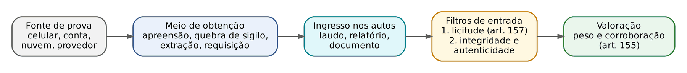
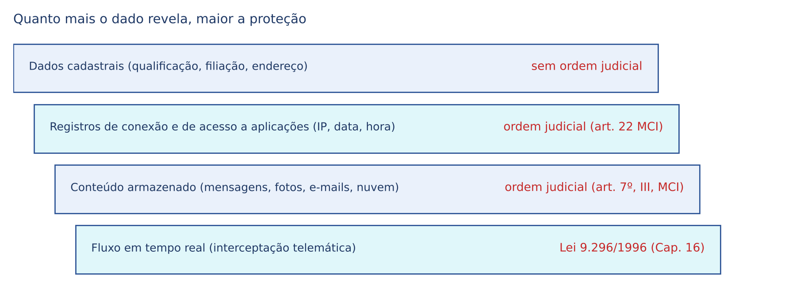
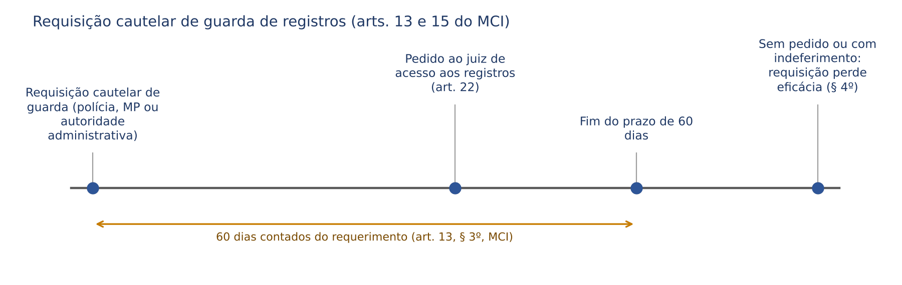
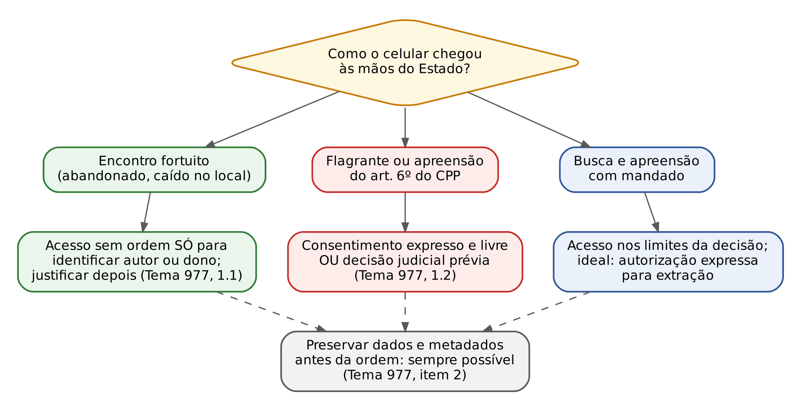
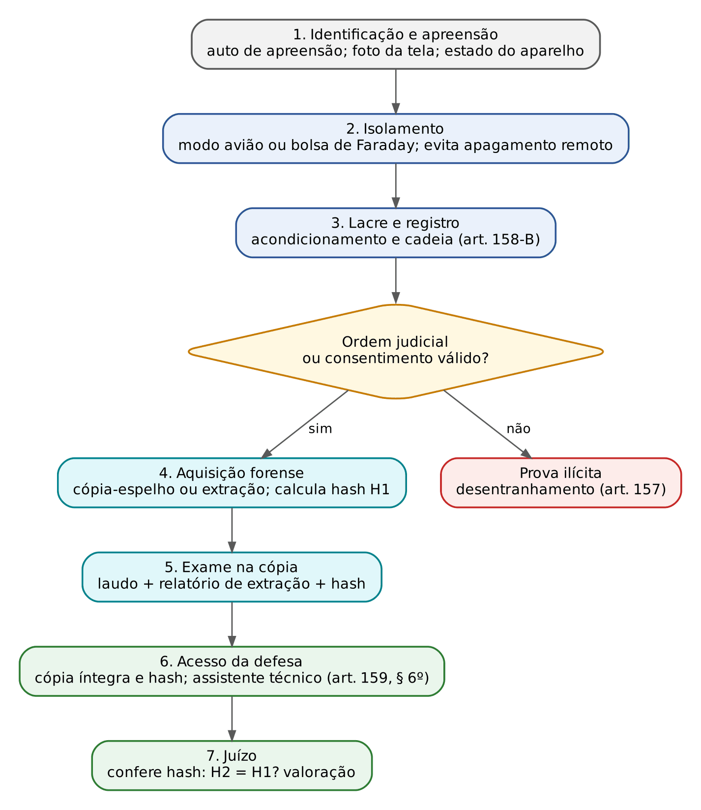

# CAPÍTULO 17 — PROVA DIGITAL: OBTENÇÃO, PRESERVAÇÃO, EXTRAÇÃO, DOCUMENTAÇÃO, AUTENTICIDADE, INTEGRIDADE E CADEIA DE CUSTÓDIA; DADOS ARMAZENADOS E DE TRÁFEGO, DISPOSITIVOS, PLATAFORMAS E NUVEM

:::INCIDENCIA
TRF5 p. 10; TJRS p. 6. Nível A. Lote: 5 questões (FGV 4, FCC 1), mais correlatas de outros capítulos.
O que mais cai: acesso a dados de celular apreendido (Tema 977 do STF), espelhamento do WhatsApp Web, *prints* de conversas e cadeia de custódia digital (cópia-espelho e *hash*).
:::

## 17.1 O que é prova digital e por que ela pede regras próprias

### 17.1.1 Conceito

Prova digital é toda informação com valor probatório que é produzida, armazenada ou transmitida em meio eletrônico e que só pode ser lida com o auxílio de um equipamento e de um programa (*software*). Entram no conceito tanto os dados que já nasceram digitais (uma mensagem de aplicativo, um registro de acesso, um arquivo de áudio gravado no celular) quanto os que nasceram analógicos e foram digitalizados depois (a foto de um contrato em papel, o PDF de um documento escaneado). A FGV cobrou exatamente essa amplitude: é falsa a afirmação de que os elementos originalmente analógicos e posteriormente digitalizados ficam fora do conceito (Q3179528, alternativa A; ver o box em 17.6.3).

O CPP não tem um capítulo sobre prova digital. O regime é montado por peças: Constituição (art. 5º, X, XII e LXXIX, este incluído pela EC 115/2022, que constitucionalizou a proteção de dados pessoais), CPP (busca e apreensão, perícias, documentos e cadeia de custódia dos arts. 158-A a 158-F), Lei 9.296/1996 (interceptação do fluxo telemático), Lei 12.965/2014 (Marco Civil da Internet, MCI), Convenção de Budapeste sobre o Crime Cibernético (promulgada pelo Decreto 11.491/2023) e, sobretudo, jurisprudência do STF e do STJ, que neste tema muda a cada semestre.

### 17.1.2 As características que explicam todas as regras

Quem vem do processo civil tende a tratar um *print* de conversa como trata um documento: junta-se, a outra parte impugna, e o juiz decide. No processo penal a lógica é mais exigente, e a razão está nas características do dado digital. Entendidas estas cinco características, as regras dos tópicos seguintes ficam quase intuitivas.

| Característica | O que significa | Consequência jurídica |
|---|---|---|
| Imaterialidade | O dado não é o aparelho; é uma sequência de bits que pode estar no celular, na nuvem e no servidor do provedor ao mesmo tempo | Apreender o objeto físico não é o mesmo que acessar o conteúdo (Tema 977, 17.4) |
| Volatilidade | O dado pode desaparecer por apagamento remoto, sincronização, mensagens temporárias, fim do prazo de guarda do provedor | Justifica medidas de preservação imediatas, antes mesmo da ordem de acesso (17.3.2 e 17.4) |
| Fragilidade (alterabilidade imperceptível) | Ligar o aparelho, abrir um arquivo ou receber nova mensagem altera dados e metadados sem deixar marca visível | Exige método forense e documentação de cada passo (cadeia de custódia, 17.6) |
| Replicabilidade | É possível gerar uma cópia bit a bit idêntica ao original, e provar matematicamente essa identidade (*hash*) | A perícia trabalha na cópia; o original fica lacrado; a defesa pode refazer o exame |
| Dependência de intermediários técnicos e volume | O conteúdo só é lido por programa, e um celular guarda anos de vida privada, inclusive de terceiros | Exige decisão judicial delimitada e veda a devassa genérica (*fishing expedition*) |

:::ATENCAO
A intuição civilista engana em dois pontos. Primeiro, no CPC o documento particular cuja autenticidade não é impugnada se presume verdadeiro, e o ônus de provar a falsidade é de quem a alega (arts. 411, III, e 429 do CPC). No processo penal, quando o Estado apresenta uma prova digital, cabe a ELE demonstrar a integridade e a confiabilidade do material; não se presume a veracidade da versão estatal quando os procedimentos de preservação foram descumpridos (STJ, AgRg no RHC 143.169, 17.6.4). Segundo, o próprio CPC já desconfia do dado digital: fotografia digital ou extraída da internet, se impugnada, exige a autenticação eletrônica ou, não sendo possível, perícia (art. 422, § 1º, do CPC). O processo penal leva essa desconfiança mais longe, porque o que está em jogo é a liberdade.
:::

### 17.1.3 Onde a prova digital se encaixa na teoria geral

A distinção entre fonte de prova, meio de obtenção de prova e meio de prova (desenvolvida no Cap. 14) organiza o assunto. A prova digital não é um novo meio de prova típico: o dado é a FONTE; ele chega ao Estado por um MEIO DE OBTENÇÃO (apreensão do aparelho, quebra de sigilo de dados, requisição a provedor, interceptação, consentimento do titular) e entra nos autos por um MEIO DE PROVA conhecido (documento, laudo pericial, testemunho de quem participou da conversa). Por isso o controle tem duas camadas sucessivas: a licitude da obtenção e a confiabilidade técnica do material. Só o que passa pelas duas chega à valoração.

:::DICA
Para resolver qualquer questão de prova digital, faça três perguntas, nesta ordem: (1) QUE TIPO de dado é (cadastral, registro, conteúdo armazenado, fluxo em tempo real)? Isso define o regime e se é preciso ordem judicial (17.2). (2) COMO o Estado chegou a ele (encontro fortuito, flagrante, mandado, consentimento, provedor)? Isso define a licitude (17.3 a 17.5). (3) COMO foi preservado e documentado? Isso define a integridade e a admissibilidade técnica (17.6 e 17.7).
:::

## 17.2 Classificação dos dados: o tipo de dado define o regime

### 17.2.1 Dado armazenado (estático) x dado em fluxo (dinâmico)

A distinção mais importante do capítulo vem da leitura que o STF consolidou do art. 5º, XII, da CF: a Constituição protege com reserva qualificada a COMUNICAÇÃO em curso (o fluxo), e não os dados em si, que são protegidos pela intimidade e pela vida privada (art. 5º, X) e pela proteção de dados (art. 5º, LXXIX). Daí dois regimes:

- Dado em fluxo (dinâmico, "em trânsito"): é a comunicação que está acontecendo, captada no momento da transmissão. Captá-la é INTERCEPTAÇÃO telemática, que segue a Lei 9.296/1996 (art. 1º, parágrafo único): ordem judicial, crime punido com reclusão, indícios razoáveis, subsidiariedade, prazo de 15 dias renovável (ver Cap. 16).
- Dado armazenado (estático): é o que já foi transmitido e ficou guardado em algum lugar (a conversa antiga no celular, o e-mail na caixa de entrada, o backup na nuvem). Acessá-lo é QUEBRA DE SIGILO DE DADOS: exige ordem judicial fundamentada (art. 7º, III, e art. 10, § 2º, do MCI), mas NÃO se submete aos requisitos específicos da Lei 9.296 (rol de crimes de reclusão, prazo de 15 dias).

O STJ aplicou essa distinção à nuvem: a obtenção de mensagens já entregues aos destinatários e armazenadas em nuvem é acesso a dados estáticos, distinto da interceptação do fluxo, e não se sujeita às exigências da interceptação telefônica (Sexta Turma, processo em segredo de justiça, Rel. Min. Og Fernandes, j. 17/6/2026, Informativo 902). Pelo mesmo motivo, a decisão que autoriza o acesso a dados armazenados não precisa fixar uma janela temporal específica, ao contrário do que ocorre com os registros de conexão (Jurisprudência em Teses do STJ, ed. 279, tese 5, e ed. 281, teses 5 e 8; ver 17.3.2).

:::EXEMPLO
A é investigado por tráfico. (a) A polícia quer ler, a partir de hoje, as mensagens que A trocar nos próximos 15 dias: interceptação telemática, Lei 9.296 (Cap. 16). (b) A polícia quer as mensagens que A trocou no último ano e que estão no backup do aplicativo em nuvem: quebra de sigilo de dados armazenados, ordem judicial fundamentada, sem os requisitos específicos da Lei 9.296. (c) A polícia quer saber qual IP acessou a conta de A em 10/3/2026, às 14h: registro de acesso a aplicação, ordem judicial com os requisitos do art. 22 do MCI. (d) A polícia quer o nome e o endereço do titular da linha de A: dado cadastral, requisição direta, sem ordem judicial.
:::

### 17.2.2 Conteúdo, metadados, registros e dados cadastrais

Dentro dos dados armazenados há graus de sensibilidade, e a proteção cresce conforme o dado revela mais da vida privada.

| Tipo de dado | O que é (exemplo) | Quem guarda e por quanto tempo | Exige ordem judicial? | Fundamento |
|---|---|---|---|---|
| Dados cadastrais | Qualificação pessoal, filiação e endereço do usuário ou titular da linha | Operadoras, provedores, instituições financeiras | NÃO: requisição direta do delegado ou do MP | Art. 10, § 3º, do MCI; art. 15 da Lei 12.850/2013; art. 17-B da Lei 9.613/1998 |
| Registros de conexão | Data e hora de início e término da conexão, duração e IP usado (art. 5º, VI, do MCI) | Provedor de conexão (administrador de sistema autônomo): 1 ano | SIM | Arts. 10, § 1º, 13 e 22 do MCI |
| Registros de acesso a aplicações | Data e hora de uso de determinada aplicação a partir de determinado IP (art. 5º, VIII, do MCI) | Provedor de aplicação pessoa jurídica com fins econômicos: 6 meses | SIM | Arts. 10, § 1º, 15 e 22 do MCI |
| Metadados e dados de tráfego | Quem falou com quem, quando, por quanto tempo, de onde; dados de localização (ERB, GPS) | Operadoras e provedores; o próprio aparelho | SIM (dados de localização têm regra própria nos arts. 13-A e 13-B do CPP: ver Cap. 16) | Art. 5º, X, XII e LXXIX, da CF; Convenção de Budapeste, art. 1º, "d" |
| Conteúdo armazenado | Texto das mensagens, fotos, áudios, e-mails, arquivos na nuvem | Aparelho, nuvem, servidores do provedor | SIM | Arts. 7º, III, e 10, § 2º, do MCI |
| Conteúdo em fluxo | A comunicação no momento em que trafega | Ninguém guarda: é captada em tempo real | SIM, com os requisitos da Lei 9.296 | Art. 5º, XII, da CF; Lei 9.296/1996 (Cap. 16) |

A Convenção de Budapeste define "dados de tráfego" como os dados informáticos relativos a uma comunicação, gerados pelo sistema que dela participou, indicando origem, destino, trajeto, hora, data, tamanho, duração ou tipo de serviço. Na terminologia brasileira, correspondem aos metadados de comunicação e aos registros do MCI.

Sobre os dados cadastrais, o STJ firmou que eles têm caráter objetivo e que o acesso direto pelos órgãos de investigação, sem prévia autorização judicial, não viola a intimidade (Jurisprudência em Teses, ed. 281, tese 6). A FGV explora o limite: o acesso direto alcança só qualificação, filiação e endereço; o que for além disso (registros, localização, conteúdo) volta para a reserva de jurisdição. No mesmo sentido, a FGV considerou lícita a obtenção, junto à operadora e sem ordem judicial, da identificação e do endereço do usuário de uma linha (Q3996837, TRF2 2026, box em 18.6.8). Sobre o rol do art. 15 da Lei 12.850 e os prazos de guarda dos arts. 16 e 17 dessa lei (5 anos, e não 3, como dizia a afirmação falsa da Q3865770), ver Caps. 5 e 26.

:::LEI Lei 12.965/2014 (Marco Civil da Internet), art. 7º, II e III, e art. 10, §§ 1º a 3º
Art. 7º [...] II - inviolabilidade e sigilo do fluxo de suas comunicações pela internet, salvo por ordem judicial, na forma da lei; III - inviolabilidade e sigilo de suas comunicações privadas armazenadas, salvo por ordem judicial;
Art. 10 [...] § 1º O provedor responsável pela guarda somente será obrigado a disponibilizar os registros mencionados no caput, de forma autônoma ou associados a dados pessoais ou a outras informações que possam contribuir para a identificação do usuário ou do terminal, mediante ordem judicial, na forma do disposto na Seção IV deste Capítulo, respeitado o disposto no art. 7º.
§ 2º O conteúdo das comunicações privadas somente poderá ser disponibilizado mediante ordem judicial, nas hipóteses e na forma que a lei estabelecer, respeitado o disposto nos incisos II e III do art. 7º.
§ 3º O disposto no caput não impede o acesso aos dados cadastrais que informem qualificação pessoal, filiação e endereço, na forma da lei, pelas autoridades administrativas que detenham competência legal para a sua requisição.
:::

:::PEGADINHA
"Mensagens antigas guardadas no celular ou na nuvem só podem ser obtidas por interceptação, nos termos da Lei 9.296/1996": ERRADO. Interceptação é captação do fluxo. Conteúdo armazenado se obtém por quebra de sigilo de dados (ordem judicial fundamentada), sem rol de crimes nem prazo de 15 dias. A FGV usa essa confusão como distrator recorrente (ver Q4378281, alternativa E, em 17.5).
:::

:::NOTA
A LGPD (Lei 13.709/2018) não se aplica ao tratamento de dados para fins exclusivos de segurança pública, defesa nacional, segurança do Estado ou investigação e repressão de infrações penais (art. 4º, III, "a" e "d"; Jurisprudência em Teses do STJ, ed. 279, tese 10). O tratamento de dados na persecução penal depende de lei específica, ainda não editada; até lá, valem a Constituição, o CPP, o MCI e a jurisprudência.
:::

## 17.3 Fontes da prova digital: dispositivos, plataformas, provedores e nuvem

### 17.3.1 Quem guarda o dado

O mesmo fato pode deixar rastros em quatro lugares, e cada um tem uma via própria de obtenção:

| Fonte | Exemplos | Via de obtenção típica |
|---|---|---|
| Dispositivo físico | Celular, notebook, HD externo, pendrive, chip (SIM card), câmera, relógio inteligente | Apreensão (flagrante, art. 6º do CPP ou mandado) e acesso por consentimento ou decisão judicial; extração forense (17.4 e 17.6) |
| Provedor de conexão | Operadora de telefonia ou internet | Registros de conexão: ordem judicial (art. 22 do MCI); dados cadastrais: requisição direta |
| Provedor de aplicação e plataforma | Aplicativo de mensagens, rede social, e-mail, marketplace, banco digital | Registros de acesso, dados de conta e conteúdo armazenado: ordem judicial; ordem de preservação (17.3.2) |
| Nuvem | Backup do aparelho, armazenamento de arquivos, caixa de e-mail hospedada | Ordem judicial dirigida ao provedor; se no exterior, ver 17.3.3 |
| Fonte aberta | Perfil público em rede social, site, publicação aberta | Coleta direta, sem ordem, desde que sem artifício para burlar barreiras de privacidade (ronda virtual e infiltração: Caps. 5 e 16) |

Dois detalhes já cobrados em julgados recentes: o chip da operadora não é parte integrante do aparelho e constitui fonte independente de prova, não sendo atingido pela nulidade da cadeia de custódia declarada em relação à extração dos dados do celular (STJ, Terceira Seção, AgRg na Rcl 48.657-RS, j. 16/6/2026, Informativo 897); e a decisão que autoriza a quebra de sigilo de dados armazenados não precisa de limitação temporal específica (17.2.1), ao passo que a quebra de registros de conexão precisa (17.3.2).

### 17.3.2 Provedores no Brasil: guarda, preservação e fornecimento

O MCI separa três atos que o candidato costuma confundir: GUARDAR, PRESERVAR por prazo maior e FORNECER.

- Guarda obrigatória: o provedor de conexão guarda os registros de conexão por 1 ano (art. 13); o provedor de aplicação constituído como pessoa jurídica com fins econômicos guarda os registros de acesso a aplicações por 6 meses (art. 15). Provedores de aplicação fora desse perfil podem ser obrigados por ordem judicial a guardar registros de fatos específicos em período determinado (art. 15, § 1º).
- Preservação cautelar (requisição de guarda por prazo superior): a autoridade policial ou administrativa ou o Ministério Público pode, SEM ordem judicial, requerer cautelarmente que os registros sejam guardados por prazo superior ao legal (arts. 13, § 2º, e 15, § 2º). Em contrapartida, tem 60 dias, contados do requerimento, para ingressar com o pedido de autorização judicial de acesso; se não pedir no prazo, ou se o pedido for indeferido, a requisição perde a eficácia (art. 13, §§ 3º e 4º). O provedor guarda sigilo sobre o requerimento.
- Fornecimento: em qualquer hipótese, a disponibilização dos registros ao requerente depende de autorização judicial (arts. 13, § 5º, e 15, § 3º), requerida na forma do art. 22.

:::LEI Lei 12.965/2014, art. 13, §§ 2º a 5º, e art. 22
Art. 13 [...] § 2º A autoridade policial ou administrativa ou o Ministério Público poderá requerer cautelarmente que os registros de conexão sejam guardados por prazo superior ao previsto no caput.
§ 3º Na hipótese do § 2º, a autoridade requerente terá o prazo de 60 (sessenta) dias, contados a partir do requerimento, para ingressar com o pedido de autorização judicial de acesso aos registros previstos no caput.
§ 4º O provedor responsável pela guarda dos registros deverá manter sigilo em relação ao requerimento previsto no § 2º, que perderá sua eficácia caso o pedido de autorização judicial seja indeferido ou não tenha sido protocolado no prazo previsto no § 3º.
§ 5º Em qualquer hipótese, a disponibilização ao requerente dos registros de que trata este artigo deverá ser precedida de autorização judicial, conforme disposto na Seção IV deste Capítulo.
Art. 22. A parte interessada poderá, com o propósito de formar conjunto probatório em processo judicial cível ou penal, em caráter incidental ou autônomo, requerer ao juiz que ordene ao responsável pela guarda o fornecimento de registros de conexão ou de registros de acesso a aplicações de internet.
Parágrafo único. Sem prejuízo dos demais requisitos legais, o requerimento deverá conter, sob pena de inadmissibilidade: I - fundados indícios da ocorrência do ilícito; II - justificativa motivada da utilidade dos registros solicitados para fins de investigação ou instrução probatória; e III - período ao qual se referem os registros.
:::

O STJ lê os três requisitos do art. 22 como roteiro de controle da decisão: ela é válida quando aponta fundados indícios, justifica a utilidade dos registros e delimita o período (Jurisprudência em Teses, ed. 281, tese 5); e a quebra fundamentada e temporalmente delimitada é proporcional para identificar o autor de crimes praticados com conta ou linha clonada (tese 8).

:::JURIS STF, HC 222.141 AgR, Segunda Turma, j. 6/2/2024 (Informativo 1.123)
A exceção do art. 13, § 2º, e do art. 15, § 2º, do MCI é estreita: autoriza o MP e a polícia a pedir a GUARDA de REGISTROS (data, hora, IP), não o congelamento de CONTEÚDO. No caso, o MP oficiou diretamente a provedores, sem ordem judicial, para preservar conteúdo de e-mails, fotos, contatos, histórico de localização e pesquisas de contas de investigados. A Turma, por maioria, declarou nulas as provas obtidas a partir dos dados assim preservados, porque a preservação de conteúdo restringe a autodeterminação informativa e exige prévia decisão judicial. Contraste com o Tema 977 (17.4): lá, a preservação dos dados contidos em CELULAR JÁ APREENDIDO pode ser feita pela polícia antes da ordem judicial.
:::

### 17.3.3 Geolocalização reversa e quebras por área ou por palavra-chave

Uma técnica nova gera questões de proporcionalidade: em vez de pedir os dados de um suspeito conhecido, a investigação pede ao provedor a lista de todos os aparelhos que estiveram numa área, num intervalo de tempo (a chamada cerca geográfica, ou *geofence*), ou de todos os usuários que pesquisaram determinados termos. O problema é que a ordem alcança pessoas indeterminadas, sem relação com o fato.

- O STJ admite a quebra de dados estáticos de usuários que operaram em determinada área e período, desde que haja fundamentação suficiente (Jurisprudência em Teses, ed. 281, tese 9, com base, entre outros, no RMS 62.143, Terceira Seção, DJe 8/9/2020), mas também registra julgados que a negam quando houver possibilidade de violar a intimidade de pessoas não diretamente relacionadas à investigação (tese 10). A chave para a prova é a delimitação: área pequena, janela curta, crime grave, impossibilidade de outro meio e descarte dos dados de terceiros.
- No STF, o Tema 1.148 da repercussão geral (RE 1.301.250, quebra genérica de dados de usuários não identificados, inclusive por palavras-chave de pesquisa) teve julgamento iniciado e, na última posição conferida (setembro de 2025), havia maioria parcial pela validade com restrições (crimes graves, ordem judicial, limites temporal e temático, descarte de dados de terceiros). Não foi possível confirmar a conclusão nem a tese: confira antes da prova (nota de verificação).

### 17.3.4 Dados no exterior: MLAT, requisição direta e ADC 51

Grande parte dos dados de brasileiros fica em servidores de empresas estrangeiras. Há dois caminhos para obtê-los: a cooperação jurídica internacional (o acordo de assistência mútua com os Estados Unidos, o MLAT, promulgado pelo Decreto 3.810/2001, e as cartas rogatórias; ver Cap. 32) e a requisição direta, por ordem judicial brasileira, à empresa que atua no Brasil.

O art. 11 do MCI manda aplicar a lei brasileira a qualquer operação de coleta, armazenamento, guarda ou tratamento de registros, dados pessoais ou comunicações em que pelo menos um desses atos ocorra no território nacional, inclusive quando a atividade é realizada por pessoa jurídica sediada no exterior que oferte serviço ao público brasileiro ou tenha integrante do grupo econômico com estabelecimento no Brasil (§§ 1º e 2º).

:::JURIS STF, ADC 51, Plenário, Rel. Min. Gilmar Mendes, j. 23/2/2023
O STF declarou constitucionais o MLAT, as normas do CPC e do CPP sobre cooperação e cartas rogatórias e o art. 11 do MCI. Resultado prático: o MLAT é um caminho legítimo, mas NÃO é o único. A autoridade judicial brasileira pode requisitar dados diretamente a provedores que tenham representação ou atuação no Brasil, quando a coleta ou o tratamento ocorrer no território nacional ou o crime for praticado por pessoa localizada no Brasil, com respaldo também no art. 18 da Convenção de Budapeste (ordem de produção dirigida a quem presta serviço no território). A empresa não pode recusar o cumprimento sob o argumento de que os dados estão armazenados no exterior e só seriam acessíveis via MLAT. A cooperação continua necessária quando a requisição direta não for viável.
:::

A Convenção de Budapeste (Decreto 11.491/2023) também prevê instrumentos que a prova pode citar: conservação expedita de dados armazenados e de dados de tráfego (arts. 16 e 17), ordem de produção (art. 18), busca e apreensão de dados informáticos (art. 19), recolha em tempo real de dados de tráfego e interceptação de conteúdo (arts. 20 e 21), conservação expedita a pedido de outro Estado (art. 29) e acesso transfronteiriço a dados abertos ao público ou com consentimento de quem tem autoridade legal para divulgá-los (art. 32). Detalhes da cooperação: Cap. 32.

### 17.3.5 Quem decide e por provocação de quem

Na fase de investigação, decidir sobre afastamento do sigilo de dados, interceptação do fluxo telemático, busca e apreensão e acesso a informações sigilosas é competência do juiz das garantias (art. 3º-B, XI, do CPP; implantação e alcance no Cap. 3). E a decisão depende de provocação: viola o sistema acusatório a atuação de ofício do juiz, na fase investigativa, para deferir busca domiciliar e quebra de sigilo telemático sem requerimento dos órgãos de persecução (STJ, Sexta Turma, processo em segredo de justiça, j. 21/10/2025, Informativo 868; teoria em Cap. 1). Contra a decisão que defere ou indefere a quebra não há recurso específico: a defesa usa o *habeas corpus* (Cap. 30) e a acusação, o mandado de segurança ou a reiteração fundamentada do pedido.

## 17.4 Obtenção I: o celular apreendido e o Tema 977 do STF

### 17.4.1 Apreender não é acessar

O celular é, ao mesmo tempo, um objeto físico e um arquivo da vida inteira do titular: conversas, fotos, localização, saúde, finanças, contatos de terceiros. Por isso a jurisprudência separa dois atos. APREENDER o aparelho é medida comum, que dispensa ordem judicial quando ocorre em flagrante, no local do crime (art. 6º, II, do CPP) ou incidentalmente a uma busca válida. ACESSAR o conteúdo é outra coisa: é ingresso na intimidade e nos dados, protegidos pelo art. 5º, X, XII e LXXIX, da CF.

A evolução é curta e cobrável. O STF chegou a validar, em 2012, a consulta ao registro de chamadas de celular apreendido em flagrante, por entender que registro não é comunicação (HC 91.867, Segunda Turma, Rel. Min. Gilmar Mendes). O STJ, quando os aparelhos passaram a guardar conversas inteiras, firmou que é ilícito o acesso policial, sem autorização judicial, às mensagens de aplicativo de celular apreendido no flagrante (RHC 51.531-RO, Sexta Turma, Rel. Min. Nefi Cordeiro, j. 19/4/2016, Informativo 583), entendimento consolidado na Jurisprudência em Teses (ed. 279, tese 3: ilícito o acesso direto pela polícia, ressalvada a voluntariedade do detentor). Em 2025, o STF uniformizou a matéria em repercussão geral.

:::JURIS STF, Tema 977 da repercussão geral (ARE 1.042.075-RJ, Plenário, Rel. Min. Dias Toffoli, j. 25/6/2025, Informativo 1.184)
Tese, em paráfrase fiel por itens:
1. A mera apreensão do celular, nos termos do art. 6º do CPP ou em flagrante delito, NÃO está sujeita à reserva de jurisdição. O acesso aos dados, porém, observa as condicionantes seguintes.
1.1. Encontro fortuito do aparelho: o acesso aos dados para o fim EXCLUSIVO de esclarecer a autoria do fato supostamente criminoso, ou de identificar o proprietário, não depende de consentimento nem de prévia decisão judicial, desde que a medida seja justificada posteriormente.
1.2. Celular apreendido na forma do art. 6º do CPP ou por ocasião da prisão em flagrante: o acesso fica condicionado ao consentimento expresso e livre do titular dos dados OU a prévia decisão judicial que justifique, com base em elementos concretos, a proporcionalidade da medida e delimite sua abrangência à luz da intimidade, da privacidade, da proteção de dados pessoais e da autodeterminação informacional. Nesses casos, a polícia deve agir com rapidez e o Judiciário deve apreciar os pedidos com prioridade, inclusive em plantão.
2. A autoridade policial pode adotar as providências necessárias para PRESERVAR os dados e metadados do aparelho apreendido antes da autorização judicial, justificando depois as razões do acesso.
3. Efeitos prospectivos: as teses valem a partir do julgamento, ressalvados os pedidos formulados pelas defesas até a data do seu encerramento.
Caso concreto: um assaltante fugiu e deixou o celular cair no local; a polícia examinou o aparelho e identificou o autor. O TJRJ anulou a condenação por ilicitude da prova; o STF restabeleceu-a.
:::

### 17.4.2 As situações, uma a uma

| Situação | Pode acessar sem ordem? | Observação |
|---|---|---|
| Celular encontrado fortuitamente no local do crime (caído, abandonado) | SIM, só para identificar autor ou dono, com justificação posterior | Tema 977, item 1.1. Ir além disso (vasculhar a vida do titular, buscar outros crimes) exige ordem |
| Celular desbloqueado abandonado voluntariamente por pessoa não identificada | SIM | Sem expectativa legítima de privacidade (STJ, Quinta Turma, AgRg no REsp 2.180.196-PR, Rel. Min. Messod Azulay Neto, publicado em 17/12/2025) |
| Celular achado em estabelecimento prisional | Acesso inicial às notificações e dados aparentes, SIM, com justificação e controle judicial posteriores; extração integral, com supervisão judicial | A posse é falta grave (art. 50, VII, da LEP) e o ingresso do aparelho é crime (art. 349-A do CP), o que mitiga a expectativa de privacidade (STJ, Sexta Turma, AgRg no AREsp 3.208.338-RS, j. 16/6/2026; Quinta Turma, REsp 2.235.157-RS, j. 4/3/2026, Informativo 883) |
| Celular apreendido em flagrante ou na forma do art. 6º do CPP | NÃO: consentimento expresso e livre ou decisão judicial prévia | Tema 977, item 1.2. Preservar dados (modo avião, bolsa de Faraday, cópia sem análise) é permitido antes da ordem (item 2) |
| Celular apreendido em cumprimento de mandado de busca e apreensão | Nos limites da decisão | O STJ admite verificação e coleta preliminar de dados pelo policial durante o cumprimento do mandado, sem perito oficial, porque a apreensão determinada pelo juiz pressupõe o acesso (Corte Especial, Inq 1.674-DF, Rel. Min. Nancy Andrighi, j. 6/5/2026, Informativo 891). Boa prática: pedir e deferir expressamente a extração |
| Vítima ou interlocutor entrega o próprio celular e mostra as mensagens que recebeu | SIM | Consentimento de quem é titular daqueles dados (participante da conversa). Problema aqui não é licitude, é integridade (17.7) |

:::PEGADINHA
"A mera apreensão de celular está sujeita a reserva de jurisdição": ERRADO (item 1 do Tema 977). E também: "a polícia não pode adotar providências para preservar dados e metadados antes da autorização judicial": ERRADO (item 2). "O Judiciário tem 90 dias para decidir, sob pena de indeferimento automático": invenção; a tese só fala em celeridade e tramitação prioritária, inclusive em plantão.
:::

:::QUESTAO FCC 2026 — DPE-MT — Defensor Público (Q3954638)
O que se pergunta: qual afirmação está de acordo com o STF sobre o acesso, no inquérito, a dados de celular. Gabarito oficial: B, a que reproduz o item 1.1 do Tema 977 (encontro fortuito: acesso para esclarecer autoria ou propriedade sem consentimento ou decisão prévia, com justificação posterior). Erros das demais: A afirma que a mera apreensão se sujeita à reserva de jurisdição (é o oposto do item 1); C estende ao celular apreendido em flagrante a regra do encontro fortuito (no flagrante exige-se consentimento ou decisão prévia, item 1.2); D nega à polícia a preservação de dados antes da ordem (contraria o item 2); E inventa um prazo de 90 dias com indeferimento automático. No mesmo sentido, a FGV, no ENAM 2025.2 (Q3692359), considerou correta a afirmação que transcrevia o item 1.2.
:::

### 17.4.3 Consentimento: quando vale

O consentimento do titular é alternativa à ordem judicial, mas a jurisprudência o examina com lupa, pela mesma razão que examina o consentimento para ingresso em domicílio (Cap. 15): o investigado preso, cercado por policiais, raramente consente de modo livre. Três parâmetros:

- Deve ser EXPRESSO e LIVRE, do TITULAR dos dados (Tema 977, item 1.2). Silêncio, entrega do aparelho desbloqueado sob abordagem ou consentimento de terceiro não bastam por si.
- O ônus de provar a voluntariedade é do Estado; a boa prática é registrar o consentimento por escrito e, se possível, em áudio e vídeo.
- O consentimento não sana ilicitude anterior: se o flagrante foi ilícito, o consentimento posterior do investigado (ou mesmo a autorização judicial posterior) não afasta a contaminação quando há nexo causal com o ato ilícito e não existe fonte independente (STJ, Quinta Turma, AgRg no HC 1.041.047-GO, j. 22/4/2026, Informativo 891; teoria da prova derivada no Cap. 14).

Sobre a senha: o investigado não é obrigado a fornecê-la nem a desbloquear o aparelho com biometria, em razão do direito de não produzir prova contra si (*nemo tenetur se detegere*), e a recusa não pode ser valorada contra ele. A investigação pode, com ordem judicial, valer-se de técnica forense para contornar o bloqueio. (Ponto firmado na doutrina; não localizei tese vinculante específica: ver nota.)

A FGV aplicou o item 1.1 a celular deixado no chão por suspeitos em fuga e acessado só para identificar a linha: flagrante válido, sem exigência de ordem judicial para o acesso nem para os dados cadastrais (TRF2 2026, Q3996837, gabarito E; box em 18.6.8). A alternativa sedutora era a que vedava o acesso sem prévia autorização judicial.

### 17.4.4 A decisão judicial que autoriza o acesso

O Tema 977 exige uma decisão que (i) aponte elementos concretos que justifiquem a proporcionalidade e (ii) DELIMITE a abrangência. Na prática, uma boa decisão indica: o aparelho (marca, IMEI, auto de apreensão), o objeto (conversas, mídias, agenda, localização, contas em nuvem sincronizadas), a finalidade ligada ao fato investigado, a forma (extração forense com cálculo de *hash*, 17.6) e as cautelas com dados de terceiros e dados sensíveis. O STJ entende que a decisão que autoriza a quebra de dados ARMAZENADOS não precisa fixar recorte temporal (Jurisprudência em Teses, ed. 279, tese 5); a delimitação exigida pelo STF pode ser feita por objeto e finalidade. A divergência é sutil e pode aparecer em prova discursiva: o candidato prudente fundamenta a decisão com algum recorte, temporal ou temático, sempre que o caso permitir.

:::SENTENCA Preliminar de ilicitude do acesso ao celular
Onde entra: nas preliminares da sentença (antes do mérito), ou na decisão que analisa pedido de desentranhamento. O que fundamentar: como o aparelho chegou ao Estado (encontro fortuito, flagrante, mandado); se houve consentimento expresso e livre, documentado, ou decisão judicial prévia; se o acesso ficou nos limites da finalidade; data dos fatos (item 3: efeitos prospectivos do Tema 977, aplicando-se aos fatos anteriores a jurisprudência então vigente, que já exigia ordem judicial para o celular apreendido em flagrante); e, se houver ilicitude, o que é derivado e o que tem fonte independente.
Redação-modelo: "O aparelho foi apreendido no flagrante e seu conteúdo acessado pelos policiais ainda na abordagem, sem consentimento expresso documentado e sem prévia decisão judicial, em contrariedade ao item 1.2 do Tema 977 do STF; declaro ilícitas as capturas de tela juntadas ao auto de prisão e determino seu desentranhamento (art. 157 do CPP), preservada a extração realizada posteriormente com autorização judicial, que constitui fonte independente (art. 157, § 2º)."
Erro que a banca pune: anular a APREENSÃO do aparelho (que é lícita) quando o vício está no ACESSO, ou anular todo o processo sem verificar fonte independente.
:::

O exemplo da redação-modelo reproduz um julgado: embora ilícitas as capturas de tela de conversas obtidas pela polícia sem consentimento ou ordem e inseridas em relatório de investigação, a posterior extração dos dados do aparelho com autorização judicial permite classificar a prova como de fonte independente (STJ, Sexta Turma, HC 1.035.054-SP, Rel. Min. Sebastião Reis Júnior, j. 18/11/2025, Informativo 873; Jurisprudência em Teses, ed. 279, tese 4). A banca pode explorar o ponto: a fonte só é independente se a extração autorizada não foi motivada pelo que se viu ilicitamente.

## 17.5 Obtenção II: espelhamento do WhatsApp Web e acesso em tempo real

### 17.5.1 O que é o espelhamento

O espelhamento consiste em conectar a conta de aplicativo de mensagens do investigado a outro computador, normalmente lendo o código QR com o celular apreendido (ou obtido por instantes), de modo que a polícia passa a ver, numa tela própria, tudo o que o investigado vê: as conversas antigas, as que acontecem enquanto a sessão está aberta e as futuras, até a desconexão. Três diferenças em relação aos institutos conhecidos explicam a desconfiança dos tribunais:

- Não é interceptação: não há captação do fluxo por terceiro na rede, com a mediação da operadora, mas acesso direto à conta, como se o policial fosse o usuário.
- Não é mera extração de dados armazenados: alcança comunicações FUTURAS, em tempo real.
- Permite AGIR: o espelhador pode enviar mensagens, apagar conversas e participar dos diálogos, e o aplicativo, por desenho, não deixa registro confiável dessas ações, o que fragiliza a integridade de tudo o que for colhido.

### 17.5.2 Sem autorização judicial: ilícito; com autorização: divergência

Sem autorização judicial específica, o espelhamento é ilícito por qualquer ângulo: é acesso a dados armazenados sem ordem e, além disso, captação de comunicações futuras sem ordem.

Com autorização judicial, as Turmas criminais do STJ divergem:

| Corrente | Julgados | Fundamento |
|---|---|---|
| Ilicitude mesmo com ordem judicial | Sexta Turma, RHC 99.735-SC, Rel. Min. Laurita Vaz, j. 27/11/2018 (Informativo 640) | Meio híbrido sem previsão legal; não cabe analogia com a interceptação, porque o espelhador pode enviar e apagar mensagens sem deixar vestígio; impossível assegurar a integridade |
| Validade com ordem judicial, como ação encoberta ou infiltração virtual | Quinta Turma, AREsp 2.309.888-MG, j. 17/10/2023 (Informativo 792) e AgRg no AREsp 2.318.334-MG, j. 16/4/2024 (Informativo 810), ambos Rel. Min. Reynaldo Soares da Fonseca | A criptografia de ponta a ponta inviabiliza a interceptação clássica; com ordem judicial fundamentada, proporcionalidade, subsidiariedade e controle, o espelhamento se aproxima da infiltração virtual (art. 10-A da Lei 12.850/2013; Cap. 16) |

A questão foi afetada ao rito dos repetitivos: Tema 1.382 do STJ ("definição da licitude da prova decorrente de quebra de sigilo telemático, por meio de espelhamento de aplicativo de transmissão de mensagens"; ProAfR no REsp 2.052.194-MG, Rel. Min. Rogerio Schietti Cruz, Terceira Seção, j. 9/9/2025, Informativo 863), ainda sem tese na última verificação.

:::QUESTAO FGV 2026 — PC-PR — Delegado de Polícia (Q4378281)
Caso: (i) celular apreendido sem autorização judicial específica é conectado ao WhatsApp Web, e a polícia passa a ver mensagens antigas e novas, inclusive recebidas após a apreensão; (ii) outro celular tem a memória periciada, após autorização judicial, para extrair mensagens já armazenadas. Gabarito: D, o espelhamento sem autorização judicial específica é inválido por permitir acesso contínuo a conversas passadas, presentes e futuras, e a perícia sobre dados estáticos já armazenados pode ser válida se autorizada judicialmente. Por que as outras falham: A trata as duas diligências como ilícitas, mas a segunda teve autorização; B diz que a apreensão autoriza acesso integral, inclusive a conversas futuras (contraria o Tema 977); C valida o espelhamento sem nova decisão só porque houve busca autorizada (a autorização de busca não abrange captação de comunicações futuras); E iguala perícia de dados estáticos e espelhamento como "interceptação telemática" (são regimes distintos: 17.2.1). Repare que a questão não exigiu tomar partido na divergência sobre espelhamento COM ordem.
:::

### 17.5.3 Quadro dos regimes

| | Extração de dados armazenados | Espelhamento de aplicativo | Interceptação telemática | Infiltração virtual |
|---|---|---|---|---|
| Objeto | Dados já existentes no aparelho ou na nuvem | Conta inteira: passado, presente e futuro | Fluxo de comunicações em tempo real | Interação do agente com investigados na internet |
| Base legal | Art. 5º, X e XII, da CF; art. 7º, III, do MCI; arts. 240 e 158-A do CPP | Sem previsão legal específica | Lei 9.296/1996 | Art. 10-A da Lei 12.850/2013; arts. 190-A a 190-E do ECA |
| Ordem judicial | Sim (salvo consentimento ou encontro fortuito, Tema 977) | Indispensável; licitude mesmo com ordem é controvertida (Tema 1.382 do STJ) | Sim, com rol de crimes, subsidiariedade e prazo | Sim, com prazos e requisitos próprios |
| Onde estudar | Este capítulo | Este capítulo | Cap. 16 | Cap. 16 |

## 17.6 Preservação, extração, documentação e cadeia de custódia digital

### 17.6.1 Os arts. 158-A a 158-F valem para o vestígio digital

A cadeia de custódia (arts. 158-A a 158-F do CPP, incluídos pela Lei 13.964/2019) é o conjunto de procedimentos para manter e documentar a história cronológica do vestígio, do reconhecimento ao descarte, de modo a rastrear sua posse e manuseio. A teoria geral, as dez etapas do art. 158-B e o debate sobre as consequências da quebra estão no Cap. 14. Aqui interessa o que é próprio do meio digital.

O ponto de partida é que a lei define vestígio como "todo objeto ou material bruto, visível ou latente, constatado ou recolhido, que se relaciona à infração penal" (art. 158-A, § 3º). O dado digital é vestígio LATENTE: existe, mas só se torna perceptível por meio técnico. Logo, a disciplina da cadeia de custódia se aplica integralmente à prova digital, e com rigor maior, porque o vestígio digital é mais frágil que o físico (17.1.2). A FGV cobrou exatamente essa premissa (Q3898933, box em 17.6.4).

### 17.6.2 Como se preserva e extrai: o vocabulário técnico mínimo

O juiz não precisa ser perito, mas precisa entender o laudo para controlá-lo. O vocabulário que aparece em provas e em laudos:

- Isolamento: o aparelho apreendido é colocado em modo avião ou numa bolsa de Faraday (invólucro que bloqueia sinais), para impedir apagamento remoto, recebimento de novas mensagens e sincronização que alterem o conteúdo. É providência de PRESERVAÇÃO, permitida antes da ordem judicial (Tema 977, item 2).
- Bloqueador de escrita (*write blocker*): dispositivo ou programa que permite ler um disco sem gravar nada nele, para que o próprio exame não altere a prova.
- Cópia-espelho (imagem forense): cópia bit a bit de toda a mídia, inclusive áreas apagadas e não alocadas. A análise é feita na cópia; o original fica lacrado e pode ser reexaminado.
- Extração de celular: por ferramentas forenses (o Cellebrite é a mais citada), em níveis diferentes: lógica (o que o sistema mostra), sistema de arquivos e física (cópia da memória). Gera um relatório de extração, que costuma acompanhar o laudo em mídia própria, com programa leitor.
- Função *hash*: algoritmo que transforma qualquer arquivo ou mídia numa sequência curta e única de caracteres, uma espécie de impressão digital do conteúdo. Se UM bit for alterado, o *hash* muda inteiramente. Por isso, calcular o *hash* no momento da aquisição e conferi-lo depois prova que o material não mudou (algoritmos usuais: família SHA-2, como o SHA-256; o MD5 é mais antigo e hoje é considerado fraco isoladamente).

:::EXEMPLO
O perito extrai o celular de B em 2/3/2026 e registra no laudo o *hash* da extração (ilustrativo: 9f2c...e71a). Em 10/9/2026, o assistente técnico da defesa recebe a mídia, recalcula o *hash* e obtém o mesmo valor: está demonstrado, matematicamente, que a mídia analisada pela defesa é idêntica à adquirida pelo perito (a chamada mesmidade). Se o valor fosse diferente, alguém alterou algo depois da aquisição, e a acusação teria de explicar o quê e por quê.
:::

A norma técnica de referência é a ABNT NBR ISO/IEC 27037 (diretrizes para identificação, coleta, aquisição e preservação de evidência digital), que trabalha com quatro atributos que o juiz pode usar como critério de controle: auditabilidade (um terceiro consegue verificar o que foi feito), repetibilidade (o mesmo examinador, com o mesmo método, chega ao mesmo resultado), reprodutibilidade (outro examinador, com outro instrumento, chega ao mesmo resultado) e justificabilidade (cada escolha técnica é explicável). Não é lei, mas é parâmetro técnico invocado pela jurisprudência e pelas bancas.

:::PROCESSO Etapas do art. 158-B aplicadas ao celular apreendido
| Etapa (art. 158-B) | No meio digital |
|---|---|
| Reconhecimento, isolamento e fixação (I a III) | Identificar o aparelho e seu estado (ligado, bloqueado, tela aberta); fotografar a tela; isolar de redes |
| Coleta e acondicionamento (IV e V) | Apreender com auto descritivo (marca, modelo, IMEI, chip); embalar em invólucro antiestático e lacrado, numerado |
| Transporte e recebimento (VI e VII) | Registrar quem levou, quando e para onde; central de custódia confere o lacre |
| Processamento (VIII) | Aquisição forense com cópia-espelho ou extração, cálculo e registro do *hash*, ferramenta e versão utilizadas |
| Armazenamento (IX) | Original lacrado na central de custódia; cópias de trabalho identificadas; após a perícia, o material volta à central (art. 158-F) |
| Descarte (X) | Por decisão judicial, preservada a possibilidade de contraprova enquanto pertinente |
:::

### 17.6.3 Documentar e disponibilizar à defesa

Documentar é registrar quem fez o quê, quando, com qual ferramenta e qual versão, e qual *hash* foi obtido em cada etapa. A documentação é o que permite o contraditório sobre a prova técnica: sem ela, a defesa não tem como verificar nada. Daí duas consequências práticas:

- A defesa tem direito de acesso à fonte íntegra (cópia da extração com o respectivo *hash*), não só aos trechos que a acusação selecionou, para que o assistente técnico possa refazer o exame. O CPP prevê que, havendo requerimento, o material probatório que serviu de base à perícia seja disponibilizado no órgão oficial, na presença de perito oficial, para exame pelos assistentes (art. 159, § 6º). O STJ declarou nulo laudo pericial baseado em mídias cujo conteúdo integral se tornou inacessível à defesa por falha de armazenamento ao longo da cadeia de custódia (Sexta Turma, RHC 218.358-PI, j. 4/11/2025, Informativo 870). Em sentido de limite, considerou não haver cerceamento quando o acesso dos advogados foi restrito aos elementos conectados à ação penal, colhidos na quebra de sigilo telemático da VÍTIMA (Sexta Turma, AgRg no RHC 143.762-PE, por maioria, j. 7/10/2025, Informativo 868): a restrição ali protegia dados de terceiro alheios ao processo.
- Nem todo o material precisa ser inserido no processo eletrônico: dados de terceiros e conteúdos íntimos sem relação com o fato devem ficar em mídia acautelada, acessível às partes, e não publicados nos autos (é o erro da alternativa D da questão abaixo).
- O perito pode ser ouvido em audiência para esclarecer a prova ou responder a quesitos, desde que o mandado de intimação e os quesitos sejam encaminhados com antecedência mínima de 10 dias, podendo responder em laudo complementar (art. 159, § 5º, I; FCC, Q4092727, correlata, gabarito B).

:::QUESTAO FGV 2025 — TRF3 — Juiz Federal Substituto (Q3179528)
O que se pergunta: afirmação correta sobre provas digitais. Gabarito: B, a preservação da cadeia de custódia das provas digitais visa garantir integridade e autenticidade, e uma de suas etapas consiste em realizar cópias-espelho e calcular o *hash*. Armadilhas: A exclui do conceito o material analógico digitalizado (o conceito o inclui, 17.1.1); C troca a finalidade (a cadeia de custódia não serve para tornar a informação inacessível a terceiros, mas para garantir mesmidade e rastreabilidade); D manda inserir TODO o material no sistema judicial eletrônico (desproporcional à privacidade de terceiros; basta a disponibilização às partes); E diz que a apreensão do equipamento dispensa cópia de segurança (é o contrário: trabalha-se na cópia para preservar o original).
:::

### 17.6.4 Consequências da falha: inadmissibilidade ou valoração?

Este é o ponto em que a jurisprudência do STJ está em movimento, e a prova pode cobrar qualquer das linhas. O debate geral (nulidade, inadmissibilidade ou questão de peso) é do Cap. 14; o que segue é a sua projeção no meio digital.

| Linha | Julgados | Ideia central |
|---|---|---|
| Inadmissibilidade quando falta qualquer método que garanta a integridade | Quinta Turma, AgRg no RHC 143.169-RJ, Rel. p/ acórdão Min. Ribeiro Dantas, j. 7/2/2023 (Informativo 763); Quinta Turma, AgRg no HC 828.054-RN, Rel. Min. Joel Ilan Paciornik, j. 23/4/2024 (Informativo 811) | Cabe ao Estado demonstrar integridade e confiabilidade; sem cópia-espelho, *hash* ou outra técnica auditável, não se presume a autenticidade e a prova é inadmissível. No HC 828.054, o perito, sem conseguir usar a ferramenta forense, fotografou as telas do celular: prova inadmissível |
| Integridade comprometida por corrupção de arquivos | Quinta Turma, processo em segredo de justiça, j. 10/12/2024 (Informativo 838) | A corrupção de parte dos arquivos compromete a integralidade e inviabiliza a utilização |
| Questão de eficácia (peso), não de nulidade; exige demonstração concreta | Corte Especial, Inq 1.674-DF, Rel. Min. Nancy Andrighi, j. 6/5/2026 (Informativo 891); Sexta Turma, HC 1.054.038-SP, j. 10/3/2026 | O descumprimento dos arts. 158-A a 158-F não anula automaticamente a prova; a quebra exige demonstração concreta de adulteração ou prejuízo, sem presunção de má-fé; antes da instrução é prematuro juízo conclusivo sobre a idoneidade dos vestígios digitais; o manuseio do aparelho pela polícia antes da perícia, por si só, não quebra a cadeia |
| Dúvida razoável impõe perícia | Jurisprudência em Teses, ed. 281, tese 4 (Sexta Turma, AgRg no HC 1.014.212-ES, 2026) | Havendo dúvida razoável sobre integridade e autenticidade, é necessário exame pericial para assegurar a confiabilidade e o contraditório |

Como conciliar para a prova: (i) se o material foi produzido SEM NENHUM método verificável (fotografias de tela pelo próprio perito, cópia sem *hash*, arquivos corrompidos) e não há como confirmar que corresponde ao que foi apreendido, a resposta da banca tem sido a INADMISSIBILIDADE (é o gabarito da FGV no TJPR 2026, abaixo); (ii) se houve método, mas falhou algum registro pontual, e há outros meios de verificação, a questão se desloca para o PESO da prova, exigindo-se da defesa a indicação concreta do problema; (iii) havendo dúvida razoável, o juiz determina perícia antes de valorar. A Jurisprudência em Teses resume o fundamento comum: para a integridade e a auditabilidade da prova digital, é necessária a preservação da cadeia de custódia e a possibilidade de exame técnico independente, o que pode incluir o uso de *hash*, em observância ao princípio da mesmidade (ed. 281, tese 3).

:::QUESTAO FGV 2026 — TJ-PR — Juiz Substituto (Q3898933)
Caso: investigação de crime contra a honra pela internet; notebook apreendido com mandado; em vez de espelhar o disco, o perito ligou o computador e fotografou as telas com as conversas, juntando as fotos ao laudo. Gabarito: C, a quebra da cadeia de custódia da prova digital torna a evidência inadmissível, porque compromete integridade e autenticidade e impede assegurar que o material analisado é o mesmo que foi coletado. Passos: (1) o vestígio digital é latente e está sob os arts. 158-A e seguintes; (2) ligar o equipamento e fotografar telas altera dados e não permite auditoria; (3) sem cópia-espelho e *hash*, não há mesmidade demonstrável (AgRg no HC 828.054). Distratores: A (cadeia de custódia só para vestígios físicos) contraria o art. 158-A, § 3º; B (preclusão se a defesa não impugnar) e D (oitiva do perito supre a falta de espelhamento) tratam como mera irregularidade o que compromete a própria verificabilidade; E mistura "prova ilícita" com "nulidade relativa": o problema não é de licitude da obtenção (houve mandado), mas de confiabilidade. Atenção: diante do Inq 1.674 (maio de 2026), uma banca futura pode formular o tema sob a ótica da valoração; leia o enunciado à procura de "nenhum método" (inadmissibilidade) ou "irregularidade pontual" (peso).
:::

No mesmo sentido do gabarito, a FCC considerou correta a afirmação de que são inadmissíveis mensagens de e-mail obtidas em busca legalmente autorizada, mas desacompanhadas dos respectivos códigos *hash* (Q3531601, DPE-AM 2025, correlata do Cap. 14, apoiada no AgRg no RHC 143.169).

## 17.7 Autenticidade e integridade: *prints*, ata notarial, *blockchain* e conteúdo sintético

### 17.7.1 Três atributos que não se confundem

- Autenticidade: o dado provém de quem se diz que provém (a mensagem saiu mesmo da conta e do aparelho de A).
- Integridade: o conteúdo não foi alterado desde a coleta (nada foi editado, inserido ou apagado).
- Completude ou contexto: o recorte apresentado não distorce o todo (uma conversa pinçada pode inverter o sentido do diálogo).

Um *print* (captura de tela, *screenshot*) falha nos três ao mesmo tempo: é uma IMAGEM da tela, não o dado; não traz metadados confiáveis; pode ser montado com aplicativos de edição ou de conversas falsas; e mostra só o trecho escolhido por quem o fez. Por isso o *print*, sozinho, é prova frágil.

### 17.7.2 Quatro situações de *prints* e o regime de cada uma

| Quem produziu o *print* e como | Licitude da obtenção | Integridade e valor |
|---|---|---|
| Policial, no celular apreendido do investigado, sem consentimento nem ordem | ILÍCITA (Tema 977; Jurisprudência em Teses, ed. 279, tese 3) | Desentranhamento; salva-se o que vier de fonte independente, como extração posterior autorizada (HC 1.035.054, 17.4.4) |
| Perito ou policial, com ordem judicial, mas fotografando a tela em vez de extrair | Lícita | Inadmissível ou sem valor se não houver método que garanta integridade (AgRg no HC 828.054; Q3898933) |
| Vítima ou interlocutor, a partir do próprio aparelho, e entregue à polícia | Lícita: o participante da conversa pode revelá-la, como pode gravar a própria conversa (Tema 237 do STF, Cap. 16; art. 233, parágrafo único, do CPP, que permite ao destinatário exibir a carta em defesa de seu direito) | Admissível se confirmada em juízo e sem indícios de manipulação (STJ, Quinta Turma, AgRg no AREsp 2.967.267-SC, j. 21/10/2025, Informativo 869); impugnada de modo concreto, exige verificação (perícia no aparelho do interlocutor, obtenção do arquivo original, dados do provedor) |
| Terceiro estranho à conversa que acessou o aparelho alheio às escondidas | Ilícita (violação de intimidade e de dispositivo) | Não pode ser usada contra o titular; discussão sobre uso em favor do réu (prova ilícita *pro reo*: Cap. 14) |

:::QUESTAO FGV 2026 — PC-PR — Delegado de Polícia (Q4378266)
Caso: notícia de crime de corrupção passiva contra auditor fiscal, instruída por empresário com *prints* de conversas de WhatsApp em que o auditor pediria dinheiro. Gabarito oficial: B, os *prints* não são prova válida, devendo a autoridade policial diligenciar para obter o arquivo digital original de onde foram extraídas as conversas, para verificar a integridade e preservar a cadeia de custódia. Leitura correta: o comando é dirigido ao DELEGADO, no início da investigação. Os *prints* do interlocutor não são ilícitos (alternativa D erra ao falar em interceptação, que não houve), mas não bastam por si: a conduta tecnicamente correta é buscar o original (o aparelho do empresário, com seu consentimento, para extração forense com *hash*). Erram A e E ao tratá-los como prova documental plena, e C ao inverter o ônus (presunção de autenticidade, cabendo à defesa entregar o celular). Ponto discutível: a afirmação categórica "não são prova válida" convive com o julgado da Quinta Turma que admite *prints* do particular confirmados em juízo e sem sinais de manipulação (Informativo 869). Na prova, leia "não são válidos" como "não são suficientes sem verificação de integridade".
:::

### 17.7.3 Como reforçar a autenticidade: ata notarial, perícia e *blockchain*

O civilista conhece a ata notarial (art. 384 do CPC; art. 7º, III, da Lei 8.935/1994): o tabelião atesta, com fé pública, a existência e o modo de existir de um fato, por exemplo o conteúdo exibido numa tela em certo dia e hora. Ela tem utilidade no processo penal, mas com um limite que a banca adora: o tabelião certifica o que VIU, não que o conteúdo é autêntico na origem, nem que não foi manipulado antes de lhe ser exibido. A ata notarial prova a exibição; a integridade da fonte depende de exame técnico.

| Instrumento | O que prova | O que NÃO prova |
|---|---|---|
| *Print* simples | Que alguém exibiu uma imagem | Origem, integridade, completude |
| Ata notarial | Que o tabelião viu aquele conteúdo naquele dispositivo, naquela data | Que o conteúdo não foi forjado ou editado antes; autoria da mensagem |
| Plataforma de preservação com registro de *hash* e carimbo de tempo (inclusive em *blockchain*) | Que aquele arquivo existia daquela forma naquele momento e não foi alterado DEPOIS do registro | Que o conteúdo era verdadeiro ANTES do registro; autoria |
| Extração forense do aparelho com *hash* | Integridade do conteúdo do aparelho e metadados (datas, remetente, identificadores) | Quem fisicamente digitou (questão de autoria, resolvida com outras provas) |
| Dados fornecidos pelo provedor por ordem judicial | Registros de conta, IP, data e hora, conteúdo guardado no servidor | Quem estava diante do aparelho |

*Blockchain*, em linguagem simples, é um registro distribuído em que cada bloco de informações carrega o *hash* do anterior, de modo que alterar um registro antigo exigiria refazer toda a cadeia; por isso serve como prova de anterioridade e de inalteração a partir do registro. Não é prova de autenticidade da origem.

### 17.7.4 Inteligência artificial e conteúdo sintético (*deepfakes*)

Ferramentas de inteligência artificial produzem áudios, vídeos e imagens sintéticos verossímeis (*deepfakes*), e também conversas inteiras forjadas. Dois efeitos processuais, que convém tratar com cautela porque não há ainda regra legal nem tese vinculante específica sobre a valoração:

- Para a acusação, um áudio ou vídeo não tem autenticidade presumida só porque "parece real": impugnado de modo concreto, exige perícia (análise de metadados, de compressão, de inconsistências, comparação de voz) e corroboração por outras provas (dados do provedor, testemunhas, localização).
- Para a defesa, o mero argumento genérico de que "pode ser *deepfake*" não basta para afastar prova íntegra e corroborada; a impugnação precisa apontar indício concreto de manipulação, o que levará o juiz a determinar a perícia (Jurisprudência em Teses, ed. 281, tese 4).

A lógica é a mesma de todo o capítulo: a confiabilidade da prova digital se demonstra por método verificável, e não por aparência.

## 17.8 Admissibilidade e valoração da prova digital

### 17.8.1 Dois juízos distintos

O ponto do TJRS fala em "admissibilidade" e em "valoração" da prova digital. São momentos diferentes:

- Admissibilidade é o juízo sobre se a prova pode ENTRAR (ou permanecer) no processo. Reprovam nesse filtro: a prova ILÍCITA (obtida com violação de norma constitucional ou legal, art. 157 do CPP), que deve ser desentranhada, com as derivadas, salvo fonte independente ou descoberta inevitável (Cap. 14); e, conforme a linha jurisprudencial adotada (17.6.4), a prova cuja integridade não pode ser verificada por nenhum método.
- Valoração é o juízo sobre QUANTO a prova admitida convence, à luz do livre convencimento motivado (art. 155 do CPP) e do *standard* de prova exigido para a decisão (Cap. 14). Aqui pesam: a qualidade da preservação, a existência de *hash* e de laudo, a completude do material, a corroboração por fontes independentes (provedor, testemunhas, apreensões, localização), a coerência interna e a explicação para eventuais falhas.

Duas regras transversais. Primeira: a prova digital colhida na investigação e periciada é, em regra, prova NÃO REPETÍVEL no sentido do art. 155 (o laudo pode ser usado na sentença, submetido a contraditório diferido, com acesso da defesa à fonte e possibilidade de contraprova); já os *prints* e relatórios policiais sem perícia são meros elementos informativos, que sozinhos não sustentam condenação. Segunda: ônus. O Estado deve demonstrar a integridade do que apresenta (AgRg no RHC 143.169); a defesa, para obter a desconsideração de prova que tem método e documentação, deve apontar o problema concreto (Inq 1.674); havendo dúvida razoável, a perícia é o caminho (tese 4 da ed. 281 da Jurisprudência em Teses).

:::PASSO Como o juiz examina uma prova digital impugnada
1. Identifique o tipo de dado (cadastral, registro, conteúdo armazenado, fluxo) e, com isso, o regime aplicável e se era exigida ordem judicial (17.2).
2. Reconstitua a obtenção: como o aparelho ou o dado chegou ao Estado (encontro fortuito, flagrante, mandado, consentimento, provedor); verifique a data dos fatos (efeito prospectivo do Tema 977); confira se havia decisão judicial prévia, fundamentada, provocada e delimitada, e se a diligência ficou dentro dela.
3. Se houver ilicitude, delimite a contaminação: o que deriva do ato ilícito e o que tem fonte independente ou seria inevitavelmente descoberto (art. 157, §§ 1º e 2º). Determine o desentranhamento do ilícito.
4. Examine a integridade: há auto de apreensão descritivo, lacre, registro de custódia, cópia-espelho ou extração forense, *hash* registrado na aquisição e conferível? A defesa teve acesso à fonte íntegra?
5. Classifique a falha, se houver: ausência total de método verificável (tende à inadmissibilidade) ou irregularidade pontual com outros meios de verificação (vai para o peso). Se a impugnação aponta dúvida razoável e concreta, determine perícia ou complementação (art. 159, § 5º, I) antes de decidir.
6. Valore: corroboração externa, contexto e completude das conversas, autoria (quem usava a conta e o aparelho), coerência com as demais provas; nunca condene com base exclusiva em *print* não verificado ou em elemento informativo não submetido a contraditório (art. 155).
:::

:::SENTENCA Prova digital na sentença penal
Onde entra: a licitude, como preliminar (ou como questão prévia ao exame do mérito, se a parte não a suscitou, quando houver violação constitucional evidente); a integridade e o peso, no exame da materialidade e da autoria. O que fundamentar: origem do dado, título jurídico do acesso (consentimento, decisão, encontro fortuito), método de preservação (*hash*, extração) e acesso da defesa; em seguida, o valor que se atribui ao material e a sua corroboração.
Redação-modelo: "Rejeito a alegação de quebra da cadeia de custódia: o aparelho foi apreendido e lacrado conforme o auto de fl. X, a extração foi realizada com autorização judicial e ferramenta forense, com registro do código *hash*, cuja conferência pela assistente técnica da defesa não apontou divergência, e a defesa não indicou adulteração concreta; as mensagens, ademais, são corroboradas pelos registros de acesso fornecidos pelo provedor e pelo depoimento da vítima."
Erro que a banca pune: condenar com base em *prints* juntados pela polícia sem perícia e sem confirmação em juízo; tratar a quebra da cadeia de custódia como nulidade relativa preclusa pela falta de impugnação imediata; ou, no extremo oposto, anular todo o processo pela quebra de cadeia de custódia sem examinar as provas independentes.
:::

:::PROCESSO Qual recurso cabe
| Decisão | Instrumento | Observação |
|---|---|---|
| Deferimento de quebra de sigilo de dados, de acesso a celular ou de espelhamento (juiz das garantias) | *Habeas corpus* pela defesa (Cap. 30) | Não há recurso previsto no art. 581; o HC é admitido quando a medida afeta, ainda que indiretamente, a liberdade |
| Indeferimento do pedido de quebra ou de acesso | MP: mandado de segurança ou novo pedido fundamentado | Sem recurso típico; correição parcial só em hipótese de inversão tumultuária (Cap. 28) |
| Decisão interlocutória que rejeita a alegação de ilicitude ou de quebra da cadeia de custódia | Sem recurso imediato: a matéria é reiterada em alegações finais e em preliminar de apelação; HC se houver ilegalidade flagrante | Não há preclusão para a ilicitude constitucional |
| Decisão que declara a ilicitude e manda desentranhar | Acusação: não há previsão no rol do art. 581; a jurisprudência admite mandado de segurança ou correição parcial conforme o caso | Preclusa a decisão de desentranhamento, a prova é inutilizada por decisão judicial, facultado às partes acompanhar o incidente (art. 157, § 3º) |
| Sentença que valora (ou deixa de valorar) a prova digital | Apelação (art. 593 do CPP) | A licitude e a integridade vão como preliminar; o peso, no mérito |
:::

## 17.9 Resumo para revisão pré-prova

| Instituto | Regra | Exceções e detalhes | Fundamento |
|---|---|---|---|
| Conceito de prova digital | Informação produzida, armazenada ou transmitida em meio eletrônico, nata ou digitalizada | Não há regime legal próprio; regime montado por CF, CPP, MCI, Lei 9.296 e jurisprudência | Art. 5º, X, XII e LXXIX, da CF |
| Dado armazenado x fluxo | Armazenado: quebra de sigilo de dados com ordem judicial; fluxo: interceptação | Mensagens entregues e guardadas em nuvem são dados estáticos; decisão sobre dados armazenados dispensa recorte temporal | Arts. 7º, II e III, e 10 do MCI; Lei 9.296; Info 902 do STJ |
| Dados cadastrais | Requisição direta pelo delegado ou MP, sem ordem | Só qualificação, filiação e endereço | Art. 10, § 3º, do MCI; art. 15 da Lei 12.850; JT 281.6 |
| Registros de conexão e de aplicação | Guarda: 1 ano (conexão) e 6 meses (aplicação); fornecimento só com ordem judicial | Requisito do art. 22: indícios, utilidade, período | Arts. 13, 15 e 22 do MCI |
| Requisição cautelar de guarda | Polícia, autoridade administrativa ou MP pedem guarda por prazo maior, sem ordem | 60 dias para pedir a ordem de acesso, sob pena de ineficácia; não alcança conteúdo (HC 222.141 AgR) | Arts. 13, §§ 2º a 4º, e 15, § 2º, do MCI |
| Geolocalização reversa e quebras por área | STJ admite com fundamentação e delimitação | Vedada se atinge indevidamente terceiros; Tema 1.148 do STF a conferir | JT 281.9 e 281.10 |
| Provedor no exterior | Requisição direta possível a empresa que atua no Brasil | MLAT e rogatória continuam válidos e necessários quando a via direta for inviável | Art. 11 do MCI; ADC 51; Convenção de Budapeste, art. 18 |
| Celular: apreensão | Não exige ordem judicial | Flagrante, art. 6º do CPP, busca | Tema 977, item 1 |
| Celular: acesso após encontro fortuito | Sem ordem, só para identificar autor ou dono, com justificação posterior | Abandonado desbloqueado e encontrado em presídio: acesso inicial admitido | Tema 977, item 1.1; Info 883 e Ed. Extra 33 do STJ |
| Celular: acesso após flagrante ou art. 6º | Consentimento expresso e livre ou decisão judicial prévia, concreta e delimitada | Preservação de dados e metadados antes da ordem é permitida; efeitos prospectivos | Tema 977, itens 1.2, 2 e 3 |
| Celular: busca com mandado | Acesso nos limites da decisão; policial pode fazer coleta preliminar | Boa prática: autorização expressa de extração | Inq 1.674 (STJ, Corte Especial) |
| Consentimento | Expresso, livre, do titular; ônus do Estado | Não sana ilicitude anterior | Tema 977; AgRg no HC 1.041.047 |
| Espelhamento do WhatsApp Web | Sem ordem: ilícito | Com ordem: Sexta Turma (ilícito) x Quinta Turma (válido como ação encoberta); Tema 1.382 do STJ pendente | RHC 99.735; AgRg no AREsp 2.318.334 |
| Cadeia de custódia digital | Arts. 158-A a 158-F aplicam-se ao vestígio digital (latente) | Isolamento, lacre, cópia-espelho, *hash*, documentação, acesso da defesa | Art. 158-A, § 3º; ABNT NBR ISO/IEC 27037 |
| Falha na cadeia digital | Sem nenhum método verificável: inadmissível | Irregularidade pontual: peso, com demonstração concreta; dúvida razoável: perícia | AgRg no RHC 143.169; AgRg no HC 828.054; Inq 1.674; JT 281.4 |
| Acesso da defesa | Direito à fonte íntegra com *hash* | Laudo nulo se a mídia integral ficou inacessível; dados de terceiro alheios podem ser resguardados | Art. 159, § 6º; RHC 218.358; AgRg no RHC 143.762 |
| *Prints* | Do policial sem ordem: ilícitos; do perito sem extração: inadmissíveis; do interlocutor: lícitos, valem se confirmados e sem sinal de manipulação | Extração posterior autorizada pode ser fonte independente | Tema 977; HC 1.035.054; Info 869 |
| Ata notarial e *blockchain* | Provam exibição ou inalteração a partir do registro | Não provam autenticidade da origem | Art. 384 do CPC |
| Admissibilidade x valoração | Licitude e verificabilidade (entrada); peso e corroboração (valoração) | *Print* não verificado não sustenta condenação sozinho | Arts. 155 e 157 do CPP |

## 17.10 Artigos de lei incidentes

- Constituição Federal: art. 5º, X, XII, LVI e LXXIX.
- Código de Processo Penal: arts. 3º-B, XI; 6º, II e III; 155; 157, §§ 1º a 3º; 158-A a 158-F; 159, §§ 5º e 6º; 232 e 233; 240 a 243 (busca e apreensão, Cap. 15); 581 e 593.
- Código de Processo Civil (comparação): arts. 384, 411, 422, § 1º, e 429.
- Lei 12.965/2014 (Marco Civil da Internet): arts. 5º, VI e VIII; 7º, II e III; 10, §§ 1º a 3º; 11; 13; 15; 22.
- Lei 9.296/1996: art. 1º, parágrafo único (remissão ao Cap. 16).
- Lei 12.850/2013: arts. 10-A, 15 a 17 (remissões aos Caps. 5, 16 e 26).
- Lei 9.613/1998: art. 17-B.
- Lei 13.709/2018 (LGPD): art. 4º, III.
- Lei 8.935/1994: art. 7º, III (ata notarial).
- Lei 7.210/1984 (LEP): art. 50, VII; Código Penal: art. 349-A.
- Convenção de Budapeste (Decreto 11.491/2023): arts. 1º, 16 a 21, 29 e 32.
- MLAT Brasil-Estados Unidos (Decreto 3.810/2001).

## 17.11 Julgados, temas e súmulas do capítulo

- STF, Tema 977 (ARE 1.042.075, j. 25/6/2025): apreensão sem ordem; acesso por encontro fortuito, consentimento ou decisão; preservação antes da ordem; efeitos prospectivos.
- STF, ADC 51 (j. 23/2/2023): MLAT constitucional, mas não exclusivo; requisição direta a provedor que atua no Brasil.
- STF, HC 222.141 AgR (j. 6/2/2024): requisição cautelar sem ordem só alcança registros, não conteúdo.
- STF, HC 91.867 (2012): registro de chamadas de celular apreendido; precedente superado na prática pelo Tema 977.
- STF, Tema 1.148 (RE 1.301.250): quebra genérica de dados de usuários não identificados; julgamento a conferir.
- STJ, RHC 51.531 (j. 19/4/2016): acesso a mensagens de celular apreendido em flagrante sem ordem é ilícito.
- STJ, RHC 99.735 (j. 27/11/2018): espelhamento do WhatsApp Web nulo mesmo com ordem (Sexta Turma).
- STJ, AREsp 2.309.888 (j. 17/10/2023) e AgRg no AREsp 2.318.334 (j. 16/4/2024): espelhamento válido com ordem, como ação encoberta (Quinta Turma).
- STJ, Tema 1.382 (afetado em 9/9/2025): licitude do espelhamento; pendente.
- STJ, AgRg no RHC 143.169 (j. 7/2/2023): Estado prova integridade; sem método, prova digital inadmissível.
- STJ, AgRg no HC 828.054 (j. 23/4/2024): fotografias de tela pelo perito, sem extração e *hash*, inadmissíveis.
- STJ, Inq 1.674 (Corte Especial, j. 6/5/2026): cadeia de custódia é questão de eficácia; *hash* garante auditabilidade; coleta preliminar pelo policial em busca.
- STJ, HC 1.054.038 (j. 10/3/2026): manuseio policial antes da perícia não quebra, por si, a cadeia.
- STJ, Informativo 838 (j. 10/12/2024): corrupção parcial de arquivos inviabiliza a prova.
- STJ, RHC 218.358 (j. 4/11/2025): laudo nulo se a mídia integral ficou inacessível à defesa.
- STJ, AgRg no RHC 143.762 (j. 7/10/2025): restrição de acesso a dados telemáticos da vítima alheios à ação não é cerceamento.
- STJ, HC 1.035.054 (j. 18/11/2025): *prints* policiais ilícitos; extração autorizada posterior como fonte independente.
- STJ, AgRg no AREsp 2.967.267 (j. 21/10/2025): *prints* do particular confirmados em juízo, sem sinal de manipulação, são admissíveis.
- STJ, AgRg no REsp 2.180.196 (2025): celular desbloqueado e abandonado não tem expectativa de privacidade.
- STJ, AgRg no AREsp 3.208.338 (j. 16/6/2026) e REsp 2.235.157 (j. 4/3/2026): celular em presídio; acesso inicial sem ordem e extração com supervisão judicial.
- STJ, AgRg na Rcl 48.657 (j. 16/6/2026): chip é fonte independente em relação ao aparelho.
- STJ, Informativo 902 (j. 17/6/2026): mensagens armazenadas em nuvem são dados estáticos, não interceptação.
- STJ, AgRg no HC 1.041.047 (j. 22/4/2026): consentimento ou ordem posterior não sanam acesso derivado de flagrante ilícito.
- STJ, Jurisprudência em Teses, ed. 279 (teses 3, 4, 5 e 10) e ed. 281 (teses 3, 4, 5, 6, 8, 9 e 10): ambiente digital.

Remissões a outros capítulos: cadeia de custódia (teoria geral e consequências da quebra), prova ilícita e derivada, Cap. 14; busca e apreensão e consentimento para ingresso em domicílio, Cap. 15; Tema 237 do STF, interceptação telemática, infiltração virtual e arts. 13-A e 13-B do CPP, Cap. 16; dados cadastrais na Lei 12.850, Caps. 5 e 26; juiz das garantias, Cap. 3; recursos, Caps. 28 e 30; cooperação internacional, Cap. 32.

:::NOTA Notas de verificação
- Conferidos em fonte primária ou fonte secundária confiável: texto do MCI (arts. 5º, 7º, 10, 11, 13, 15 e 22) na compilação do Planalto (PDF do Drive, atualizado em 18/9/2026); tese e data do Tema 977 (Sinopse TJSC 2026 do Drive e notícia do MPF); ADC 51 (notícia do julgamento, sem acesso ao acórdão); HC 222.141 AgR (resumo do Informativo 1.123, relator não confirmado); AgRg no HC 828.054, AgRg no RHC 143.169, Inq 1.674, AREsp 2.309.888, AgRg no AREsp 2.318.334 e RHC 99.735 (Dizer o Direito, Sinopse TJSC e Damásio); demais julgados do STJ pelo Radar de Editais (informativos e Jurisprudência em Teses).
- A conferir antes da publicação: conclusão e tese do Tema 1.148 do STF (última posição localizada: setembro de 2025, maioria parcial pela validade com restrições); situação do Tema 1.382 do STJ (afetado, sem tese na última verificação); turma e relatoria do HC 91.867 (citado de memória); número do julgado do Informativo 902 e do Informativo 838 (processos em segredo de justiça).
- Ponto doutrinário sem tese vinculante específica: não obrigatoriedade de fornecer senha ou biometria (*nemo tenetur*).
- Gabarito discutível: Q4378266 (FGV, PC-PR 2026), cuja afirmação categórica de invalidade dos *prints* do interlocutor convive com o AgRg no AREsp 2.967.267 (Informativo 869); Q3898933 (FGV, TJPR 2026), cujo gabarito de inadmissibilidade deve ser lido à luz do Inq 1.674 (maio de 2026), que trata a cadeia de custódia como questão de eficácia.
- Não localizei, até 17/10/2026, lei que discipline especificamente a prova digital no CPP; a Lei 15.358/2026 (lida no Drive) não trouxe regras sobre o tema. A referência ao art. 18 da Convenção de Budapeste como fundamento da ADC 51 vem do voto do relator, segundo a notícia consultada.
- Quadro de recursos (17.8): o cabimento de mandado de segurança ou correição parcial pela acusação contra a decisão de desentranhamento é solução jurisprudencial casuística; conferir com o Cap. 28.
:::
