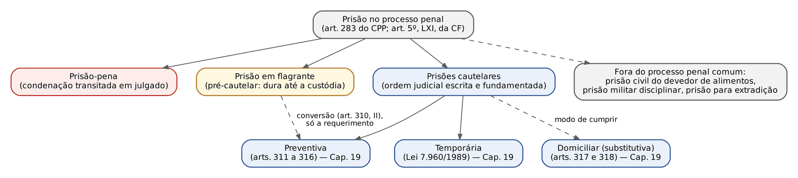
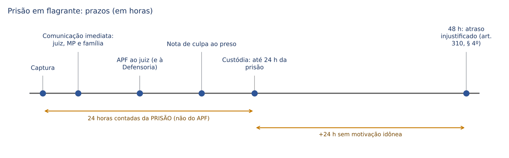
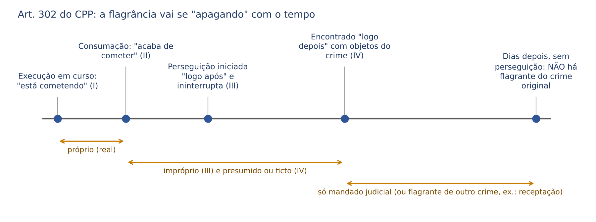
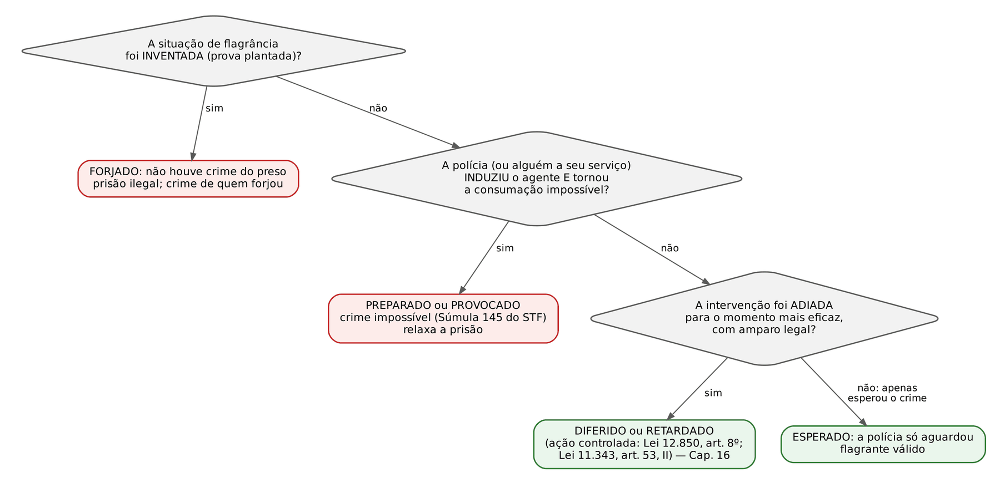
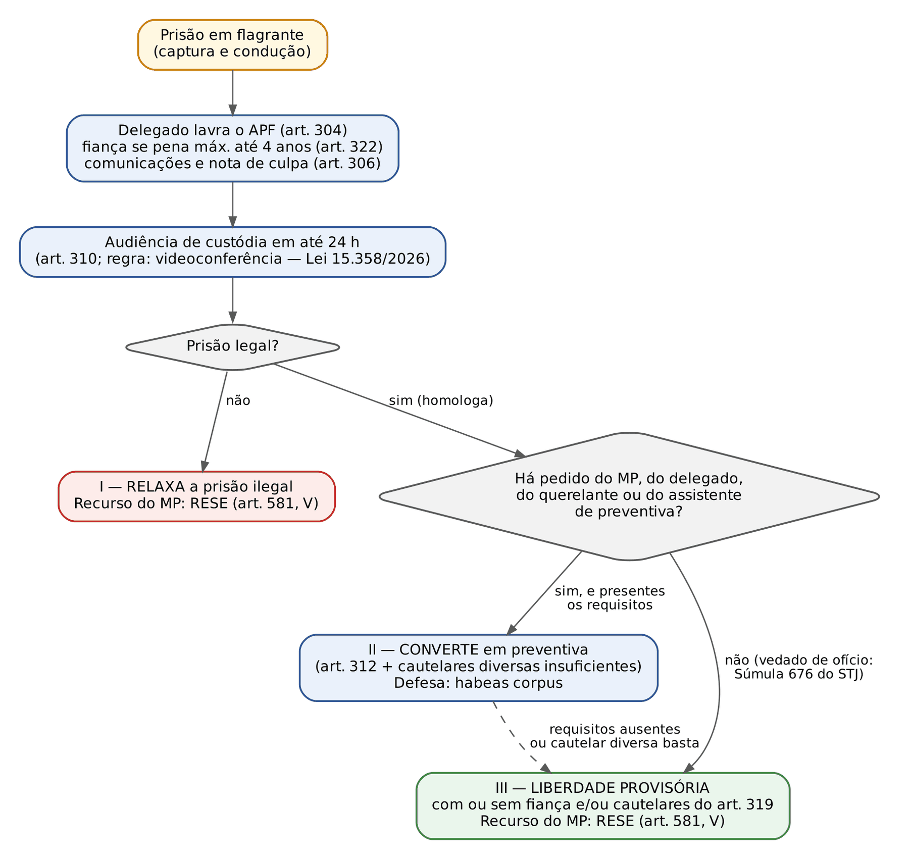

# CAPÍTULO 18 — PRISÃO I: TEORIA GERAL DAS CAUTELARES PESSOAIS, PRISÃO EM FLAGRANTE, AUDIÊNCIA DE CUSTÓDIA, PRISÃO ESPECIAL E USO DE ALGEMAS

:::INCIDENCIA
TRF5 p. 11; TJRS p. 5; TJSC p. 11 e 19 (Resolução CNJ 213/2015). Nível A+. Lote: 24 questões (FGV 22, FCC 2).
O que mais cai: classificar a espécie de flagrante num caso (próprio, impróprio, presumido; preparado x esperado), quem pode e quem deve prender, formalidades e prazos do auto e da custódia, vedação da preventiva de ofício (Súmula 676 do STJ), prisão especial depois da ADPF 334 e Súmula Vinculante 11.
:::

| Subtema | FGV | FCC | Padrão de cobrança |
|---|---|---|---|
| Espécies de flagrante (art. 302 e doutrinárias) | 8 | 0 | caso concreto: "logo após" x "logo depois"; preparado x esperado x forjado x diferido |
| Sujeitos do flagrante (art. 301) | 2 | 0 | quem "pode" (qualquer do povo) e quem "deve" (polícia) |
| Auto de prisão, prazos e audiência de custódia | 2 | 1 | 24 horas; assinaturas do art. 304; filhos (§ 4º); juiz das garantias |
| Ofício, contraditório, revogação e fundamentação | 2 | 1 | Súmula 676 do STJ; art. 315, § 2º; revisão "mensal" (falso) |
| Imunidades, inafiançabilidade e fiança | 3 | 0 | senador e crime afiançável; tráfico inafiançável; quebra da fiança |
| Prisão especial | 3 | 0 | diplomado (ADPF 334); vereador, deputado e ex-jurado; só antes do trânsito |
| Flagrante e licitude da prova; descumprimento de cautelar | 2 | 0 | celular abandonado; rompimento de tornozeleira |

## 18.1 O mapa das prisões e a lógica cautelar

### 18.1.1 Por que se prende alguém que ainda é presumido inocente

A Constituição diz que ninguém será considerado culpado até o trânsito em julgado (art. 5º, LVII) e, ao mesmo tempo, admite a prisão em flagrante e a prisão por ordem escrita e fundamentada do juiz (art. 5º, LXI). A conciliação está na ideia de cautela: a prisão antes da condenação NÃO é antecipação da pena, mas instrumento para proteger o processo (a prova, a aplicação da lei penal) ou a sociedade contra um risco concreto gerado pela liberdade do imputado. Se o juiz prende "porque o crime é grave" ou "para dar exemplo", está punindo antes da sentença, e a prisão é ilegal. A presunção de inocência funciona aqui como norma de tratamento (o acusado é tratado como inocente; a prisão é exceção); suas outras dimensões (regra probatória e regra de julgamento) estão no Cap. 1.

O art. 283 do CPP, na redação do Pacote Anticrime (Lei 13.964/2019), fecha o sistema: só se prende em flagrante, por prisão cautelar decretada por juiz ou por condenação transitada em julgado. Não existe mais "prisão para averiguação", "prisão administrativa" do CPP nem prisão automática por pronúncia ou sentença recorrível: a execução provisória da pena foi afastada pelo STF nas ADCs 43, 44 e 54 (ver Cap. 1), com a ressalva do Júri (Tema 1.068 do STF; ver Cap. 23).

:::LEI CPP, art. 283
Art. 283. Ninguém poderá ser preso senão em flagrante delito ou por ordem escrita e fundamentada da autoridade judiciária competente, em decorrência de prisão cautelar ou em virtude de condenação criminal transitada em julgado.
§ 1º As medidas cautelares previstas neste Título não se aplicam à infração a que não for isolada, cumulativa ou alternativamente cominada pena privativa de liberdade.
§ 2º A prisão poderá ser efetuada em qualquer dia e a qualquer hora, respeitadas as restrições relativas à inviolabilidade do domicílio.
:::

### 18.1.2 A ponte com o processo civil (e onde ela engana)

O civilista reconhece a estrutura: toda tutela cautelar exige probabilidade do direito e perigo da demora (art. 300 do CPC). No processo penal, a doutrina (Aury Lopes Jr., Badaró, Renato Brasileiro) rebatiza esses requisitos para mostrar que a transposição é imperfeita:

| Processo civil | Processo penal | Por que a troca de nome importa |
|---|---|---|
| *fumus boni iuris* (probabilidade do direito do autor) | *fumus commissi delicti*: prova da existência do crime e indícios suficientes de autoria (art. 312) | o Estado não tem "direito" a prender; o que se exige é a probabilidade de um FATO criminoso e de sua autoria |
| *periculum in mora* (risco ao resultado útil pelo tempo) | *periculum libertatis*: perigo gerado pelo estado de liberdade do imputado (art. 312, *caput*, parte final) | o perigo não vem do tempo do processo, mas do comportamento do imputado solto (fuga, ameaça a testemunha, reiteração) |
| poder geral de cautela do juiz (art. 297 do CPC) | rol legal de medidas (arts. 319 e 320) e legitimidade restrita (art. 282, § 2º) | prevalece que não há poder geral de cautela para criar restrições à liberdade fora da lei, por força da legalidade estrita; o juiz também não age de ofício (18.3) |
| tutela provisória concedida de ofício em certos casos | cautelar pessoal NUNCA decretada de ofício | sistema acusatório (art. 3º-A do CPP; Cap. 3) |

:::ATENCAO Intuição civilista que derruba candidato
No cível, o juiz pode conceder tutela diversa da pedida para assegurar o resultado útil. No processo penal, a doutrina e o STJ reconhecem certa margem na ESCOLHA da medida quando houve provocação (18.3.3), mas não existe "fungibilidade de ofício" para agravar a situação do preso sem pedido, nem medida atípica criada pelo juiz para restringir a liberdade. O inverso é livre: revogar ou abrandar pode ser de ofício (art. 282, § 5º; art. 316).
:::

## 18.2 Princípios das medidas cautelares pessoais

Medida cautelar pessoal é a que recai sobre a pessoa do imputado (prisão preventiva, temporária, domiciliar substitutiva e as cautelares diversas dos arts. 319 e 320). Distingue-se das cautelares reais ou patrimoniais (sequestro, hipoteca legal, arresto: Cap. 13) e das cautelares probatórias (busca, interceptação: Caps. 15 e 16). Os princípios abaixo valem para todas as pessoais; os requisitos específicos da preventiva e da temporária estão no Cap. 19.

| Princípio | Conteúdo | Base | Exemplo do que viola |
|---|---|---|---|
| Jurisdicionalidade | só o juiz decreta cautelar pessoal (exceção: flagrante, que é pré-cautelar, e a fiança arbitrada pelo delegado) | CF, art. 5º, LXI; CPP, art. 283 | delegado que "mantém preso" o capturado além do prazo legal sem decisão judicial |
| Motivação concreta | decisão com fatos do caso, contemporâneos, sem fórmula genérica | CF, art. 93, IX; CPP, arts. 282, § 6º, 312, § 2º, e 315 | "a gravidade do crime e o clamor público justificam a prisão" |
| Contraditório | regra: ouvir a parte contrária antes (5 dias); exceção: urgência ou perigo de ineficácia, justificada | CPP, art. 282, § 3º | ouvir a defesa antes de uma prisão para evitar fuga iminente (aqui o contraditório é diferido) |
| Provisionalidade | a medida dura enquanto durar a situação de perigo (*rebus sic stantibus*): cessado o motivo, revoga-se; surgindo novo motivo, decreta-se de novo | CPP, arts. 282, § 5º, e 316 | manter a prisão "por conveniência da instrução" depois de ouvidas todas as testemunhas |
| Provisoriedade | a medida tem limite TEMPORAL | Lei 7.960/1989 (temporária com prazo fixo); art. 316, parágrafo único (revisão a cada 90 dias); excesso de prazo | preventiva que se arrasta anos sem julgamento por desídia estatal (ver Cap. 19 e Súmulas 52 e 64 do STJ, Cap. 19) |
| Excepcionalidade e subsidiariedade | a prisão é a *ultima ratio*: só quando as cautelares diversas forem insuficientes, o que o juiz deve justificar | CPP, art. 282, § 6º; art. 310, II | converter o flagrante em preventiva sem dizer por que monitoramento eletrônico não bastaria |
| Proporcionalidade (necessidade e adequação) | a medida deve ser necessária a um fim cautelar e adequada à gravidade do crime, às circunstâncias do fato e às condições pessoais | CPP, art. 282, I e II | preventiva por furto simples de primário com bons antecedentes |
| Homogeneidade (desdobramento da proporcionalidade) | a cautelar não pode ser mais gravosa do que a provável pena final | doutrina e jurisprudência do STJ | prender preventivamente quem, se condenado, cumprirá pena em regime aberto ou terá substituição por restritivas |

:::LEI CPP, art. 282, §§ 2º a 6º
§ 2º As medidas cautelares serão decretadas pelo juiz a requerimento das partes ou, quando no curso da investigação criminal, por representação da autoridade policial ou mediante requerimento do Ministério Público.
§ 3º Ressalvados os casos de urgência ou de perigo de ineficácia da medida, o juiz, ao receber o pedido de medida cautelar, determinará a intimação da parte contrária, para se manifestar no prazo de 5 (cinco) dias, acompanhada de cópia do requerimento e das peças necessárias, permanecendo os autos em juízo, e os casos de urgência ou de perigo deverão ser justificados e fundamentados em decisão que contenha elementos do caso concreto que justifiquem essa medida excepcional.
§ 4º No caso de descumprimento de qualquer das obrigações impostas, o juiz, mediante requerimento do Ministério Público, de seu assistente ou do querelante, poderá substituir a medida, impor outra em cumulação, ou, em último caso, decretar a prisão preventiva, nos termos do parágrafo único do art. 312 deste Código.
§ 5º O juiz poderá, de ofício ou a pedido das partes, revogar a medida cautelar ou substituí-la quando verificar a falta de motivo para que subsista, bem como voltar a decretá-la, se sobrevierem razões que a justifiquem.
§ 6º A prisão preventiva somente será determinada quando não for cabível a sua substituição por outra medida cautelar, observado o art. 319 deste Código, e o não cabimento da substituição por outra medida cautelar deverá ser justificado de forma fundamentada nos elementos presentes do caso concreto, de forma individualizada.
:::

Três leituras finas desses parágrafos, todas cobráveis:

- § 3º (contraditório prévio): a regra é intimar a parte contrária para falar em 5 (cinco) dias; a exceção (urgência ou perigo de ineficácia) também precisa ser FUNDAMENTADA com elementos do caso. Na prática, a preventiva pedida para evitar fuga costuma ser decretada sem oitiva prévia, e o contraditório fica diferido (posterior). Na audiência de custódia o contraditório é imediato: MP e defesa falam antes de o juiz decidir.
- § 4º (descumprimento): a remissão ao "parágrafo único do art. 312" é resíduo de redação; após a Lei 13.964/2019, a regra está no art. 312, § 1º. A gradação é obrigatória: substituir, cumular e, só em último caso, prender. E depende de requerimento (MP, assistente ou querelante).
- § 1º do art. 283: se a infração não prevê pena privativa de liberdade (por exemplo, o porte de droga para consumo pessoal, art. 28 da Lei 11.343/2006), nenhuma cautelar pessoal é cabível.

:::EXEMPLO Descumprimento: consequência processual, não necessariamente crime
A responde por receptação qualificada em liberdade, com monitoração eletrônica (art. 319, IX). Policiais o encontram com a tornozeleira cortada; ele admite que a destruiu só para não ser rastreado. Consequência processual certa: o MP pode requerer ao juiz a substituição, a cumulação ou, em último caso, a preventiva (arts. 282, § 4º, e 312, § 1º). Consequência penal: a FGV entendeu que o delegado NÃO deve lavrar o auto (ver box abaixo).
:::

:::QUESTAO FGV 2026 — PC-PR — Delegado de Polícia (Q4378300)
Caso: preso monitorado corta e destrói a tornozeleira para escapar da fiscalização; pergunta-se a conduta do delegado. Gabarito: D — não lavrar o auto, por atipicidade da desobediência e ausência de *animus nocendi* (vontade específica de causar prejuízo) no dano, comunicando o fato ao juízo. Passos: (1) desobediência (art. 330 do CP): a jurisprudência do STJ afasta o crime quando a lei prevê sanção processual específica para o descumprimento, que aqui é a do art. 282, § 4º; (2) dano qualificado: a linha adotada exige a intenção de causar prejuízo patrimonial, ausente quando o agente só quer fugir à vigilância; (3) logo, não há crime a autuar, e o caminho é comunicar o juiz do processo, a quem cabe reagir pelo art. 282, § 4º. Armadilhas: (A) e (C) apostam na intuição de que "descumprir ordem judicial é desobediência"; (E) atribui ao delegado o arquivamento, que ele nunca pode fazer (art. 17 do CPP; Cap. 4). Gabarito discutível quanto ao dano: ver nota de verificação.
:::

## 18.3 Quem pode provocar e o que o juiz pode fazer de ofício

### 18.3.1 A regra: nenhuma cautelar pessoal de ofício

Antes de 2019, o art. 282, § 2º, e o art. 311 permitiam ao juiz decretar a preventiva de ofício durante o processo. A Lei 13.964/2019 suprimiu a expressão "de ofício" dos dois dispositivos. Hoje, a legitimidade é:

| Fase | Quem pode pedir cautelar pessoal |
|---|---|
| Investigação | MP (requerimento) e autoridade policial (representação) |
| Processo | MP, querelante e assistente de acusação (requerimento); a autoridade policial, já sem inquérito em curso, não representa |
| Descumprimento de cautelar (art. 282, § 4º) | MP, assistente ou querelante |

O STF (2ª Turma, HC 188.888, Rel. Min. Celso de Mello, j. 6/10/2020) e o STJ (3ª Seção, RHC 131.263, Rel. Min. Sebastião Reis Júnior, j. 24/2/2021) afirmaram que a vedação alcança também a CONVERSÃO do flagrante em preventiva, mesmo quando não há audiência de custódia. O entendimento virou súmula.

:::JURIS STJ, Súmula 676 (Terceira Seção, j. 11/12/2024)
"Em razão da Lei n. 13.964/2019, não é mais possível ao juiz, de ofício, decretar ou converter prisão em flagrante em prisão preventiva."
Por que a conversão foi incluída: o art. 310, II, fala em "converter", e houve quem dissesse que converter não é decretar. O STJ rejeitou o argumento: a conversão cria um título novo de prisão, com requisitos próprios (art. 312), e por isso depende de provocação como qualquer preventiva. Consequência prática: na custódia, se o MP pede liberdade provisória e o delegado não representou pela preventiva, o juiz NÃO pode prender, ainda que discorde.
:::

O argumento de fundo é o sistema acusatório (art. 3º-A do CPP, declarado constitucional pelo STF nas ADIs 6.298, 6.299, 6.300 e 6.305; ver Cap. 3): o juiz que decide sobre a prisão não pode ser o mesmo que a deseja, sob pena de perder a imparcialidade. Por isso o art. 20 da Lei 11.340/2006, que ainda fala em preventiva "de ofício" na violência doméstica, é lido como superado pela Lei 13.964/2019 (Cap. 25).

:::QUESTAO FCC 2025 — DPE-SP — Analista de Defensoria (Q3304097)
Caso: na custódia de preso por tráfico, o próprio MP diz que o flagrante está em ordem, mas pede liberdade provisória (primário, endereço fixo); a defesa reitera. Gabarito: B — a juíza não pode decretar a preventiva, porque vedado o agir de ofício. Armadilhas: (A) "não está vinculada ao pedido do MP" (está, quanto ao limite máximo: sem pedido de prisão, não há prisão); (C) e (D) aplicam por analogia o art. 28 do CPP (remessa ao órgão revisor), que trata de arquivamento, não de cautelares, e (D) ainda inventa uma prisão por 5 dias; (E) o juiz não pode "alertar" o MP para que mude o pedido, o que seria provocar a provocação. No mesmo sentido: FGV 2025 — ENAM 2025.1 (Q3362317), item I (correto, transcreve a Súmula 676).
:::

### 18.3.2 O que o juiz PODE fazer sem pedido

| Ato | De ofício? | Fundamento |
|---|---|---|
| Revogar a cautelar ou substituí-la por outra MAIS BRANDA | SIM | art. 282, § 5º; art. 316, *caput* |
| Revisar a preventiva a cada 90 dias | SIM (é dever) | art. 316, parágrafo único (Cap. 19) |
| Relaxar prisão ilegal | SIM (é dever) | CF, art. 5º, LXV |
| Conceder *habeas corpus* de ofício | SIM | CPP, art. 654, § 2º (Cap. 30) |
| MANTER, na sentença, a preventiva já existente, fundamentadamente | SIM (prevalece) | art. 387, § 1º: o juiz "decidirá" sobre a manutenção; manter não é decretar |
| Decretar ou converter preventiva, decretar temporária, impor cautelar diversa | NÃO | arts. 282, § 2º, e 311; Súmula 676 do STJ |
| Agravar cautelar por descumprimento | NÃO | art. 282, § 4º |
| "Voltar a decretá-la" (art. 282, § 5º, e art. 316, parte final) | controvertido | a letra parece permitir; a leitura coerente com a Súmula 676 exige novo requerimento, e é a mais segura em prova |

:::QUESTAO FGV 2024 — Câmara dos Deputados — Consultor Legislativo (Q2513034)
Três afirmações: (I) o juiz pode, de ofício ou a pedido, revogar a cautelar quando insubsistentes os motivos; (II) a domiciliar permite ausentar-se por motivo de saúde, comunicando ao juiz em 24 horas; (III) o juiz deve revisar mensalmente a preventiva. Gabarito: D — só I. II é falsa porque o art. 317 só admite ausência com AUTORIZAÇÃO judicial (Cap. 19); III é falsa porque a revisão é a cada 90 (noventa) dias (art. 316, parágrafo único), e o descumprimento do prazo não gera soltura automática (Cap. 19).
:::

:::QUESTAO FCC 2026 — DPE-BA — Defensor Público (Q4037440) — correlata
Caso: réu preso durante toda a instrução; nas alegações finais o MP pede condenação e silencia sobre a prisão. Gabarito: C — o juiz pode manter a preventiva na sentença, fundamentadamente. A armadilha é tratar manutenção como decretação de ofício. Note que manter exige fundamentação atual (art. 387, § 1º): a sentença que nega o recurso em liberdade "sem fundamentação adicional" é ilegal, e o tribunal não pode suprir o vício no julgamento do *habeas corpus* (Cap. 19).
:::

### 18.3.3 Pedido de cautelar diversa e decretação da preventiva

Se o MP pede, na custódia, apenas cautelares do art. 319, pode o juiz decretar a preventiva? Há precedentes do STJ nos dois sentidos. Uma linha entende que, provocado a restringir a liberdade, o juiz escolhe a medida adequada, e a escolha da mais grave não é atuação de ofício. A outra (5ª Turma, AgRg no HC 754.506-MG, Rel. Min. Reynaldo Soares da Fonseca, j. 16/8/2022) considera que decretar a prisão quando só se pediu medida diversa equivale a agir de ofício. Em prova objetiva, marque a vedação apenas quando NÃO houver nenhum pedido restritivo; havendo pedido de cautelar diversa, a questão tem de indicar qual corrente adota.

:::DICA Tese do STJ que convém conhecer (e usar com cuidado)
Jurisprudência em Teses do STJ, ed. 184: (tese 7) não é possível decretar a preventiva de ofício, mesmo na conversão do flagrante; (tese 8) a posterior manifestação do MP ou da autoridade policial pela prisão supre o vício da falta de prévio requerimento; ed. 185, tese 9: a preventiva de ofício decretada ANTES da vigência do Pacote Anticrime não é ilegal (*tempus regit actum*; norma processual: Cap. 2). A tese 8 é criticada pela doutrina, porque transforma o pedido posterior em convalidação de ato que o juiz não podia praticar.
:::

## 18.4 Fundamentação concreta: o art. 315 e a ponte com o art. 489 do CPC

A decisão que decreta, substitui ou denega preventiva será sempre motivada (art. 315, *caput*), e o § 1º exige que o juiz aponte "fatos novos ou contemporâneos" que justifiquem a medida (contemporaneidade: o perigo tem de ser atual, não um fato antigo requentado). O § 2º reproduz quase literalmente o art. 489, § 1º, do CPC, terreno conhecido do leitor civilista; a diferença é que, no processo penal, a falta de fundamentação de uma prisão não gera apenas embargos de declaração: torna a prisão ilegal e impõe a soltura por *habeas corpus*.

:::LEI CPP, art. 315, § 2º
§ 2º Não se considera fundamentada qualquer decisão judicial, seja ela interlocutória, sentença ou acórdão, que:
I - limitar-se à indicação, à reprodução ou à paráfrase de ato normativo, sem explicar sua relação com a causa ou a questão decidida;
II - empregar conceitos jurídicos indeterminados, sem explicar o motivo concreto de sua incidência no caso;
III - invocar motivos que se prestariam a justificar qualquer outra decisão;
IV - não enfrentar todos os argumentos deduzidos no processo capazes de, em tese, infirmar a conclusão adotada pelo julgador;
V - limitar-se a invocar precedente ou enunciado de súmula, sem identificar seus fundamentos determinantes nem demonstrar que o caso sob julgamento se ajusta àqueles fundamentos;
VI - deixar de seguir enunciado de súmula, jurisprudência ou precedente invocado pela parte, sem demonstrar a existência de distinção no caso em julgamento ou a superação do entendimento.
:::

A Lei 15.272/2025 (26/11/2025) reforçou o padrão: proibiu a preventiva com base em gravidade abstrata (art. 312, § 4º), listou critérios para aferir a periculosidade (art. 312, § 3º) e passou a exigir que a decisão da custódia examine expressamente as circunstâncias do art. 310, §§ 2º e 5º (art. 310, § 6º; ver 18.7.4). O conteúdo desses critérios é estudado no Cap. 19.

Dois limites jurisprudenciais completam o quadro:

- Proibição de fundamentação "*a posteriori*": no *habeas corpus*, o tribunal não acrescenta fundamentos para salvar prisão decretada ou mantida sem motivação concreta (STJ, RHC 212.836-RS; v. Cap. 19).
- Fundamentação *per relationem* (por remissão ao parecer do MP ou à representação do delegado): admitida pelos tribunais superiores quando o juiz incorpora razões concretas e acrescenta ao menos alguma análise própria; a mera remissão genérica ("acolho o parecer") é insuficiente.

:::QUESTAO FGV 2024 — Câmara dos Deputados — Consultor Legislativo (Q2513033)
Pergunta-se a afirmativa correta sobre fundamentação da prisão cautelar. Gabarito: E — o juiz não pode deixar de seguir súmula, jurisprudência ou precedente invocado pela parte sem demonstrar distinção ou superação (art. 315, § 2º, VI). Armadilhas: dispensar fundamentação na "mera substituição" (o *caput* abrange substituir); limitar-se ao dispositivo legal ou a conceitos indeterminados "para resguardar o sigilo" (incisos I e II; sigilo justifica restringir o acesso, nunca suprimir a motivação); limitar-se a invocar precedente por "respeito à hierarquia" (inciso V).
:::

:::SENTENCA Decisão que decreta ou mantém prisão: o que não pode faltar
Onde entra: na decisão da custódia, na decisão sobre representação ou requerimento de preventiva e no capítulo da sentença sobre o direito de recorrer em liberdade (art. 387, § 1º). O que fundamentar, nesta ordem: (1) quem pediu (legitimidade; evita a nulidade da atuação de ofício); (2) *fumus commissi delicti* com indicação dos elementos dos autos; (3) *periculum libertatis* com fato concreto e contemporâneo; (4) por que as cautelares do art. 319 são insuficientes (art. 282, § 6º); (5) cabimento pelo art. 313 (Cap. 19). Redação-modelo: "Atendendo ao requerimento ministerial, decreto a prisão preventiva: a materialidade e os indícios de autoria estão no auto de apreensão e nos depoimentos de fls.; o risco à instrução decorre das mensagens ameaçadoras enviadas à vítima ontem, após a prisão do corréu, e a proibição de contato (art. 319, III) já se mostrou ineficaz, pois descumprida." Erros que a banca pune: gravidade abstrata; "clamor público"; fórmula que serviria a qualquer caso (art. 315, § 2º, III); omitir a análise das cautelares diversas.
:::

## 18.5 Execução de qualquer prisão: mandado, força, domicílio e captura fora da comarca

As regras dos arts. 284 a 300 valem para toda prisão (flagrante ou mandado) e são cobradas sobretudo pela literalidade. Em quadro:

| Tema | Regra | Dispositivo |
|---|---|---|
| Horário | qualquer dia e hora, respeitada a inviolabilidade do domicílio | art. 283, § 2º |
| Domicílio com mandado | de dia: intima-se o morador; se não entregar, entra-se à força com duas testemunhas; à noite: cerca-se a casa e arromba-se ao amanhecer | art. 293; CF, art. 5º, XI |
| Domicílio sem mandado (flagrante) | pode-se entrar a qualquer hora, se houver fundadas razões de flagrante no interior, justificadas depois | art. 294; CF, art. 5º, XI; Tema 280 do STF (ver Cap. 15) |
| Força | só a indispensável contra resistência ou tentativa de fuga; lavra-se auto de resistência com duas testemunhas | arts. 284 e 292 |
| Requisitos do mandado | lavrado pelo escrivão e assinado pela autoridade; identifica a pessoa; menciona a infração; declara a fiança, se afiançável; dirigido a quem deva cumpri-lo | art. 285, parágrafo único |
| Entrega ao preso | mandado em duplicata; um exemplar ao preso, com dia, hora e lugar | art. 286 |
| Infração inafiançável sem exibição do mandado | a prisão pode ser feita, e o preso é apresentado IMEDIATAMENTE ao juiz que expediu o mandado, para audiência de custódia | art. 287 |
| Preso fora da comarca | precatória com o inteiro teor do mandado; na urgência, requisição por qualquer meio; remoção em até 30 dias | arts. 289 e 299 |
| Banco Nacional de Mandados (CNJ) | o juiz registra o mandado; qualquer agente pode cumpri-lo, mesmo fora da competência territorial; comunica-se o juiz do local | art. 289-A |
| Perseguição que atravessa comarcas | o executor prende onde alcançar e apresenta o preso à autoridade local | art. 290 |
| Separação | presos provisórios separados dos definitivamente condenados; militar preso em flagrante recolhido ao quartel | art. 300 |

:::PEGADINHA Falta de exibição do mandado
A exibição do mandado não é condição de validade da prisão em flagrante (no flagrante não há mandado nenhum). Na prisão por mandado de crime INAFIANÇÁVEL, a falta de exibição também não impede a captura (art. 287). A alternativa "a falta de exibição do mandado no momento da abordagem torna nula a prisão em flagrante" (FGV 2026, TJ-SC, Oficial de Justiça, Q4153628, alternativa D) é falsa.
:::

## 18.6 Prisão em flagrante

### 18.6.1 Conceito, natureza e fases

Flagrante vem do latim *flagrare*, arder: é o crime que ainda "queima", visível no momento em que acontece ou logo depois. Porque a certeza visual da infração é alta, a Constituição dispensa ordem judicial para a captura (art. 5º, LXI). Mas essa dispensa só se justifica pela brevidade: o flagrante serve para interromper o crime, preservar a prova e apresentar o preso ao juiz. Por isso a doutrina majoritária moderna (Aury Lopes Jr., Badaró, Renato Brasileiro) o qualifica como medida PRÉ-CAUTELAR: ele não se destina a manter ninguém preso, mas a colocar o capturado à disposição do juiz, que em até 24 horas decide se há fundamento cautelar. Desde a Lei 12.403/2011, ninguém "responde ao processo preso em flagrante": ou o juiz converte em preventiva, ou solta.

O flagrante percorre quatro fases, e a ilegalidade de qualquer delas contamina a prisão:

| Fase | O que acontece | Vício típico |
|---|---|---|
| 1. Captura | voz de prisão e contenção física | captura fora das hipóteses do art. 302; força excessiva; algemas sem justificativa |
| 2. Condução | apresentação à autoridade policial (ou à do lugar mais próximo, art. 308) | demora injustificada; "passeio" com o preso |
| 3. Lavratura do auto (APF) | oitiva do condutor, das testemunhas e interrogatório; decisão do delegado de recolher, arbitrar fiança ou liberar | ausência de oitivas; preso não informado do direito ao silêncio |
| 4. Recolhimento e comunicações | comunicação imediata, remessa do APF em 24 horas, nota de culpa | falta de comunicação à família ou ao juiz; nota de culpa não entregue |

### 18.6.2 Sujeitos: quem pode e quem deve prender

:::LEI CPP, art. 301
Art. 301. Qualquer do povo poderá e as autoridades policiais e seus agentes deverão prender quem quer que seja encontrado em flagrante delito.
:::

- Flagrante FACULTATIVO: qualquer pessoa do povo, inclusive a vítima, pode prender. É exercício regular de direito (art. 23, III, do CP).
- Flagrante OBRIGATÓRIO (ou compulsório): as autoridades policiais e seus agentes devem prender. É estrito cumprimento de dever legal, e a omissão dolosa pode configurar prevaricação. Prevalece que o dever acompanha o policial mesmo fora do serviço, nos limites do razoável (não se exige ato heroico).
- Servidor público que não é policial (escrevente, oficial de justiça, funcionário de cartório) está no grupo do "qualquer do povo": PODE, mas não DEVE.
- Guarda municipal: o STF reconheceu que as guardas podem exercer ações de segurança urbana, inclusive policiamento ostensivo e comunitário, vedada a atividade de polícia judiciária (RE 608.588, Tema 656, j. 20/2/2025). A prisão em flagrante pela guarda é, no mínimo, a de "qualquer do povo"; o STJ chegou a afetar a questão de saber se ela pode prender com respaldo no art. 301 (Tema 1.356), mas a Terceira Seção cancelou a afetação em 28/8/2026, sem fixar tese. Os limites da busca pessoal feita por guardas são tratados no Cap. 15.

:::QUESTAO FGV 2024 — TJ-MS — Analista Judiciário (Q2489740)
Caso: num restaurante, um homem agride a esposa; intervêm um delegado de polícia (de folga), um empresário e um servidor de vara cível. Gabarito: A — o delegado DEVERÁ prender; o empresário e o servidor PODERÃO. Armadilha: achar que o servidor do Judiciário tem o dever do art. 301 (não é autoridade policial nem agente dela) ou que o delegado de folga perde o dever. No mesmo sentido: FGV 2025 — ENAC — 2º Exame (Q3673876): cliente e funcionário de tabelionato podem prender o roubador; a obrigação é da polícia; e o diplomado em universidade federal NÃO tem prisão especial (ADPF 334; ver 18.8) — gabarito D.
:::

### 18.6.3 Espécies legais (art. 302)

:::LEI CPP, art. 302
Art. 302. Considera-se em flagrante delito quem:
I - está cometendo a infração penal;
II - acaba de cometê-la;
III - é perseguido, logo após, pela autoridade, pelo ofendido ou por qualquer pessoa, em situação que faça presumir ser autor da infração;
IV - é encontrado, logo depois, com instrumentos, armas, objetos ou papéis que façam presumir ser ele autor da infração.
:::

| Espécie | Inciso | Núcleo | Exemplo |
|---|---|---|---|
| Próprio, real, perfeito ou propriamente dito | I e II | o agente é surpreendido praticando o crime ou imediatamente após consumá-lo, ainda no local | policiais em ronda veem A apontando faca para B e exigindo o celular |
| Impróprio, imperfeito ou quase flagrante | III | PERSEGUIÇÃO iniciada "logo após" o crime e não interrompida; a prisão pode ocorrer horas depois, se a perseguição foi contínua | vítima grita "pega ladrão", policiais saem atrás e prendem o autor três quarteirões adiante |
| Presumido, ficto ou assimilado | IV | SEM perseguição: o agente é ENCONTRADO "logo depois" com instrumentos, armas ou objetos que façam presumir a autoria | horas após o roubo à agência, policiais localizam A em barreira, com a arma e os objetos subtraídos |

Os dois advérbios são a chave das questões:

- "Logo após" (inciso III) qualifica o INÍCIO da perseguição: ela deve começar em lapso exíguo, ainda com contato visual ou com informações seguras sobre a direção da fuga. A perseguição pode DURAR horas; o que não pode é começar tarde. O art. 290, § 1º, ajuda: há perseguição quando o executor, tendo avistado o agente, o segue sem interrupção, ainda que depois o perca de vista, ou quando, por indícios ou informações fidedignas, vai no seu encalço.
- "Logo depois" (inciso IV) é, segundo parte da doutrina (Aury Lopes Jr.), um intervalo um pouco mais elástico que o "logo após", porque não exige perseguição, mas encontro casual com os objetos do crime. Não há prazo legal fixo; a jurisprudência examina caso a caso. Não existe a regra das "24 horas" (folclore que a FGV usa como distrator).

:::QUESTAO FGV 2024 — AL-PR — Analista Legislativo (Q2449769)
Caso: dois roubadores; A é capturado por policiais no ato, tendo "acabado de cometer" o crime; B foge e é encontrado logo depois, em outra rua, com a arma e o celular da vítima. Gabarito: C — A em flagrante próprio; B em flagrante presumido. Passos: (1) A está no inciso II; (2) para B não houve perseguição narrada, só encontro posterior com objetos, logo inciso IV; (3) "imperfeito" e "impróprio" são sinônimos (inciso III) e exigiriam perseguição. No mesmo sentido: FGV 2024 — TRF1 — Analista (Q3028439), gabarito C (Lucas encontrado logo depois, sem perseguição, com a arma e os bens: flagrante ficto); FGV 2024 — PC-SC (Q2365394), gabarito D (policiais em ronda flagram a ameaça com faca: flagrante próprio, não "esperado", porque o encontro foi casual).
:::

:::QUESTAO FGV 2026 — TJ-SC — Oficial de Justiça e Avaliador (Q4153628)
Caso: policiais ouvem "pega ladrão", perseguem sem interrupção o autor com a bolsa e o prendem três quarteirões depois. Gabarito: A — flagrante impróprio (inciso III). Distratores: prisão ilegal por não ser "no exato momento" (B); custódia "perante o MP ou o delegado" (C: é perante o JUIZ); nulidade pela falta de exibição de mandado (D); dispensa de testemunhas, bastando policiais e confissão (E: o art. 304 exige oitiva das testemunhas que acompanharem e, faltando testemunhas do fato, duas de apresentação; ver 18.6.7). No mesmo tema, literalidade pura: FGV 2026 — TJ-MS — Analista (Q3856358), gabarito B (a única alternativa que reproduz o art. 302, com "logo após" no III e "logo depois" no IV; as demais inventam "24 horas", "no dia da prática" ou suprimem incisos).
:::

:::QUESTAO FGV 2026 — PC-PR — Delegado de Polícia (Q4378272)
Caso: roubo de automóvel em 10/8 às 22h; em 13/8 às 20h a PM encontra o carro com Tício, que diz tê-lo recebido emprestado de um vizinho. Gabarito: C — o delegado lavra o auto pelo crime de RECEPTAÇÃO, se entender haver indícios de que Tício sabia da origem ilícita. Passos: (1) quanto ao roubo, passaram quase três dias sem perseguição: não há "logo depois" (inciso IV) nem perseguição (III), logo não há flagrante do roubo; (2) quanto à receptação, as modalidades "conduzir" e "ocultar" são permanentes, e o agente está "cometendo" a infração enquanto conduz o carro (arts. 302, I, e 303); (3) cabe ao delegado o juízo de tipicidade provisória (dolo). Armadilhas: (A) e (B) forçam flagrante do roubo; (D) "reconhecimento positivo autoriza flagrante independentemente do tempo" (o reconhecimento não cria flagrância; ver Cap. 15); (E) o delegado não "pula" o auto e manda o preso direto ao juiz para que ESTE diga se há flagrante: o juízo inicial é da autoridade policial (art. 304, § 1º).
:::

### 18.6.4 Espécies doutrinárias: preparado, esperado, forjado e diferido

| Espécie | O que é | Validade | Exemplo |
|---|---|---|---|
| Preparado ou provocado (delito de ensaio, de experiência ou putativo por obra do agente provocador) | o agente provocador (policial ou particular a serviço da polícia) INDUZ alguém a praticar o crime e, ao mesmo tempo, toma providências que tornam IMPOSSÍVEL a consumação | ilegal: crime impossível (Súmula 145 do STF); prisão relaxada | policial disfarçado convence quem nunca vendeu droga a vender-lhe um pacote, com a prisão já armada |
| Esperado | a polícia, sabendo que o crime vai ocorrer, apenas AGUARDA e intervém no início da execução ou na consumação, sem induzir | válido (responde por tentativa ou crime consumado, conforme o caso) | gerente desconfia do documento falso, pede ao cliente que volte mais tarde e chama a polícia, que o prende no saque |
| Forjado (fabricado, maquinado) | a situação de flagrância é INVENTADA: prova plantada (droga "enxertada" na mochila) | ilegal; o "preso" não praticou crime; responde quem forjou (denunciação caluniosa, abuso de autoridade, fraude processual) | policial coloca arma no carro do abordado |
| Diferido, retardado, prorrogado ou protelado | a intervenção é ADIADA, com amparo legal, para o momento mais eficaz à prova (ação controlada) | válido se observados os requisitos legais (comunicação ao juiz na Lei 12.850/2013; autorização judicial na Lei 11.343/2006, art. 53, II) | polícia acompanha o transporte de drogas para prender também o destinatário; ver Cap. 16 |

O direito material desse quadro (por que o preparado é crime impossível, e por que, nos crimes permanentes, a provocação não apaga o crime preexistente) está na Apostila de Direito Penal, Cap. 8 (8.7). Aqui interessa a consequência PROCESSUAL: preparado e forjado levam ao relaxamento da prisão (art. 310, I) e, no processo, à rejeição da denúncia ou à absolvição (sumária, se evidente); esperado e diferido são válidos.

Uma variante legal recente: a Lei 13.964/2019 criou tipos com "agente policial disfarçado" (art. 33, § 1º, IV, da Lei 11.343/2006; arts. 17, § 2º, e 18, parágrafo único, da Lei 10.826/2003). Quem vende droga ou arma ao policial disfarçado responde se houver elementos probatórios razoáveis de conduta criminal PREEXISTENTE. É a positivação da ideia de que o agente que já trazia consigo ou tinha em depósito a droga cometeu crime que nada teve de provocado.

:::QUESTAO FGV 2024 — ENAM — 1º Exame Nacional da Magistratura (Q2459860)
Caso: o gerente do banco desconfia do documento usado para sacar FGTS de terceiro, pede ao sacador que volte em algumas horas, confirma a falsidade e aciona a PM, que o prende no momento do saque. Gabarito: E — prisão legal, flagrante ESPERADO. Passos: (1) ninguém induziu o agente; a iniciativa criminosa era dele; (2) a polícia apenas aguardou o retorno; (3) logo não incide a Súmula 145. Armadilhas: (A) "provocado" (não houve indução); (B) "ação controlada" (não há organização criminosa nem retardamento legalmente amparado); (C) "diferido" (é sinônimo de ação controlada); (D) "preparado é legal" (o preparado é ilegal).
:::

:::QUESTAO FGV 2026 — ENAM 2026.1 (Q4102398)
Três itens. I define flagrante forjado com a definição do PROVOCADO (indução + impedimento da consumação): falso. II define flagrante esperado com a definição da AÇÃO CONTROLADA (retardamento da intervenção contra organização criminosa, art. 8º da Lei 12.850/2013): falso. III reproduz a tese do STF sobre ingresso domiciliar sem mandado (fundadas razões justificadas *a posteriori*, inclusive à noite): verdadeiro (RE 603.616, Tema 280; ver Cap. 15). Gabarito: C — só III. Lição: a FGV cobra as definições TROCADAS; memorize o verbo de cada espécie: provocado INDUZ, esperado AGUARDA, forjado INVENTA, diferido ADIA.
:::

### 18.6.5 Flagrante conforme a natureza da infração

| Infração | Cabe flagrante? | Observação |
|---|---|---|
| Permanente (consumação se prolonga: sequestro, tráfico nas modalidades "ter em depósito" e "guardar", posse ilegal de arma, receptação na modalidade "ocultar") | SIM, a qualquer tempo enquanto durar a permanência (art. 303) | é o que legitima, com fundadas razões, o ingresso em domicílio sem mandado; a fuga isolada do suspeito não basta (Tema 280 do STF e HC 598.051 do STJ: ver Cap. 15) |
| Habitual (exige reiteração: curandeirismo, exercício ilegal da medicina) | majoritariamente NÃO: o ato isolado é atípico, e não se pode dizer quando o agente "está cometendo" o crime | corrente minoritária admite quando a habitualidade já está demonstrada no momento (ex.: consultório em funcionamento com vários pacientes) |
| Continuado (art. 71 do CP) | SIM, em relação a cada crime, que é autônomo; a continuidade é ficção para a pena | o flagrante alcança o crime surpreendido, não a série |
| Formal (consuma-se com a conduta, independentemente do resultado) | SIM no momento da conduta; o recebimento posterior da vantagem é mero exaurimento | na concussão, a prisão no momento da entrega do dinheiro, dias após a exigência, é questionada: a consumação foi na exigência e já não há "logo após"; há precedentes do STJ reconhecendo a ilegalidade de flagrantes assim montados |
| Ação penal privada | SIM, mas o APF só é lavrado se a vítima (ou seu representante) o requerer, e o requerimento deve ser ratificado no prazo legal para a queixa | art. 5º, § 5º, do CPP; sem requerimento, só se captura para fazer cessar o crime |
| Ação pública condicionada | SIM, com a mesma lógica: o APF depende de representação do ofendido | art. 5º, § 4º, do CPP |
| Infração de menor potencial ofensivo | a captura é possível, mas NÃO se impõe prisão (nem se exige fiança) se o autor assume o compromisso de comparecer ao Juizado; lavra-se termo circunstanciado | art. 69, parágrafo único, da Lei 9.099/1995 (ver Apostila de Direito Penal, Cap. 25); na violência doméstica contra a mulher, a Lei 9.099/1995 não se aplica (art. 41 da Lei 11.340/2006), e há APF normalmente |
| Porte de droga para uso (art. 28 da Lei 11.343/2006) | NUNCA prisão em flagrante; termo circunstanciado e compromisso de comparecimento; ausente o juiz, providências pela autoridade policial no local, vedada a detenção | art. 48, §§ 2º e 3º; aspecto processual do RE 635.659 (Tema 506): ver Cap. 25 |
| Crime de trânsito com vítima | não se impõe prisão em flagrante nem se exige fiança ao condutor que presta pronto e integral socorro | art. 301 do CTB (ver Apostila de Direito Penal, Cap. 43) |

:::DICA Um raciocínio que resolve quase todo caso de "crime antigo"
Pergunte: a infração ainda está acontecendo agora? Se a modalidade é permanente (ter em depósito, conduzir, ocultar, manter em cárcere), a resposta é sim, e o flagrante é próprio (art. 302, I, c/c art. 303), por mais antigo que seja o início. Se a infração já se consumou e se esgotou (roubo de três dias atrás), só os incisos III e IV podem salvar o flagrante, e eles exigem proximidade temporal. É o que separa, no mesmo caso, o roubo (sem flagrante) da receptação (com flagrante) em Q4378272.
:::

### 18.6.6 Quem não pode ser preso em flagrante (ou só em certos casos)

As imunidades e prerrogativas foram estudadas, no aspecto material, na Apostila de Direito Penal, Cap. 4 (4.7). Aqui, o quadro de consulta rápida, com o efeito processual sobre o auto:

| Pessoa | Regra sobre o flagrante | Providência processual | Fonte |
|---|---|---|---|
| Presidente da República | não está sujeito a prisão nas infrações comuns enquanto não sobrevier sentença condenatória | não há flagrante; a prerrogativa não se estende a Governadores | CF, art. 86, § 3º |
| Deputados federais e senadores | desde a diplomação, só em flagrante de crime INAFIANÇÁVEL | autos remetidos em 24 horas à Casa, que resolve sobre a prisão pelo voto da maioria de seus membros | CF, art. 53, § 2º |
| Deputados estaduais e distritais | mesma regra, por simetria | Assembleia pode rever a prisão (STF, ADIs 5.823, 5.824 e 5.825, j. 8/5/2019) | CF, art. 27, § 1º |
| Vereadores | NÃO têm imunidade formal; podem ser presos em flagrante por qualquer crime | (têm prisão especial: 18.8) | CF, art. 29, VIII (só imunidade material) |
| Magistrados | só em flagrante de crime inafiançável | apresentação imediata ao Presidente do Tribunal a que vinculado | LC 35/1979 (LOMAN), art. 33, II |
| Membros do MP | só em flagrante de crime inafiançável | MP estadual: comunicação e apresentação ao Procurador-Geral de Justiça em até 24 horas; MPU: comunicação imediata ao tribunal competente e ao Procurador-Geral da República | Lei 8.625/1993, art. 40, III; LC 75/1993, art. 18, II, "d" |
| Advogados | por motivo ligado ao exercício da profissão, só em flagrante de crime inafiançável | presença de representante da OAB na lavratura do auto, sob pena de nulidade; nos demais casos, comunicação expressa à seccional | Lei 8.906/1994, art. 7º, IV e § 3º |
| Agentes diplomáticos e familiares | imunidade de jurisdição penal: não podem ser presos | comunica-se o Ministério das Relações Exteriores | Convenção de Viena de 1961, art. 29 |
| Funcionários consulares | imunidade só para atos de ofício; prisão por crime grave mediante decisão judicial | idem | Convenção de Viena de 1963, art. 41 |
| Eleitor (5 dias antes até 48 horas depois da eleição) | só em flagrante, por sentença condenatória por crime inafiançável ou por desrespeito a salvo-conduto | candidatos: 15 dias antes | Código Eleitoral, art. 236 |
| Condutor que socorre a vítima; usuário de droga; autor de infração de menor potencial ofensivo | ver 18.6.5 | termo circunstanciado | CTB, art. 301; Lei 11.343/2006, art. 48; Lei 9.099/1995, art. 69 |

O denominador comum é a INAFIANÇABILIDADE: para parlamentares, magistrados, promotores e advogados (por ato profissional), só há flagrante de crime inafiançável. São inafiançáveis, por força da Constituição (art. 5º, XLII a XLIV) e do art. 323 do CPP, o racismo, a tortura, o tráfico de drogas, o terrorismo, os hediondos e a ação de grupos armados contra a ordem constitucional. Inafiançável NÃO significa "insuscetível de liberdade provisória": admite-se liberdade provisória SEM fiança, com ou sem cautelares (Cap. 19). Para o parlamentar, o STF já admitiu o flagrante de crime permanente considerado inafiançável por estarem presentes os motivos da preventiva (art. 324, IV), entendimento controvertido.

:::QUESTAO FGV 2025 — TJ-TO — Juiz Substituto (Q3453270)
Caso: senador preso em flagrante por receptação (dirigia veículo com chassi raspado que sabia ser furtado); o delegado lavra o auto e o recolhe ao cárcere. Gabarito: E — conduta incorreta, porque senadores, durante o mandato, só podem ser presos em flagrante de crime inafiançável. Passos: (1) receptação não está no rol de inafiançáveis; (2) logo, o art. 53, § 2º, da CF impede a prisão. Armadilhas: (B) "ao vislumbrar descabimento de fiança": a fiança não é o ponto, mas a imunidade; (C) "fiança obrigatória": a fiança nunca é "obrigatória" ao delegado como forma de soltura do parlamentar, que simplesmente não podia ser preso; (D) a PM pode prender em flagrante sem mandado (art. 301).
:::

:::QUESTAO FGV 2025 — TJ-ES — Outorga de Delegações (Q3520643)
Caso: reincidente preso em flagrante por tráfico (300 g de cocaína). Gabarito: D — não cabe fiança, nem pela autoridade policial nem pelo juiz, porque o tráfico é inafiançável (CF, art. 5º, XLIII; CPP, art. 323, II). As demais alternativas discutem efeitos do quebramento de uma fiança que sequer pode ser concedida. No mesmo sentido, correlata: FGV 2025 (Q3171982), gabarito B. Lembre: a inafiançabilidade não impede a liberdade provisória sem fiança (Cap. 19).
:::

:::QUESTAO FGV 2025 — DPE-PE — Defensor Público (Q3390870)
Caso: preso em flagrante por furto qualificado solto na custódia mediante fiança; depois, intimado, falta a ato do processo sem motivo justo. Afirmações: (1) a fiança será julgada quebrada: V (art. 341, I); (2) perde-se a totalidade do valor: F (o quebramento acarreta perda de METADE, art. 343; perda total é a do art. 344, condenação com fuga); (3) o valor perdido vai à vítima: F (vai ao fundo penitenciário, deduzidas custas e encargos, art. 345). Gabarito: E (V-F-F). Fiança é tema do Cap. 19; o box está aqui porque a questão nasce de uma custódia.
:::

### 18.6.7 O auto de prisão em flagrante (APF)

Apresentado o preso à autoridade policial do lugar da captura (ou à do lugar mais próximo, art. 308), segue-se a ordem do art. 304: (1) oitiva do CONDUTOR (quem conduziu o preso, que não é necessariamente quem prendeu), com entrega a ele de cópia do termo e recibo do preso, o que o libera de imediato; (2) oitiva das TESTEMUNHAS que o acompanharem; (3) INTERROGATÓRIO do conduzido, que deve ser informado do direito ao silêncio e de ter assistência de família e advogado (CF, art. 5º, LXIII); (4) lavratura do auto. Cada oitiva é assinada logo após ser colhida (reforma da Lei 11.113/2005, que acabou com a espera de horas do condutor).

:::LEI CPP, art. 304, §§ 1º a 4º
§ 1º Resultando das respostas fundada a suspeita contra o conduzido, a autoridade mandará recolhê-lo à prisão, exceto no caso de livrar-se solto ou de prestar fiança, e prosseguirá nos atos do inquérito ou processo, se para isso for competente; se não o for, enviará os autos à autoridade que o seja.
§ 2º A falta de testemunhas da infração não impedirá o auto de prisão em flagrante; mas, nesse caso, com o condutor, deverão assiná-lo pelo menos duas pessoas que hajam testemunhado a apresentação do preso à autoridade.
§ 3º Quando o acusado se recusar a assinar, não souber ou não puder fazê-lo, o auto de prisão em flagrante será assinado por duas testemunhas, que tenham ouvido sua leitura na presença deste.
§ 4º Da lavratura do auto de prisão em flagrante deverá constar a informação sobre a existência de filhos, respectivas idades e se possuem alguma deficiência e o nome e o contato de eventual responsável pelos cuidados dos filhos, indicado pela pessoa presa.
:::

Pontos que a banca explora:

- O § 1º revela que o delegado faz um juízo de valor: se das oitivas NÃO resultar fundada suspeita, ele não recolhe o conduzido (pode registrar ocorrência ou instaurar inquérito sem prisão). Não é mero carimbador do flagrante. Também é ele quem arbitra fiança nas infrações com pena máxima até 4 (quatro) anos (art. 322; Cap. 19).
- Testemunhas de apresentação (instrumentárias, § 2º): não viram o crime, só a apresentação do preso. Os policiais que efetuaram a prisão podem depor como testemunhas; seu depoimento vale como o de qualquer testemunha e deve ser avaliado com cautela à luz das demais provas (Cap. 15).
- O § 4º (Marco Legal da Primeira Infância, Lei 13.257/2016) existe para viabilizar a análise da prisão domiciliar da mãe ou do pai responsável (art. 318; HC 143.641; Cap. 19).
- Na falta do escrivão, qualquer pessoa designada pela autoridade lavra o auto, depois de compromissada (art. 305). Se o crime é praticado na presença da autoridade ou contra ela no exercício das funções, o próprio auto narra o fato e a voz de prisão (art. 307).
- O art. 309 ("se o réu se livrar solto") é resquício das infrações em que o réu "se livrava solto" (antigo art. 321, alterado pela Lei 12.403/2011); hoje a liberação imediata decorre do art. 69 da Lei 9.099/1995, da fiança policial ou da ausência de fundada suspeita.

:::QUESTAO FGV 2025 — MPE-RJ — Analista do MP (Q3362535)
Três afirmações, todas literalidade do art. 304: falta de testemunhas da infração não impede o auto, assinando com o condutor duas testemunhas da apresentação (§ 2º); recusa ou impossibilidade de assinar do preso supre-se com duas testemunhas da leitura (§ 3º); informação sobre filhos, idades, deficiência e responsável (§ 4º). Gabarito: E (V-V-V). A pegadinha é desconfiar do § 4º, inserido em 2016 e pouco lido.
:::

:::LEI CPP, art. 306
Art. 306. A prisão de qualquer pessoa e o local onde se encontre serão comunicados imediatamente ao juiz competente, ao Ministério Público e à família do preso ou à pessoa por ele indicada.
§ 1º Em até 24 (vinte e quatro) horas após a realização da prisão, será encaminhado ao juiz competente o auto de prisão em flagrante e, caso o autuado não informe o nome de seu advogado, cópia integral para a Defensoria Pública.
§ 2º No mesmo prazo, será entregue ao preso, mediante recibo, a nota de culpa, assinada pela autoridade, com o motivo da prisão, o nome do condutor e os das testemunhas.
:::

| Providência | Prazo | Destinatário | Consequência do descumprimento |
|---|---|---|---|
| Comunicação da prisão e do LOCAL | IMEDIATA | juiz, MP, família ou pessoa indicada (CF, art. 5º, LXII) | ilegalidade da prisão; crime do art. 12 da Lei 13.869/2019 (ver Apostila de Direito Penal, Cap. 44) |
| Remessa do APF | 24 horas da PRISÃO | juiz; cópia integral à Defensoria se não houver advogado | relaxamento por vício formal |
| Nota de culpa (documento que informa ao preso o motivo da prisão, o condutor e as testemunhas) | 24 horas | preso, mediante recibo | idem; crime do art. 12, parágrafo único, III, da Lei 13.869/2019 |
| Audiência de custódia | 24 horas da PRISÃO | juiz | ver 18.7.5 |

:::PEGADINHA "Comunicação em 24 horas"
A COMUNICAÇÃO da prisão é IMEDIATA. O que tem prazo de 24 horas é a REMESSA do auto (e a nota de culpa e a custódia). A alternativa que diz "a prisão será comunicada ao juiz em até 24 horas" troca os dois.
:::

### 18.6.8 Flagrante ilegal: relaxamento, contaminação da prova e o celular apreendido

Prisão ilegal "será imediatamente relaxada pela autoridade judiciária" (CF, art. 5º, LXV; CPP, art. 310, I). Relaxar é reconhecer a ILEGALIDADE da prisão (vício na situação de flagrância ou nas formalidades); não se confunde com liberdade provisória, que pressupõe prisão LEGAL mas desnecessária, nem com revogação, que extingue cautelar legal cujos motivos desapareceram.

| Instituto | Pressuposto | Exemplo |
|---|---|---|
| Relaxamento | prisão ILEGAL | flagrante forjado; captura três dias depois sem perseguição; ausência de comunicação |
| Liberdade provisória | prisão em flagrante LEGAL, mas sem necessidade cautelar | primário preso por furto qualificado, com emprego e residência |
| Revogação | cautelar decretada legalmente, cujos motivos cessaram | preventiva por ameaça a testemunha, já ouvida |

Consequências da ilegalidade:

- O relaxamento não impede, se houver pedido e requisitos, a imediata decretação da preventiva (o vício do flagrante não contamina o juízo cautelar autônomo) — salvo quando a prova que sustentaria a preventiva derivar do próprio flagrante ilícito.
- A ilicitude da prisão (flagrante fora das hipóteses do art. 302) contamina a prova que dela deriva, e nem consentimento nem autorização judicial posteriores a salvam se houver nexo causal e faltar fonte independente (STJ, AgRg no HC 1.041.047-GO; v. Cap. 17; teoria geral no Cap. 14).
- Para a jurisprudência dominante, eventuais vícios formais do APF ficam SUPERADOS com a conversão em preventiva, que é novo título (Jurisprudência em Teses do STJ, ed. 120). A superação não alcança a ilicitude da PROVA, que continua discutível no processo.

:::QUESTAO FGV 2026 — TRF2 — Juiz Federal Substituto (Q3996837)
Caso: denúncia anônima sobre transporte de remédios falsificados; os suspeitos fogem ao ver a polícia e deixam no chão uma caixa e um celular; os policiais acessam o aparelho, identificam a linha, obtêm da operadora nome e endereço do titular (Caio), vigiam a casa e o prendem horas depois dirigindo o veículo com a carga. Gabarito: E — prisão válida; não se exigia autorização judicial nem para o acesso ao celular encontrado (encontro fortuito, para esclarecer a autoria ou o proprietário, com justificativa posterior: tese do STF sobre acesso a celular, ver Cap. 17), nem para os dados cadastrais (nome e endereço vinculados à linha), que não estão sob reserva de jurisdição e que a autoridade policial pode requisitar diretamente (há previsões expressas, como o art. 15 da Lei 12.850/2013 e o art. 17-B da Lei 9.613/1998; Cap. 16). Note que o flagrante de Caio é próprio (está transportando a carga: crime permanente), não fruto de perseguição.
:::

:::PROCESSO Qual recurso cabe contra as decisões sobre o flagrante
| Decisão | Recurso | Fundamento |
|---|---|---|
| Relaxa a prisão em flagrante | RESE (MP) | art. 581, V |
| Concede liberdade provisória (com ou sem fiança) | RESE (MP) | art. 581, V |
| Indefere requerimento de preventiva ou a revoga | RESE (MP ou assistente habilitado, conforme o caso) | art. 581, V |
| Homologa o flagrante, converte em preventiva ou nega liberdade provisória | NÃO há recurso previsto; defesa usa *habeas corpus* | CF, art. 5º, LXVIII; Cap. 30 |
| Arbitra, cassa ou julga inidônea a fiança | RESE | art. 581, V |
O RESE não tem efeito suspensivo nessas hipóteses: o preso solto continua solto até o julgamento. Cobrado em FGV 2024 — TJ-AP (Q2442335) e FGV 2025 — PC-MG (Q3171416), ambos com gabarito "recurso em sentido estrito" contra o relaxamento (ver Cap. 28).
:::

## 18.7 Audiência de custódia

### 18.7.1 O que é e de onde vem

Audiência de custódia (ou de apresentação) é o ato em que o preso é levado, sem demora, à presença de um juiz, que verifica a legalidade da prisão, a necessidade de mantê-la e a ocorrência de tortura ou maus-tratos. A exigência vem dos tratados: a Convenção Americana de Direitos Humanos manda que toda pessoa presa seja conduzida, sem demora, à presença de um juiz (art. 7.5), e o Pacto Internacional sobre Direitos Civis e Políticos diz o mesmo (art. 9.3). Como esses tratados têm status supralegal (RE 466.343; Cap. 1), o Brasil já estava obrigado antes de ter lei. A implantação veio por via judicial e administrativa: o STF, na cautelar da ADPF 347 (estado de coisas inconstitucional do sistema prisional, 2015; ver Cap. 31), determinou a realização das audiências, e o CNJ as regulamentou na Resolução 213/2015. A Lei 13.964/2019 levou o instituto ao CPP (arts. 287, 310 e 3º-B, § 1º), e a Lei 15.358/2026 (Marco Legal do Combate ao Crime Organizado, de 24/3/2026, em vigor na publicação, em 25/3/2026) mudou a forma: a videoconferência passou a ser a regra.

Para o civilista, a melhor analogia é uma audiência de justificação com objeto restrito: o juiz NÃO examina o mérito da acusação, mas apenas a regularidade da prisão e a presença (ou não) de fundamento cautelar.

:::LEI CPP, art. 310 (redação da Lei 15.358/2026 no caput), caput e §§ 2º e 4º
Art. 310. Após receber o auto de prisão em flagrante, no prazo máximo de até 24 (vinte e quatro) horas após a realização da prisão, o juiz deverá promover, por meio de videoconferência em tempo real, audiência de custódia com a presença do acusado, seu advogado constituído ou membro da Defensoria Pública e o membro do Ministério Público, e, nessa audiência, o juiz deverá, fundamentadamente:
I - relaxar a prisão ilegal; ou
II - converter a prisão em flagrante em preventiva, quando presentes os requisitos constantes do art. 312 deste Código, e se revelarem inadequadas ou insuficientes as medidas cautelares diversas da prisão; ou
III - conceder liberdade provisória, com ou sem fiança.
(...)
§ 2º Se o juiz verificar que o agente é reincidente ou que integra organização criminosa armada ou milícia, ou que porta arma de fogo de uso restrito, deverá denegar a liberdade provisória, com ou sem medidas cautelares.
(...)
§ 4º Transcorridas 24 (vinte e quatro) horas após o decurso do prazo estabelecido no caput deste artigo, a não realização de audiência de custódia sem motivação idônea ensejará também a ilegalidade da prisão, a ser relaxada pela autoridade competente, sem prejuízo da possibilidade de imediata decretação de prisão preventiva.
:::

### 18.7.2 Prazo, participantes e objeto

- Prazo: até 24 (vinte e quatro) horas contadas da REALIZAÇÃO DA PRISÃO (art. 310, *caput*; art. 3º-B, § 1º), não do recebimento do auto. A Resolução CNJ 213/2015 (art. 1º) fala em 24 horas "da comunicação do flagrante"; prevalece, para a prova, o texto legal.
- Participantes obrigatórios: o preso, sua defesa técnica (advogado constituído ou Defensoria Pública) e o MP. O assistente de acusação não participa (ainda não há processo).
- Vedação: os agentes policiais responsáveis pela prisão ou pela investigação não podem estar presentes no ato (Res. CNJ 213/2015, art. 4º, parágrafo único). O objetivo é permitir que o preso relate violência sem intimidação.
- Objeto (Res. CNJ 213/2015, art. 8º): o juiz informa o direito ao silêncio, pergunta sobre as circunstâncias da prisão e o tratamento recebido (tortura e maus-tratos), verifica se houve exame de corpo de delito, apura situações de vulnerabilidade (gestação, filhos, saúde, deficiência) e se ABSTÉM de perguntas destinadas a produzir prova sobre os fatos imputados. Por isso o que o preso diz na custódia não deve ser usado como prova de autoria no processo.
- Entrevista prévia e reservada com o defensor: garantida, presencialmente, por videoconferência ou outro meio (art. 310, § 9º, incluído pela Lei 15.358/2026).

:::QUESTAO FCC 2024 — TRF3 — Técnico Judiciário (Q2564682)
Pergunta-se o prazo máximo, contado da prisão, para a audiência de custódia do preso em flagrante. Gabarito: A — 24 horas (art. 310, *caput*). Distratores: 48 e 72 horas, 5 e 7 dias. No mesmo sentido: FGV 2025 — ENAM 2025.1 (Q3362317), item III, FALSO por falar em "72 horas" para a apresentação ao juiz das garantias (art. 3º-B, § 1º: 24 horas); o gabarito C considerou corretos só os itens I (Súmula 676 do STJ) e II (ADPF 334; ver 18.8).
:::

### 18.7.3 Videoconferência: de exceção a regra

A evolução é cobrável em três tempos:

| Momento | Regra sobre a forma | Fonte |
|---|---|---|
| Lei 13.964/2019 | o art. 3º-B, § 1º, VEDAVA a videoconferência (o parágrafo foi vetado, e o veto, derrubado pelo Congresso) | redação original do art. 3º-B, § 1º |
| STF, ADIs 6.298, 6.299, 6.300 e 6.305 (j. 24/8/2023) | interpretação conforme: a custódia é presencial em 24 horas; a videoconferência é admitida EXCEPCIONALMENTE, por decisão judicial, se o meio permitir verificar a integridade do preso e garantir seus direitos | acórdão das ADIs (ver Cap. 3) |
| Lei 15.358/2026 | a custódia realiza-se "por meio de videoconferência em tempo real" (art. 310, *caput*; art. 3º-B, § 1º); presencial só em situação excepcional de força maior, por decisão justificada (art. 310, § 13) | Planalto, redação vigente |

A Lei 15.358/2026 cercou a videoconferência de garantias (art. 310, §§ 8º a 13): todos os mecanismos de intervenção para defesa e MP, que podem suscitar questões de ordem (§ 8º); entrevista prévia reservada (§ 9º); preso sozinho na sala durante a oitiva, ressalvada a presença física do defensor (§ 10), para que nenhum policial o intimide fora do enquadramento da câmera; REPETIÇÃO COMPLETA da audiência se a falha de comunicação for atribuível ao tribunal ou a seus provedores, sem convalidação de ato incompleto (§ 11); salas próprias e equipamentos estáveis em todos os estabelecimentos prisionais (§ 12). A doutrina garantista critica a mudança, porque a apresentação física é o meio mais eficaz para constatar sinais de violência; a compatibilidade da regra com a CADH ("conduzida à presença") é discussão em aberto (ver nota de verificação).

:::PEGADINHA § 13 do art. 310: a exceção é a presencial
Pela redação vigente, a audiência PRESENCIAL é que depende de decisão justificada e de força maior, e é vedada se "demasiadamente custosa" ou se trouxer excessivo risco à segurança social ou do detido. Questões elaboradas antes de 25/3/2026 (inclusive a FGV ENAM 2025.1, Q3362317) tratam a videoconferência como exceção, conforme a interpretação do STF de 2023; para fatos e provas posteriores à Lei 15.358/2026, inverta a regra.
:::

O novo § 7º do art. 310 acrescentou uma providência de economia processual: antes da audiência, a serventia confere os processos criminais do custodiado; havendo citação pendente em qualquer deles, o juiz a certifica, faz a citação pessoal na própria custódia e comunica o juízo competente. A disciplina da citação está no Cap. 20.

### 18.7.4 As decisões possíveis

O juiz decide em duas etapas lógicas: (1) LEGALIDADE da prisão (se ilegal, relaxa; se legal, homologa o auto); (2) NECESSIDADE de manter alguém preso (havendo pedido, converte em preventiva quando presentes os requisitos do art. 312 e insuficientes as cautelares diversas; não havendo pedido ou requisitos, concede liberdade provisória, com ou sem fiança, com ou sem cautelares do art. 319). Os parágrafos do art. 310 modulam essa decisão:

| Dispositivo | Conteúdo | Leitura correta |
|---|---|---|
| § 1º | se o APF indicar que o agente agiu em legítima defesa, estado de necessidade ou exercício regular de direito/estrito cumprimento do dever (art. 23 do CP), o juiz PODE conceder liberdade provisória mediante termo de comparecimento a todos os atos, sob pena de revogação | é faculdade fundamentada; a prisão de quem age amparado por excludente é desproporcional |
| § 2º | reincidente, integrante de organização criminosa armada ou milícia, ou portador de arma de uso restrito: o juiz "deverá denegar" a liberdade provisória | vedação abstrata, criticada como inconstitucional pela doutrina (Aury Lopes Jr.), à semelhança de vedações *ex lege* já afastadas pelo STF (Cap. 19); na jurisprudência, não dispensa a demonstração concreta dos requisitos da preventiva nem o pedido de prisão (sem pedido, o juiz não pode prender: Súmula 676 do STJ) |
| § 3º | autoridade que, sem motivação idônea, der causa à não realização da custódia no prazo responde administrativa, civil e penalmente | responsabilização pessoal |
| § 4º | 24 horas após o prazo, a não realização sem motivação idônea torna a prisão ilegal, sem prejuízo da imediata preventiva | lido conforme a Constituição pelo STF (18.7.5) |
| § 5º (Lei 15.272/2025) | circunstâncias que "recomendam" a conversão: reiteração delitiva provada; violência ou grave ameaça; liberação em custódia anterior por outra infração (salvo absolvição posterior); crime na pendência de inquérito ou ação; fuga ou perigo de fuga; perigo à instrução ou à prova | "recomendam", não "obrigam": continuam necessários pedido, requisitos do art. 312 e insuficiência das cautelares (Cap. 19) |
| § 6º (Lei 15.272/2025) | a decisão deve examinar OBRIGATORIAMENTE as circunstâncias dos §§ 2º e 5º e os critérios de periculosidade do art. 312, § 3º | dever de enfrentamento; decisão omissa é nula por falta de fundamentação |
| § 7º (Lei 15.358/2026) | citação pessoal, na custódia, de processos com citação pendente | ver Cap. 20 |
| §§ 8º a 13 (Lei 15.358/2026) | garantias e forma da videoconferência | ver 18.7.3 |
| Art. 310-A (Lei 15.272/2025) | nos crimes com violência ou grave ameaça, contra a dignidade sexual, hediondos ou de integrante de organização criminosa armada, MP ou delegado DEVERÃO requerer a coleta de material biológico para perfil genético; coleta preferencialmente na custódia ou em até 10 dias | a coleta depende de requerimento e decisão; "necessariamente na custódia" é falso; identificação genética: Caps. 4 e 16 |

:::QUESTAO FGV 2026 — MPE-MT — Promotor de Justiça Substituto (Q4116994)
A questão explora a Lei 15.272/2025. Gabarito: E — participação em organização criminosa e fundado receio de reiteração (inclusive à vista de outros inquéritos e ações) são critérios legais de periculosidade (art. 312, § 3º, II e IV). Armadilhas: deslocar para o rol de periculosidade (art. 312, § 3º) itens que estão no rol do art. 310, § 5º (fuga, perigo à prova), e afirmar que a coleta genética é "necessariamente" feita na custódia (o art. 310-A, § 1º, diz "preferencialmente", ou em 10 dias). Os critérios do art. 312, § 3º, são desenvolvidos no Cap. 19 (19.2.3).
:::

### 18.7.5 Custódia atrasada ou não realizada

Ao julgar as ADIs 6.298, 6.299, 6.300 e 6.305 (24/8/2023), o STF deu interpretação conforme ao art. 310, § 4º: a autoridade judiciária deve avaliar se estão presentes os requisitos para a prorrogação excepcional do prazo ou para a realização do ato por videoconferência, sem prejuízo da possibilidade de imediata decretação da preventiva. Ou seja, o atraso não gera soltura automática; gera o dever de justificar.

O STJ segue a mesma linha e é firme em três pontos:

1. A não realização da custódia no prazo, por si só, não acarreta nulidade automática da prisão; exige-se prejuízo (art. 563 do CPP; Cap. 27).
2. Audiência realizada poucas horas após as 24 horas, por motivo justificado (por exemplo, prisão ocorrida em regime de plantão), não anula o flagrante (6ª Turma, AgRg no RHC 224.104-MG, Rel. Min. Antonio Saldanha Palheiro, j. 12/11/2025, Informativo Extraordinário 30).
3. A conversão do flagrante em preventiva constitui NOVO TÍTULO prisional, que supera a alegação de nulidade pela falta ou atraso da custódia (Jurisprudência em Teses do STJ, ed. 120). A preventiva, porém, terá de se sustentar por si.

:::EXEMPLO Contagem: o relógio começa na captura
A é preso às 22h de sexta-feira. A comunicação ao juiz plantonista, ao MP e à família deve ser imediata (na mesma noite). O APF e a nota de culpa devem estar prontos até 22h de sábado; a custódia, até 22h de sábado. Se a audiência só ocorre domingo às 10h por falta de escolta, com justificativa registrada em ata, a jurisprudência não reconhece nulidade automática. Se ocorre só na segunda-feira, sem qualquer justificativa, já se passaram mais de 24 horas além do prazo (22h de domingo): incide o § 4º, e o juiz deve relaxar a prisão, podendo, se houver pedido e requisitos, decretar de imediato a preventiva.
:::

### 18.7.6 Custódia em toda prisão, e quem a preside

A custódia não é exclusiva do flagrante. O STF, no Plenário, julgou procedente a Rcl 29.303 (Rel. Min. Edson Fachin, sessão virtual concluída em 3/3/2023) para determinar que todos os tribunais realizem a audiência de custódia, em 24 horas, em TODAS as modalidades de prisão: preventiva, temporária, prisão para extradição, prisão por descumprimento de cautelar ou de monitoração e prisão definitiva para execução da pena. A lei confirma: o art. 287 manda apresentar ao juiz que expediu o mandado o preso capturado sem exibição da ordem; o art. 3º-B, § 1º, fala em preso "em flagrante ou por força de mandado de prisão provisória"; e a Res. CNJ 213/2015 (art. 13) estende o ato aos presos por mandado de prisão cautelar ou definitiva. Cumprido o mandado fora da jurisdição do juiz que o expediu, a apresentação é feita ao juiz do local, conforme a organização judiciária.

No modelo do juiz das garantias, é ele quem preside a custódia e decide sobre a prisão na fase investigativa (art. 3º-B, II e § 1º; competência cessa com o oferecimento da denúncia, segundo o STF; Cap. 3).

:::SENTENCA Termo da audiência de custódia: roteiro e modelo
Onde entra: decisão proferida em audiência (registrada em ata ou gravação), que pode cair como peça prática ou como "decisão interlocutória" na segunda fase. Roteiro: (1) regularidade formal do APF (oitivas, assinaturas, comunicações, nota de culpa, prazo); (2) situação de flagrância (art. 302) e eventual relato de violência (se houver, requisitar exame de corpo de delito e oficiar aos órgãos de controle); (3) homologação ou relaxamento; (4) pedidos formulados (quem pediu o quê); (5) se houver pedido de prisão: art. 312 (incluídos os §§ 3º e 4º), art. 313, circunstâncias dos §§ 2º e 5º do art. 310 (exame obrigatório pelo § 6º), insuficiência das cautelares; (6) se não: liberdade provisória com as cautelares pertinentes; (7) providências do art. 310-A e do § 7º. Redação-modelo: "O flagrante é próprio (art. 302, I) e o auto observou os arts. 304 e 306, razão pela qual o homologo. O Ministério Público requereu apenas liberdade provisória com cautelares; ausente pedido de prisão, é vedada a conversão de ofício (art. 311 do CPP; Súmula 676 do STJ), e as medidas de comparecimento mensal e proibição de contato com a vítima se mostram suficientes (art. 282, I e II)." Erros que a banca pune: converter sem pedido; examinar o mérito (autoria) além do *fumus*; deixar de enfrentar os §§ 2º e 5º do art. 310 (art. 310, § 6º); usar as declarações do custodiado como confissão.
:::

## 18.8 Prisão especial

### 18.8.1 O que é (e o que não é)

Prisão especial é o direito de certas pessoas, ENQUANTO NÃO HOUVER CONDENAÇÃO DEFINITIVA, de ficar recolhidas em local distinto da prisão comum. Não é privilégio de conforto: o § 1º do art. 295 diz que ela "consiste exclusivamente no recolhimento em local distinto da prisão comum"; não havendo estabelecimento específico, basta cela distinta no mesmo estabelecimento (§ 2º), que pode ser alojamento coletivo salubre (§ 3º); o preso especial não é transportado com o comum (§ 4º); os demais direitos e deveres são os do preso comum (§ 5º). Transitada em julgado a condenação, a prerrogativa acaba, e o condenado vai ao sistema comum (com a ressalva do art. 84, § 2º, da LEP, que manda separar o preso que, ao tempo do fato, era funcionário da administração da justiça criminal).

:::LEI CPP, art. 295 (rol)
Art. 295. Serão recolhidos a quartéis ou a prisão especial, à disposição da autoridade competente, quando sujeitos a prisão antes de condenação definitiva:
I - os ministros de Estado;
II - os governadores ou interventores de Estados ou Territórios, o prefeito do Distrito Federal, seus respectivos secretários, os prefeitos municipais, os vereadores e os chefes de Polícia;
III - os membros do Parlamento Nacional, do Conselho de Economia Nacional e das Assembléias Legislativas dos Estados;
IV - os cidadãos inscritos no "Livro de Mérito";
V – os oficiais das Forças Armadas e os militares dos Estados, do Distrito Federal e dos Territórios;
VI - os magistrados;
VII - os diplomados por qualquer das faculdades superiores da República; (Vide ADPF nº 334)
VIII - os ministros de confissão religiosa;
IX - os ministros do Tribunal de Contas;
X - os cidadãos que já tiverem exercido efetivamente a função de jurado, salvo quando excluídos da lista por motivo de incapacidade para o exercício daquela função;
XI - os delegados de polícia e os guardas-civis dos Estados e Territórios, ativos e inativos.
:::

:::JURIS STF, ADPF 334, Rel. Min. Alexandre de Moraes, Plenário, j. 31/3/2023 (Informativo 1089)
O inciso VII do art. 295 (prisão especial, até a decisão definitiva, para os diplomados em curso superior) é incompatível com a Constituição de 1988, por ofensa à isonomia (arts. 3º, IV, e 5º, *caput*): o STF declarou a NÃO RECEPÇÃO do dispositivo, por unanimidade. Fundamento: a distinção baseada no grau de instrução não guarda relação com nenhuma necessidade de proteção do preso e reforça desigualdade social. Os demais incisos continuam vigentes, porque se ligam, ao menos em tese, a funções que expõem o preso a risco no cárcere comum (autoridades, policiais, jurados).
:::

### 18.8.2 Prerrogativas de categorias e a sala de Estado-Maior

Várias leis especiais preveem, em vez de simples prisão especial, recolhimento em "sala de Estado-Maior" antes do trânsito em julgado: advogados (Lei 8.906/1994, art. 7º, V: sala de Estado-Maior com instalações e comodidades condignas e, na sua falta, prisão domiciliar; o STF, na ADI 1.127, afastou a exigência de que as instalações fossem "assim reconhecidas pela OAB"), magistrados (LOMAN, art. 33, III), membros do MP (Lei 8.625/1993, art. 40, V) e defensores públicos (LC 80/1994, art. 44, III). Sala de Estado-Maior, segundo o STF (Rcl 4.535), é compartimento de unidade das Forças Armadas ou forças auxiliares, destinado a oficiais, sem grades ou portas trancadas por fora: NÃO é cela. Não havendo sala com essas características, o advogado tem direito à prisão domiciliar.

Para os demais titulares de prisão especial, a Lei 5.256/1967 permite que o juiz, ouvido o MP e considerando a gravidade e as circunstâncias do crime, autorize a prisão na própria residência onde não houver estabelecimento adequado (prisão domiciliar especial, que não se confunde com a domiciliar substitutiva do art. 318; Cap. 19).

Militares: os inferiores e praças são recolhidos, onde possível, a estabelecimentos militares (art. 296); o militar preso em flagrante, depois de lavrado o auto, vai ao quartel de sua corporação (art. 300, parágrafo único).

:::QUESTAO FGV 2026 — AL-RO — Analista Legislativo (Q3883102)
Caso: preventiva decretada contra um vereador, um deputado estadual e um servidor municipal, todos bacharéis em Direito. Gabarito: A — vereador (inciso II) e deputado estadual (inciso III, "Assembleias Legislativas") têm prisão especial; o servidor não, porque o diploma superior já não a garante (ADPF 334). Observação para prova discursiva: a questão ignora a imunidade formal do deputado estadual (art. 27, § 1º, c/c art. 53, § 2º, da CF), que impede a própria preventiva; a FGV quis testar apenas o art. 295. No mesmo sentido, sobre o diploma: FGV 2025 — ENAC (Q3673876) e FGV 2025 — ENAM (Q3362317, item II).
:::

:::QUESTAO FGV 2025 — DPE-PE — Defensor Público (Q3390871)
Caso: dois presos preventivamente por roubo, ambos diplomados; um deles já exerceu efetivamente a função de jurado. Gabarito: C — durante a segregação CAUTELAR, o ex-jurado tem prisão especial (art. 295, X); o outro não (ADPF 334). Armadilhas: (A) e (B) falam em prisão especial "em caso de condenação definitiva, não aplicável à segregação cautelar", invertendo o *caput* (é justamente o contrário: só ANTES da condenação definitiva).
:::

:::QUESTAO FGV 2026 — PC-PI — Delegado de Polícia (Q3848991)
Caso: três condenados definitivamente a 12 anos em regime fechado (um empresário, um ex-jurado e um guarda civil), todos diplomados, que responderam soltos ao processo. Gabarito: D — nenhum tem prisão especial, porque o art. 295 só vale "antes de condenação definitiva". O raciocínio é de um passo: verificar o MOMENTO da prisão antes de procurar o inciso.
:::

:::PEGADINHA Jornalista e leis esparsas
Jornalistas NÃO têm prisão especial: a Lei de Imprensa não foi recepcionada (STF, ADPF 130). Prerrogativas em leis esparsas antigas têm recepção discutível à luz da ADPF 334; a banca só cobrou o CPP.
:::

## 18.9 Uso de algemas

### 18.9.1 A regra: excepcionalidade justificada por escrito

O CPP não proíbe nem autoriza genericamente as algemas: o art. 284 limita a força à "indispensável no caso de resistência ou de tentativa de fuga", e o art. 199 da LEP remeteu o tema a decreto federal, editado só em 2016 (Decreto 8.858/2016). No vácuo, o STF editou a Súmula Vinculante 11 (2008), ainda hoje a norma central.

:::JURIS STF, Súmula Vinculante 11
"Só é lícito o uso de algemas em casos de resistência e de fundado receio de fuga ou de perigo à integridade física própria ou alheia, por parte do preso ou de terceiros, justificada a excepcionalidade por escrito, sob pena de responsabilidade disciplinar, civil e penal do agente ou da autoridade e de nulidade da prisão ou do ato processual a que se refere, sem prejuízo da responsabilidade civil do Estado."
Decomponha: (1) três hipóteses alternativas (resistência; fundado receio de fuga; perigo à integridade física, do próprio preso ou de outrem, causado pelo preso ou por terceiros); (2) justificativa ESCRITA (no auto, no boletim, na ata da audiência); (3) quatro consequências do uso ilegítimo: responsabilidade disciplinar, civil e penal do agente; nulidade da prisão ou do ato; responsabilidade civil do Estado. Fundamento: dignidade da pessoa humana e presunção de inocência (o preso algemado em público ou diante de jurados é exposto como culpado).
:::

| Situação | Regra | Fonte |
|---|---|---|
| Captura e condução | só nas hipóteses da SV 11, justificadas por escrito | SV 11; Decreto 8.858/2016 |
| Audiências em geral (inclusive custódia) | idem; a justificativa consta da ata | SV 11; Res. CNJ 213/2015, art. 8º |
| Plenário do Júri | não se permite algemas, "salvo se absolutamente necessário à ordem dos trabalhos, à segurança das testemunhas ou à garantia da integridade física dos presentes"; e é nula a referência às algemas, nos debates, como argumento de autoridade | arts. 474, § 3º, e 478, I (ver Cap. 23) |
| Mulher grávida em atos médico-hospitalares preparatórios do parto, durante o trabalho de parto e no puerpério imediato | VEDADO, sem exceção legal | art. 292, parágrafo único (Lei 13.434/2017); Decreto 8.858/2016 |
| Abuso de autoridade | o tipo específico (art. 17 da Lei 13.869/2019) foi vetado, e o veto mantido; a responsabilização penal depende de outro tipo | ver Apostila de Direito Penal, Cap. 44 |

:::LEI CPP, art. 292, parágrafo único, e art. 474, § 3º
Art. 292, parágrafo único. É vedado o uso de algemas em mulheres grávidas durante os atos médico-hospitalares preparatórios para a realização do parto e durante o trabalho de parto, bem como em mulheres durante o período de puerpério imediato.
Art. 474, § 3º. Não se permitirá o uso de algemas no acusado durante o período em que permanecer no plenário do júri, salvo se absolutamente necessário à ordem dos trabalhos, à segurança das testemunhas ou à garantia da integridade física dos presentes.
:::

### 18.9.2 Consequências processuais e meio de impugnação

- Nulidade: a SV 11 fala em nulidade "da prisão ou do ato processual". Na prática, os tribunais superiores costumam afastar a nulidade quando a decisão que manteve as algemas está fundamentada em elementos concretos (por exemplo, número reduzido de escolta, periculosidade evidenciada no processo) e, em regra, exigem demonstração de prejuízo (Cap. 27). No Júri, o prejuízo é mais facilmente reconhecido, pela influência sobre os jurados leigos.
- Reclamação constitucional: o uso de algemas em afronta à SV 11 autoriza reclamação diretamente ao STF (CF, art. 103-A, § 3º; Cap. 29), além do *habeas corpus* quando a questão atinge a liberdade.

:::QUESTAO FGV 2024 — ENAM (2024.2) — correlata (Q3058612)
Três itens sobre presunção de inocência na jurisprudência do STF. O item I reproduz a SV 11: verdadeiro. O item II afirma que a condução coercitiva de investigados ou réus para interrogatório é compatível com a Constituição: falso (ADPFs 395 e 444; v. Cap. 4). Gabarito: A — só I. Correlata: FGV 2026 — PC-PR (Q4378261), alternativa B, falsa ao dizer que no Júri o réu "permanecerá sempre algemado" (a regra do art. 474, § 3º, é a inversa).
:::

:::SENTENCA Algemas na audiência: como decidir e registrar
Onde entra: na ata da audiência de instrução, da custódia ou da sessão do Júri, quando a defesa pede a retirada das algemas ou a escolta pede sua manutenção. O que fundamentar: fato concreto do caso (histórico de fuga, agressão anterior, número de réus e de agentes, estrutura da sala), nunca a gravidade abstrata do crime. Redação-modelo: "Mantenho o uso de algemas durante o ato, com base na Súmula Vinculante 11, porque o acusado tentou se evadir na audiência anterior (termo de fls.) e a escolta conta hoje com apenas dois agentes para três réus; a medida durará apenas o tempo do ato." Erros que a banca pune: decidir sem registrar por escrito; justificar com "periculosidade inerente ao crime de roubo"; no Júri, permitir que o MP explore as algemas nos debates (art. 478, I).
:::

## 18.10 Resumo para revisão pré-prova

| Instituto | Regra | Exceções e detalhes | Fundamento |
|---|---|---|---|
| Hipóteses de prisão | flagrante, cautelar judicial ou condenação transitada | execução imediata no Júri (Cap. 23) | CF, art. 5º, LXI; CPP, art. 283 |
| Requisitos cautelares | *fumus commissi delicti* e *periculum libertatis* | não há poder geral de cautela para restringir liberdade | arts. 282 e 312 |
| Princípios | jurisdicionalidade, motivação, contraditório, provisionalidade, provisoriedade, excepcionalidade, proporcionalidade (homogeneidade) | contraditório prévio cede à urgência fundamentada | arts. 282, 315 e 316 |
| Infração sem pena privativa | nenhuma cautelar pessoal | — | art. 283, § 1º |
| Legitimidade | MP, querelante, assistente; delegado na investigação | descumprimento: MP, assistente ou querelante | arts. 282, §§ 2º e 4º, e 311 |
| Ofício | vedado decretar ou converter | revogar, abrandar, relaxar e manter na sentença: pode | Súmula 676 do STJ; arts. 282, § 5º, 316, 387, § 1º |
| Fundamentação | concreta, contemporânea, sem gravidade abstrata | tribunal não supre fundamentação em HC (Cap. 19) | arts. 312, §§ 2º e 4º, e 315 |
| Sujeitos do flagrante | qualquer do povo pode; polícia deve | guarda municipal: Tema 656 do STF; Tema 1.356 do STJ cancelado | art. 301 |
| Flagrante próprio | está cometendo ou acaba de cometer | permanente: enquanto durar | arts. 302, I e II, e 303 |
| Impróprio | perseguição iniciada "logo após", sem interrupção | pode durar horas | arts. 302, III, e 290, § 1º |
| Presumido | encontrado "logo depois" com objetos do crime | sem perseguição; sem prazo fixo | art. 302, IV |
| Preparado | indução + impossibilidade de consumação: ilegal | crime preexistente (permanente) subsiste; agente disfarçado | Súmula 145 do STF |
| Esperado, forjado, diferido | esperado e diferido válidos; forjado ilegal | diferido = ação controlada (Cap. 16) | doutrina; Leis 12.850 e 11.343 |
| Ação privada e condicionada | APF depende de requerimento ou representação | captura para cessar o crime | art. 5º, §§ 4º e 5º |
| Vedações ao flagrante | parlamentares, magistrados, MP, advogados (ato profissional): só crime inafiançável | Presidente: nunca antes de sentença; vereador: sem imunidade formal; diplomatas | CF, arts. 53, § 2º, e 86, § 3º |
| Sem prisão em flagrante | menor potencial ofensivo com compromisso; usuário de droga; condutor que socorre | violência doméstica: há APF | Lei 9.099, art. 69; Lei 11.343, art. 48; CTB, art. 301 |
| APF | condutor, testemunhas, interrogatório; delegado faz juízo de fundada suspeita | sem testemunhas do fato: duas de apresentação; filhos (§ 4º) | arts. 304 e 305 |
| Comunicações | imediata ao juiz, MP e família | APF ao juiz e nota de culpa em 24 horas; Defensoria se sem advogado | art. 306 |
| Relaxamento | prisão ilegal; contamina prova derivada | preventiva pode ser decretada se houver pedido | CF, art. 5º, LXV; CPP, art. 310, I |
| Recursos | relaxamento, liberdade provisória, indeferimento de preventiva: RESE | conversão ou manutenção: HC | art. 581, V |
| Custódia | 24 horas da prisão, com MP e defesa; por videoconferência em tempo real | presencial só por força maior; repetição se falha do tribunal | art. 310 (Lei 15.358/2026) |
| Objeto da custódia | legalidade, necessidade, tortura; sem perguntas sobre o mérito | policiais da prisão não assistem | Res. CNJ 213/2015 |
| Decisões | relaxar; converter (com pedido); liberdade provisória | §§ 2º e 5º examinados obrigatoriamente (§ 6º) | art. 310, I a III, §§ 1º a 6º |
| Atraso | sem nulidade automática; preventiva é novo título | § 4º lido conforme pelo STF | ADIs 6.298 e outras; AgRg no RHC 224.104 |
| Abrangência | toda modalidade de prisão | juiz do local, se mandado cumprido fora | Rcl 29.303; art. 287 |
| Prisão especial | só antes da condenação definitiva; local distinto | diplomado: não recepcionado; domiciliar se não houver local (Lei 5.256) | art. 295; ADPF 334 |
| Sala de Estado-Maior | advogados, juízes, MP, defensores | não é cela; na falta, domiciliar (advogado) | Lei 8.906, art. 7º, V; Rcl 4.535 |
| Algemas | só resistência, fuga ou perigo, justificadas por escrito | Júri: absolutamente necessário; parturiente: vedado | SV 11; arts. 292, parágrafo único, e 474, § 3º |

## 18.11 Artigos de lei incidentes

- Constituição Federal: art. 5º, XI, XLII a XLIV, LVII, LXI, LXII, LXIII, LXV e LXVIII; arts. 27, § 1º, 53, § 2º, 86, § 3º, e 103-A, § 3º.
- CPP: arts. 3º-A, 3º-B, II e § 1º; 5º, §§ 4º e 5º; 282; 283; 284 a 300 (especialmente 285 a 287, 289-A, 290, 292, 293, 295 e 300); 301 a 310-A; 311; 312, §§ 1º a 4º; 315; 316; 322 e 323; 341, 343 e 345; 387, § 1º; 474, § 3º; 478, I; 581, V.
- Lei 13.964/2019 (Pacote Anticrime); Lei 15.272/2025 (arts. 310, §§ 5º e 6º, 310-A e 312, §§ 3º e 4º); Lei 15.358/2026 (arts. 3º-B, § 1º, e 310, *caput* e §§ 7º a 13).
- Resolução CNJ 213/2015, arts. 1º, 4º, 8º e 13.
- Lei 9.099/1995, art. 69, parágrafo único; Lei 11.343/2006, arts. 28, 33, § 1º, IV, 48, §§ 2º e 3º, e 53, II; Lei 12.850/2013, art. 8º; Lei 10.826/2003, arts. 17, § 2º, e 18, parágrafo único; CTB, art. 301; Lei 11.340/2006, arts. 20 e 41.
- Lei 8.906/1994, art. 7º, IV, V e § 3º; LC 35/1979, art. 33, II e III; Lei 8.625/1993, art. 40, III e V; LC 75/1993, art. 18, II, "d"; LC 80/1994, art. 44, III; Lei 5.256/1967; Código Eleitoral, art. 236.
- LEP, arts. 84, § 2º, e 199; Decreto 8.858/2016; Lei 13.869/2019, art. 12.
- Convenção Americana de Direitos Humanos, art. 7.5; PIDCP, art. 9.3; Convenções de Viena de 1961 (art. 29) e de 1963 (art. 41).

## 18.12 Julgados, temas e súmulas do capítulo

- Súmula 676 do STJ: vedada a decretação ou a conversão do flagrante em preventiva de ofício.
- STF, HC 188.888 (2ª Turma, 6/10/2020) e STJ, RHC 131.263 (3ª Seção, 24/2/2021): conversão de ofício é ilegal após a Lei 13.964/2019.
- STJ, AgRg no HC 754.506-MG (5ª Turma, 16/8/2022): preventiva quando o MP só pediu cautelar diversa equivale a ofício (há divergência).
- Jurisprudência em Teses do STJ, ed. 184 (teses 7 e 8) e ed. 185 (tese 9): ofício, convalidação por pedido posterior e *tempus regit actum*.
- Súmula 145 do STF: flagrante preparado (aspecto processual; material na Apostila de Direito Penal, Cap. 8).
- STF, RE 608.588 (Tema 656, 20/2/2025): guardas municipais e policiamento ostensivo; STJ, Tema 1.356: afetação cancelada em 28/8/2026.
- Jurisprudência em Teses do STJ, ed. 120: conversão em preventiva supera vícios do APF e a falta de custódia.
- STF, ADIs 6.298, 6.299, 6.300 e 6.305 (24/8/2023), no aspecto da custódia: interpretação conforme do art. 310, § 4º, e videoconferência excepcional (superada pela Lei 15.358/2026).
- STJ, AgRg no RHC 224.104-MG (6ª Turma, 12/11/2025): custódia poucas horas após o prazo, justificada, não anula o flagrante.
- STF, Rcl 29.303 (Plenário, 3/3/2023): custódia em todas as modalidades de prisão.
- STF, ADPF 334 (Plenário, 31/3/2023, Info 1089): não recepção da prisão especial para diplomados.
- STF, Rcl 4.535 e ADI 1.127: conceito de sala de Estado-Maior e prerrogativa do advogado.
- Súmula Vinculante 11: algemas.

Remissões a outros capítulos: ADCs 43, 44 e 54 e RE 466.343 (Cap. 1); ADIs 6.298 e outras, teses gerais do juiz das garantias (Cap. 3); ADPFs 395 e 444 (Cap. 4); AgRg no HC 1.041.047 (Cap. 17); RHC 212.836 (Cap. 19); RE 603.616 (Tema 280), HC 598.051 e acesso a celular (Caps. 15 e 17); ADPF 347 (Cap. 31); Tema 1.068 do STF (Cap. 23); Súmulas 52 e 64 do STJ, SL 1.395, ADI 6.581, HC 143.641 e Tema 959 (Cap. 19); RE 635.659 (Cap. 25).

:::NOTA Notas de verificação
- Conferidos no Planalto em 17/10/2026 (texto compilado do CPP e Leis 15.272/2025 e 15.358/2026): arts. 282, 283, 284 a 300, 301 a 310-A, 311, 312, 315, 316, 322 a 324, 474 e 3º-B, § 1º. Boxes LEI transcritos dessa leitura. A Lei 15.358/2026 é de 24/3/2026, publicada em 25/3/2026, com vigência imediata (art. 44); a Lei 15.272/2025 é de 26/11/2025.
- Conferido no Planalto em 17/10/2026, sem divergência com o texto: CPP, arts. 310-A, 341, 343, 344, 345, 387, § 1º, 478, I, e 581, V; LOMAN, art. 33, II e III; Lei 8.625/1993, art. 40, III e V; LC 75/1993, art. 18, II, "d" e "e"; LC 80/1994, art. 44, II e III; Lei 8.906/1994, art. 7º, IV, V e § 3º; Lei 5.256/1967, art. 1º; Código Eleitoral, art. 236; Decreto 8.858/2016, arts. 2º e 3º; Lei 13.964/2019 (o art. 3º-B, § 1º, foi integralmente vetado e promulgado após a derrubada do veto). Seguem sem conferência na fonte primária: Res. CNJ 213/2015 (arts. 1º, 4º, parágrafo único, 8º e 13) e Convenções de Viena.
- Datas e números de julgados confirmados em fontes secundárias confiáveis (Dizer o Direito, Sinopse TJSC 2026, informativos): ADPF 334 (31/3/2023), Rcl 29.303 (sessão virtual até 3/3/2023), HC 188.888, RHC 131.263, AgRg no HC 754.506, AgRg no RHC 224.104; cancelamento da afetação do Tema 1.356 do STJ (sessão de 28/8/2026, ofício do NUGEP do TRF3 de 9/9/2026). Conferidos de memória, sem fonte aberta nesta sessão: RE 608.588 (Tema 656, 20/2/2025), ADIs 5.823 a 5.825 (8/5/2019, constam da Apostila de Direito Penal), Rcl 4.535, ADI 1.127, ADPF 130.
- Art. 310, § 2º: não se localizou decisão do STF declarando sua inconstitucionalidade; o texto registra a crítica doutrinária e a exigência jurisprudencial de fundamentação concreta. Confirmar se há ADI pendente.
- Videoconferência como regra (Lei 15.358/2026): não se localizou, até 17/10/2026, decisão do STF sobre sua compatibilidade com a CADH e com a interpretação conforme de 2023; acompanhar.
- Q4378300 (tornozeleira): gabarito oficial D segue linha de precedentes que exige *animus nocendi* no dano e afasta a desobediência quando há sanção processual específica; há julgados reconhecendo dano qualificado no rompimento de tornozeleira. Gabarito discutível quanto ao dano.
- Q3883102: o gabarito ignora a imunidade formal do deputado estadual em relação à preventiva (registrado no box).
- Jurisprudência em Teses do STJ, ed. 120: o arquivo do Drive estava truncado antes dessa edição; teses citadas sem número, de memória.
- Mapeamento FGV, Dizer o Direito, Sinopse TJSC 2026, Aury Lopes Jr. (Prisões Cautelares, 6ª ed.) lidos na parte do tema; Capez e o compilado TRF6 não foram lidos.
:::
