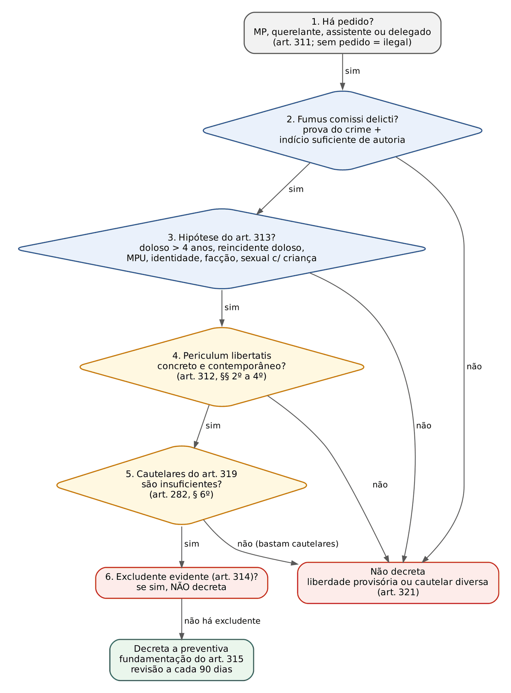
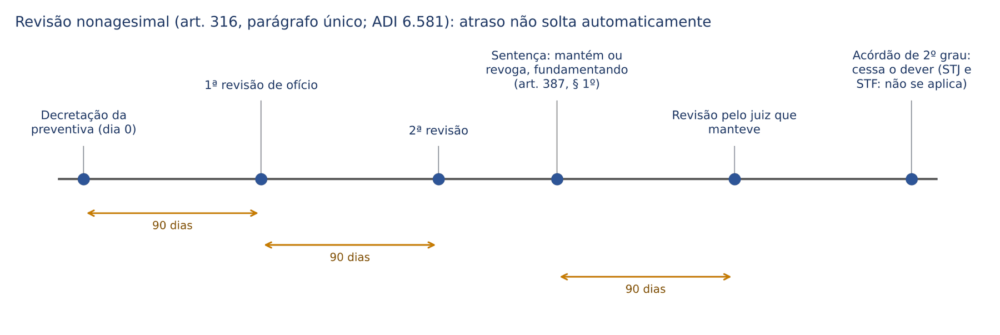
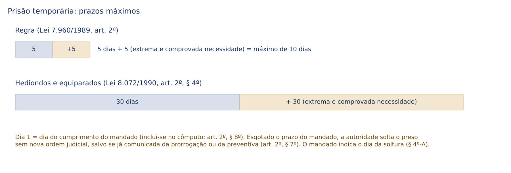
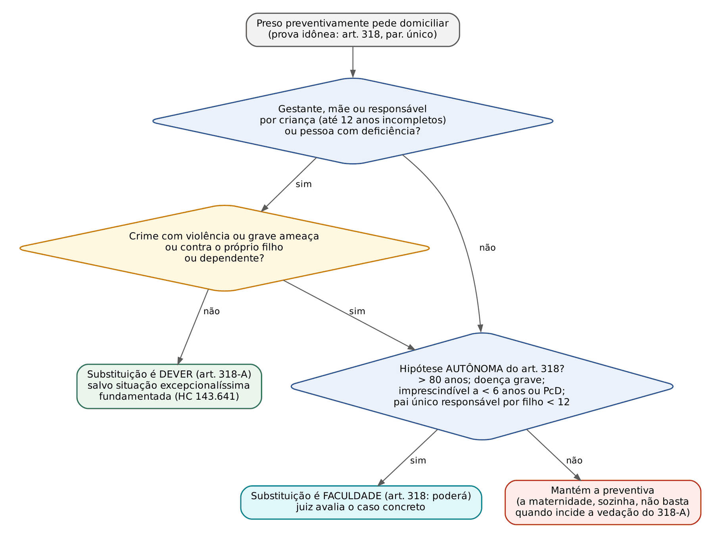
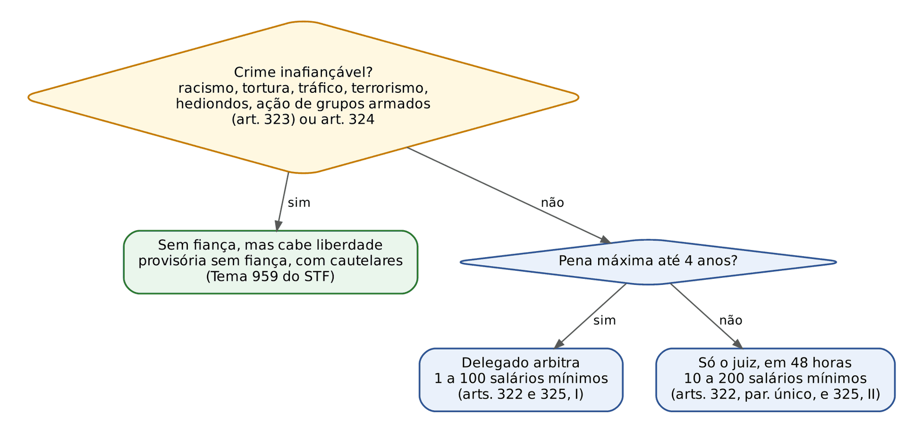
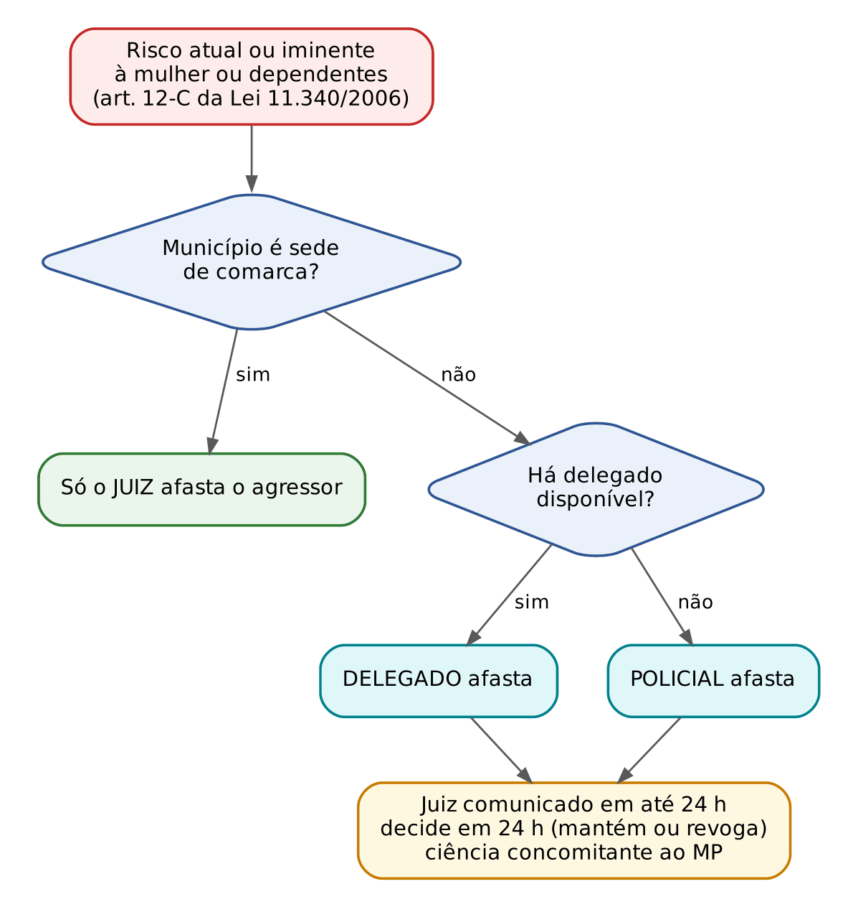

# CAPÍTULO 19 — PRISÃO II: PREVENTIVA, TEMPORÁRIA, DOMICILIAR, MEDIDAS CAUTELARES DIVERSAS DA PRISÃO, LIBERDADE PROVISÓRIA E FIANÇA; MEDIDAS PROTETIVAS DE URGÊNCIA

:::INCIDENCIA
TRF5 p. 11; TJRS p. 5 e 10; TJSC p. 11 e 19. Nível A+. Lote: 69 questões (FGV 56, FCC 13).
O que mais cai: cabimento da preventiva (art. 313: crime culposo NÃO admite), rol taxativo e prazos da temporária, hipóteses de domiciliar (arts. 318 e 318-A), quebramento x cassação da fiança e medidas protetivas (afastamento do lar pelo delegado ou policial; natureza e duração).
:::

| Subtema | FGV | FCC | Padrão da cobrança |
|---|---|---|---|
| Preventiva: cabimento, fundamentos, revisão, sentença | 20 | 5 | caso concreto: "o juiz poderá decretar a preventiva?" (homicídio culposo, lesão doméstica com MPU descumprida) |
| Temporária | 13 | 0 | "em qual destes crimes NÃO cabe?"; prazos; soltura sem alvará |
| Domiciliar | 8 | 3 | "para quais destes presos cabe a substituição?" (idade, filho com 12 ou 13 anos, violência) |
| Cautelares diversas | 2 | 2 | rol do art. 319; requisitos de cada medida |
| Liberdade provisória e fiança | 5 | 0 | quem arbitra; inafiançáveis; quebramento (metade) x perda (total) |
| Medidas protetivas de urgência | 8 | 3 | art. 12-C; art. 19; Tema 1.249; recurso cabível |

## 19.1 Visão de conjunto: a escada das cautelares pessoais

A teoria geral das cautelares pessoais (art. 282: necessidade e adequação, requerimento das partes, contraditório prévio, descumprimento, subsidiariedade da prisão) e a prisão em flagrante com a audiência de custódia estão no Cap. 18. Aqui se estudam os "degraus" que o juiz escolhe depois de examinar o caso. A ideia a guardar é a de uma escada: o juiz sobe um degrau só se o de baixo não bastar (art. 282, § 6º, e art. 321).

| Degrau (do mais leve ao mais grave) | Base legal | Quando |
|---|---|---|
| Liberdade provisória sem nenhuma condição além do comparecimento | arts. 310, III, e 321 | não há perigo concreto que justifique cautelar |
| Liberdade provisória com fiança e/ou cautelares do art. 319 | arts. 319, 321 e 322 a 350 | há perigo, mas medidas menos gravosas o neutralizam |
| Prisão domiciliar (substitutiva da preventiva) | arts. 317 a 318-B | cabe a preventiva, mas a condição pessoal do preso justifica o recolhimento em casa |
| Prisão preventiva | arts. 311 a 316 | nada abaixo basta |
| Prisão temporária (trilho próprio, só no inquérito) | Lei 7.960/1989 | imprescindível para a investigação de crime do rol |

Para o civilista: a preventiva é tutela de urgência cautelar (protege o processo ou a sociedade de um risco gerado pela liberdade do imputado), não tutela antecipada da pena. Por isso não serve para antecipar a pena nem decorre automaticamente da denúncia (art. 313, § 2º), e vale a cláusula *rebus sic stantibus*: mudou a situação de fato, revoga-se ou redecreta-se (art. 316). Prisão provisória e pena se encontram só na detração (Apostila de Direito Penal, Cap. 17).

## 19.2 Prisão preventiva

### 19.2.1 Legitimidade e momento

A preventiva cabe em qualquer fase da investigação ou do processo, decretada pelo juiz a requerimento do Ministério Público, do querelante ou do assistente, ou por representação da autoridade policial (art. 311). Desde a Lei 13.964/2019 o juiz NÃO decreta a preventiva de ofício, nem converte de ofício o flagrante em preventiva (Súmula 676 do STJ; o tema é do Cap. 18). Três desdobramentos que caem:

- O art. 20 da Lei 11.340/2006 ainda diz "de ofício", mas deve ser lido conforme o art. 311 do CPP: também na violência doméstica a preventiva exige provocação. A Lei 14.344/2022 (art. 17), mais recente, já omite a expressão.
- O assistente pode requerer a preventiva também na fase de investigação? A letra do art. 311 permite o requerimento "em qualquer fase", mas o assistente só é admitido depois do recebimento da denúncia (art. 268): na prática, só requer no processo.
- Revogar de ofício é permitido (art. 316, caput; art. 282, § 5º): a vedação protege a liberdade, não a prisão. E MANTER a preventiva já existente, na sentença, não é decretá-la de ofício (19.2.8).

:::QUESTAO FGV 2024 — Câmara dos Deputados — Consultor Legislativo (Q2513031)
Afirmações: I. a preventiva cabe na fase pré-processual ou em qualquer fase do processo; II. pode ser decretada por "requisição" do MP, do querelante ou do assistente, ou por representação da autoridade policial; III. os quatro fundamentos do art. 312. Gabarito: C (I e III).
Armadilha: II troca "requerimento" por "requisição". Requisição é ordem; o MP pede, o juiz decide. A troca de uma palavra derruba a assertiva.
No mesmo sentido (de ofício x a pedido): Q3179530 (FGV 2025, TRF3, gabarito B: o juiz pode, de ofício ou a pedido, revogar a cautelar e voltar a decretá-la se sobrevierem razões; a alternativa A, que permitia a preventiva de ofício, está errada).
:::

### 19.2.2 Pressupostos: o *fumus comissi delicti*

O art. 312 exige "prova da existência do crime e indício suficiente de autoria". É o equivalente penal da probabilidade do direito do art. 300 do CPC, mas com uma assimetria: quanto à materialidade, exige-se PROVA (certeza de que houve crime); quanto à autoria, basta INDÍCIO suficiente (probabilidade, não certeza). Prova cabal de autoria é exigência da condenação, não da cautelar (Q2513032, alternativa A, errada por isso). Um reconhecimento pessoal ou fotográfico feito em desacordo com o art. 226 não serve nem para a preventiva (ver Cap. 15).

### 19.2.3 Fundamentos: o *periculum libertatis*

A preventiva só se justifica se a liberdade do imputado gerar perigo (o "perigo gerado pelo estado de liberdade", na redação da Lei 13.964/2019) ligado a pelo menos um dos quatro fundamentos do art. 312:

| Fundamento | O que protege | Exemplos que a jurisprudência aceita | O que NÃO basta |
|---|---|---|---|
| Garantia da ordem pública | a sociedade, contra a reiteração | reiteração delitiva concreta; *modus operandi* (violência extrema, premeditação); liderança ou integração em organização criminosa; quantidade e variedade relevantes de droga, armas ou munições | gravidade abstrata do tipo; clamor público; "credibilidade da justiça"; proteger o próprio preso de linchamento |
| Garantia da ordem econômica | a economia, contra a reiteração de crimes econômicos | fraudes em série que continuam a lesar o mercado | o vulto do prejuízo, sozinho |
| Conveniência da instrução criminal | a prova (cautelar instrumental) | ameaça a testemunhas, destruição de provas, combinação de versões | a mera possibilidade abstrata de influenciar testemunhas |
| Aplicação da lei penal | a eficácia da futura condenação | fuga comprovada, preparativos de fuga, uso de documentos falsos | não ser localizado para citação, por si só; não ter residência fixa, por si só; ser estrangeiro |

A Lei 15.272/2025 (de 26/11/2025) positivou critérios que a jurisprudência já usava e vedou expressamente a gravidade abstrata:

:::LEI CPP, art. 312, §§ 3º e 4º (Lei 15.272/2025)
§ 3º Devem ser considerados na aferição da periculosidade do agente, geradora de riscos à ordem pública:
I – o modus operandi, inclusive quanto ao uso reiterado de violência ou grave ameaça à pessoa ou quanto à premeditação do agente para a prática delituosa;
II – a participação em organização criminosa;
III – a natureza, a quantidade e a variedade de drogas, armas ou munições apreendidas; ou
IV – o fundado receio de reiteração delitiva, inclusive à vista da existência de outros inquéritos e ações penais em curso.
§ 4º É incabível a decretação da prisão preventiva com base em alegações de gravidade abstrata do delito, devendo ser concretamente demonstrados a periculosidade do agente e seu risco à ordem pública, à ordem econômica, à regularidade da instrução criminal e à aplicação da lei penal, conforme o caso.
:::

Leitura correta do § 3º: são critérios que o juiz DEVE considerar para aferir o risco à ordem pública, não hipóteses de prisão automática. Inquéritos e ações em curso, que a Súmula 444 do STJ proíbe usar para agravar a pena-base, servem aqui como indicativo de reiteração, porque a preventiva não é pena: ela olha para o risco futuro. A mesma lei criou, no art. 310, § 5º, uma lista de circunstâncias que "recomendam" a conversão do flagrante em preventiva (reiteração, violência ou grave ameaça, liberação anterior em outra audiência de custódia, infração cometida na pendência de inquérito ou ação, fuga, perigo para a prova) e, no § 6º, tornou obrigatório o exame dessas circunstâncias e dos critérios do art. 312, § 3º, na decisão da audiência de custódia (ver Cap. 18). "Recomendam" não é "obrigam": a conversão continua dependendo do art. 312 e da insuficiência das cautelares diversas.

:::PEGADINHA Critérios de periculosidade (art. 312, § 3º) x circunstâncias da conversão (art. 310, § 5º)
A FGV embaralha as duas listas. São critérios de PERICULOSIDADE para a ordem pública (art. 312, § 3º): *modus operandi*, organização criminosa, drogas/armas/munições, reiteração (inclusive por inquéritos e ações em curso). Fuga ou perigo de fuga e perigo para a prova estão só na lista do art. 310, § 5º (e, de qualquer modo, ligam-se à aplicação da lei penal e à instrução, não à ordem pública).
:::

:::QUESTAO FCC 2026 — DPE-MA — Defensor Público (Q4012646)
Gabarito: A (reiteração à vista de inquéritos e ações em curso, art. 312, § 3º, IV). Armadilhas: tornar a conversão obrigatória por violência, dispensar fundamentação concreta ou mandar ignorar natureza e quantidade de droga.
A Q4116994 (FGV 2026, MPE-MT, gabarito E), que embaralha as listas do art. 312, § 3º, e do art. 310, § 5º, está comentada no Cap. 18 (v. 18.7.4).
No mesmo sentido: Q3954645 (FCC 2026, DPE-MT, gabarito D: periculosidade concreta por inquéritos em andamento e risco à aplicação da lei penal; errada a que torna a preventiva automática pela liberação anterior em custódia ou pela quantidade de droga); Q4378279 (FGV 2026, PC-PR, gabarito C: a gravidade abstrata NÃO autoriza a preventiva).
:::

Outros pontos da jurisprudência do STJ sobre fundamentos:

- A simples não localização do réu, sem outros elementos, não justifica a preventiva para aplicação da lei penal (STJ, AgRg no RHC 170.036-MG, j. 21/11/2023).
- É idônea a preventiva fundada no *modus operandi* e na necessidade de interromper a atuação de líder de organização criminosa voltada a crimes informáticos (Jurisprudência em Teses, ed. 279, tese 7).
- O juiz pode consultar informações públicas das redes sociais do investigado e usá-las para fundamentar a preventiva, sem quebra da imparcialidade (STJ, AgRg no AREsp 2.655.165-SC, Quinta Turma, j. 1º/4/2025).
- Quando a prova de autoria é essencialmente digital e ainda depende de perícia de fidedignidade, a proporcionalidade recomenda substituir a preventiva por cautelares diversas até o laudo (STJ, AgRg no HC 1.014.212-ES, Sexta Turma, j. 10/2/2026).
- Se a liberdade provisória foi concedida apenas porque o preso firmou colaboração premiada, o descumprimento do acordo autoriza restabelecer a preventiva (Jurisprudência em Teses, ed. 197, tese 4).

:::DOUTRINA Ordem pública: o fundamento mais criticado
Aury Lopes Jr. vê na "ordem pública" um conceito vago, que serve a usos não cautelares da prisão (clamor público, gravidade do crime, credibilidade das instituições). A jurisprudência não declarou o fundamento inválido, mas absorveu a crítica ao exigir risco concreto de reiteração, hoje positivado no art. 312, §§ 3º e 4º.
:::

### 19.2.4 Hipóteses de admissibilidade (art. 313)

Mesmo presentes o *fumus* e o *periculum*, a preventiva só é ADMISSÍVEL nas hipóteses do art. 313. É um filtro de proporcionalidade feito pelo legislador: não faz sentido prender preventivamente quem, se condenado, provavelmente não cumprirá pena em regime fechado (princípio da homogeneidade).

| Hipótese | Dispositivo | Observações |
|---|---|---|
| Crime DOLOSO com pena privativa de liberdade MÁXIMA superior a 4 anos | art. 313, I | conta-se a pena máxima em abstrato, com majorantes no máximo e minorantes no mínimo; crime culposo NUNCA entra, por maior que seja a pena |
| Reincidente em crime doloso (condenação anterior transitada em julgado) | art. 313, II | ressalvado o período depurador de 5 anos (art. 64, I, do CP); não basta maus antecedentes; a condenação anterior também tem de ser por crime doloso |
| Violência doméstica e familiar contra mulher, criança, adolescente, idoso, enfermo ou pessoa com deficiência, para garantir a execução de medidas protetivas de urgência | art. 313, III | dispensa o patamar de pena; pressupõe MPU deferida (em regra, descumprida); dispensa vítima mulher |
| Crime cometido por integrante de organização criminosa ultraviolenta, grupo paramilitar ou milícia privada, no contexto das condutas do art. 2º da Lei 15.358/2026 | art. 313, V (Lei 15.358/2026, de 24/3/2026) | ver ATENCAO abaixo |
| Crimes contra a dignidade sexual praticados contra criança ou adolescente, ou dos arts. 240 a 241-D e 244-A do ECA | art. 313, VI (Lei 15.487/2026, de 6/8/2026) | admite a preventiva ainda que a pena máxima não supere 4 anos |
| Dúvida sobre a identidade civil ou falta de elementos para esclarecê-la | art. 313, § 1º | o preso é solto logo após a identificação, salvo outra hipótese |

Duas regras de fechamento:

- Vedação de finalidade (art. 313, § 2º): não se admite preventiva para antecipar a pena, nem como decorrência imediata da investigação, da apresentação ou do recebimento da denúncia (Q2513032, alternativa E, errada).
- Preventiva por descumprimento de cautelar (art. 312, § 1º, e art. 282, § 4º): descumprida uma cautelar diversa, o juiz, a requerimento, pode substituí-la, cumulá-la ou, em último caso, decretar a preventiva. Parte da doutrina (e julgados do STJ) admite essa preventiva "substitutiva" ou "sancionatória" mesmo fora do art. 313, porque o próprio imputado frustrou a alternativa; a posição mais garantista exige o art. 313. Na prova objetiva, a FGV cobra a regra do § 1º do art. 312 sem entrar nessa divergência.

:::ATENCAO Lei 15.358/2026: "causa suficiente" para a preventiva?
Além de incluir o inciso V no art. 313, a Lei 15.358/2026 (Marco Legal do Combate ao Crime Organizado) dispõe que a prática dos crimes de domínio social estruturado "é causa suficiente para decretação de prisão preventiva" (art. 2º, § 9º) e os torna inafiançáveis (art. 2º, § 4º, II). Lido literalmente, o § 9º criaria preventiva obrigatória pela simples imputação, o que choca com o art. 312, § 4º, com o art. 313, § 2º, e com a linha do STF que derrubou vedações abstratas à liberdade (art. 21 do Estatuto do Desarmamento, ADI 3.112; art. 44 da Lei de Drogas, Tema 959 — 19.6). Leitura segura: a imputação desses crimes torna a preventiva ADMISSÍVEL, mas o juiz continua obrigado a demonstrar o perigo concreto e a insuficiência das cautelares. Os aspectos materiais e as demais regras da lei estão no Cap. 26 e na Apostila de Direito Penal, Cap. 46.
:::

:::EXEMPLO O homicídio culposo e a preventiva (o caso preferido da FGV)
Caso: R, sem residência fixa e com outras condenações por crimes culposos, é denunciado por homicídio culposo no trânsito (art. 302 do CTB, detenção de 2 a 4 anos). O MP pede a preventiva para garantir a aplicação da lei penal.
1. O que se pergunta: a preventiva é admissível?
2. A regra: art. 313. Inciso I exige crime DOLOSO; inciso II, reincidência em crime DOLOSO; os incisos III, V e VI não se aplicam; não há dúvida sobre a identidade (§ 1º trata de identidade, não de endereço).
3. Aplicação: nenhuma hipótese incide. A preventiva é INCABÍVEL, por mais concretos que sejam o risco de fuga ou os maus antecedentes. O juiz pode impor cautelar diversa (art. 319), mas NÃO pode "trocar" a preventiva pela temporária (só cabe no inquérito e em crimes do rol) nem pela domiciliar (que substitui uma preventiva cabível).
Fundamento jurisprudencial: o STJ afirma ser incabível preventiva em crime culposo (HC 593.250/SP, Sexta Turma, j. 22/9/2020).
:::

:::QUESTAO FGV 2024 — TJ-SC — Juiz Substituto (Q2387000)
Denúncia por homicídio culposo; o MP pede a preventiva porque o réu tem outras condenações por delitos culposos e não tem residência fixa na comarca. Gabarito: A (a preventiva não é cabível, mas o juiz pode decretar cautelar diversa da prisão).
Armadilhas: B (ordem pública pelos antecedentes) e D (aplicação da lei penal pela falta de residência) discutem o FUNDAMENTO, quando o problema está antes, na ADMISSIBILIDADE; C (temporária substitutiva) ignora que a temporária é só da investigação e do rol taxativo.
No mesmo sentido (homicídio culposo, preventiva incabível): Q3049383 (FGV 2024, TJ-SC, gabarito A); Q3117553 (FGV 2024, TJ-PE, trânsito e maus antecedentes, gabarito E); Q3878296 (FGV 2026, TJ-RJ, gabarito A); Q3425294 (FGV 2025, TRF1, gabarito C: nem temporária, pedida pelo delegado, nem preventiva); Q3301271 (FGV 2025, TJ-SE, gabarito A: o MP desclassificou para culposo e pediu só comparecimento periódico; o juiz recebe a denúncia e não pode decretar a preventiva); Q4088254 (FGV 2026, MPE-RJ, gabarito D: duplo homicídio culposo de investigada grávida, sem residência fixa e com cinco inquéritos; nem preventiva nem domiciliar).
:::

:::QUESTAO FCC 2026 — MPE-AL — Analista (Q4092728)
Quatro réus primários: roubo com preventiva fundada só na gravidade abstrata; furto simples (máximo de 4 anos) com preventiva pelo *modus operandi*; corrupção passiva com preventiva pela reiteração à vista de outros processos; violência doméstica com MPU descumprida. Gabarito: D (corretas só a terceira e a quarta).
Passos: roubo, admissível pelo art. 313, I, mas falha o FUNDAMENTO (gravidade abstrata: art. 312, § 4º); furto simples, falha a ADMISSIBILIDADE (pena máxima igual a 4 anos não é "superior" a 4); corrupção passiva, máximo de 12 anos e reiteração concreta (art. 312, § 3º, IV); violência doméstica, art. 313, III.
No mesmo sentido: Q2513032 (FGV 2024, Câmara dos Deputados, gabarito D: dúvida sobre a identidade civil; erradas a "prova cabal" de autoria, a exigência de concordância da vítima na violência doméstica e a preventiva como decorrência da denúncia).
:::

### 19.2.5 Excludentes de ilicitude (art. 314)

A preventiva "em nenhum caso" será decretada se o juiz verificar, pelas provas dos autos, que o agente agiu em estado de necessidade, legítima defesa, estrito cumprimento do dever legal ou exercício regular de direito (art. 23 do CP). A lógica: se o *fumus* aponta para um fato lícito, não há crime a acautelar. A regra se estende, pela mesma razão, às excludentes de culpabilidade evidentes (posição corrente na doutrina). No flagrante, a mesma ideia leva à liberdade provisória mediante termo de comparecimento (art. 310, § 1º — Cap. 18).

### 19.2.6 Contemporaneidade e fundamentação

O perigo tem de ser ATUAL. A decisão deve indicar "fatos novos ou contemporâneos" que justifiquem a medida (art. 312, § 2º, e art. 315, § 1º). Contemporaneidade não significa que o crime seja recente: significa que o RISCO persiste no momento da decisão. Um crime de 2019 pode justificar preventiva em 2026 se o réu continua, hoje, ameaçando testemunhas; um crime de ontem não a justifica se nada indica risco.

A lista de vícios de fundamentação do art. 315, § 2º (espelho do art. 489, § 1º, do CPC) e a fundamentação *per relationem* estão no Cap. 18 (18.4). Aqui basta lembrar que ela vale para a decisão que decreta, substitui ou DENEGA a preventiva (art. 315, caput).

Questões correlatas comentadas no Cap. 18: Q2513033 (FGV 2024, Câmara dos Deputados, gabarito E, art. 315, § 2º, VI) e Q2513034 (gabarito D: revogação de ofício; revisão a cada 90 dias, não mensal; domiciliar só com autorização judicial para sair).

:::SENTENCA A decisão que decreta a preventiva
Onde entra: decisão interlocutória autônoma (no recebimento da denúncia, na custódia ou em qualquer fase) ou capítulo da sentença (art. 387, § 1º). Roteiro: (1) provocação (quem pediu); (2) admissibilidade (inciso do art. 313); (3) *fumus* (materialidade provada e indícios de autoria, com referência às provas); (4) *periculum* concreto e contemporâneo, ligado a um fundamento do art. 312; (5) insuficiência das cautelares do art. 319, explicada (art. 282, § 6º); (6) ausência de excludente (art. 314).
Redação-modelo: "Admissível a custódia (art. 313, I, do CPP: roubo majorado, pena máxima superior a 4 anos), presentes prova da materialidade (auto de apreensão e laudo de fls.) e indícios suficientes de autoria (reconhecimento formal da vítima, art. 226). O réu responde a duas outras ações por roubo, cometidos nos últimos seis meses com idêntico modo de agir, o que evidencia risco concreto e atual de reiteração (art. 312, § 3º, IV); medidas do art. 319 não o neutralizariam, porque os fatos foram praticados durante o cumprimento de recolhimento noturno anteriormente imposto."
Erro que a banca pune: invocar "gravidade do delito", "clamor social" ou "hediondez" sem fato concreto; esquecer de explicar por que as cautelares diversas não bastam; decretar sem pedido.
:::

### 19.2.7 Revogação, redecretação e revisão nonagesimal

O juiz pode, de ofício ou a pedido, revogar a preventiva se faltar motivo para que subsista e voltar a decretá-la se sobrevierem razões (art. 316, caput). E deve REVISAR de ofício a necessidade da manutenção a cada 90 dias, em decisão fundamentada, "sob pena de tornar a prisão ilegal" (parágrafo único).

O que o STF e o STJ disseram sobre o parágrafo único:

| Ponto | Entendimento | Fonte |
|---|---|---|
| Atraso na revisão solta o preso? | NÃO automaticamente: o juízo deve ser instado a reavaliar a legalidade e a atualidade dos fundamentos | STF, SL 1.395 MC-Ref, j. 15/10/2020; ADI 6.581 e ADI 6.582, j. 8/3/2022; JT do STJ, ed. 184, tese 5 |
| Até quando vale o dever? | até o final do processo de conhecimento, com o encerramento da cognição plena pelo tribunal de segundo grau | ADI 6.581 |
| Quem revisa? | o "órgão emissor da decisão" (quem decretou ou manteve) | art. 316, parágrafo único |
| Tribunal que só julga recurso ou HC tem o dever? | NÃO, quando atua como órgão revisor; tem, se ele próprio decretou a prisão (competência originária, por exemplo) | JT do STJ, ed. 184, tese 6 |
| Aplica-se às cautelares diversas (art. 319)? | NÃO; o atraso também não as torna ilegais, embora o juiz deva reavaliá-las quando provocado ou quando mudarem os fatos | STJ, AgRg na Pet 16.308-DF, Corte Especial, j. 12/8/2025 |
| Aplica-se às medidas protetivas de urgência? | NÃO há revisão periódica obrigatória | STJ, Tema 1.249 (19.8) |

:::JURIS STF, SL 1.395 MC-Ref e ADI 6.581 (art. 316, parágrafo único)
SL 1.395 (j. 15/10/2020): a inobservância da reavaliação no prazo de 90 dias não implica revogação automática da preventiva; o juízo competente deve ser instado a reavaliar a legalidade e a atualidade de seus fundamentos. ADI 6.581 (j. 8/3/2022): o prazo não acarreta, automaticamente, a revogação da prisão; a revisão nonagesimal aplica-se até o final dos processos de conhecimento, com o encerramento da cognição plena pelo tribunal de segundo grau, não se aplicando às prisões cautelares decorrentes de condenação em segunda instância ainda não transitada em julgado; aplica-se também aos processos de competência originária.
Consequência prática: a omissão gera constrangimento sanável por HC, cuja ordem, em regra, determina que o juiz reavalie imediatamente, e não que solte.
:::

:::QUESTAO FGV 2026 — TJ-PE — Juiz Substituto (Q4349518)
Servidor do TJPE, réu por corrupção e lavagem, submetido a cautelares diversas (proibição de acesso ao tribunal e de contato, proibição de sair da comarca, tornozeleira) há mais de 12 meses sem reavaliação; aposentou-se. A defesa sustenta revisão obrigatória a cada 90 dias e perda do objeto pela aposentadoria. Gabarito: B (o art. 316, parágrafo único, não se aplica às cautelares diversas, e o mero decurso de 90 dias não gera ilegalidade automática).
Armadilhas: A estende a revisão às cautelares diversas; C cria ilegalidade por excesso de prazo; E trata a aposentadoria como causa automática de revogação (ela é fato a ser ponderado, não basta por si, pois o risco de interferência pode persistir por outros meios).
No mesmo sentido: Q2489741 (FGV 2024, TJ-MS, gabarito B: decretada e mantida na sentença, com os autos já no TJ, o órgão emissor revisa a cada 90 dias, de ofício); Q3304099 (FCC 2025, DPE-SP, gabarito B: a revisão nonagesimal vale até o final do processo de conhecimento, encerrado com a cognição plena pelo tribunal de segundo grau).
:::

:::QUESTAO FGV 2024 — PC-SC — Delegado (Q2360705)
Preventiva decretada no inquérito para garantia da ordem pública e revogada no processo; durante a instrução, testemunhas da acusação passam a ser ameaçadas pelo réu. Pergunta-se o que o juiz pode fazer. Gabarito: B (só a II: redecretar a preventiva por conveniência da instrução, cautelar instrumental, presentes *fumus* e *periculum* — art. 316, caput).
Por que as outras falham: I invoca a aplicação da lei penal, que se liga à fuga, não à intimidação de testemunhas; III parte da premissa falsa de que a redecretação não seria admitida; IV nega ao juiz a redecretação, que o art. 316 autoriza expressamente.
:::

### 19.2.8 Excesso de prazo

Não há prazo legal máximo para a preventiva. O controle é feito pela razoabilidade, à luz da complexidade da causa, da quantidade de réus, do comportamento das partes e da diligência do juízo (art. 5º, LXXVIII, da CF). Três súmulas do STJ balizam o raciocínio:

| Súmula do STJ | Enunciado (síntese) | Lógica |
|---|---|---|
| 21 | pronunciado o réu, fica superada a alegação de excesso de prazo na instrução | a instrução da primeira fase do júri acabou |
| 52 | encerrada a instrução criminal, fica superada a alegação de excesso de prazo | idem, no procedimento comum |
| 64 | não constitui constrangimento ilegal o excesso de prazo na instrução provocado pela defesa | ninguém se beneficia da própria demora |

Cuidado: as Súmulas 21 e 52 são relativizadas quando, depois da pronúncia ou do fim da instrução, a demora para o júri ou para a sentença se torna desarrazoada; o excesso pode então ser reconhecido em relação à nova fase. O remédio é o habeas corpus (Cap. 30). Correlata: Q2449098 (empate no julgamento de HC por excesso de prazo: prevalece a decisão mais favorável ao paciente — Cap. 30).

### 19.2.9 Preventiva na sentença e na pronúncia

Na sentença condenatória, o juiz decide, fundamentadamente, sobre a manutenção ou, se for o caso, a imposição de preventiva ou de outra cautelar, sem prejuízo do conhecimento da apelação (art. 387, § 1º). Na pronúncia, o juiz decide, motivadamente, sobre manutenção, revogação ou substituição da prisão ou cautelar anteriormente decretada e, se o réu estiver solto, sobre a necessidade de decretá-la (art. 413, § 3º — Cap. 23). Nos crimes hediondos, a sentença decide fundamentadamente se o réu pode apelar em liberdade (art. 2º, § 3º, da Lei 8.072/1990). Não existe mais prisão como efeito automático da condenação recorrível nem exigência de recolhimento para apelar (ver Cap. 28).

Duas questões práticas:

- Réu preso durante todo o processo e MP silente nas alegações finais: o juiz pode MANTER a preventiva na sentença, fundamentadamente. Manutenção não é decretação de ofício: a prisão já foi provocada, e o art. 387, § 1º, impõe ao juiz o dever de se pronunciar.
- O tribunal, ao julgar HC contra prisão mantida na sentença sem fundamentação, NÃO pode acrescentar fundamentos que o juiz não deu, sob pena de convalidar prisão ilegal (STJ, RHC 212.836-RS, Sexta Turma, j. 20/3/2025). Fundamentação é requisito de validade da própria decisão de primeiro grau.

:::QUESTAO FCC 2026 — DPE-BA — Defensor Público (Q4037440)
Réu preso em flagrante por roubo majorado, mantido preso durante todo o processo; nas alegações finais, o MP pede a condenação e silencia sobre a prisão; a defesa pede o apelo em liberdade. Gabarito: C (o juiz pode manter a preventiva, fundamentadamente).
Armadilhas: B (soltura obrigatória pelo sistema acusatório) confunde manter com decretar; A (aguardar os 90 dias para sentenciar) inverte a lógica da revisão; D (abrir vista ao MP) cria exigência inexistente; E (não se manifestar) viola o art. 387, § 1º.
No mesmo sentido, sobre a outra face: Q4012643 (FCC 2026, DPE-MA, gabarito A: o TJ não pode suprir, no HC, a fundamentação omitida na sentença que vedou o recurso em liberdade).
:::

:::SENTENCA O capítulo da prisão na sentença condenatória
Onde entra: depois da dosimetria, do regime e da detração (Apostila de Direito Penal, Caps. 17 e 26), em tópico próprio ("Da prisão preventiva" ou "Do direito de recorrer em liberdade").
O que fundamentar: se o réu está preso, se persistem os motivos (com fato concreto e atual) e se a manutenção é compatível com o regime fixado; se está solto, por que só agora surgiu o risco (fato novo). Regime semiaberto ou aberto e prisão preventiva convivem mal: manter preso em regime fechado quem foi condenado ao semiaberto é ilegal; a jurisprudência admite manter a preventiva compatibilizando-a com as regras do regime fixado.
Redação-modelo: "Mantenho a prisão preventiva (art. 387, § 1º, do CPP): persistem os motivos da decisão de fls., agora reforçados pela condenação, e o réu, durante a instrução, foi flagrado em contato com a vítima, em desafio à proibição imposta; as cautelares diversas mostraram-se insuficientes. Expeça-se guia de recolhimento provisória."
Erro que a banca pune: vedar o recurso em liberdade "por se tratar de crime grave" ou sem nenhuma fundamentação; soltar o réu só porque o MP não pediu a manutenção.
:::

### 19.2.10 Qual recurso cabe

:::PROCESSO Qual recurso cabe contra as decisões sobre prisão e cautelares
| Decisão | Recurso ou ação | Fundamento e observações |
|---|---|---|
| Decreta ou mantém preventiva ou temporária | habeas corpus | não há recurso previsto para a defesa; HC é a via (Cap. 30) |
| Indefere requerimento de preventiva ou a revoga | RESE, 5 dias, sem efeito suspensivo | art. 581, V |
| Concede liberdade provisória ou relaxa a prisão em flagrante | RESE | art. 581, V |
| Arbitra fiança, julga-a inidônea, quebrada ou perdida, ou a cassa | RESE | art. 581, V e VII |
| Indefere temporária | sem previsão expressa; parte da doutrina admite RESE por interpretação extensiva do art. 581, V; outros apontam o mandado de segurança | ver nota de verificação |
| Impõe cautelar diversa | HC, se afetar a liberdade de locomoção (proibição de sair da comarca, recolhimento noturno, monitoração); se não afetar, não cabe HC | art. 5º, LXVIII, da CF |
| Indefere ou revoga cautelar diversa | RESE por interpretação extensiva do art. 581, V (posição majoritária) | |
| Indefere prisão domiciliar | HC | |
| Mantém ou decreta preventiva na sentença | apelação (capítulo da sentença) e, na prática, HC | arts. 387, § 1º, e 593 |
| Defere, indefere ou revoga medida protetiva de urgência | controvertido; ver 19.8.4 | |
:::

## 19.3 Prisão temporária

### 19.3.1 Natureza e finalidade

A temporária é a prisão cautelar da INVESTIGAÇÃO: serve para apurar crimes graves quando a liberdade do investigado comprometeria a investigação (intimidar testemunhas, avisar comparsas, destruir prova). Nasceu (Lei 7.960/1989) para substituir a ilegal "prisão para averiguação". Duas consequências estruturais:

- Só cabe durante a investigação. Recebida a denúncia, não há mais temporária; se o risco persistir, o caminho é a preventiva.
- Tem prazo certo e soltura automática: findo o prazo, o preso sai sem precisar de alvará.

### 19.3.2 Cabimento: a leitura do STF nas ADIs 3.360 e 4.109

O art. 1º da Lei 7.960/1989 lista três incisos (imprescindibilidade para o inquérito; falta de residência fixa ou de elementos de identidade; fundadas razões de autoria em crimes do rol). Durante décadas discutiu-se como combiná-los. O STF resolveu:

:::JURIS STF, ADIs 3.360 e 4.109, Plenário, j. 11/2/2022
A temporária só é cabível quando, CUMULATIVAMENTE: (1) for imprescindível para as investigações do inquérito policial (art. 1º, I), a partir de elementos concretos e não de conjecturas, vedada sua utilização como prisão para averiguações, em violação ao direito à não autoincriminação, ou quando fundada no mero fato de o representado não ter residência fixa (inciso II); (2) houver fundadas razões de autoria ou participação do indiciado nos crimes do rol do art. 1º, III (*fumus comissi delicti*), vedada a analogia ou a interpretação extensiva do rol; (3) for justificada em fatos novos ou contemporâneos (art. 312, § 2º, do CPP); (4) for adequada à gravidade concreta do crime, às circunstâncias do fato e às condições pessoais do indiciado (art. 282, II, do CPP); e (5) não for suficiente a imposição de medidas cautelares diversas (art. 282, § 6º, do CPP).
:::

Tradução prática: os incisos I e III são sempre necessários e cumulativos; o inciso II (falta de residência ou de identificação), sozinho, NÃO autoriza a temporária. E as regras gerais do CPP sobre contemporaneidade, adequação e subsidiariedade da prisão aplicam-se também à temporária.

Rol de crimes do art. 1º, III, lido com a legislação penal atual:

| Alínea | Crime | Leitura atual |
|---|---|---|
| a | homicídio doloso (art. 121, caput e § 2º) | inclui o feminicídio, hoje tipo autônomo (art. 121-A do CP), por ser homicídio doloso; não inclui o culposo |
| b | sequestro ou cárcere privado (art. 148, caput, §§ 1º e 2º) | |
| c | roubo (art. 157, caput e §§ 1º a 3º) | qualquer roubo, simples, majorado, tentado ou consumado |
| d | extorsão (art. 158, caput e §§ 1º e 2º) | inclui a simples |
| e | extorsão mediante sequestro (art. 159) | |
| f e g | estupro e "atentado violento ao pudor" | hoje, estupro (art. 213), que absorveu a antiga figura; estupro de vulnerável é hediondo (ver abaixo) |
| h | rapto violento | revogado (Lei 11.106/2005) |
| i e j | epidemia com morte; envenenamento de água ou alimento qualificado pela morte | |
| l | "quadrilha ou bando" (art. 288) | hoje, associação criminosa, inclusive a simples |
| m | genocídio | |
| n | tráfico de drogas | hoje, art. 33 da Lei 11.343/2006 |
| o | crimes contra o sistema financeiro (Lei 7.492/1986) | |
| p | crimes da Lei de Terrorismo | Lei 13.260/2016 |

E os crimes hediondos e equiparados que não estão no rol (tortura, estupro de vulnerável, furto qualificado por explosivo etc.)? O art. 2º, § 4º, da Lei 8.072/1990 diz que a temporária, "nos crimes previstos neste artigo", terá prazo de 30 dias. A doutrina majoritária lê o dispositivo como ampliação do cabimento a todos os hediondos e equiparados; uma leitura restritiva, reforçada pela taxatividade afirmada nas ADIs 3.360 e 4.109, sustenta que o § 4º apenas fixa o prazo quando o crime, além de hediondo, estiver no rol. A FGV adotou a leitura majoritária: aceitou temporária de 30 dias no furto qualificado por explosivo, hediondo fora do rol (Q2360693, adiante).

:::DICA Como resolver "em qual destes crimes NÃO cabe temporária"
Procure no rol o crime pelo NOME, não pela gravidade, e depois confira se ele é hediondo ou equiparado (para a FGV, também admite temporária, com prazo de 30 dias). Fora do rol e não hediondos, ainda que graves: corrupção passiva e ativa, peculato, furto (inclusive qualificado, salvo o qualificado por explosivo, que é hediondo), estelionato, receptação (inclusive qualificada), incêndio, porte e disparo de arma de fogo, lesão corporal grave, constrangimento ilegal, intimidação sistemática virtual. Dentro do rol, ainda que "simples": roubo simples e tentado, extorsão simples, associação criminosa simples, estupro simples, tráfico, cárcere privado.
:::

:::QUESTAO FGV 2024 — TJ-RR — Analista Judiciário (Q3087138)
Delegado quer representar pela temporária de três investigados: corrupção passiva, furto qualificado por rompimento de obstáculo e roubo simples. Gabarito: E (só no roubo simples).
Passos: imprescindibilidade e fundadas razões foram dados pelo enunciado; o que decide é o rol. Corrupção passiva e furto qualificado não estão nele; o roubo, em qualquer forma, está (alínea c).
No mesmo sentido: Q3171411 (FGV 2025, PC-MG, gabarito D: não cabe no incêndio simples; cabe na associação criminosa simples, no tráfico, na extorsão simples e no roubo simples); Q3345960 (FGV 2025, TJ-GO, gabarito A: não cabe na receptação qualificada); Q3847178 (FGV 2026, PC-PI, gabarito A: não cabe no disparo de arma de fogo); Q3520336 (FGV 2025, TJ-ES, gabarito E: cabe no sequestro, não no porte de arma, lesão grave, intimidação sistemática virtual ou constrangimento ilegal); Q3324271 (FGV 2025, TJ-SC, gabarito E: estelionato e furto qualificado pela fraude estão fora do rol, e a temporária é incabível, qualquer que fosse a posição do MP); Q2449102 (FGV 2024, TJ-AP, gabarito C: cabe no roubo simples TENTADO, por 5 dias prorrogáveis por mais 5).
:::

### 19.3.3 Procedimento e prazos

| Etapa | Regra | Dispositivo |
|---|---|---|
| Iniciativa | representação do delegado ou requerimento do MP; NUNCA de ofício | art. 2º, caput |
| Oitiva do MP | se a iniciativa for do delegado, o juiz ouve o MP antes de decidir | art. 2º, § 1º |
| Prazo para decidir | 24 horas do recebimento da representação ou do requerimento, em despacho fundamentado | art. 2º, § 2º |
| Controle judicial | o juiz pode, de ofício ou a pedido do MP ou do advogado, mandar apresentar o preso, pedir informações e determinar exame de corpo de delito | art. 2º, § 3º |
| Mandado | em duas vias, uma entregue ao preso como nota de culpa; deve conter NECESSARIAMENTE o período de duração e o dia da soltura | art. 2º, §§ 4º e 4º-A |
| Execução | só depois da expedição do mandado judicial; o preso é informado dos direitos constitucionais | art. 2º, §§ 5º e 6º |
| Prazo | 5 dias, prorrogáveis por igual período em caso de extrema e comprovada necessidade; 30 + 30 nos hediondos e equiparados | art. 2º, caput; Lei 8.072/1990, art. 2º, § 4º |
| Contagem | inclui-se o dia do cumprimento do mandado | art. 2º, § 8º |
| Fim do prazo | a autoridade solta o preso independentemente de nova ordem judicial, salvo se já comunicada da prorrogação ou da decretação da preventiva | art. 2º, § 7º |
| Separação | presos temporários ficam separados dos demais | art. 3º |
| Plantão | plantão permanente de 24 horas do Judiciário e do MP para os pedidos | art. 5º |

:::EXEMPLO Contando o prazo
Temporária por roubo, mandado com prazo de 5 dias, cumprido às 23h de 10/3. Dia 1 = 10/3 (o dia do cumprimento conta, ainda que restasse uma hora); dias 2 a 5 = 11, 12, 13 e 14/3. Encerrado o dia 14/3, o preso é solto pela própria autoridade, sem alvará, salvo comunicação de prorrogação ou de preventiva. Manter o preso além do prazo é crime de abuso de autoridade (art. 12, parágrafo único, IV, da Lei 13.869/2019 — Apostila de Direito Penal, Cap. 44).
:::

:::QUESTAO FGV 2024 — PC-SC — Psicólogo Policial (Q2365398)
Temporária por homicídio triplamente qualificado contra a companheira. Gabarito: A (decorrido o prazo do mandado, a autoridade põe o preso em liberdade independentemente de nova ordem, salvo comunicação de prorrogação ou preventiva — art. 2º, § 7º).
Armadilhas: B (decretação de ofício); C (prazo de 5 dias para decidir: são 24 horas); D (mandado em uma via: são duas); E (prazo começa no dia seguinte: o dia do cumprimento conta).
No mesmo sentido: Q4378262 (FGV 2026, PC-PR, gabarito A: I e II corretas; a III erra ao incluir "ordem pública e ordem econômica" entre os requisitos da temporária, que são da preventiva); Q3848999 (FGV 2026, PC-PI, gabarito B: cárcere privado está no rol, e o mandado conterá NECESSARIAMENTE o período e o dia da soltura; corrupção passiva e porte de arma, fora do rol; "poderá conter" está errado); Q3179530 (FGV 2025, TRF3: erradas a alternativa que admite temporária "em qualquer fase do processo" e a que exige alvará para a soltura nos hediondos).
:::

:::QUESTAO FGV 2024 — PC-SC — Delegado (Q2360693)
Temporária por furto qualificado pelo emprego de explosivo (art. 155, § 4º-A, do CP), decretada por 30 dias; vencido o prazo, o delegado mantém o preso "pela gravidade do crime". Afirmações: I. o preso deveria ter sido solto ao fim do prazo do mandado; II. a prisão é ilegal porque o prazo máximo, para esse crime, é de 5 + 5 dias; III. a manutenção pelo delegado é legítima. Gabarito: E (só a I).
Passos: (1) I está certa: findo o prazo do mandado, a autoridade solta o preso sem nova ordem (art. 2º, § 7º); (2) II está errada: o furto qualificado por explosivo é hediondo (art. 1º, IX, da Lei 8.072/1990, na redação da Lei 13.964/2019), e a temporária nos hediondos tem prazo de 30 dias, prorrogável por igual período (art. 2º, § 4º), de modo que a decretação por 30 dias foi regular; (3) III está errada: a manutenção pelo delegado depois do prazo, "pela gravidade do crime", é ilegal. A FGV adotou a leitura majoritária: a temporária cabe nos hediondos e equiparados, ainda que fora do rol da Lei 7.960/1989.
:::

:::QUESTAO FGV 2026 — MPE-RJ — Promotor de Justiça Substituto (Q4088253)
O Gaeco, em procedimento investigatório criminal (PIC) que apura organização criminosa, roubos com arma de fogo e extorsões, requer ao juiz a temporária de quatro investigados por 30 dias. Gabarito: C (pode ser decretada no PIC, por 30 dias prorrogáveis por igual período).
Passos: (1) legitimidade: o MP pode requerer (art. 2º); (2) a lei fala em "inquérito policial", mas a FGV aceitou a temporária no PIC, coerente com o reconhecimento do poder investigatório do MP (Tema 184 do STF — Cap. 5); (3) prazo: roubo com emprego de arma de fogo é hediondo (art. 1º, II, "b", da Lei 8.072/1990), logo 30 + 30. Erradas as alternativas que exigem representação policial ou "conversão" do PIC em inquérito.
:::

:::QUESTAO FGV 2024 — ENAM 2024.2 (Q3058619)
Afirmações sobre a temporária à luz do STF: I. exige sempre o inciso III (rol taxativo, sem analogia); II. deve basear-se em fatos novos ou contemporâneos; III. a subsidiariedade do art. 282, § 6º, não se aplicaria à temporária. Gabarito: B (I e II).
Armadilha: III contraria o quinto requisito fixado nas ADIs 3.360 e 4.109 (insuficiência das cautelares diversas).
:::

### 19.3.4 Temporária x preventiva

| Aspecto | Temporária | Preventiva |
|---|---|---|
| Fase | só investigação | investigação ou processo |
| Iniciativa | delegado ou MP | MP, querelante, assistente ou delegado |
| Crimes | rol do art. 1º, III, da Lei 7.960/1989 (e hediondos e equiparados, para a doutrina majoritária e a FGV) | art. 313 (doloso com máximo superior a 4 anos, reincidência dolosa, MPU, identidade, facção, crimes sexuais contra criança) |
| Finalidade | imprescindibilidade para a investigação | ordem pública, ordem econômica, instrução, aplicação da lei penal |
| Prazo | 5 + 5; 30 + 30 nos hediondos | sem prazo legal; revisão a cada 90 dias |
| Fim | soltura automática ao fim do prazo | revogação por decisão judicial |
| Prazo para decidir | 24 horas | sem prazo específico |
| Mandado | duas vias, com o dia da soltura | regras gerais (arts. 285 e seguintes) |

## 19.4 Prisão domiciliar

### 19.4.1 Conceito e hipóteses do art. 318

A prisão domiciliar do CPP é o recolhimento do indiciado ou acusado em sua residência, de onde só pode sair com autorização judicial (art. 317). Não é medida cautelar diversa: é a PRÓPRIA preventiva, cumprida em outro lugar. Daí o pressuposto lógico que a FGV explora: só se substitui uma preventiva CABÍVEL. Se a preventiva é inadmissível (por exemplo, crime culposo), não há o que substituir.

:::LEI CPP, art. 318
Art. 318. Poderá o juiz substituir a prisão preventiva pela domiciliar quando o agente for:
I - maior de 80 (oitenta) anos;
II - extremamente debilitado por motivo de doença grave;
III - imprescindível aos cuidados especiais de pessoa menor de 6 (seis) anos de idade ou com deficiência;
IV - gestante;
V - mulher com filho de até 12 (doze) anos de idade incompletos;
VI - homem, caso seja o único responsável pelos cuidados do filho de até 12 (doze) anos de idade incompletos.
Parágrafo único. Para a substituição, o juiz exigirá prova idônea dos requisitos estabelecidos neste artigo.
:::

Os detalhes que derrubam candidatos:

| Inciso | Detalhe literal | Erro típico de alternativa |
|---|---|---|
| I | maior de 80 anos (quem COMPLETOU 80 já é "maior de 80", como "maior de 18" é quem completou 18) | trocar por 70 ou 85 anos; exigir doença além da idade |
| II | EXTREMAMENTE debilitado por doença grave | basta "doença grave" |
| III | imprescindível a criança com menos de 6 anos ou a pessoa com deficiência | trocar 6 por 12 anos |
| IV | gestante, em qualquer mês de gestação | exigir gravidez de risco ou o nascimento |
| V | mulher com filho de até 12 anos INCOMPLETOS (até 11 anos e 364 dias) | filho de 12 ou 13 anos |
| VI | homem, se for o ÚNICO responsável pelo filho de até 12 anos incompletos | omitir "único responsável" |

### 19.4.2 Gestantes e mães: o art. 318-A e o HC coletivo 143.641

Em 20/2/2018, a Segunda Turma do STF concedeu o HC coletivo 143.641 (Rel. Min. Ricardo Lewandowski) para determinar a substituição da preventiva pela domiciliar de todas as presas gestantes, puérperas ou mães de crianças (até 12 anos incompletos) ou de pessoas com deficiência, salvo nos crimes praticados por elas mediante violência ou grave ameaça, contra seus descendentes ou, ainda, em situações excepcionalíssimas, devidamente fundamentadas. A ordem foi depois estendida, em outro HC coletivo (HC 165.704, Segunda Turma, 2020), aos pais e responsáveis por crianças e pessoas com deficiência, observadas as mesmas ressalvas. A Lei 13.769/2018 positivou o núcleo da decisão:

:::LEI CPP, arts. 318-A e 318-B (Lei 13.769/2018)
Art. 318-A. A prisão preventiva imposta à mulher gestante ou que for mãe ou responsável por crianças ou pessoas com deficiência será substituída por prisão domiciliar, desde que:
I - não tenha cometido crime com violência ou grave ameaça a pessoa;
II - não tenha cometido o crime contra seu filho ou dependente.
Art. 318-B. A substituição de que tratam os arts. 318 e 318-A poderá ser efetuada sem prejuízo da aplicação concomitante das medidas alternativas previstas no art. 319 deste Código.
:::

Repare na mudança de verbo: no art. 318, o juiz "poderá"; no art. 318-A, a preventiva "será substituída". Para a gestante e a mãe, a substituição virou regra (poder-dever), com duas exceções legais (violência ou grave ameaça; crime contra o filho ou dependente) e uma exceção jurisprudencial (situações excepcionalíssimas, fundamentadas). A imprescindibilidade dos cuidados maternos é PRESUMIDA na cautelar (STJ, AgRg no HC 731.648-SC, Quinta Turma, j. 7/6/2022); na execução da pena, ao contrário, o STJ exige prova concreta (19.4.3).

O que o STJ e o STF consideram "situação excepcionalíssima" e o que não consideram:

| Afasta a domiciliar | Não afasta a domiciliar |
|---|---|
| indícios de que a mãe integra organização criminosa e usa a própria residência para traficar (STJ, AgRg no RHC 232.676-DF, Sexta Turma, j. 17/6/2026) | a mera reiteração delitiva, sem risco concreto à criança (STJ, AgRg no HC 910.688-MG, j. 24/6/2024) |
| papel de destaque em organização criminosa de grande poderio econômico, sem prova de imprescindibilidade para filho adolescente (STJ, EDcl no HC 956.760-CE, Sexta Turma, j. 20/5/2025) | a hediondez do crime, por si só (por exemplo, tráfico ou furto qualificado por explosivo) |
| crime cometido contra o próprio filho, inclusive por omissão (art. 318-A, II) | estar a mãe, no momento do flagrante, em outro Estado, longe das filhas: deslocamento não é abandono (STJ, HC 1.070.513-PR, Sexta Turma, j. 14/4/2026) |
| crime com violência ou grave ameaça (art. 318-A, I) | ser a ré reincidente, isoladamente |

:::QUESTAO FGV 2025 — MPE-ES — Promotor de Justiça Substituto (Q3752777)
Quatro presas: (i) mãe acusada de se omitir diante de abusos sexuais do marido contra os filhos; (ii) acusada de feminicídio contra a companheira, cuja filha de 2 anos ficou sem a avó que a criava; (iii) gestante, já condenada definitivamente por tráfico, apontada como líder de organização criminosa com laboratório de refino na própria casa; (iv) primária, acusada de furto qualificado por explosivo, mãe de crianças de 3 e 7 anos. Gabarito: D (na hipótese iv, a hediondez não impede a substituição).
Passos: (i) crime contra os próprios filhos (art. 318-A, II); (ii) crime com violência (art. 318-A, I), e a falta de outro parente não remove a vedação legal; (iii) situação excepcionalíssima (liderança de organização e tráfico dentro da casa onde vivem as crianças); (iv) furto, sem violência à pessoa, mãe de crianças: substituição devida. A alternativa B (direito absoluto) ignora as exceções.
:::

:::QUESTAO FGV 2024 — TJ-SC — Analista Jurídico (Q2515319)
João, 81 anos, e Caio, único responsável por filho de "treze anos incompletos", presos preventivamente por lesões graves praticadas em conjunto. Gabarito: D (substitui-se a de João, ainda que o crime tenha violência; a de Caio, não).
Passos: (1) João: art. 318, I; a vedação por violência do art. 318-A é regra para gestantes e mães, não para o idoso; (2) Caio: "13 anos incompletos" significa 12 anos, e o inciso VI exige filho de até 12 anos INCOMPLETOS; (3) a alternativa que veda cumular cautelares (A e B) contraria o art. 318-B.
No mesmo sentido: Q3037173 (FGV 2024, TRF1, gabarito E: gestante de quatro meses e idoso de 81 anos têm direito à substituição; não se exige o nascimento nem doença do idoso); Q3171414 (FGV 2025, PC-MG, gabarito B: NÃO cabe para quem é imprescindível a criança com menos de DOZE anos, porque o inciso III fala em 6); Q3846834 (FGV 2026, PC-PI, gabarito B: a alternativa "homem com filho de até 12 anos" omite o "único responsável"); Q3777982 (FGV 2025, AL-AM, gabarito D: gestante tem direito se não cometeu crime com violência ou grave ameaça E não o cometeu contra filho ou dependente, admitida a cumulação de cautelares).
:::

:::QUESTAO FCC 2026 — TJ-CE — Oficial de Justiça (Q4240031)
Gestante presa por crime com grave ameaça; homem de 82 anos; pai único responsável por filho de 14 anos; mãe de criança de 9 anos. Gabarito: C (o idoso e a mãe).
Passos: a gestante esbarra no art. 318-A, I; o filho de 14 anos não está na faixa do inciso VI; idade superior a 80 e filho de 9 anos preenchem o art. 318.
No mesmo sentido: Q3538960 (FCC 2025, TRF4, gabarito E: mãe de criança de 10 anos, por crime sem violência, e homem COM 80 anos; o pai de filho de 13 anos e a gestante que roubou ficam de fora); Q2564497 (FCC 2024, TRF3, gabarito E: só o pai único responsável por filho de 10 anos; de fora a gestante por roubo armado, o idoso de 75 anos e a mãe de filhos de 13 e 14 anos); Q3520332 (FGV 2025, TJ-ES, gabarito B: tráfico, pai único responsável por filho de 11 anos e mãe de criança de 10 anos: substituição para ambos, admitidas cautelares cumulativas, inclusive a monitoração eletrônica); Q2515594 (FGV 2024, TJ-SC, gabarito B: tráfico privilegiado, mãe de criança de 5 anos: substitui-se, admitidas cautelares; pena máxima, hediondez e ausência de deficiência do filho são irrelevantes).
:::

:::NOTA Tráfico e hediondez
O tráfico de drogas é crime equiparado a hediondo, mas não é cometido com violência ou grave ameaça. Por isso a mãe presa por tráfico, em regra, tem direito à domiciliar (art. 318-A). O tráfico privilegiado (art. 33, § 4º, da Lei 11.343/2006) nem é equiparado a hediondo (art. 112, § 5º, da LEP). Os aspectos materiais estão na Apostila de Direito Penal, Cap. 37.
:::

### 19.4.3 Domiciliar cautelar x domiciliar na execução da pena

| Aspecto | Domiciliar cautelar (CPP) | Domiciliar na execução (LEP) |
|---|---|---|
| Natureza | modo de cumprir a preventiva | modo de cumprir a pena |
| Base | arts. 317 a 318-B do CPP | art. 117 da LEP (regime aberto: maior de 70 anos, doença grave, filho com menos de 18 anos ou com deficiência, gestante); falta de vagas (Súmula Vinculante 56) |
| Imprescindibilidade dos cuidados maternos | presumida para a mãe de criança | deve ser comprovada concretamente |
| Falta de estabelecimento adequado | irrelevante | não autoriza a domiciliar de imediato (STJ, Tema 993); antes, buscam-se as medidas da SV 56 |
| Competência | juiz do processo | juiz da execução (Apostila de Direito Penal, Cap. 24) |

Note a diferença de idade: 80 anos na cautelar (art. 318, I), 70 anos no regime aberto (art. 117, I, da LEP). A falsa alternativa "a domiciliar é espécie de medida cautelar alternativa à prisão" também aparece (Q3304099, FCC 2025, alternativa D, errada): ela não está no art. 319; substitui a preventiva.

## 19.5 Medidas cautelares diversas da prisão

### 19.5.1 Ficha do art. 319

As cautelares diversas existem desde a Lei 12.403/2011, que rompeu com o binômio "prisão ou liberdade". Elas seguem os requisitos do art. 282 (necessidade e adequação, Cap. 18), podem ser aplicadas isolada ou CUMULATIVAMENTE (art. 282, § 1º) e exigem pena privativa de liberdade cominada (art. 283, § 1º). Diferentemente da preventiva, não estão limitadas pelo art. 313: cabem, por exemplo, em crime culposo.

| Inciso | Medida | Requisito específico ou finalidade |
|---|---|---|
| I | comparecimento periódico em juízo, no prazo e nas condições fixados, para informar e justificar atividades | controle genérico |
| II | proibição de acesso ou frequência a determinados lugares | circunstâncias relacionadas ao fato; evitar novas infrações |
| III | proibição de manter contato com pessoa determinada | circunstâncias relacionadas ao fato |
| IV | proibição de ausentar-se da comarca | conveniência ou necessidade para a investigação ou instrução |
| V | recolhimento domiciliar no período noturno e nos dias de folga | investigado ou acusado com residência E trabalho fixos |
| VI | suspensão do exercício de função pública ou de atividade de natureza econômica ou financeira | justo receio de sua utilização para a prática de infrações penais |
| VII | internação provisória | crime com violência ou grave ameaça; peritos concluem pela inimputabilidade ou semi-imputabilidade (art. 26 do CP); risco de reiteração |
| VIII | fiança | infrações que a admitem; assegurar comparecimento, evitar obstrução, ou resistência injustificada à ordem judicial (19.7) |
| IX | monitoração eletrônica | isolada ou como instrumento de fiscalização de outras medidas |
| art. 320 | proibição de ausentar-se do País | comunicação às autoridades de fronteira e intimação para ENTREGAR o passaporte em 24 horas |

Pontos de prova:

- O rol do art. 319 é tido como exemplificativo pela jurisprudência (poder geral de cautela), desde que a medida atípica seja menos gravosa que a prisão e fundamentada. Exemplo: proibição de usar redes sociais para prevenir crimes virtuais (STJ, Quinta Turma, j. 10/9/2025, Informativo 864).
- Recolhimento noturno e nos dias de folga gera DETRAÇÃO, com ou sem tornozeleira (STJ, Tema 1.155; o cálculo está na Apostila de Direito Penal, Cap. 17). Por isso é errada a assertiva de que o recolhimento "não compromete o *status libertatis*" (Q3304099, alternativa E).
- Suspensão da função pública: medida de natureza cautelar, sem perda do cargo; não se confunde com o afastamento previsto em leis especiais (por exemplo, art. 2º, II, do Decreto-Lei 201/1967 para prefeitos — Cap. 24; afastamento cautelar com remuneração na Lei 15.358/2026 — Cap. 26).
- Internação provisória: é a única cautelar que pressupõe perícia de sanidade (incidente de insanidade — Cap. 13).
- Revogação e substituição de ofício ou a pedido (art. 282, § 5º); decretação ou agravamento, só a pedido (art. 282, § 2º).
- Descumprimento: o juiz, mediante requerimento do MP, do assistente ou do querelante, pode substituir a medida, impor outra em cumulação ou, em último caso, decretar a preventiva (art. 282, § 4º; art. 312, § 1º). Romper a tornozeleira para fugir à fiscalização não é crime de desobediência nem, segundo o STJ, dano qualificado sem dolo específico: a consequência é processual (Q4378300, Cap. 18).

:::QUESTAO FGV 2025 — TJ-GO — Residente Jurídico (Q3345958)
São cautelares diversas: I. internação provisória nos crimes com violência ou grave ameaça, quando os peritos concluírem pela inimputabilidade ou semi-imputabilidade e houver risco de reiteração; II. fiança, nas infrações que a admitem; III. monitoração eletrônica. Gabarito: E (todas).
No mesmo sentido: Q2513035 (FGV 2024, Câmara dos Deputados, gabarito C, F-V-F: a proibição de sair do País implica a entrega do passaporte; a suspensão da função exige justo receio de uso para infrações; o recolhimento domiciliar pressupõe residência E trabalho fixos, e não a ausência deles); Q3387022 (FCC 2025, DPE-RS, gabarito C: adequação à gravidade do crime, às circunstâncias e às condições pessoais, art. 282, II; erradas a "audiência de custódia" no descumprimento, a restrição da revogação ao pedido das partes e a regra inventada de aplicação isolada nas infrações de menor potencial e cumulada nas demais).
:::

## 19.6 Liberdade provisória

### 19.6.1 Conceito e espécies

Liberdade provisória é a restituição da liberdade a quem foi preso em FLAGRANTE (prisão legal), sem que estejam presentes os requisitos da preventiva (arts. 310, III, e 321). Não confundir com o relaxamento (prisão ILEGAL — Cap. 18) nem com a revogação da preventiva (art. 316). Ela pressupõe uma prisão em flagrante; quem foi preso preventivamente obtém a revogação, não a "liberdade provisória" (no sentido técnico). É "provisória" porque vincula o beneficiário a condições e pode ser revogada.

| Espécie | Quando | Base |
|---|---|---|
| Sem fiança e sem outras condições (além do termo de comparecimento) | não há perigo que justifique cautelar | art. 321 |
| Sem fiança, vinculada a cautelares diversas | há perigo moderado; crime inafiançável ou fiança desnecessária | arts. 319 e 321 |
| Com fiança (isolada ou cumulada com outras cautelares) | crime afiançável e fiança adequada | arts. 319, VIII, § 4º, e 322 a 349 |
| Sem fiança, por pobreza | crime afiançável, mas o preso não pode pagar | art. 350 |
| Mediante termo de comparecimento, por excludente de ilicitude evidente | flagrante com legítima defesa, estado de necessidade etc. | art. 310, § 1º |

### 19.6.2 Inafiançável não é "insuscetível de liberdade provisória"

Esta é a ideia mais importante da seção e a mais cobrada. A Constituição declara inafiançáveis o racismo, a tortura, o tráfico, o terrorismo, os hediondos e a ação de grupos armados contra a ordem constitucional (art. 5º, XLII, XLIII e XLIV). Inafiançável significa apenas que a liberdade não pode ser obtida MEDIANTE FIANÇA. Não significa que o preso deva continuar preso. Se não houver motivo para a preventiva, ele recebe liberdade provisória SEM fiança, com ou sem outras cautelares (art. 321).

O resultado parece paradoxal (o crime menos grave paga fiança; o mais grave sai sem pagar), mas é a consequência inevitável de duas premissas: a prisão cautelar exige necessidade concreta, e a lei não pode presumir essa necessidade em abstrato. Por isso o STF derrubou as vedações legais automáticas de liberdade provisória:

:::JURIS STF, Tema 959 (RE 1.038.925) e HC 104.339
No HC 104.339 (Plenário, j. 10/5/2012), o STF declarou incidentalmente inconstitucional a vedação de liberdade provisória do art. 44 da Lei 11.343/2006; no RE 1.038.925 (repercussão geral, Tema 959, 2017), fixou: é inconstitucional a expressão "e liberdade provisória" constante do caput do art. 44 da Lei 11.343/2006. O texto do art. 44 continua publicado no Planalto, mas a vedação não se aplica. A mesma lógica já havia derrubado a vedação do art. 21 do Estatuto do Desarmamento (ADI 3.112, j. 2/5/2007).
:::

Outras vedações legais à liberdade provisória que a prova pode trazer, e como lê-las:

- Art. 310, § 2º, do CPP (Lei 13.964/2019): o juiz "deverá denegar" a liberdade provisória ao reincidente, ao integrante de organização criminosa armada ou milícia e a quem porta arma de uso restrito. Parte expressiva da doutrina sustenta sua inconstitucionalidade pela mesma razão do Tema 959; a leitura segura é que essas circunstâncias reforçam o risco, mas a decisão continua exigindo fundamentação concreta (ver Cap. 18).
- Art. 12-C, § 2º, da Lei 11.340/2006 e art. 14, § 3º, da Lei 14.344/2022: não se concede liberdade provisória havendo risco à integridade da vítima ou à efetividade da medida protetiva; aqui a vedação é ligada a um risco concreto, não abstrata.
- Art. 2º, § 9º, da Lei 15.358/2026: ver 19.2.4.

:::QUESTAO FGV 2024 — TRF1 — Analista Judiciário (Q3028443)
Preso em flagrante por tortura; a defesa pede liberdade provisória com fiança na custódia. Gabarito: E (não pode arbitrar fiança, por vedação legal expressa — art. 323, II, do CPP).
Armadilha: a alternativa D atribui a impossibilidade à pena máxima superior a 4 anos; esse critério define QUEM arbitra (delegado ou juiz), não SE cabe fiança. O preso pode, porém, obter liberdade provisória sem fiança.
No mesmo sentido: Q3179530 (FGV 2025, TRF3: errada a alternativa que nega liberdade provisória nos crimes inafiançáveis, "tais como racismo e tortura").
:::

## 19.7 Fiança

### 19.7.1 Conceito e quem a arbitra

Fiança é a caução real (dinheiro, pedras, objetos ou metais preciosos, títulos da dívida pública ou hipoteca inscrita em primeiro lugar — art. 330) prestada para garantir que o afiançado cumpra suas obrigações processuais. É sempre "definitiva" (não existe fiança provisória) e pode ser prestada pelo próprio acusado ou por terceiro, enquanto não transitar em julgado a condenação (art. 334). É cautelar diversa (art. 319, VIII) e pode ser cumulada com outras (art. 319, § 4º).

| Situação | Quem arbitra | Prazo |
|---|---|---|
| Infração com pena máxima não superior a 4 anos | autoridade policial (que preside o auto de flagrante) ou juiz | — (art. 322, caput; art. 332) |
| Pena máxima superior a 4 anos | só o juiz | 48 horas (art. 322, parágrafo único) |
| Delegado recusa ou retarda a fiança cabível | o preso ou alguém por ele requer ao juiz, por simples petição | 48 horas (art. 335) |
| Prisão por mandado | o juiz que o expediu ou a autoridade a quem foi requisitada a prisão | art. 332 |
| Descumprimento de MPU (art. 24-A da LMP e art. 25 da Lei 14.344/2022) | SÓ o juiz, embora a pena máxima não supere 4 anos no art. 25 | art. 24-A, § 2º; art. 25, § 2º |

A fiança é concedida independentemente de audiência do MP, que terá vista depois (art. 333).

### 19.7.2 Valor

:::ESQUEMA Valores e ajustes da fiança (arts. 325 e 326)
| Pena máxima cominada | Faixa |
|---|---|
| não superior a 4 anos | de 1 (um) a 100 (cem) salários mínimos |
| superior a 4 anos | de 10 (dez) a 200 (duzentos) salários mínimos |
Ajustes pela situação econômica do preso (art. 325, § 1º): dispensa (na forma do art. 350); redução até o máximo de 2/3; aumento em até 1.000 (mil) vezes.
Critérios do valor (art. 326): natureza da infração, condições pessoais de fortuna e vida pregressa, circunstâncias indicativas de periculosidade e importância provável das custas do processo até o final do julgamento.
:::

:::EXEMPLO Calculando a fiança
Furto qualificado (art. 155, § 4º; pena de 2 a 8 anos). Máximo superior a 4 anos: só o juiz arbitra, entre 10 e 200 salários mínimos. Suponha salário mínimo de 1.500 (mil e quinhentos) reais e fixação no piso: 10 x 1.500 = 15.000 (quinze mil) reais. O preso, desempregado, não pode pagar: o juiz pode reduzir até 2/3, ou seja, ao mínimo de 5.000 (cinco mil) reais (15.000 - 10.000), ou dispensá-la (art. 350), impondo as obrigações dos arts. 327 e 328 e, se for o caso, outras cautelares. Se, ao contrário, o preso for muito rico, o valor pode ser multiplicado por até 1.000.
:::

### 19.7.3 Crimes e situações sem fiança

| Inafiançáveis pela natureza (art. 323) | Sem fiança pela situação (art. 324) |
|---|---|
| racismo | quem, no mesmo processo, quebrou fiança anterior ou descumpriu sem motivo justo as obrigações dos arts. 327 e 328 |
| tortura, tráfico de drogas, terrorismo e crimes hediondos | prisão civil ou militar |
| crimes de grupos armados, civis ou militares, contra a ordem constitucional e o Estado Democrático | quando presentes os motivos da preventiva (art. 312) |
| e, por lei especial: crimes de domínio social estruturado (Lei 15.358/2026, art. 2º, § 4º, II) | |

A FGV gosta de testar o tráfico em flagrante na delegacia: o delegado NÃO pode conceder fiança, por dois motivos cumulativos (crime inafiançável e pena máxima superior a 4 anos). Q3171982 (FGV 2025, gabarito B: preso primário com 50 gramas de cocaína; nem a pequena quantidade nem a primariedade autorizam o delegado). E a FCC, o roubo majorado pela restrição da liberdade da vítima, hediondo desde a Lei 13.964/2019 e, portanto, inafiançável (Q3304099, alternativa A, errada).

### 19.7.4 Obrigações do afiançado e as sanções: quebramento, perda, cassação e reforço

O afiançado assume três obrigações: comparecer a todos os atos para os quais for intimado (art. 327); não mudar de residência sem prévia permissão da autoridade processante; e não se ausentar de casa por mais de 8 (oito) dias sem comunicar onde poderá ser encontrado (art. 328). Violá-las provoca o QUEBRAMENTO. A lei usa quatro institutos parecidos, que a banca adora misturar:

| Instituto | Hipóteses | Consequência sobre o valor | Consequência sobre a liberdade |
|---|---|---|---|
| Quebramento | não comparecer, intimado, sem motivo justo; obstruir deliberadamente o processo; descumprir cautelar cumulada; resistir injustificadamente a ordem judicial; praticar nova infração penal DOLOSA (art. 341); mudar de residência ou ausentar-se por mais de 8 dias sem comunicar (art. 328) | perda de METADE (art. 343) | o juiz decide sobre outras cautelares ou, se for o caso, a preventiva (art. 343); não se concede nova fiança no mesmo processo (art. 324, I) |
| Perda | condenado definitivamente, o acusado não se apresenta para começar a cumprir a pena (art. 344) | perda da TOTALIDADE | — |
| Cassação | fiança incabível na espécie, reconhecida em qualquer fase (art. 338), ou nova classificação revela delito inafiançável (art. 339) | valor restituído (art. 337) | o juiz reexamina a necessidade de cautelar |
| Reforço | fiança insuficiente por engano; depreciação dos bens dados em garantia; nova classificação do delito (art. 340) | exige-se complemento | não reforçada, a fiança fica sem efeito e o réu é recolhido (art. 340, parágrafo único) |

Destino do dinheiro: condenado o réu, a fiança paga custas, indenização, prestação pecuniária e multa (art. 336), inclusive se houver prescrição depois da sentença condenatória (parágrafo único); absolvido ou extinta a ação, o valor é restituído atualizado e sem desconto (art. 337). Em caso de perda ou quebramento, o saldo, deduzidos os encargos, vai ao fundo penitenciário (arts. 345 e 346). Se o quebramento for reformado em recurso, a fiança subsiste em todos os efeitos (art. 342).

:::PEGADINHA "Cassação" por não comparecer?
NÃO. Faltar a ato do processo, intimado e sem justificativa, é QUEBRAMENTO (metade do valor), e não cassação. Cassação liga-se a um erro sobre o cabimento da fiança (art. 338) ou a nova classificação que torne o crime inafiançável (art. 339). E perda TOTAL só ocorre quando o condenado definitivamente não se apresenta para cumprir a pena (art. 344).
:::

:::QUESTAO FGV 2024 — MPE-GO — Promotor de Justiça Substituto (Q2367588)
Dois afiançados por estelionato contra idoso: João falta, sem motivo, a ato para o qual foi intimado; Antônio comete nova infração dolosa. Gabarito: D (ambos quebram a fiança, com perda de metade).
Armadilha: A e B fazem da nova infração dolosa uma "cassação" com perda total; o art. 341 põe as duas condutas (I e V) no mesmo regime de quebramento, e o art. 343 fixa a perda em metade.
No mesmo sentido: Q2365392 (FGV 2024, PC-SC, gabarito C: furto qualificado, fiança de 2.000 (dois mil) reais, falta injustificada a ato do processo: quebramento, perda de metade, cabendo ao juiz decidir sobre outras cautelares ou a preventiva); Q3744586 (FGV 2025, TJ-RS, gabarito A: correto só o item I, critérios do art. 326; o item II diz "cassada" quando seria "quebrada", e o III fala em 15 dias quando são 8, além de dizer cassação).
:::

### 19.7.5 Dispensa da fiança por pobreza (art. 350)

Cabendo fiança, o juiz, verificando a situação econômica do preso, pode conceder-lhe liberdade provisória sem pagamento, sujeitando-o às obrigações dos arts. 327 e 328 e a outras cautelares, se for o caso. Descumpridas, aplica-se o art. 282, § 4º (substituição, cumulação ou preventiva). Só o JUIZ dispensa; o delegado pode arbitrar, mas não dispensar (o art. 325, § 1º, I, remete ao art. 350, que fala em "juiz"). Manter alguém preso apenas porque não pôde pagar a fiança é ilegal: se o próprio juiz entendeu que bastava a fiança, a pobreza não pode transformar a liberdade em prisão.

:::SENTENCA A decisão de liberdade provisória na custódia ou no processo
Onde entra: decisão da audiência de custódia (art. 310, III) ou decisão sobre pedido posterior da defesa.
O que fundamentar: (1) legalidade do flagrante (se ilegal, relaxa, Cap. 18); (2) ausência dos requisitos da preventiva ou suficiência de cautelares; (3) cabimento e valor da fiança (arts. 323, 324, 325 e 326), ou a dispensa (art. 350); (4) cautelares escolhidas, com a finalidade de cada uma (art. 282, I e II); (5) advertência das obrigações e das consequências do descumprimento.
Redação-modelo: "Primário, com residência e trabalho comprovados, o autuado responde por furto simples, sem violência; não há indício de reiteração nem risco à instrução. Concedo liberdade provisória mediante fiança de 1 (um) salário mínimo, que dispenso diante da hipossuficiência comprovada (art. 350), cumulada com comparecimento mensal em juízo (art. 319, I), advertido de que o descumprimento poderá ensejar a preventiva (art. 282, § 4º)."
Erro que a banca pune: negar liberdade provisória "por ser o crime inafiançável"; fixar fiança em crime inafiançável; manter preso por falta de pagamento de fiança.
:::

## 19.8 Medidas protetivas de urgência

A Apostila de Direito Penal (Cap. 38.4 e 38.10) já expõe o rol das medidas protetivas de urgência (MPUs) da Lei 11.340/2006 e da Lei 14.344/2022, as teses do Tema 1.249 do STJ e o crime do art. 24-A. Aqui fica o que é PROCESSUAL e cobrado nas provas desta disciplina: natureza e regime processual, procedimento, afastamento do lar sem ordem judicial, duração e revogação, recursos, relação com a prisão e as novas MPUs do CPP.

### 19.8.1 Natureza jurídica e regime processual

Por que a natureza importa? Porque dela dependem o procedimento (citação, contestação, revelia?), o juízo e a câmara competentes para o recurso e o próprio recurso cabível. Há duas linhas, que convivem:

| Linha | Conteúdo | Consequência |
|---|---|---|
| Tutela inibitória autônoma (satisfativa) | as MPUs protegem direitos fundamentais da mulher contra a repetição do ilícito; não dependem de inquérito, processo ou boletim de ocorrência; valem enquanto houver risco (art. 19, §§ 5º e 6º, da LMP, na redação da Lei 14.550/2023; STJ, Tema 1.249, j. 13/11/2024) | não se aplica o art. 308 do CPC (não há ação principal a propor em 30 dias — JT do STJ, ed. 205, tese 3); as medidas cíveis são título executivo judicial (art. 22, § 10, Lei 15.412/2026) |
| Cautelar penal (para as medidas do art. 22, I a III) | afastamento do lar, proibição de aproximação e de contato e restrição do porte de armas restringem a liberdade e seguem o CPP | não há citação para contestar nem revelia nos moldes do CPC (JT do STJ, ed. 206, tese 2); competência das câmaras CRIMINAIS para os recursos (tese 3); cabe HC quando a medida restringe a locomoção |

Procedimento, em síntese processual: pedido da ofendida (diretamente ou pela delegacia, sem necessidade de advogado) ou do MP (art. 19); decisão em 48 horas (art. 18) — 24 horas na Lei 14.344/2022 (art. 15); concessão "de imediato, independentemente de audiência das partes e de manifestação do Ministério Público, devendo este ser prontamente comunicado" (art. 19, § 1º); cognição sumária a partir do depoimento da ofendida ou de suas alegações escritas (art. 19, § 4º). O contraditório é DIFERIDO: o requerido é cientificado depois e pode impugnar a medida (STJ, REsp 2.009.402-GO, Quinta Turma, j. 8/11/2022). As MPUs podem ser cumuladas e substituídas a qualquer tempo por outras mais eficazes (art. 19, §§ 2º e 3º), e o juiz aplica a tutela específica ou o resultado prático equivalente (art. 22, § 4º, na redação da Lei 15.412/2026 — a mesma técnica do art. 497 do CPC).

:::QUESTAO FGV 2025 — DPE-PE — Defensor Público (Q3390864)
V ou F: (1) MPUs independem de tipificação penal, ação, inquérito ou boletim de ocorrência; (2) vigoram por no máximo 180 dias, prorrogáveis; (3) podem ser concedidas de imediato, sem audiência das partes e sem manifestação do MP, que será comunicado. Gabarito: C (V, F, V).
Armadilha: o prazo de 180 dias não existe; a medida vigora enquanto persistir o risco (art. 19, § 6º).
No mesmo sentido: Q3530372 (FCC 2025, MPE-PI, gabarito D: não há revisão periódica obrigatória, mas as MPUs podem ser reavaliadas a pedido ou quando constatado o fim do risco; erradas a vinculação a prazos fixos de 30 a 180 dias, a dispensa de comunicação à vítima na extinção, a dependência de boletim ou inquérito e a extinção automática por arquivamento ou absolvição); Q3531597 (FCC 2025, DPE-AM, gabarito E: descumprida a MPU, não cabe ANPP; erradas a dependência de procedimento prévio, a revisão a cada 90 dias, a extinção automática por absolvição e o "prazo decadencial de 12 meses" para subsistir sem processo).
:::

:::QUESTAO FGV 2024 — PC-SC — Delegado (Q2360698)
V ou F: (1) MPUs podem ser cumuladas, mas as cautelares do CPP não, pelo *ne bis in idem*; (2) o delegado, em Município que não é sede de comarca, pode afastar imediatamente o agressor do lar; (3) as MPUs são concedidas em cognição sumária a partir do depoimento da ofendida ou de suas alegações escritas; (4) podem ser concedidas de imediato, sem audiência das partes e sem manifestação do MP, que deve ser prontamente comunicado. Gabarito: C (F, V, V, V).
Passos: (1) é falsa (art. 282, § 1º: as cautelares do CPP também se cumulam); (2) e (3) são verdadeiras (arts. 12-C, II, e 19, § 4º); (4) reproduz literalmente o art. 19, § 1º. Armadilha: a alternativa A (F, V, V, F) atrai quem desconfia da assertiva literal.
:::

### 19.8.2 Afastamento do lar sem ordem judicial (art. 12-C)

Verificado risco atual ou iminente à vida ou à integridade física, sexual, psicológica, moral ou patrimonial da mulher ou de seus dependentes (redação da Lei 15.411/2026, de 20/5/2026), o agressor é IMEDIATAMENTE afastado do lar pelo juiz; pelo delegado, se o Município não for sede de comarca; ou pelo policial, se, além disso, não houver delegado disponível no momento da denúncia. Nas duas últimas hipóteses, o juiz é comunicado em até 24 horas e decide, em igual prazo, sobre a manutenção ou a revogação, dando ciência concomitante ao MP (§ 1º). A Lei 14.344/2022 tem regra igual para a criança e o adolescente (art. 14), com uma diferença: o Conselho Tutelar pode representar pelo afastamento (§ 1º).

Por que o MP não aparece na lista? Porque o legislador escolheu quem está fisicamente presente no local à noite e no fim de semana: a polícia. A FGV insiste nas alternativas com "Promotor de Justiça".

:::QUESTAO FGV 2024 — MPE-GO — Promotor de Justiça Substituto (Q2367598)
Município que não é sede de comarca; a vítima procura a delegacia, onde só está o policial João; o delegado mais próximo está em outro Município, também sem comarca. Gabarito: C (o próprio policial afasta o agressor; o juiz é comunicado em até 24 horas e decide em igual prazo, com ciência concomitante ao MP).
Passos: (1) não é sede de comarca; (2) não há delegado disponível NO MOMENTO da denúncia (o de outro Município não conta); (3) o policial afasta. Erradas as alternativas com 48 horas e com "após ouvir o MP" (a ciência é concomitante, não prévia).
No mesmo sentido: Q3846849 (FGV 2026, PC-PI, gabarito B: juiz; delegado, se o Município não for sede de comarca; policial, se também não houver delegado; nunca o promotor); Q3049918 (FGV 2024, Prefeitura de Macaé, gabarito B: o risco à integridade PSICOLÓGICA também autoriza; o policial pode afastar se não houver delegado disponível; não é preciso deslocar a vítima à sede da comarca); Q2375390 (FGV 2024, TJ-RJ, gabarito E: o afastamento é imediato, verificado o risco atual ou iminente).
:::

### 19.8.3 Duração, revisão e revogação

As MPUs não têm prazo: vigoram enquanto persistir o risco (art. 19, § 6º) e não estão sujeitas à revisão periódica do art. 316 do CPP (Tema 1.249; teses completas na Apostila de Direito Penal, Cap. 38.4.1). Consequências processuais que caem:

- O arquivamento do inquérito, a absolvição ou a extinção da punibilidade não extinguem automaticamente as medidas; o juiz deve reavaliá-las (Tema 1.249). Em sentido aparentemente oposto, a Sexta Turma já considerou indevida a manutenção depois da conclusão do inquérito sem indiciamento (JT do STJ, ed. 206, tese 7, julgado de 2022, anterior ao repetitivo): na prova, prevalece o Tema 1.249, e a ausência de indiciamento é dado a ponderar na reavaliação do risco.
- Revogar exige contraditório, com oitiva da vítima e do suposto agressor, e a ofendida deve ser comunicada da extinção (art. 21 da LMP).
- Para MANTER a medida, não se exigem fatos novos de violência: basta a persistência do risco inicialmente configurado; exigir novos fatos inverteria indevidamente o ônus da prova (STJ, Sexta Turma, j. 13/8/2025, Informativo 860).
- Proporcionalidade temporal: não há prazo, mas também não há eternização sem reavaliação (JT do STJ, ed. 206, tese 6).

### 19.8.4 Recursos, legitimidade da vítima e habeas corpus

O legislador não disse qual recurso cabe contra a decisão que defere, indefere ou revoga MPU. As opções defendidas são o agravo de instrumento (pela natureza inibitória e pela aplicação subsidiária do CPC, autorizada pelo art. 13 da LMP), o RESE (por analogia com o art. 581, V, do CPP) e a apelação (por se tratar de decisão com força de definitiva, art. 593, II). A jurisprudência mais recente do STJ:

- Reconheceu a legitimidade recursal da VÍTIMA para impugnar a decisão que indefere ou revoga MPU, independentemente de habilitação como assistente (STJ, REsp 2.204.582-GO, Quinta Turma, j. 13/5/2025).
- Admitiu o agravo de instrumento contra a decisão sobre MPU, aplicando a fungibilidade diante da dúvida objetiva sobre o recurso cabível (STJ, REsp 2.214.127, Rel. Min. Joel Ilan Paciornik, 2025).
- Admite HC contra a MPU que restringe a liberdade de ir e vir (proibição de aproximação: JT do STJ, ed. 206, tese 10), mas não contra a que não a restringe (por exemplo, alimentos ou restrição de visitas: JT ed. 41, tese 16).

:::QUESTAO FCC 2026 — DPE-MT — Defensor Público (Q3954637)
Recurso cabível, segundo o STJ, contra a decisão que revoga ou indefere MPU em favor de mulher em situação de violência doméstica. Gabarito: C (agravo de instrumento).
Comentário: o gabarito acompanha o julgado do STJ que admitiu o agravo de instrumento, com fundamento também na fungibilidade. Não há tese repetitiva sobre o recurso cabível, e tribunais estaduais ainda divergem (RESE ou apelação). Na prova, se a pergunta for "segundo o STJ", marque o agravo de instrumento; se a banca pedir a posição doutrinária, mencione a divergência.
:::

### 19.8.5 MPU e prisão

O descumprimento de MPU tem três consequências independentes, que podem cumular-se:

| Consequência | Base | Observações |
|---|---|---|
| Prisão preventiva | art. 313, III, do CPP; art. 20 da LMP; art. 17 e art. 21, III, da Lei 14.344/2022 | exige pedido (não mais de ofício), *fumus* e *periculum* concretos; dispensa a pena máxima superior a 4 anos; vale para mulher, criança, adolescente, idoso, enfermo e pessoa com deficiência |
| Crime de descumprimento | art. 24-A da LMP (reclusão, 2 a 5 anos, e multa); art. 25 da Lei 14.344/2022; art. 338-A do CP | fiança só pelo juiz; detalhes na Apostila de Direito Penal, Cap. 38.5 |
| Substituição ou agravamento da MPU | art. 19, § 2º, da LMP; art. 22, § 6º (monitoração eletrônica prioritária se houver descumprimento) | a decisão que deixa de aplicar a monitoração nesses casos exige fundamentação expressa (art. 22, § 9º, Lei 15.383/2026) |

E o regime processual "endurecido" da LMP afasta, ao mesmo tempo, os institutos consensuais: transação penal e suspensão condicional do processo não se aplicam (art. 41 da LMP; Súmula 536 do STJ — Apostila de Direito Penal, Cap. 38.6) e o ANPP é vedado (art. 28-A, § 2º, IV, do CPP — Cap. 8).

:::QUESTAO FGV 2026 — TJ-BA — Juiz Substituto (Q4083768)
Lesão corporal grave contra a esposa, com coabitação; MPU deferida e reiteradamente descumprida; réu confesso, sem benefícios anteriores; o MP denuncia e pede a preventiva. Gabarito: D (receber a denúncia e decretar a preventiva para garantir a execução da MPU).
Passos: (1) a denúncia tem justa causa (laudos, vítima, testemunhas, confissão); (2) ANPP é vedado na violência doméstica contra a mulher (art. 28-A, § 2º, IV), de modo que o juiz não pode deixar de receber a denúncia para "instar" o MP a propô-lo; (3) suspensão condicional do processo é vedada (art. 41 da LMP); (4) temporária só na investigação e para crimes do rol; domiciliar só substitui preventiva; (5) art. 313, III: preventiva admissível, com pedido do MP.
No mesmo sentido: Q3951767 (FGV 2026, TJ-PA, gabarito E); Q3786386 (FGV 2025, TJ-MS, gabarito D: afastamento do lar descumprido; erradas transação, suspensão, ANPP e "temporária para garantir a MPU"); Q3532365 (FGV 2025, MPE-RJ, gabarito E: recebe a denúncia, decreta a MPU e a preventiva; o juiz não pode condicionar o recebimento a uma proposta de ANPP incabível); Q3301276 (FGV 2025, TJ-SE, gabarito C: lesão leve em flagrante e vítima que não quer prosseguir; a ação é pública incondicionada (Súmula 542 do STJ), a renúncia é inviável, o ANPP é vedado e o juiz não o propõe; cabe a preventiva para garantir a ordem pública e a execução de MPU).
:::

### 19.8.6 Outras medidas: trabalho e matrícula escolar

Algumas medidas da LMP, embora não "obriguem o agressor", são cobradas na forma de "qual destas o juiz pode determinar": prioridade de remoção da servidora pública e manutenção do vínculo trabalhista por até 6 meses, se necessário o afastamento do trabalho (art. 9º, § 2º); matrícula ou transferência dos dependentes para a escola mais próxima, independentemente de vaga (art. 23, V, e art. 9º, § 7º). Q3779561 (FGV 2025, AL-AM, gabarito A: a lei prevê só a remoção prioritária; escolta policial diária e mudança para trabalho remoto não estão na lei). Q3401955 (FGV 2025, DPE-RO, gabarito E: a matrícula dos filhos em escola próxima não é medida que OBRIGA o agressor, mas medida em favor da ofendida — art. 23, V; programas de reeducação, acompanhamento psicossocial, restrição de visitas e suspensão da posse de armas estão no art. 22).

### 19.8.7 As MPUs do CPP (Título IX-A, Lei 15.280/2025)

A Lei 15.280/2025 (de 5/12/2025) criou no CPP um Título IX-A, "Das medidas protetivas de urgência", fora do contexto doméstico:

- Art. 350-A: havendo indícios de crime contra a dignidade sexual, o juiz pode aplicar de imediato ao autor medidas semelhantes às do art. 22 da LMP (suspensão da posse ou restrição do porte de armas, afastamento do lar, proibição de aproximação, contato e frequência, restrição de visitas a dependentes, alimentos, programas de reeducação, acompanhamento psicossocial), com aplicação subsidiária do CPC (§ 4º) e cumulação OBRIGATÓRIA com monitoração eletrônica do autor e dispositivo de alerta para a vítima (§ 5º). As mesmas medidas valem para crimes cuja vítima esteja em situação de vulnerabilidade (crianças, adolescentes, pessoas com deficiência ou incapazes), "qualquer que seja o crime investigado" (§ 6º).
- Art. 350-B: em qualquer fase, a pedido da autoridade policial, do MP ou da VÍTIMA, o juiz pode proibir o autor de exercer atividades que envolvam contato direto com pessoas em situação de vulnerabilidade, presentes prova da existência do crime, indício suficiente de autoria e perigo gerado pelo estado de liberdade (os mesmos requisitos da preventiva, art. 312).

O descumprimento dessas medidas foi tipificado no art. 338-A do CP (Apostila de Direito Penal, Cap. 38.5).

### 19.8.8 LMP x Lei 14.344/2022: diferenças processuais

| Ponto | Lei 11.340/2006 (mulher) | Lei 14.344/2022 (criança e adolescente) |
|---|---|---|
| Prazo para o juiz decidir sobre MPU | 48 horas (art. 18) | 24 horas (art. 15) |
| Quem pode pedir | ofendida e MP (art. 19) | MP, autoridade policial, Conselho Tutelar e quem atue em favor da vítima (art. 16) |
| Afastamento sem ordem judicial | art. 12-C | art. 14 (e o Conselho Tutelar pode representar) |
| Preventiva "de ofício" na letra da lei | sim (art. 20), superada pelo art. 311 do CPP | não (art. 17) |
| Preventiva como medida em favor da vítima | — | expressamente, havendo indícios de ameaça à vítima ou testemunha (art. 21, III) |
| Proteção de noticiantes e denunciantes | — | sim (art. 20, III e IV; art. 21, V) |
| Crime de descumprimento | art. 24-A (reclusão, 2 a 5 anos) | art. 25 (detenção, 3 meses a 2 anos) |

## 19.9 Resumo para revisão pré-prova

Quadro comparativo das prisões cautelares e da domiciliar:

| Aspecto | Flagrante (Cap. 18) | Temporária | Preventiva | Domiciliar (CPP) |
|---|---|---|---|---|
| Natureza | precautelar | cautelar da investigação | cautelar da investigação e do processo | forma de cumprir a preventiva |
| Quem determina | qualquer do povo ou a polícia; o juiz homologa e decide em até 24 horas | juiz, por representação do delegado ou requerimento do MP | juiz, a pedido do MP, querelante, assistente ou delegado | juiz |
| De ofício? | — | não | não (Súmula 676 do STJ) | substituição pode ser concedida de ofício (favorece o preso) |
| Requisitos | art. 302 | ADIs 3.360 e 4.109: incisos I e III, contemporaneidade, adequação, insuficiência das cautelares | arts. 312 e 313 e insuficiência das cautelares | preventiva cabível + art. 318 ou 318-A, com prova idônea |
| Prazo | até a custódia | 5 + 5; 30 + 30 nos hediondos | indeterminado; revisão a cada 90 dias até o 2º grau | o da preventiva |
| Fim | relaxamento, conversão ou liberdade provisória | soltura automática | revogação judicial | revogação ou restabelecimento do cárcere |
| Contra a decisão | HC; RESE contra relaxamento ou liberdade provisória | HC | HC; RESE contra indeferimento ou revogação | HC |

| Instituto | Regra | Exceções e detalhes | Fundamento |
|---|---|---|---|
| Admissibilidade da preventiva | doloso com máximo superior a 4 anos; reincidente doloso; MPU; identidade; facção; crime sexual contra criança | culposo nunca; furto simples (máximo 4) não; descumprimento de cautelar (art. 312, § 1º) | arts. 312, § 1º, e 313 |
| Fundamentos | ordem pública, ordem econômica, instrução, aplicação da lei penal | periculosidade: *modus operandi*, organização criminosa, drogas e armas, reiteração; vedada gravidade abstrata | art. 312, §§ 2º a 4º |
| Vedações | antecipação de pena; decorrência automática da denúncia; excludentes de ilicitude | art. 2º, § 9º, da Lei 15.358/2026 lido como admissibilidade, não automatismo | arts. 313, § 2º, e 314 |
| Fundamentação | concreta, contemporânea, enfrentando argumentos | tribunal não supre fundamentação omitida na sentença | art. 315; RHC 212.836 |
| Revisão de 90 dias | de ofício, pelo órgão emissor | atraso não solta automaticamente; não vale em tribunal revisor, após o 2º grau, nas cautelares diversas e nas MPUs | art. 316, parágrafo único; SL 1.395; ADI 6.581; AgRg na Pet 16.308 |
| Excesso de prazo | razoabilidade | superado com pronúncia ou fim da instrução; não há se causado pela defesa | Súmulas 21, 52 e 64 do STJ |
| Sentença e pronúncia | decidir sobre manter, revogar ou impor | manter sem pedido do MP é possível | arts. 387, § 1º, e 413, § 3º |
| Temporária | só inquérito; rol taxativo; 5 + 5 ou 30 + 30 | inciso II sozinho não basta; dia do cumprimento conta; soltura sem alvará | Lei 7.960/1989; Lei 8.072/1990, art. 2º, § 4º |
| Domiciliar | art. 318: faculdade | art. 318-A: dever para gestante e mãe, salvo violência, crime contra o filho ou situação excepcionalíssima; cumulável com cautelares | arts. 318 a 318-B; HC 143.641 |
| Cautelares diversas | rol do art. 319 e art. 320; isoladas ou cumuladas | recolhimento noturno exige residência e trabalho fixos e gera detração; passaporte entregue em 24 horas | arts. 282, 319 e 320; Tema 1.155 do STJ |
| Liberdade provisória | regra quando não cabe preventiva | inafiançável admite liberdade provisória sem fiança | art. 321; Tema 959 do STF |
| Fiança: quem arbitra | delegado se máximo até 4 anos; acima, juiz em 48 horas | art. 24-A da LMP: só juiz | arts. 322 e 335 |
| Fiança: valores | 1 a 100 SM (até 4 anos); 10 a 200 SM (acima) | dispensar, reduzir 2/3, aumentar 1.000 vezes | arts. 325 e 326 |
| Inafiançáveis | racismo, tortura, tráfico, terrorismo, hediondos, grupos armados | e as situações do art. 324 | arts. 323 e 324 |
| Quebramento | falta a ato, obstrução, descumpre cautelar, resiste, nova infração dolosa, muda ou se ausenta mais de 8 dias sem comunicar | perde metade; perda total só se o condenado não se apresenta | arts. 327, 328, 341, 343 e 344 |
| Cassação e reforço | fiança incabível ou nova classificação | não reforçada, perde efeito | arts. 338 a 340 |
| MPU: natureza e procedimento | tutela inibitória autônoma; art. 22, I a III, regime penal | decisão em 48 horas (24 na Lei 14.344); sem audiência prévia; sem prazo; sem revisão periódica | art. 19 da LMP; Tema 1.249 |
| Afastamento sem ordem judicial | juiz; delegado (Município sem comarca); policial (sem delegado) | juiz comunicado em 24 horas e decide em 24 horas; ciência ao MP | art. 12-C da LMP; art. 14 da Lei 14.344/2022 |
| MPU: recursos | vítima tem legitimidade; agravo de instrumento admitido pelo STJ | HC se restringe a locomoção | REsp 2.204.582; REsp 2.214.127 |
| MPU descumprida | preventiva (art. 313, III) + crime (art. 24-A) + medidas mais eficazes | sem transação, suspensão ou ANPP | LMP, arts. 20, 22 e 41; CPP, art. 28-A, § 2º, IV |
| MPUs do CPP | crimes contra a dignidade sexual e vítimas vulneráveis; monitoração obrigatória | proibição de atividade com vulneráveis (art. 350-B) | arts. 350-A e 350-B (Lei 15.280/2025) |

## 19.10 Artigos de lei incidentes

- Constituição Federal: art. 5º, XLII, XLIII, XLIV, LXI, LXV, LXVI e LXXVIII.
- CPP: arts. 282, 310 (§§ 1º, 2º, 5º e 6º), 311 a 316, 317 a 318-B, 319 a 321, 322 a 350, 350-A e 350-B, 387, § 1º, 413, § 3º, 581, V e VII.
- Lei 7.960/1989: arts. 1º a 3º e 5º.
- Lei 8.072/1990: art. 1º e art. 2º, II, § 3º e § 4º.
- Lei 11.343/2006: art. 44 (expressão "e liberdade provisória" declarada inconstitucional).
- Lei 11.340/2006: arts. 9º, § 2º, 12-C, 13, 18 a 24-A, 38-A e 41.
- Lei 14.344/2022: arts. 14 a 21 e 25.
- Lei 15.358/2026: art. 2º, §§ 4º e 9º.
- Lei 13.869/2019: art. 12, parágrafo único, IV.
- Lei 7.210/1984: art. 117.

## 19.11 Julgados, temas e súmulas do capítulo

- STF, SL 1.395 MC-Ref (j. 15/10/2020): atraso na revisão de 90 dias não revoga automaticamente a preventiva.
- STF, ADIs 6.581 e 6.582 (j. 8/3/2022): revisão nonagesimal até o fim do processo de conhecimento em 2º grau; sem revogação automática.
- STF, ADIs 3.360 e 4.109 (j. 11/2/2022): cinco requisitos cumulativos da temporária; rol taxativo.
- STF, HC 143.641 (j. 20/2/2018): HC coletivo, domiciliar para gestantes e mães, salvo violência, crime contra descendentes e situações excepcionalíssimas.
- STF, HC 165.704 (2020): extensão aos pais e responsáveis.
- STF, RE 1.038.925 (Tema 959) e HC 104.339: inconstitucional a vedação de liberdade provisória no tráfico.
- STF, ADI 3.112: inconstitucional a vedação de liberdade provisória do Estatuto do Desarmamento.
- Súmula 21 do STJ: pronúncia supera alegação de excesso de prazo na instrução.
- Súmula 52 do STJ: fim da instrução supera excesso de prazo.
- Súmula 64 do STJ: excesso causado pela defesa não é constrangimento ilegal.
- STJ, AgRg na Pet 16.308-DF (Corte Especial, j. 12/8/2025): revisão de 90 dias não se aplica às cautelares diversas.
- STJ, Jurisprudência em Teses, ed. 184, teses 5 e 6: prazo de 90 dias não peremptório; não se aplica aos tribunais revisores.
- STJ, RHC 212.836-RS (j. 20/3/2025): tribunal não supre, em HC, a fundamentação da prisão mantida na sentença.
- STJ, HC 593.250/SP (j. 22/9/2020): preventiva incabível em crime culposo.
- STJ, AgRg no RHC 170.036-MG (j. 21/11/2023): não localização do réu, sozinha, não justifica a preventiva.
- STJ, AgRg no HC 1.014.212-ES (j. 10/2/2026): prova digital pendente de perícia recomenda cautelares diversas.
- STJ, AgRg no AREsp 2.655.165-SC (j. 1º/4/2025): juiz pode usar informações públicas de redes sociais para fundamentar cautelares.
- STJ, AgRg no HC 731.648-SC (j. 7/6/2022): imprescindibilidade materna presumida na cautelar.
- STJ, AgRg no HC 910.688-MG (j. 24/6/2024), EDcl no HC 956.760-CE (j. 20/5/2025), HC 1.070.513-PR (j. 14/4/2026) e AgRg no RHC 232.676-DF (j. 17/6/2026): limites da domiciliar para mães.
- STJ, REsp 2.009.402-GO (j. 8/11/2022): MPU sem citação nem revelia; contraditório diferido.
- STJ, REsp 2.204.582-GO (j. 13/5/2025): vítima tem legitimidade para recorrer da decisão sobre MPU.
- STJ, REsp 2.214.127 (2025): agravo de instrumento contra decisão sobre MPU, com fungibilidade.
- STJ, Informativo 860 (j. 13/8/2025): manter MPU não exige novos fatos de violência.
- STJ, Jurisprudência em Teses, ed. 206, teses 2, 3, 6, 7 e 10, e ed. 41, tese 16: natureza penal do art. 22, I a III; prazo razoável; HC.

Remissões a outros capítulos: Súmula 676 do STJ e art. 310 (Cap. 18); Tema 1.249 do STJ, art. 24-A e art. 338-A do CP (Apostila de Direito Penal, Cap. 38); Súmula 536 e Súmula 542 do STJ (Apostila de Direito Penal, Caps. 38 e 20); Tema 1.155 do STJ (Apostila de Direito Penal, Cap. 17); Tema 993 do STJ e Súmula Vinculante 56 (Apostila de Direito Penal, Cap. 24); Tema 184 do STF (Cap. 5); Súmula 444 do STJ (Apostila de Direito Penal, Cap. 13).

:::NOTA Notas de verificação
Conferido no Planalto em 17/10/2026: arts. 310 e 311 a 350-B do CPP (inclusive art. 312, §§ 3º e 4º, e art. 310, §§ 5º e 6º, da Lei 15.272/2025; art. 313, V, da Lei 15.358/2026; art. 313, VI, da Lei 15.487/2026; Título IX-A da Lei 15.280/2025); Lei 7.960/1989; art. 2º da Lei 8.072/1990; art. 44 da Lei 11.343/2006; arts. 9º, 12-C, 18 a 24-A, 38-A e 40-A da Lei 11.340/2006 (com as Leis 15.383/2026, 15.411/2026 e 15.412/2026); arts. 14 a 25 da Lei 14.344/2022; art. 2º da Lei 15.358/2026.
Incertezas: (1) art. 2º, § 9º, da Lei 15.358/2026 ("causa suficiente" para a preventiva): não localizei decisão do STF sobre sua constitucionalidade; a leitura proposta é doutrinária. (2) Recurso contra decisão de MPU: o REsp 2.214.127 foi conferido apenas por notícia (Conjur, 15/10/2025), sem turma e data; não há tese repetitiva. (3) Tema 1.249: REsp afetado citado em fontes secundárias como REsp 2.071.109-MG; não citado no texto. (4) HC 165.704: ano conferido de memória (2020); data exata não verificada. (5) Recurso contra o indeferimento da temporária e das cautelares diversas: posições doutrinárias, sem precedente qualificado. Data da Lei 15.411/2026 (20/5/2026) conferida no Planalto em 17/10/2026.
Gabaritos corrigidos no banco em 17/10/2026 e boxes reescritos: Q2360693 (E), Q2360698 (C) e Q2360705 (B). Gabaritos discutíveis: Q4088253 (temporária em PIC do MP, aceita pela FGV apesar da letra "inquérito policial"); Q3538960 (FCC considerou "maior de 80" quem tem 80 anos completos, leitura correta, mas a alternativa pode confundir).
:::
