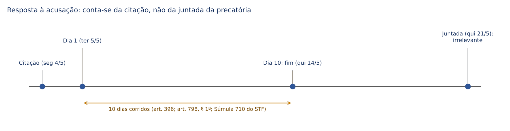
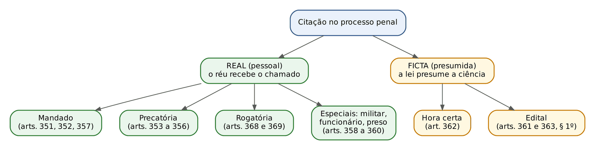
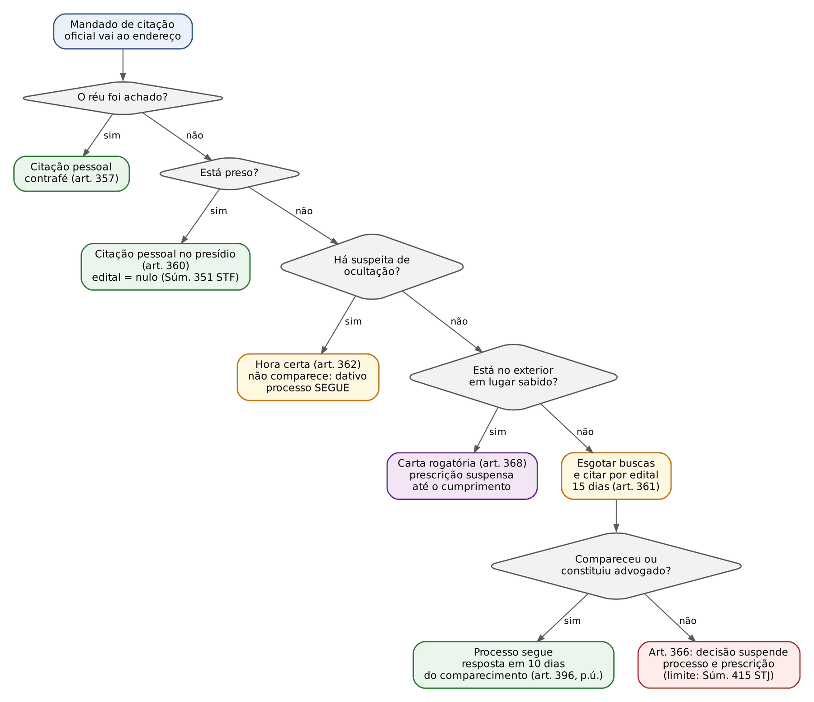
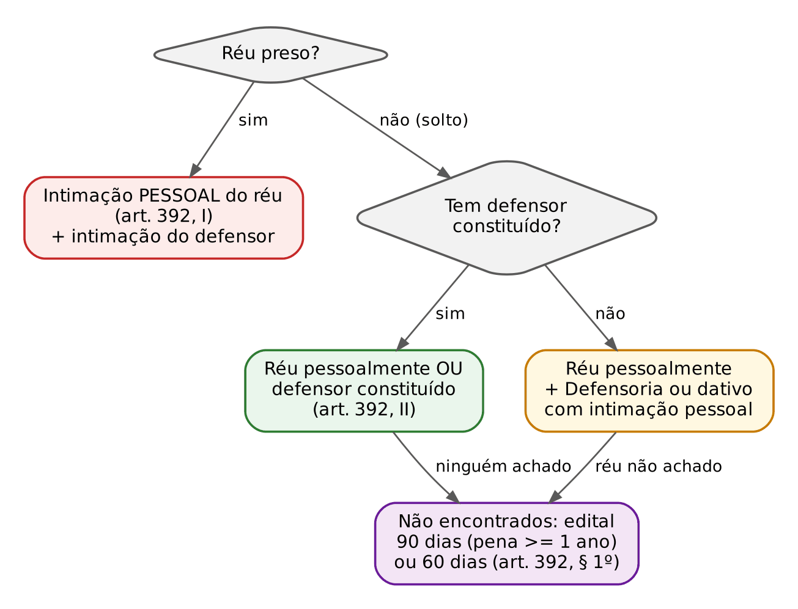

# CAPÍTULO 20 — ATOS PROCESSUAIS E COMUNICAÇÃO: FORMA, ATOS DIGITAIS E VIDEOCONFERÊNCIA, PRAZOS, CITAÇÃO, INTIMAÇÃO, REVELIA E SUSPENSÃO DO PROCESSO (ART. 366)

:::INCIDENCIA
TRF5 p. 7; TJRS p. 6; TJSC p. 12. Nível A. Lote: 21 questões (FGV 18, FCC 3).
O que mais cai: art. 366 (citado por edital que não comparece nem constitui advogado) comparado com a carta rogatória (art. 368) e com o réu que constitui advogado; hora certa x edital; revelia por mudança de endereço (art. 367); Súmula 710 do STF; intimação da sentença do réu preso; hipóteses do interrogatório por videoconferência.
:::

| Subtema | FGV | FCC | Padrão de cobrança |
|---|---|---|---|
| Art. 366, art. 368 e réu que constitui advogado | 8 | 1 | caso com dois ou três corréus em situações diferentes; "suspende" x "interrompe" |
| Hora certa e edital | 5 | 1 | réu que se oculta: hora certa (não edital) e defensor dativo (não suspensão) |
| Revelia (art. 367) | 3 | 0 | mudança de endereço sem comunicar: revelia, processo segue |
| Prazos e Súmula 710 | 0 | 1 | contagem com datas reais, precatória juntada depois |
| Intimação da sentença | 1 | 0 | réu preso: pessoal, sem termo de apelação obrigatório |
| Videoconferência | 1 | 0 | as quatro finalidades do art. 185, § 2º |

## 20.1 Atos processuais: noção, classificação e forma

### 20.1.1 O que é ato processual e para que serve classificá-lo

Ato processual é todo ato humano praticado no processo (ou para ele) pelos sujeitos processuais, que produz efeito sobre a relação processual: cria, modifica, impulsiona ou extingue. O conceito é o mesmo do processo civil, e o leitor civilista pode transpô-lo sem medo. O que muda no processo penal são três coisas: a forma tem mais valor como garantia (porque o que está em jogo é a liberdade), a comunicação dos atos ao acusado é cercada de cautelas que o CPC dispensa, e a contagem dos prazos segue regra própria (art. 798 do CPP, dias corridos, a partir da intimação).

A classificação mais cobrada é a pelo sujeito que pratica o ato:

| Sujeito | Espécies | Exemplos no processo penal |
|---|---|---|
| Partes | postulatórios (pedem), instrutórios (provam), dispositivos (dispõem de posição processual), reais (condutas materiais) | denúncia, requerimento de diligência; arrolar testemunha; desistência de recurso, renúncia; pagamento da fiança, comparecimento |
| Juiz | decisórios (despachos, decisões interlocutórias simples e mistas, sentenças), instrutórios (colheita da prova), de polícia processual (ordem nos atos), administrativos ou anômalos | recebimento da denúncia; inquirição; retirar alguém da sala (arts. 251 e 794); requisição de inquérito |
| Auxiliares | de movimentação (conclusão, vista), de documentação (termos, certidões), de execução ou comunicação (citação, intimação) | certidão do oficial de justiça; termo de audiência |

Os atos decisórios do juiz (despacho, interlocutória simples e mista, sentença definitiva e terminativa) e o recurso cabível contra cada um são estudados no Cap. 21; aqui interessam os atos de comunicação.

### 20.1.2 Forma: lugar, tempo, publicidade e documentação

O CPP não tem um título geral de "forma dos atos". As regras estão espalhadas nas disposições gerais (arts. 791 a 798) e junto de cada ato. O quadro abaixo junta o que é cobrável.

| Aspecto | Regra | Exceções e detalhes |
|---|---|---|
| Lugar | sede do juízo ou do tribunal (art. 792) | em caso de necessidade, residência do juiz ou outra casa designada (art. 792, § 2º); diligências fora da sede por natureza (citação, busca, inspeção); autoridades do art. 221 ouvidas em local, dia e hora ajustados; interrogatório do réu preso no presídio (art. 185, § 1º); atos por videoconferência (20.2) |
| Tempo (dias) | atos podem ser praticados em férias, domingos e feriados (art. 797) | sessões de julgamento NÃO são marcadas em domingo ou feriado; julgamento iniciado em dia útil não se interrompe pela superveniência de feriado ou domingo (art. 797) |
| Tempo (horário) | o CPP não fixa horário geral (no cível, 6 às 20 horas: art. 212 do CPC) | busca domiciliar só de dia, salvo flagrante, desastre ou socorro (art. 5º, XI, da CF; art. 245 do CPP; ver Cap. 15) |
| Publicidade | atos públicos, em regra (art. 792; art. 5º, LX, e art. 93, IX, da CF) | portas fechadas se houver escândalo, inconveniente grave ou perigo de perturbação da ordem (art. 792, § 1º); segredo para preservar a intimidade do ofendido (art. 201, § 6º) |
| Idioma | português; interrogatório de quem não fala a língua com intérprete (art. 193) | documento em língua estrangeira traduzido, se necessário (art. 236) |
| Documentação | termo assinado pelo juiz e pelas partes com resumo do ocorrido (art. 405) | registro audiovisual preferencial; cópia às partes sem necessidade de transcrição (art. 405, §§ 1º e 2º) |

:::PEGADINHA Sessão de julgamento em domingo
A banca costuma afirmar que "nenhum ato processual penal pode ser praticado em domingo ou feriado". Errado: a regra (art. 797) é a inversa, todos os atos podem, EXCETO as sessões de julgamento, que não serão marcadas para esses dias. E o júri iniciado na sexta que avança para o sábado e o domingo prossegue normalmente.
:::

:::NOTA Prazos: onde estudar
A teoria dos prazos (classificação, contagem do art. 798, prorrogação para o dia útil, suspensão entre 20/12 e 20/1 do art. 798-A, incluído pela Lei 14.365/2022, prazos em dobro) está no Cap. 2. Aqui ficam só as regras que dependem da comunicação do ato (termo inicial e intimação eletrônica: 20.3).
:::

## 20.2 Processo eletrônico, atos digitais e teleaudiências

### 20.2.1 A Lei 11.419/2006 aplicada ao processo penal

A Lei 11.419/2006 vale para os processos civil, penal e trabalhista e para os juizados (art. 1º, § 1º). Ela permite autos digitais, assinatura eletrônica, Diário da Justiça eletrônico e intimação por portal. Quatro regras são cobradas:

1. Diário da Justiça eletrônico: considera-se data da publicação o primeiro dia útil seguinte ao da disponibilização, e os prazos começam no primeiro dia útil que seguir à publicação (art. 4º, §§ 3º e 4º). Exemplo: disponibilização na quinta; publicação na sexta; prazo começa a correr na segunda.
2. Intimação pelo portal (para quem está cadastrado): considera-se feita no dia em que o intimando consulta o teor; se não consultar em até 10 dias CORRIDOS contados do envio, considera-se feita automaticamente no último dia desse prazo (art. 5º, §§ 1º a 3º). Essas intimações são consideradas pessoais para todos os efeitos (art. 5º, § 6º), o que importa para o MP e a Defensoria (20.3).
3. Citação eletrônica: a lei a autoriza, "excetuadas as dos Direitos Processuais Criminal e Infracional" (art. 6º). Logo, o acusado NÃO é citado por meio eletrônico na forma da Lei 11.419. Essa é a grande diferença em relação ao CPC, em que a citação eletrônica é a forma preferencial (art. 246 do CPC, na redação da Lei 14.195/2021).
4. Cartas precatórias, rogatórias e de ordem e comunicações entre órgãos do Judiciário tramitam preferentemente por meio eletrônico (art. 7º). A "precatória por via telegráfica" do art. 356 do CPP é hoje a precatória eletrônica.

:::JURIS STJ, AgRg no AREsp 2.492.606-DF, j. 5/8/2025 (Info 861)
O prazo de 10 dias corridos para a consulta eletrônica (art. 5º, § 3º, da Lei 11.419/2006) conta-se da data do envio da intimação, independentemente de feriados ou dias não úteis no intervalo. Só depois de aperfeiçoada a intimação (pela consulta ou pelo decurso dos 10 dias) é que começa o prazo processual propriamente dito.
:::

:::PEGADINHA Citação "preferencialmente eletrônica" no processo penal
Na Q3114277 (FGV 2024, TJ-MT, Analista), a alternativa sedutora dizia que a citação se faria "preferencialmente, por via telefônica ou eletrônica". É a regra do CPC, não a do CPP: o art. 6º da Lei 11.419/2006 exclui a citação criminal do meio eletrônico. A citação por WhatsApp admitida pelo STJ (20.4.6) é cumprimento do mandado pelo oficial de justiça, com cautelas, e não citação eletrônica pelo sistema.
:::

### 20.2.2 Videoconferência e audiência telepresencial: vocabulário do CNJ

A Resolução CNJ 354/2020 (cumprimento digital de atos processuais) separa dois conceitos que as provas usam: videoconferência é a comunicação a distância realizada em ambientes de unidades judiciárias (a pessoa está, por exemplo, numa sala do presídio ou de outro fórum); audiência telepresencial é a realizada a partir de ambiente físico externo às unidades judiciárias (cada um de sua casa ou escritório). Ambas são equiparadas, para todos os fins, à audiência presencial, com as mesmas garantias. A resolução prevê, no processo penal, sala adequada no presídio, entrevista prévia e reservada do réu com o defensor e canal reservado de comunicação durante o ato, oitiva separada das testemunhas e registro audiovisual disponibilizado em repositório oficial. A Resolução CNJ 465/2022 trouxe diretrizes gerais para as videoconferências no Judiciário. Atenção: a resolução do CNJ não cria hipótese de interrogatório a distância do réu preso, que depende das finalidades legais do art. 185, § 2º (abaixo).

### 20.2.3 Interrogatório do réu preso por videoconferência (art. 185, §§ 2º a 9º)

A lógica: o interrogatório é o principal momento de autodefesa, e o contato físico com o juiz é parte dessa garantia. Por isso a lei, desde a Lei 11.900/2009, criou uma escada: (1) regra, o juiz vai ao presídio (art. 185, § 1º), o que na prática quase não ocorre; (2) excepcionalmente, videoconferência, por decisão fundamentada e para uma das finalidades legais; (3) não sendo possível nenhuma das duas, o preso é requisitado e apresentado em juízo (art. 185, § 7º).

:::LEI Código de Processo Penal, art. 185, § 2º
§ 2º Excepcionalmente, o juiz, por decisão fundamentada, de ofício ou a requerimento das partes, poderá realizar o interrogatório do réu preso por sistema de videoconferência ou outro recurso tecnológico de transmissão de sons e imagens em tempo real, desde que a medida seja necessária para atender a uma das seguintes finalidades:
I - prevenir risco à segurança pública, quando exista fundada suspeita de que o preso integre organização criminosa ou de que, por outra razão, possa fugir durante o deslocamento;
II - viabilizar a participação do réu no referido ato processual, quando haja relevante dificuldade para seu comparecimento em juízo, por enfermidade ou outra circunstância pessoal;
III - impedir a influência do réu no ânimo de testemunha ou da vítima, desde que não seja possível colher o depoimento destas por videoconferência, nos termos do art. 217 deste Código;
IV - responder à gravíssima questão de ordem pública.
:::

As garantias que acompanham a medida (art. 185, §§ 3º a 9º):

| Garantia | Dispositivo |
|---|---|
| Intimação das partes da decisão que determina a videoconferência com 10 dias de antecedência | § 3º |
| Direito de o preso acompanhar, pelo mesmo sistema, todos os atos da audiência una antes de ser interrogado | § 4º |
| Entrevista prévia e reservada com o defensor; canais telefônicos reservados entre o defensor no presídio, o advogado na sala do fórum e o preso | § 5º |
| Fiscalização da sala do presídio por corregedores, juiz, MP e OAB | § 6º |
| Aplicação, no que couber, a outros atos que dependam da participação do preso (acareação, reconhecimento, oitiva de testemunha ou do ofendido), garantido o acompanhamento pelo acusado e seu defensor | §§ 8º e 9º |

:::PEGADINHA As finalidades têm palavras-chave
- Inciso I: "fundada suspeita" de integrar organização criminosa OU de fuga durante o deslocamento. Não se exige "comprovação" da intenção de fugir (alternativa errada da Q3781281).
- Inciso II: a dificuldade é do réu (enfermidade, circunstância pessoal), não a mera vontade de não ir ao fórum.
- Inciso III: só se NÃO for possível ouvir a vítima ou a testemunha por videoconferência. Se for possível, o caminho do art. 217 é afastar o réu do depoente, não interrogá-lo a distância.
- Inciso IV: "gravíssima questão de ordem pública" (não basta "risco à ordem pública" ou o tipo de crime, como homicídio).
:::

:::QUESTAO FGV 2025 — MPU — Analista do MPU (Perito em TI) (Q3339452)
Caso: juiz federal determinou de ofício, em decisões fundamentadas, o interrogatório por videoconferência de três réus presos: (i) fundada suspeita de integrar organização criminosa e de fuga no deslocamento; (ii) relevante dificuldade de comparecimento por enfermidade; (iii) evitar influência sobre testemunhas e vítima, sem possibilidade de ouvi-las por videoconferência.
Gabarito: D — as três decisões são legais.
Passos: (1) o que se pergunta: se cada motivo está entre as finalidades do art. 185, § 2º; (2) regra: a lista é taxativa, mas cada caso cabe exatamente num inciso (I, II e III, este com a ressalva atendida); (3) o juiz pode agir de ofício, desde que fundamente. Armadilha: as alternativas que excluem o terceiro processo ignoram que a ressalva do inciso III ("desde que não seja possível colher o depoimento destas por videoconferência") estava satisfeita no enunciado.
No mesmo sentido, correlata: Q3781281 (FGV 2025, CGE-SP; gabarito A, "gravíssima questão de ordem pública"; erradas as versões com "comprovação" de fuga, crime de homicídio ou mero desejo do réu).
:::

Dois pontos de jurisprudência completam o tema. Primeiro, a videoconferência é técnica para o réu PRESO que está sob custódia do Estado; o réu foragido não tem direito subjetivo a ser interrogado a distância para continuar foragido, e o indeferimento desse pedido não gera nulidade (é o que a FGV considerou correto na Q3752769, MPE-ES 2025, item i). Segundo, a lei federal é indispensável: o STF declarou formalmente inconstitucional lei estadual paulista que disciplinava o interrogatório por videoconferência antes da Lei 11.900/2009, por invadir a competência privativa da União para legislar sobre processo (art. 22, I, da CF).

### 20.2.4 Testemunha e vítima por videoconferência; afastamento do réu

A testemunha que mora fora da jurisdição do juiz é ouvida por precatória (art. 222) ou, como prefere a prática atual, por videoconferência, inclusive durante a própria audiência de instrução, permitida a presença do defensor (art. 222, § 3º). A expedição da precatória não suspende a instrução (art. 222, § 1º), mas o interrogatório continua sendo o último ato (Tema 1.114 do STJ; ver Cap. 22).

Se a presença do réu puder causar humilhação, temor ou sério constrangimento à testemunha ou ao ofendido, o juiz fará a inquirição por videoconferência e, somente se isso for impossível, determinará a retirada do réu, prosseguindo com a presença do defensor; a medida e seus motivos constam do termo (art. 217). Na audiência inteiramente virtual, o STJ admite retirar o réu da sala virtual, com as mesmas garantias (AREsp 1.961.441 — v. Cap. 15; correlata: Q3898932, FGV 2026, TJ-PR, gabarito C).

### 20.2.5 Audiência de custódia por videoconferência (Lei 15.358/2026)

A Lei 15.358, de 24/3/2026 (Marco Legal do Combate ao Crime Organizado), inverteu a lógica fixada pelo STF nas ADIs do juiz das garantias (que admitia a videoconferência só excepcionalmente): o art. 3º-B, § 1º, e o art. 310, caput, passaram a prever a audiência de custódia por videoconferência em tempo real, e o § 13 do art. 310 transformou a presencial em exceção (força maior, por decisão justificada). O regime completo, com os §§ 8º a 13 (intervenção da defesa e do MP, entrevista reservada, privacidade do preso na sala, repetição integral do ato se a falha técnica for atribuível ao tribunal), está no Cap. 18.

Para este capítulo, interessa uma regra nova de comunicação processual: antes de iniciar a custódia, a serventia confere os processos criminais a que o preso responde e, constatada pendência de citação em qualquer deles, informa ao juiz, que certifica a ocorrência, procede à citação pessoal do acusado e comunica de imediato o juízo competente (art. 310, § 7º, incluído pela Lei 15.358/2026). A finalidade é evidente: aproveitar o momento em que o Estado tem o réu nas mãos para evitar citações por edital e suspensões pelo art. 366 em processos nos quais ele está, na verdade, preso.

## 20.3 Termo inicial dos prazos e comunicação: o que depende da intimação

No CPC, o prazo começa, em regra, da juntada aos autos do mandado ou do aviso de recebimento (art. 231 do CPC). No processo penal, NÃO: o prazo corre da intimação em si (art. 798, § 5º, "a"), ou da audiência em que a decisão foi proferida com a parte presente (alínea "b"), ou do dia em que a parte manifestou ciência inequívoca (alínea "c"). O STF sumulou a diferença.

:::JURIS STF, Súmula 710
"No processo penal, contam-se os prazos da data da intimação, e não da juntada aos autos do mandado ou da carta precatória ou de ordem."
Por quê: o art. 798, § 5º, "a", manda contar "da intimação"; o ato que dá ciência é o cumprimento do mandado, não sua juntada, que é mero ato cartorário. A súmula vale também para a citação (prazo da resposta à acusação).
:::

:::QUESTAO FCC 2026 — TJ-CE — Oficial de Justiça (Q4240035)
Caso: ré citada por carta precatória para responder à acusação em 10 dias; a citação foi cumprida na segunda-feira, 4/5/2026; a precatória voltou e foi juntada na quinta-feira, 21/5/2026. Pede-se o termo inicial e o termo final.
Gabarito: D — início em 5/5/2026 (terça) e fim em 14/5/2026 (quinta).
Passos: (1) termo de referência é a citação, não a juntada (Súmula 710); (2) exclui-se o dia do começo (art. 798, § 1º): a contagem começa na terça, 5/5; (3) prazo contínuo, sem pular fim de semana: dez dias de 5/5 a 14/5, quinta-feira, dia útil, sem prorrogação. Armadilha: as alternativas A e E partem da juntada (raciocínio do CPC, art. 231); a C inclui o dia da citação; a B soma dias úteis.
:::

Regras de termo inicial para os sujeitos com intimação pessoal:

| Sujeito | Forma | Termo inicial do prazo | Fundamento |
|---|---|---|---|
| Ministério Público | pessoal (art. 370, § 4º), com vista; no processo eletrônico, pelo portal | data da entrega dos autos na repartição do MP, sendo irrelevante que a intimação pessoal tenha ocorrido em audiência, cartório ou por mandado; no eletrônico, a regra do art. 5º da Lei 11.419 | STJ, Tema 959 (REsp 1.349.935-SE, 3ª Seção, j. 23/8/2017); decisões do Júri: Tema 1.403, afetado (v. Cap. 23) |
| Defensoria Pública | pessoal, com entrega dos autos com vista; prazos em DOBRO | da entrega dos autos ou da intimação eletrônica | LC 80/1994, arts. 44, I, 89, I, e 128, I |
| Defensor dativo (nomeado) | pessoal | da intimação pessoal | art. 370, § 4º |
| Defensor constituído, advogado do querelante e do assistente | publicação no órgão oficial (hoje DJe ou portal) com o nome do acusado, sob pena de nulidade | da publicação (DJe: primeiro dia útil após a disponibilização) ou da consulta no portal | art. 370, § 1º; Lei 11.419, arts. 4º e 5º |

:::ATENCAO MP sem prazo em dobro no processo penal
O prazo em dobro do MP do CPC (art. 180) NÃO se aplica ao processo penal, que tem regra própria e não prevê o benefício. A Defensoria, ao contrário, tem prazo em dobro também no processo penal, por força da LC 80/1994. Em contrapartida, o MP pode pedir que suas intimações sejam eletrônicas: havendo requerimento nesse sentido, a intimação eletrônica não viola a prerrogativa de intimação pessoal (STJ, Pet no REsp 1.468.085-PA, j. 13/9/2022, Info 757).
:::

## 20.4 Citação

### 20.4.1 Conceito, finalidade e o que muda em relação ao cível

Citação é o ato pelo qual o acusado é chamado a juízo, cientificado da acusação e convocado a defender-se. É a projeção mais concreta do contraditório e da ampla defesa (art. 5º, LV, da CF) e do direito do acusado, previsto no Pacto de São José da Costa Rica (art. 8.2, "b"), à comunicação prévia e pormenorizada da acusação. Por isso o CPP diz que o processo "terá completada a sua formação quando realizada a citação do acusado" (art. 363, caput): a relação processual nasce com o oferecimento e o recebimento da denúncia e se completa, em relação ao réu, com a citação.

Na terminologia tradicional, distinguem-se: citação (chamamento a juízo para se defender); intimação (ciência de ato já praticado, intima-se "de"); notificação (convocação para ato futuro, notifica-se "para"). O CPP não é rigoroso no uso dos termos (art. 359 fala em "notificar" o funcionário réu; o art. 514 chama de notificação o chamado do funcionário para defesa preliminar, ver Cap. 24; a Lei de Drogas fala em "notificação" para defesa prévia antes do recebimento, ver Cap. 25), e a banca raramente explora a distinção.

:::ESQUEMA Citação no cível x citação no penal
| Ponto | Processo civil | Processo penal |
|---|---|---|
| Interrupção da prescrição | o despacho que ordena a citação interrompe a prescrição, retroagindo à propositura (art. 240, § 1º, do CPC) | a citação NÃO interrompe a prescrição; o marco é o RECEBIMENTO da denúncia (art. 117, I, do CP) |
| Forma preferencial | eletrônica (art. 246 do CPC) | pessoal, por mandado (art. 351); eletrônica vedada (art. 6º da Lei 11.419/2006) |
| Citação na pessoa do advogado | possível, com poderes (art. 242 do CPC) | NÃO há; o réu é citado pessoalmente (ou de forma ficta); nem o réu preso é citado por advogado |
| Hora certa | arts. 252 a 254 do CPC | admitida por remissão expressa (art. 362), constitucional (Tema 613 do STF) |
| Revel citado por edital | curador especial e processo segue (art. 72, II, do CPC) | processo e prescrição SUSPENSOS (art. 366) |
| Efeito da revelia | presunção de veracidade (art. 344 do CPC) | NÃO há confissão ficta; só deixa de ser intimado (art. 367) |
| Prazo para a defesa | da juntada do mandado (art. 231 do CPC) | da citação (Súmula 710 do STF); citado por edital, do comparecimento (art. 396, p.ú.) |
:::

Consequências práticas da falta ou do vício de citação: a falta de citação é nulidade absoluta (art. 564, III, "e"), mas o comparecimento do réu antes do ato consumar-se, ainda que só para alegar o vício, sana a falta (art. 570). Também não há nulidade se o réu, sem citação regular, se defendeu por advogado constituído em todos os atos (STJ, AgRg no HC 823.208 — v. Cap. 27).

### 20.4.2 Citação por mandado (citação pessoal típica)

É a regra quando o réu está no território do juiz (art. 351). O mandado indica o juiz, o querelante (na ação privada), o réu (ou seus sinais característicos), a residência, o fim da citação e o juízo, lugar, dia e hora do comparecimento (art. 352). No procedimento comum atual, o "fim" é responder à acusação por escrito em 10 dias (art. 396).

:::LEI Código de Processo Penal, art. 357
Art. 357. São requisitos da citação por mandado:
I - leitura do mandado ao citando pelo oficial e entrega da contrafé, na qual se mencionarão dia e hora da citação;
II - declaração do oficial, na certidão, da entrega da contrafé, e sua aceitação ou recusa.
:::

Contrafé é a cópia do mandado (e, na prática, da denúncia) entregue ao citado. A recusa do réu em recebê-la NÃO invalida a citação: basta que o oficial certifique a recusa (inciso II).

:::QUESTAO FGV 2024 — TJ-MT — Analista Judiciário (Direito) (Q3114277)
Pede-se a afirmação correta sobre atos processuais.
Gabarito: B — é requisito da citação por mandado a declaração do oficial sobre a entrega da contrafé e sua aceitação ou recusa (art. 357, II).
Armadilhas: citação "preferencialmente" eletrônica (regra do CPC; ver 20.2.1); intimação do defensor constituído "por mandado" (é por publicação, art. 370, § 1º); réu preso citado por advogado (é pessoal, art. 360); réu que se oculta citado por edital (é hora certa, art. 362).
:::

### 20.4.3 Citação por precatória e por carta de ordem

Se o réu está em território de outro juiz, a citação se faz por precatória (art. 353), com os requisitos do art. 354. O juízo deprecado lança o "cumpra-se", o oficial cita por mandado e a carta é devolvida (art. 355). Duas regras são cobradas:

- precatória itinerante: se o deprecado verificar que o réu está em território de um terceiro juiz, remete-lhe diretamente a carta, desde que haja tempo (art. 355, § 1º);
- réu que se oculta no juízo deprecado: certificada a ocultação, a precatória volta imediatamente "para o fim previsto no art. 362" (art. 355, § 2º). Atenção: o dispositivo é anterior à reforma de 2008, quando o art. 362 previa edital para o réu que se ocultava; hoje, o art. 362 trata da hora certa, que o próprio oficial do juízo deprecado pode realizar, e a devolução imediata perdeu o sentido prático. Na prova, se a pergunta for "o que faz o oficial que verifica a ocultação", a resposta é a hora certa.

Carta de ordem é a expedida por tribunal a juiz a ele vinculado (por exemplo, na ação penal originária, ver Cap. 24).

:::QUESTAO FGV 2025 — MPU — Analista do MPU (Direito) (Q3339813)
Caso: ação penal na Justiça Federal no Rio de Janeiro; réu residente em São Paulo foi citado; depois, mudou-se sem comunicar o novo endereço e não foi achado para a audiência.
Gabarito: D — citado por carta precatória (outra jurisdição, dentro do país) e a mudança de endereço sem comunicação ao juízo caracteriza a revelia (art. 367).
Armadilhas: rogatória (só para o estrangeiro, art. 368); carta de ordem (de tribunal para juiz vinculado); "mudança não gera revelia" (contraria a letra do art. 367).
:::

### 20.4.4 Citações especiais: militar, funcionário público e preso

| Réu | Como é citado | Por quê |
|---|---|---|
| Militar | por intermédio do chefe do respectivo serviço (art. 358) | hierarquia e disciplina: o militar não pode simplesmente ausentar-se; o chefe é requisitado a apresentá-lo e lhe dá ciência |
| Funcionário público | citado pessoalmente, e o dia do comparecimento é notificado a ele e ao chefe da repartição (art. 359) | continuidade do serviço público: o chefe precisa organizar a substituição |
| Preso | pessoalmente (art. 360, redação da Lei 10.792/2003) | o Estado sabe onde ele está; não há razão para citação ficta; para os atos, é requisitado (art. 399, § 1º) |

:::JURIS STF, Súmula 351
"É nula a citação por edital de réu preso na mesma unidade da federação em que o juiz exerce a sua jurisdição."
Lógica: se o réu está sob custódia do próprio Estado, a citação ficta (que presume que ele está em lugar incerto) é contraditória. A súmula é de 1963, quando a consulta a outros estados era difícil; com o art. 360 (citação pessoal do preso, sem distinção de lugar) e com os cadastros nacionais de presos, sustenta-se que a nulidade alcança também o réu preso em outra unidade da federação quando a prisão era conhecível pelo juízo. Na prova objetiva, reproduza a súmula; em questão discursiva, mencione a leitura ampliativa. A Lei 15.358/2026 reforçou a regra ao mandar citar pessoalmente, na audiência de custódia, o preso com citação pendente (art. 310, § 7º; ver 20.2.5).
:::

### 20.4.5 Citação de réu no estrangeiro e em legação estrangeira (arts. 368 e 369)

Se o acusado está no estrangeiro em lugar SABIDO, é citado por carta rogatória, e o prazo de prescrição fica suspenso até o cumprimento (art. 368). Se está no estrangeiro em lugar INCERTO, aplica-se a regra geral do réu não encontrado: edital (art. 361) e, se ele não comparecer nem constituir advogado, o art. 366. As citações em legações estrangeiras (embaixadas e consulados no Brasil, que gozam de inviolabilidade) também se fazem por rogatória (art. 369). O trâmite da rogatória (autoridade central, tratados, auxílio direto) está no Cap. 32.

Atenção a três detalhes da suspensão do art. 368:

- é suspensão (o prazo volta a correr do ponto em que parou), não interrupção (o prazo não recomeça do zero);
- só a prescrição fica suspensa; o processo não fica parado, porque ainda não há réu citado e o ato de citação está em curso;
- o termo final é o efetivo cumprimento no exterior, e não a juntada da carta aos autos (STJ, 5ª Turma, REsp 1.882.330-SP, j. 6/4/2021, Info 691), mesma lógica da Súmula 710.

:::QUESTAO FGV 2025 — TRF6 — Juiz Federal Substituto (Q3742431)
Pede-se o termo final da suspensão da prescrição na citação por rogatória.
Gabarito: B — a data da efetiva comunicação processual no estrangeiro.
Armadilha: "juntada da carta rogatória cumprida nos autos" (alternativa A), que é o raciocínio civilista do art. 231 do CPC. No mesmo sentido: Q3037174 (FGV 2024, TRF1, Inspetor; gabarito D: réu que mora no exterior em lugar sabido é citado por rogatória, com suspensão da prescrição até o cumprimento; erradas a "revelia por não ter endereço no Brasil", a precatória e o edital).
:::

### 20.4.6 Citação por WhatsApp e outros meios digitais

O CPP não prevê citação eletrônica, e a Lei 11.419 a exclui. Ainda assim, o STJ admite que o oficial de justiça cumpra o mandado de citação por aplicativo de mensagens, desde que adote cautelas que assegurem a autenticidade do número e a identidade do citando, como a foto do documento de identidade, a imagem do próprio citando, a confirmação escrita e, se possível, termo de ciência assinado (STJ, HC 641.877-DF, j. 9/3/2021, Info 688). A lógica é a da instrumentalidade: o que importa é a certeza de que o réu, e não outra pessoa, recebeu a acusação. Sem essas cautelas, a citação é nula, e o STJ tem anulado citações por WhatsApp em que nada comprovava que o interlocutor era o réu.

:::DICA Como enxergar a citação por WhatsApp na prova
Não é "citação eletrônica" (vedada); é citação PESSOAL, real, cumprida pelo oficial por meio tecnológico. Por isso, se válida, produz os efeitos da citação por mandado (prazo de 10 dias da ciência; se o réu não responder, nomeia-se defensor, art. 396-A, § 2º). Se a banca disser que a citação por WhatsApp autoriza, por si, a suspensão do art. 366, está errado: o art. 366 pressupõe citação por edital.
:::

### 20.4.7 Citação com hora certa (art. 362)

Até 2008, o réu que se ocultava era citado por edital, e com a Lei 9.271/1996 isso levava à suspensão do processo e da prescrição: a ocultação era premiada. A Lei 11.719/2008 corrigiu a distorção com a hora certa.

:::LEI Código de Processo Penal, art. 362
Art. 362. Verificando que o réu se oculta para não ser citado, o oficial de justiça certificará a ocorrência e procederá à citação com hora certa, na forma estabelecida nos arts. 227 a 229 da Lei nº 5.869, de 11 de janeiro de 1973 - Código de Processo Civil.
Parágrafo único. Completada a citação com hora certa, se o acusado não comparecer, ser-lhe-á nomeado defensor dativo.
:::

O procedimento é o do CPC (a remissão ao CPC/1973 hoje se lê como feita aos arts. 252 a 254 do CPC/2015): o oficial, tendo procurado o réu duas vezes no domicílio sem encontrá-lo e suspeitando de ocultação, intima qualquer pessoa da família ou, na falta, vizinho (ou o porteiro, em condomínio) de que voltará no dia útil imediato, em hora designada; voltando e não encontrando o réu, dá-o por citado, deixa a contrafé com quem estiver presente e certifica; o escrivão envia ao réu, em 10 dias, carta, telegrama ou correspondência eletrônica dando ciência de tudo.

Consequência penal decisiva: a hora certa é citação ficta, mas NÃO leva ao art. 366. Se o réu não comparecer, nomeia-se defensor dativo e o processo SEGUE (art. 362, parágrafo único), com o prazo de 10 dias para a resposta contado da citação; não apresentada, o juiz nomeia defensor para oferecê-la (art. 396-A, § 2º). A lógica: quem se esconde sabe da acusação, e a suspensão do art. 366 existe para proteger quem não sabe.

:::JURIS STF, RE 635.145-RS, Plenário, j. 1/8/2016 (Tema 613; Info 833)
Tese: é constitucional a citação com hora certa no âmbito do processo penal. Razões: a ocultação é ato voluntário do acusado, que não pode beneficiar-se da própria torpeza; a lei cerca o ato de cautelas (duas diligências, intimação de familiar ou vizinho, carta de ciência) e garante defesa técnica por dativo; a ampla defesa não exige que o processo pare diante de quem foge da citação.
:::

:::QUESTAO FCC 2026 — TJ-CE — Oficial de Justiça (Q4240028)
Caso: réu solto; o oficial foi duas vezes ao endereço, ninguém atendeu, mas se ouvia música alta lá dentro; suspeita de ocultação.
Gabarito: E — o oficial certifica e procede à citação com hora certa, na forma do CPC; completada, se o acusado não comparecer, nomeia-se defensor dativo.
Passos: (1) a pergunta é sobre o réu que se oculta (não sobre o réu desaparecido); (2) regra: art. 362, caput e parágrafo único; (3) aplicação: duas tentativas e indícios de presença no imóvel configuram a suspeita exigida. Armadilhas: "incabível hora certa no processo penal" (contraria o art. 362 e o Tema 613) com edital e art. 366 (alternativas A e D); hora certa seguida de revelia "sem necessidade de defensor dativo" (alternativa C: a defesa técnica é indispensável).
No mesmo sentido: Q3028642 (FGV 2024, TRF1, Oficial de Justiça; gabarito E: hora certa e dativo, não suspensão); Q3848993 (FGV 2026, PC-PI, Delegado; gabarito D, F–F–V: é falso que o réu que se oculta seja citado por edital e que o dativo seja nomeado "completada a citação por edital"; é verdadeiro que o processo se completa com a citação, art. 363).
:::

:::QUESTAO FGV 2024 — Câmara Municipal de São Paulo — Procurador Legislativo (Q2351295)
Caso: réu denunciado por roubo majorado que se oculta para não ser citado. Pergunta-se a consequência segundo o CPP.
Gabarito: A (citação com hora certa, na forma do CPC — art. 362).
Armadilhas: edital de 15 ou de 10 dias (D e E) é o regime anterior à Lei 11.719/2008 e serve ao réu NÃO encontrado; "citação tácita" (B) não existe; revelia (C) pressupõe réu já citado ou intimado (art. 367).
:::

### 20.4.8 Citação por edital (arts. 361, 363, § 1º, 365 e 396, parágrafo único)

O edital é o último recurso: só cabe quando o réu não é encontrado (art. 361; art. 363, § 1º), depois de esgotados os meios razoáveis de localização (endereços dos autos, consultas a cadastros públicos, sistemas conveniados, presídios). Não cabe para o réu que se oculta (hora certa), nem para o preso (Súmula 351), nem para o réu no estrangeiro em lugar sabido (rogatória).

| Elemento | Regra |
|---|---|
| Prazo do edital | 15 dias (art. 361); o art. 364 menciona prazos de 15 a 90 dias e de 30 dias, mas remete a incisos do art. 363 revogados em 2008, e por isso não tem mais aplicação prática |
| Conteúdo | nome do juiz, nome ou sinais do réu, residência e profissão se constarem, fim da citação, juízo, dia, hora e lugar do comparecimento, prazo (art. 365) |
| Contagem | o prazo do edital corre da publicação na imprensa, se houver, ou da afixação (art. 365, V) |
| Publicidade | afixação à porta do fórum e publicação pela imprensa, onde houver (art. 365, parágrafo único); hoje, publicação no DJe |
| Resumo dos fatos | não é exigido: basta indicar o dispositivo legal (Súmula 366 do STF; ver Cap. 27) |
| Se o réu comparecer, em qualquer tempo | o processo segue os arts. 394 e seguintes (art. 363, § 4º); o prazo de 10 dias para a resposta corre do comparecimento pessoal ou do defensor constituído (art. 396, parágrafo único) |
| Se não comparecer nem constituir advogado | art. 366 (20.6) |

:::QUESTAO FGV 2025 — TJ-GO — Residente Jurídico (Q3345957)
Caso: réu solto não encontrado, sem indício de ocultação, esgotados todos os meios de localização.
Gabarito: E — citação por edital.
Armadilha: hora certa (alternativa D) exige suspeita de OCULTAÇÃO; aqui o réu simplesmente sumiu. Rogatória (B) exige réu no estrangeiro em lugar sabido. E não se fala em "intimação" (A e C), porque o primeiro chamamento é citação.
:::

:::ESQUEMA Hora certa x edital: a distinção que decide a questão
| | Hora certa | Edital |
|---|---|---|
| Situação de fato | réu localizado que se OCULTA | réu NÃO encontrado (paradeiro desconhecido) |
| Quem constata | oficial de justiça, na diligência | juiz, à vista das certidões negativas e das buscas |
| Se o réu não comparece | defensor dativo; processo segue | processo e prescrição suspensos (art. 366) |
| Fundamento | art. 362 (Tema 613 do STF) | arts. 361, 363, § 1º, e 366 |
:::

## 20.5 Roteiro: o réu não foi encontrado, o que fazer

:::PASSO Decisão do juiz diante da certidão negativa de citação
1. Leia a certidão: o oficial relata ocultação (tentativas, indícios de presença, informações de vizinhos)? Se sim e a hora certa ainda não foi feita, determine-a (art. 362).
2. Se não há ocultação, verifique se o réu está preso (consulta aos sistemas de presos): se estiver, cite-o pessoalmente no estabelecimento (art. 360); edital seria nulo (Súmula 351).
3. Se não está preso, verifique se há notícia de que está no exterior em lugar sabido: rogatória (art. 368), com suspensão da prescrição até o cumprimento; registre na decisão a data de expedição.
4. Se o paradeiro é desconhecido, esgote as buscas razoáveis (endereços dos autos, cadastros conveniados, contatos de familiares) e só então determine o edital de 15 dias (art. 361).
5. Decorrido o prazo do edital: se o réu comparecer ou constituir advogado, siga o procedimento, com prazo de resposta a partir do comparecimento (art. 396, parágrafo único). Se não, profira decisão suspendendo o processo e o prazo prescricional (art. 366), fixando o termo final da suspensão da prescrição (Súmula 415 do STJ), e decida fundamentadamente sobre produção antecipada de provas e sobre preventiva, se houver requerimento.
6. Em Juizado Especial Criminal, o roteiro é outro: não encontrado o autor do fato para citação pessoal, as peças vão ao juízo comum (art. 66, parágrafo único, da Lei 9.099/1995; ver 20.6.5).
:::

## 20.6 Suspensão do processo e da prescrição (art. 366)

### 20.6.1 Por que o processo para

Antes da Lei 9.271/1996, o réu citado por edital que não comparecia era julgado à revelia, com defensor dativo, e podia ser condenado sem jamais ter sabido do processo. A doutrina via nisso uma ficção incompatível com a ampla defesa e com o art. 8º da Convenção Americana. A solução de 1996 foi parar o processo enquanto o réu não aparecer e, para que essa paralisação não leve à prescrição em benefício de quem sumiu, parar também o prazo prescricional.

:::LEI Código de Processo Penal, art. 366
Art. 366. Se o acusado, citado por edital, não comparecer, nem constituir advogado, ficarão suspensos o processo e o curso do prazo prescricional, podendo o juiz determinar a produção antecipada das provas consideradas urgentes e, se for o caso, decretar prisão preventiva, nos termos do disposto no art. 312.
:::

### 20.6.2 Requisitos cumulativos

1. Citação POR EDITAL válida (não por hora certa, não pessoal, não por rogatória).
2. Não comparecimento do acusado.
3. Não constituição de advogado.

Basta que o réu compareça OU constitua advogado para não haver suspensão: o advogado constituído é prova de que o réu sabe da acusação. Nesse caso, o processo segue normalmente, com prazo de resposta a partir do comparecimento do defensor constituído (art. 396, parágrafo único). A FGV adora este ponto em casos com vários réus.

:::QUESTAO FGV 2024 — TJ-SC — Juiz Substituto (Q2387001)
Caso: réu com extensa folha de antecedentes, denunciado por organização criminosa e estelionatos, com pedido de preventiva; não encontrado, foi citado por edital; não compareceu, mas constituiu advogado nos autos.
Gabarito: C — não se suspendem o processo nem a prescrição, e o juiz pode decretar a preventiva.
Passos: (1) requisitos do art. 366 são cumulativos; a constituição de advogado afasta o terceiro; (2) logo, o processo segue (art. 396, parágrafo único); (3) a preventiva não depende do art. 366: é examinada pelos arts. 312 e 313 (risco de reiteração evidenciado pelos antecedentes; ver Cap. 19). Armadilhas: suspensão automática por ter havido edital (A); "interrupção" da prescrição (D e E).
No mesmo sentido, em casos com dois ou três réus: Q4349521 (FGV 2026, TJ-PE, Juiz; gabarito C: réu citado por edital que constituiu advogado não tem suspensão; corréu na Argentina em lugar sabido, rogatória com suspensão da prescrição até o cumprimento); Q3373864 (FGV 2025, TRF5, Juiz; gabarito A: citado por edital com advogado constituído e réu citado pessoalmente que não respondeu seguem sem suspensão; o réu na Bolívia, por rogatória, tem só a prescrição suspensa).
:::

:::QUESTAO FGV 2025 — TRF5 — Juiz Substituto (Q3373864): o réu citado pessoalmente que não responde
O terceiro corréu (Oscar) foi citado pessoalmente e não apresentou resposta. A tentação é aplicar a ele alguma suspensão. Não há: citado pessoalmente, o silêncio do réu leva à nomeação de defensor para apresentar a resposta (art. 396-A, § 2º), e o processo segue. O art. 366 é exclusivo do citado por edital.
:::

### 20.6.3 A suspensão depende de decisão judicial

A suspensão do processo e do prazo prescricional, assim como o restabelecimento da tramitação, NÃO é automática: exige decisão judicial (STJ, 5ª Turma, AgRg no HC 957.112-PR, j. 11/2/2025, Info 841). A data da decisão marca o início da suspensão da prescrição, e por isso o juiz deve proferi-la logo após o decurso do prazo do edital.

:::QUESTAO FCC 2025 — DPE-AM — Defensor Público (Q3531595)
Pergunta-se a consequência do não comparecimento do réu citado por edital que não constitui advogado.
Gabarito: D — o juiz deve determinar a suspensão do processo e do curso do prazo prescricional, podendo ordenar a produção antecipada das provas urgentes.
Armadilhas: "automaticamente suspensos" (C e E; contraria o Info 841); prisão preventiva "obrigatória" (E; é facultativa e condicionada ao art. 312); revelia com presunção de veracidade (A; não existe no processo penal).
No mesmo sentido, sem a nuance da decisão: Q3870739 (FGV 2026, TJ-RJ, Comissário; gabarito A: suspensos processo e prescrição); Q4153631 (FGV 2026, TJ-SC, Oficial de Justiça; gabarito B: suspensão do processo e da prescrição, com possibilidade de provas urgentes e preventiva; erradas a nomeação de dativo com prosseguimento, a exigência de prévia hora certa e a "concordância da vítima" no estelionato).
:::

### 20.6.4 Os três poderes do juiz durante a suspensão

a) Produção antecipada de provas urgentes. O processo está parado, mas a prova pode perecer (testemunha idosa ou doente, vestígios que se apagam). O juiz pode antecipá-la, com defensor nomeado ao réu para o ato. A antecipação, porém, não pode ser automática nem genérica:

:::JURIS STJ, Súmula 455
"A decisão que determina a produção antecipada de provas com base no artigo 366 do CPP deve ser concretamente fundamentada, não a justificando unicamente o mero decurso do tempo."
Lógica: se o simples passar do tempo bastasse, toda suspensão viria acompanhada da colheita integral da prova, e o réu seria, na prática, julgado sem saber, exatamente o que o art. 366 quis evitar. A Terceira Seção do STJ, contudo, admitiu a antecipação do depoimento de POLICIAIS, pela natureza de sua atividade (muitas ocorrências semelhantes, risco concreto de esquecimento), o que é tratado como fundamento concreto e não como mero decurso do tempo.
:::

b) Prisão preventiva "se for o caso, nos termos do art. 312". O art. 366 não cria nova hipótese de prisão: a preventiva só é decretada se presentes o *fumus commissi delicti*, o *periculum libertatis* e uma das hipóteses do art. 313. A simples não localização do réu citado por edital não basta, por si, para presumir fuga, embora a evasão comprovada do distrito da culpa possa fundamentar o risco à aplicação da lei penal (ver Cap. 19).

c) Fixar o termo final da suspensão da prescrição. O art. 366 não diz até quando a prescrição fica suspensa; se fosse indefinidamente, o crime ficaria imprescritível por obra de lei ordinária, quando a Constituição só admite imprescritibilidade para racismo e ação de grupos armados (art. 5º, XLII e XLIV).

:::JURIS STJ, Súmula 415, e STF, Tema 438 (RE 600.851, Plenário, j. 4/12/2020, Info 1001)
Súmula 415 do STJ: "O período de suspensão do prazo prescricional é regulado pelo máximo da pena cominada."
Tema 438 do STF: em caso de inatividade processual decorrente de citação por edital, ressalvados os crimes previstos na Constituição como imprescritíveis, é constitucional limitar o período de suspensão do prazo prescricional ao tempo de prescrição da pena máxima em abstrato cominada ao crime, a despeito de o processo permanecer suspenso.
Como funciona: a prescrição fica parada pelo tempo do art. 109 do CP calculado sobre a pena máxima; esgotado esse período, a prescrição VOLTA a correr (de onde parou), mas o PROCESSO continua suspenso. O cálculo passo a passo, com linha do tempo e redução do art. 115, está na Apostila de Direito Penal, Cap. 22.
:::

:::EXEMPLO A suspensão "descasada"
B é denunciado por estelionato simples (pena máxima de 5 anos, prescrição em 12 anos, art. 109, III, do CP). Recebimento da denúncia em 1/3/2020; edital frustrado; decisão de suspensão em 1/9/2020. A prescrição fica suspensa por 12 anos, até 1/9/2032. Nessa data, retoma o curso com os 6 meses já consumidos (de 1/3/2020 a 1/9/2020) e prescreverá em 11 anos e 6 meses, em 1/3/2044, se o réu não aparecer. O processo, porém, permanece suspenso o tempo todo: se B for preso em 2040, o processo é retomado e a prescrição continua correndo normalmente.
:::

### 20.6.5 Quando o art. 366 não se aplica

| Situação | Regra | Onde |
|---|---|---|
| Réu citado por hora certa | dativo e prosseguimento (art. 362, p.ú.) | 20.4.7 |
| Réu no estrangeiro em lugar sabido | rogatória; só a prescrição fica suspensa até o cumprimento (art. 368) | 20.4.5 |
| Réu que constituiu advogado ou compareceu | processo segue (art. 396, p.ú.) | 20.6.2 |
| Lavagem de dinheiro | o art. 366 NÃO se aplica: o réu citado por edital que não comparece segue com defensor dativo (art. 2º, § 2º, da Lei 9.613/1998) | Cap. 26 |
| Juizado Especial Criminal | não há citação por edital no JECrim: não encontrado o acusado, as peças vão ao juízo comum (art. 66, p.ú., da Lei 9.099/1995), onde o art. 366 poderá incidir | Cap. 24 |
| Fatos anteriores à Lei 9.271/1996 | o art. 366 é norma HÍBRIDA (processual na suspensão do processo, material na suspensão da prescrição, que é prejudicial ao réu); como não se pode cindi-lo, não retroage: para os crimes anteriores à vigência (junho de 1996), nem o processo nem a prescrição se suspendem | Cap. 2 |

Correlatas sobre o JECrim: Q3592860 (FGV 2025, TJ-SC, Juiz Leigo; gabarito A: remessa ao juízo comum) e Q4240030 (FCC 2026, TJ-CE, Oficial de Justiça; gabarito E: encaminhar ao juízo comum; erradas hora certa, edital e revelia).

:::SENTENCA A decisão de suspensão do art. 366
Onde entra: decisão interlocutória proferida após o decurso do prazo do edital; reaparece na sentença, no capítulo da prescrição (para descontar o período suspenso) e nas preliminares, se o réu alegar nulidade da citação editalícia.
O que fundamentar: (1) as diligências que esgotaram a busca do réu; (2) a regularidade do edital e o decurso do prazo; (3) a ausência de comparecimento e de advogado constituído; (4) o termo final da suspensão da prescrição, com a conta do art. 109 sobre a pena máxima; (5) se houver pedido, a urgência CONCRETA de cada prova a antecipar e, separadamente, os requisitos da preventiva.
Redação-modelo: "Citado por edital, o acusado não compareceu nem constituiu defensor. Com fundamento no art. 366 do CPP, suspendo o processo e o curso do prazo prescricional a partir desta data, este pelo prazo máximo de 12 anos (art. 109, III, do CP; Súmula 415 do STJ), findo o qual a prescrição voltará a correr, mantida a suspensão do processo."
Erro comum que a banca pune: suspender "automaticamente" sem decisão; antecipar toda a prova "pelo decurso do tempo" (Súmula 455); decretar preventiva como consequência do art. 366; usar a palavra "interrupção".
Recurso cabível: o art. 581, XVI, prevê RESE contra a decisão que ordena a suspensão do processo "em virtude de questão prejudicial", e a suspensão do art. 366 não decorre de prejudicial; parte da doutrina admite o RESE por interpretação extensiva, outra parte indica a correição parcial, e o tema não tem posição consolidada que a banca cobre. A decisão que antecipa prova sem fundamentação concreta ou decreta preventiva com reflexo na liberdade é impugnável por habeas corpus; a que decreta preventiva, também pelas vias do Cap. 19 (ver Caps. 28 e 30).
:::

### 20.6.6 Quadro comparativo final: cada situação, cada consequência

| Situação do réu | Processo | Prescrição | Fundamento |
|---|---|---|---|
| Citado pessoalmente, não responde | segue (dativo para a resposta) | corre | art. 396-A, § 2º |
| Citado por hora certa, não comparece | segue (dativo) | corre | art. 362, p.ú. |
| Citado por edital, comparece ou constitui advogado | segue | corre | arts. 363, § 4º, e 396, p.ú. |
| Citado por edital, não comparece nem constitui advogado | SUSPENSO (por decisão) | SUSPENSA, pelo prazo do art. 109 sobre a pena máxima | art. 366; Súmula 415 do STJ; Tema 438 do STF |
| No estrangeiro em lugar sabido | aguarda a citação | SUSPENSA até o cumprimento da rogatória | art. 368 |
| Citado ou intimado, muda de endereço sem avisar ou falta sem motivo | segue sem a presença dele (revelia) | corre | art. 367 |

:::PEGADINHA Suspende x interrompe
Nenhuma das hipóteses do capítulo INTERROMPE a prescrição. Interromper é zerar e recomeçar (art. 117 do CP: recebimento da denúncia, pronúncia, sentença condenatória etc.); suspender é congelar e retomar de onde parou. Nas Q3086964 (FGV 2024, TJ-MT, Juiz; gabarito B), Q4349521 e Q3373864, todas as alternativas com "interrompido" estão erradas.
:::

:::QUESTAO FGV 2024 — TJ-MT — Juiz Substituto (Q3086964)
Caso: corréu A citado por edital, não compareceu nem constituiu advogado; corréu B no exterior em lugar sabido, expedida rogatória.
Gabarito: B — em relação a B, suspende-se o curso da prescrição até o cumprimento da rogatória.
Passos: A está no art. 366 (processo e prescrição suspensos); B no art. 368 (só a prescrição, até o cumprimento). Armadilhas: suspensão do processo "mas não da prescrição" para A (A e D); suspensão de processo e prescrição para ambos (C); "interrupção" para B (E).
:::

## 20.7 Revelia (art. 367)

### 20.7.1 Conceito e hipóteses

No processo penal, revel é o acusado que, citado ou intimado pessoalmente para qualquer ato, deixa de comparecer sem motivo justificado, ou que muda de residência sem comunicar o novo endereço ao juízo (art. 367). A regra é de lealdade processual: depois de ciente do processo, o ônus de manter o endereço atualizado é do réu. Não se confunde com o art. 366: lá o réu NÃO sabe do processo (citação ficta por edital); aqui ele SABE (citação pessoal ou por hora certa, ou intimação pessoal) e se desinteressa.

:::LEI Código de Processo Penal, art. 367
Art. 367. O processo seguirá sem a presença do acusado que, citado ou intimado pessoalmente para qualquer ato, deixar de comparecer sem motivo justificado, ou, no caso de mudança de residência, não comunicar o novo endereço ao juízo.
:::

### 20.7.2 Efeitos: muito menores que no cível

| Efeito | Processo civil | Processo penal |
|---|---|---|
| Presunção de veracidade dos fatos | sim (art. 344 do CPC) | NÃO: a acusação continua com todo o ônus da prova; não existe confissão ficta |
| Defesa técnica | dispensável se o réu não constitui advogado (curador só para o citado de forma ficta) | indispensável: o juiz nomeia defensor (art. 261; Súmula 523 do STF, ver Cap. 27) |
| Intimações | prazos correm da publicação (art. 346 do CPC) | o réu deixa de ser intimado dos atos seguintes; o defensor continua sendo intimado |
| Intimação da sentença | publicação | continua obrigatória na forma do art. 392 (20.9) |
| Reversão | o revel intervém no estado em que está o processo | idem: pode comparecer a qualquer tempo e participar dos atos seguintes, inclusive ser interrogado |

O único efeito propriamente processual da revelia penal é dispensar a intimação do réu para os atos subsequentes (o processo "seguirá sem a presença do acusado"). Duas ressalvas: (a) a intimação da sentença continua necessária (art. 392); (b) no júri, a sessão de julgamento não é adiada pelo não comparecimento do réu solto regularmente intimado (art. 457; ver Cap. 23), mas a intimação prévia para a sessão plenária é indispensável, por edital se ele não for encontrado, sob pena de nulidade absoluta (STJ, AgRg no REsp 2.248.978 — v. Cap. 27).

:::QUESTAO FGV 2026 — MPE-GO — Promotor de Justiça Substituto (Q3865784)
Caso: réu por extorsão mediante sequestro, com defesa constituída presente à audiência; ele não compareceu, e se apurou que mudara de residência sem comunicar ao juízo.
Gabarito: E — a audiência é realizada sem a presença do acusado, com a decretação da revelia.
Passos: (1) o réu já fora citado; (2) mudou-se sem comunicar: hipótese literal do art. 367; (3) consequência: o processo segue sem ele. Armadilhas: suspender a audiência para intimá-lo por edital, por precatória ou por meio do advogado (A, B e D: o ônus da comunicação era do réu); "realizada desde que a defesa concorde" (C: a lei não exige concordância).
No mesmo sentido: Q3395869 (FGV 2025, DPE-RO, Analista; gabarito B: correta a revelia, pois cabe ao acusado manter o endereço atualizado; errado dizer que o juiz deveria diligenciar o novo endereço ou suspender o processo) e Q3339813 (20.4.3).
:::

:::ATENCAO Revelia não autoriza prisão nem agrava a pena
A revelia não é fundamento autônomo da preventiva (ver Cap. 19), não é circunstância judicial negativa e não pode ser invocada na sentença como indício de culpa. Na sentença, a revelia aparece só no relatório ("decretada a revelia à fl. x, nos termos do art. 367") e, se houver, nas preliminares, quando a defesa sustenta que o réu tinha motivo justificado para faltar.
:::

## 20.8 Intimações e notificações (arts. 370 a 372)

### 20.8.1 Regras gerais e formas

Às intimações dos acusados, testemunhas e demais pessoas aplica-se, no que couber, o capítulo das citações (art. 370, caput): mandado, precatória, rogatória e, se não encontrados, edital. O que muda é a forma de intimação dos profissionais:

:::LEI Código de Processo Penal, art. 370, §§ 1º e 4º
§ 1º A intimação do defensor constituído, do advogado do querelante e do assistente far-se-á por publicação no órgão incumbido da publicidade dos atos judiciais da comarca, incluindo, sob pena de nulidade, o nome do acusado.
§ 4º A intimação do Ministério Público e do defensor nomeado será pessoal.
:::

| Destinatário | Forma | Observações |
|---|---|---|
| Acusado | pessoal (mandado, precatória; no presídio, se preso) | o advogado constituído recebe as intimações de atos processuais; a do réu é exigida quando a lei manda (audiência a que deva comparecer, sentença) |
| Defensor constituído, advogado do querelante e do assistente | publicação oficial (DJe) ou portal eletrônico, com o nome do acusado sob pena de nulidade | sem órgão de publicação: pelo escrivão, por mandado, via postal com AR ou outro meio idôneo (art. 370, § 2º); a intimação pessoal pelo escrivão dispensa a publicação (§ 3º) |
| MP | pessoal (art. 370, § 4º), com vista | termo inicial: Tema 959 do STJ (20.3) |
| Defensor nomeado (dativo) | pessoal (art. 370, § 4º) | a publicação no DJe não basta |
| Defensoria Pública | pessoal, com vista, prazo em dobro | LC 80/1994 |
| Ofendido | comunicação dos atos de ingresso e saída do acusado da prisão, designação de audiência e sentença (art. 201, § 2º) | no endereço indicado ou por meio eletrônico, se ele optar (art. 201, § 3º) |

Duas formas simplificadas: a intimação por despacho na própria petição em que foi requerida, observado o art. 357 (art. 371), e a intimação em audiência: adiada a instrução, o juiz marca desde logo a continuação, na presença das partes e testemunhas, que ficam intimadas (art. 372).

Jurisprudência recente sobre a forma:

- Sigilo não autoriza ocultar o nome do advogado na intimação: mesmo em processo sob sigilo elevado, a publicação deve indicar o nome do advogado da parte (STJ, AREsp 2.234.661-RS, j. 27/8/2024, Info 823).
- Réu preso que advoga em causa própria deve ser intimado pessoalmente ou por carta com aviso de recebimento: a publicação no DJe não basta, porque ele não tem acesso regular ao diário (STJ, 6ª Turma, j. 12/11/2025, processo em segredo de justiça, Informativo de Jurisprudência Edição Extraordinária n. 30).
- Intimação por aplicativo de mensagens (de réu, testemunha ou vítima) segue a lógica da citação por WhatsApp (20.4.6): válida se houver certeza da identidade do destinatário e da ciência do conteúdo; a Resolução CNJ 354/2020 admite comunicação eletrônica que assegure que o destinatário tomou conhecimento.

:::DICA Nulidade por falta de intimação: absoluta ou relativa?
A falta de intimação de ato essencial (por exemplo, do defensor para a audiência de instrução, ou do réu para a sessão do júri) gera nulidade; a gravidade e a necessidade de prejuízo são estudadas no Cap. 27 (inclusive a Súmula 431 do STF, sobre o julgamento de recurso sem intimação ou publicação da pauta). Aqui ficam só as súmulas sobre precatória, abaixo.
:::

### 20.8.2 Intimação e carta precatória para oitiva de testemunha

Quando a testemunha é ouvida por precatória, as partes devem ser intimadas da expedição (art. 222, caput). Duas súmulas resolvem o resto:

:::JURIS STF, Súmula 155, e STJ, Súmula 273
Súmula 155 do STF: "É relativa a nulidade do processo criminal por falta de intimação da expedição de precatória para inquirição de testemunha."
Súmula 273 do STJ: "Intimada a defesa da expedição da carta precatória, torna-se desnecessária intimação da data da audiência no juízo deprecado."
Lógica conjunta: a parte que sabe que a carta foi expedida tem o ônus de acompanhar seu trâmite no juízo deprecado; se nem da expedição foi intimada, a nulidade existe, mas é relativa, e depende de arguição oportuna e de prejuízo.
:::

No mesmo contexto, o STF fixou que não há nulidade pela ausência, na oitiva de testemunha por precatória, de réu preso que não manifestou expressamente a intenção de participar da audiência (RE 602.543 QO, Tema 240, j. 19/11/2009). Com a videoconferência do art. 222, § 3º, o problema praticamente desapareceu: o réu acompanha o ato da própria audiência una.

## 20.9 Intimação da sentença (art. 392)

### 20.9.1 A lógica do art. 392

A sentença condenatória é o ato mais grave do processo, e dela nasce o direito de recorrer, que pertence tanto ao defensor quanto ao próprio réu (que pode apelar por termo, art. 578). Por isso o CPP exige, em certos casos, que o réu seja intimado pessoalmente, e não só por seu advogado. O texto do art. 392 é velho (pensa em "réu que se livra solto" e em fiança) e precisa ser lido com as categorias atuais: réu preso e réu solto.

:::LEI Código de Processo Penal, art. 392, I a III e §§ 1º e 2º
Art. 392. A intimação da sentença será feita:
I - ao réu, pessoalmente, se estiver preso;
II - ao réu, pessoalmente, ou ao defensor por ele constituído, quando se livrar solto, ou, sendo afiançável a infração, tiver prestado fiança;
III - ao defensor constituído pelo réu, se este, afiançável, ou não, a infração, expedido o mandado de prisão, não tiver sido encontrado, e assim o certificar o oficial de justiça;
(...)
§ 1º O prazo do edital será de 90 dias, se tiver sido imposta pena privativa de liberdade por tempo igual ou superior a um ano, e de 60 dias, nos outros casos.
§ 2º O prazo para apelação correrá após o término do fixado no edital, salvo se, no curso deste, for feita a intimação por qualquer das outras formas estabelecidas neste artigo.
:::

Os incisos IV a VI tratam do edital: quando o réu solto e seu defensor constituído não forem encontrados (IV), quando o defensor do réu foragido também não for encontrado (V) e quando o réu sem defensor constituído não for encontrado (VI).

| Situação | Quem se intima | Observações |
|---|---|---|
| Réu preso | o réu, PESSOALMENTE, e também o defensor | o prazo recursal corre da ÚLTIMA intimação (réu ou defensor), entendimento consolidado no STJ e no STF; não basta a publicação para o advogado |
| Réu solto com defensor constituído | o réu pessoalmente OU o defensor constituído | o STJ entende suficiente a intimação do defensor constituído |
| Réu solto assistido por Defensoria ou dativo | o réu pessoalmente e o defensor (pessoalmente) | leitura conjunta dos incisos II e VI: o réu sem defensor constituído só é intimado por edital se não for encontrado, o que pressupõe tentativa de intimação pessoal |
| Réu foragido (mandado de prisão não cumprido) | o defensor constituído | inciso III |
| Ninguém encontrado | edital de 90 dias (pena privativa igual ou superior a 1 ano) ou 60 dias (demais casos) | prazo de apelação corre depois do fim do edital, salvo intimação por outra forma no curso dele (§ 2º) |
| Sentença lida em audiência | as partes presentes ficam intimadas ali | art. 798, § 5º, "b" |

### 20.9.2 Termo de apelação: não é requisito

Na intimação pessoal do réu preso, o oficial costuma levar um "termo de apelação ou renúncia" para que ele diga se quer recorrer. É boa prática, mas NÃO é requisito legal: a falta de indagação ao preso sobre o desejo de recorrer e a ausência do termo não invalidam a intimação pessoal regularmente feita, sobretudo quando a defesa técnica também foi intimada (STF, 2ª Turma, RHC 212.375 AgR-SP, j. 18/10/2022; STJ, 5ª Turma, RHC 61.365-SP, j. 3/3/2016, Info 579). O conflito entre a vontade do réu e a do defensor sobre recorrer é tema do Cap. 28 (Súmula 705 do STF).

:::QUESTAO FGV 2026 — TJ-PA — Juiz Substituto (Q3951759)
Caso: réu preso preventivamente durante todo o processo e condenado; pergunta-se como deve ser intimado da sentença.
Gabarito: E — a intimação deve ser pessoal, mas não é cogente perguntar ao preso se pretende apelar, nem é indispensável que o mandado venha acompanhado de termo de apelação.
Passos: (1) réu preso: art. 392, I, intimação pessoal (elimina A e B, que admitem intimação só na pessoa do advogado); (2) formalidades extras não previstas em lei não são requisitos de validade (elimina C e D). Armadilha: a alternativa A ainda afirma que a decisão de recorrer "compete à defesa técnica, e não à autodefesa", o que é falso: o réu tem legitimidade própria para apelar.
:::

:::SENTENCA Parte final da sentença: a ordem de intimação
Onde entra: no dispositivo, depois das determinações finais (custas, comunicação ao TRE, rol dos culpados após o trânsito), vem o comando de publicação e intimação.
Redação-modelo, réu preso: "Publique-se. Registre-se. Intimem-se, o réu pessoalmente no estabelecimento prisional em que se encontra (art. 392, I, do CPP), a defesa e o Ministério Público. Comunique-se a vítima (art. 201, § 2º, do CPP)."
Redação-modelo, réu solto com defensor constituído: "Intimem-se o réu e seu defensor constituído (art. 392, II, do CPP); não localizado o réu, a intimação do defensor supre a pessoal."
Erro comum que a banca pune: mandar intimar o réu preso "na pessoa do advogado"; esquecer a comunicação do ofendido; fixar prazo de edital errado (90 dias só se a pena privativa for igual ou superior a 1 ano).
Recurso: contra a sentença, apelação (art. 593, I), em 5 dias contados da última intimação; razões em 8 dias (ver Cap. 28).
:::

### 20.9.3 E o acórdão?

O acórdão do tribunal é intimado pela publicação no órgão oficial (ou pelo portal), dirigida ao defensor constituído; a jurisprudência não exige intimação pessoal do réu, preso ou solto, do acórdão de apelação. Ressalvam-se as prerrogativas de intimação pessoal do MP, da Defensoria e do dativo. A intimação para a sessão de julgamento do recurso (publicação da pauta) é tratada no Cap. 27 (Súmula 431 do STF).

## 20.10 Resumo para revisão pré-prova

| Instituto | Regra | Exceções e detalhes | Fundamento |
|---|---|---|---|
| Tempo dos atos | podem ser praticados em domingos, feriados e férias | sessão de julgamento não é MARCADA para domingo ou feriado; se começou em dia útil, prossegue | art. 797 |
| Lugar e publicidade | sede do juízo; atos públicos | portas fechadas (escândalo, inconveniente grave, perturbação); residência do juiz em caso de necessidade | art. 792 |
| Documentação | termo com resumo; registro audiovisual | cópia às partes sem transcrição | art. 405 |
| Lei 11.419 | aplica-se ao processo penal | DJe: publicação no 1º dia útil após a disponibilização; portal: 10 dias corridos do envio; citação eletrônica criminal VEDADA | arts. 1º, 4º, 5º e 6º |
| Interrogatório por videoconferência | excepcional, decisão fundamentada, de ofício ou a requerimento | 4 finalidades: segurança (organização criminosa ou fuga), dificuldade pessoal do réu, influência sobre vítima ou testemunha que não possam depor por vídeo, gravíssima questão de ordem pública; intimação das partes com 10 dias; entrevista e canais reservados | art. 185, §§ 2º a 9º |
| Testemunha por vídeo; afastamento do réu | testemunha de fora da jurisdição por videoconferência | se a presença do réu intimida: primeiro vídeo; só na impossibilidade, retirada do réu, com o defensor presente | arts. 222, § 3º, e 217 |
| Custódia | por videoconferência (Lei 15.358/2026) | presencial só por força maior; preso com citação pendente é citado pessoalmente na custódia | arts. 3º-B, § 1º, e 310, caput, §§ 7º e 13 |
| Termo inicial dos prazos | da intimação, não da juntada | MP: entrega dos autos (Tema 959 do STJ); DP: prazo em dobro; MP: sem dobro | art. 798, § 5º; Súmula 710 do STF |
| Citação: efeitos | completa a formação do processo | NÃO interrompe a prescrição (o marco é o recebimento) | art. 363; art. 117, I, do CP |
| Citação por mandado | réu no território do juiz | requisitos: leitura, contrafé, certidão de aceitação ou recusa | arts. 351, 352 e 357 |
| Precatória | réu em outra jurisdição | itinerante (§ 1º); ocultação no deprecado: hoje, hora certa | arts. 353 a 356 |
| Militar, funcionário, preso | chefe do serviço; réu e chefe da repartição; pessoal | edital de réu preso na mesma UF é nulo | arts. 358 a 360; Súmula 351 do STF |
| Rogatória | réu no estrangeiro em lugar SABIDO; legação estrangeira | suspende só a PRESCRIÇÃO até o efetivo cumprimento no exterior (não a juntada) | arts. 368 e 369; REsp 1.882.330 |
| WhatsApp | admitido pelo STJ como cumprimento do mandado | exige certeza da identidade (foto, documento, confirmação) | HC 641.877 |
| Hora certa | réu que se OCULTA | procedimento do CPC (arts. 252 a 254); não comparecendo: dativo e processo SEGUE | art. 362; Tema 613 do STF |
| Edital | réu NÃO encontrado, buscas esgotadas | 15 dias; basta indicar o dispositivo legal; comparecendo, resposta em 10 dias do comparecimento | arts. 361, 363, 365, 396, p.ú. |
| Art. 366 | edital + não comparece + não constitui advogado: suspensão do processo e da prescrição | por DECISÃO; prescrição suspensa pelo prazo do art. 109 sobre a pena máxima, depois volta a correr com o processo ainda suspenso; provas urgentes com fundamentação concreta; preventiva só pelo art. 312 | art. 366; Súmulas 415 e 455 do STJ; Tema 438 do STF |
| Não incidência do art. 366 | advogado constituído; hora certa; lavagem; JECrim (remessa ao comum); fatos anteriores a 1996 | norma híbrida não retroage | art. 2º, § 2º, da Lei 9.613; art. 66, p.ú., da Lei 9.099 |
| Revelia | citado ou intimado pessoalmente que falta sem motivo ou muda de endereço sem avisar | sem confissão ficta; defesa técnica obrigatória; réu ainda intimado da sentença; júri: intimação para o plenário indispensável | art. 367 |
| Intimações de profissionais | constituído, querelante e assistente: publicação com nome do acusado; MP e dativo: pessoal | sigilo não oculta o nome do advogado; réu preso advogando em causa própria: pessoal ou AR | art. 370, §§ 1º a 4º |
| Precatória para testemunha | intimar da expedição | falta: nulidade relativa; intimada a expedição, dispensa-se a da data no deprecado | Súmula 155 do STF; Súmula 273 do STJ |
| Intimação da sentença | preso: pessoal + defensor; solto: réu ou defensor constituído | edital de 90 dias (pena igual ou superior a 1 ano) ou 60; termo de apelação dispensável | art. 392 |

## 20.11 Artigos de lei incidentes

- Constituição Federal: art. 5º, XI, XLII, XLIV, LV e LX; art. 22, I; art. 93, IX.
- Código de Processo Penal: arts. 3º-B, § 1º; 185, §§ 1º a 9º; 193; 201, §§ 2º e 3º; 217; 222, §§ 1º a 3º; 236; 245; 251; 261; 310, caput e §§ 7º a 13; 351 a 372; 392; 396 e 396-A, § 2º; 399, § 1º; 400; 405; 457; 564, III, "e"; 570; 578; 581, XVI; 792; 794; 797; 798 e 798-A.
- Código Penal: arts. 109, 115 e 117, I.
- Código de Processo Civil (comparação e remissão): arts. 180, 212, 231, 240, 242, 246, 252 a 254, 344 e 346.
- Lei 11.419/2006: arts. 1º, § 1º, 4º, 5º, 6º, 7º e 9º.
- Lei 9.271/1996 (nova redação dos arts. 366 a 370 do CPP); Lei 11.719/2008 (hora certa; art. 363); Lei 11.900/2009 (videoconferência); Lei 15.358/2026 (custódia por videoconferência; art. 310, § 7º).
- Lei 9.099/1995: art. 66, parágrafo único. Lei 9.613/1998: art. 2º, § 2º. LC 80/1994: arts. 44, I, 89, I, e 128, I.
- Resoluções CNJ 354/2020 e 465/2022.

## 20.12 Julgados, temas e súmulas do capítulo

- Súmula 710 do STF: prazo conta da intimação, não da juntada do mandado ou da precatória.
- Súmula 351 do STF: nula a citação por edital de réu preso na mesma unidade da federação.
- Súmula 155 do STF: falta de intimação da expedição de precatória para testemunha é nulidade relativa.
- Súmula 273 do STJ: intimada a expedição da precatória, desnecessária a intimação da data no deprecado.
- Súmula 415 do STJ: suspensão da prescrição do art. 366 regulada pelo máximo da pena cominada.
- Súmula 455 do STJ: produção antecipada de provas no art. 366 exige fundamentação concreta, não o mero decurso do tempo.
- STF, Tema 438 (RE 600.851, j. 4/12/2020): constitucional limitar a suspensão da prescrição do art. 366 ao prazo da pena máxima.
- STF, Tema 613 (RE 635.145, j. 1/8/2016): constitucional a citação com hora certa no processo penal.
- STF, Tema 240 (RE 602.543 QO, j. 19/11/2009): sem nulidade na ausência de réu preso que não pediu para participar da oitiva por precatória.
- STJ, Tema 959 (REsp 1.349.935, j. 23/8/2017): prazo do MP conta da entrega dos autos na repartição.
- STJ, REsp 1.882.330 (j. 6/4/2021, Info 691): suspensão do art. 368 termina com o cumprimento da rogatória no exterior.
- STJ, HC 641.877 (j. 9/3/2021, Info 688): citação por WhatsApp válida com cautelas de identidade e autenticidade.
- STJ, AgRg no HC 957.112 (j. 11/2/2025, Info 841): suspensão e retomada do art. 366 dependem de decisão judicial.
- STJ, AgRg no AREsp 2.492.606 (j. 5/8/2025, Info 861): 10 dias corridos da consulta eletrônica contados do envio.
- STJ, Pet no REsp 1.468.085 (j. 13/9/2022, Info 757): intimação eletrônica do MP a seu requerimento não viola a prerrogativa.
- STJ, AREsp 2.234.661 (j. 27/8/2024, Info 823): sigilo não autoriza ocultar o nome do advogado na intimação.
- STJ, 6ª Turma, j. 12/11/2025 (segredo de justiça; Edição Extraordinária n. 30): réu preso advogando em causa própria, intimação pessoal ou por AR.
- STF, RHC 212.375 AgR (j. 18/10/2022) e STJ, RHC 61.365 (j. 3/3/2016, Info 579): termo de apelação não é requisito da intimação pessoal da sentença.
- Remissões: STJ, AREsp 1.961.441 (Cap. 15); STJ, AgRg no REsp 2.248.978 e AgRg no HC 823.208 (Cap. 27); STJ, Tema 1.403 (Cap. 23); Súmulas 366, 431 e 523 do STF (Cap. 27); Súmula 705 do STF (Cap. 28); Tema 1.114 do STJ (Cap. 22); ADIs 6.298, 6.299, 6.300 e 6.305 e custódia (Caps. 3 e 18); prisão preventiva (Cap. 19); art. 2º, § 2º, da Lei 9.613/1998 (Cap. 26); Súmula 415 do STJ com cálculo (Apostila de Direito Penal, Cap. 22).

:::NOTA Notas de verificação
Conferidos no Planalto em 17/10/2026 (página compilada do CPP): arts. 3º-B, 185, 217, 222, 310 (com a redação e os §§ 7º a 13 da Lei 15.358, de 24/3/2026), 351 a 372, 392, 396, 400, 405, 792, 797, 798 e 798-A (Lei 14.365/2022); Lei 11.419/2006, arts. 4º a 9º. Transcrições dos boxes LEI feitas dessas páginas.
Fontes do Drive: Sinopse de Jurisprudência TJSC 2026 (trechos sobre Tema 438, Tema 613, rogatória, intimação da sentença do réu preso, Tema 959, Tema 240, retirada do réu da sala virtual); Capez, 31ª ed. (formas dos atos e conceito de citação, intimação e notificação); CPP Legislação 360 (art. 185); Mapeamento FGV. Arquivos grandes lidos só na parte do tema; o PDF do CPP 360 veio truncado (até o art. 195).
A conferir antes da publicação: (1) número e conteúdo da Resolução CNJ 465/2022 (diretrizes de videoconferência), confirmado só por fonte secundária; (2) Turma e relator do HC 641.877 (não citados no texto); (3) julgado da Terceira Seção do STJ sobre antecipação do depoimento de policiais no art. 366 (citado sem número; provável RHC 64.086, 2016); (4) leitura ampliativa da Súmula 351 para preso em outra UF e exigência de intimação pessoal do réu solto assistido pela Defensoria (apresentadas como entendimento prevalente, sem número de julgado); (5) julgado do STF que declarou inconstitucional a lei paulista de videoconferência (citado sem número; provável HC 90.900, 2008); (6) entendimento sobre a intimação do acórdão sem intimação pessoal do réu (sem número).
Q2351295: gabarito corrigido no banco em 17/10/2026 (D para A, hora certa); box reescrito.
Exemplo do 20.6.4 usa estelionato com pena de 1 a 5 anos (a Lei 15.397/2026 não alterou a pena do caput, conforme a Apostila de Direito Penal, Cap. 30).
:::
