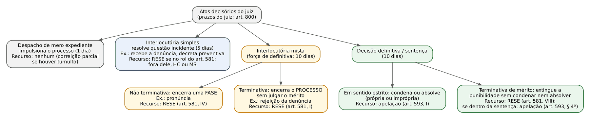
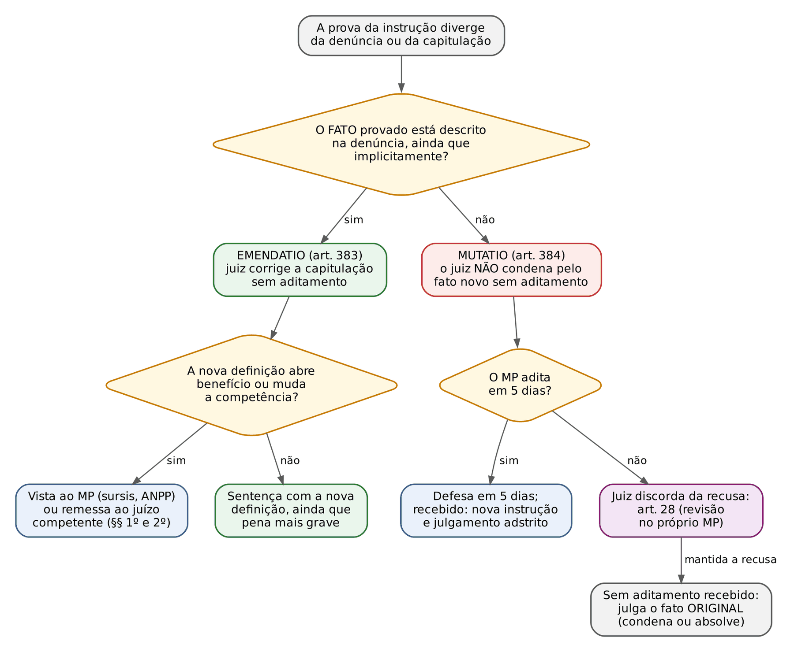
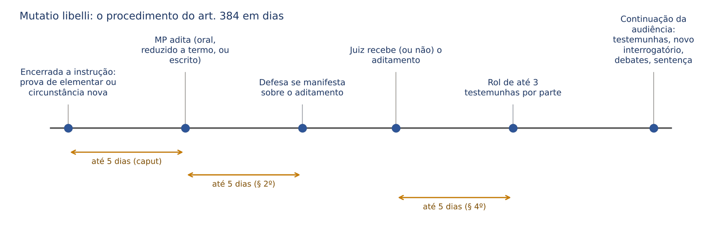
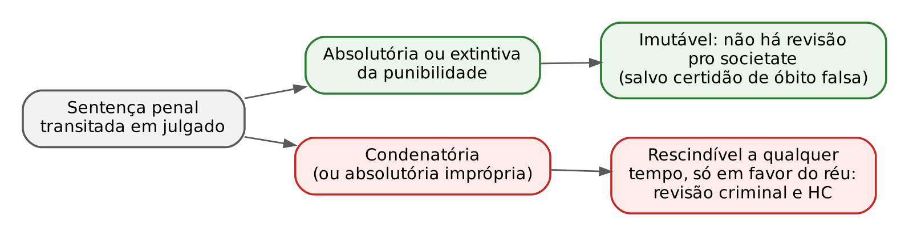
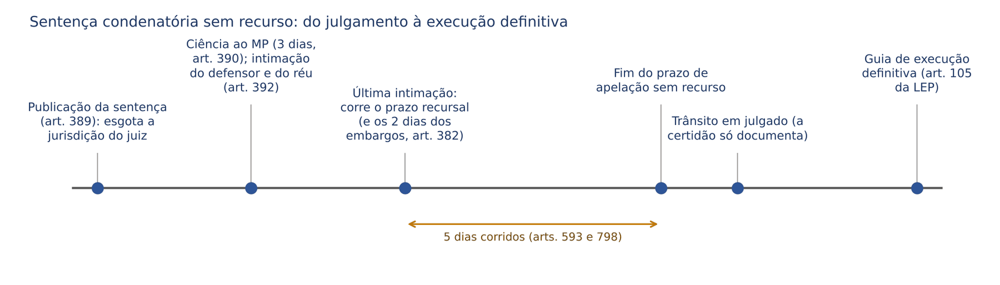

# CAPÍTULO 21 — ATOS JURISDICIONAIS, SENTENÇA PENAL, CORRELAÇÃO ENTRE ACUSAÇÃO E SENTENÇA, COISA JULGADA E TRÂNSITO EM JULGADO

:::INCIDENCIA
TRF5 p. 7; TJRS p. 7; TJSC p. 13. Nível A; 17 questões no lote (FGV 16, FCC 1).
O que mais cai: distinguir *emendatio* de *mutatio libelli* em caso concreto (9 das 17 questões), o art. 385 (condenar apesar do pedido de absolvição do MP) e a literalidade dos arts. 381 e 382.
:::

| Subtema | FGV | FCC | Padrão de cobrança |
|---|---|---|---|
| *Emendatio* x *mutatio*, procedimento e reflexos (suspensão, competência, segundo grau) | 8 | 1 | caso narrado: "a prova revelou..." e o candidato decide se há aditamento |
| Art. 385 e recurso do MP depois do pedido de absolvição | 4 | 0 | juiz condena; outro promotor apela; o tribunal pode agravar? |
| Requisitos da sentença, embargos do art. 382, sentença no JECrim | 3 | 0 | literalidade (data e assinatura; "ambiguidade"; relatório dispensado) |
| Coisa julgada e identidade de fato | 1 | 0 | fato já julgado com outra capitulação |

## 21.1 Atos jurisdicionais: classificação e por que ela importa

### 21.1.1 A lógica da classificação

O civilista está acostumado a um sistema em que a lei define o que é sentença, decisão interlocutória e despacho (art. 203 do CPC) e, a partir daí, o recurso decorre quase automaticamente: sentença, apelação; interlocutória, agravo de instrumento nas hipóteses do art. 1.015. No processo penal, a lógica é outra. O CPP não tem um conceito legal fechado de cada pronunciamento e o sistema recursal é organizado por um ROL de decisões (art. 581, recurso em sentido estrito, chamado RESE) e por uma cláusula residual (art. 593, II, apelação contra decisões "definitivas, ou com força de definitivas", não previstas no rol). Por isso, a classificação doutrinária dos atos do juiz serve a duas perguntas práticas: qual é o prazo que o juiz tem para proferir o ato e qual recurso cabe contra ele.

O próprio CPP usa a classificação no art. 800, que fixa os prazos do juiz singular, contados do termo de conclusão: 10 dias para a decisão definitiva ou interlocutória mista; 5 dias para a interlocutória simples; 1 dia para o despacho de expediente. Os prazos são impróprios (o descumprimento não gera preclusão nem nulidade), e o juiz pode excedê-los por igual tempo, declarando motivo justo (art. 800, § 3º).

### 21.1.2 Despachos

Despacho de mero expediente é o ato que apenas impulsiona o processo, sem decidir questão alguma: designar audiência, mandar intimar, juntar documento, abrir vista. É irrecorrível. Se o despacho inverte tumultuariamente a ordem do processo (*error in procedendo* sem recurso específico), cabe correição parcial, nos termos das leis de organização judiciária e regimentos (ver Cap. 28).

### 21.1.3 Decisões interlocutórias simples e mistas

Decisão interlocutória simples resolve questão incidente sem encerrar o processo nem uma fase dele. Exemplos: recebimento da denúncia, decretação ou revogação de prisão preventiva, deferimento de busca, indeferimento de diligência. Só é recorrível se estiver no rol do art. 581 (por exemplo, a que concede liberdade provisória, relaxa o flagrante ou indefere o requerimento de preventiva, inciso V; a que NEGA a liberdade provisória não está no rol e é atacada por habeas corpus). Fora do rol, o caminho é o habeas corpus (se houver risco à liberdade de locomoção) ou o mandado de segurança (ver Cap. 30). O recebimento da denúncia é o exemplo clássico: interlocutória simples, irrecorrível, atacável por habeas corpus para trancamento (é uma das assertivas verdadeiras da Q2360704, FGV 2024, PC-SC, analisada no Cap. 6).

Decisão interlocutória mista (ou decisão com força de definitiva) tem força de decisão final, porque encerra o processo ou uma etapa dele, sem julgar o mérito (sem condenar nem absolver). Subdivide-se em:

- não terminativa: encerra uma FASE do procedimento, e o processo continua. Exemplo: pronúncia, que encerra a primeira fase do Júri (RESE, art. 581, IV).
- terminativa: encerra o PROCESSO sem julgamento do mérito. Exemplos: rejeição da denúncia (RESE, art. 581, I); procedência da exceção de coisa julgada ou de litispendência (RESE, art. 581, III).

Por que o rótulo importa: decisões com força de definitiva que NÃO estejam no rol do art. 581 são apeláveis pelo art. 593, II (exemplos usuais da doutrina: a que julga o pedido de restituição de coisa apreendida e a que decide sobre o sequestro de bens — ver Cap. 13).

### 21.1.4 Sentenças: em sentido estrito e terminativas de mérito

Sentença em sentido estrito é a decisão definitiva que julga o mérito da pretensão punitiva, encerrando o processo no primeiro grau. Divide-se em:

- condenatória: julga procedente, no todo ou em parte, a pretensão punitiva e aplica pena;
- absolutória própria: não acolhe a pretensão punitiva e não impõe sanção alguma;
- absolutória imprópria: absolve o inimputável do art. 26, *caput*, do CP, reconhecendo o fato típico e ilícito, e lhe aplica medida de segurança (art. 386, parágrafo único, III). Chama-se "imprópria" porque, apesar do nome, impõe uma sanção penal.

Há ainda as decisões terminativas de mérito (ou definitivas em sentido amplo): julgam o mérito sem condenar nem absolver. O exemplo é a decisão que declara extinta a punibilidade (morte, prescrição, decadência). Ela resolve definitivamente a pretensão punitiva e faz coisa julgada material (21.5), mas não é absolvição. A consequência recursal é cobrada: a decisão que decreta a prescrição ou julga, por outro modo, extinta a punibilidade desafia RESE (art. 581, VIII); se a extinção for reconhecida DENTRO da sentença que julga o mérito (por exemplo, condena por um crime e declara prescrito outro), o recurso é a apelação, que absorve o RESE (art. 593, § 4º). Na execução penal, a extinção é atacada por agravo em execução (art. 197 da LEP).

:::PEGADINHA Absolvição sumária pela extinção da punibilidade
O art. 397, IV, manda "absolver sumariamente" quando extinta a punibilidade. Tecnicamente não é absolvição (o mérito do fato não foi apreciado), e por isso parte da doutrina sustenta que o recurso continua sendo o RESE (art. 581, VIII), e não a apelação do art. 416 ou do art. 593, I. Na prova objetiva, siga a literalidade de cada dispositivo e desconfie de alternativa que trate a extinção da punibilidade como absolvição para fins de efeitos civis: ela não impede a ação civil (art. 67, II, do CPP; ver Cap. 7).
:::

Classificação quanto ao órgão que profere a decisão (cobrada em provas de literalidade doutrinária):

| Espécie | Quem decide | Exemplo |
|---|---|---|
| Subjetivamente simples | um só juiz | sentença do juiz singular |
| Subjetivamente plúrima | órgão colegiado homogêneo | acórdão de câmara ou turma |
| Subjetivamente complexa | mais de um órgão, cada um decidindo uma parte | Júri: os jurados decidem crime e autoria; o juiz presidente fixa a pena (art. 492) |

Três rótulos doutrinários que aparecem em provas:

- sentença suicida: aquela cujo dispositivo contradiz a fundamentação (fundamenta a legítima defesa e condena). É nula ou, se a contradição for sanável, corrigível por embargos de declaração (art. 382).
- sentença vazia: a que não tem fundamentação concreta (cópia de modelo, frases genéricas). Nula (art. 93, IX, da CF; art. 564, V, do CPP).
- sentença inexistente: falta-lhe elemento essencial à própria existência do ato (proferida por quem não é juiz, sem dispositivo). Não precisa ser rescindida: não produz coisa julgada.

### 21.1.5 Acórdãos e decisões monocráticas nos tribunais

Acórdão é o julgamento colegiado dos tribunais (o CPC o define no art. 204; o CPP não define, mas o conceito é o mesmo). O acórdão que confirma a condenação ou a impõe interrompe a prescrição (art. 117, IV, do CP; ver Apostila de Direito Penal, Cap. 22).

Decisão monocrática é a proferida pelo relator sozinho, nas hipóteses autorizadas pela lei e pelos regimentos: negar seguimento a recurso inadmissível ou contrário a súmula ou precedente, julgar habeas corpus contra jurisprudência dominante, decidir pedido liminar. Aplicam-se ao processo penal, por analogia (art. 3º do CPP), os poderes do relator do art. 932 do CPC, e o STJ tem súmula no sentido de que o relator pode, monocraticamente, dar ou negar provimento ao recurso quando houver entendimento dominante sobre o tema (Súmula 568 do STJ). A monocrática não subtrai o julgamento do colegiado, porque contra ela cabe agravo interno (no CPP, chamado em regra de agravo regimental), que leva a questão ao órgão colegiado.

:::ATENCAO Prazo do agravo contra decisão monocrática em matéria penal
A intuição civilista (15 dias úteis, arts. 1.021 e 1.070 do CPC) leva ao erro. Em matéria penal, o prazo do agravo contra decisão de relator nos tribunais superiores é de 5 dias (art. 39 da Lei 8.038/1990), contados em dias corridos, conforme o art. 798 do CPP. O regime dos agravos e o sistema recursal dos tribunais estão no Cap. 29.
:::

:::PROCESSO QUAL RECURSO CABE — atos jurisdicionais
| Ato | Exemplo | Recurso |
|---|---|---|
| Despacho de expediente | designa audiência | nenhum (correição parcial se houver tumulto) |
| Interlocutória simples no rol do art. 581 | concede liberdade provisória | RESE (art. 581, V) |
| Interlocutória simples fora do rol | recebe a denúncia | nenhum; HC ou MS |
| Interlocutória mista terminativa | rejeita a denúncia | RESE (art. 581, I) |
| Interlocutória mista não terminativa | pronúncia | RESE (art. 581, IV) |
| Decisão com força de definitiva fora do rol | restituição de coisa apreendida | apelação (art. 593, II) |
| Sentença condenatória ou absolutória | — | apelação (art. 593, I) |
| Extinção da punibilidade em decisão autônoma | declara a prescrição | RESE (art. 581, VIII) |
| Decisão monocrática do relator | nega seguimento a recurso | agravo regimental ou interno (5 dias em matéria penal nos tribunais superiores) |
:::

## 21.2 Sentença penal: requisitos, fundamentação e vícios

### 21.2.1 Requisitos (art. 381) e o relatório no JECrim

A estrutura da sentença, o relatório, a ordem das questões e o roteiro para a prova prática estão na Apostila de Direito Penal, Cap. 26 (26.2), com o texto do art. 381 transcrito. Aqui, o que a banca cobra na objetiva é a literalidade dos seis incisos, que correspondem às partes da sentença:

| Art. 381 | Exige | Parte |
|---|---|---|
| I | nomes das partes ou, quando não possível, indicações para identificá-las | relatório |
| II | exposição SUCINTA da acusação e da defesa | relatório |
| III | motivos de fato e de direito em que se FUNDAR a decisão | fundamentação |
| IV | artigos de lei APLICADOS | fundamentação |
| V | dispositivo | dispositivo |
| VI | data e assinatura do juiz | fecho |

:::QUESTAO FGV 2024 — TJ-MT — Analista Judiciário (Q3114276)
O que se perguntou: qual afirmação sobre o conteúdo da sentença é correta.
Gabarito oficial: D (a sentença deve conter a data e a assinatura do juiz — art. 381, VI).
A armadilha é a deformação de cada inciso: nomes "obrigatoriamente completos" (a lei admite indicações que permitam identificar, inciso I); exposição "integral e detalhada" (a lei diz SUCINTA, inciso II); "todos os dispositivos aplicados e aplicáveis" (só os APLICADOS, inciso IV); motivos que fundam "e que poderiam fundar" a decisão (só os que a fundam, inciso III).
:::

No Juizado Especial Criminal, o relatório é dispensado: "A sentença, dispensado o relatório, mencionará os elementos de convicção do Juiz" (art. 81, § 3º, da Lei 9.099/1995). A fundamentação, porém, nunca é dispensada. Cuidado: o "breve resumo dos fatos relevantes ocorridos em audiência" é do art. 38 da mesma lei, que trata da sentença CÍVEL do Juizado.

:::QUESTAO FGV 2025 — TJ-SC — Juiz Leigo (Q3592905)
O que se perguntou: condenado por injúria no JECrim, com causa de aumento (ofensa na presença de várias pessoas) e maus antecedentes, como o juiz deve estruturar a sentença.
Gabarito oficial: A (relatório dispensado; maus antecedentes na primeira fase da dosimetria; a causa de aumento na terceira).
Passos: (1) relatório: dispensado (art. 81, § 3º, da Lei 9.099/1995), o que elimina as alternativas que o "exigem"; (2) maus antecedentes são circunstância judicial do art. 59 do CP (primeira fase); (3) causa de aumento (majorante, fração que incide sobre a pena) é sempre da terceira fase. Dosimetria: Apostila de Direito Penal, Caps. 13 a 15. No mesmo tema (relatório dispensável no JECrim, fundamentação indispensável): Q3324276 (FGV 2025, TJ-SC, Juiz Substituto; Cap. 27).
:::

### 21.2.2 Fundamentação

A motivação é garantia constitucional (art. 93, IX, da CF) e, no processo penal, tem duas funções: permitir o controle da decisão pelas partes e pelo tribunal e demonstrar que a condenação resultou da prova, e não de convicção íntima. O art. 315, § 2º, do CPP (Lei 13.964/2019) reproduz, para "qualquer decisão judicial, seja ela interlocutória, sentença ou acórdão", a lista do art. 489, § 1º, do CPC: não se considera fundamentada a decisão que se limita a indicar ou parafrasear ato normativo, emprega conceitos jurídicos indeterminados sem explicar sua incidência, invoca motivos que serviriam a qualquer decisão, não enfrenta todos os argumentos capazes de infirmar a conclusão, invoca precedente ou súmula sem identificar seus fundamentos determinantes, ou deixa de seguir precedente invocado pela parte sem demonstrar distinção ou superação. A sentença sem fundamentação é nula (art. 564, V).

Quatro pontos de jurisprudência que a banca usa:

- Fundamentação *per relationem* (por referência a outra peça, como parecer do MP ou decisão anterior) é válida quando a peça referida tem fundamentação suficiente e é acessível às partes (STJ, AgRg no HC 876.612, j. 8/10/2024; desenvolvido na Apostila de Direito Penal, 26.2.1). O limite é o enfrentamento das teses defensivas relevantes: adotar só as alegações finais do MP, sem examinar as da defesa, não satisfaz o art. 315, § 2º, IV (é o núcleo da Q3324276, Cap. 27).
- O tribunal não pode suprir, no habeas corpus, a fundamentação omitida na sentença que manteve a prisão (v. Cap. 19).
- O vício de fundamentação da DOSIMETRIA costuma ser corrigido pelo próprio tribunal (redimensionando a pena), sem anular a sentença; o vício de fundamentação do MÉRITO leva à anulação.
- O juiz não precisa rebater um a um os argumentos que ficaram logicamente superados pela fundamentação adotada; precisa enfrentar os capazes de, em tese, infirmar a conclusão (art. 315, § 2º, IV).

### 21.2.3 Conteúdo obrigatório: sentença absolutória e condenatória

Sentença absolutória (art. 386). O juiz absolve "mencionando a causa na parte dispositiva", isto é, indicando o inciso. A escolha do inciso tem efeitos civis (os incisos I e IV, e o reconhecimento de excludente de ilicitude, fazem coisa julgada no cível; os de dúvida, não), e por isso a defesa tem interesse recursal em apelar da absolvição para mudar o fundamento (de "falta de provas", inciso VII, para "inexistência do fato", inciso I). A tabela completa dos incisos e de seus efeitos civis está na Apostila de Direito Penal, 26.7, e no Cap. 7 desta apostila (07.4). Na absolvição, o juiz manda pôr o réu em liberdade, se for o caso, ordena a cessação das medidas cautelares e aplica medida de segurança, se cabível (art. 386, parágrafo único).

Sentença condenatória (art. 387). O juiz menciona as agravantes e atenuantes que reconhecer, as circunstâncias dos arts. 59 e 60 do CP, aplica a pena, fixa o valor mínimo de reparação (inciso IV; ver Cap. 7), decide fundamentadamente sobre a manutenção ou imposição de preventiva ou outra cautelar, sem condicionar o conhecimento da apelação ao recolhimento (§ 1º), e computa o tempo de prisão provisória para fixar o regime inicial (§ 2º, detração na sentença). O roteiro dos consectários está na Apostila de Direito Penal, 26.9, e a preventiva na sentença, no Cap. 19.

:::DICA O que é processual em cada inciso do art. 386
Para a prova objetiva, guarde três pares: I (provada a inexistência) x II (falta prova da existência); IV (provado que o réu não concorreu) x V (falta prova de que concorreu); VI (excludente provada OU fundada dúvida sobre ela) x VII (prova insuficiente em geral). Os incisos "de certeza" (I, IV e excludente de ilicitude provada) vinculam o cível; os "de dúvida" (II, V, VI parte final e VII), não.
:::

## 21.3 Publicação, embargos de declaração e esgotamento da jurisdição

Publicação. A sentença é publicada "em mão do escrivão", que lavra o termo e a registra (art. 389). Na prática: a sentença escrita se considera publicada quando entregue em cartório (ou, no processo eletrônico, quando juntada aos autos), e não quando assinada; a sentença proferida em audiência se considera publicada na própria audiência. A data importa porque a publicação da sentença condenatória recorrível interrompe a prescrição (art. 117, IV, do CP; Apostila de Direito Penal, Cap. 22). Se o cartório não certificou a data de recebimento, não se pode presumi-la a partir do mero lançamento de movimentação no sistema para aferir a prescrição (STJ, HC 408.736, Sexta Turma, j. 6/2/2018, Informativo 619). Publicada a sentença, o escrivão dá ciência ao MP em 3 dias, sob pena de suspensão de 5 dias (art. 390).

Esgotamento da jurisdição. Publicada, a sentença torna-se irretratável para o juiz que a proferiu: ele só pode corrigir erro material (de ofício ou a pedido, a qualquer tempo) e julgar os embargos de declaração. Por isso a sentença que, depois de publicada, é "reconsiderada" pelo próprio juiz para mudar o mérito é nula. Quem proferiu a sentença fica impedido de julgar o recurso contra ela se vier a integrar o tribunal (art. 252, III).

Embargos de declaração contra a sentença ("embarguinhos"). Qualquer das partes pode, em 2 dias, pedir que o juiz declare a sentença quando houver obscuridade, AMBIGUIDADE, contradição ou omissão (art. 382). No JECrim, o prazo é de 5 dias (art. 83 da Lei 9.099/1995). Efeitos, contagem e embargos contra acórdão (art. 619) estão no Cap. 28.

:::QUESTAO FGV 2024 — Câmara dos Deputados — Consultor Legislativo (Q2513045)
O que se perguntou: qual afirmação sobre a sentença penal é correta.
Gabarito oficial: C (é cabível o pedido para que o juiz declare a sentença quando houver obscuridade, ambiguidade, contradição ou omissão — art. 382).
Armadilhas: (A) dispensa identificação das partes, relatório e artigos de lei (contraria o art. 381); (B) veda nova definição jurídica (é exatamente o que o art. 383 permite); (D) proíbe o aditamento depois da instrução (é o momento da *mutatio*, art. 384); (E) proíbe condenar quando o MP pede absolvição (o art. 385 permite).
:::

Intimação da sentença (art. 392: réu preso, solto, revel, edital com prazo de 90 ou 60 dias) e contagem do prazo recursal a partir da última intimação: Cap. 20 (20.9).

## 21.4 Correlação entre acusação e sentença

### 21.4.1 O princípio: o réu se defende dos fatos

No processo civil, o juiz fica adstrito ao PEDIDO e à causa de pedir (arts. 141 e 492 do CPC). No processo penal, o que vincula o juiz é o FATO descrito na denúncia ou queixa (a imputação), e não a capitulação jurídica que a acusação lhe deu nem o pedido final. A razão é a forma como a defesa se organiza: o réu se defende do que lhe é atribuído como acontecimento (o que fez, quando, como, com que meio, com que intenção), porque é isso que ele pode negar, explicar ou contrapor com provas. A qualificação jurídica é tarefa do juiz, que conhece o direito: *jura novit curia* ("o tribunal conhece o direito") e *narra mihi factum, dabo tibi jus* ("narra-me o fato e te darei o direito").

Daí o princípio da correlação (ou congruência): deve haver correspondência entre o fato imputado e o fato pelo qual o réu é condenado. Viola a correlação a sentença:

- *extra petita*: condena por fato diverso do imputado;
- *ultra petita*: condena por fato mais amplo, acrescentando elementar ou circunstância não descrita (por exemplo, reconhece qualificadora não narrada);
- *citra petita*: deixa de julgar fato imputado (por exemplo, um dos crimes ou um dos réus).

A sentença incongruente é nula (nulidade absoluta, por ofensa ao contraditório e à ampla defesa; ver Cap. 27). Mas a nulidade é da SENTENÇA, e o tribunal, em recurso exclusivo da defesa, não pode corrigir a incongruência em prejuízo do réu (21.4.4).

O que é "fato", para esse fim: o acontecimento histórico com todas as elementares (dados que compõem o tipo: subtração, violência, coisa alheia, posse anterior) e circunstâncias (dados que alteram a pena: qualificadoras, majorantes, privilégios) descritas na acusação, explícita ou implicitamente. Implícito é o dado que decorre necessariamente da narrativa: se a denúncia diz que o agente "apontou um revólver para a vítima e exigiu a bolsa", a grave ameaça está descrita, ainda que a palavra não apareça.

Para o juiz, a pergunta que resolve quase todas as questões é uma só: o fato que a prova revelou é o MESMO que a denúncia descreveu? Se sim, o problema é só de nome (*emendatio*); se não, há fato novo, e o juiz não pode condenar por ele sem que a acusação o impute formalmente (*mutatio*).

### 21.4.2 *Emendatio libelli* (art. 383)

:::LEI Código de Processo Penal, art. 383
Art. 383. O juiz, sem modificar a descrição do fato contida na denúncia ou queixa, poderá atribuir-lhe definição jurídica diversa, ainda que, em consequência, tenha de aplicar pena mais grave. § 1º Se, em consequência de definição jurídica diversa, houver possibilidade de proposta de suspensão condicional do processo, o juiz procederá de acordo com o disposto na lei. § 2º Tratando-se de infração da competência de outro juízo, a este serão encaminhados os autos.
:::

*Emendatio libelli* (literalmente, "correção da acusação") é a atribuição, pelo juiz, de definição jurídica diversa ao mesmo fato narrado. Como nada se acrescenta ao fato de que o réu se defendeu, não há aditamento, não há nova instrução e não há sequer necessidade de ouvir as partes antes da sentença; a nova capitulação pode levar a pena mais grave. Cabe em qualquer espécie de ação penal (pública ou privada), porque é ato do juiz.

Exemplos de *emendatio*:

- A denúncia narra que A, falso manobrista, recebeu as chaves do convidado e levou o carro, e capitula como estelionato. O fato narrado já é o de furto mediante fraude (a fraude serviu para afastar a vigilância, não para obter a entrega da posse com ânimo de transferi-la). O juiz condena por furto qualificado sem aditamento (é a hipótese (i) da Q3752772, analisada em 06.7.3).
- A denúncia narra que B empurrou a vítima e arrancou o cordão de seu pescoço, mas capitula como furto. A violência está descrita: condenação por roubo, sem aditamento.
- A denúncia descreve três subtrações em condições semelhantes de tempo, lugar e modo e pede concurso material; o juiz reconhece a continuidade delitiva (art. 71 do CP): a forma de concurso é questão de direito.
- A denúncia de sonegação indica expressamente o montante do tributo suprimido; o juiz pode aplicar a majorante do grave dano à coletividade (art. 12, I, da Lei 8.137/1990), ainda que não capitulada (Jurisprudência em Teses do STJ, edição 90, tese 2).

:::QUESTAO FGV 2025 — TJ-SC — Juiz Leigo (Q3592904)
O que se perguntou: denúncia por injúria contra servidor em razão das funções; ao sentenciar, o juiz entende que os fatos DESCRITOS configuram difamação, mais grave. O que pode fazer.
Gabarito oficial: A (pode dar definição jurídica diversa, ainda que aplique pena mais grave, por *emendatio libelli*).
Passos: (1) o que mudou? só a qualificação jurídica, porque o juiz decide "à luz dos fatos descritos"; (2) regra: art. 383, *caput*; (3) consequência: sem aditamento e com pena maior. Armadilhas: (B) chama de *mutatio*; (C) e (D) exigem aditamento ou veem usurpação da função do MP (o MP é dono da imputação do fato, não da capitulação); (E) supõe vedação de pena mais grave.
No mesmo sentido, quanto à literalidade: Q3781282 (FGV 2025, CGE-SP), gabarito C (só a assertiva III: aberta a possibilidade de suspensão condicional do processo, "o juiz procederá de acordo com o disposto na lei", § 1º); a assertiva I erra ao exigir aditamento em 5 dias e a II chama de *mutatio* a nova definição jurídica sem mudança do fato.
:::

Os §§ 1º e 2º regulam os reflexos da nova definição, e é aqui que a banca mais testa o candidato que só decorou o *caput*:

- Benefício que se torna cabível. Se a nova capitulação (ou a procedência parcial) permite a suspensão condicional do processo, o juiz NÃO condena desde logo: abre vista ao MP para que se manifeste sobre a proposta (§ 1º; Súmula 337 do STJ). A mesma lógica vale para o ANPP e, se a infração passar a ser de menor potencial ofensivo, para a transação penal. O próprio juiz não "concede" o benefício: a proposta é do MP, e a recusa imotivada ou divergente do juízo é submetida à instância revisora do MP, por aplicação analógica do art. 28 (Súmula 696 do STF). O desenvolvimento material dos institutos e a redação-modelo da decisão que abre vista estão na Apostila de Direito Penal, Cap. 25 (25.5.7 e box SENTENCA), e a visão processual do ANPP no Cap. 8.
- Competência. Se a infração, com a nova definição, for da competência de outro juízo, os autos são remetidos a ele (§ 2º). Exemplos: desclassificação para infração de menor potencial ofensivo (remessa ao JECrim, onde caberá transação); para crime da competência da Justiça Federal ou Eleitoral. Sendo incompetência absoluta, o juiz não profere sentença de mérito (ver Cap. 9, 09.2.3).

:::QUESTAO FGV 2024 — TJ-SC — Juiz Substituto (Q2387002)
O que se perguntou: denúncia por furto qualificado pela fraude; na sentença, sem modificar o fato, o juiz desclassifica para estelionato e abre vista ao MP sobre a suspensão condicional do processo; o MP se recusa, insistindo na capitulação original, e não recorre. O que o juiz faz.
Gabarito oficial: B (pode dar a nova definição jurídica e, diante da recusa, deve remeter os autos ao Procurador-Geral de Justiça).
Passos: (1) a nova definição sem mudança do fato é *emendatio* legítima, mesmo no sistema acusatório; (2) aberta a possibilidade do benefício, o juiz procede conforme o § 1º (vista ao MP); (3) recusa do MP: o juiz não oferece a suspensão de ofício (a proposta é ato do titular da ação), mas submete a divergência à chefia do MP (art. 28, por analogia; Súmula 696 do STF). Armadilhas: (A), (C) e (E) negam a *emendatio* com base no princípio acusatório; (D) permite que o juiz ofereça a suspensão de ofício.
:::

*Emendatio* em segundo grau. Não há surpresa para as partes, e por isso o tribunal pode dar nova definição jurídica ao fato ao julgar a apelação. O limite é a proibição de *reformatio in pejus* (piora da situação do réu em recurso exclusivo da defesa, art. 617; ver Cap. 28): em recurso só da defesa, o tribunal pode corrigir a capitulação desde que não aumente a pena nem agrave qualquer aspecto da condenação.

*Emendatio* no recebimento da denúncia ("*emendatio* antecipada"). Em regra, o momento da *emendatio* é a sentença: o art. 383 está no título da sentença, o réu se defende dos fatos e o juiz que "corrige" a denúncia ao recebê-la invade a função do titular da ação e antecipa julgamento. O STJ admite, porém, a correção antecipada da capitulação, excepcionalmente, quando a classificação inadequada (i) afeta a competência absoluta, (ii) impõe procedimento inadequado ou (iii) restringe benefícios penais por excesso de acusação (STJ, HC 241.206, Sexta Turma, j. 11/11/2014, Informativo 553; HC 258.581, Quinta Turma, j. 18/2/2016). O excesso de acusação é o caso típico: capitular furto simples como furto qualificado para afastar a suspensão condicional do processo ou o ANPP; capitular como hediondo o que não é, para viabilizar prisão. Se o juiz não fizesse nada, o réu perderia o benefício na largada, e a correção só na sentença chegaria tarde.

:::QUESTAO FCC 2025 — DPE-SP — Analista de Defensoria (Q3304104)
O que se perguntou: réu primário, que recusou ANPP por negar a autoria, denunciado por furto mediante fraude (fingiu ser manobrista e levou o veículo); o juiz entende que é estelionato simples. Segundo o STJ, o que deve fazer ao receber os autos.
Gabarito oficial: C (realizar a *emendatio libelli* antecipada e enviar os autos ao MP para que ofereça a suspensão condicional do processo).
Passos: (1) a capitulação alegadamente excessiva bloqueia benefício (o estelionato simples tem pena mínima de 1 ano, compatível com a suspensão do art. 89 da Lei 9.099/1995; o furto qualificado, de 2 anos, não); (2) é uma das hipóteses excepcionais de *emendatio* no recebimento; (3) consequência: vista ao MP para a proposta. Armadilhas: (A) devolver ao MP para "corrigir" a capitulação não tem base legal; (B) art. 28 é para a recusa, não para a capitulação; (D) aguardar a sentença frustraria o benefício; (E) erro de capitulação não gera inépcia (06.4.1).
Atenção: no plano MATERIAL, a questão é discutível, porque o caso do falso manobrista costuma ser tratado como FURTO mediante fraude (Q3752772, Cap. 6), e não como estelionato; a FCC pediu apenas o procedimento "se o juiz entender" ser estelionato.
:::

:::SENTENCA *Emendatio* na sentença
Onde entra: na fundamentação, depois de reconhecer materialidade e autoria e antes da dosimetria, no tópico da tipicidade.
O que fundamentar: (1) que o fato reconhecido é exatamente o descrito na denúncia (cite o trecho); (2) por que a capitulação correta é outra; (3) se a nova definição abre benefício ou muda a competência, a providência dos §§ 1º e 2º, em vez da condenação.
Redação-modelo: "A denúncia descreve que o acusado, mediante empurrão, arrancou o cordão do pescoço da vítima. A violência à pessoa, expressamente narrada, configura o crime do art. 157, *caput*, do Código Penal, e não o furto capitulado. Como o réu se defende dos fatos, e não de sua qualificação jurídica, atribuo-lhes definição jurídica diversa, com fundamento no art. 383 do Código de Processo Penal."
Erro que a banca pune: chamar de *emendatio* a condenação por elementar que só apareceu na instrução (é *mutatio*, e a sentença é nula); condenar diretamente pela infração desclassificada que admite suspensão, ANPP ou transação, sem abrir vista ao MP.
:::

### 21.4.3 *Mutatio libelli* (art. 384)

:::LEI Código de Processo Penal, art. 384
Art. 384. Encerrada a instrução probatória, se entender cabível nova definição jurídica do fato, em consequência de prova existente nos autos de elemento ou circunstância da infração penal não contida na acusação, o Ministério Público deverá aditar a denúncia ou queixa, no prazo de 5 (cinco) dias, se em virtude desta houver sido instaurado o processo em crime de ação pública, reduzindo-se a termo o aditamento, quando feito oralmente. § 1º Não procedendo o órgão do Ministério Público ao aditamento, aplica-se o art. 28 deste Código. § 2º Ouvido o defensor do acusado no prazo de 5 (cinco) dias e admitido o aditamento, o juiz, a requerimento de qualquer das partes, designará dia e hora para continuação da audiência, com inquirição de testemunhas, novo interrogatório do acusado, realização de debates e julgamento. § 3º Aplicam-se as disposições dos §§ 1º e 2º do art. 383 ao caput deste artigo. § 4º Havendo aditamento, cada parte poderá arrolar até 3 (três) testemunhas, no prazo de 5 (cinco) dias, ficando o juiz, na sentença, adstrito aos termos do aditamento. § 5º Não recebido o aditamento, o processo prosseguirá.
:::

*Mutatio libelli* ("mudança da acusação") ocorre quando a prova produzida na instrução revela ELEMENTAR ou CIRCUNSTÂNCIA da infração que não está contida, nem explícita nem implicitamente, na acusação. O fato mudou; o réu não se defendeu do fato novo; logo, o fato novo precisa ser formalmente imputado (aditamento) e submetido a contraditório (nova instrução) antes de ser julgado.

O que muda em relação à redação anterior à Lei 11.719/2008, e que explica a cobrança: antes, o juiz podia, em certos casos, baixar os autos para a defesa e condenar sem aditamento se a pena fosse igual ou menor. Hoje o aditamento é SEMPRE necessário, independentemente da pena (mais grave, igual ou menor), porque o critério é a mudança do fato, não o reflexo na pena. A iniciativa é do MP; o juiz não adita nem "convida" formalmente o MP a aditar em termos que antecipem julgamento (pode, no máximo, provocar a aplicação do § 1º se discordar da inércia).

Hipóteses típicas de *mutatio*:

| Denúncia | Prova da instrução | Por que é fato novo |
|---|---|---|
| furto (subtração) | houve violência ou grave ameaça | violência/ameaça é elementar do roubo |
| furto (subtração) | o réu já tinha a posse do bem por empréstimo e não o devolveu | posse lícita anterior é elementar da apropriação indébita e incompatível com a subtração |
| receptação | o réu participou da subtração | autoria do furto é fato diverso |
| crime doloso | o resultado decorreu de imprudência | a culpa exige descrição da modalidade (qual dever de cuidado foi violado) |
| homicídio culposo por excesso de velocidade | a causa foi o avanço do sinal vermelho | a modalidade de culpa integra o fato |
| roubo simples (ameaça verbal) | emprego de arma de fogo | majorante não descrita |
| homicídio com dolo direto (no Júri) | sustentação de dolo eventual | dolo direto e eventual exigem descrições fáticas distintas |

Quanto à última linha, o STJ reconheceu nulidade absoluta quando denúncia e pronúncia se limitaram ao dolo direto e o MP introduziu o dolo eventual só em Plenário, levando-o à quesitação (STJ, REsp 1.678.050, Sexta Turma, j. 14/11/2017). Diferente é a denúncia que não especifica a modalidade do dolo, mas descreve suficientemente a dinâmica dos fatos: aí não há inépcia nem inovação, e a modalidade pode ser esclarecida na instrução (STJ, RHC 183.002, Sexta Turma, j. 1/7/2025). É o tema da Q3951763 (FGV 2026, TJ-PA, Juiz Substituto; gabarito C, nulidade por violação da correlação), desenvolvida no Cap. 23.

Procedimento passo a passo:

1. Momento: "encerrada a instrução probatória", isto é, depois do interrogatório e antes das alegações finais. Na audiência una, o MP pode aditar oralmente (reduz-se a termo) ou pedir prazo; a audiência é cindida.
2. Prazo do MP: 5 dias. O aditamento é peça acusatória: descreve o fato com a nova elementar ou circunstância e o capitula.
3. Defesa: ouvida em 5 dias sobre o aditamento (§ 2º). Não há nova CITAÇÃO: o réu já integra a relação processual; basta a intimação do defensor (e a defesa pode impugnar o aditamento, por exemplo, por falta de justa causa).
4. Juízo de admissibilidade: o juiz recebe ou rejeita o aditamento, com os mesmos critérios da denúncia (art. 395).
5. Recebido: cada parte pode arrolar até 3 testemunhas em 5 dias (§ 4º); a requerimento de qualquer das partes, designa-se a continuação da audiência, com inquirição das testemunhas, NOVO INTERROGATÓRIO, debates e julgamento (§ 2º).
6. Sentença: o juiz fica adstrito aos termos do aditamento (§ 4º). A antiga discussão sobre poder condenar pela imputação original, se a nova não se provar, perdeu espaço com essa redação (ver 06.7.2): recebido o aditamento, a imputação passa a ser a nova.
7. Reflexos: aplicam-se os §§ 1º e 2º do art. 383 (benefícios e competência, § 3º).

Três situações de desvio que caem em prova:

- O MP não adita. O juiz que discorda aplica o art. 384, § 1º, que remete ao art. 28. Com a nova redação do art. 28 (Lei 13.964/2019) e a interpretação conforme do STF (ADIs 6.298 e outras; ver Cap. 4), o sentido prático é submeter a divergência à instância de revisão do próprio MP (Procurador-Geral de Justiça ou órgão equivalente; no MPF, a Câmara de Coordenação e Revisão). Se a chefia mantiver a recusa, o juiz julga o fato tal como descrito na denúncia original: condena pelo que foi imputado e provado, ou absolve se o fato imputado não se provou. Ele NÃO absolve "por falta de aditamento" quando o fato original está provado, nem condena pelo fato novo.
- O aditamento é rejeitado. O processo prossegue pelo fato original (§ 5º). Contra a rejeição, a doutrina admite RESE, por equiparação à rejeição da denúncia (art. 581, I); contra o recebimento, não há recurso (cabe habeas corpus). Registre que o ponto não é pacífico.
- Ação penal privada exclusiva. O art. 384 manda o MP aditar "a denúncia ou queixa ... se em virtude desta houver sido instaurado o processo em crime de ação pública", isto é, na queixa SUBSIDIÁRIA. Na ação privada exclusiva, o MP não pode ampliar a imputação; só o querelante, dentro do prazo decadencial (ver 06.7.4, sobre o art. 45).

:::ATENCAO O aditamento não serve para incluir FATO NOVO autônomo
A *mutatio* altera a definição jurídica do MESMO acontecimento (o furto que, provado, era roubo). Se a instrução revela outro crime, autônomo (um segundo furto, em outra data), o caminho é nova denúncia ou aditamento próprio, com nova citação e novo procedimento, e não o art. 384.
:::

:::QUESTAO FGV 2026 — MPE-MT — Promotor de Justiça Substituto (Q4117001)
O que se perguntou: denúncia por furto (subtração de veículo); a instrução revela comodato verbal anterior e apropriação do veículo não devolvido (apropriação indébita). Como se resolve a correlação.
Gabarito oficial: A (o MP deve aditar, porque surgiram elementos não contidos na denúncia).
Passos: (1) a posse lícita anterior não estava narrada e é incompatível com a "subtração": fato novo; (2) art. 384: aditamento obrigatório; (3) a pena igual dos dois crimes é irrelevante. Armadilhas: (B) chama de *emendatio*; (C) dispensa o aditamento pela pena máxima igual (o critério é o fato, não a pena); (D) manda absolver se não houver aditamento (o juiz aplica o § 1º e, mantida a recusa, julga o fato original); (E) exige nova citação (basta ouvir o defensor em 5 dias).
:::

:::QUESTAO FGV 2026 — MPE-RJ — Promotor de Justiça Substituto (Q4088255)
O que se perguntou: denúncia por furto; vítima e vídeo revelam violência; o MP, sem aditar, pede nas alegações finais a condenação por roubo.
Gabarito oficial: B (o MP deveria oferecer aditamento, por haver prova de circunstância não contida na denúncia).
Passos: (1) violência é elementar do roubo, ausente na denúncia; (2) pedido em alegações finais NÃO é aditamento: não passa pelo § 2º (manifestação da defesa, recebimento, nova instrução e novo interrogatório); (3) sem aditamento, o juiz só pode julgar o furto narrado. Armadilhas: (A) diz que o juiz não pode condenar por furto por causa do pedido de roubo (o pedido não retira a imputação original); (C) supõe que o interrogatório em silêncio supriria a defesa do fato novo; (D) e (E) confundem *mutatio* com dispensa de aditamento.
:::

:::QUESTAO FGV 2024 — TJ-AP — Analista Judiciário (Q2449099)
O que se perguntou: denúncia por tentativa de homicídio (disparos na direção do policial); em juízo, o policial diz que os disparos foram para o alto, para fugir da abordagem.
Gabarito oficial: A (se o MP entender cabível nova definição jurídica, deverá aditar em 5 dias, reduzindo-se a termo o aditamento oral).
Passos: (1) a direção dos disparos e a finalidade (fugir, não matar) mudam o fato imputado; (2) é *mutatio*, que depende do MP; (3) literalidade do *caput*. Armadilhas: (B) e (D) falam em *emendatio* (com ou sem concordância das partes); (C) suprime a fase de continuação da audiência ("findo o qual o juiz proferirá sentença"); (E) atribui a *mutatio* ao juiz, sem o MP.
:::

:::QUESTAO FGV 2024 — Câmara Municipal de São Paulo — Procurador Legislativo (Q2351297)
O que se perguntou: denúncia por roubo simples (ameaça verbal); a vítima revela em juízo o uso de arma de fogo (majorante não descrita); o MP pede prazo para aditar. Qual afirmação está correta.
Gabarito oficial: C (havendo aditamento, cada parte pode arrolar até 3 testemunhas, em 5 dias, ficando o juiz, na sentença, adstrito aos termos do aditamento — § 4º, literal).
Armadilhas, todas de número ou de poder: (A) reproduz o § 2º, mas com oitiva do defensor em "três dias" (são 5); (B) permite ao juiz considerar a nova definição sem aditamento; (D) dá 10 dias ao MP (são 5); (E) dá RESE contra o RECEBIMENTO do aditamento (não há previsão). Na prova, decore os números: 5 dias para o MP, 5 para a defesa, 3 testemunhas em 5 dias.
:::

:::PEGADINHA Majorante e qualificadora x agravante
Qualificadora e causa de aumento (majorante) são CIRCUNSTÂNCIAS do tipo que precisam estar descritas na denúncia; se só aparecem na instrução, exigem *mutatio*. Agravante genérica (arts. 61 e 62 do CP) segue regime próprio, o do art. 385 (21.4.6).
:::

### 21.4.4 *Mutatio* em segundo grau: Súmula 453 do STF

:::JURIS STF, Súmula 453
"Não se aplicam à segunda instância o art. 384 e parágrafo único do Código de Processo Penal, que possibilitam dar nova definição jurídica ao fato delituoso, em virtude de circunstância elementar não contida, explícita ou implicitamente, na denúncia ou queixa."
Lógica: se o tribunal julgasse fato novo, haveria supressão de instância (o fato não foi instruído nem sentenciado no primeiro grau) e ofensa ao duplo grau. A súmula se refere à redação antiga do art. 384 (o "parágrafo único"), mas continua aplicável à atual.
:::

Consequências práticas:

- O tribunal julga o fato tal como descrito na denúncia. Se a sentença condenou por fato não descrito (sem *mutatio*), há nulidade; em recurso exclusivo da defesa, o tribunal não pode anular para que se faça a *mutatio* (isso pioraria a situação do réu: *reformatio in pejus* indireta, ver Cap. 28) nem condenar pelo fato novo; resta julgar o fato descrito, o que muitas vezes leva à absolvição.
- A *emendatio*, ao contrário, é admitida no tribunal, respeitada a vedação de *reformatio in pejus* (21.4.2).
- Nas ações penais de competência ORIGINÁRIA dos tribunais (réu com foro por prerrogativa), a *mutatio* é admitida, porque o tribunal é o órgão de instrução e julgamento, e não há instância suprimida (Renato Brasileiro).

:::QUESTAO FGV 2024 — TJ-RJ — Programa de Residência (Q2375308)
O que se perguntou: denunciada por lesão corporal grave com dolo direto; a instrução prova imprudência; o juiz, sem aditamento, condena por lesão culposa; só a ré recorre. Como o tribunal decide.
Gabarito oficial: C (o tribunal deve absolver, diante da nulidade da sentença por violação da correlação).
Passos: (1) a desclassificação de crime doloso para culposo exige a descrição da modalidade de culpa, que a denúncia não continha: era caso de *mutatio*, não feita; (2) a sentença é nula; (3) no tribunal, não se pode fazer a *mutatio* (Súmula 453) e, em recurso exclusivo da defesa, não se pode anular para refazer o procedimento em prejuízo da ré; (4) julga-se o fato descrito (lesão dolosa), que não se provou: absolvição. Armadilhas: (A) e (D) tratam a troca de dolo por culpa como *emendatio* ou desclassificação "para menos" dispensada de aditamento (o aditamento é obrigatório mesmo para pena menor); (B) anula para observar a *mutatio*, o que prejudica a ré em recurso só dela.
:::

### 21.4.5 Tabela comparativa

| Ponto | *Emendatio libelli* (art. 383) | *Mutatio libelli* (art. 384) |
|---|---|---|
| O que muda | só a definição jurídica | o FATO: surge elementar ou circunstância não contida na acusação |
| De onde vem | interpretação do juiz | prova produzida na instrução |
| Quem age | o juiz, de ofício | o MP adita; o juiz não pode condenar pelo fato novo sem aditamento |
| Aditamento | desnecessário | obrigatório, qualquer que seja a pena (5 dias) |
| Contraditório | dispensa oitiva prévia das partes | defesa em 5 dias; até 3 testemunhas por parte; novo interrogatório; debates |
| Pena mais grave | permitida | permitida, observado o procedimento |
| Momento | sentença (excepcionalmente, no recebimento: "antecipada") | encerrada a instrução |
| Espécie de ação | todas, inclusive privada | pública e privada subsidiária (aditamento pelo MP) |
| Segundo grau | admitida, sem *reformatio in pejus* | vedada (Súmula 453), salvo competência originária |
| Recusa | — | art. 28 (revisão no MP) e, mantida, julga-se o fato original |
| Reflexos | §§ 1º e 2º (benefícios e competência) | os mesmos (§ 3º) |

### 21.4.6 Art. 385: condenar apesar do pedido de absolvição e reconhecer agravantes

:::LEI Código de Processo Penal, art. 385
Art. 385. Nos crimes de ação pública, o juiz poderá proferir sentença condenatória, ainda que o Ministério Público tenha opinado pela absolvição, bem como reconhecer agravantes, embora nenhuma tenha sido alegada.
:::

Primeira parte: condenação contra o pedido do MP. A ação penal pública é indisponível: o MP não pode desistir dela (art. 42). O pedido de absolvição nas alegações finais é OPINIÃO do órgão (a lei diz "opinado"), fruto de sua independência funcional, e não retirada da acusação: a imputação continua sendo a da denúncia. O juiz, igualmente independente, julga conforme a prova. A tese de que o art. 385 seria incompatível com o sistema acusatório (art. 3º-A) e a decisão do STJ que o manteve (REsp 2.022.413, j. 14/2/2023) estão em 01.2.3; o STF tem precedentes de turma pela constitucionalidade (HC 185.633, Segunda Turma) e exige, nesse caso, ônus de fundamentação reforçado, porque o juiz decide contra o próprio titular da ação (AP 976, Primeira Turma, em que o ônus não foi satisfeito e houve absolvição). A questão está submetida ao Plenário do STF na ADPF 1.122, sem julgamento de mérito localizado. Na prova objetiva, prevalece a validade do art. 385.

Consequências recursais (onde a FGV mais aprofunda):

- O membro do MP que oficiar depois pode recorrer da sentença condenatória, inclusive para agravar a pena: a manifestação anterior de outro promotor não vincula o sucessor (independência funcional) nem gera preclusão lógica, porque o MP não "desistiu" da ação.
- O MP não pode desistir do recurso que interpôs (art. 576). Se o promotor que apresenta as razões opina pelo não provimento, isso não é desistência: o tribunal conhece do recurso e pode provê-lo.
- O recurso do MP devolve a matéria de modo amplo também em favor do réu: o tribunal pode até absolvê-lo (a vedação de *reformatio in pejus* protege a defesa; não impede a melhora da situação do réu em recurso da acusação).

:::QUESTAO FGV 2026 — MPE-RJ — Promotor de Justiça Substituto (Q4088258)
O que se perguntou: o promotor titular pediu absolvição por roubo majorado; o juiz condenou a 6 anos; o substituto apelou para agravar a pena, sem razões; o titular, de volta das férias, apresentou razões pelo não conhecimento e não provimento.
Gabarito oficial: B (o juiz podia condenar, e o tribunal pode conhecer da apelação e, provendo-a, majorar a pena).
Passos: (1) art. 385: condenação válida; (2) o recurso interposto pelo substituto é válido (independência funcional) e o MP não pode desistir dele (art. 576); razões em sentido contrário não equivalem a desistência; (3) recurso da acusação: o agravamento da pena não é *reformatio in pejus*. Armadilhas: (A) trata a opinião absolutória como desistência; (C) e (E) veem desistência do recurso; (D) invoca *reformatio in pejus* contra recurso da acusação.
No mesmo sentido: Q3532364 (FGV 2025, MPE-RJ; gabarito D: o juiz podia condenar, e o recurso do MP para aumentar a pena pode ser conhecido, podendo o tribunal até absolver o réu) e Q3117552 (FGV 2024, TJ-PE, Juiz Substituto; gabarito B: o juiz pode condenar apesar do pedido de absolvição; não há remessa ao PGJ, adstrição às alegações finais nem nulidade).
:::

Segunda parte: agravantes não alegadas. Na ação pública, o juiz pode reconhecer agravantes genéricas (arts. 61 e 62 do CP) não alegadas pelo MP. Os limites que a doutrina e a jurisprudência impõem para compatibilizar a regra com a correlação:

- a agravante de natureza objetiva, ligada ao modo de execução (meio cruel, emboscada, crime contra criança, idoso ou gestante), precisa estar descrita, ainda que implicitamente, na denúncia (Capez); a reincidência, comprovada por certidão juntada aos autos e submetida ao contraditório, é o exemplo típico de reconhecimento sem alegação;
- no Júri, a regra é outra: o juiz presidente só considera as agravantes e atenuantes "alegadas nos debates" (art. 492, I, *b*); a reincidência não debatida em Plenário não pode ser aplicada (STJ, HC 507.883, Sexta Turma, j. 6/6/2019; ver Cap. 23);
- qualificadoras e majorantes não estão no art. 385: dependem de descrição na denúncia (21.4.3).

Ação privada: o art. 385 NÃO se aplica. Se o querelante não pede a condenação nas alegações finais, ocorre perempção (art. 60, III, do CPP), causa de extinção da punibilidade (Apostila de Direito Penal, Cap. 21).

:::QUESTAO FGV 2025 — CGE-SP — Auditor Estadual de Controle (Q3781278)
O que se perguntou: em duas ações penais, o MP e o querelante opinaram pela absolvição; o que o juiz pode fazer.
Gabarito oficial: B (nos crimes de ação pública, pode condenar apesar da opinião absolutória do MP e reconhecer agravantes não alegadas).
Armadilhas: (A) estende o art. 385 a qualificadoras e causas de aumento não narradas (exigem descrição); (C) estende o art. 385 à ação privada (há perempção); (D) e (E) negam a condenação na ação pública. Correlata: Q3742372 (FGV 2025, TRF-6, Juiz Federal; gabarito B: é possível reconhecer agravantes não alegadas pelo MP; Cap. 7).
:::

:::SENTENCA Condenação apesar do pedido absolutório do MP
Onde entra: no mérito, ao enfrentar a prova de autoria e materialidade.
O que fundamentar: que o pedido do MP é opinião que não vincula (art. 385; ação pública indisponível, art. 42) e, sobretudo, por que a prova autoriza a condenação, rebatendo especificamente os argumentos do próprio MP (ônus de fundamentação reforçado).
Redação-modelo: "Embora o Ministério Público tenha opinado pela absolvição, a imputação deduzida na denúncia permanece, e o art. 385 do Código de Processo Penal autoriza a condenação quando a prova a sustenta. Ao contrário do que sustentou o órgão ministerial, o reconhecimento da vítima foi corroborado por..."
Erro que a banca pune: tratar o pedido de absolvição como desistência e absolver "por falta de pretensão acusatória"; ou condenar sem enfrentar os fundamentos do pedido absolutório; ou aplicar o art. 385 na ação privada.
:::

## 21.5 Coisa julgada penal

### 21.5.1 Conceito, espécies e a diferença em relação ao cível

Coisa julgada é a qualidade de imutabilidade que a decisão adquire quando não cabe mais recurso. Como no cível, distingue-se:

- coisa julgada FORMAL: imutabilidade da decisão dentro do processo em que foi proferida (preclusão máxima). Toda decisão que encerra o processo a tem. Não impede nova ação sobre o mesmo fato, corrigido o defeito ou surgida a prova que faltava;
- coisa julgada MATERIAL: imutabilidade que projeta efeitos para fora do processo e impede nova persecução pelo mesmo fato contra o mesmo acusado (*ne bis in idem* processual; ver 01.4.12). Só a têm as decisões que examinam o mérito da pretensão punitiva.

| Decisão | Coisa julgada | Consequência prática |
|---|---|---|
| Sentença condenatória ou absolutória | material | novo processo pelo mesmo fato é vedado (exceção de coisa julgada) |
| Absolvição sumária (art. 397) | material | idem |
| Declaração de extinção da punibilidade | material | idem (ressalva: certidão de óbito falsa) |
| Rejeição da denúncia (art. 395) | formal | nova denúncia corrigido o vício (ver 06.6.4) |
| Impronúncia (art. 414) | formal | nova denúncia com prova nova, enquanto não extinta a punibilidade (art. 414, parágrafo único) |
| Arquivamento por falta de base para a denúncia | formal | desarquivamento com notícia de prova nova (art. 18; Súmula 524 do STF — ver Cap. 4) |
| Arquivamento por atipicidade ou extinção da punibilidade | material | não se aplica o art. 18 (STJ, Inq 1.721 — v. Cap. 4) |

Sobre a última linha: o arquivamento por atipicidade ou extinção da punibilidade examina o mérito e, por isso, não admite reabertura por "prova nova" (v. Cap. 4, com a divergência STF x STJ quanto à excludente de ilicitude).

A grande diferença em relação ao processo civil está na RESCINDIBILIDADE. No cível, a ação rescisória serve a ambas as partes, no prazo de 2 anos (arts. 966 e 975 do CPC). No processo penal, a coisa julgada é assimétrica:

- a sentença ABSOLUTÓRIA transitada (e a que declara extinta a punibilidade) é imutável: não existe revisão criminal *pro societate*, nem mesmo diante de prova nova contundente ou de confissão posterior do absolvido. A doutrina fala em coisa "soberanamente julgada";
- a sentença CONDENATÓRIA (e a absolutória imprópria, que impõe medida de segurança) pode ser desconstituída a QUALQUER TEMPO, mesmo depois de cumprida a pena ou morto o condenado, mas só em favor do réu: revisão criminal (arts. 621 a 623) e habeas corpus (ver Cap. 30).

Por que a assimetria: a liberdade e a segurança do indivíduo contra o Estado pesam mais que a correção do erro em favor da acusação; o Estado teve todas as oportunidades de provar a culpa no processo. É garantia convencional expressa: o acusado absolvido por sentença passada em julgado não pode ser submetido a novo processo pelos mesmos fatos (art. 8.4 da CADH).

Ressalvas que a banca cobra:

- Certidão de óbito falsa: a decisão que declara extinta a punibilidade com base nela pode ser revogada e a persecução retomada, sem que isso seja revisão *pro societate*, porque o pressuposto da decisão não existiu (STF, HC 104.998; desenvolvido na Apostila de Direito Penal, Cap. 21). O réu responde também pelo uso do documento falso.
- Nulidade absoluta não reconhecida antes do trânsito NÃO pode ser invocada contra o réu depois dele (Súmula 160 do STF — ver Cap. 27). Já a nulidade em favor do réu pode ser reconhecida a qualquer tempo, por revisão ou habeas corpus.
- Decisão proferida por juízo absolutamente INCOMPETENTE, se absolutória ou extintiva da punibilidade, também transita e impede novo processo: o STF afirmou que a decisão de extinção da punibilidade, após transação penal homologada por juízo incompetente, transitada em julgado, impede a renovação da persecução pelo mesmo fato, porque o *ne bis in idem* prevalece sobre o dever de punir, ainda que se trate de nulidade absoluta (STF, HC 86.606, j. 22/5/2007). A incompetência absoluta gera nulidade, não inexistência, e a nulidade não alegada antes do trânsito não pode ser oposta ao réu.
- Lei penal mais benéfica posterior ao trânsito incide sobre a condenação, aplicada pelo juízo da execução (Súmula 611 do STF — ver Cap. 3 e Cap. 31). A coisa julgada penal cede *pro reo* também por essa via.

### 21.5.2 Limites objetivos: a identidade do FATO

O que fica imutável é o julgamento sobre o FATO imputado, o acontecimento histórico, e não sobre a qualificação jurídica que lhe deram. É a mesma regra da correlação vista do lado oposto: se o réu se defendeu do fato, e o fato foi julgado, não pode voltar a ser acusado dele sob outro nome. A exceção de coisa julgada só pode ser oposta quanto ao FATO PRINCIPAL que foi objeto da sentença (art. 110, § 2º); questões decididas incidentalmente não ficam imutáveis (ver 13.3.4).

:::EXEMPLO Mesmo fato, outro nome
A atropela B. Processado no JECrim por lesão corporal culposa na direção de veículo, A é absolvido por falta de provas, com trânsito em julgado. Depois, o MP descobre que A dirigia na contramão, em alta velocidade e de faróis apagados, e o denuncia por tentativa de homicídio com dolo eventual.
Passo 1 — mesmo acusado? Sim.
Passo 2 — mesmo fato natural? Sim: a mesma colisão, no mesmo dia, contra a mesma vítima. Que a qualificação seja outra (culposo x doloso; JECrim x Júri) é irrelevante.
Passo 3 — houve decisão de mérito transitada? Sim. Logo, há coisa julgada material, e o segundo processo não pode prosseguir, ainda que o primeiro juízo fosse incompetente para o crime doloso.
:::

:::QUESTAO FGV 2026 — TRF-2 — Juiz Federal Substituto (Q3996835)
O que se perguntou: denúncia por homicídio tentado com dolo eventual (motorista de caminhão na contramão, em alta velocidade, sem faróis; vítima sem lesões graves); a defesa comprova que, pelo mesmo registro de ocorrência, o JECrim já declarara extinta a punibilidade da lesão corporal culposa na direção de veículo, por decadência da representação, com trânsito em julgado. O que o juiz do Júri deve fazer.
Gabarito oficial: C (absolver sumariamente o réu, em razão da extinção da punibilidade já transitada em julgado).
Passos: (1) identidade de fato: é a mesma colisão; a capitulação diversa não afasta a coisa julgada; (2) a decisão de extinção da punibilidade é terminativa de mérito e faz coisa julgada material; (3) consequência: o segundo processo não pode seguir; no rito do Júri, a FGV adotou a absolvição sumária pela extinção da punibilidade (art. 397, IV, aplicado por analogia; ver a pegadinha de 21.1.4 sobre a natureza dessa "absolvição"). Armadilhas: (A) conflito de competência pressupõe dois juízos em atuação, e o primeiro processo já terminou; (B) declinar ao JECrim ignora que nada há a julgar; (D) supõe "crime diverso" pela mudança de capitulação; (E) anula decisão transitada contra o réu por incompetência (vedado: não há revisão *pro societate*; STF, HC 86.606).
:::

Fatos que se prolongam ou se repetem. Três situações que confundem:

- Crime continuado (art. 71 do CP): cada crime da série continua sendo fato autônomo. Se, depois do trânsito, descobrem-se outros crimes da mesma cadeia, eles podem ser processados em ação nova; a unidade da continuidade é restabelecida na execução, pela unificação das penas (art. 66, III, *a*, da LEP; ver Cap. 31). Não há coisa julgada sobre fato que não foi imputado.
- Crime permanente e crime habitual: a imputação abrange a conduta até a data em que foi descrita na acusação; a conduta posterior (o agente continua mantendo a vítima em cárcere, ou continua exercendo ilegalmente a medicina depois da denúncia) é fato novo, que pode ser objeto de outro processo.
- Duas condenações pelo mesmo fato, ambas transitadas (erro do sistema): uma delas deve ser desconstituída por habeas corpus ou revisão. Há divergência sobre qual prevalece (a que transitou primeiro ou a mais favorável ao réu); na dúvida, a prova costuma explorar apenas a impossibilidade de manter as duas.

:::PASSO Como decidir a exceção (ou a alegação) de coisa julgada
1. Identifique o acusado: a coisa julgada só alcança quem foi parte (21.5.3).
2. Compare os FATOS naturais (conduta, data, lugar, vítima, resultado), ignorando a capitulação.
3. Verifique se a decisão anterior é de MÉRITO (condenação, absolvição, extinção da punibilidade, arquivamento por atipicidade) e se transitou em julgado. Se não transitou, o problema é de litispendência (13.3.4).
4. Acolhida: extingue-se o segundo processo; se a denúncia ainda não foi recebida, rejeita-se (art. 395, II); depois da resposta, absolvição sumária pela extinção da punibilidade (art. 397, IV) ou extinção do processo.
5. Recurso: a decisão que julga PROCEDENTE a exceção desafia RESE (art. 581, III); a que a rejeita é irrecorrível, impugnável por habeas corpus.
:::

### 21.5.3 Limites subjetivos

A coisa julgada penal alcança o acusado que figurou no processo. Coautor ou partícipe não denunciado pode ser processado depois pelo mesmo fato, e a absolvição de um corréu não aproveita automaticamente aos demais, salvo pela extensão dos efeitos do recurso fundada em motivos que não sejam de caráter exclusivamente pessoal (art. 580; ver Cap. 28) e pela revisão ou habeas corpus com o mesmo fundamento. Na esfera civil, os efeitos da sentença penal sobre terceiros (o responsável civil que não foi parte) estão no Cap. 7 (07.6).

## 21.6 Trânsito em julgado

### 21.6.1 Conceito e momento

Trânsito em julgado é o momento em que a decisão deixa de ser impugnável por recurso: ou porque se esgotaram os recursos cabíveis, ou porque se esgotou o prazo sem interposição, ou porque houve renúncia ou desistência válidas. É certificado nos autos pelo cartório, mas a certidão apenas documenta um fato processual que já ocorreu; o que importa é a data em que o último prazo se esgotou.

Pontos que o juiz precisa dominar:

- Trânsito para cada parte. Como o prazo corre separadamente para acusação e defesa, fala-se em trânsito em julgado "para a acusação" (o MP e o assistente não recorreram ou o recurso deles foi julgado) e "para a defesa". O trânsito para a acusação tem efeitos próprios: fixa o teto da pena para a prescrição retroativa e intercorrente (art. 110, § 1º, do CP) e impede a *reformatio in pejus*. O termo inicial da prescrição executória e o Tema 788 do STF estão na Apostila de Direito Penal, Cap. 22.
- Recurso inadmissível. Recurso intempestivo ou manifestamente incabível não impede a formação da coisa julgada, que se considera ocorrida ao fim do prazo legal; a decisão que não conhece do recurso apenas declara esse fato.
- Trânsito parcial. Quando a sentença julga vários crimes ou vários réus, cada capítulo autônomo não impugnado pode transitar antes dos demais, com execução definitiva da parte transitada (o STF admitiu essa solução na execução da AP 470, em 2013).

### 21.6.2 Efeitos do trânsito da condenação

| Efeito | Conteúdo | Onde está |
|---|---|---|
| Fim da presunção de inocência | só agora o réu é "culpado" (art. 5º, LVII, da CF); a prisão antes disso é cautelar | Cap. 1 (ADCs 43, 44 e 54); Cap. 19 |
| Execução definitiva | expedição da guia de recolhimento ou de execução (art. 105 da LEP) | Cap. 31 |
| Exceção do Júri | execução imediata da condenação pelo Conselho de Sentença (Tema 1.068 do STF) | Cap. 23 |
| Reincidência | crime cometido depois do trânsito da condenação anterior (art. 63 do CP) | DP, Cap. 14 |
| Direitos políticos | suspensos enquanto durarem os efeitos da condenação (art. 15, III, da CF) | DP, Cap. 18 |
| Efeitos extrapenais | perdimento, perda de cargo, título executivo civil (arts. 91 e 92 do CP; art. 63 do CPP) | DP, Cap. 18; Cap. 7 |
| Rescindibilidade | só *pro reo*, sem prazo (revisão e HC) | 21.5.1; Cap. 30 |

:::PEGADINHA O "rol dos culpados"
O art. 393 do CPP, que mandava lançar o nome do réu no rol dos culpados como efeito da sentença condenatória recorrível, foi REVOGADO pela Lei 12.403/2011. Hoje, qualquer registro com efeito de culpa só é compatível com o trânsito em julgado. Alternativa que apresente o lançamento no rol dos culpados como efeito da sentença recorrível está errada.
:::

:::SENTENCA Disposições finais ligadas ao trânsito
Onde entra: no fecho da sentença condenatória, depois da dosimetria e dos consectários.
O que determinar: as providências que dependem do trânsito, sem antecipá-las (comunicação à Justiça Eleitoral, guia de execução definitiva, lançamento de antecedentes), separadas das que valem desde logo (decisão sobre a prisão, art. 387, § 1º).
Redação-modelo: "Após o trânsito em julgado, expeça-se guia de execução definitiva, comunique-se à Justiça Eleitoral para os fins do art. 15, III, da Constituição e procedam-se às anotações de praxe."
Erro que a banca pune: mandar executar a pena ou lançar o nome do réu como culpado antes do trânsito (fora da hipótese do Júri) ou condicionar a apelação ao recolhimento à prisão. O modelo completo do dispositivo e das disposições finais está na Apostila de Direito Penal, 26.9.7 e 26.10.
:::

Sentença no Júri (art. 492: o juiz presidente sentencia conforme a decisão dos jurados; desclassificação pelo Conselho de Sentença) e a execução imediata da condenação pelo Júri: Cap. 23.

## 21.7 Resumo para revisão pré-prova

| Instituto | Regra | Exceções e detalhes | Fundamento |
|---|---|---|---|
| Classificação dos atos | despacho; interlocutória simples; mista (terminativa ou não); definitiva | prazos do juiz: 1, 5 e 10 dias, impróprios | art. 800 |
| Recurso por espécie | simples: RESE só se no rol; mista: RESE (581, I, III, IV) ou apelação residual; sentença: apelação | extinção da punibilidade autônoma: RESE (581, VIII); dentro da sentença: apelação (593, § 4º) | arts. 581 e 593 |
| Absolvição imprópria | absolve o inimputável e aplica medida de segurança | sentença terminativa de mérito: extingue a punibilidade sem condenar nem absolver | art. 386, parágrafo único, III |
| Decisão monocrática | relator decide com base em entendimento dominante | agravo ao colegiado; em matéria penal nos tribunais superiores, 5 dias corridos | Súmula 568 do STJ; art. 39 da Lei 8.038/1990 |
| Requisitos da sentença | nomes, exposição SUCINTA, motivos, artigos APLICADOS, dispositivo, data e assinatura | JECrim: relatório dispensado, fundamentação não | art. 381; art. 81, § 3º, da Lei 9.099/1995 |
| Fundamentação | lista do art. 315, § 2º (= art. 489, § 1º, do CPC) | *per relationem* válida se a peça é suficiente e acessível; tribunal não supre fundamento da prisão em HC (Cap. 19) | art. 93, IX, da CF; art. 564, V |
| Publicação | em mão do escrivão; em audiência, na própria audiência | depois dela, só erro material e embargos; MP ciente em 3 dias | arts. 389 e 390 |
| Embargos da sentença | 2 dias; obscuridade, AMBIGUIDADE, contradição, omissão | JECrim: 5 dias | art. 382; art. 83 da Lei 9.099/1995 |
| Correlação | o réu se defende dos FATOS, não da capitulação | sentença *extra*, *ultra* ou *citra petita* é nula | *jura novit curia* |
| *Emendatio* | mesmo fato, nova definição, de ofício, sem aditamento, ainda que pena maior | abre benefício: vista ao MP (recusa: art. 28, Súmula 696); outra competência: remessa | art. 383 |
| *Emendatio* antecipada | regra: na sentença | no recebimento, se a capitulação afeta competência absoluta, rito ou benefícios | STJ, HC 241.206 |
| *Emendatio* no tribunal | admitida | sem *reformatio in pejus* em recurso da defesa | art. 617 |
| *Mutatio* | elementar ou circunstância nova provada: MP adita em 5 dias, qualquer que seja a pena | defesa em 5 dias; até 3 testemunhas em 5 dias; novo interrogatório; juiz adstrito ao aditamento; sem nova citação | art. 384 |
| Recusa a aditar | art. 28 (revisão no MP) | mantida: julga-se o fato original (condena ou absolve) | art. 384, §§ 1º e 5º |
| Doloso para culposo | exige *mutatio* (modalidade de culpa) | sem ela, sentença nula; em recurso só da defesa, absolvição | Q2375308 |
| *Mutatio* no tribunal | vedada | admitida em competência originária | Súmula 453 do STF |
| Art. 385 | ação pública: condena apesar do pedido absolutório e reconhece agravantes | ônus de fundamentação reforçado; ADPF 1.122 pendente; não vale na ação privada (perempção) | arts. 42, 60, III, e 385 |
| Recurso do MP após pedir absolvição | outro promotor pode apelar para agravar; MP não desiste do recurso | o tribunal pode até absolver | art. 576 |
| Agravantes não alegadas | possíveis na ação pública | objetivas: descritas na denúncia; Júri: só as debatidas | art. 492, I, *b* |
| Coisa julgada | formal (dentro do processo) x material (impede novo processo) | arquivamento por atipicidade ou extinção da punibilidade: material (Cap. 4) | arts. 18 e 581, III |
| Rescindibilidade | absolutória e extintiva: imutáveis; condenatória: revisão e HC só *pro reo*, sem prazo | certidão de óbito falsa; Súmula 160 do STF; lei mais benéfica (Súmula 611) | arts. 621 a 623 |
| Limite objetivo | o FATO natural, não a capitulação | só o fato principal (110, § 2º); continuado: cada crime é autônomo | art. 110, § 2º |
| Juízo incompetente | absolvição ou extinção transitadas impedem novo processo | *ne bis in idem* prevalece | STF, HC 86.606 |
| Limite subjetivo | só o acusado que foi parte | extensão do art. 580 | art. 580 |
| Trânsito em julgado | esgotados recursos ou prazos | trânsito para a acusação; recurso intempestivo não o impede; trânsito parcial por capítulos | art. 110, § 1º, do CP |
| Efeitos do trânsito | fim da presunção, guia definitiva, reincidência, direitos políticos | Júri: Tema 1.068; "rol dos culpados" revogado (art. 393) | art. 5º, LVII, e 15, III, da CF |

## 21.8 Artigos de lei incidentes

- Constituição Federal: arts. 5º, LVII; 15, III; 93, IX; 129, I.
- Código de Processo Penal: arts. 3º, 3º-A, 18, 28, 42, 45, 60, III, 67, 82, 110, § 2º, 252, III, 315, § 2º, 381 a 392, 393 (revogado), 395, 397, 414, 416, 492, 564, V, 576, 580, 581, I, III, IV, V e VIII, 593, I, II e § 4º, 617, 619, 621 a 623, 798 e 800.
- Código de Processo Civil (aplicação supletiva): arts. 203, 204, 489, § 1º, 932, 966, 975, 1.021 e 1.070.
- Lei 9.099/1995: arts. 81, § 3º, 83 e 89.
- Lei 8.038/1990: art. 39.
- Lei de Execução Penal: arts. 66, III, *a*, 105 e 197.
- Código Penal: arts. 61, 62, 63, 71, 110, § 1º, e 117, IV.
- Lei 8.137/1990: art. 12, I.
- CADH: art. 8.4.

## 21.9 Julgados, temas e súmulas do capítulo

- Súmula 453 do STF: *mutatio libelli* não se aplica em segundo grau.
- Súmula 568 do STJ: relator pode decidir monocraticamente com base em entendimento dominante.
- STJ, HC 241.206 (Sexta Turma, j. 11/11/2014, Informativo 553) e HC 258.581 (Quinta Turma, j. 18/2/2016): *emendatio* antecipada no recebimento da denúncia, em caráter excepcional.
- STJ, Jurisprudência em Teses, edição 90, tese 2: *emendatio* para a majorante do art. 12, I, da Lei 8.137/1990 quando a denúncia indica o montante sonegado.
- STJ, REsp 1.678.050 (Sexta Turma, j. 14/11/2017): dolo eventual introduzido só em Plenário viola a correlação.
- STJ, RHC 183.002 (Sexta Turma, j. 1/7/2025): denúncia que não especifica a modalidade do dolo não é inepta.
- STF, AP 976 (Primeira Turma) e HC 185.633 (Segunda Turma): art. 385 constitucional, com ônus de fundamentação reforçado.
- STJ, HC 507.883 (Sexta Turma, j. 6/6/2019): no Júri, agravante não debatida em Plenário não pode ser aplicada.
- STJ, HC 408.736 (Sexta Turma, j. 6/2/2018, Informativo 619): data de publicação da sentença não se presume pelo andamento eletrônico.
- STF, HC 86.606 (j. 22/5/2007): extinção da punibilidade transitada, ainda que por juízo incompetente, impede nova ação.
- Remissões: STJ, Inq 1.721 (Cap. 4); STJ, RHC 212.836 (Cap. 19); REsp 2.022.413 e ADPF 1.122 (Cap. 1, 01.2.3); ADCs 43, 44 e 54 (Cap. 1); Súmula 611 do STF (Cap. 3); Súmula 524 do STF e arquivamento (Cap. 4); Súmula 337 do STJ e Súmula 696 do STF (Apostila de Direito Penal, Cap. 25); STJ, AgRg no HC 876.612 (Apostila de Direito Penal, Cap. 26); STF, HC 104.998 (Apostila de Direito Penal, Cap. 21); Tema 788 do STF (Apostila de Direito Penal, Cap. 22); Súmula 160 do STF (Cap. 27); Tema 1.068 do STF (Cap. 23).

:::NOTA Notas de verificação
1) Arts. 381 a 387, 389, 390, 393 (revogado pela Lei 12.403/2011) e 800 do CPP, art. 39 da Lei 8.038/1990 (agravo em 5 dias, vigente) e arts. 81, § 3º, e 83 da Lei 9.099/1995: conferido no Planalto em 17/10/2026 (redação vigente igual à transcrita). ERRO corrigido: o art. 81, § 3º, da Lei 9.099/1995 não contém o "breve resumo dos fatos relevantes" (é do art. 38, sentença cível). STJ, Inq 1.721: Corte Especial (conforme o Cap. 4).
2) Gabarito da Q2351297 corrigido no banco em 17/10/2026 (A para C); o box usa o gabarito atual (C, literalidade do art. 384, § 4º). Q3304104 (FCC): o gabarito é coerente com a premissa do enunciado, mas a capitulação do caso do falso manobrista como estelionato é discutível no plano material.
3) Art. 385: não se localizou julgamento de mérito da ADPF 1.122 nem mudança de orientação do STJ sobre agravantes não alegadas até 17/10/2026; datas da AP 976 e do HC 185.633 não conferidas no inteiro teor (fonte: CPP Legislação 360). Conferir antes da prova.
4) STF, HC 86.606: turma e relator não confirmados (fonte secundária). Trânsito parcial na AP 470 (2013) e a afirmação de que recurso intempestivo não impede o trânsito: sem número de precedente conferido.
5) Recurso contra a rejeição do aditamento (RESE por analogia) e natureza da "absolvição sumária" do art. 397, IV: posições doutrinárias, não pacíficas.
6) Fontes do Drive lidas: Mapeamento FGV; Capez (31ª ed., 2024, cap. 19, sentença); CPP Legislação 360 (arts. 381 a 393 e 800); Sinopse TJSC 2026 (trechos sobre correlação, art. 385 e *emendatio*); Jurisprudência em Teses do STJ (busca). O compilado do TRF6 e o caderno do Dizer o Direito vieram truncados pelo conector e só foram usados nos trechos de arquivamento e coisa julgada.
:::
