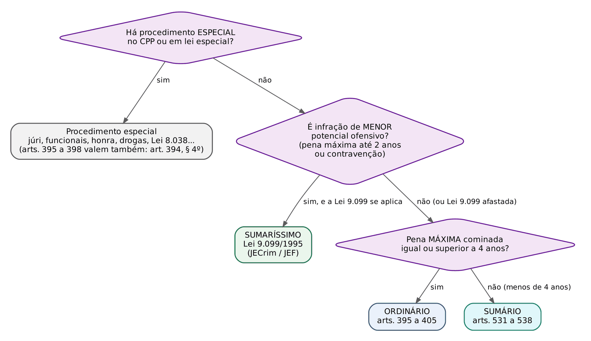
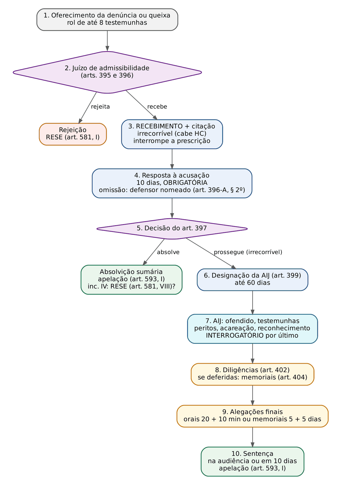
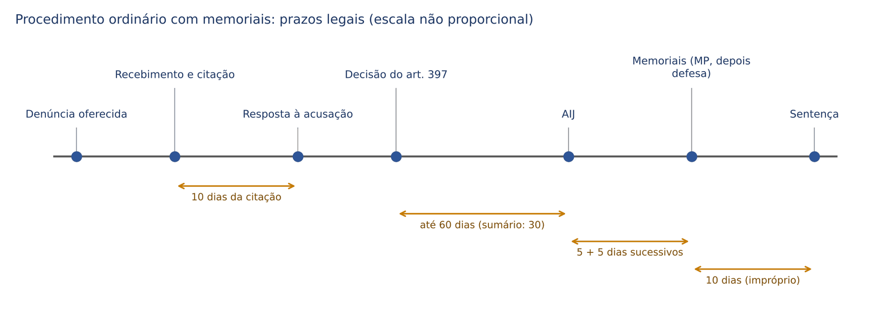
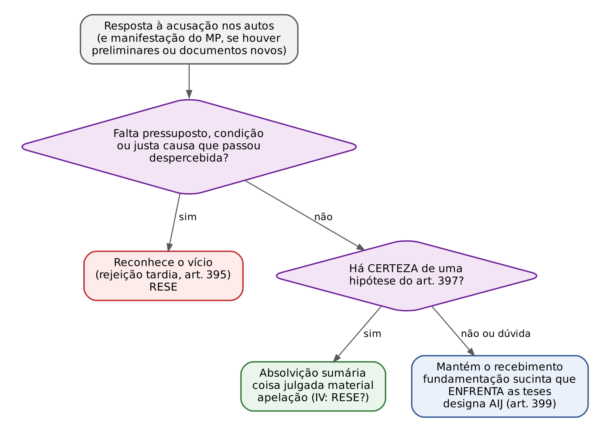
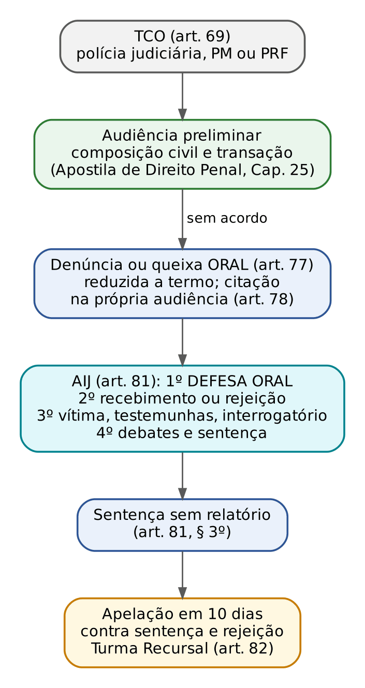

# CAPÍTULO 22 — PROCEDIMENTO COMUM (ORDINÁRIO, SUMÁRIO E SUMARÍSSIMO): RECEBIMENTO DA DENÚNCIA, RESPOSTA À ACUSAÇÃO, ABSOLVIÇÃO SUMÁRIA, AUDIÊNCIA DE INSTRUÇÃO E JULGAMENTO, ALEGAÇÕES FINAIS E DILIGÊNCIAS

:::INCIDENCIA
Pontos: TRF5 p. 12; TJRS p. 9; TJSC p. 14. Nível A+. Lote: 8 questões (FGV 7, FCC 1), mais correlatas de outros capítulos.
O que mais cai: ordem dos atos na audiência (ofendido, acusação, defesa, interrogatório por último), número de testemunhas e quem não entra na conta, hipóteses TAXATIVAS de absolvição sumária (a inimputabilidade fica de fora), resposta à acusação obrigatória e o rito pela pena máxima.
:::

| Subtema | FGV | FCC | Padrão de cobrança |
|---|---|---|---|
| Ordem dos atos na AIJ, carta precatória e inversão | 3 | 0 | caso com rito a identificar e ordem trocada; precatória autoriza inverter testemunhas, não o interrogatório |
| Número de testemunhas | 1 | 1 | 8 por parte no ordinário; não compromissadas e referidas fora da conta |
| Absolvição sumária | 1 | 0 | itens I, II, III com "inclusive a inimputabilidade" e "falta de justa causa" como iscas |
| Resposta à acusação | 1 | 0 | não apresentada: defensor nomeado, com vista por 10 dias |
| Ausência do réu solto na AIJ | 1 | 0 | revelia (art. 367): a audiência prossegue |

## 22.1 Processo, procedimento e a escolha do rito

### 22.1.1 O que muda em relação ao processo civil

Processo é a relação jurídica entre juiz, acusação e defesa; procedimento (ou rito) é a sequência ordenada de atos por meio da qual essa relação caminha até a sentença. No CPC de 2015, o civilista se acostumou com um procedimento comum único, adaptável por negócio processual (art. 190) e por decisão do juiz (art. 139, VI). No processo penal a lógica é outra: o rito é definido por LEI, a partir da gravidade abstrata da infração, e não pode ser negociado pelas partes nem livremente moldado pelo juiz. A razão é garantista: o rito mais longo concede mais oportunidades de defesa (mais testemunhas, prazo maior, possibilidade de memoriais), e a escolha do rito não pode ficar ao sabor de conveniências.

Outra diferença de base: no cível, a citação precede qualquer exame de mérito da inicial, e a defesa vem antes do saneamento. No procedimento comum penal, o juiz faz um juízo de admissibilidade ANTES da citação (recebe ou rejeita a denúncia), o réu responde DEPOIS do recebimento, e só então o juiz decide se o caso deve ir à instrução ou se já pode ser encerrado com absolvição sumária. Esse desenho de "filtro, defesa, segundo filtro" é a espinha deste capítulo.

### 22.1.2 Comum e especial; ordinário, sumário e sumaríssimo (art. 394)

:::LEI CPP, art. 394, caput e §§ 1º a 5º
Art. 394. O procedimento será comum ou especial. § 1º O procedimento comum será ordinário, sumário ou sumaríssimo: I - ordinário, quando tiver por objeto crime cuja sanção máxima cominada for igual ou superior a 4 (quatro) anos de pena privativa de liberdade; II - sumário, quando tiver por objeto crime cuja sanção máxima cominada seja inferior a 4 (quatro) anos de pena privativa de liberdade; III - sumaríssimo, para as infrações penais de menor potencial ofensivo, na forma da lei. § 2º Aplica-se a todos os processos o procedimento comum, salvo disposições em contrário deste Código ou de lei especial. § 3º Nos processos de competência do Tribunal do Júri, o procedimento observará as disposições estabelecidas nos arts. 406 a 497 deste Código. § 4º As disposições dos arts. 395 a 398 deste Código aplicam-se a todos os procedimentos penais de primeiro grau, ainda que não regulados neste Código. § 5º Aplicam-se subsidiariamente aos procedimentos especial, sumário e sumaríssimo as disposições do procedimento ordinário.
:::

Três pegadinhas de literalidade: (1) o critério é a pena MÁXIMA cominada, não a mínima nem a aplicada; (2) exatamente 4 anos já é ordinário ("igual ou superior"); (3) o sumaríssimo não usa o critério dos 4 anos, mas o conceito de infração de menor potencial ofensivo (art. 61 da Lei 9.099/1995: contravenções e crimes com pena máxima não superior a 2 anos, cumulada ou não com multa).

| Rito | Cabimento | Exemplos típicos | Dispositivos |
|---|---|---|---|
| Ordinário | crime com pena máxima igual ou superior a 4 anos, sem rito especial | roubo (art. 157), furto qualificado (art. 155, § 4º), estelionato (art. 171), corrupção ativa (art. 333) | arts. 395 a 405 |
| Sumário | crime com pena máxima inferior a 4 anos e superior a 2 anos, sem rito especial; e infrações de menor potencial ofensivo excluídas do Juizado | embriaguez ao volante (art. 306 do CTB, 6 meses a 3 anos); dano qualificado (art. 163, parágrafo único, 6 meses a 3 anos); ameaça em violência doméstica contra a mulher (Juizado afastado) | arts. 531 a 538 |
| Sumaríssimo | infração de menor potencial ofensivo, quando a Lei 9.099/1995 se aplica | ameaça (art. 147), lesão leve fora da violência doméstica (art. 129, *caput*), contravenções | Lei 9.099/1995, arts. 77 a 83; Lei 10.259/2001 |
| Especiais | previsão expressa no CPP ou em lei especial | júri; crimes funcionais afiançáveis; crimes contra a honra; propriedade imaterial; drogas; competência originária | Caps. 23 a 26 |

:::DICA Contar a pena máxima sem errar
A armadilha mais comum: crimes que "parecem" pequenos e têm pena máxima de exatamente 4 anos (furto simples, receptação simples, apropriação indébita) seguem o ORDINÁRIO. Para chegar à pena máxima: considere as qualificadoras (que criam nova moldura) e as causas de aumento pela fração que MAIS aumenta; as causas de diminuição, pela fração que MENOS diminui; agravantes e atenuantes NÃO entram, porque não têm quantidade fixada em lei. No concurso de crimes, a orientação predominante soma as penas máximas (concurso material) ou aplica a exasperação máxima (concurso formal e crime continuado), por analogia com o raciocínio das Súmulas 243 do STJ e 723 do STF (ver Apostila de Direito Penal, Cap. 25). Exemplo: três danos qualificados em concurso material (máximo de 3 anos cada) somam 9 anos de pena máxima: rito ORDINÁRIO, embora cada crime, isolado, seguisse o sumário.
:::

Situações em que a infração de menor potencial ofensivo NÃO vai ao sumaríssimo e cai, em regra, no sumário: violência doméstica e familiar contra a mulher (art. 41 da Lei 11.340/2006 afasta toda a Lei 9.099/1995); crimes militares (art. 90-A da Lei 9.099/1995); réu não encontrado para citação pessoal (não há citação por edital no Juizado: art. 66, parágrafo único) e causa complexa (art. 77, § 2º), hipóteses em que as peças vão ao juízo comum, que adota o rito sumário (art. 538 do CPP). Para crimes contra a pessoa idosa, a Lei 15.163/2025, ao alterar o art. 94 do Estatuto, afastou a Lei 9.099/1995 para os fatos posteriores à sua vigência (Apostila de Direito Penal, Cap. 25, 25.2.3, e Cap. 42).

:::QUESTAO FGV 2025 — TJ-ES — Outorga de Delegações (Q3520335)
Caso: roubo circunstanciado pelo emprego de arma de fogo, sem precatórias, peritos, acareações ou reconhecimento; pergunta-se o rito e a ordem dos atos. Gabarito oficial: A (ordinário: declarações dos ofendidos, testemunhas de acusação e de defesa, nesta ordem, e interrogatório ao final).
Passos: (1) rito: o roubo tem pena máxima de 10 anos (antes e depois da Lei 15.397/2026), muito acima de 4: ORDINÁRIO, o que elimina C, D e E; (2) ordem: art. 400 (ofendido, acusação, defesa, interrogatório), o que elimina B, que inverte acusação e defesa e põe o ofendido depois das testemunhas.
:::

### 22.1.3 O § 4º do art. 394: o "núcleo comum" de todos os ritos de primeiro grau

O § 4º manda aplicar os arts. 395 a 398 (rejeição, recebimento com citação para resposta, resposta à acusação e absolvição sumária) a TODOS os procedimentos penais de primeiro grau, inclusive os de leis especiais. A ideia é que nenhum réu, em nenhum rito, perca a chance de ser absolvido sumariamente antes de enfrentar uma instrução inútil. A compatibilização com os ritos que já preveem defesa ANTES do recebimento (crimes funcionais afiançáveis, art. 514; Lei de Drogas, art. 55; competência originária, Lei 8.038/1990) é estudada nos Caps. 24 e 25. O júri tem regra própria: absolvição sumária só ao fim da primeira fase, depois da instrução (art. 415; Cap. 23).

O § 5º completa o sistema: o ordinário é o rito-padrão e se aplica subsidiariamente aos demais. É por esse parágrafo que se admitem, no sumário, as diligências do art. 402 e os memoriais do art. 403, § 3º, que o legislador não repetiu nos arts. 531 a 538 (22.9).

A Lei 14.994/2024 deu nova redação ao art. 394-A: os processos que apurem crime hediondo ou violência contra a mulher têm prioridade de tramitação em todas as instâncias, e os que apurem violência contra a mulher independem do pagamento de custas, taxas ou despesas processuais, salvo má-fé (isenção restrita à vítima e, se morta, ao cônjuge, ascendente, descendente ou irmão que atue no processo; §§ 1º e 2º).

:::PEGADINHA Rito errado: nulidade?
A adoção do rito ORDINÁRIO onde caberia o sumário não gera nulidade: o rito mais amplo só beneficia a defesa, e não há prejuízo (art. 563). O inverso (sumário onde caberia o ordinário, com corte de testemunhas, por exemplo) pode gerar nulidade RELATIVA, que exige arguição oportuna e demonstração de prejuízo (Cap. 27). Afirmação "a inobservância do rito gera sempre nulidade absoluta" é falsa.
:::

## 22.2 O procedimento ordinário em um só olhar

Antes do detalhe, o mapa. A figura mostra cada ato, quem decide, o prazo e o recurso; a linha do tempo, os prazos legais em sequência; a ficha, o que acontece quando o ato não é praticado.

:::PROCESSO Ficha do procedimento ordinário: ato, prazo, omissão e recurso
| Ato | Prazo | Consequência da omissão ou do vício | Recurso ou impugnação |
|---|---|---|---|
| Denúncia | 5 dias (preso) ou 15 dias (solto) do recebimento do inquérito (art. 46; Cap. 6) | réu preso: relaxamento da prisão; possibilidade de ação privada subsidiária | — |
| Rejeição (art. 395) | — | — | RESE (art. 581, I); no Juizado, apelação (art. 82 da Lei 9.099/1995) |
| Recebimento e citação (art. 396) | — | recebimento sem fundamentação mínima: nulidade | irrecorrível; habeas corpus para trancamento |
| Resposta à acusação (arts. 396 e 396-A) | 10 dias da citação pessoal (Súmula 710 do STF; Cap. 20); citado por edital, do comparecimento | juiz NOMEIA defensor, com vista por 10 dias (art. 396-A, § 2º); julgar sem resposta: nulidade | — |
| Decisão pós-resposta (art. 397) | sem prazo legal (impróprio) | decisão genérica que ignora as teses: nulidade | absolvição: apelação (art. 593, I); no inciso IV, RESE (art. 581, VIII) segundo parte da doutrina; prosseguimento: irrecorrível (HC) |
| Designação da AIJ (art. 399) | AIJ em até 60 dias (art. 400) | prazo impróprio; com réu preso, excesso de prazo pode gerar relaxamento (Cap. 19) | HC (réu preso) |
| AIJ (art. 400) | ato único, concentrado | inversão da ordem: nulidade relativa (prejuízo e arguição oportuna) | preliminar de apelação; HC |
| Diligências (art. 402) | requeridas ao final da audiência | indeferimento motivado é válido | irrecorrível; preliminar de apelação |
| Alegações finais (art. 403) | orais: 20 + 10 minutos; memoriais: 5 dias sucessivos (§ 3º e art. 404) | falta das alegações da DEFESA: nulidade; do querelante sem pedido de condenação: perempção | — |
| Sentença | na audiência ou em 10 dias (arts. 403, § 3º, e 404) | prazo impróprio | apelação (art. 593, I); embargos de declaração em 2 dias (art. 382) |
:::

## 22.3 Juízo de admissibilidade: o recebimento da denúncia

### 22.3.1 O que o juiz faz quando a denúncia chega

As hipóteses de rejeição (art. 395), a comparação entre rejeição e absolvição sumária, a coisa julgada da rejeição, o recurso cabível e as Súmulas 707 e 709 do STF estão desenvolvidos no Cap. 6 (06.6). Com o juiz das garantias, quem decide sobre o recebimento é o juiz da instrução e julgamento, porque a competência daquele cessa com o OFERECIMENTO da denúncia (Cap. 3). Aqui interessa o que é próprio do procedimento: o momento do recebimento, a fundamentação exigida e o que vem junto com ele.

Ao receber a denúncia, o juiz, numa única decisão: (1) declara admitida a acusação; (2) manda citar o acusado para responder em 10 dias (art. 396); (3) examina, quando houver requerimento ou réu preso, a necessidade de manter, revogar ou impor medidas cautelares (arts. 282 e 316; Cap. 19); (4) resolve requerimentos do MP que acompanham a denúncia (folha de antecedentes, perícias, juntada de documentos). Se a acusação comportar acordo de não persecução penal ainda não examinado, a questão deve ser enfrentada antes (Cap. 8).

### 22.3.2 Quando a denúncia é recebida: art. 396 ou art. 399?

A Lei 11.719/2008 criou um problema de redação. O art. 396 diz que o juiz, "se não a rejeitar liminarmente, recebê-la-á e ordenará a citação"; o art. 399, depois da resposta, volta a dizer "recebida a denúncia ou queixa, o juiz designará dia e hora para a audiência". Haveria dois recebimentos?

| Corrente | Momento do recebimento | Argumento | Consequência |
|---|---|---|---|
| Majoritária (STJ e STF; maior parte da doutrina) | art. 396, ANTES da citação | o art. 396 usa o verbo de forma expressa; só se cita alguém para responder a uma acusação já admitida; o "recebida" do art. 399 é mera referência ao ato anterior | interrupção da prescrição na data da decisão do art. 396 (art. 117, I, do CP); a decisão do art. 399 é de "ratificação" ou de prosseguimento |
| Minoritária (parte da doutrina crítica, como Aury Lopes Jr.) | art. 399, DEPOIS da resposta | o contraditório deveria preceder a admissão da acusação; o art. 396 seria só um juízo de "não rejeição" | interrupção da prescrição só no art. 399 |

Para a prova objetiva, a resposta é a majoritária: o recebimento ocorre no art. 396 (STJ, HC 138.089-SC, 5ª Turma, Rel. Min. Felix Fischer, j. 2/3/2010), e é essa data que interrompe a prescrição. Na prova de sentença, isso decide contas de prescrição retroativa: o marco é a decisão do art. 396, não a "ratificação" posterior (Apostila de Direito Penal, Cap. 22). A ADI 6.298 tocou no assunto por outro ângulo: o STF declarou inconstitucional o trecho do art. 3º-C que fazia a competência do juiz das garantias cessar "com o recebimento da denúncia ou queixa na forma do art. 399", fixando o marco no oferecimento (Cap. 3).

:::EXEMPLO Duplo recebimento e prescrição
Furto simples (pena máxima de 4 anos; prescrição em 8 anos, art. 109, IV, do CP). Fato em 10/3/2018; denúncia recebida em 5/3/2026 (art. 396); resposta em 20/4/2026; decisão do art. 399 "recebendo" a denúncia em 15/5/2026. Pergunta: houve prescrição da pretensão punitiva pela pena máxima entre o fato e o recebimento?
1. Marco interruptivo: 5/3/2026 (corrente majoritária).
2. Entre 10/3/2018 e 5/3/2026: 7 anos, 11 meses e 23 dias, menos de 8 anos: NÃO prescreveu.
3. Se o candidato tomasse o art. 399 (15/5/2026) como marco, teria passado de 8 anos e declararia, erradamente, a prescrição.
:::

### 22.3.3 Fundamentação do recebimento

O recebimento é decisão interlocutória simples (Cap. 21), e a jurisprudência do STF e do STJ é firme em que ele NÃO exige fundamentação exauriente: basta que o juiz aponte, de forma concisa, a presença dos requisitos do art. 41 e a ausência das hipóteses do art. 395, com referência ao lastro probatório mínimo. A razão é dupla: o juízo é de mera admissibilidade (standard probatório baixo; Cap. 14) e uma fundamentação extensa anteciparia o julgamento de mérito, comprometendo a imparcialidade aparente do julgador. O recebimento pode apoiar-se em elementos do inquérito: a vedação do art. 155 do CPP alcança a condenação fundada exclusivamente em elementos informativos, não o juízo de admissibilidade.

Duas cautelas. Primeira: concisão não é vazio. Decisão de puro carimbo, que poderia servir para qualquer processo, é nula por falta de motivação (art. 93, IX, da CF). Segunda, e mais cobrada: a decisão que, DEPOIS da resposta à acusação, rejeita a absolvição sumária e manda o processo à instrução precisa enfrentar, ainda que sucintamente, as teses defensivas (22.5.6). O STJ tem anulado decisões padronizadas que se limitam a afirmar que "as teses da defesa dependem de instrução" sem dizer por quê (por exemplo, AgRg no HC 740.253-SP, 6ª Turma, j. 10/6/2025: nula a decisão de ratificação que não examinou as preliminares da resposta, com determinação de que outra seja proferida).

Quando o recebimento se apoia em prova que depois se revela ilícita ou em reconhecimento feito sem as cautelas do art. 226, o vício alcança a própria admissibilidade: o STJ afirma que o reconhecimento inválido não pode fundamentar nem decisões de menor exigência probatória, como o recebimento da denúncia (Cap. 15).

### 22.3.4 Não há recurso contra o recebimento

O CPP não prevê recurso contra a decisão que recebe a denúncia (o art. 581, I, trata só da que NÃO a recebe). O caminho é o habeas corpus para trancamento da ação penal, medida excepcional, admitida quando, sem exame aprofundado de provas, se evidenciam atipicidade, extinção da punibilidade, inépcia ou ausência de justa causa (Cap. 30). Não confundir: contra a REJEIÇÃO cabe RESE (art. 581, I); contra o RECEBIMENTO, nada (HC).

:::SENTENCA Decisão de recebimento (art. 396)
Onde entra: é a primeira decisão do juiz da instrução; na prova prática, aparece como peça autônoma ("profira a decisão cabível") ou é pressuposta no relatório da sentença, com DATA (marco da prescrição).
O que fundamentar: requisitos do art. 41; ausência das hipóteses do art. 395, inclusive justa causa (indique os elementos: laudo, depoimentos, documentos); medidas cautelares; citação.
Redação-modelo: "A denúncia descreve fato aparentemente típico com todas as suas circunstâncias, qualifica o acusado e vem amparada no auto de apreensão e nos depoimentos colhidos no inquérito, que conferem lastro mínimo de autoria e materialidade. Ausentes as hipóteses do art. 395 do CPP, RECEBO a denúncia e determino a citação do acusado para responder à acusação, por escrito, no prazo de 10 dias (arts. 396 e 396-A do CPP)."
Erro que a banca pune: fundamentar como se fosse sentença (antecipando juízo de culpa) ou, no outro extremo, despacho de uma linha sem referência aos elementos dos autos; esquecer de enfrentar a prisão do réu preso.
:::

## 22.4 Citação e resposta à acusação

### 22.4.1 Citação e contagem do prazo

As formas de citação, o art. 366 (suspensão do processo e da prescrição do réu citado por edital que não comparece nem constitui advogado), a citação com hora certa e a contagem do prazo da resposta a partir do CUMPRIMENTO do mandado (Súmula 710 do STF), e não da juntada, estão no Cap. 20 (20.4 a 20.6), com caso resolvido de carta precatória (Q4240035). O que importa aqui é a regra de procedimento: o réu citado pessoalmente tem 10 dias para responder por escrito (art. 396); o citado por edital, 10 dias a partir do comparecimento pessoal ou do defensor constituído (art. 396, parágrafo único).

:::ATENCAO Intuição civilista que leva ao erro
No cível, o réu que não contesta é revel e sofre a presunção de veracidade (art. 344 do CPC). No processo penal, NÃO existe resposta facultativa nem presunção contra o réu: a resposta à acusação é peça OBRIGATÓRIA, e o silêncio do réu citado pessoalmente leva o juiz a nomear defensor para apresentá-la. A revelia penal (art. 367) só dispensa a intimação do réu para atos futuros; não confessa nada (Cap. 20, 20.7).
:::

### 22.4.2 Natureza e obrigatoriedade

A resposta à acusação substituiu a antiga "defesa prévia" (facultativa, apresentada depois do interrogatório inicial) e é o primeiro grande momento de defesa técnica do processo. É obrigatória porque é por meio dela que o juiz decide se absolve sumariamente: um processo em que o juiz delibera sobre o art. 397 sem resposta é um processo em que faltou defesa no momento em que ela poderia encerrar a ação.

:::LEI CPP, art. 396-A
Art. 396-A. Na resposta, o acusado poderá argüir preliminares e alegar tudo o que interesse à sua defesa, oferecer documentos e justificações, especificar as provas pretendidas e arrolar testemunhas, qualificando-as e requerendo sua intimação, quando necessário. § 1º A exceção será processada em apartado, nos termos dos arts. 95 a 112 deste Código. § 2º Não apresentada a resposta no prazo legal, ou se o acusado, citado, não constituir defensor, o juiz nomeará defensor para oferecê-la, concedendo-lhe vista dos autos por 10 (dez) dias.
:::

Duas situações distintas levam à nomeação do § 2º: (a) o réu constitui advogado, mas este deixa o prazo correr em branco; (b) o réu, citado, não constitui ninguém. Antes de nomear defensor na hipótese (a), a boa prática, decorrente do direito de escolher o próprio defensor, é intimar o réu para constituir outro advogado, com a advertência de que, no silêncio, a Defensoria Pública (ou dativo) será nomeada. O defensor nomeado recebe vista dos autos por 10 dias. A ausência total de resposta, com o processo seguindo assim mesmo, é falta de defesa: nulidade absoluta (Súmula 523 do STF; Cap. 27). Resposta apenas genérica ("a defesa se manifestará no curso da instrução") não é nula por si: a deficiência só anula se provado prejuízo, na lógica da mesma súmula.

:::QUESTAO FGV 2025 — DPE-RO — Analista Jurídico (Q3395874)
Caso: homicídio em bar; réu processado em vara com competência do júri; pedia-se a afirmativa correta sobre o rito. Gabarito oficial: B (não apresentada a resposta no prazo legal, o juiz nomeia defensor para oferecê-la em até 10 dias).
Fundamento: no júri, a regra está no art. 408, com redação equivalente ao art. 396-A, § 2º, do procedimento comum. Armadilhas: (A) as acareações são expressamente admitidas na instrução preliminar (art. 411); (C) absolvição sumária NÃO decorre de indícios de autoria e prova da materialidade: esses são os requisitos da PRONÚNCIA (art. 413); (D) contra a impronúncia cabe apelação (art. 416); (E) o juiz pode dar definição jurídica diversa na pronúncia (art. 418). Detalhes do júri: Cap. 23.
:::

### 22.4.3 Conteúdo: o que a defesa deve (e pode) alegar

| Conteúdo | O que é | Detalhe que cai |
|---|---|---|
| Preliminares | inépcia, falta de condição ou pressuposto, nulidades do inquérito que contaminem a prova, prescrição | podem levar à rejeição "tardia" ou à extinção (22.5.6) |
| Mérito | tudo o que interesse à defesa: excludentes, atipicidade, negativa de autoria | a defesa pode guardar teses para depois; NÃO há preclusão das teses de mérito |
| Documentos e justificações | prova pré-constituída | a justificação é a produção prévia de prova testemunhal em procedimento próprio |
| Especificação de provas | perícias, diligências, requisições | o que não for requerido aqui pode ser requerido depois só se surgir da instrução (art. 402) |
| Rol de testemunhas | até 8 no ordinário e 5 no sumário | momento PRECLUSIVO para a defesa (o da acusação é a denúncia); a testemunha arrolada fora do prazo pode ser ouvida como testemunha do juízo (art. 209), a critério do juiz |
| Exceções | suspeição, incompetência, litispendência, ilegitimidade, coisa julgada | processadas em APARTADO (art. 396-A, § 1º; Cap. 13) |

Número de testemunhas, quem entra na conta e a contagem por fato e por réu: ver Cap. 6 (06.4.1) e Cap. 15 (15.5.4).

Um ponto novo e importante: para que a resposta seja efetiva, a defesa precisa conhecer a prova. O STJ vem reconhecendo nulidade quando o juiz nega à defesa, antes da resposta, o acesso integral aos elementos colhidos na investigação.

:::JURIS STJ, AgRg no RHC 213.204-BA, 5ª Turma, j. 21/5/2025 (Info 853)
A defesa pediu acesso integral ao material da investigação para elaborar a resposta à acusação; o juiz negou, e o acesso só veio às vésperas das alegações finais. O STJ reconheceu a nulidade: sem conhecer os elementos que embasaram a acusação, a defesa não pôde escolher testemunhas, requerer provas nem produzir contraprova; a resposta à acusação não é adequada se elaborada sem acesso à íntegra do material que subsidiou a denúncia.
:::

:::JURIS STJ, AREsp 3.028.845-PR, 5ª Turma, j. 16/6/2026 (Info 895)
A defesa tem direito de acessar não só a prova SELECIONADA pela acusação para a denúncia, mas também o material mantido sob custódia estatal que possa contextualizar, contradizer ou enfraquecer a hipótese acusatória (no caso, gravações). Reabrir prazo para complementar alegações finais NÃO sana o vício, porque não devolve a oportunidade de usar a prova desde a resposta à acusação e durante a instrução. E a afirmação judicial de que as gravações não fundamentaram a condenação não torna o vício irrelevante: a defesa tem direito de verificar se a narrativa foi construída sobre leitura parcial da fonte.
:::

### 22.4.4 Há réplica do Ministério Público?

O procedimento comum não prevê manifestação do MP sobre a resposta (diferentemente do júri, art. 409, que manda ouvir o MP sobre preliminares e documentos em 5 dias). Ainda assim, por força do contraditório, é comum e recomendável abrir vista ao MP quando a resposta trouxer preliminares que possam extinguir o processo ou documentos novos. A falta dessa vista não anula o processo se o juiz rejeita as preliminares (sem prejuízo para a acusação); se o juiz pretende ACOLHER preliminar ou absolver com base em documento novo, ouvir antes o MP evita a anulação da decisão por violação do contraditório (lógica que o civilista conhece do art. 10 do CPC, aplicável supletivamente; Cap. 2).

## 22.5 Absolvição sumária (art. 397)

### 22.5.1 A lógica do instituto

A absolvição sumária é o "julgamento antecipado" do processo penal, mas com uma diferença decisiva em relação ao art. 355 do CPC: só funciona a favor do réu. O juiz pode absolver de plano; não pode condenar sem instrução. A razão é que o processo penal, por si, já é um gravame; se a resposta à acusação demonstra, sem margem de dúvida, que o réu não pode ser condenado, não há por que submetê-lo à instrução.

:::LEI CPP, art. 397
Art. 397. Após o cumprimento do disposto no art. 396-A, e parágrafos, deste Código, o juiz deverá absolver sumariamente o acusado quando verificar: I - a existência manifesta de causa excludente da ilicitude do fato; II - a existência manifesta de causa excludente da culpabilidade do agente, salvo inimputabilidade; III - que o fato narrado evidentemente não constitui crime; ou IV - extinta a punibilidade do agente.
:::

Três palavras do texto carregam o regime: "deverá" (não é faculdade: presente a hipótese, o juiz absolve); "manifesta" e "evidentemente" (o standard é de CERTEZA: havendo dúvida, o processo segue para a instrução, onde a dúvida será resolvida, ao final, em favor do réu). Parte da doutrina critica a fórmula "*in dubio pro societate*" usada para justificar o prosseguimento; o resultado prático é o mesmo: na fase do art. 397, dúvida NÃO absolve, porque a lei exige evidência, e não porque a dúvida beneficie a sociedade.

### 22.5.2 As quatro hipóteses comentadas

| Inciso | Hipótese | Exemplo de absolvição sumária | Atenção |
|---|---|---|---|
| I | excludente de ilicitude manifesta (legítima defesa, estado de necessidade, estrito cumprimento do dever legal, exercício regular de direito; excludentes supralegais) | vídeo juntado com a resposta mostra, sem dúvida, que A atirou contra B, que avançava armado de faca sobre ele | excludente apenas plausível ou controvertida: instrução |
| II | excludente de culpabilidade manifesta, SALVO inimputabilidade | erro de proibição inevitável demonstrado documentalmente; coação moral irresistível incontroversa | a ressalva mira o inimputável por doença mental ou desenvolvimento mental incompleto ou retardado (art. 26, *caput*, do CP): absolvê-lo é aplicar medida de segurança, o que exige instrução |
| III | fato narrado evidentemente não constitui crime | atipicidade formal (fato não descrito em lei); insignificância reconhecida de plano (já a *abolitio criminis* superveniente é extinção da punibilidade, inciso IV) | se a atipicidade fosse evidente já na denúncia, o caminho seria a rejeição (Cap. 6, 06.6.3) |
| IV | extinção da punibilidade | prescrição, decadência, morte do agente, perdão aceito, renúncia, *abolitio criminis* (art. 107 do CP; Apostila de Direito Penal, Cap. 21) | não é absolvição em sentido técnico: é decisão declaratória da extinção (22.5.4) |

Por que a inimputabilidade ficou de fora? Porque a absolvição do inimputável é IMPRÓPRIA: o juiz reconhece o fato típico e ilícito e impõe medida de segurança (art. 386, parágrafo único, III; Apostila de Direito Penal, Cap. 19). Impor medida de segurança, que pode durar anos, sem instrução seria condenar sem processo. No JÚRI, a regra é diferente: o art. 415, parágrafo único, permite a absolvição sumária imprópria do inimputável quando a inimputabilidade for a ÚNICA tese defensiva (Cap. 23). A semi-imputabilidade (art. 26, parágrafo único, do CP) não exclui a culpabilidade: só reduz a pena, e por isso nunca leva à absolvição sumária.

:::QUESTAO FGV 2024 — TJ-MT — Analista Judiciário (Q3115100)
Itens sobre as hipóteses de absolvição sumária no ordinário: (I) excludente de culpabilidade "inclusive a inimputabilidade"; (II) excludente manifesta de ilicitude; (III) falta de justa causa. Gabarito oficial: B (apenas II).
Armadilhas: o item I inverte a ressalva legal ("SALVO inimputabilidade"); o item III mistura institutos: falta de justa causa é causa de REJEIÇÃO da denúncia (art. 395, III), juízo de admissibilidade, e não de absolvição, que é juízo de mérito.
:::

### 22.5.3 Absolvição sumária do comum x do júri

As duas absolvições sumárias têm o mesmo nome e lógicas diferentes. A do art. 397 vem no INÍCIO, antes da prova judicial, e trabalha com evidências pré-constituídas; a do art. 415 vem no FIM da primeira fase do júri, depois da instrução, e por isso admite hipóteses de prova (inexistência do fato, negativa de autoria) que no início seriam impensáveis.

| | Comum (art. 397) | Júri (art. 415) |
|---|---|---|
| Momento | depois da resposta, antes da instrução | depois da instrução preliminar, no lugar da pronúncia |
| Provada a inexistência do fato | NÃO é hipótese | sim (inciso I) |
| Provado não ser o réu autor ou partícipe | NÃO é hipótese | sim (inciso II) |
| Fato atípico | sim ("evidentemente não constitui crime") | sim ("não constituir infração penal") |
| Excludentes de ilicitude e culpabilidade | sim, se MANIFESTAS | sim ("causa de isenção de pena ou de exclusão do crime") |
| Inimputabilidade | NUNCA | só se for a ÚNICA tese defensiva |
| Extinção da punibilidade | sim (inciso IV) | não está no art. 415 (declarada a qualquer tempo, art. 61 do CPP) |
| Recurso | apelação (art. 593, I); no inciso IV, controvérsia (22.5.4) | apelação (art. 416) |

:::PEGADINHA "O juiz absolverá sumariamente se provado que o réu não é o autor do fato"
No procedimento COMUM, falso: negativa de autoria não está no art. 397, porque depende de prova a ser produzida na instrução; se a resposta à acusação traz álibi documental incontestável, a solução técnica é o reconhecimento da falta de justa causa superveniente (rejeição tardia, 22.5.6) ou o prosseguimento. No JÚRI, verdadeiro (art. 415, II). Questões que misturam os dois róis são frequentes.
:::

### 22.5.4 Natureza, coisa julgada, efeitos civis e recurso

Nos incisos I a III, a absolvição sumária é sentença definitiva de MÉRITO: faz coisa julgada material e impede nova ação penal pelo mesmo fato (Cap. 21, 21.5). Os efeitos civis dependem do fundamento: a excludente de ilicitude reconhecida faz coisa julgada no cível (art. 65 do CPP); a atipicidade e as dirimentes não impedem a ação civil (Cap. 7, quadro de 07.4.2). Correlata cobrada: FGV 2024, TJ-SC, Juiz Substituto (Q3049384, classificada no Cap. 28), gabarito B: absolvição sumária por atipicidade em furto desafia APELAÇÃO do MP e, transitada, NÃO vincula o juízo cível.

No inciso IV, a natureza é discutida. A decisão não diz que o réu é inocente; declara que o Estado perdeu o poder de punir. Por isso parte expressiva da doutrina sustenta que, apesar do nome, ela é decisão declaratória de extinção da punibilidade, recorrível por RESE (art. 581, VIII: decisão "que decretar a prescrição ou julgar, por outro modo, extinta a punibilidade"); outra parte aplica a letra do art. 397 e do art. 593, I, e admite apelação. Na dúvida, o princípio da fungibilidade (art. 579) protege a parte de boa-fé que interpõe um pelo outro no prazo do menor (5 dias, prazo comum aos dois para a interposição; Cap. 28).

Correlata: Q3996835 (FGV 2026, TRF2, Juiz Federal; gabarito C; box no Cap. 21): extinção da punibilidade pelo mesmo fato já transitada no JECrim leva à absolvição sumária, veículo que a banca tomou do art. 397, IV.

### 22.5.5 Absolvição sumária nos procedimentos especiais

Pelo art. 394, § 4º, o art. 397 aplica-se a todos os ritos de primeiro grau. Na prática: (a) nos ritos com defesa preliminar ANTES do recebimento (art. 514 do CPP; art. 55 da Lei 11.343/2006; Lei 8.038/1990), discute-se se é preciso nova resposta depois do recebimento; a orientação prevalente é que a defesa preliminar já cumpre a função, e o juiz pode, ao recebê-la ou depois, absolver sumariamente se presente hipótese do art. 397 (Caps. 24 e 25); (b) no júri, a absolvição sumária própria é a do art. 415, ao final da primeira fase, e a maioria entende que o art. 397 não se aplica para antecipá-la, ressalvada a extinção da punibilidade, que pode ser declarada a qualquer tempo (art. 61; Cap. 23); (c) no Juizado, a defesa é oral e anterior ao recebimento (art. 81 da Lei 9.099/1995), e nada impede o juiz de, recebida a denúncia, absolver de plano se a hipótese for evidente.

### 22.5.6 Depois da resposta: as três saídas do juiz

O juiz que lê a resposta tem três caminhos:

1. Reconhecer vício de admissibilidade que passou despercebido no recebimento (inépcia, falta de condição ou pressuposto, falta de justa causa). A jurisprudência do STJ admite que o juiz, à vista da resposta, reconsidere o recebimento e "rejeite" a denúncia, sem preclusão *pro judicato*, porque a decisão de recebimento é interlocutória e foi tomada sem contraditório (STJ, REsp 1.318.180-DF, 6ª Turma, j. 16/5/2013; Cap. 6, 06.6.2). O recurso, então, é o da rejeição: RESE (art. 581, I).
2. Absolver sumariamente (art. 397), com fundamentação de sentença: relatório sucinto, motivação e dispositivo.
3. Afastar as preliminares e as teses de absolvição sumária e designar audiência (art. 399).

:::SENTENCA Decisão que afasta a absolvição sumária (art. 399)
Onde entra: é a decisão mais frequente da vara criminal e aparece na prova prática como "decisão de saneamento" do processo penal.
O que fundamentar: enfrentar CADA preliminar e cada tese que pretenda a absolvição sumária, dizendo por que não há evidência (o que falta provar e por que a questão depende de instrução); deferir ou indeferir as provas especificadas; designar a AIJ e ordenar intimações; reexaminar a prisão, se houver réu preso.
Redação-modelo: "A tese de legítima defesa não se apresenta de forma manifesta: as declarações da vítima e da testemunha T1 indicam que o acusado iniciou a agressão, de modo que a existência de agressão injusta e atual depende da instrução. Ausentes as hipóteses do art. 397 do CPP, mantenho o recebimento da denúncia e designo audiência de instrução e julgamento para o dia..."
Erro que a banca pune: fórmula genérica ("as teses defensivas confundem-se com o mérito e serão apreciadas na sentença") sem nenhuma referência ao caso concreto; e, no extremo oposto, análise tão profunda que antecipa a condenação.
:::

Essa decisão é irrecorrível: não está no rol do art. 581. A defesa pode impetrar habeas corpus (trancamento, se a ilegalidade for evidente) ou renovar as teses nas alegações finais e na apelação.

:::PASSO Como decidir depois da resposta à acusação
1. Verifique se a resposta existe e foi apresentada por defensor habilitado; se não, nomeie defensor (art. 396-A, § 2º).
2. Exceções: mande autuar em apartado (art. 396-A, § 1º) e decida-as no incidente (Cap. 13).
3. Preliminares de admissibilidade (inépcia, justa causa, condições): acolhidas, extinga (rejeição tardia, art. 395); afastadas, fundamente.
4. Hipóteses do art. 397: há EVIDÊNCIA? Sim: absolva (sentença). Dúvida: prossiga, dizendo por quê.
5. Provas especificadas: defira as pertinentes; indefira, motivadamente, as irrelevantes, impertinentes ou protelatórias (art. 400, § 1º).
6. Designe a AIJ dentro de 60 dias (ordinário) ou 30 (sumário); intime acusado, defensor, MP, querelante e assistente (art. 399); requisite o réu preso (art. 399, § 1º); expeça precatórias.
7. Réu preso: reavalie a necessidade da prisão (art. 316, parágrafo único; Cap. 19).
:::

## 22.6 Audiência de instrução e julgamento (arts. 399 e 400)

### 22.6.1 Designação, intimações e prazo

Recebida a denúncia e afastada a absolvição sumária, o juiz designa dia e hora para a audiência e manda intimar o acusado, o defensor, o MP e, se for o caso, o querelante e o assistente (art. 399). O réu preso é REQUISITADO, cabendo ao poder público apresentá-lo (§ 1º), ressalvada a participação por videoconferência nas hipóteses do art. 185, § 2º (Cap. 20, 20.2.3).

A audiência deve realizar-se em até 60 dias no ordinário (art. 400) e 30 no sumário (art. 531). São prazos IMPRÓPRIOS: seu descumprimento não gera nulidade nem preclusão. Com réu preso, porém, o atraso injustificado pode configurar constrangimento ilegal por excesso de prazo, examinado pelo critério da razoabilidade, e não por soma aritmética (Súmulas 21, 52 e 64 do STJ; Cap. 19).

### 22.6.2 Audiência una: oralidade, concentração e identidade física

O modelo da Lei 11.719/2008 é o da audiência ÚNICA e oral: "as provas serão produzidas numa só audiência" (art. 400, § 1º), seguidas de debates orais e sentença na própria audiência (art. 403). Desse modelo decorrem a concentração (todos os atos num só momento), a imediação (o juiz tem contato direto com a prova) e a identidade física (art. 399, § 2º: "o juiz que presidiu a instrução deverá proferir a sentença").

O conceito e as exceções clássicas da identidade física (afastamento do juiz por convocação, licença, promoção, aposentadoria ou morte, com aplicação analógica do antigo art. 132 do CPC/1973) estão no Cap. 1 (01.4.7). Para o procedimento, acrescente três pontos: (1) a violação do art. 399, § 2º, gera nulidade RELATIVA, que exige demonstração de prejuízo, segundo a orientação do STJ; (2) a oitiva de testemunhas por carta precatória ou por videoconferência NÃO viola a identidade física, porque a lei a admite expressamente (arts. 222 e 185); (3) o juiz que sucede o que presidiu a instrução pode, se entender necessário, repetir provas antes de sentenciar.

### 22.6.3 A ordem dos atos

A ordem do art. 400 é: declarações do ofendido; testemunhas de ACUSAÇÃO; testemunhas de DEFESA; esclarecimentos dos peritos (se requeridos com antecedência, § 2º); acareações; reconhecimento de pessoas e coisas; e, por último, o INTERROGATÓRIO. A figura da ordem dos atos, o regime de cada meio de prova (ofendido, testemunhas, *cross-examination* do art. 212, reconhecimento, acareação) e o fundamento do interrogatório como último ato em todos os ritos (STF, HC 127.900) estão no Cap. 15 (15.1 e 15.2.2).

:::LEI CPP, art. 400
Art. 400. Na audiência de instrução e julgamento, a ser realizada no prazo máximo de 60 (sessenta) dias, proceder-se-á à tomada de declarações do ofendido, à inquirição das testemunhas arroladas pela acusação e pela defesa, nesta ordem, ressalvado o disposto no art. 222 deste Código, bem como aos esclarecimentos dos peritos, às acareações e ao reconhecimento de pessoas e coisas, interrogando-se, em seguida, o acusado. § 1º As provas serão produzidas numa só audiência, podendo o juiz indeferir as consideradas irrelevantes, impertinentes ou protelatórias. § 2º Os esclarecimentos dos peritos dependerão de prévio requerimento das partes.
:::

A lógica da ordem é a do contraditório: primeiro a acusação produz a sua prova, depois a defesa a contrasta, e por fim o acusado, conhecendo TUDO, decide se fala e o que fala. É o oposto do sistema anterior, em que o réu era interrogado no início, "às cegas". O ofendido vem antes de todos porque é a principal fonte de prova da acusação; não é testemunha e não entra na conta do art. 401 (Cap. 15, 15.4.1).

Ressalva do art. 222: a expedição de carta precatória NÃO suspende a instrução (§ 1º). Por isso a ordem entre testemunhas pode ser invertida quando alguma é ouvida por precatória (uma testemunha de acusação ouvida no juízo deprecado depois das de defesa ouvidas no deprecante). O que a precatória NÃO autoriza é antecipar o INTERROGATÓRIO: ele espera o retorno da carta (STJ, Tema 1.114; tese e consequências no Cap. 15, 15.2.2).

:::QUESTAO FGV 2026 — TJ-PA — Juiz Substituto (Q3951758)
Caso: o MP pediu precatória para ouvir a vítima, que mora em outro estado, e arrolou testemunhas; a defesa arrolou as suas; no dia da audiência no juízo deprecante, a precatória ainda não voltara, sem que se tivesse esgotado o prazo fixado para cumprimento. Gabarito oficial: C (podem ser ouvidas as testemunhas de acusação e de defesa, porque a precatória autoriza a inversão, mas NÃO o interrogatório; designa-se audiência em continuação).
Passos: (1) a precatória não suspende a instrução (art. 222, § 1º): elimina A, que manda esperar; (2) a ressalva do art. 400 ao art. 222 permite ouvir as testemunhas de defesa antes da vítima deprecada: elimina B; (3) o interrogatório é o último ato e depende do retorno da carta (Tema 1.114): elimina D e E. Atenção à sutileza da alternativa E: o § 2º do art. 222 permite JULGAR sem a precatória quando FINDO o prazo marcado para o cumprimento; aqui o prazo não tinha acabado.
:::

:::QUESTAO FGV 2024 — PC-SC — Psicólogo Policial (Q2365391)
Caso: no processo por tráfico, o juiz interrogou o réu primeiro, depois ouviu os policiais (testemunhas de acusação) e por fim as testemunhas de defesa. Gabarito oficial: C (agiu incorretamente: primeiro as testemunhas de acusação, depois as de defesa, e só então o interrogatório).
Armadilhas: (A) a ordem não fica à discrição do juiz por "eficiência"; (D) e (E) reproduzem a ordem antiga da Lei de Drogas (interrogatório no início, art. 57 da Lei 11.343/2006), superada pela orientação do STF de que o interrogatório é o último ato também nos ritos especiais (HC 127.900; Cap. 15); (B) inverte acusação e defesa. Lembre que a violação gera nulidade RELATIVA: depende de arguição oportuna e prova de prejuízo (Cap. 27).
:::

### 22.6.4 Testemunhas na audiência

O número máximo por rito (8 no ordinário, 5 no sumário), a exclusão das que não prestam compromisso e das referidas (art. 401, § 1º), a contagem por fato e por réu e a desistência (art. 401, § 2º, ressalvado o art. 209) estão em 15.5.4 (Cap. 15) e na tabela de 06.4.1 (Cap. 6). As questões do lote cobram exatamente a literalidade:

:::QUESTAO FGV 2024 — TJ-MS — Analista Judiciário (Q2489738)
Caso: no ordinário, o MP arrolou dez pessoas, duas das quais, por lei, não prestam compromisso; a defesa impugnou o número. Gabarito oficial: A (o MP agiu conforme a lei: até 8 testemunhas, sem contar as que não prestam compromisso; 10 menos 2 dá 8).
No mesmo sentido: Q3538961 (FCC 2025, TRF4, Técnico; gabarito C: na corrupção ativa, pena máxima de 12 anos, ordinário, até 8 testemunhas, não se compreendendo as que não prestam compromisso e as referidas); correlatas Q4231785 (FCC 2026, TJ-CE; gabarito A) e Q3914316 (FGV 2026, TJ-MS; gabarito C), ambas classificadas no Cap. 15. Armadilhas recorrentes: "5 compromissadas e 3 não compromissadas", "incluindo as referidas", "sem limite para prestigiar a verdade real".
:::

### 22.6.5 Ausências: quem falta e o que acontece

O princípio é o de que "nenhum ato será adiado, salvo quando imprescindível à prova faltante" (art. 535, no sumário, aplicado ao ordinário pela mesma lógica da audiência una; também art. 80 da Lei 9.099/1995). As situações típicas:

| Quem falta | Consequência | Fundamento |
|---|---|---|
| Testemunha intimada, sem justificativa | condução coercitiva; multa; possível crime de desobediência; a audiência pode ser cindida | arts. 218 e 219 |
| Testemunha que a parte se comprometeu a levar | preclusão para a parte, que pode pedir substituição só em situações excepcionais | art. 401; orientação jurisprudencial |
| Réu SOLTO intimado, sem justificativa | revelia: a audiência prossegue sem ele; perde o interrogatório naquela data (pode ser ouvido se comparecer depois, antes da sentença) | art. 367 (Cap. 20, 20.7) |
| Réu PRESO não apresentado pelo Estado | adia-se o ato ou realiza-se o interrogatório por videoconferência nas hipóteses legais; colher prova sem ele, contra sua vontade, compromete a autodefesa | art. 399, § 1º; art. 185, § 2º |
| Defensor constituído, com impedimento provado até a abertura da audiência | adiamento; sem prova do impedimento, nomeação de defensor para o ato (*ad hoc*) | art. 265, §§ 1º e 2º (Cap. 12) |
| MP | adiamento; a falta injustificada é comunicada ao Procurador-Geral | aplicação analógica do art. 455 (júri) |

:::QUESTAO FGV 2024 — TJ-AP — Analista Judiciário (Q2442334)
Caso: réu solto, intimado pessoalmente, não comparece à audiência sem justificativa; o advogado pede adiamento; o juiz indefere, ouve vítima e testemunhas e passa às alegações finais. Gabarito oficial: E (agiu corretamente: a ausência injustificada leva à revelia).
Armadilhas: (A) não existe "ato atentatório à dignidade da justiça" com multa ao réu ausente (instituto do CPC, art. 77, § 2º, e art. 334, § 8º); (B) a autodefesa é RENUNCIÁVEL (o réu pode calar e pode não comparecer); só a defesa técnica é indispensável; (D) o interrogatório não ocorreu por opção do réu, que deixou de comparecer: não há inversão de ordem imputável ao juízo.
:::

### 22.6.6 Documentação e indeferimento de provas

O registro dos depoimentos é feito, sempre que possível, por gravação audiovisual, com cópia às partes sem necessidade de transcrição (art. 405, §§ 1º e 2º); lavra-se termo com breve resumo dos fatos relevantes (art. 405, *caput*). A leitura, em audiência, do depoimento prestado pela vítima na polícia não gera nulidade sem demonstração de prejuízo, e a intervenção do juiz para proteger a dignidade da vítima, preservada a possibilidade de perguntas pela defesa, não é cerceamento (STJ, AgRg no RHC 198.541-RJ, 5ª Turma, j. 14/4/2025, Info 852). Os deveres de todos os sujeitos em relação à vítima (art. 400-A, Lei 14.245/2021) e as teses do Tema 1.451 do STF estão nos Caps. 3 e 15.

O juiz pode indeferir provas "irrelevantes, impertinentes ou protelatórias" (art. 400, § 1º), sempre motivadamente. O indeferimento é irrecorrível: a parte registra o inconformismo em ata e o renova como preliminar de apelação (cerceamento de defesa), ou impetra HC quando houver risco à liberdade. Não confunda com o poder instrutório do juiz para esclarecer dúvida sobre ponto relevante (art. 156, II), estudado no Cap. 1 (01.2.3) e no Cap. 14.

## 22.7 Diligências (art. 402) e conversão em memoriais (art. 404)

Encerrada a prova oral, o juiz pergunta às partes se têm diligências a requerer: primeiro MP, querelante e assistente; depois o acusado (art. 402). Não é uma segunda chance de pedir o que poderia ter sido pedido na denúncia ou na resposta: só se admitem diligências "cuja necessidade se origine de circunstâncias ou fatos apurados na instrução". É preclusão temporal pura: o que já era previsível precluiu.

:::EXEMPLO Diligência nova x diligência preclusa
Roubo. Na audiência, a testemunha T2 diz que o celular da vítima foi rastreado e que há imagens de câmera de um posto de gasolina, dados que não constavam do inquérito.
1. Pedido da defesa de requisição das imagens do posto: necessidade NASCEU na instrução: cabível (art. 402).
2. Pedido da defesa de perícia no objeto apreendido, que constava do inquérito desde o início e não foi requerida na resposta à acusação: necessidade NÃO surgiu da instrução: o juiz pode indeferir por preclusão, motivadamente (sem prejuízo de determiná-la de ofício, se a reputar indispensável à verdade, art. 156, II).
:::

Deferida diligência "considerada imprescindível", de ofício ou a requerimento, a audiência é encerrada sem alegações finais (art. 404). Realizada a diligência, as partes apresentam MEMORIAIS no prazo sucessivo de 5 dias (primeiro a acusação, depois a defesa) e o juiz sentencia em 10 dias (art. 404, parágrafo único). O indeferimento das diligências também é irrecorrível (preliminar de apelação).

Correlata útil: o MP pediu absolvição por falta dos laudos definitivos de armas e drogas; o juiz não está vinculado ao pedido e pode requisitar os laudos faltantes (FGV 2025, TRF5, Juiz, Q3373868, gabarito C; classificada no Cap. 14).

## 22.8 Alegações finais

### 22.8.1 Forma, tempo e ordem

| Situação | Forma | Tempo ou prazo | Sentença |
|---|---|---|---|
| Regra (art. 403, *caput*) | ORAIS, em audiência | 20 minutos para a acusação e 20 para a defesa, prorrogáveis por mais 10 cada | na própria audiência |
| Mais de um acusado (art. 403, § 1º) | orais | tempo da defesa INDIVIDUAL para cada réu | idem |
| Assistente de acusação (art. 403, § 2º) | orais, depois do MP | 10 minutos; a defesa ganha mais 10 | idem |
| Complexidade do caso ou número de acusados (art. 403, § 3º) | MEMORIAIS | 5 dias, sucessivamente (acusação, depois defesa) | em 10 dias |
| Diligência imprescindível deferida (art. 404) | MEMORIAIS, após a diligência | 5 dias sucessivos | em 10 dias |

A ordem é sempre acusação primeiro, defesa por último: quem se defende fala depois de saber tudo o que foi alegado contra si. Desdobramento cobrado: havendo corréu colaborador, o delatado apresenta alegações depois dele (STF, HC 166.373; Cap. 8, 08.4.8, com figura própria). Os prazos de memoriais contam-se pelo art. 798 (contínuos, excluído o dia do começo; Cap. 2 e Cap. 20 para o termo inicial do MP).

:::LEI CPP, art. 403
Art. 403. Não havendo requerimento de diligências, ou sendo indeferido, serão oferecidas alegações finais orais por 20 (vinte) minutos, respectivamente, pela acusação e pela defesa, prorrogáveis por mais 10 (dez), proferindo o juiz, a seguir, sentença. § 1º Havendo mais de um acusado, o tempo previsto para a defesa de cada um será individual. § 2º Ao assistente do Ministério Público, após a manifestação desse, serão concedidos 10 (dez) minutos, prorrogando-se por igual período o tempo de manifestação da defesa. § 3º O juiz poderá, considerada a complexidade do caso ou o número de acusados, conceder às partes o prazo de 5 (cinco) dias sucessivamente para a apresentação de memoriais. Nesse caso, terá o prazo de 10 (dez) dias para proferir a sentença.
:::

### 22.8.2 As alegações finais da defesa são indispensáveis

Diferentemente das razões finais no cível, as alegações finais da DEFESA são peça essencial: sentenciar sem elas é sentenciar sem defesa técnica no momento de maior relevância, e a jurisprudência do STF e do STJ trata a falta como nulidade absoluta (Súmula 523 do STF; Cap. 27). Daí o roteiro quando o advogado constituído não as apresenta:

:::PASSO Advogado constituído não apresenta memoriais
1. Intime novamente o advogado, com advertência.
2. Persistindo a inércia, intime PESSOALMENTE o réu para constituir novo advogado em prazo razoável, informando que, no silêncio, será nomeada a Defensoria Pública ou defensor dativo (direito de escolher o defensor).
3. Silente o réu, nomeie a Defensoria ou dativo e abra vista para os memoriais.
4. Comunique a OAB: o abandono do processo sem justo motivo é infração disciplinar (art. 265, com a redação da Lei 14.752/2023, que suprimiu a antiga multa; Cap. 12).
5. Diante de conduta recalcitrante e procrastinatória, o juiz pode destituir o advogado: não há ilegalidade na destituição do defensor que, apesar de sucessivas intimações, deixa de apresentar alegações finais e posterga indevidamente o desfecho (STJ, AgRg no RMS 74.055-SP, 6ª Turma, j. 22/4/2025, Info 848).
:::

Alegações finais da defesa existentes, mas sucintas ou fracas, não anulam o processo por si: a deficiência só gera nulidade se demonstrado prejuízo (mesma Súmula 523). A defesa pode, inclusive, adotar estratégia de pedir apenas a pena mínima; o juiz não se substitui ao advogado na escolha das teses.

Do lado da acusação: (a) na ação pública, o pedido de absolvição do MP não vincula o juiz, que pode condenar (art. 385; Cap. 21, 21.4.6, com Q3117552); (b) na ação privada, o querelante que deixa de pedir a condenação nas alegações finais dá causa à PEREMPÇÃO (art. 60, III, do CPP), com extinção da punibilidade (Cap. 6, onde está o box da Q3324272, FGV 2025, TJ-SC, Juiz, gabarito B; Cap. 21).

## 22.9 Sentença

A sentença é proferida na audiência, logo após os debates orais (art. 403, *caput*), ou em 10 dias, quando houver memoriais (arts. 403, § 3º, e 404, parágrafo único). O prazo é impróprio. Requisitos, fundamentação, publicação, correlação e coisa julgada: Cap. 21; estrutura, roteiro e modelos para a prova prática: Apostila de Direito Penal, Cap. 26. Antes de sentenciar, encerrada a instrução, o juiz verifica se a prova revelou elementar ou circunstância não descrita na denúncia (*mutatio libelli*, art. 384), caso em que o MP é provocado a aditar e o procedimento se reabre (Cap. 21, 21.4.3).

:::SENTENCA Preliminares de procedimento na sentença penal
Onde entra: no início da fundamentação, antes da prescrição e do mérito, sempre que a defesa alegar nulidade de procedimento ou o juiz a identificar.
O que fundamentar: identifique o ato, a regra violada (inversão da ordem do art. 400; interrogatório antes do retorno da precatória; indeferimento de diligência; ausência de resposta à acusação; falta de vista de documento), o momento em que foi arguida (art. 571: no ordinário, até as alegações finais) e o prejuízo concreto. Nulidade relativa sem arguição oportuna ou sem prejuízo: afaste; com ambos: reconheça e determine a renovação do ato e dos dependentes.
Redação-modelo: "Afasto a preliminar de nulidade por inversão da ordem de inquirição. A testemunha de acusação T3 foi ouvida por carta precatória depois das testemunhas de defesa, o que autoriza o art. 222, § 1º, do CPP, e o interrogatório foi realizado após o retorno da carta, como exige o Tema 1.114 do STJ; ademais, a defesa não indicou prejuízo concreto (art. 563 do CPP)."
Erro que a banca pune: declarar nulidade "absoluta" por mera inversão da ordem, sem prejuízo; ou ignorar a falta de resposta à acusação, que é vício insanável.
:::

## 22.10 Procedimento sumário (arts. 531 a 538)

Depois da Lei 11.719/2008, o sumário ficou quase idêntico ao ordinário: mesma fase postulatória (arts. 395 a 398, por força do art. 394, § 4º: recebimento, citação, resposta em 10 dias e absolvição sumária), mesma ordem dos atos, mesmo interrogatório ao final. As diferenças são poucas e por isso mesmo cobradas.

| Ponto | Ordinário | Sumário |
|---|---|---|
| Cabimento | pena máxima igual ou superior a 4 anos | pena máxima inferior a 4 anos (fora do Juizado) e infrações de menor potencial ofensivo remetidas pelo Juizado (art. 538) |
| Prazo para a AIJ | 60 dias (art. 400) | 30 dias (art. 531) |
| Testemunhas por parte | 8 (art. 401) | 5 (art. 532) |
| Ordem dos atos | art. 400 | art. 531 (idêntica, com "ofendido, se possível" e debate ao final) |
| Diligências ao final da audiência | art. 402 | sem previsão própria; admitidas pela aplicação subsidiária do ordinário (art. 394, § 5º), se a necessidade surgir da instrução |
| Alegações finais | orais, 20 + 10 (art. 403); memoriais (§ 3º) | orais, 20 + 10 (art. 534); memoriais sem previsão expressa, admitidos subsidiariamente em caso complexo |
| Adiamento | princípio da audiência una | "nenhum ato será adiado, salvo quando imprescindível a prova faltante" (art. 535); testemunha presente é ouvida mesmo com suspensão, respeitada a ordem (art. 536) |
| Parágrafos do art. 400 | aplicáveis | aplicáveis por remissão expressa (art. 533) |

:::DICA Os números que caem
Ordinário: 4 anos ou mais, 60 dias, 8 testemunhas. Sumário: menos de 4 anos, 30 dias, 5 testemunhas. Nos dois: resposta em 10 dias, alegações orais de 20 + 10 minutos, assistente com 10 minutos, sentença na audiência ou em 10 dias.
:::

## 22.11 Procedimento sumaríssimo (Lei 9.099/1995) e Juizados Especiais Federais

### 22.11.1 O que fica aqui e o que fica em outros lugares

O conceito de infração de menor potencial ofensivo, as hipóteses de inaplicabilidade da Lei 9.099/1995, a composição civil, a transação penal e a suspensão condicional do processo estão na Apostila de Direito Penal, Cap. 25 (25.2 a 25.5); a visão processual dos institutos negociais, no Cap. 8. Os recursos dos Juizados (apelação para a Turma Recursal, embargos, recurso extraordinário e a Súmula 203 do STJ) estão no Cap. 29; competência e conflitos envolvendo Juizados, nos Caps. 9 a 11; os incidentes do rito e as particularidades do Juizado como procedimento especial, no Cap. 24. Aqui fica o RITO: o caminho do termo circunstanciado até a sentença, em contraste com o procedimento comum.

### 22.11.2 Fase preliminar: o termo circunstanciado e quem pode lavrá-lo

No lugar do inquérito, a autoridade policial lavra termo circunstanciado de ocorrência (TCO) e o encaminha imediatamente ao Juizado, com o autor do fato e a vítima, requisitando os exames periciais necessários (art. 69). Se o autor do fato for encaminhado ao Juizado ou assumir o compromisso de comparecer, não se lavra auto de prisão em flagrante nem se exige fiança (art. 69, parágrafo único; Apostila de Direito Penal, Cap. 25, 25.2.4).

A pergunta de prova é: "autoridade policial", no art. 69, significa só o delegado? O STF respondeu que NÃO, a partir de uma premissa: o TCO não é ato de investigação, mas peça informativa simplificada, um registro detalhado da ocorrência.

:::JURIS STF, ADI 3.807, ADI 5.637 e ADIs 6.245 e 6.264: quem pode lavrar o TCO
- ADI 3.807 (j. 29/6/2020): o juiz pode lavrar o TCO do usuário de drogas (art. 48, §§ 2º e 3º, da Lei 11.343/2006), porque o TCO não é ato de investigação (v. Cap. 25).
- ADI 5.637 (Plenário, Rel. Min. Edson Fachin, j. 11/3/2022, Info 1046): é constitucional lei estadual que autoriza a Polícia Militar e o Corpo de Bombeiros Militar a lavrar TCO; o art. 69 da Lei 9.099/1995 não se refere exclusivamente à polícia judiciária.
- ADIs 6.245 e 6.264 (Plenário, Rel. Min. Roberto Barroso, j. 17/2/2023, Info 1083): é constitucional o decreto federal que atribuiu à Polícia Rodoviária Federal a lavratura de TCO; o TCO, por não ter natureza investigativa, pode ser lavrado por integrantes da polícia judiciária ou da polícia administrativa.
Gancho para a prova: "o TCO só pode ser lavrado pelo delegado de polícia, por se tratar de ato de polícia judiciária" é FALSO.
:::

### 22.11.3 Audiência preliminar e denúncia oral

Na audiência preliminar (arts. 72 a 76), tenta-se a composição civil e, frustrada ou incabível, a transação penal. Não havendo acordo (ou ausente o autor do fato), o MP oferece DENÚNCIA ORAL, de imediato, se não houver necessidade de diligências imprescindíveis (art. 77). Três regras próprias:

1. A denúncia é elaborada com base no TCO, com dispensa do inquérito, e prescinde do exame de corpo de delito quando a materialidade estiver aferida por boletim médico ou prova equivalente (art. 77, § 1º).
2. Caso complexo: o MP pede a remessa das peças ao juízo comum (art. 77, § 2º); na ação privada, a queixa também pode ser oral, e o juiz verifica se a complexidade recomenda a remessa (§ 3º). No juízo comum, segue-se o SUMÁRIO (art. 538 do CPP).
3. A denúncia é reduzida a termo e o acusado presente recebe cópia, ficando citado e cientificado da audiência de instrução (art. 78). O acusado ausente é citado pessoalmente (art. 66); não encontrado, NÃO há edital no Juizado: as peças vão ao juízo comum (art. 66, parágrafo único).

### 22.11.4 A audiência de instrução e julgamento do Juizado (art. 81)

O texto do art. 81 (box LEI), o roteiro da audiência e as questões sobre ele estão no Cap. 24 (24.7.5). A grande inversão em relação ao comum: no Juizado, a defesa fala ANTES do recebimento da denúncia (defesa preliminar oral), e o recebimento ocorre na própria audiência de instrução, seguida de vítima, testemunhas, interrogatório, debates orais e sentença sem relatório.

| Ponto | Procedimento comum | Sumaríssimo |
|---|---|---|
| Fase pré-processual | inquérito | TCO (art. 69) |
| Peça acusatória | escrita | oral, reduzida a termo (art. 77) |
| Defesa inicial | escrita, 10 dias, DEPOIS do recebimento | oral, na AIJ, ANTES do recebimento (art. 81) |
| Citação por edital | admitida (art. 361) | NÃO: remessa ao juízo comum (art. 66, parágrafo único) |
| Testemunhas | 8 (ordinário) ou 5 (sumário) | omissão legal; posição usual: 3, por analogia (Cap. 6, 06.4.1) |
| Sentença | relatório obrigatório (art. 381, II) | relatório DISPENSADO (art. 81, § 3º) |
| Recurso contra a rejeição da denúncia | RESE, 5 dias (art. 581, I) | APELAÇÃO, 10 dias, com razões (art. 82, § 1º) |
| Recurso contra a sentença | apelação, 5 dias (art. 593) | apelação, 10 dias, com razões, à Turma Recursal (art. 82) |
| Embargos de declaração | 2 dias (art. 382) | 5 dias (art. 83, § 1º) |

Questões do lote sobre a audiência e o recurso do Juizado, com box no Cap. 24: Q3592822 (FGV 2025, TJ-SC, Juiz Leigo; gabarito D: todas as provas na AIJ, art. 81, § 1º) e Q2564496 (FCC 2024, TRF3; gabarito C: contra a rejeição da denúncia no JEF, apelação em 10 dias, não RESE).

### 22.11.5 Juizados Especiais Federais Criminais

A Lei 10.259/2001 manda aplicar a Lei 9.099/1995 aos Juizados Federais no que não conflitar (art. 1º), com o mesmo conceito de menor potencial ofensivo e o mesmo rito sumaríssimo; competência do JEF Criminal (art. 2º), exclusão das contravenções e conflitos com a vara federal: Cap. 24 (24.7.2).

:::PEGADINHA Rejeição da denúncia: RESE ou apelação?
Depende do RITO. Procedimento comum e especiais do CPP: RESE (art. 581, I), 5 dias para interpor e 2 para arrazoar. Juizados estaduais e federais: APELAÇÃO (art. 82 da Lei 9.099/1995), 10 dias, com razões. Absolvição sumária: apelação (art. 593, I), com a controvérsia do inciso IV. Recebimento: nenhum recurso (HC).
:::

## 22.12 Resumo para revisão pré-prova

| Instituto | Regra | Exceções e detalhes | Fundamento |
|---|---|---|---|
| Escolha do rito | ordinário: pena máxima igual ou superior a 4 anos; sumário: inferior a 4; sumaríssimo: menor potencial ofensivo | conta a pena MÁXIMA (qualificadora; aumento máximo; diminuição mínima; concurso soma ou exaspera); violência doméstica e militar fora do Juizado; Juizado sem edital ou causa complexa: sumário | art. 394, § 1º; art. 538; Lei 9.099, arts. 61, 66, 77, § 2º, e 90-A; Lei 11.340, art. 41 |
| Núcleo comum | arts. 395 a 398 valem para todos os ritos de primeiro grau; ordinário é subsidiário | júri: absolvição sumária própria (art. 415) | art. 394, §§ 4º e 5º |
| Prioridade e custas | crime hediondo e violência contra a mulher: prioridade; violência contra a mulher: sem custas para a vítima, salvo má-fé | isenção restrita à vítima ou sucessores | art. 394-A (Lei 14.994/2024) |
| Rito errado | ordinário no lugar do sumário: sem nulidade | rito mais restrito: nulidade relativa, se houver prejuízo | art. 563 |
| Recebimento | ocorre no art. 396 (majoritário); interrompe a prescrição nessa data | o "recebida" do art. 399 é ratificação | art. 396; art. 117, I, do CP |
| Fundamentação do recebimento | concisa, sem exaurir o mérito | carimbo genérico é nulo; reconhecimento inválido não sustenta o recebimento | art. 93, IX, da CF |
| Recurso | recebimento: nenhum (HC); rejeição: RESE | Juizado: apelação em 10 dias | art. 581, I; Lei 9.099, art. 82 |
| Resposta à acusação | obrigatória, 10 dias da citação pessoal; edital: do comparecimento | inércia ou ausência de defensor: juiz nomeia defensor com vista por 10 dias; falta total: nulidade absoluta | arts. 396 e 396-A, § 2º |
| Conteúdo da resposta | preliminares, mérito, documentos, justificações, provas, rol de testemunhas | rol preclui (depois, só testemunha do juízo); exceções em apartado; acesso integral à prova antes da resposta | art. 396-A, § 1º; art. 209; STJ, Info 853 e 895 |
| Absolvição sumária | "deverá" absolver se MANIFESTA excludente de ilicitude ou de culpabilidade, fato EVIDENTEMENTE atípico ou extinta a punibilidade | inimputabilidade NUNCA (medida de segurança exige instrução); negativa de autoria e inexistência do fato não estão no art. 397; dúvida: instrução | art. 397 |
| Comum x júri | art. 397 no início; art. 415 depois da instrução | no júri, inimputabilidade se única tese; negativa de autoria provada | arts. 397 e 415 |
| Recurso da absolvição sumária | apelação | inciso IV: RESE (art. 581, VIII), segundo parte da doutrina; fungibilidade | arts. 593, I, 581, VIII, e 579 |
| Decisão que prossegue | fundamentação sucinta que enfrenta as teses | irrecorrível (HC); rejeição tardia admitida | arts. 397 e 399 |
| Designação da AIJ | intimar réu, defensor, MP, querelante e assistente; requisitar o preso | AIJ em 60 dias (ordinário) ou 30 (sumário), prazos impróprios | arts. 399, 400 e 531 |
| Identidade física | quem presidiu a instrução sentencia | afastamento do juiz; precatória e videoconferência não violam; violação: nulidade relativa | art. 399, § 2º |
| Ordem da AIJ | ofendido, acusação, defesa, peritos, acareação, reconhecimento, interrogatório | precatória permite inverter testemunhas, não o interrogatório; inversão: nulidade relativa | arts. 400 e 222; Tema 1.114 do STJ (Cap. 15) |
| Testemunhas | 8 (ordinário), 5 (sumário) por parte | fora da conta: não compromissadas e referidas; desistência livre, ressalvado o art. 209 | arts. 401 e 532 |
| Ausências | réu solto intimado ausente: revelia, segue | réu preso não apresentado: adiamento ou videoconferência; defensor com impedimento provado: adiamento | arts. 367, 399, § 1º, e 265 |
| Provas | indeferimento motivado do irrelevante, impertinente ou protelatório | irrecorrível; preliminar de apelação | art. 400, § 1º |
| Diligências | só as que nascem da instrução | deferida a imprescindível: memoriais em 5 dias sucessivos e sentença em 10 | arts. 402 e 404 |
| Alegações finais | orais 20 + 10; assistente 10 (defesa + 10); vários réus: tempo individual | memoriais em 5 dias sucessivos se complexo ou muitos réus; delatado fala depois do colaborador | art. 403; HC 166.373 (Cap. 8) |
| Falta de alegações da defesa | nulidade absoluta | intimar o réu para constituir outro advogado; destituição do advogado recalcitrante é legítima | Súmula 523 do STF; STJ, Info 848 |
| Alegações da acusação | pedido de absolvição do MP não vincula | querelante sem pedido de condenação: perempção | arts. 385 e 60, III |
| Sentença | na audiência ou em 10 dias | antes, verificar *mutatio libelli* | arts. 403 e 384 |
| Sumário | igual ao ordinário, com 30 dias e 5 testemunhas | diligências e memoriais por subsidiariedade | arts. 531 a 538; art. 394, § 5º |
| TCO | peça informativa, não investigativa | lavrado por juiz (usuário de drogas), PM, bombeiro militar, PRF | Lei 9.099, art. 69; ADIs 3.807, 5.637, 6.245 e 6.264 |
| Sumaríssimo | denúncia oral; defesa ANTES do recebimento, na AIJ; provas na audiência; sentença sem relatório | sem edital (vai ao comum); rejeição e sentença: apelação em 10 dias; embargos em 5 | Lei 9.099, arts. 77 a 83 |
| JEF Criminal | menor potencial ofensivo da competência federal | reunião por conexão preserva transação e composição | Lei 10.259, arts. 1º e 2º |

## 22.13 Artigos de lei incidentes

- Constituição Federal: art. 5º, LIV e LV; art. 93, IX; art. 98, I, e § 1º; art. 109, IV.
- Código de Processo Penal: arts. 41; 46; 60, III; 155; 156, II; 185, § 2º; 209; 212; 218; 219; 222, §§ 1º e 2º; 265, §§ 1º e 2º; 367; 382; 384; 385; 394; 394-A; 395; 396; 396-A; 397; 399; 400; 400-A; 401; 402; 403; 404; 405; 406 a 409; 411; 415; 416; 531 a 538; 563; 571; 579; 581, I e VIII; 593, I.
- Código Penal: arts. 26; 107; 109; 117, I.
- Lei 9.099/1995: arts. 60; 61; 66; 69; 72 a 83; 90-A.
- Lei 10.259/2001: arts. 1º e 2º.
- Lei 11.343/2006: art. 48, §§ 2º e 3º; arts. 55 e 57.
- Lei 11.340/2006: art. 41.
- Lei 14.994/2024 (art. 394-A do CPP); Lei 14.245/2021 (art. 400-A do CPP e art. 81, § 1º-A, da Lei 9.099/1995); Lei 14.752/2023 (art. 265 do CPP).

## 22.14 Julgados, temas e súmulas do capítulo

- STJ, AgRg no RHC 213.204-BA (5ª Turma, j. 21/5/2025, Info 853): acesso negado à prova da investigação antes da resposta à acusação gera nulidade.
- STJ, AREsp 3.028.845-PR (5ª Turma, j. 16/6/2026, Info 895): acesso também ao material sob custódia estatal não selecionado pela acusação; reabrir prazo de alegações finais não sana.
- STJ, AgRg no RMS 74.055-SP (6ª Turma, j. 22/4/2025, Info 848): legítima a destituição do advogado que, intimado sucessivamente, não apresenta alegações finais.
- STJ, AgRg no RHC 198.541-RJ (5ª Turma, j. 14/4/2025, Info 852): leitura do depoimento policial da vítima na AIJ sem prejuízo não anula.
- STJ, HC 138.089-SC (5ª Turma, j. 2/3/2010): o recebimento da denúncia ocorre no art. 396.
- STJ, AgRg no HC 740.253-SP (6ª Turma, j. 10/6/2025): nula a ratificação do recebimento que não enfrenta as teses da resposta.
- STJ, REsp 1.318.180-DF (6ª Turma, j. 16/5/2013): rejeição da denúncia após a resposta, sem preclusão.
- STF, ADI 5.637 (j. 11/3/2022, Info 1046): PM e bombeiro militar podem lavrar TCO.
- STF, ADIs 6.245 e 6.264 (j. 17/2/2023, Info 1083): PRF pode lavrar TCO.

Remissões a outros capítulos: Súmulas 707 e 709 do STF e rejeição (Cap. 6); ADIs 6.298, 6.299, 6.300 e 6.305 (Cap. 3); Súmula 710 do STF e art. 366 (Cap. 20); HC 127.900 e Tema 1.114 do STJ (Cap. 15); Tema 1.451 do STF e ADPF 1.107 (Caps. 3 e 15); HC 166.373 (Cap. 8); Súmula 523 do STF (Cap. 27); Súmulas 21, 52 e 64 do STJ (Cap. 19); Súmula 38 do STJ (Cap. 10); Súmula 428 do STJ (Cap. 11); Súmulas 243 do STJ e 723 do STF (Apostila de Direito Penal, Cap. 25); art. 385 e REsp 2.022.413 (Cap. 21); Q3996835 (Cap. 21); ADI 3.807 (Cap. 25).

:::NOTA Notas de verificação
- Conferidos no Planalto em 17/10/2026 (página compilada do CPP e Lei 9.099/1995): CPP, arts. 394 a 405 (inclusive 394-A, com a redação da Lei 14.994/2024, e 400-A) e 531 a 538; Lei 9.099/1995, arts. 60, 69 e 77 a 83. Transcrições dos boxes LEI feitas dessas páginas. Não houve, até esta data, alteração dos arts. 395 a 405 e 531 a 538 posterior à Lei 11.719/2008, salvo o art. 400-A. Lei 10.259/2001, arts. 1º e 2º (redação da Lei 11.313/2006): conferido no Planalto em 17/10/2026 (paráfrase correta).
- Julgados conferidos em fontes secundárias confiáveis (Dizer o Direito, Sinopse TJSC 2026 do Drive e Radar): ADIs 3.807 (desenvolvida no Cap. 25), 5.637, 6.245 e 6.264 (datas, relatores e informativos); Infos 848, 852, 853 e 895 do STJ; Tema 1.114 (desenvolvido no Cap. 15). Os acórdãos originais não foram lidos.
- Precedentes localizados em 17/10/2026 em fontes secundárias (artigo doutrinário no Jus, blog de Evinis Talon e Dizer o Direito), sem leitura do inteiro teor: HC 138.089-SC (recebimento no art. 396); AgRg no HC 740.253-SP (anulação de ratificação genérica pós-resposta); REsp 1.318.180-DF (rejeição tardia). Continuam sem número de julgado: posição do STF sobre o momento do recebimento; dispensa de fundamentação exauriente do recebimento; nulidade relativa por violação da identidade física (não localizei precedente com essa qualificação expressa).
- Pontos doutrinários com atribuição genérica: corrente minoritária do recebimento no art. 399 (atribuída a Aury Lopes Jr. com segurança moderada); recurso contra a absolvição sumária do inciso IV (RESE x apelação): divergência real, sem posição jurisprudencial consolidada localizada; número de testemunhas no sumaríssimo (3) por analogia; aplicação analógica do art. 455 à ausência do MP na AIJ do procedimento comum: solução prática, não regra expressa.
- Escopo coordenado: ordem dos atos, testemunhas, Tema 1.114 e art. 400-A ficaram no Cap. 15 (lá desenvolvidos); aqui, só a perspectiva do procedimento e os boxes das questões do lote. O detalhamento do Juizado como procedimento especial (inclusive o box LEI do art. 81, o JEF e as questões Q3592822 e Q2564496) e seus recursos fica nos Caps. 24 e 29; Q3996835 tem box no Cap. 21.
- Drive: lidos o mapeamento FGV (seção de procedimento), a Sinopse TJSC 2026 e o caderno Dizer o Direito (busca por tema), o compilado TRF6 (busca por tema, sem trechos úteis) e o Capez 2024 (a extração disponível cobre só os capítulos iniciais; o capítulo de procedimentos não veio no texto extraído). O CPP comentado não foi lido.
- Gabaritos: todos os do lote conferidos com o banco atualizado (nenhuma questão deste capítulo constava da lista de gabaritos corrigidos de 17/10/2026). Q3996835 (absolvição sumária por extinção da punibilidade já declarada no JECrim): gabarito coerente com a vedação de revisão *pro societate*, mas a escolha do art. 397, IV, como veículo é da banca.
:::
