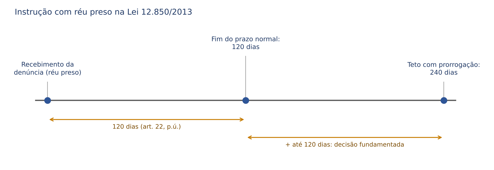
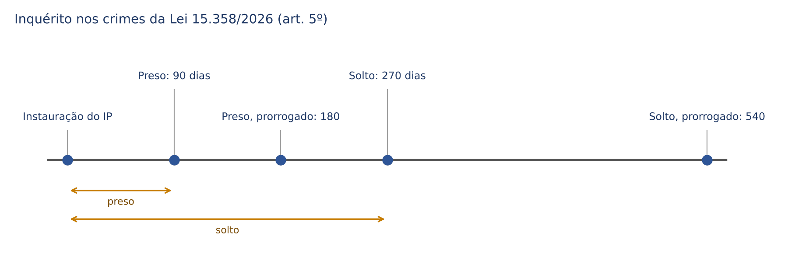
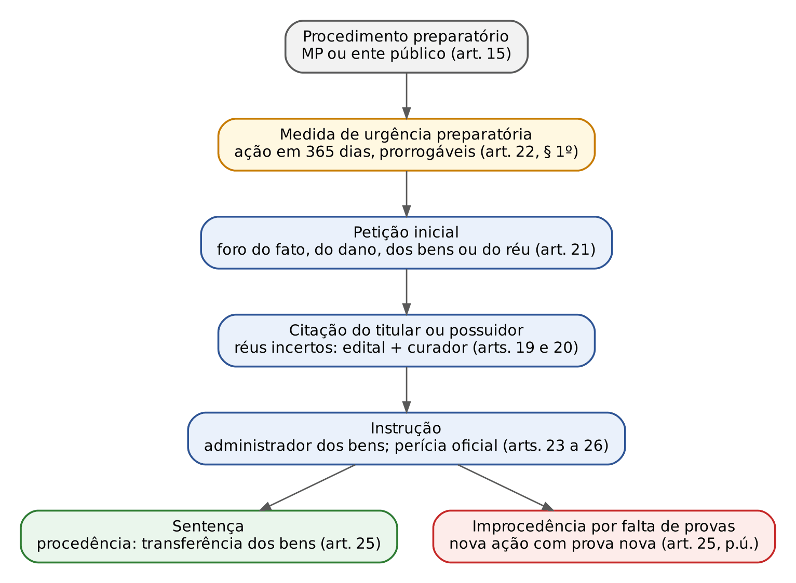
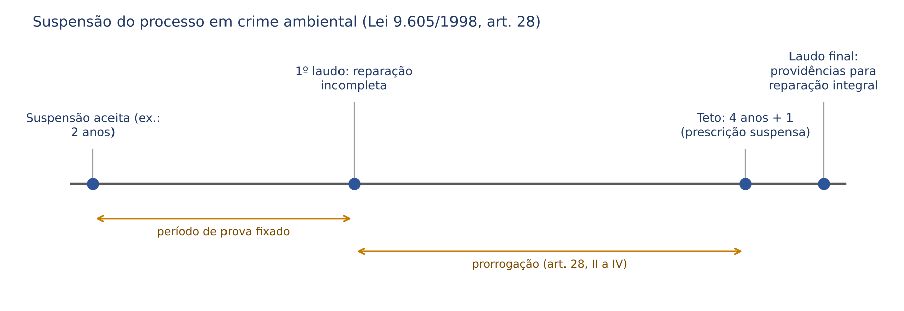
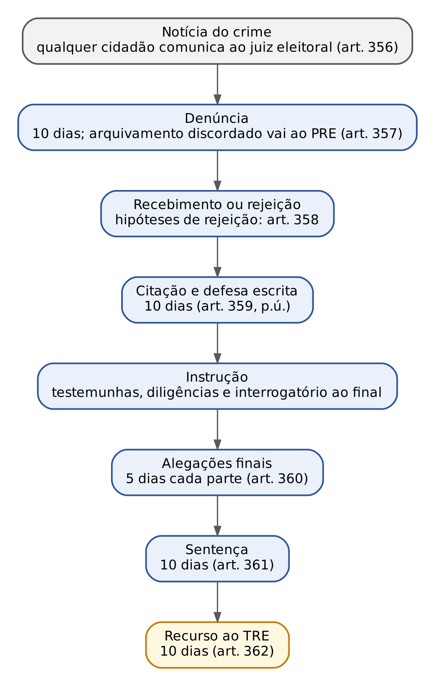

# CAPÍTULO 26 — PROCEDIMENTOS E REGRAS PROCESSUAIS DA LEGISLAÇÃO ESPECIAL II: ORGANIZAÇÕES CRIMINOSAS E LEI 15.358/2026, TERRORISMO, LAVAGEM, SISTEMA FINANCEIRO, CRIMES AMBIENTAIS, MIGRAÇÃO E TRÁFICO DE PESSOAS, ABUSO DE AUTORIDADE, TRÂNSITO, ARMAS, ELEITORAL E FALÊNCIA

:::INCIDENCIA
TRF5 p. 12; TJRS p. 10; TJSC p. 19. Nível A; 6 questões no lote (FGV 6, FCC 0), todas de 2024 a 2026, mais correlatas de outros capítulos.
O que mais cai: Lei 15.358/2026 (perdimento extraordinário, ação civil de perdimento, prazos do inquérito), Lei 12.850/2013 (afastamento cautelar, colegiado, custódia em presídio federal), ação penal no abuso de autoridade, citação por edital na lavagem e benefícios da Lei 9.099 no trânsito e nos crimes ambientais.
:::

## 26.1 Como estudar as leis especiais no plano processual

Cada lei penal especial costuma trazer, além dos crimes, um pequeno "código de processo" próprio: quem investiga, qual juízo julga, qual ação penal, qual rito, que medidas patrimoniais cabem e quais regras do CPP ficam afastadas. A técnica é sempre a mesma: aplica-se o CPP, SALVO naquilo que a lei especial regula de modo diferente (princípio da especialidade, expresso em vários desses diplomas: art. 17-A da Lei 9.613/1998, art. 364 do Código Eleitoral, art. 188 da Lei 11.101/2005, art. 291 do CTB, art. 39 da Lei 13.869/2019). Para o juiz, isso significa que, diante de um processo por crime de lei especial, a pergunta de abertura é: "o que esta lei muda no rito comum?".

O conteúdo material de cada lei (tipos, penas, majorantes, efeitos) está na Apostila de Direito Penal, Caps. 39, 40, 43, 44, 46, 47, 48 e 49; aqui fica só o que é processual e ainda não foi dito lá, com remissão expressa. Medidas assecuratórias em geral, alienação antecipada e mapa do perdimento estão no Cap. 13; colegiados e Varas Colegiadas, no Cap. 9; competência federal e eleitoral, no Cap. 10; meios de obtenção de prova, nos Caps. 5 e 16; colaboração premiada, no Cap. 8.

:::ESQUEMA As cinco perguntas para qualquer lei especial
| Pergunta | Onde a resposta costuma estar | Exemplo |
|---|---|---|
| 1. Quem investiga e em quanto tempo? | dispositivo sobre inquérito | Lei 15.358/2026, art. 5º (90 e 270 dias) |
| 2. Qual Justiça julga? | regra de competência | Lei 13.260/2016, art. 11 (sempre federal) |
| 3. Qual a ação penal? | regra de ação | Lei 13.869/2019, art. 3º (pública incondicionada) |
| 4. Qual o rito e o que muda nele? | regra de procedimento | Lei 12.850/2013, art. 22 (ordinário, 120 dias com réu preso) |
| 5. Que medidas patrimoniais e cautelares especiais cabem? | capítulo de medidas assecuratórias | Lei 9.613/1998, art. 4º; Lei 15.358/2026, art. 9º |
:::

## 26.2 Organizações criminosas (Lei 12.850/2013): regras processuais

### 26.2.1 Rito ordinário e o prazo de 120 dias para o réu preso (art. 22)

Os crimes da Lei 12.850/2013 (organização criminosa, embaraço à investigação e os crimes correlatos dos arts. 18 a 21-B) e as infrações penais CONEXAS seguem o procedimento comum ORDINÁRIO do CPP (art. 22, caput), ainda que a pena de algum dos crimes conexos, isoladamente, levasse ao rito sumário ou ao sumaríssimo. A lei quis um rito só para todo o "pacote" de fatos, com a instrução mais ampla (8 testemunhas por fato para cada parte, diligências do art. 402 e memoriais), porque processos de organização criminosa são, por natureza, complexos e com muitos réus. A sequência dos atos (recebimento, resposta à acusação em 10 dias, absolvição sumária, audiência una) é a do Cap. 22.

O que a lei acrescenta é um limite temporal para a instrução quando o réu está PRESO: ela deve ser encerrada em prazo razoável, que NÃO pode exceder 120 dias, prorrogáveis em até igual período por decisão fundamentada, motivada pela complexidade da causa ou por fato procrastinatório atribuível ao réu (art. 22, parágrafo único).

Três observações para não errar:

- Termo inicial: a lei não diz expressamente. A leitura mais coerente com a expressão "instrução criminal" é contar a partir do recebimento da denúncia (início da ação penal) até o encerramento da instrução (fim da audiência e das diligências), e não até a sentença. Parte da doutrina conta da prisão; na prova, a banca cobra o número (120 + até 120) e os dois motivos da prorrogação.
- Natureza: o prazo NÃO é peremptório nem de cômputo aritmético. Os tribunais superiores aplicam aqui a mesma lógica geral do excesso de prazo (Cap. 19, 19.2.8): só há constrangimento ilegal se a demora for injustificada e imputável ao Estado; complexidade (muitos réus, precatórias, perícias contábeis) e manobras da defesa a justificam. O que a lei acrescenta é o DEVER de decisão fundamentada para prorrogar.
- Consequência do excesso injustificado: relaxamento da prisão (art. 5º, LXV, da CF), sem prejuízo de cautelares diversas; a via usual é o *habeas corpus* (Cap. 30). O excesso não anula o processo nem extingue a punibilidade.

:::EXEMPLO Contando o prazo
Caso: Denúncia contra 12 réus por organização criminosa e extorsões, recebida em 3/2/2026, quatro deles presos preventivamente. Há 30 testemunhas, três delas ouvidas por precatória.
Passo 1 — prazo normal: 120 dias a partir de 3/2/2026, termo em 3/6/2026.
Passo 2 — em 20/5/2026, o juiz prorroga por mais 90 dias, em decisão que aponta o número de réus, as precatórias e a perícia contábil pendente (complexidade da causa). Novo termo: 1/9/2026.
Passo 3 — teto legal: a prorrogação pode chegar a "igual período", isto é, mais 120 dias (até 1/10/2026). Se a instrução passar disso sem justificativa concreta e sem culpa da defesa, a prisão deve ser relaxada.
Erro a evitar: prorrogar "pela gravidade dos crimes" — gravidade não é complexidade nem procrastinação, e o fundamento é nulo para esse fim.
:::

### 26.2.2 Sigilo da investigação e acesso do defensor (art. 23)

O juiz pode decretar o sigilo da investigação para garantir a celeridade e a eficácia das diligências, assegurado ao defensor, no interesse do representado, amplo acesso aos elementos de prova que digam respeito ao exercício do direito de defesa, "devidamente precedido de autorização judicial", ressalvadas as diligências em andamento (caput). Determinado o depoimento do investigado, o defensor tem vista prévia dos autos, ainda que sigilosos, no prazo MÍNIMO de 3 dias antes do ato, ampliável a critério da autoridade (parágrafo único).

A lógica é a da Súmula Vinculante 14 (ver Cap. 4): acesso ao que JÁ foi documentado; nunca às diligências em curso (uma interceptação em andamento, um mandado ainda não cumprido). A exigência de "autorização judicial" para o acesso deve ser lida em conformidade com a súmula: o juiz não pode negar acesso ao material já documentado que interesse à defesa. A negativa injustificada pode configurar o crime do art. 32 da Lei 13.869/2019 (26.9) e se impugna por reclamação ao STF (descumprimento de súmula vinculante), *habeas corpus* ou mandado de segurança.

### 26.2.3 Afastamento cautelar do funcionário público (art. 2º, § 5º)

Havendo indícios suficientes de que o funcionário público INTEGRA a organização criminosa, o juiz pode determinar seu afastamento cautelar do cargo, emprego ou função, SEM PREJUÍZO DA REMUNERAÇÃO, quando a medida se fizer necessária à investigação ou à instrução processual. É uma cautelar pessoal com finalidade instrumental (proteger a prova), e não punição antecipada: por isso a remuneração continua sendo paga.

| | Lei 12.850/2013, art. 2º, § 5º | CPP, art. 319, VI | Lei 9.613/1998, art. 17-D | Lei 15.358/2026, art. 9º, VII |
|---|---|---|---|---|
| Pressuposto | indícios de que o funcionário integra a organização | justo receio de uso da função para praticar infrações penais | mero indiciamento | indícios de crime dos arts. 2º e 3º |
| Finalidade | investigação ou instrução | evitar reiteração | — | investigação ou instrução |
| Remuneração | mantida | a lei não diz (prevalece a manutenção) | mantida | mantida |
| Decretação | juiz, fundamentadamente | juiz, a requerimento (art. 282, § 2º) | AUTOMÁTICA | juiz |
| Situação | vigente | vigente | INCONSTITUCIONAL (STF, ADI 4.911, j. 20/11/2020) | vigente |

Iniciativa: o texto diz "poderá o juiz determinar", mas, depois da Lei 13.964/2019, o juiz não decreta cautelar pessoal de ofício (art. 282, § 2º, e art. 311 do CPP; ver Cap. 18, 18.3). O afastamento deve ser requerido pelo MP ou representado pelo delegado. Recurso: a lei não prevê; contra a decisão que decreta cautelar diversa da prisão, o STJ admite *habeas corpus*, porque o descumprimento pode levar à preventiva (art. 282, § 4º); o mandado de segurança é alternativa para o MP contra a decisão que indefere.

:::QUESTAO FGV 2024 — TJ-SC — Juiz Substituto (Q3049388)
Três funcionários públicos com patrimônio incompatível com a renda, denunciados por corrupção e organização criminosa, valendo-se dos cargos. O que o juiz pode decretar? Gabarito oficial: B — a requerimento do MP, o afastamento cautelar dos cargos, SEM prejuízo da remuneração, se necessário à instrução (art. 2º, § 5º).
Armadilhas: (A) e (C) sequestro e perda "de ofício" da diferença patrimonial — é o confisco alargado do art. 91-A do CP, que depende de requerimento do MP na denúncia (Cap. 13 e Apostila de Direito Penal, Cap. 18); (D) interdição por "dez" anos (são 8 anos subsequentes ao cumprimento da pena, efeito automático do § 6º, e não medida requerida); (E) afastamento de ofício e "com prejuízo" da remuneração, pela desproporção patrimonial — erra a iniciativa, a remuneração e o fundamento (a desproporção patrimonial não é pressuposto do § 5º).
:::

### 26.2.4 Onde fica preso o integrante: segurança máxima e presídio federal

Duas regras da Lei 12.850/2013 interferem diretamente na decisão do juiz sobre o local da custódia:

- Art. 2º, § 8º (Lei 13.964/2019): as LIDERANÇAS de organizações criminosas armadas ou com armas à disposição INICIAM o cumprimento da pena em estabelecimento de segurança máxima (estadual ou federal). 
- Arts. 21-A e 21-B (Lei 15.245/2025): quem solicita, ordena ou conspira para violência ou grave ameaça contra agente público, advogado, jurado, testemunha, colaborador ou perito, para obstruir processo ou investigação de organização criminosa, é recolhido em estabelecimento penal FEDERAL de segurança máxima tanto como PRESO PROVISÓRIO quanto, depois da condenação, para iniciar o cumprimento da pena.

A lei define o tipo de estabelecimento, não o regime: o regime inicial continua a ser fixado pelo art. 33 do CP (Apostila de Direito Penal, Cap. 17). O procedimento de inclusão no Sistema Penitenciário Federal (Lei 11.671/2008, com decisão do juiz federal corregedor) está no Cap. 31.

:::QUESTAO FGV 2026 — TJ-BA — Juiz Substituto (Q4083763)
Integrante de organização criminosa que ordenou grave ameaça a testemunha de acusação, preso preventivamente e depois condenado pelo art. 21-A da Lei 12.850/2013. Gabarito oficial: E — como preso provisório e, após a condenação, para iniciar o cumprimento da pena, em estabelecimento penal federal de segurança máxima.
Passos: (1) o que se pergunta: o local da custódia cautelar e da definitiva; (2) a regra: §§ 3º e 4º do art. 21-A alcançam as DUAS situações; (3) aplicação: preventiva e pena no federal.
Armadilhas: (A) confunde estabelecimento com regime e afirma regime fechado pela gravidade em abstrato (Súmulas 718 e 719 do STF — Apostila de Direito Penal, Cap. 17); (B) e (C) separam artificialmente a fase cautelar da definitiva; (D) remete ao estabelecimento estadual, contra o texto.
:::

### 26.2.5 Meios de obtenção de prova, colaboração e colegiado (remissões)

A Lei 12.850/2013 é o "estatuto" dos meios especiais de investigação (art. 3º): colaboração premiada (Cap. 8), captação ambiental, ação controlada, acesso a registros e dados cadastrais, interceptação, afastamento de sigilos, infiltração de agentes e cooperação entre órgãos (Caps. 5 e 16). Tudo isso se aplica por remissão expressa à Lei 13.260/2016 (art. 16), à Lei 15.358/2026 (arts. 8º e 32) e, quanto à ação controlada e à infiltração, à lavagem (art. 1º, § 6º, da Lei 9.613/1998). Questão correlata: Q3865770 (FGV 2026, MPE-GO, gabarito B — V, F, F: o acesso sem ordem judicial restringe-se a qualificação, filiação e endereço (art. 15); os prazos de guarda dos registros de viagens e de ligações telefônicas são de 5 anos, e não de 3 (arts. 16 e 17) — desenvolvimento no Cap. 5).

:::QUESTAO FGV 2024 — Câmara dos Deputados — Consultor Legislativo (Q2513056)
Três afirmações sobre o tratamento legal do crime organizado. Gabarito oficial: C — I e III corretas.
I (correta): o juiz pode formar colegiado para a prática de QUALQUER ato processual, inclusive a sentença (art. 1º da Lei 12.694/2012 — Cap. 9, 09.9.2).
II (errada): mistura conceitos — "4 ou mais pessoas" vem da Lei 12.850/2013, mas lá as penas máximas devem ser SUPERIORES a 4 anos; "iguais ou superiores" é do conceito da Lei 12.694/2012, que exige 3 pessoas (Apostila de Direito Penal, Cap. 46, 46.9).
III (correta): MP, a qualquer tempo, e delegado, nos autos do inquérito, ouvido o MP, podem requerer ou representar pelo perdão judicial ao colaborador, ainda que não previsto na proposta inicial (art. 4º, § 2º, da Lei 12.850/2013 — Cap. 8).
:::

:::QUESTAO FGV 2025 — TRF 5ª Região — Juiz Federal Substituto (Q3373855)
Grupo de sete pessoas, estruturado e com divisão de tarefas, que cooptava funcionários de concessionária aeroportuária para embarcar drogas à Europa; nenhuma droga apreendida; denúncia por tráfico, associação para o tráfico, organização criminosa e corrupção. Gabarito oficial: C — a transnacionalidade é causa de aumento do crime de organização criminosa (art. 2º, § 4º, V).
Por que as outras falham, no plano da sentença: (A) é possível condenar por associação para o tráfico E organização criminosa se o grupo se dedica também a outros crimes (não há *bis in idem* quando os objetos não coincidem); (B) empregado celetista de concessionária de serviço público é funcionário por equiparação (art. 327, § 1º, do CP); (D) e (E) tratam da MATERIALIDADE do tráfico: para o STJ, sem apreensão da droga não há como condenar por tráfico (falta o laudo que prova a natureza da substância), o que NÃO impede a condenação por associação para o tráfico, crime autônomo que se prova por outros meios — por isso (D) erra ao estender o obstáculo à associação e (E) erra ao admitir a condenação por tráfico sem apreensão. Desenvolvimento no Cap. 25.
:::

## 26.3 Lei 15.358/2026 (Marco Legal do Combate ao Crime Organizado): o "processo" da lei antifacção

### 26.3.1 Mapa: o que é processual e onde está

A Lei 15.358, de 24/3/2026 (DOU de 25/3/2026, vigência imediata — art. 44), tem um Título II inteiro de "normas processuais e operacionais" (arts. 5º a 29), além de alterações no CPP (art. 38). Os crimes (domínio social estruturado e favorecimento) e as controvérsias materiais estão na Apostila de Direito Penal, Cap. 46, 46.14. As regras processuais se distribuem assim:

| Tema | Dispositivo | Onde estudar |
|---|---|---|
| Prazos do inquérito e das decisões cautelares | art. 5º | aqui (26.3.2) |
| Forças-tarefa e cooperação internacional | arts. 6º e 7º | aqui (26.3.2) |
| Meios de obtenção de prova | arts. 8º e 32 (remissão à Lei 12.850 e à Lei 9.613) | Caps. 5 e 16 |
| Medidas assecuratórias cautelares e perdimento extraordinário | art. 9º | Cap. 13 (13.5.7 e 13.7); aqui só o procedimento (26.3.3) |
| Intervenção judicial em pessoa jurídica | art. 10 | aqui (26.3.3) |
| Medidas definitivas pós-trânsito | art. 11 | aqui (26.3.4) |
| Ação civil autônoma de perdimento | arts. 12 a 28 | aqui (26.3.5) |
| Banco de dados de facções | art. 29 | aqui (26.3.6) |
| Audiência de custódia por videoconferência e citação na custódia | arts. 3º-B, § 1º, e 310 do CPP | Caps. 18 e 20 |
| Exceção à força atrativa do Júri e Varas Colegiadas | art. 78, I, do CPP; art. 2º, § 8º | Cap. 9 (09.9.4) |
| Preventiva: nova hipótese de admissibilidade | art. 313, V, do CPP; art. 2º, § 9º | Cap. 19 |
| Efeito ativo ou suspensivo no RESE do art. 581, V | art. 584, § 4º, do CPP | aqui (26.3.6) e Cap. 28 |

### 26.3.2 Investigação: prazos próprios do inquérito e das decisões

Nos crimes da Lei 15.358/2026, o inquérito deve ser concluído em 90 dias com o indiciado PRESO e em 270 dias com o indiciado SOLTO, prorrogável por igual período (art. 5º, caput). Compare: no CPP, 10 dias (preso) e 30 dias (solto); na Justiça Federal, 15 + 15 (preso); na Lei de Drogas, 30 e 90 dias, duplicáveis (Caps. 4 e 25). É o prazo de inquérito mais longo do sistema para investigado preso.

A lei também fixa prazos para o JUIZ e para o MP durante a investigação, coisa rara no processo penal:

| Ato | Prazo | Dispositivo |
|---|---|---|
| Juiz decide representação do delegado ou requerimento do MP | 15 dias da conclusão | art. 5º, § 1º |
| MP opina sobre representação do delegado | 5 dias do recebimento | art. 5º, § 2º |
| Urgência ou risco de ineficácia | MP e juiz em 24 horas, prazo simultâneo; contraditório da parte depois da decisão | art. 5º, § 3º |
| Delegado submete o indeferimento à revisão do MP (se o promotor não recorreu) | 48 horas; a instância revisora delibera no mesmo prazo | art. 5º, § 6º |

Pontos que a banca explora:

- O descumprimento de QUALQUER desses prazos NÃO gera automaticamente o relaxamento da prisão nem a liberdade do preso; o juiz avalia o caso concreto (§ 4º). A regra positiva o que a jurisprudência já fazia com o excesso de prazo (Cap. 19, 19.2.8), mas não autoriza prisão sem limite: excesso injustificado continua ilegal.
- As regras valem, no que couber, para o procedimento investigatório criminal do MP (§ 5º).
- O § 6º é uma novidade institucional: indeferida a representação do delegado (por exemplo, por busca e apreensão) e não recorrendo o promotor, o delegado pode levar a matéria, em 48 horas, à instância revisora do próprio MP (definida na lei orgânica), que decide no mesmo prazo. Note que a "revisão" é da posição do MP de não recorrer; a decisão judicial só muda se o órgão revisor promover o recurso cabível.
- Forças-tarefa (art. 6º): o § 5º diz que o descumprimento das regras de cooperação "não gera nulidade" na obtenção das provas; a cláusula alcança as formalidades da cooperação, e não as nulidades por violação de garantias (prova ilícita, quebra da cadeia de custódia — Cap. 14).

### 26.3.3 Medidas cautelares patrimoniais e intervenção em pessoa jurídica: o procedimento

O catálogo do art. 9º, o prazo de 10 dias para a prova da origem lícita e o perdimento extraordinário sem condenação estão no Cap. 13 (13.5.7 e 13.7). Do ponto de vista do juiz que decide, importam ainda as regras de PROCEDIMENTO do art. 9º:

- Iniciativa: juiz de ofício (letra da lei), MP ou delegado por representação, ouvido o MP nos prazos do art. 5º (5 dias ou 24 horas). A decretação de ofício na investigação é questionada à luz do art. 3º-A do CPP (Cap. 3); em prova objetiva, prevalece a letra.
- Contraditório DIFERIDO: as medidas podem ser decretadas sem ouvir o atingido (§ 1º), que se manifesta depois (os 10 dias do § 6º).
- Fundamentação reforçada (§ 3º): o juiz, o MP e o delegado devem demonstrar EXPRESSAMENTE necessidade, adequação e proporcionalidade e indicar, quando possível, os "efeitos sistêmicos" da medida (por exemplo, o bloqueio do Pix de uma empresa de transporte que atende uma comunidade inteira), para evitar dano a pessoas e empresas alheias à facção. É a versão patrimonial do art. 315 do CPP.
- Custódia e depositário (§§ 4º e 5º): os bens ficam com o poder público; é VEDADO nomear depositário o próprio investigado, seus parentes, sócios ou empregados, salvo decisão fundamentada que demonstre a impossibilidade material ou a inadequação técnica da custódia pública.
- Sigilo obrigatório das ordens de bloqueio até o cumprimento, sob pena de responsabilidade funcional (§ 13).

Intervenção judicial em pessoa jurídica (art. 10). Se houver indícios CONCRETOS de que uma empresa está sendo beneficiada pela facção, o juiz, a requerimento do MP ou por representação do delegado (aqui a lei NÃO prevê atuação de ofício), determina o afastamento imediato dos sócios e a intervenção na administração, com bloqueio de operações até a nomeação do interventor. 

:::PROCESSO Ficha — intervenção judicial em pessoa jurídica (Lei 15.358/2026, art. 10)
| Item | Regra |
|---|---|
| Cabimento | indícios concretos de que a PJ é beneficiada por facção, grupo paramilitar ou milícia, no curso da investigação |
| Iniciativa | requerimento do MP ou representação do delegado |
| Efeito imediato | afastamento dos sócios; bloqueio de operações financeiras, societárias e de gestão até a nomeação do interventor (§ 2º) |
| Interventor | idoneidade, qualificação técnica e experiência em gestão ou *compliance*; mandato de 6 meses, prorrogável por períodos iguais e sucessivos enquanto subsistirem as razões da medida (§ 3º); contas trimestrais ao juízo e ao MP (§ 7º) |
| Poderes do interventor | suspender contratos suspeitos, romper vínculos com investigados, auditar, segregar bens ilícitos, propor saneamento ou liquidação (§ 4º) |
| Efeitos colaterais | suspensão cautelar de contratos públicos (§ 5º), extensível a PJ controlada por terceiros usada no crime (§ 6º); impedimento de licitar e de receber incentivos enquanto durar (§ 9º) |
| Desfecho (§ 10) | restituição aos sócios de boa-fé; liquidação judicial, se comprovada participação dolosa ou culposa grave; ou perdimento total, se o patrimônio for essencialmente ilícito |
| Destino dos valores | fundo de segurança pública do Estado (investigação local), Fundo Nacional (Polícia Federal) ou rateio em partes iguais (atuação conjunta); bens ligados ao tráfico vão ao fundo antidrogas (§ 11) |
:::

### 26.3.4 Medidas definitivas depois do trânsito em julgado (art. 11)

Transitada em julgado a condenação pelos arts. 2º ou 3º, e se não tiver havido perdimento extraordinário, o juiz, de ofício ou a requerimento do MP, determina as medidas de "desarticulação financeira definitiva": conversão automática das constrições em perda definitiva (inclusive de bens em nome de terceiros, comprovada a origem ou destinação ilícita), confisco ampliado dos bens incompatíveis com a renda declarada nos 5 anos anteriores ao fato (salvo prova cabal da origem lícita), dissolução compulsória da PJ, liquidação dos bens com destinação aos fundos de segurança, proibição definitiva de contratar com o poder público, cancelamento de licenças, responsabilidade solidária e sucessória de sócios, herdeiros e interpostas pessoas até o limite do proveito, comunicações automáticas a Coaf, Banco Central, CVM, Receita e juntas comerciais e publicação em cadastro nacional (incisos I a XI).

O ponto processual está no § 3º: essas medidas têm natureza de EXECUÇÃO PENAL PATRIMONIAL e NÃO dependem de nova ação civil, aplicando-se subsidiariamente o procedimento de liquidação judicial da Lei 11.101/2005. Ou seja, o juiz criminal (o da execução) executa nos próprios autos, sem necessidade de o Estado propor ação cível. O confisco ampliado do inciso II difere do confisco alargado do art. 91-A do CP em dois pontos: não exige pedido na denúncia e tem marco temporal próprio (5 anos antes do fato); a inversão do ônus ("salvo prova cabal") é o principal foco de questionamento constitucional.

### 26.3.5 A ação civil autônoma de perdimento de bens (arts. 12 a 28)

A lei criou, para os bens ligados aos crimes de facção, um processo CIVIL de confisco, inspirado no *civil forfeiture* norte-americano e no modelo da extinção de domínio colombiana. A ideia é simples: o Estado não precisa condenar ninguém para retirar do mundo jurídico um bem de origem ilícita; ele processa, no fundo, a COISA (ação *in rem*), e o réu é quem se apresenta como titular. Para o leitor civilista, é a parte mais familiar do capítulo: petição inicial, citação, tutela de urgência, administrador, ônus da prova, coisa julgada — tudo regido subsidiariamente pelo CPC.

:::PROCESSO Ficha — ação civil autônoma de perdimento (Lei 15.358/2026)
| Item | Regra |
|---|---|
| Objeto | extinção da posse, da propriedade e de quaisquer direitos sobre bens que sejam produto ou proveito, direto ou indireto, de atividade ilícita ou com ela relacionados, com transferência ao ente público SEM indenização (art. 12) |
| Hipóteses | bem que provenha dos crimes da lei, seja a eles destinado, sirva para ocultar bens ilícitos ou provenha de negócio com esses bens (art. 13); a transmissão a terceiro não impede a perda (§ 1º), ressalvado o terceiro de boa-fé que não tinha como conhecer a origem (§ 2º) |
| Equivalente | perda de bens ou valores equivalentes se o produto não for encontrado ou estiver no exterior (art. 12, § 2º) |
| Prescrição | IMPRESCRITÍVEL (art. 12, § 3º) |
| Bens no Brasil, fato no exterior | cabe a perda; a pedido de Estado estrangeiro sem tratado, repartição em partes iguais, deduzidas as despesas (art. 14) |
| Fase pré-processual | procedimento preparatório pelo MP ou pelo órgão de representação do ente legitimado, com poder de requisição (MP) ou de solicitação (ente) de informações (art. 15); dever de comunicação dos órgãos públicos (art. 16) |
| Legitimidade ativa | União, Estados, DF, Municípios e entidades da administração indireta; MPF nas causas da Justiça Federal; MP estadual nas demais (art. 18); o MP, quando não autor, intervém obrigatoriamente como fiscal da ordem jurídica (§ 1º) |
| Polo passivo | titular ou possuidor dos bens; preposto de PJ estrangeira presume-se autorizado a receber citação (art. 19); proprietário desconhecido: réus incertos, citados por EDITAL com descrição dos bens e defendidos por CURADOR ESPECIAL; quem se apresentar como titular ingressa no estado em que o processo se encontra (art. 20) |
| Foro | local do fato ou do dano; se desconhecidos, situação dos bens ou domicílio do réu; a primeira ação PREVINE o juízo para as demais com a mesma causa de pedir ou objeto (art. 21) |
| Tutela de urgência | a qualquer tempo, ainda que não identificado o titular; a preparatória perde eficácia se a ação não for proposta em 365 dias da efetivação, prorrogáveis por igual período (art. 22, § 1º); feita a constrição, deliberação IMEDIATA sobre alienação antecipada ou administrador (§ 3º) e prioridade de tramitação (§ 4º) |
| Administração dos bens | pessoa física ou jurídica qualificada, ouvido o MP; remuneração de até 10% do valor dos bens, preferencialmente com os frutos; vedados atos de alienação de domínio (arts. 23 e 24) |
| Custas | sem adiantamento de custas, emolumentos e honorários periciais; sem condenação do autor em honorários e custas, salvo má-fé; perícia preferencialmente por peritos públicos (art. 26) |
| Independência | a perda civil independe da responsabilidade civil ou criminal e do desfecho de outras ações, SALVO sentença penal absolutória que reconheça taxativamente a INEXISTÊNCIA DO FATO (art. 17) |
| Coisa julgada | improcedência por INSUFICIÊNCIA DE PROVAS permite nova ação, por qualquer legitimado, com prova nova (arts. 17, parágrafo único, e 25, parágrafo único) — coisa julgada *secundum eventum probationis* |
| Desfecho | procedência: transferência definitiva e incorporação ao ente (arts. 25 e 27); improcedência: restituição corrigida (art. 27, parágrafo único) |
| Colaborador | terceiro, não réu na ação penal, que espontaneamente fornece provas relevantes e ajuda a localizar os bens recebe até 5% do produto, fixado na sentença (art. 28) |
:::

A regra do § 3º é a que mais pesa no dia a dia do juiz da ação, porque impede que o bem fique parado e se deprecie enquanto o processo corre:

:::LEI Lei 15.358/2026, art. 22, §§ 3º e 4º
§ 3º Realizada a constrição do bem, o juiz imediatamente deliberará a respeito da alienação antecipada, ou sobre a nomeação de administrador.
§ 4º Uma vez efetivada a constrição do bem, o processo judicial terá prioridade de tramitação.
:::

Duas observações de juiz:

- Competência: a lei não diz expressamente qual juízo, mas trata a ação como CÍVEL (art. 18, II, fala em "competência cível da Justiça Federal"). Logo, é proposta no juízo cível (estadual ou federal, conforme o autor e o interesse da União), e não na vara criminal. O recurso contra a sentença é a apelação do CPC.
- A absolvição penal só impede o perdimento civil quando reconhece a INEXISTÊNCIA DO FATO. Absolvição por falta de provas, atipicidade ou extinção da punibilidade não vincula o juízo cível. A lógica é a mesma dos arts. 66 e 67 do CPP para a ação civil *ex delicto* (Cap. 7), mas com uma diferença: lá, também a negativa de autoria provada vincula; aqui, como o processo é sobre a coisa, a autoria é irrelevante.

:::QUESTAO FGV 2026 — MPE-RJ — Promotor de Justiça Substituto (Q4088256)
Pedro e Paulo, indiciados por domínio social estruturado em milícia; bens de origem ilícita "inequívoca e comprovada" de Pedro já sequestrados; produto dos crimes de Paulo no exterior, inclusive ativos digitais. Gabarito oficial: D — o juiz pode decretar, a requerimento do MP, o perdimento EXTRAORDINÁRIO dos bens de Pedro, independentemente de condenação (art. 9º, § 8º).
Passos: (1) bens com origem ilícita clara → perdimento extraordinário, sem condenação; (2) bens no exterior → sequestro e perda pelo EQUIVALENTE (art. 91, §§ 1º e 2º, do CP; art. 12, § 2º, da Lei 15.358/2026).
Armadilhas: (A) perda "alargada" pedida só nas alegações finais e "independente de condenação" (o art. 91-A do CP exige condenação e pedido na denúncia); (B) perda pelo equivalente de Pedro sem condenação (os bens dele foram encontrados; o equivalente pressupõe que não sejam); (C) nega o equivalente para Paulo, que é justamente o caso dele; (E) "sequestro alargado" — figura inexistente (Cap. 13, 13.5.4).
Correlata: Q4378284 (FGV 2026, PC-PR, Delegado; gabarito C — Cap. 13).
:::

| Instrumento | Juízo | Momento | Depende de condenação? | Natureza |
|---|---|---|---|---|
| Perdimento extraordinário (art. 9º, § 8º) | juiz criminal | investigação ou ação penal | NÃO | incidente cautelar-definitivo no processo penal |
| Medidas definitivas (art. 11) | juiz criminal (execução) | após o trânsito | SIM | execução penal patrimonial, sem nova ação |
| Ação civil de perdimento (arts. 12 a 28) | juízo cível | a qualquer tempo (imprescritível) | NÃO (salvo inexistência do fato reconhecida) | ação civil autônoma *in rem* |

### 26.3.6 Banco de dados e alterações no CPP

Banco Nacional de Dados de facções (art. 29): base unificada de pessoas físicas e jurídicas integrantes, colaboradoras ou financiadoras, com bancos estaduais interoperáveis obrigatórios. A inclusão, "devidamente formalizada nos termos do regulamento", PRESUME o vínculo da pessoa à facção para todos os fins administrativos, operacionais e de cooperação (§ 6º). Para o processo penal, o ponto é: essa presunção é ADMINISTRATIVA e não supre a prova do vínculo na ação penal, onde o ônus é integralmente da acusação (Cap. 14, 14.5). Usar a inclusão no cadastro como prova suficiente de integrar facção, na sentença, é erro grave.

Duas alterações do CPP feitas pela lei interessam a outros capítulos, mas convém conhecer aqui:

- Art. 313, V: admite a preventiva quando o crime for cometido por integrante de facção, grupo paramilitar ou milícia, no contexto ou para a consecução das condutas do art. 2º. É hipótese de ADMISSIBILIDADE; não dispensa os fundamentos do art. 312 (perigo concreto), nem diante do art. 2º, § 9º, que fala em "causa suficiente" (Cap. 19).
- Art. 584, § 4º: no RESE contra decisões sobre prisão e liberdade (art. 581, V: concessão, negação, arbitramento, cassação ou inidoneidade da fiança; indeferimento ou revogação da preventiva; concessão de liberdade provisória; relaxamento do flagrante), o recorrente pode pedir ao tribunal, a qualquer tempo até o julgamento, efeito SUSPENSIVO ou ATIVO, demonstrando relevância dos motivos, plausibilidade do direito e risco de dano irreparável ou de difícil reparação. É a positivação, para o processo penal, da tutela recursal do art. 1.019, I, do CPC e oferece ao MP um caminho legal próprio, dentro do recurso, para o que antes se buscava por mandado de segurança — via que a Súmula 604 do STJ já recusava (ver Cap. 30; recursos no Cap. 28).

:::PEGADINHA O § 4º do art. 584 vale para TODOS os crimes
A regra foi inserida pela lei antifacção, mas está no CPP e não se limita aos crimes de facção: qualquer RESE do art. 581, V, admite o pedido de efeito suspensivo ou ativo ao tribunal. E ela vale para os dois lados: a defesa pode pedir efeito ativo para obter a liberdade negada; o MP, para restabelecer a prisão revogada.
:::

:::SENTENCA Decisão de perdimento extraordinário ou de medida patrimonial da Lei 15.358/2026
Onde entra: decisão interlocutória em autos apartados (cautelar), ou capítulo da sentença; o perdimento extraordinário pode vir antes da sentença.
O que fundamentar: (1) indícios suficientes de crime dos arts. 2º ou 3º; (2) para cada bem, por que a origem ilícita é CLARA (não basta suspeita: o § 8º exige clareza); (3) que o atingido teve os 10 dias do § 6º e o que alegou; (4) a ressalva do terceiro de boa-fé (§ 9º); (5) necessidade, adequação, proporcionalidade e efeitos sistêmicos (§ 3º).
Redação-modelo: "Intimado, o investigado não apresentou prova da origem dos 2.300.000 (dois milhões e trezentos mil) reais em criptoativos, adquiridos no período em que o laudo contábil demonstra o recolhimento de 'taxas' de comerciantes da comunidade; sendo clara a origem ilícita, decreto o perdimento extraordinário (art. 9º, § 8º, da Lei 15.358/2026), ressalvados direitos de terceiros de boa-fé."
Erro que a banca pune: tratar o perdimento extraordinário como dependente do trânsito em julgado; confundi-lo com o confisco alargado do art. 91-A do CP; decretar com base apenas no cadastro do art. 29.
:::

## 26.4 Terrorismo (Lei 13.260/2016): regras processuais

A lei se declara, já no art. 1º, como disciplina do terrorismo e de suas "disposições investigatórias e processuais". O conteúdo penal (duplo elemento subjetivo, atos preparatórios, financiamento) está na Apostila de Direito Penal, Cap. 40, 40.6. No plano processual, quatro blocos:

- Competência e investigação (art. 11): os crimes da lei são, "para todos os efeitos legais", praticados contra o interesse da União; investigação pela POLÍCIA FEDERAL, em inquérito, e julgamento pela JUSTIÇA FEDERAL (art. 109, IV, da CF). Não há terrorismo julgado pela Justiça Estadual. Se, no curso do processo federal, o juiz concluir que falta a motivação discriminatória do art. 2º (o fato é, por exemplo, homicídio ou dano comum), a competência federal desaparece com a desclassificação, salvo outra causa de interesse federal: aplica-se o art. 74, § 2º, do CPP, com remessa ao juízo estadual (Caps. 9 e 10).
- Medidas assecuratórias (arts. 12 a 15): o juiz, de ofício, a requerimento do MP ou por representação do delegado, OUVIDO O MP EM 24 HORAS, havendo indícios suficientes de crime da lei, pode decretar medidas sobre bens do investigado ou acusado, ou em nome de interpostas pessoas, que sejam instrumento, produto ou proveito. O modelo é cópia do art. 4º da Lei de Lavagem: alienação antecipada obrigatória diante de deterioração (§ 1º); liberação comprovada a licitude, mantido o necessário à reparação, multas e custas (§ 2º); pedido de liberação só conhecido com o COMPARECIMENTO PESSOAL do acusado ou da interposta pessoa (§ 3º); administrador nomeado pelo juiz, remunerado com o produto dos bens (arts. 13 e 14); cooperação internacional com repartição por metade na falta de tratado (art. 15).
- Investigação, processo e julgamento pela Lei 12.850/2013 (art. 16): todos os meios especiais de obtenção de prova, inclusive colaboração premiada, e o rito ordinário do art. 22, com o prazo de 120 dias para a instrução com réu preso (26.2.1). A remissão é ampla ("investigação, processo e julgamento"), o que justifica aplicar também o sigilo do art. 23.
- Lei 8.072/1990 (art. 17) e temporária (art. 18): crime equiparado a hediondo, inafiançável, com prisão temporária de 30 dias prorrogáveis por mais 30 (Cap. 19).

:::ESQUEMA Medidas assecuratórias nas leis especiais: o que muda de uma para outra
| Lei | Iniciativa | Oitiva prévia do MP | Prova da origem lícita | Comparecimento pessoal para liberar | Particularidade |
|---|---|---|---|---|---|
| CPP, arts. 125 a 144-A | juiz, MP, ofendido, delegado | não prevista | embargos, julgados após o trânsito | não | regra geral (Cap. 13) |
| Lavagem, art. 4º | juiz de ofício, MP, delegado (ouvido o MP em 24 horas) | 24 horas, se representação do delegado | a qualquer tempo; liberação mantém o necessário à reparação e multas (§ 2º) | SIM (§ 3º) | alienação antecipada própria (art. 4º-A, piso de 75%) |
| Terrorismo, art. 12 | juiz de ofício, MP, delegado | 24 horas | idem lavagem | SIM | administrador; cooperação internacional |
| Tráfico de pessoas, Lei 13.344/2016, art. 8º | juiz de ofício, MP, delegado | ouvido o MP | idem lavagem | SIM | procedimento do CPP (arts. 125 a 144-A) |
| Lei 15.358/2026, art. 9º | juiz de ofício, MP, delegado | 5 dias ou 24 horas (art. 5º) | 10 dias da intimação | não previsto | catálogo amplo, perdimento extraordinário (Cap. 13) |
:::

## 26.5 Lavagem de dinheiro (Lei 9.613/1998): o que a sentença precisa enfrentar

As regras de rito (comum), competência (art. 2º, III), a inaplicabilidade do art. 366 (art. 2º, § 2º), as medidas assecuratórias e a alienação antecipada (arts. 4º e 4º-A), os dados cadastrais (art. 17-B; STF, ADI 4.906) e o afastamento automático do servidor (art. 17-D; STF, ADI 4.911) estão sistematizados na Apostila de Direito Penal, Cap. 46, 46.6 e 46.7. Aqui se desenvolvem os pontos processuais que ainda faltam, em especial os que o juiz enfrenta ao receber a denúncia e ao sentenciar.

### 26.5.1 Justa causa duplicada e autonomia em relação à infração antecedente

A lavagem é crime ACESSÓRIO (depende de uma infração anterior que gere o dinheiro sujo), mas processualmente AUTÔNOMO: o processo e o julgamento independem do processo e do julgamento da infração antecedente, ainda que praticada em outro país (art. 2º, II). A denúncia deve ser instruída com "indícios suficientes da existência da infração penal antecedente", e a lavagem é punível ainda que desconhecido ou isento de pena o autor do antecedente, ou extinta a sua punibilidade (art. 2º, § 1º).

Daí a ideia de JUSTA CAUSA DUPLICADA (expressão difundida por Renato Brasileiro de Lima): para receber a denúncia, o juiz precisa de lastro probatório mínimo de DOIS fatos — a ocultação ou dissimulação, e a origem dos valores em infração penal. A denúncia não precisa descrever o antecedente com todos os pormenores; basta indicar indícios suficientes de que o objeto da lavagem provém, direta ou indiretamente, de infração penal (STJ, Corte Especial, APn 923, j. 23/9/2019, Informativo 657).

| Situação do antecedente | Consequência para a lavagem | Fundamento |
|---|---|---|
| Autor desconhecido ou isento de pena (inimputável, erro de proibição) | lavagem punível | art. 2º, § 1º |
| Antecedente prescrito ou com outra causa de extinção da punibilidade | lavagem punível (a extinção não apaga o fato) | art. 2º, § 1º; STJ, HC 207.936 (Informativo 494) |
| Antecedente julgado no exterior ou sequer processado | lavagem processável no Brasil | art. 2º, II |
| Antecedente INEXISTENTE ou ATÍPICO (por exemplo, absolvição por inexistência do fato) | falta a elementar "proveniente de infração penal": a lavagem cai | lógica do tipo |
| Crime tributário antecedente com punibilidade extinta pelo pagamento integral | o STJ entendeu que não subsistem a lavagem nem a organização criminosa dela dependentes | STJ, 6ª Turma, RHC 161.701, j. 19/3/2024 (Informativo 805) |

:::DICA Unidade ou separação de processos
O art. 2º, II, atribui ao juiz da LAVAGEM a decisão sobre reunir ou não os processos (lavagem e antecedente). Não há vedação à reunião por conexão probatória (art. 76, III, do CPP), mas também não há obrigação: o juiz decide pela conveniência da instrução (art. 80). Se o antecedente for federal e a lavagem também (art. 2º, III, "b"), a reunião é natural; se o antecedente for estadual e não houver interesse da União, a lavagem fica na Justiça Estadual (competência no Cap. 10).
:::

### 26.5.2 Citação por edital sem suspensão do processo (art. 2º, § 2º)

No processo por lavagem, o acusado que, citado por edital, não comparece nem constitui advogado NÃO tem o processo suspenso: o feito prossegue até o julgamento, com defensor dativo. A justificativa política é evitar que o réu que mandou o patrimônio para o exterior e fugiu paralise a persecução e congele a perda dos bens. A regra é alvo de crítica doutrinária (a suspensão do art. 366 decorre do direito de audiência e da ampla defesa, garantidos pela Convenção Americana, art. 8º), mas está em vigor e é a que a banca cobra. A sistemática geral do art. 366 e o quadro das exceções estão no Cap. 20 (20.6).

Dois cuidados práticos: (1) a citação por edital continua sendo subsidiária, depois de esgotados os meios de localização (Cap. 20, 20.4.8); (2) se a denúncia imputa lavagem e outros crimes conexos (por exemplo, corrupção), o art. 2º, § 2º, só alcança a imputação de lavagem; para os demais crimes, incide o art. 366, e o juiz deve DESMEMBRAR o processo quanto a eles (art. 80 do CPP), sob pena de nulidade por cerceamento quanto aos crimes comuns. A solução é doutrinária, e não há precedente vinculante sobre ela.

### 26.5.3 Ação controlada judicial (art. 4º-B)

O art. 4º-B permite ao juiz, ouvido o MP, SUSPENDER a ordem de prisão de pessoas ou as medidas assecuratórias quando sua execução imediata puder comprometer as investigações. É uma "ação controlada judicial": o Estado sabe onde estão o investigado e os bens, mas espera para alcançar toda a rede (os demais lavadores, os destinatários finais). Diferente da ação controlada da Lei 12.850/2013 (art. 8º), que é retardamento da intervenção POLICIAL comunicado previamente ao juiz (Cap. 16): aqui quem retarda é o próprio juiz, sobre ordem que ele mesmo expediu.

Questão correlata sobre técnicas especiais (entrega vigiada, ação controlada, dados cadastrais): Q3179527 (FGV 2025, TRF3, gabarito D — Cap. 5).

:::SENTENCA Lavagem de dinheiro na sentença
Onde entra: (1) nas preliminares, quando a defesa alega inépcia por falta de descrição do antecedente ou nulidade da citação por edital sem suspensão; (2) na materialidade, com a demonstração das DUAS camadas — origem ilícita e ato de ocultação ou dissimulação; (3) nos efeitos, com a perda (art. 7º, I) e a interdição pelo dobro da pena (art. 7º, II — Apostila de Direito Penal, Cap. 46, 46.7.3).
Redação-modelo: "A origem ilícita dos valores está suficientemente demonstrada pelos contratos superfaturados e pelo laudo que rastreou as transferências da conta da empreiteira para a empresa de fachada do réu; a dissimulação, pela simulação de consultorias sem contraprestação. Nos termos do art. 2º, II e § 1º, da Lei 9.613/1998, a condenação independe do desfecho da ação relativa à corrupção."
Erros que a banca pune: exigir condenação definitiva pelo antecedente; suspender o processo pelo art. 366; absolver por ausência de "prova cabal" do antecedente quando há indícios suficientes; condenar pela lavagem quando o antecedente foi declarado inexistente.
:::

## 26.6 Crimes contra o Sistema Financeiro Nacional (Lei 7.492/1986, arts. 26 a 31)

A competência federal (art. 26 e art. 109, VI, da CF: crimes contra o sistema financeiro "nos casos determinados por lei"), o papel da magnitude da lesão e a crítica ao art. 31 estão na Apostila de Direito Penal, Cap. 47, 47.2.7. O que é processual e cobrável, dispositivo a dispositivo:

| Artigo | Regra | Leitura atual |
|---|---|---|
| 26, caput | ação penal promovida pelo MPF, perante a Justiça Federal | todos os crimes da lei, mesmo em bancos privados ou estaduais; fora da Lei 7.492 (pirâmide financeira, economia popular), Justiça Estadual (Cap. 10) |
| 26, parágrafo único | além do ofendido (art. 268 do CPP), admite-se como ASSISTENTE a CVM, se o crime ocorreu em atividade sujeita à sua fiscalização, e o Banco Central, nas demais atividades sob sua fiscalização | hipótese de assistência por autarquia federal prevista em lei especial (assistência no Cap. 12) |
| 27 | denúncia não intentada no prazo legal: o ofendido pode REPRESENTAR ao Procurador-Geral da República, que oferece a denúncia, designa outro membro ou determina o arquivamento | mecanismo de controle interno do MPF; não exclui a ação privada subsidiária (art. 5º, LIX, da CF), que é garantia constitucional |
| 28 | Banco Central e CVM, ao verificarem crime da lei, DEVEM informar o MPF e enviar os documentos; o mesmo dever tem o interventor, liquidante ou síndico | é a principal fonte de notícia-crime nesses delitos |
| 29 | o MPF pode requisitar a qualquer autoridade informação, documento ou diligência; o sigilo financeiro não pode ser oposto | deve ser lido com a LC 105/2001: a requisição direta alcança informações e documentos não protegidos; a quebra do sigilo bancário do investigado continua dependendo de ordem judicial, segundo a jurisprudência do STF |
| 30 | a preventiva pode ser decretada "em razão da magnitude da lesão causada", sem prejuízo do art. 312 do CPP | a magnitude sozinha não basta: é preciso perigo concreto (Cap. 19) |
| 31 | nos crimes punidos com reclusão, vedação de fiança e de apelar em liberdade quando presentes os requisitos da preventiva | sem efeito prático: a vedação só incide quando cabível a preventiva, situação em que a fiança já seria incompatível (art. 324, IV, do CPP); o recolhimento para apelar foi abolido (art. 387, § 1º, do CPP; Súmula 347 do STJ — Cap. 28) |

:::ATENCAO Art. 27 x ação privada subsidiária
A representação ao PGR do art. 27 é instrumento ADMINISTRATIVO, dirigido à chefia do MPF. Ela não substitui nem impede a queixa subsidiária: o ofendido (por exemplo, o investidor lesado por gestão fraudulenta) que vê o prazo da denúncia esgotado sem manifestação do MP pode optar entre provocar o PGR e ajuizar a ação privada subsidiária (Cap. 6, 06.9). Se o MP pediu arquivamento, não houve inércia e a subsidiária não cabe.
:::

Questão correlata (competência): Q3179526 (FGV 2025, TRF3, gabarito C — Cap. 10): a alternativa que dizia que a pirâmide financeira "sempre" caracteriza crime contra o sistema financeiro, de competência federal, estava errada; captação de poupança popular por pirâmide é, em regra, crime contra a economia popular, da Justiça Estadual.

## 26.7 Crimes ambientais (Lei 9.605/1998) no plano processual

A ação penal pública incondicionada (art. 26), a transação condicionada à prévia composição do dano (art. 27), a suspensão do processo com laudo de reparação (art. 28), o ANPP, a perícia e o valor mínimo de reparação (art. 20) estão na Apostila de Direito Penal, Cap. 49, 49.2; a competência (Justiça Estadual como regra, federal quando há interesse direto da União), em 49.4 e no Cap. 10 desta apostila. Os tipos penais, na Apostila de Direito Ambiental, Cap. 8. Aqui: o passo a passo das medidas despenalizadoras, a pessoa jurídica no polo passivo e as regras de prova e de destinação de bens.

### 26.7.1 Transação e suspensão do processo: a sequência dos atos

Transação penal (art. 27): na audiência preliminar do Juizado, primeiro se tenta a composição do dano AMBIENTAL (art. 74 da Lei 9.099/1995); feita a composição (ou comprovada a impossibilidade de fazê-la), o MP pode propor a transação. Atenção à diferença em relação ao Juizado comum: como a ação é pública incondicionada, a composição NÃO extingue a punibilidade (não há renúncia ao direito de representação); ela é PRESSUPOSTO da proposta de transação. A composição costuma ser documentada por termo de compromisso de recuperação da área ou de pagamento, com valor e prazo.

Suspensão condicional do processo (art. 28): segue o art. 89 da Lei 9.099/1995, com cinco modificações sobre a EXTINÇÃO da punibilidade.

- I: findo o período de prova, a extinção da punibilidade depende de LAUDO de constatação da reparação do dano, salvo impossibilidade (a que se refere o § 1º, I, do art. 89);
- II: se o laudo mostrar reparação incompleta, o prazo de suspensão é PRORROGADO até o máximo do art. 89 (4 anos), acrescido de mais 1 ano, com suspensão da prescrição;
- III: durante a prorrogação não se aplicam as condições dos incisos II, III e IV do § 1º do art. 89 (proibição de frequentar lugares, de ausentar-se da comarca e comparecimento mensal);
- IV: ao fim da prorrogação, novo laudo; conforme o resultado, nova prorrogação, até o mesmo limite;
- V: esgotado o prazo máximo, a extinção depende de laudo que comprove que o acusado tomou as providências necessárias à reparação integral.

Qual recurso cabe? Contra a decisão que extingue a punibilidade ao fim do período, RESE (art. 581, VIII, do CPP); contra a que revoga a suspensão, RESE por interpretação do art. 581, XI (a doutrina divide-se; ver Cap. 28); o MP que discorda da extinção sem laudo também recorre por RESE.

### 26.7.2 Pessoa jurídica no polo passivo

O art. 225, § 3º, da CF e o art. 3º da Lei 9.605/1998 permitem processar a pessoa jurídica. A responsabilização penal da PJ como teoria está na Apostila de Direito Penal, Cap. 5; o que importa ao juiz do processo:

:::JURIS STF, RE 548.181, 1ª Turma, j. 6/8/2013
O art. 225, § 3º, da CF não condiciona a responsabilização penal da pessoa jurídica à simultânea persecução da pessoa física em tese responsável no âmbito da empresa. Caiu a "teoria da dupla imputação" (ou do sistema da imputação paralela), que o STJ exigia; o STJ passou a seguir o STF (por exemplo, RMS 39.173, 5ª Turma, j. 6/8/2015). A PJ pode ser denunciada SOZINHA, e a absolvição ou a não identificação do dirigente não a beneficia automaticamente.
:::

| Ato | Como fica com a PJ ré |
|---|---|
| Denúncia | descreve a infração cometida por decisão do representante legal ou contratual, ou do órgão colegiado, no interesse ou benefício da entidade (art. 3º) — sem isso é inepta |
| Citação | o CPP não tem regra própria: aplica-se por analogia o CPC, citando-se a PJ na pessoa de quem o contrato social ou o estatuto designa para representá-la |
| Interrogatório | por meio de preposto ou representante; se o dirigente também é réu, recomenda-se preposto distinto, para evitar conflito entre a autodefesa dele e a defesa da empresa |
| Benefícios | transação, suspensão do processo e ANPP são, em tese, aplicáveis à PJ, com condições compatíveis (prestação pecuniária, reparação, custeio de programas ambientais) |
| *Habeas corpus* | INCABÍVEL em favor da PJ, que não tem liberdade de locomoção; a via é o mandado de segurança (por exemplo, para trancar a ação penal manifestamente atípica) |

:::PEGADINHA HC para a empresa
Questões recentes da FGV (inclusive MPE-RJ 2026, sobre poluição sonora praticada por sociedade empresária) exploram a impetração de *habeas corpus* em favor da pessoa jurídica. Prevalece no STF e no STJ que a PJ não pode ser paciente, porque o HC tutela exclusivamente a liberdade de locomoção; se o HC for impetrado também em favor dos dirigentes pessoas físicas, conhece-se só quanto a eles.
:::

### 26.7.3 Prova e destinação dos bens apreendidos

- Perícia de constatação (art. 19): sempre que possível, fixa o montante do prejuízo para efeito de fiança e de cálculo da multa; a perícia produzida no inquérito CIVIL ou no juízo cível pode ser aproveitada no processo penal, "instaurando-se o contraditório" (parágrafo único). É hipótese legal de prova emprestada (Cap. 14, 14.9), com a exigência de contraditório no processo de destino.
- Exame de corpo de delito: nos crimes ambientais que deixam vestígios, o laudo é indispensável quando possível; auto de infração, fotografias e confissão administrativa não o suprem (art. 158 do CPP). Correlata: Q4083761 (FGV 2026, TJ-BA, Juiz Substituto; gabarito A — Cap. 14).
- Apreensão e destinação (art. 25): verificada a infração, apreendem-se produtos e instrumentos. Animais são prioritariamente libertados em seu hábitat ou entregues a jardins zoológicos, fundações ou entidades assemelhadas, sob responsabilidade de técnicos habilitados; produtos perecíveis e madeiras são avaliados e doados a instituições científicas, hospitalares, penais e outras com fins beneficentes; produtos e subprodutos da fauna não perecíveis são destruídos ou doados; instrumentos são vendidos, garantida a sua descaracterização por reciclagem. A destinação é decidida pela autoridade administrativa ou pelo juiz, conforme a fase, e afasta a lógica geral de guardar a coisa até o fim do processo (art. 118 do CPP — Cap. 13).

## 26.8 Migração e tráfico de pessoas (Leis 13.445/2017 e 13.344/2016)

O tipo do art. 149-A do CP (tráfico de pessoas) e o do art. 232-A (promoção de migração ilegal) estão na Apostila de Direito Penal, Cap. 47, 47.6. As regras processuais relevantes:

- Requisição de dados cadastrais de vítimas ou suspeitos e localização por estações rádio base (arts. 13-A e 13-B do CPP, incluídos pela Lei 13.344/2016): MP e delegado requisitam diretamente os dados cadastrais (resposta em 24 horas); para a localização por sinais, exige-se autorização judicial, mas, sem manifestação do juiz em 12 HORAS, a autoridade requisita diretamente às operadoras, com imediata comunicação ao juiz. Desenvolvimento no Cap. 5. Correlata: Q3049379 (FGV 2024, TJ-SC, Juiz Substituto; gabarito A — 12 horas e comunicação imediata ao juiz).
- Medidas assecuratórias (art. 8º da Lei 13.344/2016): mesmo desenho da lavagem (quadro em 26.4), pelo procedimento dos arts. 125 a 144-A do CPP.
- Aplicação subsidiária, "no que couber", da Lei 12.850/2013 (art. 9º da Lei 13.344/2016), o que traz para o tráfico de pessoas, sobretudo, os meios especiais de obtenção de prova.
- Competência: tráfico INTERNACIONAL de pessoas é da Justiça Federal (art. 109, V, da CF: crime previsto em tratado — o Protocolo de Palermo —, iniciada a execução no país e com resultado no estrangeiro, ou vice-versa); o tráfico INTERNO, em regra, da Justiça Estadual (Cap. 10). A promoção de migração ilegal (art. 232-A do CP) atinge a política migratória da União e é tratada como de competência federal. Correlata: Q3996841 (FGV 2026, TRF2, Juiz Federal; gabarito B — prisões em flagrante válidas e competência federal no caso de tráfico internacional).
- Proteção da vítima: a Lei 13.344/2016 garante assistência jurídica, social, de trabalho e emprego e de saúde, acolhimento e preservação da intimidade e da identidade (art. 6º); a vítima estrangeira de tráfico de pessoas pode obter autorização de residência (Lei 13.445/2017, art. 30, II, "g"). No processo, aplicam-se as medidas de proteção do Cap. 12 (Lei 9.807/1999) e, se a vítima for criança ou adolescente, o depoimento especial (Cap. 15).

## 26.9 Abuso de autoridade (Lei 13.869/2019): a ponte com o processo

A ação penal (art. 3º), os efeitos da condenação (art. 4º), a independência das instâncias (arts. 6º a 8º) e as fichas de todos os crimes estão na Apostila de Direito Penal, Cap. 44. Para o processo penal, a lei tem dupla importância: é processada pelo rito comum, com o CPP e a Lei 9.099/1995 aplicáveis no que couber (art. 39), e TIPIFICA como crime a violação de várias regras processuais estudadas nesta apostila. Saber essa ligação ajuda a responder questões de prova e a perceber o que a lei protege em cada ato do juiz, do MP e da polícia.

:::QUESTAO FGV 2026 — TJ-RJ — Analista Judiciário (Q3868597)
Agente público pratica abuso de autoridade contra particular, que morre de causas naturais antes da ação penal. Qual a ação penal? Gabarito oficial: B — pública INCONDICIONADA: o MP promove a responsabilização independentemente da concordância dos parentes (art. 3º).
Armadilhas: (A) e (D) condicionada à representação — e, em (D), a morte da vítima impediria a persecução; (C) incondicionada, mas dependente de "aval" dos parentes (contradição em termos); (E) privada. A morte do ofendido só repercute na ação privada subsidiária, que pode ser proposta pelo cônjuge, ascendente, descendente ou irmão (art. 31 do CPP) se o MP ficar inerte.
:::

| Crime da Lei 13.869/2019 | Regra processual protegida | Onde está a regra |
|---|---|---|
| Art. 9º: decretar prisão em manifesta desconformidade com a lei; deixar o juiz de relaxar prisão ilegal, substituir preventiva ou conceder liberdade provisória quando manifestamente cabível | legalidade da prisão e dever de relaxar | Caps. 18 e 19 |
| Art. 10: condução coercitiva manifestamente descabida ou sem prévia intimação | condução só após intimação desatendida; vedada para interrogatório (ADPFs 395 e 444) | Cap. 15 |
| Art. 12: não comunicar a prisão em flagrante ao juiz no prazo legal | comunicação imediata e audiência de custódia | Cap. 18 |
| Art. 22: invadir domicílio sem ordem ou fora das hipóteses legais; cumprir mandado entre 21h e 5h | inviolabilidade do domicílio e busca | Cap. 15 |
| Art. 25: obter prova por meio manifestamente ilícito ou usá-la sabendo da ilicitude | vedação da prova ilícita | Cap. 14 |
| Art. 30: iniciar persecução sem justa causa fundamentada | justa causa | Cap. 6 |
| Art. 32: negar ao defensor acesso aos autos já documentados | Súmula Vinculante 14 | Cap. 4 |

:::ATENCAO Crime de hermenêutica não existe
Nenhum desses tipos pune a mera divergência na interpretação da lei ou na avaliação de fatos e provas (art. 1º, § 2º), e todos exigem a finalidade específica de prejudicar outrem, beneficiar a si mesmo ou a terceiro, ou agir por capricho ou satisfação pessoal (§ 1º). Para o juiz, isso significa que decidir de forma que o tribunal depois reforme NÃO é abuso; decidir contra texto expresso, sabendo disso, para prejudicar, pode ser (Apostila de Direito Penal, Cap. 44, 44.3).
:::

## 26.10 Código de Trânsito Brasileiro (arts. 291 a 301): ficha processual

Todas as regras processuais da parte geral dos crimes de trânsito (aplicação da Lei 9.099/1995 à lesão culposa e suas exceções, art. 291, §§ 1º e 2º; suspensão da habilitação como cautelar, com RESE sem efeito suspensivo, art. 294; vedação de flagrante e de fiança a quem presta socorro, art. 301; prova da embriaguez e recusa ao etilômetro; inépcia da denúncia que não descreve a culpa) estão desenvolvidas na Apostila de Direito Penal, Cap. 43, 43.1, 43.2 e 43.7. A ficha abaixo é só para consulta rápida.

| Regra processual | Dispositivo | O que cai |
|---|---|---|
| CP, CPP e Lei 9.099 aplicáveis no que couber | art. 291, caput | subsidiariedade |
| Lesão culposa: composição civil, transação e representação, SALVO embriaguez, racha ou excesso de velocidade superior a 50 km/h; nessas exceções, ação incondicionada, sem transação e com inquérito (não TCO) | art. 291, §§ 1º e 2º | a suspensão condicional do processo NÃO é afastada pelo § 1º |
| Suspensão ou proibição da habilitação como cautelar, em qualquer fase, de ofício (letra), a requerimento do MP ou por representação do delegado, para garantia da ordem pública; RESE sem efeito suspensivo contra a decisão que a decreta ou que indefere o requerimento do MP | art. 294 | recurso cabível e iniciativa |
| Entrega da habilitação em 48 horas após o trânsito da condenação à suspensão | art. 293, § 1º | prazo |
| Sem flagrante e sem fiança para quem presta pronto e integral socorro | art. 301 | não impede flagrante por outro crime (art. 306) |
| Recusa ao etilômetro: sem crime e sem presunção de culpa; sanção administrativa válida | art. 165-A; STF, Tema 1.079 | *nemo tenetur se detegere* |

:::QUESTAO FGV 2026 — MPE-GO — Promotor de Justiça Substituto (Q3865767)
Motorista primário participa de racha em via pública e causa, culposamente, lesão corporal grave em transeunte. Gabarito oficial: B — V, F, F.
Passos: (1) enquadramento: racha com lesão grave culposa é o art. 308, § 1º, do CTB (reclusão de 3 a 6 anos), e não o art. 303; (2) transação: incabível — pena máxima muito acima de 2 anos e, de todo modo, o art. 291, § 1º, II, afasta a Lei 9.099 no racha (primeira afirmativa VERDADEIRA); (3) suspensão condicional do processo: exige pena MÍNIMA de até 1 ano; aqui é de 3 anos (segunda FALSA); (4) quem suspende o processo é o JUIZ, ao receber a denúncia e homologar a aceitação, e não o promotor (terceira FALSA).
:::

## 26.11 Estatuto do Desarmamento (Lei 10.826/2003): regras processuais

Os crimes, a perícia de eficiência e as fichas de benefícios estão na Apostila de Direito Penal, Cap. 39. No processo:

- Competência: em regra, Justiça ESTADUAL (posse, porte, disparo, comércio ilegal), ainda que a arma seja de uso restrito ou que o controle de armas seja da União (Exército e Polícia Federal), porque o interesse federal é genérico. O tráfico INTERNACIONAL de arma de fogo (art. 18) é da Justiça Federal (art. 109, V, da CF: crime previsto em convenção internacional, com transnacionalidade). Ver Cap. 10.
- Agente policial disfarçado (arts. 17, § 2º, e 18, parágrafo único, incluídos pela Lei 13.964/2019): vender ou entregar arma ou munição a agente disfarçado, presentes elementos probatórios razoáveis de conduta criminal preexistente, é crime — não se confunde com flagrante preparado (Súmula 145 do STF; Caps. 16 e 18).
- Destinação das armas apreendidas (art. 25): depois de elaborado e juntado o laudo pericial, e quando não mais interessarem à persecução, as armas são encaminhadas pelo juiz ao Comando do Exército, no prazo de até 48 horas, para destruição ou doação aos órgãos de segurança pública ou às Forças Armadas. O juiz não restitui arma apreendida a quem não comprova o registro e a regularidade da posse (art. 120 do CPP; Cap. 13), e a Lei 15.358/2026 excluiu as armas da liberação por prova de origem lícita (art. 9º, § 7º).
- Liberdade provisória e fiança: as vedações do Estatuto (art. 21 e parágrafos únicos dos arts. 14 e 15) foram declaradas inconstitucionais (ADI 3.112 — v. Cap. 19).
- Majorante do art. 21-A (Lei 15.358/2026): aumento de 2/3 nos arts. 12, 14 e 16 quando a arma está ligada ao tráfico; na sentença, atenção à vedação de dupla valoração com o art. 40, IV, da Lei de Drogas (Apostila de Direito Penal, Cap. 39, 39.9.1).

## 26.12 Crimes eleitorais (Código Eleitoral, arts. 355 a 364): o rito próprio

A competência da Justiça Eleitoral e a conexão (Inq 4.435 do STF) são do Cap. 10; as regras materiais (pena mínima presumida, ação pública inclusive nos crimes contra a honra eleitoral), da Apostila de Direito Penal, Cap. 48, 48.4. O Código Eleitoral, porém, tem um rito próprio, que o CPP complementa (art. 364).

| Fase | Regra | Dispositivo |
|---|---|---|
| Notícia do crime | qualquer cidadão que tiver conhecimento comunica ao juiz eleitoral da zona; a verbal é reduzida a termo e remetida ao MP, que pode requisitar esclarecimentos | art. 356 |
| Denúncia | 10 dias (não os 5 ou 15 do art. 46 do CPP) | art. 357 |
| Arquivamento | o juiz que discorda do pedido de arquivamento remete ao Procurador Regional Eleitoral, que denuncia, designa outro promotor ou insiste no arquivamento | art. 357, § 1º |
| Inércia do MP | o juiz representa contra o promotor; qualquer eleitor pode provocar a representação | art. 357, §§ 3º a 5º |
| Rejeição | fato que evidentemente não constitui crime, punibilidade extinta, ilegitimidade de parte ou falta de condição da ação | art. 358 |
| Recebimento | designa interrogatório, cita o réu e notifica o MP; defesa escrita e rol de testemunhas em 10 dias | art. 359 e parágrafo único |
| Instrução e alegações | ouvidas as testemunhas e feitas as diligências, alegações finais em 5 dias para cada parte | art. 360 |
| Sentença | 10 dias | art. 361 |
| Recurso | das decisões finais de condenação ou absolvição cabe recurso ao TRE em 10 dias | art. 362 |
| Execução | condenação pelo TRE: autos baixam para execução em 5 dias | art. 363 |

Três ajustes que o candidato precisa fazer sobre o texto de 1965:

- Interrogatório AO FINAL: como em todos os ritos especiais, o interrogatório desloca-se para o fim da instrução, apesar do art. 359 (STF, HC 127.900 — Cap. 15). A Justiça Eleitoral também aplica a resposta à acusação e a possibilidade de absolvição sumária dos arts. 396-A e 397 do CPP, por serem mais favoráveis à defesa e compatíveis com o rito.
- Arquivamento: o art. 357, § 1º, reproduz o modelo antigo do art. 28 do CPP (juiz discorda e remete à chefia do MP). Com o novo art. 28 e a interpretação do STF nas ADIs 6.298 e outras (Cap. 4), discute-se se o juiz eleitoral continua a ter esse controle; a leitura mais coerente com o sistema acusatório é a submissão do arquivamento à revisão ministerial (no MPE, a Procuradoria Regional Eleitoral), com a ressalva de que a jurisprudência eleitoral sobre o ponto não está consolidada.
- Consenso: transação penal e suspensão condicional do processo são aplicáveis aos crimes eleitorais conforme as penas, e o TSE admite o ANPP nos crimes eleitorais, preenchidos os requisitos do art. 28-A do CPP (Cap. 8).

:::PROCESSO Qual recurso cabe no processo penal eleitoral
- Sentença condenatória ou absolutória: recurso ao TRE em 10 dias (art. 362), com razões no mesmo prazo — e não a apelação de 5 dias do CPP.
- Decisões interlocutórias (rejeição da denúncia, por exemplo): aplica-se o CPP subsidiariamente (art. 364), com o RESE; há julgados eleitorais que aplicam o prazo de 10 dias do art. 362 por analogia, ponto sem uniformidade — confira antes da prova.
- Acórdão do TRE: recurso especial eleitoral ao TSE (art. 276 do Código Eleitoral) e, havendo questão constitucional, recurso extraordinário (Cap. 29).
:::

## 26.13 Crimes falimentares (Lei 11.101/2005, arts. 183 a 188)

A condição objetiva de punibilidade (sentença que decreta a falência, concede a recuperação judicial ou homologa a extrajudicial — art. 180), a prescrição contada dessa sentença (art. 182) e a ficha processual estão na Apostila de Direito Penal, Caps. 20 e 48 (48.3.3). Completa-se aqui a sequência dos atos, que é o que se presta a uma linha do tempo:

| Momento | Regra | Dispositivo |
|---|---|---|
| Sentença de falência ou de recuperação | o MP é intimado; verificando crime, promove imediatamente a ação penal ou requisita inquérito | art. 187, caput |
| Qualquer fase do processo falimentar | o juiz da falência ou da recuperação que perceber indícios de crime cientifica o MP | art. 187, § 2º |
| Prazo da denúncia, réu preso | art. 46 do CPP (5 dias) | art. 187, § 1º |
| Prazo da denúncia, réu solto ou afiançado | art. 46 do CPP (15 dias) OU, se o MP decidir aguardar a exposição circunstanciada do administrador judicial (art. 186, apresentada no relatório do art. 22, III, "e"), 15 dias a partir dela | art. 187, § 1º |
| Inércia do MP | qualquer credor habilitado ou o administrador judicial pode propor queixa subsidiária, no prazo decadencial de 6 meses | art. 184, parágrafo único |
| Competência | juiz CRIMINAL da jurisdição onde foi decretada a falência, concedida a recuperação ou homologado o plano extrajudicial (não o juiz da falência) | art. 183 |
| Rito | recebida a denúncia ou a queixa, procedimento SUMÁRIO dos arts. 531 a 540 do CPP | art. 185 |
| Direito subsidiário | CPP, no que não for incompatível | art. 188 |

:::PEGADINHA Rito sumário mesmo para crime com pena alta
A fraude a credores (art. 168) tem pena de reclusão de 3 a 6 anos, que pelo critério do art. 394, § 1º, do CPP levaria ao rito ordinário. Mas a lei especial manda aplicar o rito SUMÁRIO dos arts. 531 a 540 a todos os crimes falimentares (art. 185). Prevalece a lei especial: no sumário, até 5 testemunhas por parte e audiência em até 30 dias (Cap. 22).
:::

## 26.14 Resumo para revisão pré-prova

| Lei | Regra | Detalhes e exceções | Fundamento |
|---|---|---|---|
| Lei 12.850/2013 | rito ordinário para os crimes da lei e os conexos | instrução com réu preso em até 120 dias, prorrogáveis por até igual período (complexidade ou procrastinação do réu); excesso injustificado: relaxamento por HC | art. 22 |
| Lei 12.850/2013 | afastamento cautelar do funcionário que integra a organização | sem prejuízo da remuneração; necessidade para investigação ou instrução; não de ofício | art. 2º, § 5º |
| Lei 12.850/2013 | lideranças armadas: início de pena em segurança máxima; arts. 21-A e 21-B: presídio federal para preso provisório e condenado | estabelecimento não é regime | art. 2º, § 8º; art. 21-A, §§ 3º e 4º |
| Lei 15.358/2026 | inquérito em 90 dias (preso) e 270 (solto), prorrogável por igual período | juiz decide em 15 dias; MP opina em 5; urgência 24 horas; excesso não gera relaxamento automático; delegado leva indeferimento à revisão do MP em 48 horas | art. 5º |
| Lei 15.358/2026 | medidas cautelares patrimoniais com contraditório diferido e fundamentação de proporcionalidade e efeitos sistêmicos | depositário não pode ser o investigado ou parentes; sigilo das ordens; perdimento extraordinário sem condenação | art. 9º (Cap. 13) |
| Lei 15.358/2026 | intervenção judicial em PJ beneficiada pela facção | requerimento do MP ou do delegado; interventor por 6 meses prorrogáveis; restituição, liquidação ou perdimento | art. 10 |
| Lei 15.358/2026 | medidas definitivas após o trânsito, sem nova ação civil | execução penal patrimonial; confisco ampliado de 5 anos | art. 11 |
| Lei 15.358/2026 | ação civil autônoma de perdimento, imprescritível, no juízo cível | entes e MP; réus incertos por edital com curador; urgência preparatória com ação em 365 dias; só a absolvição por inexistência do fato impede; improcedência por falta de provas admite nova ação | arts. 12 a 28 |
| Lei 15.358/2026 | RESE do art. 581, V, com pedido de efeito suspensivo ou ativo ao tribunal | vale para todos os crimes | art. 584, § 4º, do CPP |
| Lei 13.260/2016 | Justiça Federal e Polícia Federal sempre | medidas assecuratórias com oitiva do MP em 24 horas e comparecimento pessoal para liberar; Lei 12.850 para investigação, processo e julgamento | arts. 11, 12 e 16 |
| Lei 9.613/1998 | justa causa duplicada; autonomia do processo | antecedente com autor desconhecido, isento ou extinta a punibilidade não impede; antecedente inexistente impede | art. 2º, II e § 1º |
| Lei 9.613/1998 | citação por edital sem suspensão (dativo) | desmembrar os crimes conexos sujeitos ao art. 366 | art. 2º, § 2º |
| Lei 7.492/1986 | MPF e Justiça Federal; CVM e Bacen como assistentes | representação ao PGR em caso de inércia; dever de comunicação de Bacen e CVM; requisição do MPF (quebra bancária ainda exige ordem judicial) | arts. 26 a 29 |
| Lei 9.605/1998 | transação com prévia composição do dano ambiental | composição não extingue a punibilidade | art. 27 |
| Lei 9.605/1998 | suspensão do processo com laudo de reparação | prorrogação até 4 anos + 1, prescrição suspensa, sem as condições dos incisos II a IV do § 1º do art. 89 | art. 28 |
| Lei 9.605/1998 | PJ processada sem dupla imputação | citação pelo representante; sem HC (MS); perícia cível aproveitável com contraditório | RE 548.181; arts. 3º e 19 |
| Leis 13.344/2016 e 13.445/2017 | arts. 13-A e 13-B do CPP; medidas assecuratórias; Lei 12.850 subsidiária | tráfico internacional: Justiça Federal; interno: Estadual | arts. 8º e 9º da Lei 13.344 |
| Lei 13.869/2019 | ação pública incondicionada, com subsidiária em 6 meses | rito comum; morte da vítima não impede a ação | art. 3º; art. 39 |
| CTB | Lei 9.099 na lesão culposa, salvo embriaguez, racha e excesso de 50 km/h | suspensão da habilitação como cautelar com RESE sem efeito suspensivo | arts. 291 e 294 |
| Lei 10.826/2003 | competência estadual; tráfico internacional federal | armas ao Exército em até 48 horas após o laudo | art. 25 |
| Código Eleitoral | denúncia em 10 dias; defesa em 10; alegações em 5; sentença em 10; recurso ao TRE em 10 | interrogatório ao final; CPP subsidiário; ANPP admitido pelo TSE | arts. 355 a 364 |
| Lei 11.101/2005 | juiz criminal do local da falência; rito sumário | denúncia em 15 dias após a exposição do administrador (réu solto); subsidiária por credor ou administrador em 6 meses | arts. 183 a 188 |

## 26.15 Artigos de lei incidentes

- Lei 12.850/2013: arts. 2º, §§ 5º a 8º; 3º; 15 a 17; 21-A e 21-B (Lei 15.245/2025); 22; 23.
- Lei 12.694/2012: arts. 1º e 2º (remissão ao Cap. 9).
- Lei 15.358/2026: arts. 5º a 32; 38 (arts. 3º-B, § 1º, 78, I, 310, 313, V, e 584, § 4º, do CPP); 39 (Lei 9.613/1998); 40 (Código Eleitoral); 44.
- Lei 13.260/2016: arts. 11 a 18.
- Lei 9.613/1998: arts. 1º, § 6º; 2º; 4º a 4º-B; 7º; 17-A, 17-B e 17-D.
- Lei 7.492/1986: arts. 26 a 31 e 33.
- Lei 9.605/1998: arts. 3º; 19; 20; 21 a 25; 26 a 28.
- Lei 13.344/2016: arts. 6º, 8º, 9º e 11; CPP, arts. 13-A e 13-B; Lei 13.445/2017, art. 30; CP, arts. 149-A e 232-A.
- Lei 13.869/2019: arts. 1º, 3º, 9º, 10, 12, 15, 18, 20, 22, 25, 30 a 32, 36, 38 e 39.
- CTB: arts. 165-A, 291, 293, 294, 301 e 308.
- Lei 10.826/2003: arts. 17, § 2º, 18, 21-A e 25.
- Código Eleitoral: arts. 276 e 355 a 364.
- Lei 11.101/2005: arts. 22, III, "e", 180, 182 a 188.
- CPP: arts. 28, 46, 74, § 2º, 80, 282, § 2º, 311, 319, VI, 366, 394, 396-A, 397, 531 a 540, 581, V, VIII e XI, 584, § 4º.

## 26.16 Julgados, temas e súmulas do capítulo

- STF, RE 548.181 (1ª Turma, j. 6/8/2013): PJ processada por crime ambiental sem dupla imputação.
- STJ, RMS 39.173 (5ª Turma, j. 6/8/2015): o STJ adere ao abandono da dupla imputação.
- STJ, APn 923 (Corte Especial, j. 23/9/2019, Informativo 657): denúncia de lavagem não precisa descrever o antecedente em pormenor.
- STJ, RHC 161.701 (6ª Turma, j. 19/3/2024, Informativo 805): extinção da punibilidade do crime tributário antecedente pelo pagamento derruba lavagem e organização criminosa dele dependentes.
- STJ, HC 207.936 (5ª Turma, j. 27/3/2012, Informativo 494): prescrição do antecedente não torna atípica a lavagem.

- Remissões: ADI 3.112 (Cap. 19); Súmula Vinculante 14 e ADIs 6.298 e outras sobre arquivamento (Cap. 4); Inq 4.435 e Súmulas de competência (Cap. 10); HC 127.900 (Cap. 15); ADI 4.906 e ADI 4.911 (Apostila de Direito Penal, Cap. 46); Tema 1.079 do STF (Apostila de Direito Penal, Cap. 43); Súmula 145 do STF (Cap. 18); Súmula 347 do STJ (Cap. 28); Súmula 604 do STJ (Cap. 30); RHC 196.496 do STJ, horário da busca (Apostila de Direito Penal, Cap. 44, e Cap. 15).

:::NOTA Notas de verificação
- Conferidos na lei seca do Drive (versões de 19 e 20/7/2026): Lei 15.358/2026, arts. 5º a 32, 38 a 40 e 44 (inclusive a nova redação do art. 584, § 4º, e do art. 313, V, do CPP); Lei 12.850/2013, arts. 2º, §§ 5º a 9º, 21-A, 22 e 23; Lei 13.260/2016, arts. 11 a 18; Lei 7.492/1986, arts. 25 a 33; Lei 9.613/1998, arts. 2º, 4º-A, 17-A a 17-E. Art. 22, §§ 1º a 4º, e art. 10, § 3º, da Lei 15.358/2026: conferidos no Planalto em 17/10/2026 (o § 3º do art. 22 foi transcrito em box LEI; no art. 10, § 3º, a prorrogação é "por períodos iguais e sucessivos"). O art. 30, que vinha truncado na extração, não é usado no capítulo.
- Conferido no Planalto em 17/10/2026 (textos compilados): Código Eleitoral, arts. 276 e 356 a 364 (inclusive o parágrafo único do art. 359, defesa em 10 dias, Lei 10.732/2003; as alterações da Lei 15.358/2026 no Código Eleitoral não tocam o rito penal); Lei 11.101/2005, arts. 22, III, "e", e 183 a 188; Lei 9.605/1998, arts. 19, 25, 26, 27 e 28; CTB, arts. 291, 293, 294, 301 (redação da Lei 14.599/2023) e 308, § 1º; Lei 10.826/2003, arts. 17, § 2º, 21-A (Lei 15.358/2026) e 25 (redação da Lei 13.886/2019, prazo de até 48 horas); Lei 13.344/2016, arts. 6º, 8º e 9º; Lei 13.445/2017, art. 30, II, "g". Correções feitas na conferência: o art. 9º da Lei 13.344 manda aplicar a Lei 12.850 "no que couber", sem restringir à investigação; o art. 30 da Lei 13.445 não diz que a residência independe de colaboração com a persecução (afirmação retirada); o art. 294, parágrafo único, do CTB também prevê RESE contra o indeferimento do requerimento do MP (acrescentado).
- Afirmações jurisprudenciais sem número conferido: TSE admitindo ANPP nos crimes eleitorais e aplicando os arts. 396-A e 397 do CPP ao rito eleitoral; prazo do recurso contra rejeição de denúncia eleitoral; competência federal para o art. 232-A do CP; HC incabível para a PJ (orientação consolidada, sem citação de número); leitura do art. 29 da Lei 7.492/1986 à luz da LC 105/2001. Conferir antes da prova.
- Soluções doutrinárias adotadas por mim e não pacificadas: termo inicial dos 120 dias do art. 22 da Lei 12.850/2013 (recebimento da denúncia); desmembramento dos crimes conexos à lavagem quando o réu é citado por edital; juízo cível para a ação de perdimento da Lei 15.358/2026; reflexo do novo art. 28 do CPP sobre o art. 357, § 1º, do Código Eleitoral.
- Lei 15.358/2026: há ações diretas no STF contra diversos dispositivos (perdimento sem condenação, imprescritibilidade da ação civil, presunção do art. 29, § 6º, exceção ao Júri); número e eventual liminar não conferidos.
- Gabaritos: nenhum dos seis gabaritos do lote consta da lista de correções de 17/10/2026; todos conferem com o bank_local.json atual. Na Q3373855, a fundamentação das alternativas D e E apoia-se na orientação do STJ sobre materialidade do tráfico sem apreensão (desenvolvida no Cap. 25), cujo número não foi conferido aqui. A questão MPE-RJ 2026 sobre HC para PJ (poluição sonora) foi vista só pelo início do enunciado no mapeamento FGV; gabarito não consultado.
- Drive lido: mapeamento FGV (integral nas partes de ranking e índice), leis secas 15.358/2026, 12.850/2013, 13.260/2016, 7.492/1986 e 9.613/1998; Legislação Penal Especial 360 (leitura incompleta pela ferramenta, sem os trechos necessários). Não lidos: Sinopse TJSC 2026, Dizer o Direito, compilado TRF6 e lei seca 13.869/2019 (conteúdo coberto pela Apostila de Direito Penal, Cap. 44).
:::
