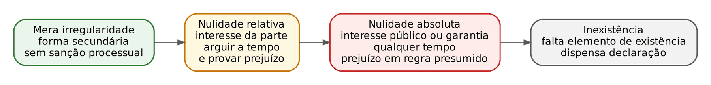
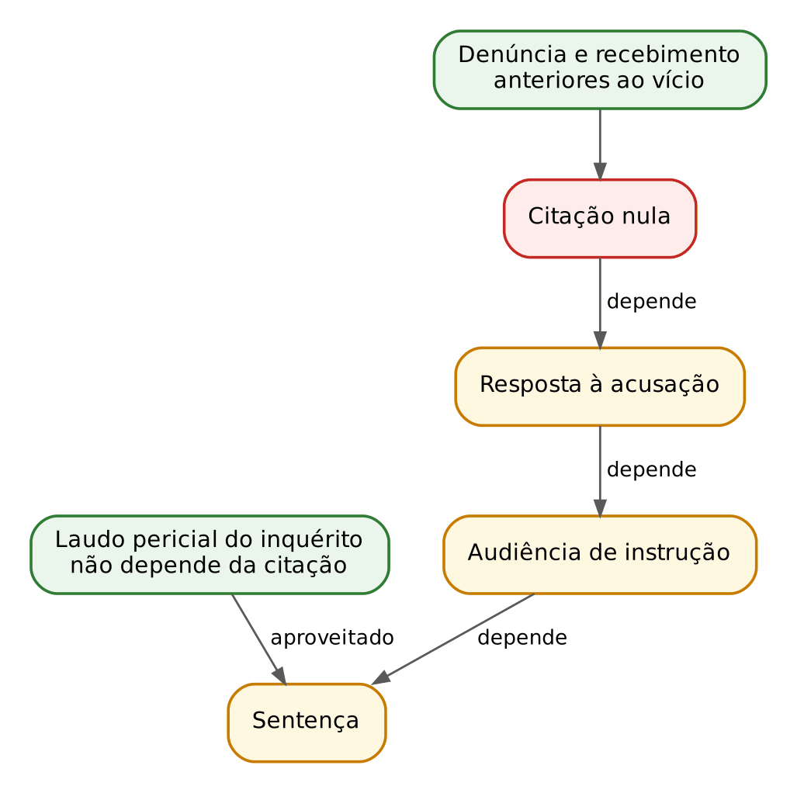
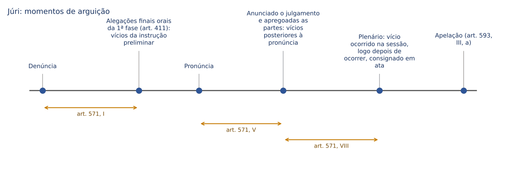
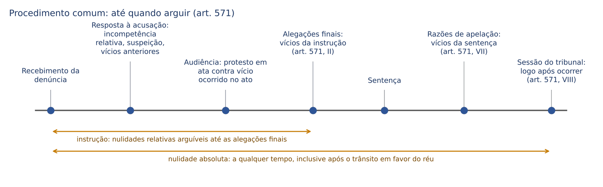
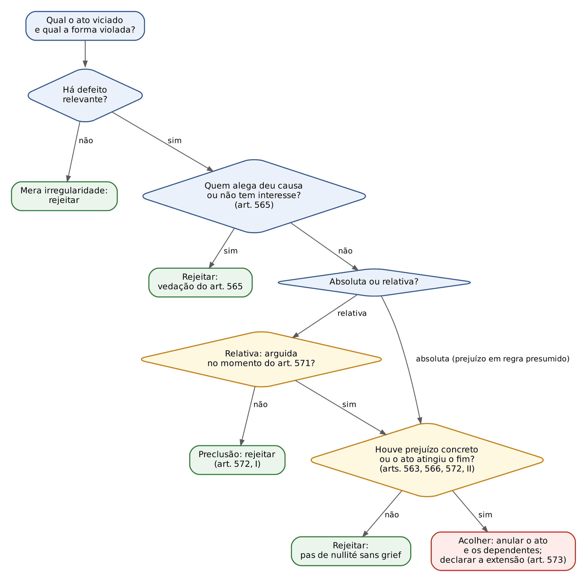

# CAPÍTULO 27 — NULIDADES

:::INCIDENCIA
TRF5 p. 13; TJRS p. 6; TJSC p. 16. Nível A+. Lote: 11 questões (FGV 9, FCC 2).
O que mais cai: casos práticos que pedem a ESPÉCIE do vício (absoluta x relativa), o MOMENTO de arguição e a exigência de PREJUÍZO; literalidade dos arts. 563 a 573; Súmula 523 do STF; inversão do interrogatório (Tema 1.114 do STJ).
:::

| Subtema | FGV | FCC | Padrão |
|---|---|---|---|
| Princípios (prejuízo, interesse, causa, sanação) | 2 | 1 | literalidade dos arts. 563, 565 e 568; caso de quem deu causa ao vício |
| Momento de arguição e prejuízo (inversão do interrogatório) | 2 | 0 | caso: arguição nas alegações finais, preclusão, Tema 1.114 |
| Falta x deficiência de defesa | 1 | 0 | Súmula 523 do STF em caso de advogado ausente |
| Incompetência e seus efeitos | 1 | 0 | art. 567: anula só os atos decisórios |
| Rol do art. 564 | 1 | 0 | "qual NÃO é nulidade": formalidade acessória |
| Fundamentação e documentação da sentença | 1 | 1 | sentença sem fundamentação no JECRIM; sentença oral sem degravação |
| Nulidade x credibilidade da prova | 1 | 0 | quebra da cadeia de custódia não é nulidade automática |

## 27.1 O que é nulidade e por que o processo penal se preocupa com a forma

### 27.1.1 A forma como garantia

No processo civil, o magistrado cível aprendeu a ver a forma com desconfiança: o CPC de 2015 manda aproveitar o ato sempre que possível (arts. 277, 282, § 2º, e 283), e a nulidade é quase sempre um problema de técnica. No processo penal a lógica de partida é outra. Aqui a forma é o modo pelo qual o Estado limita o próprio poder de punir: a citação garante que o réu saiba do que é acusado; a presença do defensor garante a defesa técnica; o interrogatório ao final garante que o réu fale depois de conhecer a prova; a fundamentação garante o controle da decisão. Por isso se diz que, no processo penal, "forma é garantia" (a expressão é corrente em Aury Lopes Jr. e em Geraldo Prado). Quando a forma prevista em lei é violada, o ato é atípico; a nulidade é a SANÇÃO que o ordenamento aplica ao ato atípico, retirando-lhe os efeitos.

Três ideias estruturam todo o tema e explicam quase todas as questões:

- a nulidade não é automática: o ato defeituoso produz efeitos até que um juiz DECLARE a nulidade (por isso se fala em "decretação" ou "pronúncia" da nulidade, art. 573, § 2º). Enquanto ninguém a declara, a sentença viciada vale, executa-se e pode até transitar em julgado;
- nem todo desvio de forma leva à nulidade: o CPP filtra o vício por princípios (prejuízo, interesse, lealdade, instrumentalidade, causalidade), que são o coração do capítulo (27.2);
- a gravidade do vício define o regime: quem pode alegar, até quando, se precisa provar prejuízo e se o vício se convalida (27.1.2).

:::ATENCAO Intuição civilista que leva ao erro
No cível, a nulidade é "cominada" ou não, e o juiz não decreta a nulidade se puder decidir o mérito a favor de quem ela aproveitaria (art. 282, § 2º, do CPC). Essa última ideia é aceita no processo penal por analogia (art. 3º do CPP) e é muito útil na sentença: se o réu será absolvido, não se anula o processo por vício que só a ele interessaria. Mas o contrário NÃO vale: a falta de defesa técnica, a falta de citação ou a decisão sem fundamentação não são "detalhes técnicos" que o juiz possa relevar invocando economia processual; atingem garantias constitucionais (contraditório, ampla defesa, motivação) e têm regime próprio.
:::

### 27.1.2 A escala dos atos defeituosos

A doutrina clássica (Ada Pellegrini Grinover, Antonio Scarance Fernandes e Antonio Magalhães Gomes Filho, em "As nulidades no processo penal") organiza os defeitos em uma escala de gravidade crescente. O CPP não usa as expressões "absoluta" e "relativa": a classificação é construção doutrinária e jurisprudencial, deduzida sobretudo dos arts. 564, 571 e 572.

| Aspecto | Mera irregularidade | Nulidade relativa | Nulidade absoluta | Inexistência |
|---|---|---|---|---|
| O que é | desvio de forma sem relevância para a finalidade do ato | violação de forma que protege interesse predominante da PARTE | violação de forma que protege interesse PÚBLICO ou garantia constitucional | falta de elemento mínimo para que o ato exista juridicamente ("não ato") |
| Exemplos | denúncia sem rol de testemunhas; termo sem data; atraso de prazo impróprio; sentença proferida fora do prazo | incompetência territorial e por prevenção (Súmula 706 do STF); falta de intimação da expedição de precatória (Súmula 155 do STF); inversão do interrogatório (Tema 1.114 do STJ); falta do MP à audiência (27.3.5) | incompetência absoluta; impedimento; falta de defesa (Súmula 523 do STF); falta de citação não suprida; decisão sem fundamentação; falta de quesito obrigatório no Júri (Súmula 156 do STF) | sentença proferida por quem não é juiz; sentença sem dispositivo; ato do juiz já aposentado |
| Quem pode alegar | ninguém extrai consequência processual | só a parte prejudicada e interessada (art. 565) | qualquer parte; juiz de ofício (salvo contra o réu em recurso dele, Súmula 160 do STF) | qualquer pessoa, a qualquer tempo |
| Momento | não há | momentos do art. 571, sob pena de preclusão (art. 572, I) | a qualquer tempo e grau de jurisdição; após o trânsito, só em favor do réu (HC ou revisão) | a qualquer tempo |
| Prejuízo | irrelevante | deve ser DEMONSTRADO por quem alega | tradicionalmente PRESUMIDO; hoje a jurisprudência exige, em regra, ao menos sua indicação (27.2.1) | irrelevante |
| Convalidação | não há o que convalidar | convalida-se pela preclusão, pelo alcance da finalidade ou pela aceitação dos efeitos (art. 572) | não se convalida (salvo pela coisa julgada favorável ao réu) | não se convalida nem transita em julgado |
| Precisa ser declarada? | não | sim | sim | não (basta ignorar o "ato"; por cautela, costuma-se reconhecê-la) |

:::DICA Como a banca diferencia absoluta e relativa
Pergunte: a forma violada protege uma GARANTIA CONSTITUCIONAL estrutural (juiz natural em critério absoluto, contraditório, ampla defesa, motivação, imparcialidade) ou uma CONVENIÊNCIA DA PARTE (foro territorial, comodidade na produção da prova, ordem dos atos)? A primeira resposta aponta para nulidade absoluta; a segunda, para relativa. Depois, confira se há súmula ou tese específica: muitas vezes a jurisprudência rebaixa para relativo um vício que a intuição diria absoluto (prevenção, inversão do interrogatório, ausência do MP intimado).
:::

### 27.1.3 A crítica doutrinária à dicotomia

Uma parte influente da doutrina (Aury Lopes Jr. é o expoente) critica a importação da dicotomia absoluta x relativa do processo civil e, sobretudo, o uso do princípio do prejuízo como "cláusula genérica" que permite ao tribunal salvar qualquer ato. Para essa corrente, quando a forma violada é uma garantia, o prejuízo é inerente à própria violação, e exigir do réu a prova de que teria sido absolvido sem o vício é exigir prova impossível (prova diabólica). A proposta é falar em atos defeituosos sanáveis e insanáveis, com o ônus de demonstrar a ausência de prejuízo atribuído a quem quer aproveitar o ato (o Estado). A posição é cobrada em provas de Defensoria e aparece em alternativas da FGV como "doutrina crítica"; nas provas de magistratura, a resposta esperada é a da jurisprudência (27.2.1), com menção à crítica quando a questão pede doutrina.

### 27.1.4 Inexistência, nulidade e coisa julgada

A distinção entre nulidade e inexistência tem uma consequência que a banca adora: o ato NULO transita em julgado e só pode ser desconstituído pelos meios próprios (recursos, HC, revisão criminal, esta só em favor do réu); o ato INEXISTENTE não transita, porque nada há para transitar. Daí dois desdobramentos:

- sentença absolutória proferida por juiz absolutamente incompetente é NULA, não inexistente; transitada em julgado, não pode ser desconstituída em prejuízo do réu, porque não existe revisão *pro societate* (posição consolidada no STF; ver o desenvolvimento de coisa julgada no Cap. 21);
- a decisão que extingue a punibilidade com base em certidão de óbito falsa pode ser revogada, segundo o STF, porque o fato que lhe dava suporte não existia; a explicação mais aceita é a de que não se forma coisa julgada material sobre fato inexistente (Cap. 21).

:::PEGADINHA Incompetência absoluta não é inexistência
Alternativa típica: "a sentença proferida por juiz absolutamente incompetente é inexistente e pode ser desconsiderada a qualquer tempo". Errado. É nula; enquanto não declarada, produz efeitos; e, se absolutória e transitada, protege o réu.
:::

## 27.2 Princípios das nulidades

### 27.2.1 Prejuízo: *pas de nullité sans grief* (arts. 563 e 566)

:::LEI CPP, arts. 563 e 566
Art. 563. Nenhum ato será declarado nulo, se da nulidade não resultar prejuízo para a acusação ou para a defesa.
Art. 566. Não será declarada a nulidade de ato processual que não houver influído na apuração da verdade substancial ou na decisão da causa.
:::

*Pas de nullité sans grief* (não há nulidade sem prejuízo) é a regra-matriz. Prejuízo, aqui, é a perda concreta de uma possibilidade processual que poderia ter influído no resultado: a testemunha que não pôde ser contraditada, a prova que não pôde ser rebatida, o argumento que não pôde ser apresentado. Note que o art. 563 protege acusação E defesa; e o art. 566 acrescenta o critério da influência: o vício que não afetou nem a apuração dos fatos nem a decisão é irrelevante.

O ponto mais cobrado é a relação entre prejuízo e espécie de nulidade:

- regra clássica: na nulidade relativa, o prejuízo deve ser DEMONSTRADO por quem alega; na absoluta, é PRESUMIDO;
- tendência atual do STF e do STJ: exigir a demonstração (ou ao menos a indicação concreta) do prejuízo também nas nulidades absolutas. O STJ afirma com frequência que o reconhecimento de nulidade, "relativa ou absoluta", reclama efetiva demonstração do prejuízo (por exemplo, AgRg no HC 738.493, Quinta Turma, j. 18/10/2022; AgRg no HC 711.657, Sexta Turma, j. 14/3/2023). Na prática, a "presunção" fica reservada a vícios que, por natureza, tornam impossível medir o prejuízo: falta total de defesa, falta de citação não suprida, juiz impedido, decisão sem motivação.

:::PASSO Como raciocinar sobre o prejuízo numa questão
1. Identifique a finalidade da forma violada (o que ela protegia).
2. Pergunte se essa finalidade foi atingida por outro modo (art. 572, II): se sim, não há prejuízo.
3. Pergunte se o ato viciado influiu na decisão (art. 566): se a condenação se apoiou em prova independente do ato viciado, não há prejuízo.
4. Só então classifique: relativa (quem alega demonstra) ou absoluta (prejuízo em regra presumido, mas a banca de 2024 a 2026 tende a cobrar a exigência de prejuízo também aqui).
:::

:::PEGADINHA "A condenação demonstra o prejuízo"
A FGV (MPE-ES 2025, Q3752769, alternativa D) testou a afirmação de que a simples condenação do réu basta para concluir pelo prejuízo. Errado: o prejuízo é a relação entre o VÍCIO e o resultado, não o resultado em si. Se fosse assim, todo vício seria relevante em toda condenação, e o art. 563 seria letra morta.
:::

:::EXEMPLO Prejuízo presente e ausente
A testemunha de acusação T foi ouvida por precatória sem intimação da defesa sobre a expedição (Súmula 155 do STF: nulidade relativa; a matéria das intimações está no Cap. 20). Caso 1: a sentença condena com base exclusiva no depoimento de T, e a defesa, nas alegações finais, aponta perguntas que faria sobre a distância em que T estava. Há prejuízo demonstrado: anula-se o depoimento e os atos dele dependentes. Caso 2: T apenas confirmou a apreensão já registrada em auto e em vídeo, e a sentença nem o menciona. Não há prejuízo: a nulidade não é declarada (arts. 563 e 566).
:::

### 27.2.2 Interesse e lealdade (art. 565)

:::LEI CPP, art. 565
Art. 565. Nenhuma das partes poderá argüir nulidade a que haja dado causa, ou para que tenha concorrido, ou referente a formalidade cuja observância só à parte contrária interesse.
:::

O artigo contém duas regras distintas, que a banca gosta de embaralhar com o princípio do prejuízo:

- vedação de arguir nulidade a que deu causa ou para a qual concorreu: expressão da boa-fé e da lealdade processual (ninguém se beneficia da própria torpeza). Exemplo: o defensor que, de propósito, deixa de arrolar a testemunha no prazo não pode depois alegar cerceamento por ela não ter sido ouvida;
- princípio do interesse: só pode arguir a nulidade a parte a quem a formalidade protege. O MP não pode alegar falta de intimação do réu para a audiência para anular uma absolvição; o réu não pode alegar que o assistente de acusação deixou de ser intimado.

A regra do interesse vale para as nulidades RELATIVAS. As absolutas, por atingirem interesse público, podem ser alegadas por qualquer parte e reconhecidas de ofício, com o limite da Súmula 160 do STF (27.5.2). A lealdade, porém, alcança até as absolutas na leitura atual da jurisprudência, por meio da vedação da "nulidade de algibeira" (adiante).

:::QUESTAO FCC 2026 — DPE-MT — Defensor Público (Q3954641)
Caso: promotor intimado falta, sem justificativa, à audiência; o juiz mantém o ato, colhe os depoimentos e absolve o réu; o MP apela só para anular o processo. Gabarito: B — negar o apelo e manter a absolvição, porque é inviável reconhecer nulidade arguida por quem lhe deu causa. Resolução: (1) pergunta-se se o MP pode obter a anulação; (2) regra: art. 565, primeira parte, e regime de nulidade relativa da ausência do MP intimado (art. 572, que inclui a alínea d do art. 564, III); (3) aplicação: o MP causou o vício ao faltar e não demonstra prejuízo. Armadilhas: (A) a nulidade por atuação inquisitorial do juiz é tese da DEFESA, construída para proteger o réu (27.3.5), e não pode ser usada pelo MP que se ausentou; (C) o tribunal não pode, em apelo que só pede anulação, condenar diretamente: além de exceder o pedido, suprimiria a instrução regular. Ver também o Tema 1.430 do STJ, ainda pendente (27.3.5).
:::

:::QUESTAO FGV 2024 — Câmara dos Deputados — Consultor Legislativo (Q2513071)
Três afirmativas; gabarito: D (só a I correta). I: a nulidade por ilegitimidade do REPRESENTANTE da parte pode ser sanada a todo tempo mediante ratificação (art. 568, literal). II: errada; vício de atribuição territorial do delegado no inquérito não invalida a ação penal (27.7). III: errada; a definição dada ("não há nulidade que favoreça a quem lhe deu causa") é a do art. 565 (lealdade), e não a do *pas de nullité sans grief*, que é o prejuízo. A armadilha é a troca de rótulos entre princípios.
:::

#### Nulidade de algibeira

"Algibeira" é bolso. Nulidade de algibeira (ou "de bolso") é a que a parte percebe, guarda em silêncio e só tira do bolso quando lhe convém, por exemplo depois da condenação ou do trânsito em julgado. O STJ não a tolera, com fundamento na boa-fé processual: no AgRg no HC 732.642 (Quinta Turma, j. 24/5/2022, Informativo 741), a defesa compareceu à oitiva da testemunha, nada alegou, não suscitou o vício no recurso e só o invocou em revisão criminal; a nulidade foi rejeitada. A tese tem sido aplicada inclusive a vícios classificados como absolutos, o que mostra o peso atual da lealdade processual.

:::ATENCAO Algibeira x nulidade absoluta não preclusiva
Não confunda. A nulidade absoluta pode ser alegada a qualquer tempo porque a parte pode NÃO TER PERCEBIDO o vício ou porque ele atinge garantia estrutural. A nulidade de algibeira pressupõe CIÊNCIA e SILÊNCIO ESTRATÉGICO. Na prova discursiva, se o enunciado narra que o defensor estava presente, viu o vício e nada disse, fundamente com a boa-fé objetiva (art. 565 e precedentes do STJ); se narra que a defesa não tinha como saber, a tese da algibeira não se aplica.
:::

### 27.2.3 Instrumentalidade das formas e convalidação (arts. 568 a 570 e 572)

A instrumentalidade das formas diz que a forma é meio, não fim: se o ato, praticado de outro modo, atingiu sua finalidade, não se anula (art. 572, II). É o mesmo raciocínio do art. 277 do CPC. Dela decorrem as hipóteses de convalidação, isto é, os modos pelos quais um ato defeituoso se torna definitivamente válido:

| Modo de convalidação | Dispositivo | Como funciona | Exemplo |
|---|---|---|---|
| Ratificação | art. 568 | o representante legítimo confirma os atos praticados por quem não tinha capacidade postulatória ou representação regular; "a todo tempo" | queixa ajuizada por advogado sem procuração com poderes especiais, depois ratificada pelo querelante (a ratificação depois da decadência é debatida; ver Cap. 6) |
| Suprimento | art. 569 | omissões da denúncia, queixa ou representação são supridas "a todo o tempo, antes da sentença final" | aditamento para incluir a qualificação completa do réu ou o rol de testemunhas |
| Comparecimento | art. 570 | a falta ou nulidade da citação, intimação ou notificação fica sanada se o interessado comparece antes de o ato consumar-se, ainda que só para arguir o vício; o juiz adia o ato se a irregularidade puder prejudicar a parte | réu não intimado comparece à audiência; o juiz, se houver prejuízo à preparação da defesa, redesigna |
| Preclusão | art. 572, I | a nulidade relativa não arguida no momento do art. 571 considera-se sanada | defesa não alega a incompetência territorial na resposta à acusação |
| Alcance da finalidade | art. 572, II | o ato, praticado por outra forma, atingiu o seu fim | citação irregular, mas o réu constitui advogado e se defende em todos os atos (STJ, AgRg no HC 823.208, j. 29/4/2024, Informativo 814; ver Cap. 20) |
| Aceitação dos efeitos | art. 572, III | a parte aceita, ainda que tacitamente, os efeitos do ato | defesa que, intimada irregularmente da perícia, apresenta quesitos e discute o laudo sem nada alegar |

:::LEI CPP, art. 572
Art. 572. As nulidades previstas no art. 564, III, d e e, segunda parte, g e h, e IV, considerar-se-ão sanadas:
I - se não forem argüidas, em tempo oportuno, de acordo com o disposto no artigo anterior;
II - se, praticado por outra forma, o ato tiver atingido o seu fim;
III - se a parte, ainda que tacitamente, tiver aceito os seus efeitos.
:::

O art. 572 é a base legal da distinção absoluta x relativa: as hipóteses nele listadas são as que a própria lei admite sanar (relativas); as demais hipóteses do art. 564 seriam, pela leitura a contrario, absolutas. São relativas por força do art. 572: falta de intervenção do MP nos termos da ação (art. 564, III, d); a "segunda parte" da alínea e (lida, em geral, como a falta de concessão dos prazos às partes; parte da doutrina inclui também o interrogatório); a falta de intimação do réu para o julgamento pelo Júri (alínea g) e das testemunhas (alínea h); e a omissão de formalidade essencial do ato (inciso IV).

:::PEGADINHA O art. 572 não é a palavra final
A jurisprudência corrige a leitura literal em dois sentidos. Rebaixa para relativos vícios que o art. 564 trataria como absolutos (incompetência territorial; deficiência de defesa, Súmula 523). E eleva para absolutos vícios que o art. 572 diz sanáveis: o STJ afirmou em 2026 que a falta de intimação do acusado para a sessão do Júri, mesmo por edital quando não encontrado, configura nulidade ABSOLUTA, não sujeita à preclusão, por violar a autodefesa, que não é suprida pela atuação do defensor (AgRg no REsp 2.248.978, Quinta Turma, j. 5/5/2026, Informativo de Jurisprudência n. 33, edição extraordinária). Em questão literal, use o art. 572; em questão de jurisprudência, use a tese.
:::

:::QUESTAO FGV 2026 — PC-PI — Oficial Investigador (Q3846841)
Pedia a INCORRETA sobre o regime do CPP. Gabarito: B — é falso que a nulidade por ilegitimidade do representante da parte possa ser sanada só "até o encerramento da instrução": o art. 568 diz "a todo tempo". As demais reproduzem os arts. 565 (A), 567 (C), 566 (D) e 563 (E). No mesmo sentido, testando a literalidade dos mesmos artigos: Q2513071 (afirmativa I) e Q3781276 (art. 567, 27.3.1).
:::

### 27.2.4 Causalidade ou consequencialidade (art. 573, §§ 1º e 2º)

:::LEI CPP, art. 573
Art. 573. Os atos, cuja nulidade não tiver sido sanada, na forma dos artigos anteriores, serão renovados ou retificados.
§ 1º A nulidade de um ato, uma vez declarada, causará a dos atos que dele diretamente dependam ou sejam conseqüência.
§ 2º O juiz que pronunciar a nulidade declarará os atos a que ela se estende.
:::

O processo é uma cadeia de atos, cada um apoiado nos anteriores. Anulado um elo, caem os que dele DEPENDEM (nulidade derivada ou consequencial); os que vieram antes e os que, embora posteriores, são independentes, permanecem. Por isso o § 2º obriga o juiz a dizer expressamente até onde vai a nulidade: decisão que só "anula o processo" sem delimitar a extensão é defeituosa e gera insegurança sobre prescrição, prisão e prova.

A causalidade das nulidades é a versão processual da teoria dos frutos da árvore envenenada (art. 157, § 1º, do CPP), mas as duas não se confundem: esta trata de provas obtidas com violação de normas materiais (ilicitude), aquela, de atos processuais praticados com violação de normas processuais (ver 27.8 e Cap. 14).

### 27.2.5 Tipicidade das formas e rol do art. 564

O art. 564 é um rol EXEMPLIFICATIVO. A cláusula aberta do inciso IV (omissão de formalidade que constitua elemento essencial do ato) permite reconhecer nulidades não listadas, e a Constituição gera nulidades diretamente (art. 93, IX: decisões sem fundamentação são nulas; art. 5º, LVI: provas ilícitas são inadmissíveis). Daí a distinção doutrinária entre nulidades cominadas (expressamente previstas em lei) e não cominadas (deduzidas da violação de forma essencial ou de garantia). No processo penal, a ausência de cominação não impede a nulidade; o que se exige é a relevância da forma violada e o prejuízo.

:::NOTA Lei 15.358/2026: forças-tarefa e "imunidade" a nulidades
O art. 6º da Lei 15.358/2026 (Marco Legal do Combate ao Crime Organizado) autoriza forças-tarefa integradas entre órgãos de investigação, persecução e inteligência, formalizadas por termo de cooperação, e o seu § 5º dispõe que o eventual descumprimento do artigo "não gera nulidade" na obtenção dos elementos de informação e das provas. A regra alcança só as formalidades do próprio art. 6º (termo de cooperação, sigilo, chefia operacional); não afasta a reserva de jurisdição, a ilicitude probatória (art. 5º, LVI, da CF) nem as regras gerais dos arts. 563 a 573. Parte da doutrina questiona sua compatibilidade com o sistema de nulidades. Para o regime geral da lei, ver Cap. 26.
:::

## 27.3 O rol do art. 564 comentado

O art. 564 é o mapa das nulidades cominadas. Boa parte do texto é de 1941 e convive com procedimentos que já não existem (libelo, contrariedade ao libelo, processo de contravenção iniciado por portaria), o que obriga a lê-lo com as reformas de 2008 e de 2019. O quadro abaixo dá, para cada hipótese, a espécie que prevalece hoje; os comentários vêm em seguida, só no que é cobrável.

| Dispositivo | Hipótese | Espécie que prevalece | Observação |
|---|---|---|---|
| I | incompetência do juiz | absoluta (matéria, pessoa, funcional) ou relativa (território, prevenção) | art. 567: anula só os atos decisórios; ver Cap. 9 |
| I | suspeição | relativa (preclui se não arguida); impedimento: absoluta | ver Caps. 12 e 13 |
| I | suborno do juiz | absoluta | atinge a própria imparcialidade; após o trânsito, revisão criminal |
| II | ilegitimidade de parte | *ad causam*: absoluta; do representante (*ad processum*): sanável a todo tempo (art. 568) | ver Cap. 6 |
| III, a | falta de denúncia, queixa ou representação | absoluta, se faltar a peça; omissões supríveis até a sentença (art. 569) | portaria e auto de flagrante como peças iniciais de contravenção não foram recepcionados (art. 129, I, da CF) |
| III, b | falta de exame de corpo de delito nos crimes que deixam vestígios | absoluta, ressalvado o art. 167 (prova testemunhal supletiva quando os vestígios desapareceram) | ver Cap. 14 (14.11) |
| III, c | falta de defensor ao réu; curador ao acusado com menos de 21 anos | falta de defesa: absoluta; deficiência: relativa (Súmula 523 do STF) | curador perdeu objeto com o CC/2002 (ver Cap. 12) |
| III, d | falta de intervenção do MP nos termos da ação | relativa (art. 572) | Tema 1.430 do STJ pendente (27.3.5) |
| III, e | falta de citação, interrogatório do réu presente, prazos às partes | citação: absoluta, salvo comparecimento (art. 570); prazos: relativa (art. 572) | ver Cap. 20 |
| III, f | pronúncia, libelo e entrega da cópia (Júri) | falta de pronúncia: absoluta | libelo extinto pela Lei 11.689/2008 |
| III, g | intimação do réu para a sessão do Júri | relativa pelo texto (art. 572); absoluta para o STJ (2026) | 27.2.3 |
| III, h | intimação das testemunhas do libelo e da contrariedade | relativa (art. 572) | leia-se hoje: testemunhas arroladas para o plenário (art. 422) |
| III, i | presença de pelo menos 15 jurados | absoluta | art. 463; ver Cap. 23 |
| III, j | sorteio dos jurados em número legal e incomunicabilidade | absoluta | Informativo 895 do STJ: efeitos podem ser restringidos (27.6) |
| III, k | falta de quesitos e respostas | absoluta (Súmula 156 do STF) | ver Cap. 23 |
| III, l | falta de acusação e defesa na sessão do Júri | absoluta | réu indefeso: dissolução do Conselho (art. 497, V) |
| III, m | falta de sentença | absoluta (ou inexistência, se faltar elemento mínimo) | |
| III, n | falta de recurso de ofício quando a lei o exige | a decisão não transita em julgado | Súmula 423 do STF (v. Cap. 28) |
| III, o | falta de intimação para ciência de sentenças e despachos recorríveis | prazo não corre; nulidade dos atos posteriores | ver Cap. 20 |
| III, p | falta de quórum legal no julgamento do tribunal | absoluta | |
| IV | omissão de formalidade que constitua elemento ESSENCIAL do ato | relativa (art. 572) | formalidade ACESSÓRIA não gera nulidade |
| V | decisão carente de fundamentação (Lei 13.964/2019) | absoluta | art. 93, IX, da CF; art. 315, § 2º |
| Parágrafo único | deficiência dos quesitos ou das respostas, e contradição entre estas | absoluta, se a deficiência impede conhecer a vontade dos jurados | Súmula 162 do STF; ver Cap. 23 |

### 27.3.1 Incompetência, suspeição e suborno (inciso I)

O regime da incompetência (absoluta x relativa, ratificação de atos, juízo aparente, recurso cabível) foi desenvolvido no Cap. 9 (09.2.2 a 09.2.4). Para este capítulo basta a regra literal que a banca cobra: a incompetência anula SOMENTE os atos decisórios, e o processo é remetido ao juiz competente (art. 567); os atos instrutórios (oitiva de testemunhas, perícias) são aproveitados, salvo prejuízo demonstrado. A Súmula 706 do STF (nulidade relativa por inobservância da prevenção) também é do Cap. 9.

:::QUESTAO FGV 2025 — CGE-SP — Auditor (Q3781276)
Caso: durante a instrução por peculato surgem dúvidas sobre a competência do juízo. A incompetência anulará: gabarito A, somente os atos decisórios (art. 567). As alternativas sedutoras fixam um marco temporal (desde o recebimento, desde o oferecimento, desde a resposta), raciocínio que o art. 567 não adota: o critério é a NATUREZA do ato (decisório x instrutório), não a data. Para a ratificação do recebimento da denúncia pelo juízo competente e seus reflexos na prescrição, ver 09.2.3.
:::

Suspeição e impedimento têm regimes distintos: a suspeição (art. 254) é presumidamente relativa e preclui se não arguida na primeira oportunidade; o impedimento (art. 252) gera nulidade absoluta, e parte da doutrina fala até em inexistência do ato, porque o juiz impedido "não poderá exercer jurisdição" (Caps. 12 e 13). O suborno do juiz (corrupção) é o vício mais grave do inciso: além de nulidade absoluta, permite revisão criminal se descoberto após o trânsito.

### 27.3.2 Ilegitimidade de parte (inciso II)

Ilegitimidade *ad causam* é a de quem não é titular da ação: o MP que denuncia em crime de ação privada, o ofendido que oferece queixa em crime de ação pública fora da hipótese subsidiária. Gera rejeição da inicial (art. 395, II) ou, se percebida depois, nulidade absoluta, insanável (ver Cap. 6). Ilegitimidade *ad processum* é defeito de representação: queixa assinada por advogado sem procuração com poderes especiais (art. 44), representante legal irregular. Esta é sanável "a todo tempo" pela ratificação (art. 568), com o debate sobre a ratificação depois do prazo decadencial tratado no Cap. 6.

### 27.3.3 Peça acusatória e corpo de delito (inciso III, a e b)

Sem denúncia, queixa ou representação (quando exigida), não há processo válido: falta o próprio ato que provoca a jurisdição (*ne procedat iudex ex officio*). As omissões da peça, ao contrário, podem ser supridas a todo tempo antes da sentença (art. 569), por aditamento (Cap. 6). A inépcia não sanada é nulidade absoluta, mas a jurisprudência entende que a superveniência da sentença condenatória torna preclusa a alegação de inépcia quando a defesa, durante todo o processo, se defendeu plenamente dos fatos narrados (a tese é desenvolvida no Cap. 6, 06.4.4).

A falta do exame de corpo de delito nos crimes que deixam vestígios é nulidade (art. 158), salvo quando os vestígios desapareceram e a prova testemunhal supre a falta (art. 167). A confissão não supre o exame (art. 158). Detalhes, Súmula 361 do STF e perícias em geral: Cap. 14.

### 27.3.4 Defesa técnica (inciso III, c) e a Súmula 523 do STF

:::JURIS STF, Súmula 523
"No processo penal, a falta da defesa constitui nulidade absoluta, mas a sua deficiência só o anulará se houver prova de prejuízo para o réu."
:::

A súmula organiza toda a matéria em dois degraus:

- FALTA de defesa: o réu ficou sem defensor em ato essencial (audiência sem advogado, alegações finais não apresentadas e não supridas, resposta à acusação ausente sem nomeação de defensor dativo). Nulidade absoluta, com prejuízo presumido: o processo penal não admite réu indefeso (arts. 261 e 263; ver Cap. 1);
- DEFICIÊNCIA de defesa: houve defensor, mas atuou mal (alegações finais genéricas, não arrolou testemunhas, não recorreu de ponto relevante). Nulidade relativa: só anula com PROVA de prejuízo, isto é, demonstração de que a atuação deficiente comprometeu concretamente o resultado.

Há uma zona cinzenta que a jurisprudência trata como FALTA, e não como deficiência: a defesa meramente formal, que equivale a nenhuma defesa (por exemplo, alegações finais de três linhas que pedem "justiça" sem enfrentar a prova, ou defensor que concorda com a condenação pedida pelo MP). Nessas hipóteses, o STJ e o STF já reconheceram nulidade por ausência material de defesa; a qualificação depende do caso, e a prova costuma narrá-lo com clareza.

:::QUESTAO FGV 2026 — TJ-SC — Oficial de Justiça (Q4153629)
Caso: advogado constituído intimado falta sem justificativa à audiência; o juiz, invocando a duração razoável, ouve as testemunhas de acusação sem defensor; o réu é condenado. Gabarito: C — a falta de defesa na audiência é nulidade absoluta; a deficiência só anula com prova de prejuízo (Súmula 523). Resolução: (1) pergunta-se se houve FALTA ou DEFICIÊNCIA; (2) regra: arts. 261 e 265 do CPP e Súmula 523; (3) aplicação: nenhum defensor atuou no ato, logo FALTA. O que o juiz deveria ter feito: adiar o ato ou nomear defensor *ad hoc* para aquela audiência (art. 265, § 2º), e comunicar a falta do advogado à OAB, se for o caso. Armadilhas: (A) a ausência do advogado não equivale a "renúncia" do réu ao contraditório; (E) não existe "ratificação" posterior dos depoimentos por advogado que não participou do ato; (D) celeridade não se sobrepõe à defesa técnica.
:::

Súmulas correlatas, com remissão ao capítulo dono: Súmula 708 do STF (renúncia do único defensor sem intimação do réu para constituir outro antes do julgamento da apelação: nulidade; Cap. 12) e Súmula 707 do STF (falta de intimação do denunciado para contrarrazões ao recurso contra a rejeição da denúncia: nulidade não suprida pela nomeação de dativo; Cap. 6). Do STJ, a Súmula 644 exige que o núcleo de prática jurídica CONSTITUÍDO pelo réu hipossuficiente apresente procuração, salvo quando nomeado pelo juízo; a ausência do instrumento é defeito de representação, sanável.

Quanto ao curador ao acusado com menos de 21 anos (art. 564, III, c, parte final), a regra perdeu o objeto com a maioridade civil aos 18 anos (CC/2002); antes disso, a Súmula 352 do STF já dizia não ser nulo o processo por falta de curador quando o réu teve assistência de defensor dativo. O curador sobrevive para o acusado inimputável ou com doença mental (Caps. 12 e 13).

### 27.3.5 Intervenção do Ministério Público (inciso III, d)

O inciso exige a intervenção do MP em todos os termos da ação por ele intentada e nos da ação privada subsidiária. É hipótese expressamente sanável (art. 572), portanto relativa. A jurisprudência majoritária do STJ sempre tratou a ausência do promotor regularmente intimado à audiência como nulidade relativa, que depende de arguição tempestiva e prova de prejuízo (por exemplo, REsp 1.493.227, Sexta Turma, j. 13/9/2016).

O problema ganhou outra dimensão com o sistema acusatório (art. 3º-A do CPP, ver Cap. 1): se o promotor falta e o JUIZ assume a inquirição das testemunhas de acusação, ele substitui o órgão acusador na produção da prova. A Sexta Turma do STJ anulou processos nessas condições, quando a defesa protestou e houve prejuízo (HC 708.007, j. 18/4/2023; REsp 1.846.407, j. 13/12/2022), e em 2025 reafirmou a tese para o juiz protagonista da inquirição e do interrogatório (REsp 2.214.638 — v. Cap. 15). A Terceira Seção afetou a controvérsia ao rito dos repetitivos (Tema 1.430: "se constitui nulidade, em violação ao sistema acusatório, a realização de audiência criminal de instrução e julgamento sem a presença do membro do Ministério Público, apesar de haver sido devidamente intimado"; afetação em 14/4/2026, Informativo 887), ainda sem julgamento.

:::DICA Como responder enquanto o Tema 1.430 não é julgado
Separe duas perguntas. (1) A mera AUSÊNCIA do promotor intimado gera nulidade? Pela jurisprudência tradicional, não: é relativa e exige prejuízo. (2) O juiz pode SUBSTITUIR o promotor e conduzir a inquirição como acusador? Não: a postura inquisitorial gera nulidade, alegável pela DEFESA. E nunca pelo MP faltoso, que deu causa ao vício (art. 565; Q3954641, em 27.2.2). Na prática, faltando o promotor, o juiz prudente adia o ato ou, se o realiza, limita-se a franquear a palavra à defesa e a fazer perguntas complementares (art. 212, parágrafo único).
:::

### 27.3.6 Citação, interrogatório e prazos (inciso III, e)

A falta de citação é nulidade absoluta, mas sanável pelo comparecimento espontâneo (art. 570) e superável quando o réu, mesmo sem citação pessoal regular, constituiu advogado e se defendeu em todos os atos (STJ, AgRg no HC 823.208, j. 29/4/2024, Informativo 814). As formas de citação e o art. 366 estão no Cap. 20.

:::JURIS STF, Súmula 366
"Não é nula a citação por edital que indica o dispositivo da lei penal, embora não transcreva a denúncia ou queixa, ou não resuma os fatos em que se baseia."
:::

A lógica da súmula: o edital só precisa dar ciência da existência da acusação e chamar o réu ao processo; o conteúdo da imputação ele conhecerá ao comparecer, quando receberá cópia da inicial e terá o prazo de resposta (art. 396, parágrafo único). Pegadinha recorrente: alternativa dizendo que o edital "deve transcrever a denúncia, sob pena de nulidade absoluta".

A falta de interrogatório do réu presente é nulidade (o interrogatório é meio de defesa, ver Cap. 15). Sua realização fora da ordem legal, antes da oitiva das testemunhas, é tema do Tema 1.114 do STJ, analisado em 27.4.2 sob o ângulo da arguição e do prejuízo. A supressão de prazo concedido por lei às partes (para resposta, alegações finais, razões de recurso) é nulidade relativa (art. 572), que depende de prejuízo.

### 27.3.7 Nulidades do Júri (inciso III, f a l, e parágrafo único)

As nulidades do procedimento do Júri são estudadas no Cap. 23, que é dono das Súmulas 156 (falta de quesito obrigatório: nulidade absoluta), 162 (quesitos da defesa depois dos das agravantes: nulidade absoluta), 206 (jurado que funcionou em julgamento anterior do mesmo processo: nulidade) e 712 do STF (desaforamento sem audiência da defesa: nulidade), bem como das referências indevidas em plenário (art. 478). Aqui ficam só as linhas que conversam com a teoria geral:

- a regra de arguição é a do art. 571, V e VIII: vícios posteriores à pronúncia, logo depois de anunciado o julgamento e apregoadas as partes; vícios ocorridos em plenário, logo depois de ocorrerem, com registro em ata, sob pena de preclusão (figura em 27.4);
- a soberania dos veredictos não impede a anulação do julgamento por vício processual; anulado, o réu vai a NOVO Júri (o tribunal não substitui os jurados);
- exemplos recentes do STJ que ilustram a aplicação do prejuízo no plenário: o uso prolongado de celular por jurado durante os debates compromete a imparcialidade e anula o julgamento (AgRg no AREsp 2.704.728, Quinta Turma, j. 20/5/2025, Informativo 853); a disponibilização tardia de depoimentos essenciais à defesa também anula o julgamento (REsp 2.050.711 — v. Cap. 23).

### 27.3.8 Sentença, recurso de ofício, intimações e quórum (inciso III, m a p)

A falta de sentença é hipótese quase teórica; na prática, o que se discute é a sentença sem um dos requisitos do art. 381 (ver Cap. 21) e, sobretudo, sem fundamentação (27.3.10). A falta de reexame necessário ("recurso de ofício") não gera propriamente nulidade, porque a decisão não transita em julgado enquanto não reexaminada (Súmula 423 do STF — v. Cap. 28).

A falta de intimação para ciência de decisão recorrível (alínea o) impede o início do prazo recursal e contamina o que vier depois. No tribunal, o vício mais cobrado está na súmula seguinte:

:::JURIS STF, Súmula 431
"É nulo o julgamento de recurso criminal, na segunda instância, sem prévia intimação, ou publicação da pauta, salvo em habeas corpus."
:::

A pauta publicada é o que permite ao advogado comparecer e sustentar oralmente; julgar sem ela suprime essa possibilidade. A ressalva do HC se explica pela urgência: o *habeas corpus* é levado a julgamento independentemente de pauta. A jurisprudência, contudo, reconhece nulidade quando o impetrante requereu EXPRESSAMENTE ser intimado da sessão para sustentar oralmente e o pedido foi ignorado. Sobre julgamento virtual: a realização do julgamento em sessão virtual, mesmo com oposição da parte, não é por si só causa de nulidade (STJ, AgRg no HC 832.679, j. 15/4/2024, Informativo 818), desde que assegurado o direito de sustentação nos termos regimentais.

### 27.3.9 Omissão de formalidade essencial (inciso IV)

É a cláusula geral do art. 564: qualquer formalidade ESSENCIAL ao ato, ainda que não listada, pode gerar nulidade, que o art. 572 qualifica como relativa (sanável). Essencial é a formalidade sem a qual o ato não cumpre a sua finalidade; acidental ou acessória é a que pode faltar sem comprometer o fim do ato, e sua falta é mera irregularidade.

:::QUESTAO FGV 2025 — CGE-SP — Auditor (Q3781283)
Pedia a hipótese que NÃO é caso de nulidade. Gabarito: E — omissão de formalidade que constitua elemento ACIDENTAL ou ACESSÓRIO do ato. O art. 564, IV, fala em formalidade "essencial"; as demais alternativas reproduzem os incisos II, V, III, i, e o parágrafo único. A troca de "essencial" por "acessório" é a pegadinha clássica de literalidade.
:::

### 27.3.10 Decisão carente de fundamentação (inciso V)

O inciso V foi incluído pela Lei 13.964/2019 e explicita no CPP o que já decorria do art. 93, IX, da CF: decisão sem fundamentação é nula. O conteúdo do que é "carente de fundamentação" vem do art. 315, § 2º, que reproduz o art. 489, § 1º, do CPC e se aplica a qualquer decisão (interlocutória, sentença ou acórdão), embora esteja no capítulo da prisão preventiva. Não se considera fundamentada a decisão que: (I) se limita a indicar, reproduzir ou parafrasear ato normativo, sem explicar sua relação com o caso; (II) emprega conceitos jurídicos indeterminados sem explicar o motivo concreto de sua incidência; (III) invoca motivos que se prestariam a justificar qualquer outra decisão; (IV) não enfrenta todos os argumentos deduzidos no processo capazes de, em tese, infirmar a conclusão adotada; (V) se limita a invocar precedente ou enunciado de súmula sem identificar seus fundamentos determinantes nem demonstrar que o caso se ajusta a eles; (VI) deixa de seguir súmula, jurisprudência ou precedente invocado pela parte sem demonstrar distinção ou superação.

Dois desdobramentos cobrados:

- fundamentação *per relationem* (por remissão a outra peça, como o parecer do MP ou a decisão de primeiro grau): o STF e o STJ a admitem, desde que a peça adotada contenha motivação suficiente e a decisão não deixe sem resposta tese relevante da parte. Adotar as alegações finais da acusação SEM enfrentar a tese defensiva viola o art. 315, § 2º, IV;
- a nulidade por falta de fundamentação é absoluta e pode ser reconhecida de ofício em favor do réu; em recurso exclusivo da acusação, porém, não se reconhece nulidade contra o réu que o MP não arguiu (Súmula 160; 27.5.2).

:::QUESTAO FGV 2025 — TJ-SC — Juiz Substituto (Q3324276)
Caso: sentença condenatória do JECrim (ameaça e dano) sem relatório, com motivação que apenas adota as alegações finais do MP sem considerar os argumentos defensivos, e sem fixar valor mínimo de reparação por falta de pedido. Gabarito: E — nula por falta de fundamentação; a dispensa do relatório é válida. Resolução: (1) relatório: no JECrim, o art. 81, § 3º, da Lei 9.099/1995 o dispensa; (2) fundamentação: a remissão às alegações finais do MP sem enfrentar a defesa viola o art. 93, IX, da CF e o art. 315, § 2º, IV, do CPP (art. 564, V); (3) reparação: sem pedido expresso e contraditório, o juiz NÃO deve fixar o valor mínimo (ver Cap. 7), logo sua ausência não é vício. Armadilhas: (A) inclui a falta de relatório como causa de nulidade; (B) e (D) validam a motivação que ignora a defesa; (C) inverte a regra da reparação.
:::

:::QUESTAO FCC 2025 — DPE-AM — Defensor Público (Q3531596)
Caso: após os debates, a juíza profere sentença oral, gravada, e faz constar em ata apenas o dispositivo e a dosimetria. Gabarito: E — agiu corretamente, porque a falta de degravação integral não prejudica o contraditório nem a segurança do registro, do mesmo modo que ocorre com a prova oral. Fundamento: art. 405, §§ 1º e 2º, do CPP (registro audiovisual sem transcrição) e STJ, REsp 2.009.368 (Quinta Turma, j. 11/2/2025, Informativo 841): é válida a sentença oral registrada em meio audiovisual sem transcrição integral. Armadilhas: (B) o art. 388 não exige transcrição; (C) e (D) inventam prazos de 20 e 15 dias para transcrever. No mesmo espírito de instrumentalidade: decisão em processo eletrônico sem o nome do magistrado no corpo não é nula, porque a assinatura digital basta para a autenticidade (STJ, AgRg no RHC 177.305, Sexta Turma, j. 5/3/2025, Informativo 844).
:::

:::SENTENCA Fundamentação que resiste à preliminar
Onde entra: em toda a sentença, mas a banca da prova prática pune especialmente (a) a rejeição genérica de teses defensivas e (b) a dosimetria com fórmulas vazias. O que fazer: enfrentar uma a uma as teses da defesa capazes de alterar o resultado, ainda que para rejeitá-las em uma frase com o motivo concreto. Redação-modelo: "Afasto a tese de legítima defesa: a própria versão do acusado no interrogatório situa a agressão depois de a vítima ter deixado o local, o que exclui a atualidade da agressão (art. 25 do CP)." Erro comum: "rejeito as teses defensivas, pois isoladas do conjunto probatório", sem dizer qual prova as contradiz (art. 315, § 2º, III e IV).
:::

## 27.4 Momento de arguição e preclusão (art. 571)

### 27.4.1 A regra e a sua tradução para os procedimentos atuais

O art. 571 diz ATÉ QUANDO cada nulidade relativa deve ser arguida; passado o momento, ela se considera sanada (art. 572, I). As nulidades absolutas não se sujeitam a esses prazos: podem ser alegadas a qualquer tempo, inclusive em HC e, após o trânsito, em revisão criminal, sempre em favor do réu (contra ele, a coisa julgada absolutória prevalece; 27.1.4). O problema é que o artigo remete a dispositivos renumerados ou revogados pelas reformas de 2008. A tabela faz a tradução:

| Inciso | Texto (em síntese) | Leitura atual |
|---|---|---|
| I | instrução dos processos do Júri: nos prazos do art. 406 | vícios anteriores à resposta: na resposta à acusação (art. 406, atual); vícios da instrução preliminar: até as alegações finais da primeira fase (art. 411, § 4º) |
| II | instrução dos processos do juiz singular e dos especiais: nos prazos do art. 500 | o antigo art. 500 era o das alegações finais; hoje, alegações finais orais ou memoriais (arts. 403 e 404, parágrafo único) |
| III | processo sumário: no prazo do art. 537 ou logo depois de aberta a audiência | rito sumário atual (arts. 531 a 538): até os debates orais da audiência |
| IV | processo do Capítulo VII do Título II do Livro II: logo depois de aberta a audiência | procedimento de medida de segurança por fato não criminoso, sem aplicação prática |
| V | ocorridas após a pronúncia: logo depois de anunciado o julgamento e apregoadas as partes | na abertura da sessão do Júri, antes do sorteio do Conselho |
| VI | instrução dos processos de competência originária dos tribunais: nos prazos do art. 500 | alegações finais da Lei 8.038/1990 (art. 11) |
| VII | verificadas após a decisão de primeira instância: nas razões de recurso ou logo depois de anunciado o julgamento do recurso | razões de apelação ou do RESE; ou na sessão, apregoadas as partes |
| VIII | do julgamento em plenário, em audiência ou em sessão do tribunal: logo depois de ocorrerem | protesto imediato, consignado em ata |

:::ATENCAO Inciso II x inciso VIII: o vício ocorrido dentro da audiência
Há tensão entre os dois incisos quando o vício nasce DENTRO da audiência de instrução (inversão de atos, indeferimento de pergunta, ausência do promotor). Pelo inciso VIII, a parte deveria protestar logo, em ata. Pelo inciso II, as nulidades "da instrução criminal" podem ser arguidas até as alegações finais. Para a inversão do interrogatório, o STJ resolveu a tensão a favor do inciso II (Tema 1.114, 27.4.2). Para o vício que exige reação imediata para ser corrigido (pergunta indeferida, testemunha ouvida sem a presença do réu), a prática recomenda protesto em ata, e a jurisprudência pune o silêncio estratégico como nulidade de algibeira (27.2.2).
:::

### 27.4.2 Inversão do interrogatório: Tema 1.114 do STJ (o ângulo das nulidades)

A regra de procedimento (o interrogatório é o último ato da instrução, art. 400; a carta precatória permite inverter a ordem das TESTEMUNHAS, mas não antecipar o interrogatório, art. 222, § 1º) é estudada no Cap. 22. O que interessa aqui é o regime do vício quando a ordem é desrespeitada.

A tese do Tema 1.114 do STJ (REsps 1.933.759 e 1.946.472, Terceira Seção, j. 13/9/2023) está transcrita no Cap. 15. Lida pelo ângulo das nulidades, em três passos: (1) a inversão é VÍCIO, nulidade RELATIVA; (2) sujeita-se à preclusão do art. 571, I e II, de modo que, no procedimento do juiz singular, a alegação nas ALEGAÇÕES FINAIS é tempestiva (o STJ não exigiu protesto na própria audiência); (3) além de tempestiva, exige DEMONSTRAÇÃO CONCRETA de prejuízo: não basta dizer que a ordem foi violada; é preciso mostrar o que o réu teria dito, ou deixado de dizer, se tivesse conhecido antes a prova deprecada, e como isso influiria na decisão. Um remédio simples evita a nulidade: se o depoimento deprecado chega depois do interrogatório e é relevante, o juiz renova o interrogatório antes de encerrar a instrução (STJ, HC 585.942, Terceira Seção, j. 9/12/2020).

:::QUESTAO FGV 2026 — TJ-PR — Juiz Substituto (Q3898936)
Caso: lavagem de dinheiro; precatória para testemunha crucial de acusação; antes do retorno, o juiz ouve as demais e interroga o réu; a defesa, presente, nada diz na audiência e, nas alegações finais, argui a nulidade. Gabarito: E — a nulidade foi arguida em momento oportuno, mas o acolhimento depende da demonstração do prejuízo concreto. Resolução: (1) o art. 222, § 1º, não autoriza antecipar o interrogatório; há vício; (2) Tema 1.114: relativo, preclusão pelo art. 571, II (alegações finais), e prejuízo demonstrado; (3) a arguição foi tempestiva; falta saber se houve prejuízo. Armadilhas: (A) nulidade absoluta com prejuízo presumido; (B) "tese vinculante" exigindo arguição na audiência (o Tema 1.114 fala em art. 571, I e II, não em VIII); (C) prevalência do art. 222, § 1º, sobre o art. 400 (vale para testemunhas, não para o interrogatório); (D) diz que a arguição foi intempestiva.
:::

:::QUESTAO FGV 2026 — DPE-RJ — Defensor Público (Q4289366)
Caso semelhante, sem precatória: o juiz, por economia de tempo, interroga o réu antes de ouvir todas as testemunhas; o defensor acompanha sem protestar em ata e argui a nulidade só nos memoriais. Gabarito oficial: E — nulidade relativa, preclusa porque não arguida na própria audiência, e sem prejuízo demonstrado. A alternativa C dizia que a arguição nos memoriais foi tempestiva, mas a nulidade dependeria de prejuízo concreto. Comentário: o gabarito oficial é DISCUTÍVEL à luz do Tema 1.114, que remete ao art. 571, I e II, e considera tempestiva a alegação nas alegações finais (exatamente o que a própria FGV adotou no TJ-PR, Q3898936). O gabarito da DPE-RJ se apoia na leitura do art. 571, VIII (vício ocorrido em audiência, arguível "logo depois de ocorrer") e na vedação da nulidade de algibeira. Para a prova de magistratura: siga o Tema 1.114 (tempestiva nas alegações finais + prejuízo concreto); se a alternativa "preclusa por falta de protesto em ata" aparecer sozinha como compatível com o enunciado, verifique se o caso narra silêncio ESTRATÉGICO do defensor que poderia ter evitado o vício. Em qualquer leitura, as alternativas A (absoluta, prejuízo presumido), B (prova ilícita) e D (discricionariedade do juiz) estão erradas.
:::

## 27.5 Quem declara a nulidade e por qual via

### 27.5.1 Reconhecimento de ofício

O juiz pode e deve reconhecer DE OFÍCIO a nulidade absoluta, em qualquer fase (é o que decorre do interesse público que ela protege), e deve sanar ou renovar o ato quando possível (art. 573, caput). A nulidade relativa, em regra, depende de provocação da parte interessada; nada impede, porém, que o juiz, percebendo o vício ainda no curso da instrução, mande repetir o ato para evitar discussão futura (por exemplo, renovar o interrogatório depois do retorno da precatória). O que o juiz não pode fazer é usar a nulidade como atalho para corrigir uma acusação mal formulada: anular de ofício para dar ao MP uma segunda chance de produzir prova afronta o art. 3º-A do CPP.

### 27.5.2 Em recurso: a Súmula 160 do STF

:::JURIS STF, Súmula 160
"É nula a decisão do tribunal que acolhe, contra o réu, nulidade não argüida no recurso da acusação, ressalvados os casos de recurso de ofício."
:::

A súmula conjuga o efeito devolutivo (*tantum devolutum quantum appellatum*) com a proibição de *reformatio in pejus*: em recurso da acusação, o tribunal só pode reconhecer contra o réu a nulidade que o MP ou o querelante arguiram; nem mesmo a nulidade absoluta pode ser declarada de ofício em prejuízo do réu. A ressalva do recurso de ofício existe porque, nele, a devolução é integral. Consequências:

| Situação | Pode o tribunal anular? |
|---|---|
| Recurso exclusivo da defesa; nulidade favorável ao réu, ainda que não arguida | sim, de ofício (inclusive por HC de ofício) |
| Recurso exclusivo da defesa; nulidade que prejudica o réu | não (proibição de *reformatio in pejus*, art. 617) |
| Recurso da acusação que arguiu a nulidade | sim, se presentes os requisitos (tempestividade da arguição, interesse, prejuízo) |
| Recurso da acusação que NÃO arguiu a nulidade; vício prejudica o réu | não (Súmula 160) |
| Reexame necessário (recurso de ofício) | sim (devolução ampla) |

Quando o tribunal anula a sentença a pedido da defesa, a nova sentença não pode impor pena mais grave que a anulada: é a proibição de *reformatio in pejus* INDIRETA, desenvolvida no Cap. 28 com suas controvérsias (incompetência absoluta e soberania dos veredictos no Júri).

:::ATENCAO Exceção recente: nulidade em favor da vítima
O STF, no Tema 1.451 (caso Mariana Ferrer), admitiu nulidade que pode ser arguida pelo MP ou pela VÍTIMA, ou decretada de ofício, para anular atos e até sentença ABSOLUTÓRIA em processos por crimes contra a dignidade sexual quando a vítima é submetida a tratamento que viola sua dignidade, ressalvada a absolvição amparada em prova independente do depoimento dela. É hipótese que foge da lógica tradicional (nulidades construídas para proteger o réu); a tese completa e a ADPF 1.107 estão no Cap. 3 (03.9.5).
:::

### 27.5.3 Qual recurso cabe

:::PROCESSO Nulidade: veículo, decisão e recurso
| Decisão ou situação | Meio de impugnação | Observações |
|---|---|---|
| Juiz ANULA o processo, no todo ou em parte (da instrução) | RESE, art. 581, XIII, em 5 dias (art. 586) | cobrado na FCC 2026, MPE-AL (Q4092729, gabarito A) |
| Juiz REJEITA a arguição de nulidade no curso do processo | irrecorrível de imediato; reiterar em alegações finais e em preliminar de apelação; HC se houver risco à liberdade | correição parcial só se houver inversão tumultuária do procedimento sem recurso previsto (Cap. 28) |
| Sentença proferida em processo nulo | apelação, com preliminar de nulidade (art. 593) | no Júri, art. 593, III, a: nulidade posterior à pronúncia |
| Acórdão não unânime desfavorável ao réu sobre nulidade | embargos infringentes e de NULIDADE, 10 dias (art. 609, parágrafo único) | exclusivos da defesa; Cap. 28 |
| Violação a lei federal ou à Constituição | REsp ou RE (Cap. 29) | prequestionamento |
| Processo manifestamente nulo, com reflexo na liberdade | *habeas corpus* (art. 648, VI) | sem dilação probatória; Cap. 30 |
| Após o trânsito em julgado | revisão criminal (art. 621; o tribunal pode anular o processo, art. 626) e HC | só em favor do réu; Cap. 30 |
:::

## 27.6 Efeitos da declaração de nulidade

Declarada a nulidade, o juiz ou tribunal deve dizer: (a) qual ato é nulo; (b) quais atos dele dependem e também caem (art. 573, §§ 1º e 2º); (c) quais atos devem ser renovados ou retificados (art. 573, caput); (d) se a decisão aproveita a corréus. Cada ponto tem consequências práticas:

- extensão OBJETIVA: caem os atos posteriores DEPENDENTES; os anteriores e os independentes ficam (figura em 27.2.4). A incompetência é regra especial: anula só os decisórios (art. 567);
- extensão SUBJETIVA: a nulidade de natureza objetiva (que não se funda em condição pessoal) aproveita aos corréus em situação idêntica, por aplicação do efeito extensivo (art. 580; Cap. 28). Mas os arts. 565 e 566 permitem limitar a extensão: o STJ restringiu os efeitos da nulidade por quebra da incomunicabilidade dos jurados ao julgamento da corré absolvida, sem estendê-los ao corréu condenado que também dera causa ao vício (AgRg no AREsp 3.164.756, Quinta Turma, j. 9/6/2026, Informativo 895);
- renovação: o ato é refeito sem o vício; a nova decisão está limitada pela proibição de *reformatio in pejus* indireta quando a anulação decorreu de recurso exclusivo da defesa (Cap. 28);
- prescrição: o ato anulado deixa de existir como marco. Anulada a sentença condenatória, ela não interrompe a prescrição, e o marco passa a ser a nova sentença; anulado o recebimento da denúncia, conta-se do novo recebimento (ou da ratificação pelo juízo competente, 09.2.3). O cálculo está na Apostila de Direito Penal, Cap. 22;
- prisão: anulada a condenação, a prisão que dela decorria perde o título; só subsiste se houver preventiva com fundamento próprio e atual (Cap. 19), e a demora causada pela renovação dos atos entra no exame do excesso de prazo.

:::EXEMPLO Delimitando a extensão
A e B foram condenados. O tribunal reconhece que a defesa de A não foi intimada da audiência em que se ouviu a principal testemunha de acusação (falta de defesa no ato). Decisão bem lançada: "anulo a audiência de 3/5/2025 e os atos subsequentes que dela dependem, inclusive a sentença, quanto a A; mantenho o recebimento da denúncia, a resposta à acusação e o laudo pericial, que são anteriores ou independentes; quanto a B, cuja defesa participou do ato e formulou perguntas, não há nulidade a estender, porque o vício é pessoal". Se o vício fosse objetivo (por exemplo, juiz impedido), a anulação alcançaria ambos.
:::

## 27.7 Nulidades no inquérito e na investigação

Regra: vícios do inquérito NÃO contaminam a ação penal. O inquérito é procedimento administrativo, informativo e dispensável (Cap. 4); o que nele se produz não é prova, salvo as provas cautelares, não repetíveis e antecipadas (art. 155; Cap. 14). Por isso, irregularidades formais da investigação (excesso de prazo com investigado solto, indiciamento mal fundamentado, delegado de circunscrição diversa, investigação conduzida por polícia sem atribuição) não anulam o processo. O STF afirmou que não há nulidade na ação penal instaurada a partir de inquérito que não deveria ter sido conduzido pela Polícia Federal, porque o juiz natural não se estende às autoridades policiais, que não julgam (HC 169.348). É também por isso que a afirmativa II da Q2513071 (27.2.2) estava errada.

As exceções são as que a banca gosta de explorar:

- prova ILÍCITA obtida no inquérito (busca domiciliar sem fundadas razões, acesso ao celular sem autorização, interceptação ilegal): não se trata de "nulidade do inquérito", mas de inadmissibilidade da prova e de suas derivadas, que contamina a ação penal na medida em que a acusação dela dependa (art. 157; Caps. 14 a 17);
- violação de prerrogativa do advogado: o art. 7º, XXI, da Lei 8.906/1994 (incluído pela Lei 13.245/2016) comina nulidade absoluta ao interrogatório ou depoimento em que se impede o advogado de assistir o cliente investigado, estendendo-a aos elementos dele derivados. A nulidade pressupõe o IMPEDIMENTO; a simples ausência de advogado no interrogatório policial, sem obstáculo à sua atuação, não anula;
- falta de advertência sobre o direito ao silêncio no interrogatório policial: o STJ só reconhece nulidade se demonstrado prejuízo (AgRg no HC 798.225, Quinta Turma, j. 12/6/2023, Informativo 791);
- investigação instaurada por quem não tem atribuição constitucional para investigar: o STJ declarou nulo desde a origem inquérito "judicial" instaurado por Corregedor-Geral de Justiça para apurar crimes, por violação do sistema acusatório e do art. 3º-A (Quinta Turma, j. 5/5/2026, Informativo 888; processo em segredo). Note a diferença: aqui não se trata de polícia "errada", mas de órgão judicial investigando;
- negativa de acesso da defesa aos elementos já documentados: a falta de acesso aos elementos colhidos na fase inquisitiva antes do início da instrução gera nulidade processual por prejuízo à defesa (STJ, Quinta Turma, j. 21/5/2025, Informativo 853; Súmula Vinculante 14, ver Cap. 4).

## 27.8 Nulidade, prova ilícita e quebra da cadeia de custódia

São três fenômenos diferentes, que a banca coloca lado a lado para ver se o candidato confunde. A teoria das provas ilícitas e da cadeia de custódia é do Cap. 14; o quadro serve para separar os regimes.

| Aspecto | Nulidade (ato processual defeituoso) | Prova ilícita | Quebra da cadeia de custódia |
|---|---|---|---|
| Norma violada | processual (forma do ato) | constitucional ou legal material, na obtenção (art. 157) | procedimento de rastreabilidade dos vestígios (arts. 158-A a 158-F) |
| Consequência | anulação e renovação do ato; queda dos dependentes (art. 573) | inadmissibilidade, desentranhamento e inutilização; contaminação das derivadas (art. 157, §§ 1º e 3º) | em regra, não gera nulidade nem inadmissibilidade automática; afeta o PESO (credibilidade) da prova, aferido com os demais elementos |
| Prejuízo e preclusão | regime dos arts. 563 a 572 | a ilicitude não se convalida pela preclusão | exige demonstração de adulteração ou comprometimento concreto |
| Pode ser renovada? | sim, o ato é refeito | não: a prova ilícita não se "refaz"; admite-se prova por fonte independente | pode ser corroborada por outros elementos de autenticidade |

:::QUESTAO FGV 2025 — MPE-ES — Promotor de Justiça (Q3752769)
Três situações: (i) réu foragido pede interrogatório por videoconferência, indeferido, e é condenado; (ii) vítima reconhece o autor por foto postada em rede social, com apreensão posterior dos bens subtraídos e da camisa usada no crime; (iii) lacre rompido e substituído sem registro na ficha de acompanhamento, com esclarecimento do policial em juízo. Gabarito: C — na hipótese (iii), a quebra da cadeia de custódia diz respeito à credibilidade da prova, não à nulidade processual. Por que as demais erram: (A) o réu foragido não tem direito subjetivo a ser interrogado por videoconferência (a videoconferência é medida excepcional, art. 185, § 2º, e o foragido pode comparecer pessoalmente; Cap. 20); (B) a identificação partiu de ato espontâneo da vítima e foi corroborada por provas independentes (bens e camisa apreendidos), de modo que a irregularidade do auto de reconhecimento não impede valorar o restante da prova (Cap. 15); (D) condenação não é prova de prejuízo (27.2.1); (E) não há nulidade sanável em nenhuma das hipóteses, porque em nenhuma há nulidade.
:::

## 27.9 Catálogo jurisprudencial: há nulidade?

Quadro de consulta rápida para a prova objetiva. Itens com dono em outro capítulo aparecem só com a conclusão e a remissão.

| Situação | Conclusão | Fonte |
|---|---|---|
| Interrogatório antes das testemunhas (inclusive com precatória pendente) | nulidade relativa; arguição até as alegações finais; prejuízo concreto | STJ, Tema 1.114 (27.4.2) |
| Promotor intimado ausente; juiz conduz a inquirição como acusador | ausência por si: relativa; postura inquisitorial: nulidade arguível pela defesa | STJ, HC 708.007; REsp 2.214.638 (Cap. 15); Tema 1.430 pendente |
| Advogado ausente; testemunhas ouvidas sem defensor | falta de defesa: absoluta | Súmula 523 do STF |
| Defensor renuncia e o réu não é intimado para constituir outro antes da apelação | nulidade | Súmula 708 do STF (Cap. 12) |
| Réu citado irregularmente, mas assistido por advogado constituído em todos os atos | não há nulidade (finalidade atingida) | STJ, AgRg no HC 823.208 (Info 814) |
| Réu preso não requisitado para a audiência por precatória, sem ter manifestado interesse em comparecer | não há nulidade | STF, Tema 240 (v. Cap. 20) |
| Falta de intimação da expedição de precatória | nulidade relativa | Súmula 155 do STF; Súmula 273 do STJ (Cap. 20) |
| Réu não intimado para a sessão do Júri | nulidade absoluta, não preclusiva (STJ, 2026) | AgRg no REsp 2.248.978 (27.2.3) |
| Jurado usa celular de modo prolongado nos debates | nulidade do julgamento | STJ, AgRg no AREsp 2.704.728 (Info 853) |
| Leitura, em audiência, do depoimento policial da vítima; juiz intervém para proteger sua dignidade | não há nulidade sem prejuízo demonstrado; a intervenção protetiva não é cerceamento | STJ, Quinta Turma, j. 14/4/2025 (Info 852); Lei 14.245/2021 (Cap. 3) |
| Julgamento virtual com oposição da parte | não é, por si, nulo | STJ, AgRg no HC 832.679 (Info 818) |
| Sentença oral gravada sem degravação integral | válida | STJ, REsp 2.009.368 (Info 841) |
| Decisão eletrônica sem o nome do juiz no corpo, com assinatura digital | válida | STJ, AgRg no RHC 177.305 (Info 844) |
| Audiência de custódia poucas horas após as 24 horas, justificadamente | não anula automaticamente o flagrante | STJ, Sexta Turma, j. 12/11/2025 (Inf. Jurisp. 30, ed. extraordinária; Cap. 18) |
| Delatado apresenta alegações finais no mesmo prazo do colaborador | nulidade, com os temperamentos fixados pelo STF | HC 166.373 (Cap. 8) |
| Uso de algemas sem justificativa escrita | nulidade do ato | Súmula Vinculante 11 (Cap. 18) |
| Citação por edital que só indica o dispositivo legal | válida | Súmula 366 do STF |
| Julgamento de recurso sem publicação da pauta | nulo, salvo em HC | Súmula 431 do STF |
| Intérprete não habilitado no interrogatório de réu surdo, analfabeto e sem domínio de Libras | controvérsia afetada | STJ, Tema 1.425 (pendente) |

## 27.10 Na prática: como enfrentar a preliminar de nulidade

A preliminar de nulidade é presença quase certa na sentença penal da segunda fase: o examinador planta um vício (inversão do interrogatório, audiência sem defensor, prova obtida em busca domiciliar duvidosa, laudo sem perito habilitado) e avalia se o candidato o identifica, classifica e decide com fundamento. A ordem de enfrentamento é a do fluxograma.

:::PASSO Como decidir uma preliminar de nulidade
1. Identifique o ato e a forma violada, com o dispositivo (art. 564 ou a norma específica). Se for questão de ilicitude da prova, o roteiro é outro (art. 157; Cap. 14).
2. Verifique se há defeito relevante ou mera irregularidade.
3. Verifique a legitimidade de quem alega: deu causa ou concorreu para o vício? A formalidade protegia a parte contrária? (art. 565).
4. Classifique: absoluta ou relativa, com a súmula ou tese aplicável.
5. Se relativa, confira a tempestividade da arguição (art. 571) e as hipóteses de sanação (arts. 568 a 570 e 572).
6. Examine o prejuízo: a finalidade foi atingida? O ato influiu na decisão? (arts. 563, 566 e 572, II). Na absoluta, registre que o prejuízo é presumido ou evidente; na relativa, aponte se a parte o demonstrou.
7. Se acolher: declare o ato nulo, os atos dependentes, os que se aproveitam e a providência (renovação), com reflexos na prescrição e na prisão (art. 573, § 2º).
8. Se rejeitar: diga qual dos filtros afastou a nulidade; um só basta, mas é prudente registrar todos os aplicáveis.
:::

:::SENTENCA A preliminar de nulidade na sentença
Onde entra: no tópico "Preliminares", depois do relatório e antes do mérito, na ordem lógica (primeiro as que extinguem o processo ou o anulam por inteiro, como incompetência absoluta e ilegitimidade; depois as que atingem atos específicos).
Redação-modelo (rejeição): "A defesa sustenta a nulidade do interrogatório, realizado antes do retorno da carta precatória expedida para a oitiva de T. Trata-se de nulidade relativa (STJ, Tema 1.114), tempestivamente arguida nas alegações finais (art. 571, II, do CPP). Não houve, contudo, demonstração de prejuízo: o depoimento deprecado limitou-se a confirmar a apreensão já documentada em auto e vídeo e não é utilizado nesta sentença (arts. 563 e 566 do CPP). Rejeito a preliminar."
Redação-modelo (acolhimento, quando o juiz percebe o vício antes de sentenciar): "Verifico que a audiência de 3/5/2025 foi realizada sem a presença de defensor, o que configura falta de defesa (Súmula 523 do STF). Declaro a nulidade do ato e dos subsequentes que dele dependem (art. 573, § 1º), preservados os anteriores e o laudo pericial; designe-se nova audiência."
Erro comum que a banca pune: (a) rejeitar a preliminar com a frase "não houve prejuízo" sem dizer por quê; (b) acolher nulidade relativa não arguida a tempo; (c) anular o processo "desde o início" sem delimitar a extensão; (d) tratar quebra da cadeia de custódia ou prova ilícita como nulidade sanável pela preclusão; (e) enfrentar o mérito antes de resolver preliminar que, se acolhida, o prejudicaria. Lembre também do art. 282, § 2º, do CPC: se a absolvição já se impõe, não se anula o processo por vício que só aproveitaria ao réu.
:::

## 27.11 Resumo para revisão pré-prova

| Instituto | Regra | Exceções e detalhes | Fundamento |
|---|---|---|---|
| Natureza da nulidade | sanção ao ato atípico; depende de DECLARAÇÃO | ato nulo produz efeitos até declarado; inexistente não transita | art. 573, § 2º |
| Escala dos defeitos | irregularidade < relativa < absoluta < inexistência | dicotomia é doutrinária; crítica de Aury Lopes Jr. | arts. 564, 571 e 572 |
| Relativa | interesse da parte; arguir a tempo e provar prejuízo; convalida-se | jurisprudência rebaixa vícios: prevenção, deficiência de defesa, inversão do interrogatório, ausência do MP intimado | arts. 571 e 572; Súmulas 155, 523 e 706 do STF |
| Absoluta | interesse público; a qualquer tempo; de ofício; prejuízo em regra presumido | tendência de exigir prejuízo também aqui; após o trânsito, só *pro reo*; algibeira vedada | STJ, AgRg no HC 738.493 e AgRg no HC 711.657 |
| Prejuízo | não há nulidade sem prejuízo; ato que não influiu não se anula | condenação não prova prejuízo | arts. 563 e 566 |
| Interesse e lealdade | não alega quem deu causa, concorreu ou a quem a forma não protege | nulidade de algibeira: silêncio estratégico não é tolerado | art. 565; STJ, AgRg no HC 732.642 |
| Convalidação | ratificação (a todo tempo), suprimento (até a sentença), comparecimento, preclusão, finalidade atingida, aceitação dos efeitos | art. 568 diz "a todo tempo" (pegadinha); art. 570: juiz adia o ato se houver prejuízo | arts. 568 a 570 e 572 |
| Hipóteses sanáveis pelo art. 572 | art. 564, III, d, e (segunda parte), g, h, e IV | STJ (2026): falta de intimação do réu para o Júri é absoluta | art. 572; AgRg no REsp 2.248.978 |
| Causalidade | caem os atos dependentes; o juiz declara a extensão | prova ilícita derivada tem regime próprio (art. 157, § 1º) | art. 573, §§ 1º e 2º |
| Rol do art. 564 | exemplificativo; inciso IV como cláusula geral | formalidade acessória não gera nulidade | art. 564, IV |
| Incompetência | anula só os atos decisórios; remessa ao competente | ratificação e juízo aparente (Cap. 9) | art. 567 |
| Ilegitimidade | *ad causam*: absoluta; do representante: sanável a todo tempo | | arts. 564, II, e 568 |
| Defesa | falta: absoluta; deficiência: relativa com prova de prejuízo | defesa meramente formal equivale a falta; Súmulas 707 e 708 | Súmula 523 do STF |
| MP | falta de intervenção: relativa | juiz que substitui o acusador: nulidade alegável pela defesa; Tema 1.430 pendente | arts. 564, III, d, e 572; art. 3º-A |
| Citação | falta: absoluta, sanável pelo comparecimento ou pela defesa plena | edital basta indicar o dispositivo | art. 570; Súmula 366 do STF |
| Tribunal | julgamento sem pauta é nulo, salvo HC | HC: nulidade se pedida expressamente a intimação para sustentar; julgamento virtual válido | Súmula 431 do STF |
| Fundamentação | decisão carente de fundamentação é nula | *per relationem* admitida se suficiente e se enfrentadas as teses; JECrim dispensa relatório | art. 564, V; art. 315, § 2º; art. 93, IX, da CF |
| Documentação | sentença oral gravada sem degravação: válida | assinatura digital basta | art. 405, § 2º; Infos 841 e 844 do STJ |
| Momento (art. 571) | instrução: até as alegações finais; após a pronúncia: abertura da sessão; plenário e audiência: logo após ocorrer; após a sentença: razões de recurso | absoluta: a qualquer tempo | arts. 571 e 572, I |
| Inversão do interrogatório | relativa; tempestiva nas alegações finais; prejuízo concreto | renovar o interrogatório evita a nulidade | STJ, Tema 1.114 |
| Recurso da acusação | não se reconhece contra o réu nulidade não arguida | ressalva do recurso de ofício; Tema 1.451 (vítima) é exceção | Súmula 160 do STF |
| Recurso cabível | anulação do processo: RESE (581, XIII); rejeição: preliminar de apelação ou HC; acórdão não unânime: embargos infringentes e de nulidade; após o trânsito: revisão e HC | correição parcial residual | arts. 581, XIII, 593, 609, 626 e 648, VI |
| Efeitos | extensão objetiva e subjetiva; renovação; prescrição perde o marco anulado; prisão perde o título condenatório | extensão a corréus pode ser restringida | arts. 573 e 580; Info 895 do STJ |
| Inquérito | vícios não contaminam a ação penal | prova ilícita; art. 7º, XXI, do EOAB; investigação por órgão judicial (Info 888) | art. 155; STF, HC 169.348 |
| Nulidade x prova ilícita x cadeia de custódia | nulidade: anula e renova; ilícita: desentranha; custódia: peso da prova | ilicitude não preclui | arts. 157, 158-A a 158-F, 563 a 573 |
| Lei 15.358/2026 | descumprimento das regras das forças-tarefa não gera nulidade | não afasta ilicitude nem reserva de jurisdição | art. 6º, § 5º |

## 27.12 Artigos de lei incidentes

- Constituição Federal: art. 5º, LIII, LIV, LV e LVI; art. 93, IX.
- Código de Processo Penal: arts. 3º-A, 155, 157, 158, 167, 212, 222, § 1º, 261, 263, 265, 315, § 2º, 366, 400, 403, 405, 406, 411, 497, V, 563 a 573, 580, 581, XIII, 593, 609, parágrafo único, 617, 621, 626 e 648, VI.
- Código de Processo Civil (aplicação supletiva): arts. 276 a 283, em especial 282, § 2º.
- Lei 8.906/1994 (EOAB): art. 7º, XXI (incluído pela Lei 13.245/2016).
- Lei 9.099/1995: art. 81, § 3º.
- Lei 13.964/2019: inclusão do art. 564, V, e do art. 315, § 2º.
- Lei 15.358/2026: art. 6º, § 5º.

## 27.13 Julgados, temas e súmulas do capítulo

- Súmula 523 do STF: falta de defesa é nulidade absoluta; deficiência só anula com prova de prejuízo.
- Súmula 160 do STF: tribunal não acolhe contra o réu nulidade não arguida no recurso da acusação, salvo recurso de ofício.
- Súmula 366 do STF: edital que indica o dispositivo legal, sem transcrever a denúncia, é válido.
- Súmula 431 do STF: julgamento de recurso sem intimação ou pauta é nulo, salvo em HC.
- Súmula 352 do STF: falta de curador não anula se o réu teve defensor dativo.
- Súmula 644 do STJ: núcleo de prática jurídica constituído pelo réu deve juntar procuração.
- STJ, Tema 1.430 (afetado em 14/4/2026): ausência do MP intimado à audiência e sistema acusatório (pendente).
- STJ, Tema 1.425 (afetado em 17/3/2026): intérprete para réu surdo sem domínio de Libras (pendente).
- STJ, AgRg no HC 732.642 (j. 24/5/2022, Info 741): vedação da nulidade de algibeira.
- STJ, AgRg no HC 738.493 (j. 18/10/2022) e AgRg no HC 711.657 (j. 14/3/2023): prejuízo exigido também nas nulidades absolutas.
- STJ, HC 708.007 (j. 18/4/2023): juiz que assume a inquirição como acusador, na ausência do MP, gera nulidade arguível pela defesa.
- STJ, AgRg no REsp 2.248.978 (j. 5/5/2026, Inf. Jurisp. 33, ed. extraordinária): falta de intimação do réu para o Júri é nulidade absoluta.
- STJ, AgRg no AREsp 3.164.756 (j. 9/6/2026, Info 895): extensão da nulidade limitada pelos arts. 565 e 566.
- STJ, AgRg no HC 823.208 (j. 29/4/2024, Info 814): citação suprida pela defesa constituída em todos os atos.
- STJ, AgRg no HC 832.679 (j. 15/4/2024, Info 818): julgamento virtual não é nulo por si.
- STJ, REsp 2.009.368 (j. 11/2/2025, Info 841): sentença oral sem degravação é válida.
- STJ, AgRg no RHC 177.305 (j. 5/3/2025, Info 844): assinatura digital supre o nome do juiz no corpo da decisão.
- STJ, AgRg no AREsp 2.704.728 (j. 20/5/2025, Info 853): jurado ao celular nos debates anula o julgamento.
- STJ, Info 853 (Quinta Turma, j. 21/5/2025): falta de acesso aos elementos do inquérito antes da instrução gera nulidade.
- STJ, Info 852 (Quinta Turma, j. 14/4/2025): leitura do depoimento policial da vítima e intervenção protetiva do juiz sem nulidade.
- STJ, Info 888 (Quinta Turma, j. 5/5/2026): inquérito instaurado por Corregedor-Geral de Justiça é nulo desde a origem.
- STJ, AgRg no HC 798.225 (j. 12/6/2023, Info 791): falta de advertência do silêncio no inquérito só anula com prejuízo.
- STF, HC 169.348: inquérito conduzido por polícia sem atribuição não anula a ação penal.

- Remissões: Súmula 423 do STF (Cap. 28); Tema 1.114 do STJ e REsp 2.214.638 (Cap. 15); Tema 240 do STF, RE 602.543 QO (Cap. 20); REsp 2.050.711 (Cap. 23); Súmulas 706 do STF e incompetência (Cap. 9); Súmula 708 do STF (Cap. 12); Súmula 707 do STF (Cap. 6); Súmulas 155 e 351 do STF e 273 do STJ (Cap. 20); Súmulas 156, 162, 206 e 712 do STF (Cap. 23); Súmula 361 do STF, cadeia de custódia e prova ilícita (Cap. 14); HC 598.886 (Cap. 15); HC 166.373 (Cap. 8); Súmula Vinculante 11 (Cap. 18); Súmula Vinculante 14 (Cap. 4); Tema 1.451 e ADPF 1.107 (Cap. 3); Súmula 705 e *reformatio in pejus* indireta (Cap. 28); HC 86.606 e coisa julgada (Cap. 21); ordem do art. 400 quanto ao procedimento (Cap. 22).

:::NOTA Notas de verificação
Conferido no Planalto (texto compilado, 17/10/2026): arts. 563 a 573 do CPP e art. 6º, § 5º, da Lei 15.358/2026. Art. 571, IV (o Capítulo VII do Título II do Livro II é o "Do processo de aplicação de medida de segurança por fato não criminoso", arts. 549 a 555): conferido no Planalto em 17/10/2026. Conferidos em fonte secundária (Sinopse TJSC 2026 do Drive, Dizer o Direito e radar do capítulo): Tema 1.114, HC 585.942, AgRg no HC 732.642, Tema 240, HC 708.007, REsp 1.846.407 e REsp 1.493.227; a referência a AgRg no HC 738.493 e AgRg no HC 711.657 (prejuízo também nas absolutas) veio de fontes secundárias e deve ser conferida no inteiro teor. Tema 1.430 confirmado em 17/10/2026 como afetado e sem tese (Terceira Seção, Rel. Ministra Maria Marluce Caldas; fonte secundária); Tema 1.425 confirmado como afetado só em fonte secundária; conferir ambos no portal do STJ antes da publicação. Deduplicação de 17/10/2026: Tema 1.114 e REsp 2.214.638 (dono: Cap. 15), Tema 240 (Cap. 20), REsp 2.050.711 (Cap. 23) e Súmula 423 do STF (Cap. 28) reduzidos a remissão; mantido aqui só o ângulo da arguição e do prejuízo do Tema 1.114. "Segunda parte" da alínea e do art. 564, III: há divergência doutrinária (só prazos x interrogatório e prazos), registrada no texto. Gabarito discutível: Q4289366 (FGV, DPE-RJ 2026) dá como preclusa a arguição da inversão do interrogatório feita nos memoriais, em tensão com o Tema 1.114 e com o gabarito da própria FGV no TJ-PR (Q3898936); explicado em 27.4.2. Q3752769, alternativa B: a justificativa (reconhecimento espontâneo corroborado por prova independente) é inferência a partir do enunciado; conferir com a jurisprudência do Cap. 15. Fontes do Drive lidas: mapeamento FGV (integral), Sinopse TJSC 2026 e compilado TRF6 (somente os trechos disponíveis na extração, que veio incompleta; o ponto de nulidades do compilado não constou da extração); Aury Lopes Jr. e Capez não foram lidos nesta redação (posições doutrinárias atribuídas apenas quando conhecidas com segurança). Nenhum gabarito das questões do capítulo foi alterado na correção de 17/10/2026.
:::
