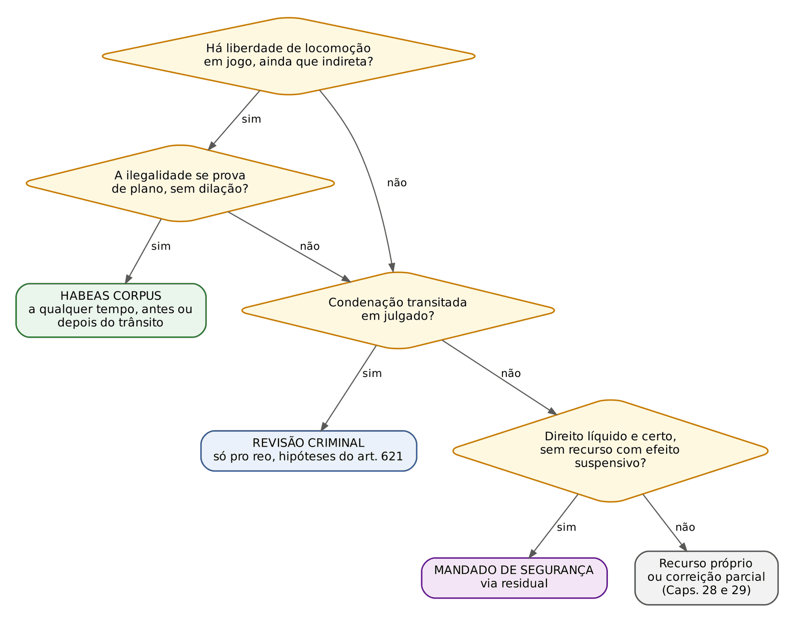
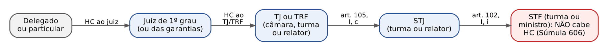
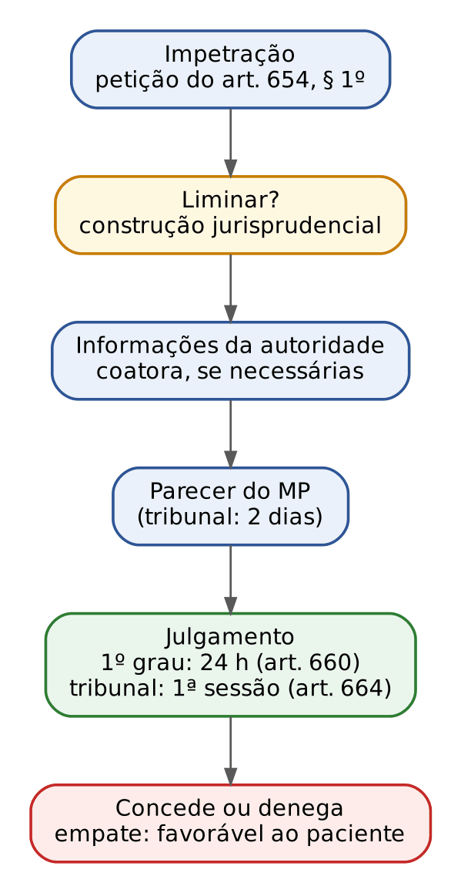
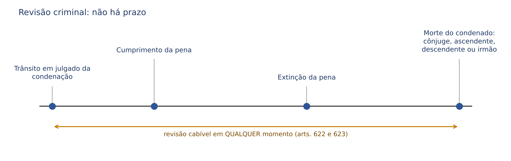
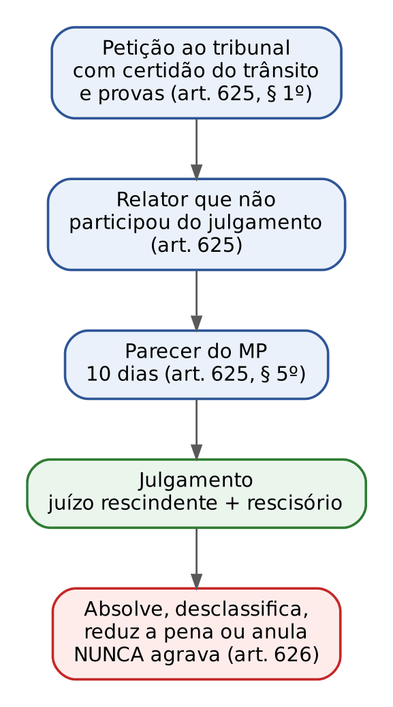

# CAPÍTULO 30 — AÇÕES AUTÔNOMAS DE IMPUGNAÇÃO: HABEAS CORPUS, REVISÃO CRIMINAL E MANDADO DE SEGURANÇA CRIMINAL

:::INCIDENCIA
Pontos: TRF5 p. 13; TJRS p. 8. Nível A. Lote: 19 questões (FGV 17, FCC 2).
O que mais cai: HC sem risco à locomoção (pena só de multa, Súmula 693), HC impetrado por terceiro contra a vontade do paciente, hipóteses e prazo da revisão criminal, indenização do art. 630 (exclusão na ação privada e na ocultação de prova) e cabimento residual do mandado de segurança.
:::

| Subtema | FGV | FCC | Padrão de cobrança |
|---|---|---|---|
| HC: cabimento e não cabimento (multa, homônimo, trancamento, salvo-conduto, HC coletivo) | 7 | 0 | caso curto com pena só de multa ou com coação evidente; "qual ação o advogado deve usar" |
| HC: legitimidade ativa e oposição do paciente | 3 | 0 | "desafeto" que impetra HC em favor do inimigo, que se opõe ou não autoriza |
| HC: julgamento (empate) | 1 | 0 | literalidade |
| Revisão criminal: cabimento, prazo, competência, indenização | 5 | 2 | caso com trânsito em julgado e fato superveniente; ação privada e indenização; transação penal |
| Mandado de segurança criminal | 1 | 0 | MS para dar efeito suspensivo a recurso, Súmula 267 |

## 30.1 Recurso x ação autônoma: por que existem três "remédios" fora do sistema recursal

Recurso é a impugnação feita DENTRO do mesmo processo, antes da preclusão ou do trânsito em julgado, pela parte que sofreu o gravame, no prazo legal e pela via prevista em lei (Caps. 28 e 29). Ação autônoma de impugnação é um PROCESSO NOVO, com partes, pedido e causa de pedir próprios, que ataca um ato judicial (ou de outra autoridade) sem depender do prazo recursal. Para o civilista, a analogia é imediata: o mandado de segurança contra ato judicial e a ação rescisória são ações, não recursos. O processo penal tem três delas, e cada uma existe por uma razão diferente:

- O *habeas corpus* (HC) existe porque a liberdade de locomoção não pode esperar o rito dos recursos, nem depender de prazo ou de capacidade postulatória. Por isso é a ação mais informal e mais rápida do ordenamento, cabível antes do processo, durante e depois do trânsito em julgado.
- A revisão criminal existe porque, no processo penal, a coisa julgada condenatória cede diante do erro judiciário: a segurança jurídica não justifica manter preso ou condenado um inocente. Por isso é cabível a qualquer tempo, mas só em favor do condenado.
- O mandado de segurança (MS) criminal existe para cobrir o que sobra: direito líquido e certo, violado por ato de juiz ou de outra autoridade no processo penal, que não envolva liberdade de locomoção (senão caberia HC) e contra o qual não haja recurso com efeito suspensivo.

O CPP trata o HC e a revisão criminal no título "Dos recursos em geral" (arts. 621 a 667). A localização é um erro histórico de técnica: a doutrina é unânime em afirmar que ambos são ações autônomas, e o STF e o STJ os tratam assim (o HC tem partes próprias, impetrante, paciente e autoridade coatora; a revisão criminal ataca a coisa julgada, o que nenhum recurso faz).

:::DICA Como ler o fluxograma
A primeira pergunta é sempre a liberdade de locomoção. Se ela estiver em jogo e a ilegalidade for demonstrável por prova pré-constituída, o HC é cabível em qualquer fase, inclusive depois do trânsito em julgado (30.2.8). Se a questão exigir reexame de provas ou não envolver a liberdade, separe: condenação transitada vai para a revisão criminal; ato sem recurso com efeito suspensivo que fere direito líquido e certo vai para o MS. As vias não são excludentes: o mesmo condenado pode ter, ao mesmo tempo, HC (para uma ilegalidade evidente) e revisão criminal (para reexame amplo da prova).
:::

## 30.2 Habeas corpus

### 30.2.1 Natureza, objeto e a ideia de "risco potencial à liberdade"

O HC é ação constitucional de natureza penal (mesmo quando impetrado contra ato de particular ou em matéria não criminal, como a internação compulsória), de rito sumaríssimo e de caráter mandamental: a decisão concessiva é uma ORDEM à autoridade coatora (soltar, não prender, trancar o processo, anular o ato). A Constituição o prevê no art. 5º, LXVIII; a Convenção Americana, no art. 7.6.

:::LEI CF, art. 5º, LXVIII, e CPP, art. 647
CF: "conceder-se-á *habeas corpus* sempre que alguém sofrer ou se achar ameaçado de sofrer violência ou coação em sua liberdade de locomoção, por ilegalidade ou abuso de poder".
CPP, art. 647: "Dar-se-á *habeas corpus* sempre que alguém sofrer ou se achar na iminência de sofrer violência ou coação ilegal na sua liberdade de ir e vir, salvo nos casos de punição disciplinar."
:::

O único bem tutelado é a liberdade de ir e vir. O que amplia muito o uso do HC é a ideia de AMEAÇA, ou risco potencial: basta que o ato impugnado possa, ainda que de forma indireta e futura, desembocar numa restrição da liberdade. Um inquérito ou uma ação penal por crime com pena privativa de liberdade já representa esse risco, porque podem terminar em prisão. Daí por que se admite HC para trancar inquérito ou ação penal de réu solto, para anular prova ilícita, para discutir a competência do juízo ou para impedir a condução coercitiva a um exame. O inverso também vale: se não houver nenhum caminho, nem remoto, até a prisão, o HC não cabe. É por isso que a pena SÓ de multa afasta o HC (30.2.4): desde a Lei 9.268/1996 a multa não pode ser convertida em prisão (art. 51 do CP).

:::EXEMPLO O teste do risco potencial
A responde a processo por furto simples (pena de reclusão); está solto e quer anular a citação. Cabe HC: o processo pode terminar em pena privativa de liberdade.
B foi condenado definitivamente à pena de 20 dias-multa por contravenção punida só com multa. Não cabe HC: nada no caminho de B leva à prisão.
C cumpre pena restritiva de direitos (prestação de serviços). Cabe HC: a restritiva pode ser convertida em privativa de liberdade (art. 44, § 4º, do CP); a FGV cobrou HC contra a troca de prestação pecuniária por prestação de serviços em recurso exclusivo da defesa (Q4349517, Cap. 28).
:::

### 30.2.2 Espécies

| Espécie | Situação | Provimento | Exemplo |
|---|---|---|---|
| Liberatório ou repressivo | a coação já existe | ordem de soltura (alvará) ou de cessação do constrangimento | preso por homônimo; prisão sem fundamentação |
| Preventivo | ameaça concreta e iminente de coação | salvo-conduto (art. 660, § 4º) | intimação para comparecer a exame grafotécnico sob pena de condução; convocação a CPI para depor como investigado |
| Com pedido de liminar | qualquer das duas, com urgência | decisão do juiz ou do relator antes das informações | prisão manifestamente ilegal |
| De ofício | o juiz ou tribunal verifica a coação no curso de qualquer processo | concessão sem provocação (arts. 654, § 2º, e 647-A) | tribunal que, ao não conhecer de um recurso, concede a ordem para corrigir a dosimetria |
| Coletivo | coação comum a um grupo determinável | ordem com efeitos para todos os integrantes | presas gestantes e mães (HC 143.641; ver Cap. 19) |

A liminar não está prevista no CPP. É construção jurisprudencial, apoiada no art. 660, § 2º (se os documentos evidenciarem a ilegalidade, o juiz ou tribunal ordenará que cesse imediatamente o constrangimento) e no poder geral de cautela; exige os requisitos de qualquer tutela de urgência: plausibilidade jurídica e perigo da demora.

O HC de ofício ganhou disciplina expressa com a Lei 14.836/2024, que incluiu o art. 647-A no CPP.

:::LEI CPP, art. 647-A (Lei 14.836/2024)
"No âmbito de sua competência jurisdicional, qualquer autoridade judicial poderá expedir de ofício ordem de *habeas corpus*, individual ou coletivo, quando, no curso de qualquer processo judicial, verificar que, por violação ao ordenamento jurídico, alguém sofre ou se acha ameaçado de sofrer violência ou coação em sua liberdade de locomoção.
Parágrafo único. A ordem de *habeas corpus* poderá ser concedida de ofício pelo juiz ou pelo tribunal em processo de competência originária ou recursal, ainda que não conhecidos a ação ou o recurso em que veiculado o pedido de cessação de coação ilegal."
:::

Três consequências práticas do art. 647-A: (1) positivou a prática do STF e do STJ de "não conhecer, mas conceder de ofício" (30.2.8); (2) previu em lei o HC COLETIVO de ofício; (3) deixou claro que o HC de ofício pode ser concedido em QUALQUER processo judicial, não só no criminal (ex.: o juiz da execução civil de alimentos que verifica a ilegalidade de uma prisão decretada em outro feito). Conceder HC de ofício não viola o sistema acusatório, porque é atuação em favor da liberdade (Cap. 1).

### 30.2.3 Hipóteses de cabimento: o art. 648

O art. 648 lista quando a coação é ilegal. O rol é exemplificativo (a cláusula constitucional "ilegalidade ou abuso de poder" é mais ampla), mas a banca cobra a literalidade.

| Inciso do art. 648 | Coação ilegal quando... | Exemplo de uso |
|---|---|---|
| I | não houver justa causa | trancamento de inquérito ou ação penal por atipicidade evidente; prisão sem fundamentação; IP de crime de ação privada instaurado sem requerimento do ofendido (art. 5º, § 5º) |
| II | alguém estiver preso por mais tempo do que determina a lei | excesso de prazo na prisão preventiva ou temporária (critério de razoabilidade; Cap. 19); pena já cumprida |
| III | quem ordenar a coação não tiver competência | prisão decretada por juiz absolutamente incompetente |
| IV | houver cessado o motivo que autorizou a coação | preventiva para garantir a instrução mantida depois de ouvidas todas as testemunhas, sem outro fundamento |
| V | não for alguém admitido a prestar fiança, nos casos em que a lei autoriza | crime afiançável com fiança negada sem motivação idônea |
| VI | o processo for manifestamente nulo | citação por edital sem esgotar a busca pessoal; ausência de defesa técnica |
| VII | extinta a punibilidade | prescrição já consumada; *abolitio criminis* |

:::QUESTAO FGV 2025 — TJ-SC — Juiz Leigo (Q3592861)
Carlos é preso em blitz porque havia mandado de prisão contra um homônimo; a defesa quer uma ação autônoma de impugnação. Gabarito: D (*habeas corpus*).
Armadilha: as alternativas oferecem MS (residual, não serve quando há coação à liberdade), revisão criminal (exige condenação transitada), carta testemunhável (recurso contra denegação de recurso) e *habeas data* (informações pessoais). Preso sem título contra si: falta de justa causa, art. 648, I.
:::

:::QUESTAO FGV 2024 — PC-SC — Delegado (Q2360699)
Quatro assertivas sobre HC. Gabarito oficial: A (corretas I, II e III).
I (correta): cabe HC contra o recebimento de denúncia sem justa causa, ainda que o acusado esteja solto (risco potencial, 30.2.1).
II (correta): ordem judicial para que o investigado compareça ao instituto de criminalística para exame grafotécnico admite HC preventivo com pedido de salvo-conduto, porque ninguém é obrigado a produzir prova contra si (*nemo tenetur se detegere*, Cap. 1).
III (correta): IP instaurado pelo delegado em crime de ação privada sem requerimento do ofendido (art. 5º, § 5º) é coação sem justa causa.
IV (errada): o CPP NÃO torna obrigatórias as informações nos HCs originários de tribunal; o art. 662 diz que o presidente as requisitará "se necessário". Atenção: o gabarito divulgado inicialmente no banco (C) estava deslocado; o oficial é A.
:::

### 30.2.4 Quando o HC NÃO cabe

| Situação | Por que não cabe | Fundamento |
|---|---|---|
| Condenação só à pena de multa, ou processo por infração punida só com multa | a multa não se converte em prisão: não há risco à locomoção | Súmula 693 do STF |
| Pena privativa de liberdade já extinta | a liberdade não está mais em jogo; o caminho é a revisão criminal | Súmula 695 do STF |
| Exclusão de militar, perda de patente ou de função pública | sanção sem reflexo na locomoção | Súmula 694 do STF |
| Discussão sobre custas | a liberdade não está em causa | Súmula 395 do STF |
| Mérito de punição disciplinar militar | vedação constitucional | CF, art. 142, § 2º; CPP, art. 647, parte final |
| Reexame aprofundado de provas ou dilação probatória | o HC exige prova pré-constituída; a dúvida se resolve na instrução ou na revisão | jurisprudência pacífica do STF e do STJ |
| Medida protetiva que não restringe a locomoção (alimentos, restrição de visitas) | sem reflexo na liberdade (a proibição de aproximação, ao contrário, admite HC) | ver Cap. 19 (19.8.4) |
| Condições da proposta de ANPP | o controle é a remessa ao órgão superior do MP (art. 28-A, § 14) | ver Cap. 8 |
| Decisão que defere intervenção de terceiro em outro HC | não afeta a liberdade | STJ, AgRg no HC 849.502 |
| Omissão de relator de extradição fundada em fato não provado nem provocado | ausência de ato coator | Súmula 692 do STF |

:::LEI Súmulas 693, 694 e 695 do STF
693: "Não cabe *habeas corpus* contra decisão condenatória a pena de multa, ou relativo a processo em curso por infração penal a que a pena pecuniária seja a única cominada."
694: "Não cabe *habeas corpus* contra a imposição da pena de exclusão de militar ou de perda de patente ou de função pública."
695: "Não cabe *habeas corpus* quando já extinta a pena privativa de liberdade."
:::

:::PEGADINHA Multa cumulada, multa substitutiva e punição disciplinar
- A Súmula 693 só afasta o HC quando a multa for a ÚNICA pena (aplicada ou cominada). Crime punido com "reclusão E multa" ou "detenção OU multa" admite HC durante o processo, porque a condenação pode ser à privativa de liberdade. Depois da condenação definitiva só à multa (por exemplo, multa substitutiva), não há mais risco.
- Punição disciplinar militar: a Constituição veda o HC quanto ao MÉRITO (conveniência e oportunidade da punição), mas o STF admite o HC para controlar a LEGALIDADE: hierarquia, competência da autoridade, existência de previsão da punição e observância do procedimento (STF, RE 338.840). Transgressão disciplinar de servidor civil não sofre a vedação.
- Pena extinta (Súmula 695) não é o mesmo que punibilidade extinta antes da condenação. Se o juiz deixou de reconhecer a prescrição e o processo prossegue, cabe HC (art. 648, VII).
:::

:::QUESTAO FGV 2024 — TJ-PE — Juiz Substituto (Q3117557)
Condenado só à pena de multa por contravenção, Roberto não recorre; o pai impetra HC para desconstituir a condenação transitada. Gabarito: E (não cabe HC, por inexistir risco à liberdade de locomoção).
Armadilha: as alternativas que dizem "cabe, porque qualquer pessoa pode impetrar" confundem legitimidade com cabimento: a legitimidade ampla não supre a falta de objeto. A alternativa que propõe conhecer o HC como revisão criminal também está errada: não há fungibilidade entre ações de natureza e competência diferentes.
No mesmo sentido: FGV 2026 — TJ-RJ — Analista (Q3868599), gabarito D (crime ambiental punido só com multa: não cabe HC; o MP, por sua vez, PODE recorrer em favor do condenado, como fiscal da ordem jurídica, o que derruba as alternativas C e E); FGV 2025 — TJ-GO — Residente (Q3345956), gabarito A (dentre as hipóteses listadas, a única em que NÃO se admite HC é a persecução por infração punida só com multa; trancamento por falta de justa causa, MPU, excesso de prazo e trancamento de investigação admitem).
:::

:::QUESTAO FGV 2025 — TJ-MS — Juiz Substituto (Q3786388)
Carlos, condenado definitivamente a 360 dias-multa por crime contra as relações de consumo, é beneficiado por HC impetrado pelo pai, enquanto ele próprio ajuíza revisão criminal; mas fora ele quem ocultara as provas que o absolveriam. Gabarito: A (o HC não é cabível, por não haver risco à liberdade).
Por que as outras falham: a ocultação de prova pelo próprio condenado NÃO impede a revisão criminal; só exclui a indenização (art. 630, § 2º, a; 30.3.7). Não há "conexão" entre HC e revisão que imponha julgamento conjunto. E a anuência do paciente não é requisito geral do HC impetrado por terceiro (30.2.5).
:::

### 30.2.5 Legitimidade

#### Legitimidade ativa: o impetrante

Qualquer pessoa pode impetrar HC, em favor próprio ou de terceiro, sem advogado e sem procuração (art. 654, *caput*; Lei 8.906/1994, art. 1º, § 1º). Pode impetrar o analfabeto (alguém assina a rogo, art. 654, § 1º, c), o estrangeiro, a criança ou o adolescente, a pessoa jurídica (em favor de pessoa física, por exemplo do seu sócio) e o Ministério Público. Delegado e juiz não impetram no exercício da função: o juiz concede de ofício; o delegado não tem essa atribuição (como cidadão, pode).

O MP pode impetrar, mas não para fins acusatórios: a impetração deve beneficiar o paciente. O STF admite o HC do MP em favor do réu e não o admite quando o objetivo é prejudicá-lo (por exemplo, para anular absolvição). O assistente de acusação não interpõe RE contra decisão concessiva de HC (Súmula 208 do STF; ver Cap. 12).

#### O paciente e a oposição ao HC

Paciente é a pessoa física cuja liberdade está em jogo. Pessoa jurídica não pode ser paciente, porque não tem liberdade de locomoção (mesmo nos crimes ambientais em que figura como ré, a defesa dela se faz por MS ou recurso).

O ponto mais cobrado pela FGV é o HC impetrado por terceiro CONTRA A VONTADE do paciente. A lógica: o HC existe para proteger o paciente; se ele se opõe, a ação perde sentido, e o terceiro (às vezes um desafeto) pode até estar agindo de má-fé para obter uma denegação que prejudique a estratégia de defesa. Por isso o Regimento Interno do STF (art. 192, § 3º) determina que não se conhece de pedido desautorizado pelo paciente, e a regra é aplicada pelos demais tribunais.

:::QUESTAO FGV 2026 — TJ-PE — Juiz Substituto (Q4349523)
Caso: André é condenado a 10 anos por roubo; o MP recorre de toda a sentença pedindo aumento de pena; a vítima, habilitada como assistente, apela 15 dias depois do fim do prazo do MP; a defesa perde o prazo; Pedro, desafeto de André, impetra HC, e André desautoriza expressamente a impetração. Gabarito: E (nem o recurso do assistente nem o HC podem ser conhecidos).
Passo 1, HC: impetração por terceiro com oposição expressa do paciente não é conhecida (RISTF, art. 192, § 3º).
Passo 2, assistente: o recurso do assistente é supletivo (só cabe quando o MP não recorre ou recorre em parte) e, habilitado, ele tem 5 dias contados do fim do prazo do MP (Súmula 448 do STF; o prazo de 15 dias do art. 598, parágrafo único, é do ofendido NÃO habilitado). Ver Cap. 12.
Armadilha: a alternativa B ("qualquer pessoa pode impetrar") é verdadeira em abstrato, mas não resolve a oposição do paciente.
:::

:::QUESTAO FGV 2025 — TRF5 — Juiz Federal Substituto (Q3373866)
Heitor impetra HC em favor do inimigo declarado Aquiles, que sofre coação por ato de juiz federal, e conduz a ação com desídia proposital, buscando a denegação; Aquiles não autorizou a impetração. Gabarito oficial: C (o conhecimento do HC pressupõe o consentimento de Aquiles).
Leitura: em regra o HC de terceiro dispensa autorização; o que impede o conhecimento é a OPOSIÇÃO do paciente. A banca, porém, tratou como requisito o consentimento quando o próprio caso revela que a impetração é contrária ao interesse do paciente (desídia proposital de um inimigo). Na prova, diante de "desafeto" que age contra o paciente, marque a falta de consentimento ou a oposição como óbice.
Erros das demais: a decisão no HC não "vincula" o paciente por substituição processual nem impede novo HC (do MP ou de outrem) com novos fundamentos; o parecer do MP não condiciona o conhecimento; não se exige advogado.
No mesmo sentido (oposição do paciente impede o conhecimento): FGV 2025 — MPE-RJ — Promotor (Q3532367), comentada em 30.3.7.
:::

#### Legitimidade passiva: a autoridade coatora e o particular

O HC é dirigido contra quem pratica ou ordena a coação: a autoridade coatora (juiz, tribunal, delegado, membro do MP, CPI) ou o particular. Contra particular, o HC é cabível quando houver privação de liberdade que dispense a intervenção policial demorada: hospital que retém paciente até o pagamento da conta, clínica psiquiátrica que interna sem os requisitos legais, fazendeiro que mantém trabalhador sob vigilância. Nesses casos, sendo também crime, nada impede a prisão em flagrante do particular; o HC é o meio mais rápido de libertar a vítima.

Quanto à "autoridade" do Ministério Público, é ele o coator quando requisita a instauração de inquérito sem justa causa (o delegado é mero executor): o HC vai ao tribunal ao qual o membro do MP está vinculado (30.2.7).

Intervenção de terceiros: no HC ligado a ação penal pública não se admite; na ação penal privada ou subsidiária, o STJ admite a intervenção do querelante no HC do querelado que pretende trancar a queixa (AgRg no REsp 1.956.757, Quinta Turma, j. 6/2/2024, Info 800), porque o querelante é parte e titular da ação.

### 30.2.6 Trancamento de inquérito e de ação penal

"Trancar" é encerrar prematuramente a investigação ou o processo por ordem judicial em HC. A medida é EXCEPCIONAL, porque substitui o juízo natural da causa e interrompe a apuração: só cabe quando a ilegalidade aparece de plano, à vista da prova pré-constituída, sem necessidade de examinar provas controvertidas. As hipóteses consolidadas no STF e no STJ:

- atipicidade evidente da conduta (inclusive pela insignificância reconhecível de plano);
- extinção da punibilidade (prescrição, decadência, morte);
- ausência de justa causa: falta de indícios mínimos de autoria ou de prova da materialidade;
- inépcia da denúncia (ver Cap. 6) e ausência de condição de procedibilidade (representação, requisição);
- excesso de prazo injustificável da investigação, mesmo com investigado solto.

Este último ponto merece atenção, porque contraria a intuição ("se ninguém está preso, o prazo do inquérito é impróprio"). O STJ trancou inquérito que tramitava havia mais de nove anos sem complexidade que justificasse a demora, mesmo sem prisão ou cautelar contra o investigado: a duração razoável do processo (art. 5º, LXXVIII, da CF) também protege quem é apenas investigado (STJ, Sexta Turma, HC 653.299, j. 16/8/2022, Info 747).

:::EXEMPLO Inquérito parado há cinco anos (FGV 2026, PC-PR, Q4378277, Cap. 4)
Inquérito sobre fraude à licitação instaurado em 2020 continua inconcluso em 2025 por acúmulo de serviço; não houve prescrição e ninguém está preso. Gabarito B: o advogado pode impetrar HC perante o JUIZ DAS GARANTIAS pedindo o trancamento por violação do prazo razoável. Por quê: (1) o excesso de prazo injustificado autoriza o trancamento ainda que o investigado esteja solto; (2) a autoridade coatora é o delegado, e o HC impetrado ANTES do oferecimento da denúncia é julgado pelo juiz das garantias (art. 3º-B, XII; ver Cap. 3); o inciso IX do mesmo artigo lhe atribui expressamente o trancamento do inquérito sem fundamento razoável. Errado mandar o HC ao TJ (o coator não é juiz) ou pedir ao juiz da instrução (ainda não há processo).
:::

Depois da sentença condenatória, o HC que pedia o trancamento por falta de justa causa fica prejudicado (Súmula 648 do STJ; ver Cap. 6): a discussão migra para a apelação, porque a sentença, tomada após instrução, absorve o juízo provisório do recebimento da denúncia.

### 30.2.7 Competência

#### Regra-mestra

O HC é julgado pelo órgão imediatamente superior ao da autoridade coatora, e, quando o paciente tiver foro por prerrogativa, pelo tribunal competente para julgá-lo pelo crime. A competência do juiz cessa quando a coação provier de autoridade judiciária de igual ou superior jurisdição (art. 650, § 1º). Para o juiz civilista, a lógica é a do mandado de segurança contra ato judicial: quem revê o ato é o órgão que tem hierarquia jurisdicional sobre o coator.

| Autoridade coatora | Competência para o HC | Fundamento |
|---|---|---|
| Delegado de polícia civil; particular | juiz de direito (na investigação, o juiz das garantias, se o HC for impetrado antes do oferecimento da denúncia) | art. 3º-B, XII, do CPP; organização judiciária |
| Delegado da Polícia Federal | juiz federal | CF, art. 109, VII |
| Promotor de justiça (por exemplo, requisição de IP sem justa causa) | Tribunal de Justiça | jurisprudência do STF (simetria com o foro do membro do MP, art. 96, III) |
| Procurador da República que oficia em primeiro grau | TRF | art. 108, I, a, por simetria |
| Juiz de direito; juiz das garantias; juiz da execução | Tribunal de Justiça | CPP, art. 650, § 1º; Constituição Estadual |
| Juiz federal | TRF | CF, art. 108, I, d |
| Juiz do Juizado Especial Criminal | Turma Recursal | Lei 9.099/1995 e regimentos (ver Cap. 29) |
| Turma Recursal | TJ ou TRF (não mais o STF) | STF, Pleno, HC 86.834 (2006), que superou a antiga Súmula 690: a Turma é composta por juízes de primeiro grau, sujeitos ao tribunal a que se vinculam |
| TJ, TRF (órgão colegiado ou relator); Ministro de Estado; comandante das Forças Armadas | STJ | CF, art. 105, I, c |
| Tribunal superior (STJ, TSE, STM) | STF | CF, art. 102, I, i |
| Paciente com foro no STF (art. 102, I, b e c) | STF | CF, art. 102, I, d (ver Cap. 10, Q3395867: senador indiciado por delegado da PF) |
| Turma, Plenário ou ministro do STF | NÃO cabe HC ao Plenário | Súmula 606 do STF |

:::LEI Súmulas 606 e 691 do STF
606: "Não cabe *habeas corpus* originário para o Tribunal Pleno de decisão de turma, ou do plenário, proferida em *habeas corpus* ou no respectivo recurso."
691: "Não compete ao Supremo Tribunal Federal conhecer de *habeas corpus* impetrado contra decisão do Relator que, em *habeas corpus* requerido a Tribunal Superior, indefere a liminar."
:::

#### Súmula 691: o "HC contra liminar" e a sua superação

O problema que a Súmula 691 resolve é a supressão de instância. Imagine: o TJ denega a ordem; a defesa impetra HC no STJ; o relator do STJ indefere a liminar. Se o STF conhecesse de novo HC contra esse indeferimento, julgaria o mérito antes do próprio STJ, saltando uma instância. O STJ aplica a mesma lógica, por analogia, ao HC impetrado contra o indeferimento de liminar por relator de TJ ou TRF.

A súmula, porém, cede diante de flagrante ilegalidade ou teratologia: o STF e o STJ afastam o óbice e concedem a ordem (normalmente de ofício) quando a coação salta aos olhos, como prisão sem nenhuma fundamentação ou regime fechado imposto contra súmula vinculante. Na prova: "Súmula 691 é regra; superação em casos teratológicos é exceção reconhecida".

:::PEGADINHA Súmula 606 x Súmula 691
- A 606 trata do STF CONTRA O PRÓPRIO STF: não cabe HC ao Plenário contra turma ou contra o próprio Plenário. Contra decisão MONOCRÁTICA de ministro, o caminho é o agravo regimental (Cap. 29), não novo HC.
- A 691 trata do STF contra RELATOR de tribunal superior que nega liminar: não conhece, salvo teratologia.
- Nenhuma das duas impede que, no próprio julgamento, o tribunal conceda a ordem de ofício (art. 647-A).
:::

### 30.2.8 HC substitutivo de recurso e HC depois do trânsito em julgado

Durante décadas, o HC foi usado no lugar do recurso próprio (em vez de apelar, impetrava-se HC; em vez de recurso ordinário constitucional ou de recurso especial, novo HC ao STJ). A partir de 2012 o STF, na Primeira Turma (HC 109.956, Rel. Min. Marco Aurélio, j. 7/8/2012), passou a NÃO CONHECER do HC substitutivo de recurso ordinário, e o STJ acompanhou. Mas os dois tribunais mantêm a ressalva da flagrante ilegalidade: não conhecem do HC e, se houver coação evidente, concedem a ordem de ofício. O art. 647-A, parágrafo único, introduzido pela Lei 14.836/2024, positivou exatamente essa prática.

Depois do trânsito em julgado, o HC continua cabível quando há risco à liberdade e a ilegalidade é verificável de plano: o STJ conhece de HC contra condenação transitada, ainda que não ajuizada revisão criminal, desde que haja flagrante ilegalidade e não se exija dilação probatória (AgRg no HC 1.011.096, Sexta Turma, Rel. Min. Rogerio Schietti Cruz, j. 1º/10/2025). O que o HC não faz é servir de revisão criminal para reexame de provas.

:::ESQUEMA HC substitutivo: o que o tribunal faz
| Situação | Conhece? | Concede? |
|---|---|---|
| HC no lugar de apelação, RESE, REsp ou recurso ordinário, sem ilegalidade evidente | não | não |
| Mesma situação, com ilegalidade flagrante (ex.: regime fechado só pela gravidade abstrata) | não | sim, de ofício |
| Condenação transitada, ilegalidade verificável de plano | sim (STJ, AgRg no HC 1.011.096) | conforme o caso |
| Condenação transitada, pedido que exige revalorar provas | não: via própria é a revisão criminal | não |
:::

:::QUESTAO FCC 2025 — DPE-SP — Analista de Defensoria (Q3304101)
André, condenado por tráfico em Santo André, teve a apelação desprovida pelo TJSP; no STJ, o HC não foi conhecido, mas a ordem foi concedida de ofício para aplicar o redutor do tráfico privilegiado. Agora quer revisão criminal para ser absolvido. Gabarito: C (TJSP).
Passo a passo: a revisão é julgada pelo tribunal que proferiu a última decisão sobre a questão que se quer rever. O STJ é competente para a revisão quando a questão objeto do pedido revisional tiver sido examinada por ele (Jurisprudência em Teses do STJ, ed. 72, tese 1). Aqui o STJ só mexeu na dosimetria, e de ofício; a autoria, que a absolvição discute, foi examinada por último pelo TJSP. Comarcas de Santo André (condenação) e de Presidente Prudente (execução) nunca julgam revisão.
:::

### 30.2.9 Procedimento

- Petição (art. 654, § 1º): nome do paciente e do coator, a espécie de constrangimento (ou as razões do temor, no preventivo) e a assinatura do impetrante. A prova deve vir com a inicial: no HC não há instrução.
- Primeiro grau: o juiz pode mandar apresentar o paciente (art. 656), requisitar informações e, efetuadas as diligências, decide fundamentadamente em 24 horas (art. 660). Concedida a ordem preventiva, expede-se salvo-conduto (art. 660, § 4º). Se a coação já cessou, julga-se prejudicado o pedido (art. 659).
- Tribunal: o relator pode indeferir liminarmente o HC manifestamente incabível (regimentos); requisita informações "se necessário" (art. 662); o MP dá parecer em 2 dias (Decreto-Lei 552/1969); o julgamento ocorre na primeira sessão (art. 664). Não há revisor nem pauta, e a sustentação oral é regulada pelo regimento.
- Efeitos: a concessão não põe fim ao processo, salvo se o fundamento for incompatível com a continuação (art. 651); concedido por nulidade, o processo é renovado a partir do ato nulo (art. 652); a autoridade que agiu com má-fé ou abuso evidente responde pelas custas (art. 653).

:::LEI CPP, art. 664, parágrafo único
"A decisão será tomada por maioria de votos. Havendo empate, se o presidente não tiver tomado parte na votação, proferirá voto de desempate; no caso contrário, prevalecerá a decisão mais favorável ao paciente."
:::

Desde a Lei 14.836/2024, em qualquer julgamento colegiado penal o empate favorece o imputado e é proclamado de imediato, ainda que decorra de vaga, impedimento, suspeição ou ausência (art. 615, § 1º — v. Cap. 28).

:::QUESTAO FGV 2024 — TJ-AP — Analista Judiciário (Q2449098)
HC por excesso de prazo (preso há três meses sem sentença em latrocínio); empate na câmara, já computado o voto do presidente. Gabarito: D (prevalece a decisão mais favorável ao paciente).
Armadilha: convocar outros julgadores, reiniciar o julgamento ou remarcar a sessão são soluções do processo civil (ampliação do colegiado do art. 942 do CPC) que não se aplicam. Desde a Lei 14.836/2024 a regra vale para todo julgamento colegiado penal, inclusive quando o empate decorre de vaga, impedimento ou ausência (art. 615, § 1º; Lei 8.038/1990, art. 41-A, parágrafo único, para o STF e o STJ).
:::

### 30.2.10 Recursos contra a decisão no HC

:::PROCESSO Qual recurso cabe no habeas corpus
| Decisão | Recurso | Prazo | Observação |
|---|---|---|---|
| Juiz de 1º grau concede ou denega a ordem | RESE (art. 581, X) | 5 dias (art. 586) | a concessão também se submete a reexame necessário (art. 574, I) |
| TJ ou TRF DENEGA, em única ou última instância | recurso ordinário constitucional ao STJ (CF, art. 105, II, a) | 5 dias (Lei 8.038/1990, art. 30) | alternativa prática: novo HC ao STJ, com o risco do não conhecimento por ser substitutivo |
| STJ ou outro tribunal superior DENEGA, em única instância | recurso ordinário ao STF (CF, art. 102, II, a) | 5 dias (Súmula 319 do STF) | |
| Tribunal CONCEDE a ordem | REsp e RE pelo MP (não pelo assistente: Súmula 208 do STF, Cap. 12) | 15 dias | não cabe recurso ordinário contra concessão |
| Decisão monocrática do relator (liminar ou mérito) | agravo regimental ou interno | ver Cap. 29 (Q3531599) | contra indeferimento de liminar, ver Súmula 691 |
| Acórdão em HC (qualquer instância) | embargos de declaração | 2 dias (art. 619) | |
:::

:::LEI Súmula 319 do STF
"O prazo do recurso ordinário para o Supremo Tribunal Federal, em *habeas corpus* ou mandado de segurança, é de cinco dias."
Atenção: para o mandado de segurança, a regra posterior é de 15 dias (Lei 8.038/1990, art. 33, e CPC, art. 1.003, § 5º); a súmula permanece aplicável ao HC.
:::

A FGV cobrou o recurso contra a decisão de 1º grau em HC na Q2515321 (Cap. 28: denegado HC contra ato de delegado, cabe RESE) e na Q2351296 (Cap. 28: concedido HC para trancar inquérito, cabe RESE, sem prejuízo do reexame necessário; o gabarito antigo do banco, que apontava apelação, foi corrigido para D). Sobre a Súmula 344 do STF (reexame da concessão de HC em crime contra a União), v. Cap. 28.

### 30.2.11 Habeas corpus coletivo

O CPP pensou o HC como ação individual (o art. 654, § 1º, exige o nome do paciente). O STF admitiu o HC coletivo em 2018 (HC 143.641, presas gestantes e mães; desenvolvido no Cap. 19), com três argumentos: a CF não restringe o HC à tutela individual; a coletivização garante isonomia e eficiência diante de violações estruturais; e, por analogia ao mandado de injunção coletivo (Lei 13.300/2016, art. 12), têm legitimidade os entes que atuam na tutela coletiva, como a Defensoria Pública. Os pacientes devem ser determináveis (identificáveis no cumprimento).

Precedentes que a banca usa:

- STF, HC 165.704 (2020): extensão da domiciliar aos pais e responsáveis (v. Cap. 19).
- STF, Segunda Turma, HC 143.988 (Rel. Min. Edson Fachin, j. 24/8/2020): HC coletivo contra a superlotação de unidades de internação de adolescentes, com fixação de limite de ocupação e determinação de medidas alternativas para os excedentes.
- STJ, Terceira Seção, HC 568.693 (j. 14/10/2020): na pandemia, determinou a soltura de todos os presos do país cuja liberdade provisória estivesse condicionada apenas ao pagamento de fiança.
- Lei 14.836/2024: o art. 647-A passou a prever, em lei, a ordem de HC COLETIVO concedida de ofício.

:::QUESTAO FGV 2026 — MPE-MT — Promotor de Justiça (Q4117017)
Unidade prisional com superlotação de 300%, constatada pelo MP, pela Defensoria e pela OAB. Gabarito: C (o STF admite reclamação e HC, inclusive coletivo, na defesa de direitos individuais homogêneos para afastar violação de direitos humanos de presos).
Armadilhas: a legitimidade NÃO é exclusiva do MP; a natureza coletiva do problema NÃO afasta o HC (é justamente o caso do HC coletivo); e a saída antecipada, a domiciliar com monitoração e a restritiva de direitos para o déficit de vagas decorrem de decisão do STF (Súmula Vinculante 56 e RE 641.320; ver Apostila de Direito Penal, Caps. 23 e 24), não dependem de lei. O estado de coisas inconstitucional do sistema prisional (ADPF 347) está no Cap. 31.
:::

:::SENTENCA O HC na mesa do juiz de primeiro grau
Onde entra: (1) como juiz competente para o HC contra delegado ou particular (inclusive o juiz das garantias na investigação); (2) como juiz que, ao sentenciar ou ao decidir qualquer incidente, constata coação ilegal e concede a ordem de ofício (arts. 654, § 2º, e 647-A).
O que fundamentar: o ato coator e quem o praticou; a prova pré-constituída; o inciso do art. 648 violado; a providência mandamental concreta (soltura, salvo-conduto, trancamento).
Redação-modelo (HC contra delegado): "Demonstrado de plano que o paciente foi recolhido em razão de mandado expedido contra homônimo, inexiste justa causa para a custódia (art. 648, I, do CPP). CONCEDO a ordem para determinar a imediata soltura do paciente, se por outro motivo não estiver preso. Recorro de ofício (art. 574, I, do CPP)."
Redação-modelo (de ofício, na sentença): "Constatado que a pena já se encontra integralmente cumprida pelo tempo de prisão provisória, concedo de ofício ordem de *habeas corpus* (art. 647-A do CPP) para determinar a soltura do réu."
Erro comum que a banca pune: esquecer o reexame necessário da concessão; decidir HC contra ato de outro juiz de mesma hierarquia (art. 650, § 1º); trancar o processo com base em versão que depende de prova a produzir.
:::

:::ESQUEMA Ficha do habeas corpus
| Item | Regra |
|---|---|
| Cabimento | violência ou coação, atual ou iminente, à liberdade de locomoção, por ilegalidade ou abuso de poder (CF, art. 5º, LXVIII; art. 648) |
| Legitimidade ativa | qualquer pessoa, sem advogado; MP em favor do paciente; não se conhece se o paciente se opõe |
| Legitimidade passiva | autoridade coatora ou particular |
| Prazo | não há |
| Forma e endereçamento | petição simples (art. 654, § 1º) ao órgão superior ao coator (30.2.7) |
| Provas | pré-constituídas; não há dilação |
| Efeitos | mandamental: alvará, salvo-conduto, trancamento, anulação; não encerra o processo, salvo incompatibilidade (art. 651) |
| Recursos | RESE + reexame necessário (1º grau); ROC ao STJ ou STF (denegação em tribunal, 5 dias) |
| Súmulas-chave | STF 691, 692, 693, 694, 695, 606, 395, 319; STJ 648 |
:::

## 30.3 Revisão criminal

### 30.3.1 Natureza e lógica: a "rescisória" que só funciona para um lado

A revisão criminal é ação autônoma que desconstitui a coisa julgada penal condenatória para corrigir erro judiciário. A comparação com a ação rescisória é inevitável e útil, mas as diferenças decidem as questões:

| Ponto | Ação rescisória (CPC) | Revisão criminal (CPP) |
|---|---|---|
| A favor de quem | qualquer das partes | SOMENTE do condenado (*pro reo*); não existe revisão *pro societate* |
| Prazo | 2 anos do trânsito (art. 975 do CPC) | a qualquer tempo, antes ou depois da extinção da pena, e mesmo após a morte do condenado (arts. 622 e 623) |
| Hipóteses | rol do art. 966 do CPC | rol do art. 621 do CPP, taxativo e interpretado com rigor |
| Depósito prévio | 5% do valor da causa | não há; nem se exige que o condenado se recolha à prisão (Súmula 393 do STF) |
| Resultado possível | rescisão e novo julgamento | absolver, desclassificar, reduzir a pena ou anular; NUNCA agravar (art. 626, parágrafo único) |

Por que só *pro reo*: a Constituição protege a coisa julgada (art. 5º, XXXVI), e a Convenção Americana proíbe novo processo contra o ABSOLVIDO por sentença passada em julgado pelos mesmos fatos (art. 8.4). A absolvição transitada é, portanto, intocável, ainda que apareçam provas esmagadoras depois (ver *ne bis in idem*, Cap. 1). A condenação injusta, ao contrário, pode ser revista a qualquer tempo, porque o interesse público na correção do erro judiciário supera a estabilidade.

### 30.3.2 Pressupostos: o que pode ser revisto

- Decisão CONDENATÓRIA, ou absolutória IMPRÓPRIA (a que absolve o inimputável e impõe medida de segurança, art. 386, parágrafo único, III), porque esta também restringe direitos.
- TRÂNSITO EM JULGADO ("processos findos", art. 621). Antes dele, a via é o recurso ou o HC.
- Não cabe revisão de absolvição própria, de decisão que extingue a punibilidade antes da condenação, de pronúncia, nem de sentença que homologa transação penal (não há condenação; a FCC cobrou exatamente isso).

:::QUESTAO FCC 2026 — DPE-MT — Defensor Público (Q3954639)
Transação penal homologada por omissão de socorro, com renúncia ao recurso; um ano depois surge prova de que Rodrigo agiu em estrito cumprimento do dever legal. Gabarito: A (a revisão criminal não é cabível, porque não se trata de sentença penal condenatória).
Armadilhas: a alternativa D ("falta de previsão para menor potencial ofensivo") erra o fundamento: não há vedação genérica nos Juizados; uma CONDENAÇÃO no Juizado admite revisão (julgada pela Turma Recursal, na posição predominante). O que afasta a revisão é a natureza homologatória da transação, que não reconhece culpa nem gera reincidência (ver Apostila de Direito Penal, Cap. 25).
:::

### 30.3.3 Hipóteses do art. 621

:::LEI CPP, art. 621
"A revisão dos processos findos será admitida:
I - quando a sentença condenatória for contrária ao texto expresso da lei penal ou à evidência dos autos;
II - quando a sentença condenatória se fundar em depoimentos, exames ou documentos comprovadamente falsos;
III - quando, após a sentença, se descobrirem novas provas de inocência do condenado ou de circunstância que determine ou autorize diminuição especial da pena."
:::

| Hipótese | O que significa | Exemplo | O que NÃO basta |
|---|---|---|---|
| I, 1ª parte: contrária ao texto expresso da lei penal | violação frontal de norma (penal ou processual), inclusive na dosimetria | pena-base acima do máximo; reincidência reconhecida com base em condenação já depurada | divergência razoável de interpretação |
| I, 2ª parte: contrária à evidência dos autos | condenação sem NENHUM apoio na prova, divorciada do conjunto probatório | condenação baseada só em elemento do inquérito, contra prova judicial unânime | revalorar a prova já examinada (STJ, REsp 2.123.321, Info 871) |
| II: prova falsa | a condenação se apoiou em depoimento, laudo ou documento cuja falsidade ficou demonstrada depois | testemunha condenada por falso testemunho; laudo fraudado | mera suspeita de falsidade |
| III: prova nova | prova surgida ou descoberta depois da sentença, de inocência ou de causa de diminuição especial | confissão do verdadeiro autor; exame de DNA; prova de semi-imputabilidade | prova velha reapresentada; retratação isolada e contraditória |

Três desenvolvimentos jurisprudenciais recentes:

- Revaloração é vedada. A revisão não é "terceira instância". A Quinta Turma do STJ restabeleceu condenação absolvida em SEGUNDA revisão criminal ajuizada sem prova nova, fixando que a revisão não pode ser admitida sem novas provas (art. 622, parágrafo único) e que é vedada a revaloração subjetiva de provas já analisadas (REsp 2.123.321, Rel. Min. Ribeiro Dantas, j. 11/11/2025, Info 871).
- Retratação da vítima em crimes sexuais. Em 2024 a Quinta Turma admitiu revisão com absolvição quando a condenação se apoiava só na palavra da vítima e ela, em justificação, disse não ter visto o rosto do autor (AREsp 2.408.401, j. 2/4/2024, Info 806; ver Cap. 15). Em 2026 a Sexta Turma delimitou o alcance: a prova nova do inciso III deve ser produzida judicialmente, sob contraditório, e demonstrar de forma clara a inocência; a retratação tardia, contraditória ou motivada por fatores extraprocessuais não basta, sobretudo em estupro de vulnerável, à luz da proteção integral (REsp 2.252.657, Rel. Min. Og Fernandes, j. 15/4/2026, Info 889). As duas decisões convivem: o que decide é a qualidade da retratação diante do restante da prova.
- Incoerência entre julgamentos. Condenado o réu com foro pelo tribunal e absolvidos, em processo desmembrado, os corréus pelos mesmos fatos, a incoerência é corrigível por revisão criminal (AgRg no AREsp 2.241.055, Info 805; ver Cap. 11).

#### Mudança de jurisprudência e precedente vinculante

A posição tradicional é a de que a simples mudança de jurisprudência não autoriza revisão criminal: a decisão que aplicou o entendimento vigente à época não era "contrária ao texto expresso da lei". A Terceira Seção do STJ, porém, admitiu a revisão com base no art. 621, I, para aplicar entendimento mais benigno quando a mudança é relevante e consolidada (RvCr 5.627, Rel. Min. Joel Ilan Paciornik, j. 13/10/2021: aplicação da minorante do tráfico privilegiado a condenados pelo art. 273, § 1º-B, do CP depois de a Corte Especial declarar inconstitucional o preceito secundário). A FGV adotou essa linha.

:::QUESTAO FGV 2026 — DPE-RJ — Defensor Público (Q4289363)
Marcos teve o tráfico privilegiado negado, em 2018, só por ser reincidente não específico, conforme a jurisprudência da época; em 2023, tese de repercussão geral do STF afirma que a reincidência não específica não impede, por si só, o benefício; a Defensoria ajuíza revisão. Gabarito: D (cabível, pelo art. 621, I: a condenação baseada em orientação superada por tese vinculante passa a ser considerada contrária ao texto expresso da lei penal, interpretada à luz da Constituição).
Por que as outras falham: B (pedido ao juízo da execução com base na Súmula 611 do STF) confunde mudança de jurisprudência com lei nova mais benéfica; C (jurisprudência superada como "documento falso") é absurda; E nega a retroação. A alternativa A reproduz a posição tradicional, que a banca considerou superada para precedentes vinculantes.
Cuidado: é tema em evolução; o gabarito parte de premissa da própria questão (tese vinculante). Fora desse contexto, a mera oscilação jurisprudencial continua não autorizando revisão.
:::

:::QUESTAO FGV 2026 — TJ-MS — Analista Judiciário (Q3856354)
Condenação por roubo transitada no TJ; na execução, descobrem-se provas novas que autorizam DIMINUIÇÃO da pena. Gabarito: E (revisão criminal, julgada pelo TJ).
Fundamento: o art. 621, III, não exige prova de inocência; basta prova nova de "circunstância que determine ou autorize diminuição especial da pena". RE e REsp pressupõem decisão não transitada; MS não desconstitui coisa julgada (Súmula 268 do STF); embargos de declaração não servem.
:::

:::QUESTAO FGV 2024 — TRF1 — Oficial de Justiça (Q3028640)
João, condenado por peculato contra a União, cumpriu a pena, já declarada extinta; surgem provas de que a condenação se baseou em depoimentos e exames falsos. Gabarito: B (cabe revisão criminal, art. 621, II).
Armadilha: as alternativas A e E apostam na coisa julgada e na extinção da pena. O art. 622 permite a revisão "antes da extinção da pena ou após", e o interesse persiste (reabilitação moral, reincidência futura, efeitos extrapenais, indenização).
:::

#### Justificação criminal: como se fabrica a "prova nova"

A revisão não tem fase instrutória ampla; a prova nova deve chegar pronta ao tribunal. Quando ela depende de testemunho (a vítima que se retrata, a testemunha que admite ter mentido, o verdadeiro autor que confessa), o condenado precisa colhê-la ANTES, em juízo, com contraditório. O instrumento é a justificação criminal: procedimento de produção antecipada de prova, sem previsão específica no CPP, processado no juízo criminal de primeiro grau (normalmente o da condenação) com aplicação analógica do CPC (art. 381 e seguintes, por força do art. 3º do CPP). O MP é intimado e pode reperguntar; o juiz não valora a prova, apenas a colhe e entrega os autos ao requerente. Declaração particular, escritura pública ou ata notarial não suprem a justificação, porque foram produzidas sem contraditório (é a exigência reafirmada no REsp 2.252.657).

:::SENTENCA A justificação criminal no primeiro grau
Onde entra: o juiz de primeiro grau recebe o pedido de justificação para instruir futura revisão criminal.
O que fazer: verificar a pertinência (o requerente indica qual prova nova pretende produzir e para qual hipótese do art. 621); intimar o MP; colher a prova em audiência, com perguntas das partes; NÃO julgar o mérito nem a veracidade; homologar a regularidade formal e entregar os autos.
Redação-modelo: "Colhidos os depoimentos sob contraditório, com intimação e participação do Ministério Público, HOMOLOGO a presente justificação, sem juízo de valor sobre a prova produzida, cuja apreciação compete ao tribunal na revisão criminal. Entreguem-se os autos ao requerente."
Erro comum: indeferir por "ausência de prova da inocência" (é valorar o que cabe ao tribunal) ou, ao contrário, declarar na homologação que a retratação é verossímil.
:::

### 30.3.4 Prazo, reiteração e legitimidade

- Prazo: nenhum (art. 622). Pode ser ajuizada durante o cumprimento, depois da extinção da pena e após a morte.
- Reiteração: não se admite repetir o pedido, salvo se fundado em novas provas (art. 622, parágrafo único).
- Legitimados (art. 623): o próprio réu, procurador legalmente habilitado ou, no caso de morte, cônjuge, ascendente, descendente ou irmão. Prevalece que o próprio condenado pode ajuizá-la pessoalmente, como no HC, mas parte da doutrina exige advogado, por se tratar de ação técnica; a jurisprudência admite a nomeação de defensor quando a petição do condenado é deficiente. O companheiro em união estável é admitido por equiparação constitucional.
- Morte do condenado no curso da revisão: o presidente do tribunal nomeia curador para a defesa (art. 631); a ação prossegue.
- Ministério Público: o art. 623 não o menciona. Parte da doutrina nega legitimidade (a revisão seria direito do condenado); outra parte a admite, porque o MP, como fiscal da ordem jurídica, também tem interesse em desfazer condenação injusta. A FGV adotou a segunda (Q3532367, 30.3.7).

:::QUESTAO FGV 2024 — TJ-MT — Juiz Substituto (Q3086968)
Lorenzo, condenado por calúnia em ação privada movida por Pablo, ajuíza revisão seis anos depois do trânsito e pede indenização. Gabarito: A (a revisão é cabível, mas Lorenzo não faz jus à indenização).
Passos: (1) não há prazo para a revisão (art. 622), o que derruba a intempestividade; (2) a decadência do direito de queixa é instituto da ação privada, irrelevante para a revisão; (3) a revisão cabe contra condenação em ação privada; (4) a indenização é excluída quando a acusação houver sido meramente privada (art. 630, § 2º, b).
No mesmo sentido: FGV 2024 — TJ-SC — Juiz Substituto (Q3049386), gabarito B (injúria em ação privada: o tribunal não pode reconhecer a indenização, "pois a acusação foi privada"; as alternativas que falam em prazo decadencial ou prescricional erram, porque a revisão não tem prazo e a indenização se pede na própria revisão).
:::

### 30.3.5 Competência

A revisão é sempre julgada por TRIBUNAL, nunca pelo juiz de primeiro grau, e por órgão diverso do que proferiu a decisão revista quando se tratar do mesmo tribunal (o relator não pode ter participado do julgamento: art. 625).

| Decisão revista | Competência |
|---|---|
| Sentença de juiz de direito não apelada, ou acórdão do TJ | TJ (órgão definido no regimento, em regra grupo ou seção criminal) |
| Sentença de juiz federal não apelada, ou acórdão do TRF | TRF (CF, art. 108, I, b) |
| Acórdão do STJ que examinou a questão objeto da revisão | STJ (CF, art. 105, I, e; JT do STJ, ed. 72, tese 1) |
| Condenação proferida pelo STF (ação originária) ou acórdão do STF que examinou a questão | STF (CF, art. 102, I, j) |
| Condenação no Juizado Especial Criminal | Turma Recursal (posição predominante; ver nota) |

A regra prática: vai ao tribunal que deu a ÚLTIMA palavra sobre a questão que se quer rever. Se o tribunal superior não conheceu do recurso, ou só tratou de outro ponto, a competência é do tribunal de origem (Q3304101, 30.2.8).

### 30.3.6 Procedimento, julgamento e limites

- A petição vem instruída com a certidão do trânsito em julgado e as peças necessárias (art. 625, § 1º). O relator pode indeferi-la liminarmente se insuficientemente instruída e se não for o caso de requisitar os autos; dessa decisão cabe recurso ao órgão colegiado (art. 625, §§ 3º e 4º).
- O MP (procurador-geral) dá parecer em 10 dias; seguem relator e revisor; julgamento em sessão (art. 625, § 5º).
- O tribunal faz dois juízos: o rescindente (desconstitui a decisão) e o rescisório (profere a nova decisão).

:::LEI CPP, art. 626
"Julgando procedente a revisão, o tribunal poderá alterar a classificação da infração, absolver o réu, modificar a pena ou anular o processo.
Parágrafo único. De qualquer maneira, não poderá ser agravada a pena imposta pela decisão revista."
:::

- A vedação do agravamento é a *reformatio in pejus* aplicada à revisão (Cap. 28). Alterar a classificação é permitido desde que a pena não aumente: o STJ validou a desclassificação de lavagem para receptação em revisão que pedia só absolvição, porque a pena foi reduzida (AgRg no REsp 1.943.070, Quinta Turma, Rel. Min. Messod Azulay Neto, j. 9/9/2025, Info 863).
- Anulado o processo, pode haver novo julgamento, mas a nova pena não pode superar a anterior (*reformatio in pejus* indireta).
- A absolvição restabelece todos os direitos perdidos em razão da condenação, devendo o tribunal, se for o caso, impor a medida de segurança cabível (art. 627).
- Contra o acórdão da revisão cabem embargos de declaração, REsp e RE. Não cabem embargos infringentes, restritos à apelação e ao RESE (Cap. 28).

#### Revisão de condenação do Júri e soberania dos veredictos

A soberania dos veredictos (CF, art. 5º, XXXVIII, c) impede que o tribunal substitua o júri no julgamento da APELAÇÃO (art. 593, III, d, só autoriza mandar o réu a novo júri; ver Cap. 23). Na revisão, porém, a soberania é uma garantia do acusado e não pode ser invocada contra ele para manter condenação injusta. Prevalece no STJ que o tribunal, ao julgar procedente a revisão contra condenação do júri por contrariedade à prova ou por prova nova de inocência, pode ABSOLVER diretamente, sem novo júri (REsp 1.304.155, Sexta Turma, j. 20/6/2013). Parte da doutrina sustenta que o juízo rescisório deveria ser devolvido a novo conselho de sentença, salvo nas hipóteses de nulidade (em que o caminho é anular e mandar a novo júri) ou de mera correção de pena.

:::PASSO Como resolver uma questão de revisão criminal
1. Há decisão condenatória (ou absolutória imprópria) TRANSITADA? Se não, a via é o recurso ou o HC; se for transação penal ou absolvição, não cabe revisão.
2. O fundamento cabe no art. 621? (I: contrariedade à lei ou à evidência, sem revaloração; II: prova falsa; III: prova nova de inocência ou de diminuição de pena.)
3. Quem pede? Condenado (pessoalmente ou por advogado); após a morte, cônjuge, ascendente, descendente ou irmão. Para a FGV, também o MP.
4. Onde? No tribunal que deu a última palavra sobre a questão (30.3.5).
5. Quando? A qualquer tempo; sem reiteração, salvo prova nova.
6. O que o tribunal pode fazer? Absolver, desclassificar, reduzir pena, anular; nunca agravar.
7. Indenização? Só se requerida, e não se o erro decorreu de ato do próprio condenado ou se a acusação foi meramente privada (30.3.7).
:::

### 30.3.7 Indenização pelo erro judiciário (art. 630)

O tribunal, se o interessado REQUERER, pode reconhecer na própria revisão o direito a justa indenização pelos prejuízos sofridos (art. 630, *caput*). O tribunal declara o direito; o valor é liquidado no juízo cível (§ 1º). Responde o Estado, se a condenação foi da respectiva justiça, ou a União, se proferida pela justiça do Distrito Federal ou de Território (§ 1º, que é de 1941; por identidade de razão, também a União pela condenação da Justiça Federal). O fundamento constitucional é o art. 5º, LXXV ("o Estado indenizará o condenado por erro judiciário, assim como o que ficar preso além do tempo fixado na sentença"), regra de responsabilidade objetiva.

:::LEI CPP, art. 630, § 2º
"A indenização não será devida:
a) se o erro ou a injustiça da condenação proceder de ato ou falta imputável ao próprio impetrante, como a confissão ou a ocultação de prova em seu poder;
b) se a acusação houver sido meramente privada."
:::

:::PEGADINHA O que as exclusões do § 2º NÃO fazem
- Não impedem a REVISÃO: o condenado que ocultou provas ou foi condenado em ação privada pode ser absolvido; só perde a indenização (Q3786388, Q3086968, Q3049386).
- A confissão que exclui a indenização é a confissão falsa que induziu o erro, não qualquer confissão.
- Parte da doutrina sustenta que a alínea b não foi recepcionada, porque o art. 5º, LXXV, impõe ao Estado a responsabilidade por erro JUDICIÁRIO, que é do juiz, não do querelante. As bancas, porém, cobram a literalidade, e o gabarito de todas as questões do lote segue o texto do CPP.
- Sem pedido expresso, o tribunal não reconhece a indenização de ofício; o interessado pode buscá-la depois em ação própria contra o Estado.
:::

:::QUESTAO FGV 2025 — MPE-RJ — Promotor de Justiça (Q3532367)
Dante, condenado por roubo, ocultara provas que o absolveriam para proteger Beatriz; o amigo Virgílio impetra HC, a que Dante se opõe; o MP ajuíza revisão criminal e pede indenização. Gabarito: D (o HC não pode ser conhecido, diante da oposição de Dante; a revisão do MP pode ser conhecida; não se reconhece a indenização).
Três regras em uma questão: oposição do paciente impede o conhecimento do HC (30.2.5); a banca admite a legitimidade do MP para a revisão (30.3.4, com a divergência); a ocultação de prova pelo próprio condenado exclui a indenização (art. 630, § 2º, a), mas não a revisão.
:::

:::ESQUEMA Ficha da revisão criminal
| Item | Regra |
|---|---|
| Cabimento | condenação ou absolvição imprópria transitada, nas hipóteses do art. 621; nunca *pro societate* |
| Legitimidade | réu, procurador habilitado; após a morte, cônjuge, ascendente, descendente ou irmão (art. 623); MP (divergente; FGV admite) |
| Prazo | qualquer tempo, antes ou depois da extinção da pena (art. 622) |
| Competência | tribunal que deu a última palavra sobre a questão; relator que não participou do julgamento (arts. 624 e 625) |
| Instrução | prova pré-constituída; prova testemunhal nova via justificação criminal |
| Resultado | absolver, desclassificar, reduzir pena, anular; vedado agravar (art. 626); restabelecimento de direitos (art. 627) |
| Indenização | se requerida; excluída por ato do condenado ou acusação meramente privada (art. 630) |
| Súmulas e julgados-chave | Súmula 393 do STF; RvCr 5.627; REsp 2.123.321; REsp 2.252.657; AgRg no REsp 1.943.070; REsp 1.304.155 |
:::

## 30.4 Mandado de segurança em matéria criminal

### 30.4.1 Cabimento residual

O MS protege direito líquido e certo (comprovável por prova pré-constituída) não amparado por *habeas corpus* nem por *habeas data*, violado por ato ilegal ou abusivo de autoridade (CF, art. 5º, LXIX; Lei 12.016/2009). No processo penal, ele é usado por defesa, acusação, vítima e terceiros para atacar decisões contra as quais o CPP não previu recurso, ou previu recurso sem efeito suspensivo, quando a espera causaria dano irreparável. O civilista conhece bem os filtros, que valem aqui igualmente:

- não cabe contra decisão judicial da qual caiba recurso com efeito suspensivo (Lei 12.016/2009, art. 5º, II) nem, em regra, contra ato judicial passível de recurso ou correição (Súmula 267 do STF), salvo teratologia ou dano irreparável que o recurso não evite;
- não cabe contra decisão transitada em julgado (Súmula 268 do STF; art. 5º, III);
- não admite dilação probatória;
- prazo decadencial de 120 dias da ciência do ato (art. 23).

O MS NÃO serve quando a liberdade de locomoção estiver em jogo: nesse caso a via é o HC, mais amplo e informal.

### 30.4.2 Hipóteses típicas

| Situação | Impetrante | Observação |
|---|---|---|
| Negativa de acesso do advogado aos autos do inquérito ou do processo | defesa | também cabe reclamação ao STF por violação da Súmula Vinculante 14 (Cap. 4) |
| Inadmissão ilegal do assistente de acusação | ofendido | a decisão é irrecorrível (art. 273); ver Cap. 12 |
| Restituição de coisa apreendida pertencente a terceiro de boa-fé, ou efeito suspensivo à apelação contra a negativa | terceiro proprietário, defesa | a apelação do art. 593, II, não tem efeito suspensivo; ver Cap. 13 e Q4289365 |
| Medidas assecuratórias sobre bens de terceiro (meação, por exemplo) | terceiro | ao lado dos embargos de terceiro; ver Cap. 13 |
| Decisões sem recurso típico contra a acusação (ex.: desentranhamento de prova reputada ilícita, indeferimento de diligência na investigação) | MP | uso casuístico; ver Caps. 14 e 17 |
| Ato de juiz do Juizado Especial Criminal | qualquer interessado | julgado pela Turma Recursal (Súmula 376 do STJ; ver Cap. 29) |

:::LEI Súmula 604 do STJ
"O mandado de segurança não se presta para atribuir efeito suspensivo a recurso criminal interposto pelo Ministério Público."
:::

A Súmula 604 nasceu para coibir a prática de o MP impetrar MS para manter preso o réu solto pela decisão recorrida (por exemplo, para dar efeito suspensivo ao RESE contra a revogação da preventiva). Esse uso inverteria a lógica das garantias: a liberdade concedida por decisão judicial não pode ser suspensa por ação que a lei não previu para tanto; se o MP quer a prisão, deve obtê-la no julgamento do recurso. Note que a súmula fala do recurso DO MINISTÉRIO PÚBLICO: ela não impede o MS da defesa ou de terceiro para dar efeito suspensivo a recurso sem esse efeito, quando houver direito líquido e certo e dano grave.

:::QUESTAO FGV 2026 — DPE-RJ — Defensor Público (Q4289365)
Veículo de Cláudia, terceira de boa-fé que comprovou documentalmente a propriedade lícita, foi apreendido em processo contra o filho; o juiz nega a restituição; a Defensoria apela (art. 593, II) e impetra MS ao TJ apenas para dar efeito suspensivo à apelação e liberar o carro de que ela depende para trabalhar. Gabarito: A (cabível o MS, não para substituir a apelação, mas para atribuir-lhe o efeito suspensivo que ela não tem, prevenindo lesão grave a direito líquido e certo).
Passos: (1) o art. 5º, II, da Lei 12.016/2009 só afasta o MS quando o recurso cabível TEM efeito suspensivo; a apelação contra decisão de restituição não tem; (2) a prova é documental e pré-constituída, logo não há dilação (afasta a alternativa E); (3) não se trata de liberdade de locomoção, então HC é inadequado (afasta C); (4) a Súmula 267 cede quando o recurso é ineficaz para evitar o dano (afasta B); (5) os embargos de terceiro são outra via possível, mas não "a" via obrigatória nem no juízo cível (afasta D). Contraste com a Súmula 604: lá o impetrante é o MP, e o efeito pretendido é contra o réu.
:::

### 30.4.3 Partes, competência, procedimento e recursos

- Litisconsórcio passivo necessário do réu: quando o MP impetra MS contra decisão proferida no processo penal, o réu deve ser citado como litisconsorte, porque a decisão do MS o atingirá (Súmula 701 do STF). Pela mesma lógica, a vítima cujo interesse é afetado pelo MS é litisconsorte passiva necessária (AREsp 1.700.368 — v. Cap. 13).
- Legitimidade: a OAB não tem legitimidade para impetrar MS em defesa individual de advogado investigado, salvo interesse geral da categoria (STJ, Sexta Turma, AgRg no RMS 73.012, j. 17/3/2026, Info 882).
- Competência: segue a autoridade coatora, como no HC: MS contra juiz de direito vai ao TJ; contra juiz federal, ao TRF (CF, art. 108, I, c); contra delegado, ao juiz de primeiro grau; contra juiz do Juizado, à Turma Recursal.
- Recursos: da sentença do juiz de primeiro grau em MS (contra delegado, por exemplo), apelação (Lei 12.016/2009, art. 14), com reexame necessário se concedida a segurança; do acórdão de TJ ou TRF que DENEGA a segurança em única instância, recurso ordinário ao STJ (CF, art. 105, II, b), em 15 dias; do acórdão que concede, REsp e RE.

:::LEI Súmula 701 do STF
"No mandado de segurança impetrado pelo Ministério Público contra decisão proferida em processo penal, é obrigatória a citação do réu como litisconsorte passivo."
:::

## 30.5 Reclamação e correição parcial

Os dois institutos aparecem nos pontos do TJRS ao lado dos "remédios autônomos", mas são estudados em outros capítulos: a reclamação constitucional (preservação da competência e da autoridade das decisões dos tribunais e das súmulas vinculantes, CF, arts. 102, I, l, 103-A, § 3º, e 105, I, f; CPC, art. 988) no Cap. 29; a correição parcial (impugnação de *error in procedendo* que causa inversão tumultuária do processo, sem recurso previsto) no Cap. 28.

## 30.6 Quadro comparativo das três ações

| Item | Habeas corpus | Revisão criminal | Mandado de segurança |
|---|---|---|---|
| Bem protegido | liberdade de locomoção | justiça da condenação | direito líquido e certo não amparado por HC |
| Momento | qualquer fase, antes, durante ou depois do processo | só após o trânsito da condenação | ato concreto, em 120 dias |
| Legitimidade ativa | qualquer pessoa (salvo oposição do paciente); MP | condenado; sucessores; MP (divergente) | titular do direito (réu, MP, vítima, terceiro) |
| Advogado | dispensado | dispensado pelo art. 623 (divergência) | obrigatório |
| Prova | pré-constituída | pré-constituída ou justificação | pré-constituída |
| Competência | órgão superior ao coator | tribunal da última decisão sobre a questão | órgão superior à autoridade coatora |
| Alcance | ordem mandamental | rescinde a coisa julgada; nunca agrava | anula ou suspende o ato |
| Pode prejudicar o réu? | não (MP só impetra em favor) | não | sim, se impetrado pela acusação (citação do réu: Súmula 701) |
| Súmulas-chave | STF 691, 693, 694, 695, 606, 319 | STF 393 | STF 267, 268, 701; STJ 604, 376 |

## 30.7 Resumo para revisão pré-prova

| Instituto | Regra | Exceções e detalhes | Fundamento |
|---|---|---|---|
| Natureza das três vias | ações autônomas, não recursos | o CPP põe HC e revisão no título dos recursos por má técnica | CPP, arts. 621 a 667 |
| HC: objeto | liberdade de locomoção, inclusive risco potencial | não cabe sem nenhum reflexo na liberdade | CF, art. 5º, LXVIII; art. 647 |
| HC: espécies | liberatório, preventivo (salvo-conduto), liminar, de ofício, coletivo | liminar é construção jurisprudencial | arts. 647-A, 654, § 2º, 660, §§ 2º e 4º |
| HC: hipóteses | rol do art. 648 (justa causa, excesso de prazo, incompetência, cessação do motivo, fiança, nulidade, extinção da punibilidade) | rol exemplificativo | art. 648 |
| HC: não cabe | só multa; pena extinta; perda de patente ou função; custas; mérito de punição disciplinar militar; reexame de prova | punição militar: cabe controle de legalidade | Súmulas 693, 695, 694, 395 do STF; CF, art. 142, § 2º |
| HC: legitimidade ativa | qualquer pessoa, sem advogado; MP em favor do paciente | não se conhece se o paciente se opõe; PJ não é paciente | art. 654; RISTF, art. 192, § 3º |
| HC: passiva | autoridade ou particular | promotor que requisita IP é coator (HC ao TJ) | jurisprudência |
| Trancamento | excepcional: atipicidade, extinção da punibilidade, falta de justa causa, inépcia, excesso de prazo injustificado | sentença condenatória prejudica o HC por falta de justa causa | STJ, HC 653.299; Súmula 648 do STJ |
| Competência | órgão superior ao coator; foro do paciente | juiz das garantias até o oferecimento da denúncia; Turma Recursal → TJ/TRF; não cabe HC ao Pleno do STF | art. 3º-B, XII; Súmulas 606 e 691 do STF |
| Súmula 691 | STF não conhece HC contra indeferimento de liminar por relator de tribunal superior | superada em flagrante ilegalidade | jurisprudência |
| HC substitutivo | não conhecido | concessão de ofício se houver ilegalidade flagrante; cabível após o trânsito se a ilegalidade for de plano | STF, HC 109.956; art. 647-A, parágrafo único; STJ, AgRg no HC 1.011.096 |
| Rito do HC | 1º grau: decisão em 24 h; tribunal: informações se necessário, MP em 2 dias, 1ª sessão | empate: decisão mais favorável | arts. 660, 662, 664; art. 615, § 1º |
| Recursos no HC | 1º grau: RESE (5 dias) + reexame necessário; denegação em tribunal: ROC ao STJ ou STF (5 dias) | concessão em tribunal: REsp/RE do MP | arts. 581, X, e 574, I; CF, arts. 102, II, a, e 105, II, a; Súmula 319 |
| HC coletivo | admitido; pacientes determináveis; Defensoria legitimada | concessão coletiva de ofício prevista em lei | HCs 143.641, 165.704, 143.988; STJ, HC 568.693; art. 647-A |
| Revisão: cabimento | condenação ou absolvição imprópria transitada | não cabe contra transação penal ou absolvição; nunca *pro societate* | arts. 621 e 626 |
| Revisão: hipóteses | I: contrária à lei ou à evidência; II: prova falsa; III: prova nova de inocência ou de diminuição | vedada a revaloração; mudança vinculante de jurisprudência admitida pelo STJ | REsp 2.123.321; RvCr 5.627 |
| Revisão: prazo | qualquer tempo, antes ou depois da extinção, mesmo após a morte | reiteração só com prova nova | arts. 622 e 623 |
| Revisão: legitimidade | réu, procurador; após a morte, CADI (cônjuge, ascendente, descendente, irmão) | MP: divergente (FGV admite); preso não precisa se recolher | art. 623; Súmula 393 do STF |
| Revisão: competência | tribunal da última palavra sobre a questão; relator que não participou | STJ só se examinou a questão | arts. 624 e 625; JT ed. 72 |
| Revisão: resultado | absolver, desclassificar, reduzir pena, anular | vedado agravar; no júri, o STJ admite absolvição direta | arts. 626 e 627; REsp 1.304.155 |
| Prova nova testemunhal | justificação criminal no 1º grau, sob contraditório | retratação de vítima: avaliar coerência com o restante da prova | REsp 2.252.657; AREsp 2.408.401 |
| Indenização | se requerida; liquidação no cível; paga Estado ou União | excluída por ato do próprio condenado ou acusação meramente privada | art. 630; CF, art. 5º, LXXV |
| MS criminal | direito líquido e certo, sem HC, sem recurso com efeito suspensivo | não para efeito suspensivo a recurso do MP; não contra trânsito | Lei 12.016/2009, art. 5º; Súmulas 267 e 268 do STF; Súmula 604 do STJ |
| MS: partes | réu litisconsorte necessário no MS do MP; vítima afetada também | OAB sem legitimidade para defesa individual | Súmula 701 do STF; AREsp 1.700.368; AgRg no RMS 73.012 |
| MS: recursos | 1º grau: apelação; denegação originária em TJ/TRF: ROC ao STJ (15 dias) | concessão: REsp/RE | Lei 12.016/2009, art. 14; CF, art. 105, II, b |

## 30.8 Artigos de lei incidentes

- Constituição Federal: art. 5º, XXXVI, LXVIII, LXIX, LXXV e LXXVIII; art. 102, I, d, i e j, e II, a; art. 105, I, c e e, e II, a e b; art. 108, I, b, c e d; art. 109, VII; art. 142, § 2º.
- CPP: arts. 3º-B, IX e XII; 5º, § 5º; 574, I; 581, X; 586; 593, II; 615, § 1º; 619; 621 a 631; 647; 647-A; 648; 650, § 1º; 651 a 654; 656; 659; 660; 662; 664; 667.
- Lei 14.836/2024 (empate e HC de ofício); Lei 8.038/1990, arts. 30, 33 e 41-A.
- Lei 12.016/2009: arts. 5º, 14, 23 e 24.
- Decreto-Lei 552/1969 (parecer do MP em HC nos tribunais).
- CPC (aplicação supletiva): arts. 381 e seguintes (produção antecipada de prova, base da justificação criminal).
- Convenção Americana sobre Direitos Humanos: arts. 7.6 e 8.4.
- Regimento Interno do STF: art. 192, § 3º.

## 30.9 Julgados, temas e súmulas do capítulo

- Súmula 693 do STF: não cabe HC contra condenação só a multa ou processo por infração punida só com multa.
- Súmula 694 do STF: não cabe HC contra exclusão de militar ou perda de patente ou função.
- Súmula 695 do STF: não cabe HC quando já extinta a pena privativa de liberdade.
- Súmula 395 do STF: não se conhece de recurso em HC sobre custas.
- Súmula 692 do STF: HC contra omissão de relator de extradição não provocado.
- Súmula 691 do STF: HC contra indeferimento de liminar em tribunal superior; superação na teratologia.
- Súmula 606 do STF: não cabe HC ao Pleno contra turma ou Plenário do STF.
- Súmula 319 do STF: ROC em HC ao STF em 5 dias.
- Súmula 393 do STF: revisão criminal sem recolhimento à prisão.
- Súmula 701 do STF: réu litisconsorte necessário no MS do MP.
- Súmulas 267 e 268 do STF: MS contra ato judicial recorrível ou transitado.
- Súmula 604 do STJ: MS não dá efeito suspensivo a recurso do MP.
- STF, HC 86.834: HC contra Turma Recursal julgado pelo TJ ou TRF.
- STF, HC 109.956: não conhecimento do HC substitutivo.
- STF, RE 338.840: HC para controle de legalidade de punição disciplinar militar.
- STF, HC 143.988: HC coletivo contra a superlotação socioeducativa.
- STJ, HC 568.693: HC coletivo nacional para presos que não pagaram fiança.
- STJ, HC 653.299: trancamento de inquérito por excesso de prazo com investigado solto.
- STJ, AgRg no HC 1.011.096: HC contra condenação transitada, com ilegalidade de plano.
- STJ, AgRg no HC 849.502: não cabe HC contra deferimento de intervenção de terceiro em HC.
- STJ, AgRg no REsp 1.956.757: intervenção do querelante no HC do querelado.
- STJ, RvCr 5.627: revisão para aplicar entendimento mais benigno consolidado.
- STJ, REsp 2.123.321: revisão sem prova nova e revaloração vedadas.
- STJ, REsp 2.252.657: retratação tardia em justificação não basta para revisão em estupro de vulnerável.
- STJ, AgRg no REsp 1.943.070: desclassificação em revisão, sem agravar a pena.
- STJ, REsp 1.304.155: absolvição direta em revisão de condenação do júri.
- STJ, AgRg no RMS 73.012: OAB sem legitimidade para MS em defesa individual de advogado.
- Jurisprudência em Teses do STJ, ed. 72, tese 1: competência do STJ para a revisão quando examinou a questão.

Remissões a outros capítulos: HCs 143.641 e 165.704 (Cap. 19); AREsp 1.700.368 (Cap. 13); Súmula 344 do STF e art. 615, § 1º (Cap. 28); Súmula 648 do STJ (Cap. 6); Súmula 208 e 448 do STF (Cap. 12); Súmula 376 do STJ (Cap. 29); AREsp 2.408.401 (Cap. 15); AgRg no AREsp 2.241.055 (Cap. 11); RHC 184.507 (Cap. 8); ADPF 347 (Cap. 31); Súmula Vinculante 14 (Cap. 4); juiz das garantias e ADIs 6.298 e outras (Cap. 3); Súmula Vinculante 56 e RE 641.320 (Apostila de Direito Penal, Caps. 23 e 24).

:::NOTA Notas de verificação
- Conferido: arts. 3º-B, XII, e 28 do CPP (CPP Legislação 360, Drive). Conferidos no Planalto em 17/10/2026 (CPP compilado): arts. 615, § 1º, 621, 622, 623, 626, 630, 647, 647-A e 664, parágrafo único; também o art. 41-A da Lei 8.038/1990 (Lei 14.836/2024) e o Decreto-Lei 552/1969, art. 1º (vista ao MP por 2 dias). ERRO corrigido: o box do art. 615, § 1º, trazia redação divergente da oficial ("nos julgamentos em curso, o empate tenha sido causado por..."); o box foi substituído por remissão ao Cap. 28, que tem a redação conferida. Ajustado o texto sobre o art. 630, § 1º (a letra da lei fala em União só para a justiça do DF e Territórios). O art. 664, parágrafo único, não foi alterado pela Lei 14.836/2024 e convive com o art. 615, § 1º.
- Julgados conferidos no Caderno Dizer o Direito (Drive) e no Radar: REsp 2.252.657 (Info 889; o Radar registra o processo como em segredo de justiça), AgRg no HC 1.011.096, REsp 2.123.321, AgRg no REsp 1.943.070, AgRg no HC 849.502, AgRg no REsp 1.956.757, AREsp 1.700.368, AgRg no RMS 73.012. RvCr 5.627 e REsp 1.304.155 conferidos por fontes secundárias na internet; HC 568.693 confirmado por fonte secundária (Info 681). HC 653.299 extraído do CPP Legislação 360.
- Citados de memória, sem conferência nesta sessão: STF, HC 109.956 (data), HC 86.834, HC 143.988 (relator, data e alcance do limite de ocupação), RE 338.840; RISTF, art. 192, § 3º (confirmado apenas por referência indireta em decisões do STF).
- Pontos controvertidos assumidos: legitimidade do MP para a revisão (a FGV admite, Q3532367); revisão de condenação do Juizado pela Turma Recursal; capacidade postulatória do condenado na revisão; revisão fundada em superação vinculante de jurisprudência (Q4289363, gabarito D, coerente com a RvCr 5.627, mas tema em evolução e alternativa A defensável pela posição tradicional).
- Gabaritos: Q2360699 corrigido no banco de C para A (assertivas I, II e III corretas); a correção é coerente com o art. 662 ("se necessário"). Q3373866 (gabarito C): a exigência de "consentimento" do paciente é leitura da banca para o caso de impetrante desafeto e desidioso; a regra geral é que só a oposição impede o conhecimento. Q2351296 (Cap. 28), citada em 30.2.10, teve o gabarito corrigido para D.
- Fontes do Drive lidas: Mapeamento FGV (padrão "desafeto impetra HC" recorrente: TJMT 2023, TJES 2023, TRF5 2025, TJPE 2026), Caderno Dizer o Direito (seção HC e revisão), CPP Legislação 360 (parcial: a extração do Drive não alcança os arts. 621 a 667), Capez (extração truncada antes do tema), Compilado TRF6 (item 7.2) e Sinopse TJSC 2026 (trechos sobre HC). Aury Lopes Jr. não foi lido.
:::
