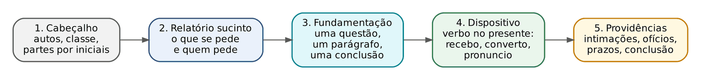
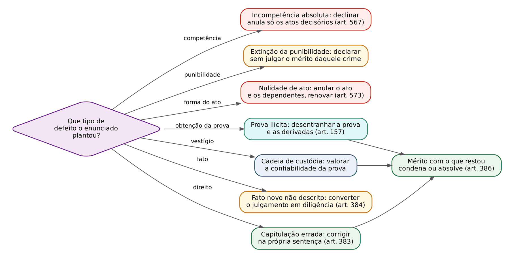
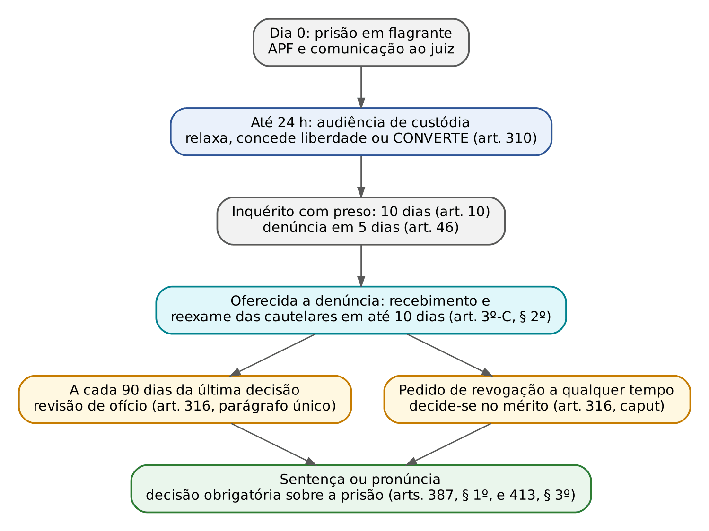

# CAPÍTULO 33 — DECISÕES PROCESSUAIS NA PROVA PRÁTICA: QUESTÕES PROCESSUAIS DA SENTENÇA E DECISÕES INTERLOCUTÓRIAS (RECEBIMENTO, ABSOLVIÇÃO SUMÁRIA, PRISÃO, PRONÚNCIA), COM ROTEIROS E MODELOS

:::INCIDENCIA
TRF5 p. 7 e 13; TJRS p. 7; TJSC p. 13, 14 e 16. Nível A (capítulo de aplicação). Lote: 0 questões atribuídas (FGV 0, FCC 0); correlatas do banco citadas pelo número.
O que mais cai: preliminares plantadas no enunciado da sentença (busca, reconhecimento, citação, correlação), fundamentação concreta da prisão, linguagem da pronúncia e decisão após a resposta à acusação.
:::

## 33.1 Como usar este capítulo

Este é um capítulo de APLICAÇÃO. Os institutos já foram explicados nos capítulos anteriores; aqui eles viram texto de decisão. Cada seção traz três coisas: a estrutura da decisão (o que vem em que ordem), um checklist (o que não pode faltar) e um modelo completo, curto, com partes por iniciais. Os modelos parciais de uma ou duas frases espalhados pela apostila continuam valendo; os daqui os integram numa peça inteira, que é o que a banca pede quando manda "profira a decisão cabível".

A prova de sentença penal (estrutura, relatório, dosimetria, dispositivo e dois casos-modelo) já está na Apostila de Direito Penal, Cap. 26, que deve ser lida antes desta. O que este capítulo acrescenta:

- como o enunciado esconde as questões processuais e qual o EFEITO de acolher cada uma (33.3);
- redação de acolhimento e de rejeição das preliminares que ainda não têm modelo na apostila (33.3.3);
- as decisões interlocutórias que podem ser pedidas como questão discursiva ou como peça (33.4 a 33.7);
- os consectários processuais da sentença que ficaram fora da Apostila de Direito Penal (33.8).

Para o civilista, a chave é esta: no cível, quase toda decisão interlocutória relevante desafia agravo de instrumento (art. 1.015 do CPC) e a parte vive "recorrendo do caminho". No processo penal, o rol de recursos é taxativo e estreito; boa parte das decisões do caminho (recebimento da denúncia, decisão que prossegue após a resposta, decisão que decreta a prisão) não tem recurso, e o controle se faz por *habeas corpus*. Por isso a QUALIDADE da fundamentação da decisão interlocutória pesa mais no crime: ela é o que o tribunal examinará no HC, sem poder suprir o que o juiz não disse (STJ, RHC 212.836-RS, Info 847 — Apostila de Direito Penal, 26.9.2).

:::PROCESSO QUAL RECURSO CABE: as decisões deste capítulo
| Decisão | Natureza (Cap. 21) | Recurso ou meio | Fundamento |
|---|---|---|---|
| Recebe a denúncia | interlocutória simples | nenhum; HC para trancamento | Cap. 22, 22.3.4 |
| Rejeita a denúncia (total ou parcialmente) | interlocutória mista terminativa | RESE, 5 dias | art. 581, I |
| Absolve sumariamente (art. 397, I a III) | sentença de mérito | apelação, 5 dias | art. 593, I |
| Declara extinta a punibilidade (art. 397, IV) | decisão terminativa | RESE (art. 581, VIII); há quem admita apelação | Cap. 22, 22.5.4 |
| Afasta a absolvição sumária e designa audiência | interlocutória simples | nenhum; HC ou preliminar em apelação | art. 399 |
| Converte o flagrante ou decreta preventiva | interlocutória | HC | Cap. 19, 19.2.10 |
| Relaxa o flagrante, concede liberdade provisória, indefere ou revoga a preventiva | interlocutória | RESE (art. 581, V) | Cap. 19, 19.2.10 |
| Pronuncia | interlocutória mista não terminativa | RESE (art. 581, IV) | Cap. 23 |
| Impronuncia ou absolve sumariamente no Júri | sentença | apelação (art. 416) | Cap. 23 |
| Desclassifica na primeira fase (art. 419) | interlocutória | RESE (art. 581, II) | Cap. 23 |
| Decide os requerimentos do art. 422 e faz o relatório do art. 423 | interlocutória simples | nenhum; nulidade arguida em plenário (art. 571, V) | Caps. 23 e 27 |
| Recusa homologar o ANPP | interlocutória | RESE (art. 581, XXV) | Cap. 8, 08.3.3 |
| Recusa homologar a colaboração | interlocutória | apelação residual (art. 593, II) | Cap. 8, 08.4.4 |
| Converte o julgamento em diligência para *mutatio* | despacho com conteúdo decisório | nenhum; correição parcial se houver inversão tumultuária | Cap. 21, 21.4.3 |
| Sentença condenatória ou absolutória | sentença | apelação (art. 593, I) | Cap. 28 |
:::

O quadro-mestre de todos os recursos, com prazos, está no Cap. 28 (28.13).

## 33.2 Técnica comum a toda decisão penal

Toda decisão, da mais simples à pronúncia, segue cinco blocos. O relatório da interlocutória é curto (um parágrafo: quem pede o quê, com que fundamento, e o que a outra parte disse). A fundamentação se organiza por QUESTÕES, não por narrativa: uma questão, um parágrafo, uma conclusão expressa ("rejeito", "acolho", "defiro", "indefiro"). O dispositivo usa o verbo no presente e na primeira pessoa ("recebo", "converto", "pronuncio"), que é a forma que o examinador procura. As providências fecham a peça: intimações, ofícios, prazos, expedição de mandados.

O padrão de fundamentação é o do art. 315, § 2º, do CPP, espelho do art. 489, § 1º, do CPC que o leitor já conhece (texto e ponte com o CPC no Cap. 18, 18.4). Ele vale para TODA decisão (o próprio caput fala em decisão que decreta, substitui ou denega cautelar, mas o § 2º se refere a "qualquer decisão judicial"). Na prática da prova, o dispositivo funciona como um teste antifórmula:

:::PASSO O teste antifórmula do art. 315, § 2º (aplique a cada parágrafo da decisão)
1. Troque mentalmente o nome do réu e o crime: o parágrafo continuaria servindo? Se sim, é fórmula genérica (inciso III) e precisa de um dado do caso (data, documento, depoimento, evento dos autos).
2. Há citação de artigo, súmula ou tema? Mostre por que o caso se ajusta a ele (incisos I e V).
3. Há conceito indeterminado ("ordem pública", "periculosidade", "indícios suficientes")? Diga qual fato concreto o preenche (inciso II).
4. Todos os argumentos das partes capazes de mudar a conclusão foram enfrentados? (inciso IV). Liste-os no rascunho e risque um a um.
5. Se a parte invocou precedente e você não o segue, demonstre a distinção ou a superação (inciso VI).
:::

Regras de redação que valem para todos os modelos deste capítulo:

- Partes e testemunhas por iniciais (A. B. C.; vítima V.; testemunha T1), sem inventar nomes; o juiz assina como "Juiz de Direito Substituto" ou "Juiz Federal Substituto", SEM nome.
- Referência a peças pelo "evento" ou pela folha indicada no enunciado; se o enunciado não indicar, "conforme documento juntado aos autos", sem inventar números.
- Fundamentação *per relationem* (remissão à manifestação do MP ou à decisão anterior) só é válida se a peça referida for suficiente e acessível e se o juiz acrescentar o dado ATUAL quando a decisão exige contemporaneidade (STJ, AgRg no HC 876.612-SP; ver Cap. 21).

## 33.3 As questões processuais escondidas na sentença

### 33.3.1 Onde o examinador planta a questão

O enunciado da prova de sentença é uma narrativa longa (inquérito, denúncia, instrução, alegações finais) em que alguns dados estão ali só para serem notados. O candidato que lê como civilista procura o pedido e a causa de pedir; o examinador penal quer que você veja o detalhe de FORMA. A tabela mostra os dados plantados mais frequentes, a tese que eles sustentam e onde ela é enfrentada.

| Dado plantado no enunciado | Tese processual | Onde enfrentar | Teoria e modelos |
|---|---|---|---|
| "Os policiais receberam denúncia anônima e ingressaram na residência" | busca domiciliar sem fundadas razões; prova ilícita | preliminar de ilicitude | Cap. 15; modelo em 33.3.3 |
| "Abordado por estar em atitude suspeita em local conhecido como ponto de tráfico" | busca pessoal sem fundada suspeita | preliminar de ilicitude | Cap. 15; modelo no Cap. 3 (Busca pessoal sem fundada suspeita na sentença) |
| "A vítima reconheceu o réu por fotografia enviada pelo aplicativo" | reconhecimento sem o art. 226 | mérito (autoria), após declarar a invalidade | Cap. 15; modelo em 33.3.3 |
| "O lacre não foi registrado" ou peso divergente | quebra da cadeia de custódia | materialidade (confiabilidade) | Cap. 14; modelo no Cap. 14 (Preliminar de quebra da cadeia de custódia) |
| "Os policiais acessaram as mensagens do celular na abordagem" | acesso ilícito a dados | preliminar de ilicitude | Cap. 17; modelo no Cap. 17 |
| "Citado por edital após uma única diligência" | nulidade de citação | preliminar de nulidade | Cap. 20; modelo em 33.3.3 |
| "O juiz indeferiu a oitiva da testemunha arrolada a tempo" ou documento juntado sem vista | cerceamento de defesa | preliminar de nulidade | Cap. 27; modelo em 33.3.3 |
| "O interrogatório ocorreu no início da audiência" ou antes do retorno da precatória | inversão do interrogatório | preliminar de nulidade | Cap. 22, modelo em 22.6; Cap. 27, 27.4.2 |
| "O crime ocorreu em município de outra comarca" ou interesse da União | incompetência | primeira preliminar | Caps. 9 e 10, com modelos |
| Data do fato, idade do réu, data do recebimento | prescrição de um dos crimes | prejudicial de mérito | Apostila de Direito Penal, 26.3.2, com modelo |
| Denúncia por furto; vítima narra empurrão na audiência | *mutatio libelli* | antes de sentenciar (conversão em diligência) | Cap. 21; modelo em 33.3.3 |
| Denúncia que atribui o crime "aos sócios", sem conduta | inépcia | preliminar (com a ressalva da preclusão) | Cap. 6, modelo em 06.6 |

:::DICA A leitura em duas cores
Na segunda leitura do enunciado, marque com uma cor tudo o que é FATO (o que aconteceu no crime) e com outra tudo o que é ATO (como a polícia, o MP e o juízo agiram: abordagem, ingresso, reconhecimento, citação, audiência, despacho). Quase todas as preliminares estão na segunda cor. Depois, para cada ATO marcado, pergunte: a lei exigia alguma forma? Ela foi cumprida? Se não, a defesa alegou?
:::

### 33.3.2 Ordem de enfrentamento e efeito de cada acolhimento

A ordem geral da fundamentação (preliminares, prejudiciais, mérito, teses, dosimetria, dispositivo) está na Apostila de Direito Penal, 26.2.3, e o roteiro de decisão de cada preliminar de nulidade, no Cap. 27, 27.10. O que costuma faltar ao candidato é saber o que ACONTECE com o processo quando ele acolhe cada tipo de questão, porque cada uma tem um efeito diferente, e errar o efeito é tão grave quanto errar a tese.

| Tipo de questão | Se acolhida, a sentença... | E o mérito? | Erro típico |
|---|---|---|---|
| Incompetência absoluta | declina e remete os autos ao juízo competente; anulam-se os atos decisórios (art. 567) | NÃO é julgado | julgar o mérito "por economia" ou anular também a prova colhida |
| Incompetência relativa não arguida a tempo | rejeita: houve prorrogação | julgado | anular por incompetência territorial preclusa (Súmula 706 do STF — Cap. 9) |
| Extinção da punibilidade de um crime | declara a extinção daquele crime | julgado só quanto aos demais | dosar a pena do crime prescrito |
| Nulidade de ato do processo | anula o ato e os que dele dependam (art. 573, § 1º); a sentença NÃO é proferida; determina a renovação | NÃO é julgado | anular "o processo desde o início" sem delimitar |
| Prova ilícita | declara a ilicitude, determina o desentranhamento da prova e das derivadas (art. 157, *caput* e § 1º) | julgado com a prova restante | anular o processo; ou declarar ilícita e depois usá-la |
| Quebra da cadeia de custódia | valora a confiabilidade; se a prova não é confiável, desconsidera-a | julgado | tratar como nulidade automática |
| Fato novo provado e não descrito | converte o julgamento em diligência para a *mutatio* (art. 384) | adiado | condenar pelo fato novo sem aditamento |
| Capitulação errada do mesmo fato | dá a nova definição jurídica (art. 383) | julgado | chamar de *emendatio* o que é *mutatio* |

Três observações de ordem que a banca explora:

- A incompetência ABSOLUTA vem antes de tudo, inclusive da prescrição: quem não tem competência não julga, e a extinção da punibilidade é declarada pelo juízo competente. Não se trata de mérito da ação, mas o juiz incompetente deve limitar-se a declinar. Exceção prática: se o enunciado já traz a extinção certa e inequívoca de todos os crimes, parte da doutrina admite que o juiz a reconheça de ofício (art. 61 do CPP), por ser a solução mais favorável; na prova, prefira declinar e registre que a questão será examinada pelo juízo competente (ver nota de verificação).
- Entre nulidade e extinção da punibilidade, prevalece a solução que torna inútil a outra. Se o crime está prescrito, não faz sentido anular a instrução para refazê-la: declare a extinção e diga que as nulidades arguidas ficam prejudicadas. A mesma lógica autoriza deixar de anular quando o mérito pode ser decidido a favor de quem aproveitaria a nulidade (art. 282, § 2º, do CPC, aplicado por analogia — Cap. 27, 27.10).
- Prova ilícita não é "preliminar de nulidade" no sentido técnico: ela não anula o processo, só exclui a prova. Por isso a sentença continua e termina, quase sempre, em absolvição por falta de prova (art. 386, II, V ou VII, conforme o que restou). Escrever "declaro nulo o processo" depois de reconhecer busca ilícita é erro técnico que custa pontos.

:::EXEMPLO Uma sentença, cinco questões, cinco efeitos
Enunciado (elaborado para esta apostila): A. e B. foram denunciados por tráfico (fato 1) e A., também, por desobediência (fato 2). A droga foi achada na casa de A. depois de "denúncia anônima" e ingresso sem mandado; com B. foi apreendida, em revista pessoal motivada por campana de três dias que o filmou entregando invólucros, uma porção de cocaína. A desobediência ocorreu há mais de três anos do recebimento da denúncia e A. tinha 20 anos na data do fato. A defesa de B. alega quebra da cadeia de custódia (lacre não descrito) e a de A., nulidade do interrogatório por ter ocorrido antes do retorno da precatória.
Solução em ordem:
1. Competência: sem questão (tráfico doméstico, Justiça Estadual).
2. Fato 2: prescrição pela pena máxima (6 meses de detenção: prazo de 3 anos, art. 109, VI, do CP, reduzido à metade pelo art. 115) — extinção da punibilidade de A. quanto ao fato 2.
3. Nulidade do interrogatório de A.: prejudicada quanto a A. se a absolvição se impuser pela ilicitude (próximo passo); não se anula ato quando o mérito favorece quem a alegou.
4. Ilicitude da busca na casa de A.: denúncia anônima sem diligência prévia não constitui fundada razão (Cap. 15); desentranha-se a apreensão; sem outra prova da materialidade, A. é absolvido do fato 1 (art. 386, II, do CPP).
5. Cadeia de custódia quanto a B.: a omissão do lacre é irregularidade; se o auto, as fotos e o laudo coincidem em peso e número de porções, a prova é confiável e B. é julgado no mérito.
Resultado: extinção (A., fato 2), absolvição (A., fato 1), mérito (B.). Cinco questões, cinco efeitos diferentes.
:::

### 33.3.3 Redação-modelo das preliminares sem modelo em outros capítulos

Os modelos de incompetência (Caps. 9 e 10), inépcia (Cap. 6), cadeia de custódia (Cap. 14), acesso ao celular (Cap. 17), busca pessoal (Cap. 3), inversão do interrogatório (Cap. 22), nulidade genérica (Cap. 27), *emendatio* e art. 385 (Cap. 21) e prescrição (Apostila de Direito Penal, 26.3.2) não se repetem. Seguem os que faltavam, sempre com a versão de rejeição e a de acolhimento.

:::SENTENCA Busca domiciliar sem mandado
Onde entra: preliminar de ilicitude, antes do mérito.
O que fundamentar: o que os policiais sabiam ANTES de entrar (dado objetivo de crime em curso) e, se alegado consentimento, como o Estado o provou (Cap. 15).
Rejeição: "Rejeito a preliminar. O ingresso foi precedido de campana de dois dias, registrada em relatório e fotografias (evento 12), em que os policiais viram o acusado receber usuários à porta e entregar-lhes invólucros; havia, portanto, fundadas razões, anteriores ao ingresso, de flagrante de crime permanente no interior da residência (art. 5º, XI, da CF; STF, Tema 280)."
Acolhimento: "Os policiais ingressaram na residência apenas com base em notícia anônima, sem diligência prévia, e o consentimento alegado não foi documentado nem confirmado pela moradora ouvida em juízo, ônus que cabia ao Estado. O encontro posterior da droga não convalida o ingresso. Declaro ilícitas a busca, a apreensão e o laudo dela derivado e determino seu desentranhamento (art. 157, *caput* e § 1º, do CPP)."
Erro que a banca pune: justificar o ingresso pelo resultado; "anular o processo" em vez de excluir a prova.
:::

:::SENTENCA Reconhecimento pessoal irregular
Onde entra: no mérito, no exame da autoria (a invalidade do reconhecimento não anula o processo; tira a prova do caminho).
O que fundamentar: se a vítima já conhecia o réu (então não há reconhecimento, mas identificação); se houve descrição prévia, alinhamento e auto; se houve exibição de foto única; e se há prova INDEPENDENTE de autoria (Cap. 15; Apostila de Direito Penal, 26.4.3).
Rejeição da tese defensiva: "O reconhecimento observou o art. 226 do CPP: a vítima descreveu previamente o autor (termo do evento 8), o acusado foi apresentado ao lado de três pessoas de características semelhantes, e lavrou-se auto assinado por duas testemunhas. A prova, ademais, harmoniza-se com as imagens da câmera do estabelecimento e com a apreensão do celular da vítima em poder do réu."
Acolhimento: "A vítima, que não conhecia o autor, recebeu dos policiais uma única fotografia do acusado antes de qualquer descrição, e o ato não foi documentado. O reconhecimento é inválido e, por contaminar a memória da testemunha, também o é a confirmação em juízo. Excluído esse elemento, não há prova independente de autoria: nada foi apreendido com o réu e nenhuma outra testemunha o situa no local. Absolvo-o com fundamento no art. 386, VII, do CPP."
Erro que a banca pune: considerar sanado o reconhecimento fotográfico irregular pela repetição em juízo; absolver sem examinar se havia prova independente.
:::

:::SENTENCA Nulidade da citação por edital
Onde entra: primeira preliminar de nulidade (vício que atinge todo o processo posterior).
O que fundamentar: quais diligências precederam o edital (endereços dos autos, sistemas conveniados, réu preso na mesma unidade da Federação); se o réu compareceu ou constituiu defensor, o que supre o vício (art. 570 do CPP); e, havendo nulidade, a extensão (Cap. 20, 20.5).
Rejeição: "A citação por edital foi precedida de diligências em todos os endereços constantes dos autos e de consulta aos sistemas conveniados (eventos 20 a 24). Ademais, o acusado constituiu defensor, que apresentou resposta à acusação e participou de toda a instrução; a finalidade do ato foi atingida (arts. 570 e 572, II, do CPP)."
Acolhimento: "O acusado foi citado por edital depois de uma única tentativa no endereço do inquérito, embora o boletim de ocorrência indicasse outro endereço e ele estivesse preso, à época, em unidade prisional deste Estado (art. 360 do CPP; Súmula 351 do STF — Cap. 20). Não compareceu e foi defendido por defensor nomeado. Declaro nula a citação e todos os atos posteriores (arts. 564, III, e, e 573, § 1º, do CPP); cite-se pessoalmente o acusado no estabelecimento prisional."
Erro que a banca pune: suspender o processo pelo art. 366 sem esgotar os meios de localização; anular quando o réu, citado irregularmente, compareceu e se defendeu.
:::

:::SENTENCA Cerceamento de defesa (prova indeferida ou acesso tardio)
Onde entra: preliminar de nulidade, depois das que atingem o processo inteiro.
O que fundamentar: se a prova foi requerida no momento próprio (resposta à acusação ou art. 402); se o indeferimento foi motivado; o que a prova poderia demonstrar e se isso influiria na decisão (prejuízo); se a defesa teve acesso aos elementos usados para condenar (ver Cap. 27, 27.9).
Rejeição: "A defesa arrolou a testemunha T5 somente após a audiência, sem justificar a novidade; o indeferimento foi motivado (evento 40) e a testemunha, segundo a própria defesa, depunha apenas sobre a conduta social do acusado, matéria já provada por declarações escritas que considero na dosimetria. Não houve prejuízo (art. 563 do CPP)."
Acolhimento: "Os depoimentos colhidos na delegacia que embasaram a acusação só foram disponibilizados à defesa depois do encerramento da instrução, o que a impediu de confrontar as testemunhas sobre eles. Converto o julgamento em diligência e reabro a instrução, com nova oitiva das testemunhas T1 e T2 e novo interrogatório."
Erro que a banca pune: rejeitar por fórmula ("não houve prejuízo") sem dizer o que a prova provaria; anular por indeferimento de prova impertinente e motivado.
:::

:::SENTENCA *Mutatio libelli*: conversão do julgamento em diligência
Onde entra: no momento de sentenciar, ANTES de qualquer conclusão de mérito; é decisão autônoma, não sentença (teoria e prazos no Cap. 21, 21.4.3).
O que fundamentar: qual elementar ou circunstância surgiu, de qual prova, e por que ela não está na denúncia nem explícita nem implicitamente; o comando ao MP, sem antecipar juízo de mérito.
Redação-modelo: "Encerrada a instrução, verifico que a vítima V. declarou em juízo que o acusado a empurrou contra a parede antes de arrancar-lhe a bolsa (evento 45), circunstância elementar (violência à pessoa) não contida, explícita ou implicitamente, na denúncia, que narra subtração 'aproveitando-se da distração da vítima'. A eventual nova definição jurídica depende de aditamento (art. 384 do CPP). Converto o julgamento em diligência e abro vista ao Ministério Público para que se manifeste em 5 dias; não havendo aditamento, venham conclusos para os fins do § 1º do art. 384."
Erro que a banca pune: condenar desde logo pelo fato novo; dizer que "o acusado praticou roubo" ao converter (antecipação de mérito); confundir com *emendatio*.
:::

:::ATENCAO A *mutatio* e o sistema acusatório
A iniciativa é do MP ("deverá aditar"); se ele não o fizer, aplica-se o art. 28 (art. 384, § 1º). Por isso o modelo registra o fato surgido sem qualificá-lo e devolve a iniciativa ao MP; sem aditamento, julga-se o fato descrito. Na prova objetiva, a FGV cobra os prazos e a Súmula 453 do STF (Cap. 21).
:::

## 33.4 Decisões do procedimento comum

A sequência dos atos, os prazos e o recurso de cada decisão estão no fluxograma do Cap. 22 (22.2). Aqui interessam as duas decisões que o juiz redige antes da audiência: a de recebimento e a que se segue à resposta à acusação.

### 33.4.1 Recebimento da denúncia

O recebimento é juízo de admissibilidade: o juiz não diz que o réu é culpado, diz que a acusação merece ser processada. Por isso a fundamentação é concisa, mas não vazia (Cap. 22, 22.3.3). Na prova discursiva, o examinador quer ver três coisas: que você verificou as hipóteses do art. 395 com os dados do caso, que você não antecipou o mérito e que você tomou TODAS as providências que o recebimento desencadeia (citação, cautelares, réu preso, diligências, comunicação à vítima).

:::ESQUEMA Checklist do recebimento
- Competência do juízo (e, havendo juiz das garantias, que a denúncia foi OFERECIDA ao juiz da instrução — Cap. 3).
- Art. 41: fato com todas as circunstâncias, qualificação, classificação, rol de testemunhas (até 8 no ordinário, 5 no sumário).
- Art. 395, I a III: inépcia, pressupostos e condições (inclusive representação, nos crimes condicionados), justa causa com indicação do lastro (laudo, auto, depoimentos).
- Lastro que NÃO serve: prova ilícita e reconhecimento sem o art. 226 não sustentam nem o recebimento (Tema 1.258 do STJ, item 1; Q3742376, FGV 2025, TRF6, gabarito E — Cap. 15).
- Prescrição pela pena máxima em abstrato (a "virtual" é vedada — Apostila de Direito Penal, Cap. 22).
- Justiça negocial: crime com pena mínima de até 1 ano (suspensão condicional do processo — art. 89 da Lei 9.099/1995) ou cabimento, em tese, de ANPP sem justificativa do MP para não o propor (Cap. 8).
- Pluralidade de réus ou fatos: receber, rejeitar ou receber em parte, um a um.
- Réu preso ou com cautelares: reexame em até 10 dias do oferecimento (art. 3º-C, § 2º, na leitura do STF — Cap. 3).
- Providências: citação para resposta em 10 dias (arts. 396 e 396-A), certidões de antecedentes, diligências requeridas na cota, comunicação à vítima (art. 201, § 2º), suspensão do art. 366 se o réu não for achado (Cap. 20).
:::

:::SENTENCA Modelo completo: recebimento com réu preso e rejeição parcial
"Autos n. [...]. Ação penal. Autor: Ministério Público. Réus: A. B. C. e D. E. F.
Vistos.
O Ministério Público ofereceu denúncia contra A. B. C., imputando-lhe o crime do art. 157, § 2º, II, do Código Penal (fato 1), e contra D. E. F., imputando-lhe o mesmo crime e o do art. 330 do Código Penal (fato 2). A. B. C. está preso preventivamente desde 2/3/2026, por decisão da audiência de custódia (evento 9).
1. Fato 1. A denúncia descreve a subtração, mediante grave ameaça exercida pelos dois acusados em conjunto, do celular da vítima V. em 1/3/2026, com as circunstâncias de tempo, lugar e modo, qualifica os acusados, classifica o fato e arrola testemunhas (art. 41 do CPP). O lastro mínimo está no auto de apreensão do aparelho em poder de A. B. C. (evento 3) e nas declarações da vítima e dos policiais no inquérito, sem que, nesta fase, se emita juízo sobre sua suficiência para a condenação. Não incidem as hipóteses do art. 395 do CPP.
2. Fato 2. A denúncia imputa a D. E. F. ameaça contra a testemunha T2, ocorrida em 5/3/2026 fora de contexto de violência doméstica, crime de ação pública condicionada à representação (art. 147, § 2º, do Código Penal). Não há nos autos manifestação da vítima que revele a vontade de ver o autor processado. Falta, portanto, condição de procedibilidade. Rejeito a denúncia quanto ao fato 2 (art. 395, II, do CPP), sem prejuízo de nova denúncia se a representação for oferecida no prazo decadencial (art. 38 do CPP).
3. Diante do exposto, RECEBO a denúncia quanto ao fato 1, em relação a ambos os acusados, e a REJEITO quanto ao fato 2.
4. Prisão. Oferecida a denúncia, reexamino a prisão de A. B. C. (art. 3º-C, § 2º, do CPP). Persistem os fundamentos da decisão do evento 9: o acusado foi preso três meses após ser posto em liberdade em outra audiência de custódia, por roubo com o mesmo modo de agir (certidão do evento 15), o que indica risco concreto e atual de reiteração (art. 312, § 3º, IV, do CPP); a medida de comparecimento então imposta não o conteve. Mantenho a prisão preventiva.
5. Providências: (a) citem-se os acusados para responder à acusação, por escrito, em 10 dias (arts. 396 e 396-A do CPP), A. B. C. pessoalmente no estabelecimento prisional, advertindo-se de que, não apresentada a resposta ou não constituído defensor, será nomeado defensor para oferecê-la (art. 396-A, § 2º); (b) juntem-se as certidões de antecedentes; (c) defiro a requisição do laudo do aparelho apreendido, requerida na cota; (d) comunique-se a vítima (art. 201, § 2º, do CPP); (e) intime-se o Ministério Público da rejeição parcial.
[Local], [data]. Juiz de Direito Substituto"
Erro que a banca pune: rejeitar o fato 2 sem dizer o inciso; usar, no recebimento, a expressão "restou comprovada a autoria"; esquecer a decisão sobre a prisão; mandar citar o réu preso por edital ou por precatória genérica.
:::

O item 2 do modelo mostra por que a rejeição por falta de condição faz só coisa julgada FORMAL (Q2360704, FGV 2024, PC-SC — Cap. 6): suprida a representação no prazo, nova denúncia é possível. Se o prazo decadencial já tivesse passado, a solução seria outra: declarar extinta a punibilidade pela decadência (art. 107, IV, do CP), decisão que faz coisa julgada material e desafia RESE pelo art. 581, VIII. Contra a rejeição parcial cabe RESE (art. 581, I), com intimação do denunciado para contrarrazões (Súmula 707 do STF — Cap. 6).

### 33.4.2 A decisão após a resposta à acusação

É a decisão mais frequente da vara criminal e a mais mal redigida. Depois da resposta, o juiz tem três saídas (Cap. 22, 22.5.6): absolver sumariamente (art. 397), reconhecer tardiamente uma hipótese de rejeição (art. 395) ou prosseguir, designando a audiência (art. 399). A tentação é a fórmula "as teses defensivas confundem-se com o mérito e serão apreciadas na sentença", que o STJ considera fundamentação inexistente quando a defesa trouxe teses concretas.

A régua do art. 397 é a EVIDÊNCIA: o juiz absolve sumariamente quando a excludente da ilicitude ou da culpabilidade é "manifesta", quando o fato "evidentemente" não constitui crime, ou quando a punibilidade está extinta. Não se exige certeza absoluta, mas a tese não pode depender de instrução. Atenção às duas pegadinhas literais: a inimputabilidade NÃO autoriza absolvição sumária no procedimento comum (art. 397, II, parte final), porque a absolvição imprópria impõe medida de segurança e exige o devido processo completo; e falta de justa causa não é hipótese do art. 397, e sim de rejeição (art. 395, III) — gabarito B da Q3115100 (FGV 2024, TJ-MT; Cap. 22).

:::PASSO Roteiro da decisão do art. 397/399
1. A resposta foi apresentada por defensor habilitado? Se não, nomeie defensor (art. 396-A, § 2º); sem resposta, nada se decide.
2. Há exceção (incompetência, litispendência, coisa julgada, suspeição)? Autue em apartado e decida no incidente (Cap. 13).
3. Enfrente cada preliminar (inépcia, ilicitude de prova, nulidade do inquérito sem reflexo no processo — Cap. 4), dizendo por que acolhe ou rejeita.
4. Para cada tese de absolvição sumária: é manifesta? Diga qual prova a demonstra de plano ou qual dado contrário impede a conclusão sem instrução.
5. Prossegue? Mantenha (ou "ratifique") o recebimento, defira ou indefira motivadamente as provas (art. 400, § 1º) e designe a audiência no prazo do art. 400 (60 dias no ordinário; 30 no sumário, art. 531).
6. Planeje a audiência: testemunha por precatória NÃO suspende a instrução (art. 222, § 1º), mas o interrogatório fica para depois do retorno da carta (Q3951758, FGV 2026, TJ-PA, gabarito C — Cap. 22).
7. Réu preso: requisite-o (art. 399, § 1º) e, se a última decisão sobre a prisão tiver mais de 90 dias, revise-a (33.5.3).
:::

:::SENTENCA Modelo completo: prosseguimento após a resposta
"Vistos.
Recebida a denúncia (evento 18) e citado o acusado A. B. C., a defesa apresentou resposta (evento 30), em que sustenta: (i) inépcia da denúncia; (ii) ilicitude da apreensão, por ausência de fundada suspeita para a busca pessoal; (iii) absolvição sumária por legítima defesa.
1. Inépcia. A denúncia narra que o acusado, em 10/1/2026, na via pública, desferiu golpes de faca no braço da vítima V., causando-lhe as lesões descritas no laudo do evento 4, e indica o local, o horário e o instrumento. A descrição permite o pleno exercício da defesa, como a própria resposta demonstra ao contrapor versão detalhada. Rejeito a preliminar.
2. Ilicitude da busca. A faca não foi apreendida em busca pessoal, mas entregue pelo próprio acusado aos policiais no local, conforme o auto de apresentação e apreensão assinado por ele (evento 3). Não houve busca, e a preliminar parte de premissa inexistente. Rejeito-a.
3. Legítima defesa. A versão defensiva, de que a vítima avançou primeiro com uma garrafa, encontra apoio apenas nas declarações do acusado; a vítima e a testemunha T1 afirmaram, na delegacia, que o acusado iniciou a agressão após discussão. A existência de agressão injusta, atual ou iminente, não é manifesta e depende da prova a ser produzida em contraditório. Ausentes as hipóteses do art. 397 do CPP, mantenho o recebimento da denúncia.
4. Provas. Defiro a oitiva das testemunhas arroladas pelas partes. Indefiro a requisição de imagens de câmera de estabelecimento situado a três quarteirões do local, por impertinente (art. 400, § 1º, do CPP), ressalvada a possibilidade de a defesa demonstrar que o trajeto passava por ali.
5. Designo audiência de instrução e julgamento para [data], às [hora]. Intimem-se o acusado, a defesa, o Ministério Público e a vítima (arts. 399 e 201, § 2º, do CPP). Expeça-se carta precatória para a oitiva de T3, com prazo de 30 dias; o interrogatório será designado após o retorno da carta.
[Local], [data]. Juiz de Direito Substituto"
:::

:::SENTENCA Modelo: absolvição sumária (art. 397, III)
"A denúncia imputa ao acusado o crime do art. 168 do Código Penal por não ter devolvido, no prazo contratual, veículo locado. A própria narrativa acusatória e o contrato que a acompanha (evento 2) revelam simples inadimplemento: o acusado comunicou a locadora do atraso, continuou a pagar as diárias e devolveu o bem dez dias depois, sem qualquer ato de disposição como dono. Não há, sequer em tese, inversão do ânimo da posse, elementar da apropriação indébita. O fato narrado evidentemente não constitui crime. Absolvo sumariamente o acusado, com fundamento no art. 397, III, do CPP. Revogo as medidas cautelares. Comunique-se a vítima. Transitada em julgado, arquivem-se."
Erro que a banca pune: absolver sumariamente por "insuficiência de provas" (isso é juízo de mérito que exige instrução: o caminho é prosseguir ou, se não há lastro mínimo, rejeitar por falta de justa causa); usar o art. 397 para o inimputável; declarar prescrição com a fórmula "absolvo" (no inciso IV o juiz declara extinta a punibilidade, não absolve no sentido material, e o recurso é o RESE do art. 581, VIII).
:::

### 33.4.3 Outras decisões do curso do processo

Três decisões de meio do caminho aparecem como questão discursiva curta:

| Situação | O que decidir | Remissão (teoria e modelo) |
|---|---|---|
| Réu citado por edital não comparece nem constitui defensor | suspensão do processo e da prescrição (art. 366), com decisão expressa sobre provas urgentes e preventiva | Cap. 20, 20.6 (modelo próprio) |
| Requerimento de diligências ao fim da audiência (art. 402) | deferir só as que surgiram da instrução; indeferir motivadamente as que poderiam ter sido pedidas antes; deferidas, memoriais em 5 dias e sentença em 10 (art. 404) | Cap. 22, 22.7 |
| Pedido de instauração de incidente de insanidade | deferir se houver dúvida fundada (art. 149), nomear curador, suspender o processo, salvo diligências urgentes | Cap. 13, 13.9 (modelo próprio) |

## 33.5 Decisões sobre a prisão

A teoria da prisão está nos Caps. 18 e 19; os modelos curtos de decretação, de liberdade provisória e do capítulo da sentença também (Cap. 18, 18.4 e 18.7.4; Cap. 19, 19.2 e 19.6; Apostila de Direito Penal, 26.9.2). Esta seção junta as peças em decisões completas e mostra em que momentos o juiz decide sobre a prisão de um mesmo réu.

### 33.5.1 Conversão do flagrante em preventiva na audiência de custódia

A decisão da custódia tem DUAS perguntas e a ordem importa: primeiro, a prisão foi legal (homologa ou relaxa)? Depois, é necessário manter alguém preso (converte, concede liberdade provisória com ou sem cautelares)? Só se chega à segunda depois de responder à primeira. Com a Lei 15.272/2025, a decisão passou a ter de enfrentar expressamente as circunstâncias do art. 310, §§ 2º e 5º, e os critérios de periculosidade do art. 312, § 3º (art. 310, § 6º; Cap. 18, 18.7.4).

:::ESQUEMA Checklist da decisão de custódia que converte
- Legalidade: hipótese do art. 302; formalidades dos arts. 304 e 306 (oitivas, nota de culpa em 24 h, comunicações); prazo de 24 h da custódia ou justificativa do atraso.
- Relato de violência policial: requisição de exame e ofício aos órgãos de controle, independentemente da decisão sobre a prisão.
- Provocação: quem pediu a preventiva (MP ou delegado). Sem pedido, NÃO se converte (Súmula 676 do STJ — Cap. 18).
- Admissibilidade: inciso do art. 313 (pena máxima superior a 4 anos, reincidência em crime doloso, violência doméstica para garantir medidas protetivas etc.).
- *Fumus commissi delicti*: materialidade e indícios de autoria, com referência às peças do auto, sem juízo de culpa.
- *Periculum libertatis*: fundamento do art. 312 ligado a fato concreto e contemporâneo; enfrentamento dos §§ 2º e 5º do art. 310 e do art. 312, § 3º (art. 310, § 6º).
- Vedação: gravidade abstrata (art. 312, § 4º), clamor público, hediondez em si.
- Subsidiariedade: por que cada cautelar do art. 319 relevante não basta (art. 282, § 6º).
- Proporcionalidade: a pena provável e o regime compatível (prisão mais gravosa que a própria condenação provável é desproporcional).
- Excludente aparente de ilicitude: se o auto indicar, liberdade provisória (arts. 310, § 1º, e 314).
- Providências: mandado no BNMP, comunicação à família, à vítima, coleta genética quando requerida (art. 310-A), citação pessoal se houver processo com citação pendente (art. 310, § 7º).
:::

:::SENTENCA Modelo completo: termo de custódia com conversão
"Audiência de custódia. Autuado: A. B. C. Presentes o Ministério Público e a Defensoria Pública. Ouvido o autuado sobre as circunstâncias da prisão, sem perguntas sobre o mérito.
1. Legalidade. O autuado foi preso em 14/4/2026, logo após subtrair, mediante grave ameaça com simulacro de arma de fogo, a bolsa da vítima V., perseguido pela guarnição que presenciou a fuga e detido a duas quadras do local com o bem (art. 302, III, do CPP). O auto observou os arts. 304 e 306: foram ouvidos o condutor, a testemunha e a vítima, entregou-se nota de culpa e comunicaram-se o juízo, a Defensoria e a família. O autuado não relatou violência e não apresenta lesões. HOMOLOGO o auto de prisão em flagrante.
2. Necessidade. O Ministério Público requereu a conversão em preventiva; a defesa pediu liberdade provisória com cautelares.
2.1. A custódia é admissível: roubo majorado, com pena máxima superior a 4 anos (art. 313, I, do CPP).
2.2. Há prova da materialidade (auto de apreensão da bolsa e do simulacro) e indícios suficientes de autoria (reconhecimento formal pela vítima, com descrição prévia e alinhamento, e prisão com o bem em perseguição contínua), sem que isso represente juízo de culpa.
2.3. O risco à ordem pública é concreto e atual. Na forma do art. 310, § 6º, examino as circunstâncias legais: o crime envolveu grave ameaça, e o autuado foi posto em liberdade em outra audiência de custódia, em 20/2/2026, por furto ainda não julgado, circunstâncias que o art. 310, § 5º, II, III e IV, indica como recomendadoras da conversão (certidão juntada); e o modo de agir, com abordagem de mulher sozinha à noite, repete o do inquérito em curso por roubo de janeiro de 2026 (art. 312, § 3º, I e IV). Não se trata de gravidade abstrata (art. 312, § 4º), mas de reiteração demonstrada por fatos datados dos últimos três meses. Não incidem as hipóteses do art. 310, § 2º, que, de todo modo, não dispensariam esta análise.
2.4. As cautelares diversas são insuficientes: o comparecimento periódico e o recolhimento noturno impostos em fevereiro não impediram o novo fato, e a monitoração eletrônica não evita a abordagem de vítimas na via pública (art. 282, § 6º, do CPP).
2.5. A medida é proporcional: a pena mínima cominada e as circunstâncias indicam, em caso de condenação, regime inicial que não será o aberto.
3. Diante do exposto, CONVERTO a prisão em flagrante de A. B. C. em PRISÃO PREVENTIVA, com fundamento nos arts. 310, II, 312 e 313, I, do CPP. Expeça-se mandado e registre-se no BNMP. Defiro a coleta de material biológico requerida pelo Ministério Público (art. 310-A). Comunique-se a vítima (art. 201, § 2º). Remetam-se os autos ao juízo competente.
Juiz de Direito Substituto"
Erro que a banca pune: converter sem pedido; deixar de examinar os §§ 2º e 5º do art. 310 (nulidade por falta de fundamentação); usar o que o autuado disse na custódia como confissão; dizer que a conversão "decorre da gravidade do crime de roubo"; esquecer o inciso do art. 313.
:::

O modelo inverso (homologação com liberdade provisória sem pedido de prisão) está no Cap. 18, 18.7.4; o de liberdade provisória com fiança, no Cap. 19, 19.6. Contra a conversão, *habeas corpus*; contra o relaxamento ou a liberdade provisória, RESE (art. 581, V).

### 33.5.2 Pedido de revogação e revisão nonagesimal

São duas decisões diferentes, com lógicas distintas, e a banca gosta de confundi-las.

| | Pedido de revogação (art. 316, *caput*) | Revisão nonagesimal (art. 316, parágrafo único) |
|---|---|---|
| Iniciativa | defesa (ou de ofício, para revogar) | de ofício, obrigatória |
| Quando | a qualquer tempo | a cada 90 dias da decisão que decretou ou da última que manteve |
| Pergunta | algum fundamento deixou de existir? | os fundamentos continuam atuais e a prisão continua proporcional ao tempo já decorrido? |
| Quem | o juízo do processo | o "órgão emissor" (não o tribunal que só revisa por recurso ou HC — Cap. 19) |
| Alcança | preventiva e cautelares diversas | só a preventiva; NÃO as cautelares do art. 319 (Q4349518, FGV 2026, TJ-PE, gabarito B — Cap. 19) |
| Omissão | — | não gera soltura automática; o juiz deve ser instado a reavaliar (STF, ADI 6.581 — Cap. 19) |

A revisão não é mera "ratificação". O teste que a decisão deve passar é o da CONTEMPORANEIDADE (art. 315, § 1º): o perigo que justificou a prisão continua existindo HOJE? A cada revisão, pergunte: (1) a instrução já colheu a prova que se queria proteger (então o fundamento "conveniência da instrução" pode ter se esgotado)? (2) o tempo de prisão já se aproxima da pena provável, considerado o regime? (3) surgiu fato novo (bom comportamento, descumprimento, nova ameaça)? (4) a demora é imputável à acusação ou ao juízo (excesso de prazo, Cap. 19, 19.2.8)?

:::SENTENCA Modelo: revisão nonagesimal que mantém a prisão
"Revisão do art. 316, parágrafo único, do CPP. A prisão preventiva de A. B. C. foi decretada em 15/4/2026 (evento 9) para garantia da ordem pública, diante de reiteração em roubos, e mantida no recebimento da denúncia (evento 22). Decorridos 90 dias, reexamino-a de ofício. Os fundamentos permanecem atuais: o acusado responde a dois outros processos por roubos praticados nos meses que antecederam a prisão, com idêntico modo de agir, e não sobreveio fato que infirme o risco de reiteração. A instrução está em curso, com audiência designada para 20/8/2026, sem atraso imputável à acusação ou ao juízo, e o tempo de prisão (três meses) é proporcional à pena cominada ao crime imputado. As cautelares do art. 319 seguem insuficientes pelas razões da decisão do evento 9, que se mostraram corretas, já que medidas menos gravosas, impostas antes, foram descumpridas. Mantenho a prisão preventiva. Próxima revisão até [data + 90 dias]."
:::

:::SENTENCA Modelo: pedido de revogação acolhido
"A defesa requer a revogação da prisão preventiva de D. E. F., decretada por conveniência da instrução criminal porque o acusado teria procurado a testemunha T1 para que mudasse seu depoimento (evento 12). Ouvido, o Ministério Público opinou pela manutenção. A testemunha T1 e as demais já foram ouvidas em juízo na audiência de 10/6/2026 (evento 40), e não há notícia de nova tentativa de contato. O fundamento cautelar que justificou a prisão, ligado à preservação da prova oral, esgotou-se com a sua produção, e não foi indicado outro fato que revele risco atual à ordem pública ou à aplicação da lei penal. Revogo a prisão preventiva (art. 316, *caput*, do CPP) e imponho a proibição de contato com as testemunhas e a vítima e o comparecimento mensal em juízo (art. 319, I e III), suficientes ao risco residual. Expeça-se alvará de soltura, se por outro motivo não estiver preso."
Erro que a banca pune: manter a prisão por conveniência da instrução depois de encerrada a instrução; revogar "por excesso de prazo" sem examinar a causa da demora; esquecer a ressalva "se por outro motivo não estiver preso".
:::

Contra a decisão que revoga a preventiva, o MP interpõe RESE (art. 581, V); contra a que a mantém, a defesa impetra HC. Os modelos de decretação no curso do processo e do capítulo da sentença estão no Cap. 19 (19.2.6 e 19.2.9) e na Apostila de Direito Penal (26.9.2); na sentença, lembre que a decisão sobre a prisão é obrigatória para o réu preso E para o solto (art. 387, § 1º).

## 33.6 Decisões do Júri

A teoria da primeira fase (*standard* da pronúncia, excesso de linguagem, conteúdo, intimação, recursos) está no Cap. 23, 23.4 e 23.5, com o esqueleto da pronúncia e exemplos de linguagem adequada e excessiva. Aqui vão a decisão de pronúncia por inteiro, os dispositivos das outras três saídas e a decisão de preparação do plenário (arts. 422 e 423), que não tem modelo em outro lugar.

:::LEI CPP, art. 413, §§ 1º e 3º
§ 1º A fundamentação da pronúncia limitar-se-á à indicação da materialidade do fato e da existência de indícios suficientes de autoria ou de participação, devendo o juiz declarar o dispositivo legal em que julgar incurso o acusado e especificar as circunstâncias qualificadoras e as causas de aumento de pena.
§ 3º O juiz decidirá, motivadamente, no caso de manutenção, revogação ou substituição da prisão ou medida restritiva de liberdade anteriormente decretada e, tratando-se de acusado solto, sobre a necessidade da decretação da prisão ou imposição de quaisquer das medidas previstas no Título IX do Livro I deste Código.
:::

### 33.6.1 A pronúncia: o problema da linguagem

O verbo do § 1º é "limitar-se-á". Para o civilista habituado a fundamentar exaustivamente (art. 489, § 1º, do CPC), é contraintuitivo: na pronúncia, fundamentar DEMAIS é vício. O juiz caminha entre dois abismos, a falta de fundamentação ("presentes os requisitos do art. 413, pronuncio") e o excesso de linguagem (certeza sobre autoria, dolo ou qualificadoras), ambos causa de nulidade (Cap. 23, 23.4.3). A técnica que resolve é a do VERBO: o juiz não afirma fatos, aponta provas.

| Evite (afirma o fato) | Prefira (aponta a prova) |
|---|---|
| "O acusado matou a vítima." | "A testemunha T1 declarou em juízo ter visto o acusado efetuar os disparos." |
| "Ficou comprovado o motivo torpe." | "Há elementos que dão suporte à qualificadora do motivo torpe, notadamente o depoimento de T2 sobre a dívida de drogas, de modo que ela não é manifestamente improcedente." |
| "A tese de legítima defesa é inverossímil." | "A legítima defesa não está demonstrada de plano, porque há versões conflitantes sobre quem iniciou a agressão, cabendo aos jurados o exame." |
| "O réu, frio e perigoso..." | Nenhum adjetivo sobre o acusado. |
| "Não há dúvida de que agiu com *animus necandi*." | "A sede e o número dos golpes, descritos no laudo, indicam a possibilidade de intenção de matar, o que afasta a desclassificação nesta fase." |

:::SENTENCA Modelo completo: decisão de pronúncia
"Autos n. [...]. Ação penal (Júri). Autor: Ministério Público. Acusado: A. B. C.
Vistos.
O Ministério Público denunciou A. B. C. como incurso no art. 121, § 2º, II e IV, do Código Penal, porque, em 3/8/2025, em frente ao bar X, teria desferido facadas em V., que morreu no local, por motivo fútil (discussão sobre a conta) e de modo a dificultar a defesa da vítima (golpes pelas costas). Recebida a denúncia, o acusado apresentou resposta; na instrução, ouviram-se cinco testemunhas e interrogou-se o acusado. Em alegações orais, o Ministério Público pediu a pronúncia nos termos da denúncia; a defesa pediu a absolvição sumária por legítima defesa e, subsidiariamente, a desclassificação para lesão corporal seguida de morte e a exclusão das qualificadoras. Decido.
1. Materialidade. Está provada pelo laudo de exame cadavérico (evento 10), que atesta morte por choque hemorrágico decorrente de ferimentos produzidos por instrumento perfurocortante.
2. Indícios de autoria. As testemunhas T1 e T2, ouvidas em juízo, declararam ter visto o acusado desferir os golpes; o próprio acusado admitiu, no interrogatório, ter atingido a vítima com a faca, embora afirme ter agido em defesa. Há, assim, indícios suficientes de autoria, extraídos de prova produzida em contraditório.
3. Absolvição sumária. A versão de que a vítima avançou com uma garrafa quebrada consta apenas do interrogatório; T1 e T2 negaram ter visto garrafa nas mãos da vítima, e nenhuma foi apreendida no local. A excludente não está provada de plano (art. 415, IV, do CPP), e o exame das versões conflitantes compete ao Conselho de Sentença.
4. Desclassificação. A sede dos golpes (região torácica e dorsal) e o número de perfurações descritas no laudo indicam a possibilidade de intenção de matar, o que impede, nesta fase, afirmar com segurança a ausência de dolo homicida (art. 419 do CPP).
5. Qualificadoras. Motivo fútil: T1 relatou que a discussão se deu pelo valor da conta, elemento que dá suporte à qualificadora. Recurso que dificultou a defesa: T2 declarou que os dois últimos golpes foram desferidos quando a vítima já se afastava, de costas. As qualificadoras encontram amparo na prova e não são manifestamente improcedentes; sua efetiva ocorrência será apreciada pelos jurados.
6. Prisão. O acusado respondeu ao processo em liberdade, compareceu a todos os atos e não há fato novo que indique risco à ordem pública, à instrução ou à aplicação da lei penal. Mantenho-o em liberdade, sem cautelares (art. 413, § 3º, do CPP).
7. Diante do exposto, com fundamento no art. 413 do CPP, PRONUNCIO A. B. C. como incurso no art. 121, § 2º, II e IV, do Código Penal, a fim de que seja submetido a julgamento pelo Tribunal do Júri desta Comarca.
Intimem-se o acusado pessoalmente, a defesa e o Ministério Público (art. 420 do CPP). Comunique-se a família da vítima (art. 201, § 2º). Preclusa esta decisão, venham os autos para os fins do art. 422.
[Local], [data]. Juiz de Direito Substituto"
:::

Observe no modelo o que está AUSENTE: agravantes (ficam para os debates e o juiz-presidente), o privilégio (quesitado se alegado em plenário), qualquer adjetivo sobre o acusado e qualquer frase de certeza. E o que está presente: a decisão expressa sobre a liberdade, exigida pelo § 3º mesmo para o réu solto. Recurso: RESE (art. 581, IV), com juízo de retratação (art. 589).

Se a prova colhida tiver revelado circunstância não descrita (o acusado agiu de emboscada, não narrada), a solução é a do art. 411, § 3º, combinado com o art. 384: vista ao MP para aditamento antes de decidir, sob pena de violação da correlação. É o mesmo problema que, levado ao plenário, gerou a nulidade da Q3951763 (FGV 2026, TJ-PA; Cap. 23). Se o juiz tiver dúvida sobre ponto relevante (confronto balístico não requerido), pode determinar a diligência de ofício antes de decidir (art. 156, II; Q3086965, FGV 2024, TJ-MT, gabarito C — Cap. 23).

### 33.6.2 Impronúncia, absolvição sumária e desclassificação

As outras três saídas da primeira fase cabem num quadro de dispositivos (teoria no Cap. 23, 23.4.4 a 23.4.6):

| Saída | Dispositivo-modelo | Recurso | Atenção |
|---|---|---|---|
| Impronúncia (art. 414) | "Não convencido da existência de indícios suficientes de autoria, pois a única testemunha que aponta o acusado o fez com base no que ouviu de terceiros não identificados, IMPRONUNCIO A. B. C., ressalvada a possibilidade de nova denúncia com prova nova enquanto não extinta a punibilidade (art. 414, parágrafo único, do CPP)." | apelação (art. 416) | revogar cautelares; conexos ao juízo competente (art. 81, parágrafo único) |
| Absolvição sumária (art. 415) | "Provado, por imagens de câmera e pelo depoimento uníssono de três testemunhas, que o acusado repeliu com um único golpe a agressão a faca que a vítima iniciara, ABSOLVO SUMARIAMENTE A. B. C., com fundamento no art. 415, IV, do CPP, c/c o art. 25 do CP." | apelação (art. 416) | prova exigida é de CERTEZA ("provado", "demonstrada"); inimputável só se a inimputabilidade for a única tese (art. 415, parágrafo único) |
| Desclassificação (art. 419) | "Ausentes indícios de intenção de matar (golpe único, com objeto contundente, na perna, e socorro prestado pelo próprio acusado), desclassifico a imputação para crime diverso dos dolosos contra a vida e determino a remessa dos autos ao juízo competente (art. 419 do CPP), à disposição do qual ficará o acusado preso." | RESE (art. 581, II) | em regra, o juiz não fixa a nova capitulação (lesão grave? seguida de morte?), que cabe ao juízo competente (posição majoritária) |

### 33.6.3 A decisão de preparação do plenário (arts. 422 e 423)

Preclusa a pronúncia, o juiz-presidente intima as partes para, em 5 dias, apresentarem rol de até 5 testemunhas para o plenário, juntarem documentos e requererem diligências (art. 422). Em seguida, profere uma decisão que funciona como o SANEADOR do Júri (o nome não é legal, mas a comparação com o art. 357 do CPC ajuda o civilista): delibera sobre os requerimentos de prova, ordena diligências para sanar nulidade ou esclarecer fato relevante e faz o RELATÓRIO SUCINTO do processo, incluindo o feito em pauta (art. 423, I e II). Essa decisão importa por três razões: o relatório é entregue aos jurados (art. 472, parágrafo único), de modo que repete, em escala menor, o risco do excesso de linguagem; é a última oportunidade de sanar nulidades antes da sessão; e prepara as regras de prova do plenário (documentos e objetos só podem ser lidos ou exibidos se juntados com antecedência mínima de 3 dias úteis e ciência da outra parte — art. 479; Cap. 23).

:::ESQUEMA Checklist da decisão do art. 423
- Tempestividade dos róis (5 dias) e limite de 5 testemunhas por parte; cláusula de imprescindibilidade, se a parte a requereu (art. 461), com o efeito de adiar o julgamento se a testemunha intimada faltar.
- Testemunhas residentes fora da comarca: não são obrigadas a comparecer; a parte pode trazê-las (ou o juiz expede precatória para oitiva prévia, conforme a necessidade).
- Diligências: deferir as pertinentes e indeferir motivadamente as protelatórias; determinar de ofício as necessárias para sanar nulidade (por exemplo, juntada de laudo complementar mencionado e ausente).
- Documentos juntados: ciência à parte contrária, para viabilizar o uso em plenário (art. 479).
- Réu preso: ordem de preferência na pauta (art. 429) e revisão da prisão (art. 316, parágrafo único).
- Assistente de acusação: habilitação até 5 dias antes da sessão (art. 430 — Cap. 12).
- Relatório sucinto: objetivo, neutro, sem adjetivos; descreve a acusação, a pronúncia, as teses e as provas produzidas, sem valorá-las.
- Inclusão em pauta, intimações (inclusive do acusado, mesmo por edital se não encontrado — STJ, AgRg no REsp 2.248.978-GO, 2026; ver Cap. 27) e requisição do réu preso.
:::

:::SENTENCA Modelo completo: deliberação do art. 423 com relatório sucinto
"Vistos.
1. O Ministério Público apresentou rol com quatro testemunhas, uma delas com cláusula de imprescindibilidade (T1), e juntou fotografias do local (evento 80). A defesa apresentou rol com cinco testemunhas e requereu perícia de reprodução simulada dos fatos (evento 82).
2. Defiro a oitiva das testemunhas arroladas, que devem ser intimadas, observada a cláusula de imprescindibilidade quanto a T1 (art. 461 do CPP). Dê-se ciência à defesa das fotografias juntadas (art. 479 do CPP).
3. Indefiro a reprodução simulada. Requerida só agora, a diligência poderia ter sido pedida na primeira fase, e as testemunhas presenciais divergem quanto à posição dos envolvidos, o que torna a reconstituição incapaz de esclarecer o ponto controvertido, que será objeto de inquirição em plenário.
4. De ofício, determino a juntada do laudo complementar de exame cadavérico mencionado no evento 12 e não anexado, para sanar a omissão (art. 423, I, do CPP).
5. Relatório. A. B. C. foi denunciado como incurso no art. 121, § 2º, II e IV, do Código Penal, porque, segundo a denúncia, em 3/8/2025, em frente ao bar X, teria desferido facadas em V., causando-lhe a morte. Na primeira fase, foram ouvidas cinco testemunhas e o acusado foi interrogado, ocasião em que admitiu ter atingido a vítima, alegando legítima defesa. Foi pronunciado nos termos da denúncia, por decisão que se tornou preclusa. Em plenário, o Ministério Público sustentará a acusação nos limites da pronúncia; a defesa anunciou as teses de legítima defesa e de desclassificação. Constam dos autos o laudo de exame cadavérico, o auto de apreensão da faca e as fotografias do local.
6. Inclua-se o processo na pauta da próxima reunião do Tribunal do Júri (art. 423, II), observada a ordem do art. 429. Intimem-se o acusado, a defesa, o Ministério Público e as testemunhas. Comunique-se a família da vítima.
[Local], [data]. Juiz de Direito Substituto"
Erro que a banca pune: relatório que adjetiva ("crime bárbaro", "o réu confessou friamente") ou que transcreve a fundamentação da pronúncia; aceitar rol intempestivo ou acima de 5 testemunhas sem motivação; esquecer de dar ciência dos documentos juntados (o que impede o uso em plenário); não sanar nulidade visível antes da sessão.
:::

Contra essa decisão não há recurso. A parte prejudicada (testemunha indeferida, documento não admitido) deve consignar o protesto e arguir a nulidade logo depois de anunciado o julgamento e apregoadas as partes (art. 571, V — Cap. 27); depois, a matéria vai à apelação pelo art. 593, III, "a".

## 33.7 Decisões da justiça negocial: ANPP e colaboração

Os modelos de homologação do ANPP e da colaboração já estão no Cap. 8 (08.3.3 e 08.4.4), assim como o do réu colaborador e do delatado na sentença. Para a prova discursiva, o que falta é a decisão de NÃO homologar, que é onde o candidato erra o destino dos autos e o recurso.

:::ESQUEMA Checklist da decisão sobre o ANPP
- Competência: juiz das garantias até o oferecimento da denúncia; depois, o juiz da causa (Cap. 8, 08.3.3).
- Audiência obrigatória com o investigado e o defensor (art. 28-A, § 4º): voluntariedade e legalidade.
- Requisitos objetivos (pena mínima inferior a 4 anos, sem violência ou grave ameaça, confissão formal e circunstanciada) e vedações do § 2º.
- Justa causa: não se homologa acordo sobre fato atípico ou apoiado em prova ilícita (seria caso de arquivamento).
- Condições inadequadas, insuficientes ou abusivas: devolver ao MP OFICIANTE para reformular (§ 5º), sem reescrever a cláusula.
- Não reformulada ou ausentes os requisitos: recusar (§ 7º) e devolver ao MP (§ 8º).
- Recurso: contra a recusa, RESE (art. 581, XXV).
:::

:::SENTENCA Modelo: devolução para adequação e recusa de homologação do ANPP
Devolução (§ 5º): "Ouvido o investigado A. B. C., assistido por seu defensor, constato a voluntariedade da adesão. A cláusula que fixa prestação pecuniária de 30.000 (trinta mil) reais, porém, é desproporcional à capacidade econômica do investigado, que declarou renda mensal de um salário mínimo e é assistido pela Defensoria, e equivale a várias vezes o prejuízo de 2.000 (dois mil) reais causado à vítima. Devolvo os autos ao Ministério Público para que reformule a proposta, com a concordância do investigado e de seu defensor (art. 28-A, § 5º, do CPP)."
Recusa (§§ 7º e 8º): "Reapresentado o acordo sem a adequação, e mantida a cláusula considerada abusiva, recuso a homologação (art. 28-A, § 7º, do CPP) e devolvo os autos ao Ministério Público para que avalie a complementação das investigações ou o oferecimento de denúncia (§ 8º). Intime-se a vítima."
Erro que a banca pune: alterar o valor por conta própria; mandar os autos ao Procurador-Geral em vez do MP oficiante; homologar por economia acordo sobre busca ilícita; indicar "apelação" contra a recusa.
:::

Na colaboração, a recusa de homologação devolve a proposta às partes para adequação (art. 4º, § 8º, da Lei 12.850/2013), e o recurso é a apelação residual (Cap. 8, 08.4.4). Na sentença do processo em que houve colaboração, o juiz aprecia os termos do acordo homologado e a sua eficácia (art. 4º, § 11) e não condena com base apenas nas declarações do colaborador (§ 16); o modelo está no Cap. 8.

## 33.8 Consectários processuais da sentença

O roteiro de dosimetria, o dispositivo e as disposições finais estão na Apostila de Direito Penal (26.9 e 26.10). Este quadro reúne os comandos processuais que a sentença deve conter, com o lugar da teoria e do modelo, e destaca os que não estão lá.

| Consectário | Comando na sentença | Teoria e modelo |
|---|---|---|
| Decisão sobre a prisão (preso ou solto) | manter, decretar, revogar ou substituir, com fundamento concreto e compatível com o regime | art. 387, § 1º; Cap. 19, 19.2.9; DP 26.9.2 |
| Detração para fixar o regime | computar a prisão provisória ANTES de fixar o regime | art. 387, § 2º; DP, Cap. 17 |
| Guia de recolhimento provisória | expedir para o réu preso condenado | DP 26.9.7 (Súmula 716 do STF — DP, Cap. 24) |
| Absolvição | liberdade imediata, cessação das cautelares, medida de segurança se for o caso | art. 386, parágrafo único; alvará "se por outro motivo não estiver preso" |
| Fiança | destinar (condenação) ou restituir (absolvição ou extinção) | arts. 336 e 337; DP 26.9.5 |
| Medidas assecuratórias | manter até o trânsito ou levantar (sequestro levantado com absolvição ou extinção transitadas) | art. 131, III; Cap. 13, 13.5 |
| Bens, armas e drogas | restituir, declarar perdimento ou destinar, bem a bem | Cap. 13, 13.4 (modelo); DP 26.9.5 |
| Valor mínimo de reparação | só com pedido e contraditório | art. 387, IV; Cap. 7 (modelo) |
| Intimações | réu preso pessoalmente; solto conforme o art. 392; prazos do edital | Cap. 20, 20.9 (modelo) |
| Comunicação à vítima | da sentença e dos acórdãos que a mantenham ou modifiquem, inclusive por meio eletrônico | art. 201, §§ 2º e 3º; Cap. 3, 03.9 |
| Falso testemunho percebido na instrução | remessa de cópias à autoridade policial ou ao MP | art. 211 do CPP; art. 40 para outros crimes de ação pública |
| Providências do trânsito | Justiça Eleitoral, identificação, guia definitiva, multa | Cap. 21 (modelo); DP 26.9.7 |

Dois desses comandos merecem explicação, porque não aparecem nos modelos da Apostila de Direito Penal:

- Por que comunicar a vítima também na ABSOLVIÇÃO: o ofendido, ainda que não habilitado como assistente, pode apelar supletivamente se o MP não o fizer (art. 598), em 15 dias contados do fim do prazo do MP (Súmula 448 do STF — Cap. 12). A comunicação do art. 201, § 2º, é o que permite, na prática, o exercício desse direito.
- Por que o art. 211: se o juiz, ao sentenciar, reconhece que uma testemunha mentiu, não a condena (não há processo contra ela); remete cópias para apuração. Escrever na sentença que "a testemunha cometeu falso testemunho" sem esse comando, ou, pior, aplicar-lhe sanção, é erro.

:::PASSO Fechamento da sentença em cinco linhas (depois do dispositivo de mérito)
1. Prisão: "Mantenho/decreto/revogo... (art. 387, § 1º)" ou "Concedo o direito de recorrer em liberdade...".
2. Bens, fiança e cautelares: um comando para cada.
3. Vítima e terceiros: "Comunique-se a vítima (art. 201, § 2º)"; cópias (art. 40 ou 211), se for o caso.
4. Desde logo: guia provisória (preso) ou alvará (absolvido), intimações na forma do art. 392.
5. Após o trânsito: comunicações, guia definitiva, multa; "Publique-se. Registre-se. Intimem-se."
:::

## 33.9 Erros que a banca pune nas decisões penais

Os erros específicos de cada decisão estão nos boxes acima; estes são os transversais, que aparecem em qualquer peça.

| Erro | Por que é grave | Como evitar |
|---|---|---|
| Decidir de ofício o que depende de pedido (prisão, cautelar, conversão) | viola o sistema acusatório (art. 3º-A; art. 282, § 2º; Súmula 676 do STJ) | abrir a fundamentação dizendo QUEM pediu |
| Linguagem de certeza fora da sentença (recebimento, pronúncia, prisão) | antecipa o mérito; na pronúncia, anula a decisão | apontar provas, não afirmar fatos (33.6.1) |
| Fórmula genérica ("presentes os requisitos", "as teses confundem-se com o mérito") | falta de fundamentação (art. 315, § 2º, III; art. 564, V) | teste antifórmula (33.2) |
| Omitir a decisão sobre a prisão ao encerrar uma fase (recebimento, pronúncia, sentença) | os arts. 3º-C, § 2º, 387, § 1º, e 413, § 3º, exigem decisão expressa | tópico próprio "Da prisão" em toda decisão que encerra fase |
| Errar o efeito da preliminar acolhida (anular quando devia excluir prova; julgar o mérito sendo incompetente) | o dispositivo fica incoerente | tabela de 33.3.2 |
| Indicar o recurso errado no "qual recurso cabe" da questão discursiva | erro de conhecimento básico | quadro de 33.1 e Cap. 28 |

## 33.10 Questões de fixação

:::QUESTAO Questão de fixação elaborada para esta apostila (não é questão de banca) — custódia sem pedido
Na audiência de custódia de A., preso em flagrante por roubo com arma de fogo e reincidente, o MP requer liberdade provisória com monitoração eletrônica. O juiz, entendendo presente o art. 310, § 2º, converte o flagrante em preventiva. Assinale a correta: (A) a decisão é válida, porque o § 2º do art. 310 impõe a denegação da liberdade provisória ao reincidente; (B) a decisão é válida, porque o juiz pode decretar a preventiva de ofício na fase do flagrante; (C) a decisão é nula, porque a conversão depende de requerimento do MP ou de representação da autoridade policial, e o § 2º não dispensa o pedido nem a demonstração concreta dos requisitos; (D) a decisão é válida se o juiz fundamentar a gravidade do roubo com arma.
Gabarito: C. Fundamento: art. 311 do CPP e Súmula 676 do STJ (Cap. 18). Armadilhas: (A) lê o § 2º como prisão automática; (B) é a regra anterior à Lei 13.964/2019; (D) invoca gravidade abstrata (art. 312, § 4º). Remédio da defesa: *habeas corpus*.
:::

:::QUESTAO Questão de fixação elaborada para esta apostila (não é questão de banca) — qual recurso
Assinale a correspondência correta entre decisão e recurso: (A) decisão que recebe a denúncia — RESE; (B) decisão que, após a resposta à acusação, declara extinta a punibilidade pela prescrição — apelação, sempre; (C) decisão que desclassifica, na primeira fase do Júri, para crime de competência do juiz singular — RESE; (D) decisão que impronuncia — RESE; (E) decisão que recusa a homologação do ANPP — apelação.
Gabarito: C (art. 581, II). (A) contra o recebimento não há recurso (HC); (B) a extinção da punibilidade desafia RESE pelo art. 581, VIII (há quem sustente apelação, mas "sempre apelação" está errado); (D) impronúncia: apelação (art. 416); (E) RESE (art. 581, XXV).
:::

:::QUESTAO Questão de fixação elaborada para esta apostila (não é questão de banca) — sentença com busca ilícita
Na sentença, o juiz reconhece que a droga foi apreendida em ingresso domiciliar sem fundadas razões e não há outra prova da materialidade. A parte final correta é: (A) declarar nulo o processo desde a denúncia e determinar nova investigação; (B) declarar ilícitas a busca e as provas derivadas, determinar o desentranhamento e absolver o réu por não haver prova da existência do fato (art. 386, II); (C) anular a sentença e remeter os autos ao MP para aditamento; (D) condenar, porque a droga efetivamente existia e o resultado confirma a suspeita.
Gabarito: B. A ilicitude exclui a prova, não anula o processo (33.3.2); sem materialidade, absolvição. (D) é o raciocínio vedado de justificar o ingresso pelo resultado (Cap. 15).
:::

## 33.11 Resumo para revisão pré-prova

| Instituto | Regra | Exceções e detalhes | Fundamento |
|---|---|---|---|
| Estrutura de toda decisão | cabeçalho, relatório sucinto, questões (uma por parágrafo), dispositivo no presente, providências | partes por iniciais; juiz sem nome | art. 315, § 2º; art. 381 |
| Teste antifórmula | o parágrafo serviria a outro processo? então é nulo | conceitos indeterminados preenchidos por fato; todas as teses enfrentadas | art. 315, § 2º, I a VI |
| Efeito das preliminares | incompetência absoluta: declina; nulidade: anula e renova; prova ilícita: exclui e julga; cadeia de custódia: valora; extinção: declara | não se anula quando o mérito favorece quem aproveitaria a nulidade | arts. 157, 567, 573; art. 282, § 2º, CPC |
| Ordem | competência antes de tudo; extinção da punibilidade torna inúteis as nulidades | crime a crime | DP 26.2.3; Cap. 27 |
| *Mutatio* na sentença | converter o julgamento em diligência, sem qualificar o fato; vista ao MP | sem aditamento, julga-se o fato descrito ou aplica-se o § 1º | art. 384 |
| Recebimento | conciso, com lastro indicado, sem certeza de autoria; decidir prisão e providências | prova ilícita e reconhecimento inválido não sustentam o recebimento; rejeição por falta de condição faz coisa julgada formal | arts. 395, 396, 3º-C, § 2º |
| Recurso no recebimento | receber: nenhum (HC); rejeitar: RESE | rejeição parcial também é RESE; contrarrazões do denunciado | art. 581, I; Súmula 707 STF |
| Decisão após a resposta | enfrentar cada tese; absolver só se manifesta a hipótese do art. 397 | inimputabilidade não; justa causa é rejeição, não absolvição | arts. 397 e 399 |
| Absolvição sumária | apelação | inciso IV (extinção): RESE, art. 581, VIII | art. 593, I |
| Audiência | até 60 dias (ordinário) ou 30 (sumário); precatória não suspende, interrogatório depois do retorno | provas impertinentes indeferidas motivadamente | arts. 400, 531, 222, § 1º |
| Custódia que converte | legalidade primeiro; pedido; art. 313; *fumus*; *periculum* concreto e atual; §§ 2º e 5º do art. 310 enfrentados; cautelares insuficientes | sem pedido, não converte | arts. 310, 312, 313, 282, § 6º; Súmula 676 STJ |
| Revisão nonagesimal | de ofício, a cada 90 dias, pelo órgão emissor, testando a contemporaneidade | não alcança cautelares diversas; atraso não solta automaticamente | art. 316, parágrafo único; ADI 6.581 |
| Revogação | fundamento esgotado (instrução encerrada) leva à revogação, com cautelares se houver risco residual | contra a revogação, RESE; contra a manutenção, HC | art. 316, *caput*; art. 581, V |
| Pronúncia | apontar provas, não afirmar fatos; qualificadoras só saem se manifestamente improcedentes; decisão sobre liberdade obrigatória | excesso de linguagem anula a decisão (não basta envelopar) | art. 413, §§ 1º e 3º; RESE (art. 581, IV) |
| Outras saídas do Júri | impronúncia e absolvição sumária: apelação; desclassificação: RESE | absolvição sumária exige prova de certeza | arts. 414 a 416 e 419 |
| Arts. 422 e 423 | róis em 5 dias (até 5 testemunhas), diligências, saneamento de nulidades, relatório sucinto neutro, pauta | documentos para o plenário com 3 dias úteis e ciência da parte | arts. 422, 423, 429, 461, 479 |
| ANPP não homologado | condições abusivas: devolve ao MP oficiante; sem adequação: recusa e devolve | RESE contra a recusa | art. 28-A, §§ 5º, 7º e 8º; art. 581, XXV |
| Consectários | prisão, detração, guia, bens, fiança, cautelares, reparação, intimações, vítima, cópias, trânsito | vítima comunicada também na absolvição (apelo supletivo) | arts. 201, § 2º, 211, 386, parágrafo único, 387, 598 |

## 33.12 Artigos de lei incidentes

- Constituição Federal: art. 5º, XI, XXXVIII e LXVIII; art. 93, IX.
- Código de Processo Penal: arts. 3º-A, 3º-C, § 2º, 28-A, §§ 4º a 8º, 38, 40, 41, 61, 131, III, 147 (remissão), 149, 156, II, 157, 201, §§ 2º e 3º, 211, 222, § 1º, 226, 282, §§ 2º e 6º, 302, 304, 306, 310, §§ 1º, 2º e 5º a 7º, 310-A, 311, 312, §§ 3º e 4º, 313, 315, §§ 1º e 2º, 316, 319, 336, 337, 360, 366, 383, 384, 386, parágrafo único, 387, §§ 1º e 2º, 392, 395 a 397, 399, 400, § 1º, 402, 404, 411, § 3º, 413 a 416, 419, 420, 422, 423, 429, 430, 461, 472, parágrafo único, 479, 531, 564, 567, 570 a 573, 581, I, II, IV, V, VIII e XXV, 589, 593 e 598.
- Código Penal: arts. 25, 107, IV, 109, 115, 121, § 2º, 147, § 2º, e 168.
- Lei 12.850/2013: art. 4º, §§ 8º, 11 e 16. Lei 9.099/1995: art. 89.
- Código de Processo Civil (comparação e analogia): arts. 282, § 2º, 357, 489, § 1º, e 1.015.

## 33.13 Julgados, temas e súmulas do capítulo

Capítulo de aplicação: nenhum julgado, tema ou súmula tem aqui o seu desenvolvimento próprio; todos são usados nos modelos com remissão ao capítulo dono.

- Remissões a outros capítulos: Súmula 676 do STJ (Cap. 18); ADI 6.581 e SL 1.395 (art. 316) e RHC 212.836 do STJ (Cap. 19 e DP 26.9.2); ADIs 6.298, 6.299, 6.300 e 6.305 (Cap. 3); Tema 280 do STF, Tema 1.258 do STJ e HC 598.051 (Cap. 15); HC 653.515 (Cap. 14); Súmulas 707 e 709 do STF (Cap. 6); Súmula 706 do STF (Cap. 9); Súmula 453 do STF e AgRg no HC 876.612 (Cap. 21); Tema 1.114 e AgRg no REsp 2.248.978 do STJ (Cap. 27); RHC 127.522 do STF, AgRg no HC 673.891 e REsp 2.050.711 do STJ (Cap. 23); Súmula 448 do STF (Cap. 12); Súmula 716 do STF (DP, Cap. 24); questões correlatas Q3742376 (Cap. 15), Q3115100 e Q3951758 (Cap. 22), Q3951763 e Q3086965 (Cap. 23), Q4349518 e Q2489741 (Cap. 19), Q2360704 (Cap. 6).

:::NOTA Notas de verificação
1) Fontes: capítulos 3, 6, 8, 14, 15, 18 a 23 e 27 desta apostila e Cap. 26 da Apostila de Direito Penal (para não repetir modelos); banco local (0 questões atribuídas; correlatas localizadas por palavra-chave, gabaritos conferidos com o bank_local.json atualizado em 17/10/2026, nenhuma delas listada em GABARITOS_CORRIGIDOS.txt); Drive: Mapeamento FGV (lido) e Prática Forense Penal (consultada; obra de advocacia sem modelos de decisão judicial); CPP Legislação 360 (o texto extraído interrompe-se antes do art. 395, inutilizável para o capítulo). Dizer o Direito (web) conferido para o AgRg no HC 673.891 e o RHC 127.522.
2) Art. 413, §§ 1º e 3º, do CPP: box LEI conferido no Planalto em 17/10/2026 (redação literal idêntica; incluídos pela Lei 11.689/2008, sem alteração posterior). Arts. 316 e 396 a 423 do CPP: conferidos no Planalto em 17/10/2026, sem alteração por lei de 2025 ou 2026 (as últimas anotações nesse trecho são da Lei 14.245/2021). Art. 310, §§ 5º a 7º, e art. 312, §§ 3º e 4º: conferidos no Planalto em 17/10/2026 (§§ 5º e 6º do art. 310 e §§ 3º e 4º do art. 312 incluídos pela Lei 15.272/2025; § 7º do art. 310 pela Lei 15.358/2026). Registro: a Lei 15.358/2026 também deu nova redação ao caput do art. 310 (audiência de custódia por videoconferência em tempo real) e incluiu os §§ 8º a 13; o tema é do Cap. 18 e não altera os modelos deste capítulo.
3) Opiniões e escolhas registradas como tais: (a) incompetência absoluta antes da prescrição, com a ressalva de parte da doutrina (33.3.2); (b) prevalência da extinção da punibilidade sobre nulidades favoráveis ao réu, por analogia ao art. 282, § 2º, do CPC; (c) RESE (art. 581, VIII) contra a decisão do art. 397, IV, com a divergência registrada; (d) na desclassificação do art. 419, a abstenção de fixar a nova capitulação é a posição majoritária, não unânime; (e) a técnica da *mutatio* adotada no modelo é a mais prudente diante do art. 3º-A, não a única.
4) Incisos do art. 310, § 5º, inseridos no modelo de custódia após a conferência (II: violência ou grave ameaça; III: liberação em prévia audiência de custódia; IV: infração na pendência de inquérito ou ação penal); os incisos I e IV do art. 312, § 3º, conferem com o Planalto.
5) Os modelos são exemplos elaborados para esta apostila, com dados fictícios e partes por iniciais; datas e eventos são ilustrativos.
:::
