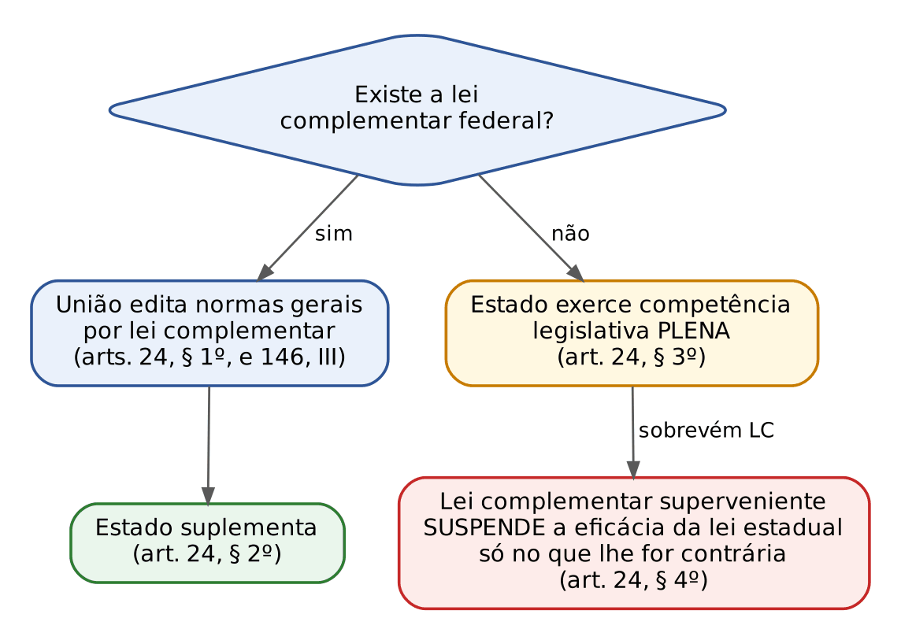
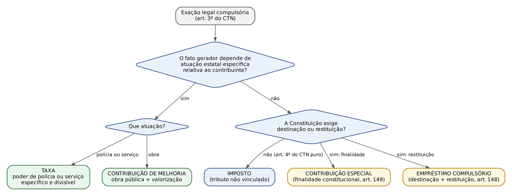

# CAPÍTULO 01 — SISTEMA TRIBUTÁRIO NACIONAL E CONCEITO DE TRIBUTO: ATIVIDADE FINANCEIRA E TRIBUTAÇÃO, NORMAS GERAIS (ART. 146 DA CF), DEFINIÇÃO LEGAL DE TRIBUTO, NATUREZA JURÍDICA ESPECÍFICA, CLASSIFICAÇÕES, FISCALIDADE, EXTRAFISCALIDADE E PARAFISCALIDADE

:::INCIDENCIA
Pontos: TRF5 p. 6; TJRS p. 1; TJSC p. 1, 2. Nível B. Lote: 18 questões (FGV 14, FCC 4).
O que mais cai: literalidade do art. 3º do CTN (lacunas e alternativas trocando "compulsória", "lei", "plenamente vinculada"); o que é e o que NÃO é tributo segundo a jurisprudência (multa, compensação financeira, tarifa de água, FUSEX); art. 4º do CTN; classificação direto x indireto e progressivo x regressivo.
:::

| Subtema | FGV | FCC | Padrão de cobrança |
|---|---|---|---|
| Definição legal do art. 3º do CTN | 3 | 2 | lacunas e troca de palavras ("facultativa", "discricionária", "medida provisória", "em bens") |
| É ou não é tributo (jurisprudência) | 3 | 0 | compensação financeira, terreno de marinha, multa de trânsito, FGTS, FUSEX, tarifa de água, desconto de IPVA |
| Natureza jurídica específica (art. 4º) e destinação | 0 | 2 | "dentre outras formas"; destinação vinculada das contribuições |
| Classificações econômicas (direto x indireto; progressivo x regressivo x neutro; extrafiscalidade) | 6 | 0 | associação de conceitos; afirmações sobre IR, ICMS, IPI, IPTU |
| Sistema Tributário, atividade financeira e carga tributária | 2 | 1 | noção de STN; carga tributária bruta; curva de Laffer |

## 01.1 Atividade financeira do Estado e tributação

### 01.1.1 Receitas originárias e derivadas

O Estado precisa de dinheiro para existir e para cumprir suas tarefas. A ciência das finanças classifica as receitas públicas pelo regime jurídico em que são obtidas. Receitas originárias são as que o Estado aufere explorando o próprio patrimônio, em posição semelhante à de um particular: o aluguel de um imóvel público, o resultado de empresas estatais, a compensação pela exploração de recursos naturais da União. Receitas derivadas são as que o Estado extrai do patrimônio alheio pelo poder de império, por força de lei e independentemente da vontade do devedor: os tributos e as multas.

Para o civilista, a chave é a fonte imediata da obrigação: contrato no aluguel, lei no imposto de renda. Note que a distinção é de regime jurídico, e não dos polos: um ente público pode pagar aluguel a outro, e uma pessoa jurídica de direito público pode ser contribuinte (respeitadas as imunidades; ver Cap. 6).

O Brasil é um Estado fiscal: financia-se predominantemente por tributos, e não por receitas patrimoniais (como faria o chamado Estado patrimonial, que vive, por exemplo, de *royalties* de petróleo).

### 01.1.2 Tributo como instrumento: do Estado liberal ao Estado social

No Estado liberal, o tributo deveria ser neutro, mero meio de obter recursos. No Estado social, percebeu-se que nenhum tributo é neutro (altera preços e decisões) e que esses efeitos podem ser usados deliberadamente: majorar o imposto de importação para proteger a indústria, reduzir o IPI de automóveis para preservar empregos, graduar o IR para redistribuir renda. Daí a distinção entre fiscalidade e extrafiscalidade (1.7.3) e a ideia de que a tributação pode reduzir ou agravar desigualdades (1.7.2).

### 01.1.3 Carga tributária

Carga tributária bruta (CTB) é a razão entre o total de tributos arrecadados por todas as esferas de governo e o produto interno bruto (PIB), num período. Três observações são cobradas. Primeira: a CTB bruta não desconta transferências do governo às famílias (assistência, subsídios); quem as deduz é o conceito de carga tributária líquida. Segunda: as transferências intergovernamentais (FPE, FPM, cota-parte do ICMS) não alteram a CTB do governo geral, porque apenas deslocam receita já arrecadada de um ente para outro; elas importam para a repartição de receitas (ver Cap. 7). Terceira: no Brasil, a maior parcela da arrecadação é da União, e não da soma de Estados e Municípios. O § 4º do art. 145 da CF (1.2.2) acrescentou um dado qualitativo: não importa só quanto se arrecada, mas sobre quem a carga recai.

:::QUESTAO FGV 2024 — Câmara dos Deputados — Consultor de Orçamento e Fiscalização Financeira (Q2512356)
Cobrou-se, em itens V/F, o conceito de carga tributária bruta (CTB), a partir do dado de que ela atingiu 33,71% do PIB em 2022.
Gabarito: C (F, F, F, V). Primeiro item falso: a CTB bruta NÃO exclui transferências de assistência e subsídios. Segundo item falso: a maior parte da CTB é federal. Terceiro item falso: aumentar a cota do FPE só redistribui receita entre entes; a CTB do governo geral não muda. Quarto item verdadeiro: a CTB do governo central não é afetada por variação de alíquota do ICMS, que é estadual.
Armadilha: confundir repartição de receitas com aumento de carga.
:::

:::QUESTAO FCC 2024 — PIAUIPREV — Analista Previdenciário (Q3884643)
Pediu-se a relação correta entre tributação e atividade econômica.
Gabarito: D. A elevação das alíquotas, a partir de certo patamar, reduz a arrecadação global: é a curva de Laffer (o excesso de carga desestimula a atividade tributada e estimula a evasão).
Por que as demais erram: o ônus de um imposto sobre consumo NÃO é sempre integralmente suportado pelo consumidor (depende da elasticidade da oferta e da demanda); o efeito Olivera-Tanzi diz o contrário do enunciado (em inflação alta, a arrecadação REAL cai, pela defasagem entre o fato gerador e o recolhimento); tributo regressivo pesa proporcionalmente MENOS à medida que a renda sobe; "efeito Laffer" não designa resultado anticíclico do imposto progressivo.
:::

## 01.2 O Sistema Tributário Nacional

### 01.2.1 Noção e estrutura constitucional

Sistema Tributário Nacional (STN) é o conjunto de normas, constitucionais e infraconstitucionais, que disciplina o poder de tributar: quem pode criar tributos, quais, com que limites, e como a receita se reparte. Ele está desenhado essencialmente na Constituição (arts. 145 a 162, no capítulo "Do Sistema Tributário Nacional", além de dispositivos esparsos como os arts. 177, § 4º, 195 e 239) e é detalhado por leis complementares (CTN, LC 87/1996, LC 116/2003, LC 214/2025 e outras) e pelas leis de cada ente.

Uma característica brasileira cobrada é a rigidez: a Constituição de 1988 desce a minúcias que, em outros países, ficam com o legislador. Ela distribui competências de forma exaustiva entre União, Estados, Distrito Federal e Municípios, de modo que o ente não pode criar tributo fora do que a Constituição lhe atribuiu (competência é matéria do Cap. 4); arrola as limitações ao poder de tributar (princípios e imunidades, Caps. 5 e 6) e reparte receitas (Cap. 7). Esse desenho é a expressão tributária do federalismo fiscal: para que os entes sejam autônomos, precisam de fontes próprias de receita e de participação nas receitas alheias.

A seção "Dos princípios gerais" (arts. 145 a 149-C) contém: as espécies tributárias atribuídas a todos os entes (art. 145), a reserva de lei complementar (arts. 146 e 146-A), os empréstimos compulsórios (art. 148), as contribuições especiais (arts. 149, 149-A, 149-B e 149-C). Depois vêm as limitações (arts. 150 a 152), os impostos de cada ente (arts. 153 a 156-B) e a repartição de receitas (arts. 157 a 162).

:::QUESTAO FGV 2024 — Prefeitura de Nova Iguaçu — Auditor Fiscal do Tesouro Municipal (Q3039623)
Pediu-se a afirmação correta sobre o STN da Constituição de 1988.
Gabarito: C: o STN é subsistema do ordenamento, delineado essencialmente pela Constituição e detalhado pela legislação infraconstitucional, para o exercício do poder de tributar sobre bases econômicas.
Armadilhas das demais: a Constituição NÃO restringiu garantias do contribuinte (ampliou-as); NÃO permite que Estados e Municípios criem tributos não previstos (competência residual é só da União, art. 154, I); NÃO extinguiu a repartição de receitas; NÃO centralizou os tributos na União.
:::

### 01.2.2 Princípios gerais: panorama e as novidades da EC 132/2023

Os princípios em espécie (legalidade, anterioridade, isonomia, capacidade contributiva, não confisco etc.) são estudados no Cap. 5. Aqui basta o mapa do art. 145, que a reforma tributária enriqueceu com dois parágrafos.

:::LEI CF, art. 145, §§ 3º e 4º (incluídos pela EC 132/2023)
§ 3º O Sistema Tributário Nacional deve observar os princípios da simplicidade, da transparência, da justiça tributária, da cooperação e da defesa do meio ambiente.
§ 4º As alterações na legislação tributária buscarão atenuar efeitos regressivos.
:::

O § 3º vale para TODO o sistema, e não apenas para os novos tributos sobre consumo. A simplicidade combate a complexidade de normas e obrigações acessórias; a transparência se liga ao dever de o contribuinte conhecer a carga embutida no preço; a justiça tributária remete à capacidade contributiva e à isonomia; a cooperação alcança tanto a relação Fisco-contribuinte quanto a relação entre entes (o Comitê Gestor do IBS é exemplo de cooperação federativa); a defesa do meio ambiente legitima tratamento tributário diferenciado conforme o impacto ambiental (a própria EC 132 autorizou, por exemplo, alíquotas de IPVA diferenciadas pelo impacto ambiental; ver Cap. 30). O § 4º é diretriz dirigida ao legislador de reforma: as mudanças devem caminhar no sentido de reduzir a regressividade (1.7.2). Os princípios específicos do IBS e da CBS (neutralidade, destino, não cumulatividade ampla) estão no Cap. 32.

:::PEGADINHA Os cinco princípios do § 3º
A lista literal é: simplicidade, transparência, justiça tributária, cooperação e defesa do meio ambiente. A FCC trocou "transparência" por "neutralidade" (Q3745773, PGE-MT 2025: a alternativa errada citava neutralidade; o gabarito era o § 4º, atenuar efeitos regressivos). A neutralidade existe na reforma, mas como princípio informador do IBS e da CBS na LC 214/2025, e não na lista do art. 145, § 3º. Ver também Q3158449 (FGV 2024, gabarito com a lista literal).
:::

:::DICA Como a FGV cobra os novos princípios
Na SEFAZ-RS 2025 (Q3154671), a FGV considerou correta só a afirmação de que o Comitê Gestor do IBS concretiza a cooperação, e erradas as de que a simplicidade valeria apenas para os tributos sobre consumo e de que a defesa do meio ambiente impediria regimes favorecidos. Na SEFAZ-PR 2025 (Q3363392), considerou inconstitucional elevar o ICMS de alimentos básicos por contrariar o dever de atenuar efeitos regressivos (o gabarito é discutível, porque o § 4º é diretriz programática; ver nota). Na magistratura (TJ-TO 2025, Q3453289), cobrou a alíquota menor de IPVA para veículo elétrico como finalidade EXTRAFISCAL autorizada expressamente pela Constituição (e não "parafiscal", nem fundada só no princípio genérico do meio ambiente).
:::

## 01.3 Normas gerais e reserva de lei complementar (arts. 146 e 146-A da CF)

### 01.3.1 Por que a Constituição exige lei complementar

Numa federação com mais de cinco mil Municípios, 26 Estados, o Distrito Federal e a União, cada um legislando sobre os próprios tributos, seria o caos se cada ente pudesse definir, a seu modo, o que é lançamento, quando ocorre a decadência ou quem é contribuinte do ICMS. A Constituição resolve isso reservando a uma lei complementar, aprovada por maioria absoluta do Congresso (art. 69), a tarefa de uniformizar o essencial. Essa lei complementar não é "federal" no sentido de valer só para a União: é lei NACIONAL, editada pelo Congresso para todos os entes. A doutrina distingue: lei federal (vincula só a União, como a lei do imposto de importação) e lei nacional (vincula todos os entes, como o CTN).

O art. 146 tem três funções, que a doutrina sintetiza como a função de dirimir conflitos de competência (inciso I), a de regular as limitações constitucionais ao poder de tributar (inciso II) e a de estabelecer normas gerais (inciso III).

:::LEI CF, art. 146, III (redação vigente)
III - estabelecer normas gerais em matéria de legislação tributária, especialmente sobre:
a) definição de tributos e de suas espécies, bem como, em relação aos impostos discriminados nesta Constituição, a dos respectivos fatos geradores, bases de cálculo e contribuintes;
b) obrigação, lançamento, crédito, prescrição e decadência tributários;
c) adequado tratamento tributário ao ato cooperativo praticado pelas sociedades cooperativas, inclusive em relação aos tributos previstos nos arts. 156-A e 195, V;
d) definição de tratamento diferenciado e favorecido para as microempresas e para as empresas de pequeno porte, inclusive regimes especiais ou simplificados no caso dos impostos previstos nos arts. 155, II, e 156-A, das contribuições sociais previstas no art. 195, I e V, e § 12 e da contribuição a que se refere o art. 239.
:::

| Inciso ou alínea | Conteúdo | Exemplo concreto e jurisprudência |
|---|---|---|
| I — conflitos de competência | evitar que dois entes tributem o mesmo fato | lista de serviços do ISS (LC 116/2003) separando ISS de ICMS; ver Caps. 4 e 28 |
| II — limitações ao poder de tributar | regular o que a Constituição limita | requisitos das imunidades de entidades de educação e assistência (art. 14 do CTN); ver Cap. 6 |
| III, a — definição de tributos e espécies; fato gerador, base e contribuinte dos IMPOSTOS | moldura de cada imposto | CTN, LC 87/1996 (ICMS), LC 116/2003 (ISS). NÃO se estende às contribuições (Tema 415 do STF, abaixo) |
| III, b — obrigação, lançamento, crédito, prescrição e decadência | regras do crédito tributário | SV 8 (ver Cap. 15); Tema 874 do STF (v. Cap. 13) |
| III, c — ato cooperativo | tratamento "adequado" | Tema 516 do STF (abaixo) |
| III, d — ME e EPP | tratamento diferenciado | LC 123/2006 (Simples Nacional); ver Cap. 31 |
| § 1º a § 3º — regime único de arrecadação | opcional, recolhimento unificado, IBS e CBS por fora ou por dentro | Simples Nacional e reforma; ver Caps. 31 e 33 |
| Art. 146-A | critérios especiais de tributação para prevenir desequilíbrios da concorrência | "pode" (faculdade), sem prejuízo de lei ordinária da União com igual objetivo |

### 01.3.2 A jurisprudência sobre o alcance do art. 146

Três linhas do STF definem o que é e o que não é matéria reservada. A primeira é a do Tema 874: lei ordinária não pode retirar o efeito suspensivo que o CTN dá ao parcelamento, porque "crédito tributário" é matéria reservada à lei complementar pelo art. 146, III, b (v. Cap. 13). As outras duas:

:::JURIS STF, Tema 415 (RE 1.053.574, j. 25/10/2019)
Há reserva de lei complementar apenas nos casos taxativamente indicados na Constituição. A alínea a do art. 146, III, exige lei complementar para fato gerador, base de cálculo e contribuintes dos IMPOSTOS discriminados; não há reserva de lei complementar para a definição desses elementos nas contribuições do art. 149. (O caso concreto, repasse de PIS e COFINS nas faturas de serviços públicos, é tratado no Cap. 26.)
:::

:::JURIS STF, Tema 516 (RE 597.315, j. 25/5/2026)
O "adequado tratamento tributário ao ato cooperativo" (art. 146, III, c) NÃO significa imunidade: veda-se apenas tributar as cooperativas de forma mais onerosa que as demais pessoas jurídicas. Foi declarada constitucional a contribuição do art. 1º, II, da LC 84/1996, a cargo das cooperativas de trabalho (lei já revogada pela Lei 9.876/1999).
:::

Outros desdobramentos pertencem a capítulos próprios e aqui só se indicam: a Súmula Vinculante 8 (prescrição e decadência só por lei complementar; ver Cap. 15); a constitucionalidade do art. 40 da LEF, lei ordinária, quanto à prescrição intercorrente (ver Cap. 22; cobrado no TRF3 2025, Q3179567); a necessidade de lei complementar para o ITCMD com elemento estrangeiro (Tema 825 do STF; ver Cap. 30) e para o DIFAL do ICMS (ver Cap. 27).

:::ATENCAO Lei complementar e lei ordinária não têm hierarquia: têm campos diferentes
A intuição de quem vem do CPC ("lei complementar está acima da ordinária") engana. O critério é material: o que a Constituição reserva à lei complementar a lei ordinária não pode tratar (há inconstitucionalidade formal, como no Tema 874); o que não é reservado pode ser tratado por lei ordinária, ainda que tenha sido veiculado por lei complementar, e essa lei complementar, nesse ponto, é apenas formalmente complementar e pode ser alterada por lei ordinária posterior. Também é vedada medida provisória sobre matéria reservada à lei complementar (art. 62, § 1º, III).
:::

### 01.3.3 O CTN: lei ordinária recepcionada como lei complementar

O CTN (Lei 5.172/1966) foi votado como lei ordinária, sob a Constituição de 1946 (o art. 1º do Código menciona a EC 18/1965). Como, a partir de 1967 e sobretudo na Constituição de 1988 (art. 146), as normas gerais passaram a ser reservadas à lei complementar, o CTN foi recepcionado com status (força) de lei complementar: formalmente ordinário, materialmente complementar. Consequência prática: suas normas gerais só podem ser alteradas por lei complementar (por isso as grandes reformas do CTN vieram pelas LC 104/2001, 118/2005 e, mais recentemente, pela LC 214/2025, que deu nova redação ao art. 9º, IV, por exemplo). Na recepção não importa a forma do ato antigo, mas a compatibilidade material com a nova ordem; a forma exigida passa a ser a da Constituição nova.

:::PEGADINHA O "Código Tributário Municipal" não vira lei complementar
A FGV (Procurador de Vitória 2024, Q3044204) afirmou, como distrator, que o Código Tributário Municipal teria sido recepcionado com status de lei complementar e só poderia ser alterado por lei complementar. ERRADO: a recepção do CTN como lei complementar decorre do art. 146 da CF, que trata de normas gerais NACIONAIS. O código do Município é lei ordinária local e pode ter isenção revogada por lei ordinária (o gabarito tratava da anterioridade, matéria do Cap. 5).
:::

### 01.3.4 Normas gerais e competência concorrente (art. 24 da CF)

O direito tributário é matéria de competência legislativa concorrente (art. 24, I). A União edita normas gerais (§ 1º); os Estados suplementam (§ 2º); inexistindo lei federal de normas gerais, os Estados exercem competência legislativa plena para atender a suas peculiaridades (§ 3º); a superveniência da lei federal sobre normas gerais suspende a eficácia da lei estadual no que lhe for contrário (§ 4º). Suspende, não revoga: se a lei de normas gerais deixar de existir, a lei estadual volta a produzir efeitos naquilo em que ficara suspensa. O caso clássico é o IPVA, que jamais teve lei complementar de normas gerais e é cobrado com base na competência plena dos Estados.

:::EXEMPLO Lei estadual anterior e lei complementar superveniente
O Estado Alfa, sem lei complementar de normas gerais sobre certo imposto, edita em 2024 lei completa sobre ele. Em 2025, a União edita a lei complementar de normas gerais, que diverge da lei estadual em dois pontos.
Passo 1: a lei de 2024 foi editada validamente, em competência plena (art. 24, § 3º).
Passo 2: a lei complementar não revoga a estadual (entes diferentes não se revogam): suspende-lhe a eficácia (§ 4º).
Passo 3: a suspensão é parcial: só os dois pontos conflitantes ficam sem eficácia; o restante e o que for matéria específica do Estado continuam valendo.
Foi exatamente o gabarito da FCC (SEFAZ-MT 2026, Q3947206: alternativa E).
:::

Atenção: a competência plena do § 3º não dispensa a lei complementar quando a Constituição a exige como condição específica para o exercício da competência (raciocínio do Tema 825, sobre o ITCMD com elemento estrangeiro; ver Cap. 30).

:::SENTENCA Alegação de inconstitucionalidade formal por invasão de reserva de lei complementar
Onde aparece: MS ou anulatória em que o contribuinte sustenta que lei ordinária (federal, estadual ou municipal) tratou de prescrição, decadência, suspensão da exigibilidade, fato gerador ou base de impostos.
O que fundamentar: (1) identificar a alínea do art. 146, III, em jogo; (2) verificar se o tema é norma GERAL reservada ou disciplina do próprio tributo pelo ente competente; (3) aplicar o precedente (SV 8, Tema 874, Tema 415). O controle é difuso e incidental: declara-se a inconstitucionalidade como fundamento, não no dispositivo (observada a cláusula de reserva de plenário nos tribunais).
Redação-modelo: "A lei ordinária local, ao condicionar a suspensão da exigibilidade decorrente do parcelamento à prestação de garantia, disciplinou matéria de crédito tributário reservada à lei complementar (art. 146, III, b, da CF), na linha do Tema 874 do STF; afasto, incidentalmente, a sua aplicação."
Erro comum: tratar como inconstitucional toda lei ordinária sobre fato gerador de CONTRIBUIÇÃO (não há reserva; Tema 415) ou exigir lei complementar para o Município fixar a base de cálculo do IPTU (cabe à lei municipal, respeitada a moldura do CTN).
:::

## 01.4 O conceito legal de tributo (art. 3º do CTN)

### 01.4.1 A definição e seus elementos

O Brasil tem definição LEGAL de tributo, e ela é a mais cobrada do capítulo.

:::LEI CTN, art. 3º
Tributo é toda prestação pecuniária compulsória, em moeda ou cujo valor nela se possa exprimir, que não constitua sanção de ato ilícito, instituída em lei e cobrada mediante atividade administrativa plenamente vinculada.
:::

| Elemento | O que significa | O que exclui | Remissão |
|---|---|---|---|
| Prestação pecuniária, em moeda ou cujo valor nela se possa exprimir | o objeto é dinheiro | tributo *in natura* (em bens) e *in labore* (em trabalho) | dação de imóveis (art. 156, XI) e dação de móveis por lei local: Cap. 14 |
| Compulsória | nasce da lei, não da vontade | obrigações contratuais (aluguel, tarifa, preço) | preço público e tarifa: Cap. 2 |
| Que não constitua sanção de ato ilícito | o fato gerador é lícito | multas, perdimento | multa tributária: Cap. 11 |
| Instituída em lei | só lei (ou ato com força de lei) cria tributo | decreto, portaria, convênio | legalidade e exceções: Cap. 5 |
| Cobrada mediante atividade administrativa plenamente vinculada | o Fisco não escolhe se cobra | discricionariedade, juízo de conveniência | lançamento: Cap. 12 |

#### Prestação pecuniária

O tributo é pago em dinheiro. A expressão "ou cujo valor nela se possa exprimir" NÃO autoriza tributo pago em sacas de café ou em horas de trabalho; serve para admitir indexadores (a extinta UFIR, as unidades fiscais estaduais e municipais) e as formas de extinção expressamente previstas, como a dação em pagamento de bens imóveis (art. 156, XI, do CTN). O STF admitiu que lei do ente crie hipóteses de extinção não previstas no CTN, inclusive dação de bens móveis, desde que não se burle a licitação (detalhes no Cap. 14).

#### Prestação compulsória

A obrigação tributária é *ex lege*: o fato previsto na lei ocorre e a obrigação nasce, sem consentimento. É isso que separa o tributo do preço público e da tarifa, cuja fonte imediata é um contrato ou ato de adesão (o usuário escolhe usar o serviço prestado por concessionária). O teste prático: a vontade do devedor participa do nascimento da obrigação? Se sim, não é tributo.

#### Que não constitua sanção de ato ilícito

Tributo e multa são receitas derivadas, mas são opostos: a multa é, por definição, a sanção por ato ilícito; o tributo não pode sê-lo. Duas consequências cobradas:

- O legislador não pode usar o tributo como castigo. Majorar o IPTU do proprietário que não constrói muros e passeios, como penalidade, é inconstitucional: a falta do muro pode ser punida com MULTA administrativa, nunca com alíquota maior "a título de imposto". Pela mesma razão, o Município não pode cobrar, como tributo, o que é multa por descumprimento de dever administrativo (por exemplo, multa por falta de inscrição imobiliária).
- O inverso é permitido: a lei pode conceder desconto a quem cumpre a lei. O STF, em medida cautelar na ADI 2.301 (j. 27/9/2000), recusou suspender lei do Rio Grande do Sul que dava desconto de IPVA a quem não cometeu infração de trânsito: o Estado pode instituir incentivo fiscal sobre tributo de sua competência para estimular o cumprimento das leis de trânsito. Desconto premial não é sanção.

Não confundir a hipótese de incidência ilícita (proibida) com o fato gerador praticado de modo ilícito (tributável). O IR incide sobre a renda do traficante porque o fato gerador é "auferir renda", fato em si lícito; a origem ilícita é irrelevante (art. 118, I, do CTN; *pecunia non olet*; ver Cap. 9). Na mesma linha, a FGV (MPRJ 2025, Q3532421) considerou que o IPTU de unidades construídas irregularmente deve ser lançado contra os possuidores atuais, e não recusado por causa da ilicitude da construção.

:::QUESTAO FGV 2024 — SES-MT — Advogado (Q2482650)
Pediu-se a afirmação correta à luz do conceito de tributo.
Gabarito: D: a remuneração dos serviços de água e esgoto prestados por concessionária tem natureza de tarifa ou preço público.
Armadilhas: "é legítimo aumentar alíquotas de IPTU como penalidade pela falta de muros" (ERRADO: tributo não é sanção); "é ilegal desconto de IPVA a quem não cometeu infrações" (ERRADO: desconto premial é válido, ADI 2.301-MC); "a compensação financeira pela exploração de recursos minerais é tributo" (ERRADO: receita patrimonial; ver 1.5).
No mesmo sentido: Q2351285 (FGV 2024, Câmara Municipal de São Paulo, Procurador Legislativo): corretos os itens I (é vedado exigir multa por falta de inscrição imobiliária a título de tributo) e II (desconto de IPVA a quem não comete infrações); errado o III (tarifa de água não é tributo); gabarito B.
:::

#### Instituída em lei

Não há exceção para a INSTITUIÇÃO: todo tributo é criado por lei ordinária, lei complementar quando exigida (empréstimo compulsório, imposto residual, imposto sobre grandes fortunas, contribuições residuais) ou medida provisória com força de lei, observado o art. 62, § 2º. As exceções da Constituição dizem respeito apenas à ALTERAÇÃO de alíquotas de certos tributos por ato do Executivo (II, IE, IPI, IOF, CIDE-combustíveis e outros; ver Cap. 5). A FCC resume o ponto dizendo que o tributo "está sob a guarida do princípio da reserva legal".

#### Cobrada mediante atividade administrativa plenamente vinculada

Ocorrido o fato gerador, a autoridade DEVE cobrar: não avalia conveniência nem oportunidade, e responde funcionalmente se não lançar (art. 142, § 1º, do CTN, que era o parágrafo único até a renumeração feita pela LC 236/2026, sem mudança de conteúdo; ver Cap. 12). A palavra "vinculado" aparece com três sentidos no direito tributário, e a confusão entre eles é armadilha recorrente.

| Expressão | Sentido | Exemplo |
|---|---|---|
| Cobrança vinculada (art. 3º do CTN) | a atividade de cobrar não é discricionária | vale para TODOS os tributos |
| Tributo vinculado (quanto ao fato gerador) | o fato gerador é uma atuação estatal relativa ao contribuinte | taxas e contribuição de melhoria (impostos são NÃO vinculados) |
| Arrecadação vinculada (quanto ao destino) | o produto tem destinação determinada | contribuições especiais, empréstimos compulsórios; os impostos têm, em regra, receita não vinculada (art. 167, IV) |

:::QUESTAO FGV 2024 — AL-SC — Analista Legislativo III, Economista (Q2486144)
Questão de lacunas do art. 3º do CTN.
Gabarito: C (tributo, compulsória, não constitua, lei).
Armadilhas: "facultativa", "constitua" sanção, "norma infraconstitucional" (genérico demais: a exigência é de LEI) e "imposto" no lugar de "tributo" (imposto é espécie; tributo é o gênero; ver também Q2564504, FCC 2024).
No mesmo sentido, todas com o texto literal como gabarito: Q3604045 (FGV 2025, CFC; alternativa D; as erradas falavam em prestação "voluntária", "medida provisória", "em bens", "parcialmente vinculada"); Q3248839 (FGV 2024, EBSERH; alternativa A); Q3596220 (FCC 2025, TRT-2; alternativa B, "sob a guarida do princípio da reserva legal"; errada a que dizia "atividade LEGISLATIVA plenamente vinculada").
:::

## 01.5 O que não é tributo

A melhor forma de fixar o art. 3º é testá-lo contra figuras parecidas. O quadro abaixo reúne o que as bancas mais exploram.

| Figura | É tributo? | Por quê | Fonte |
|---|---|---|---|
| Multa (tributária, de trânsito, administrativa) | NÃO | sanção de ato ilícito | art. 3º do CTN |
| Compensação financeira e participação pela exploração de petróleo, gás, recursos hídricos e minerais (CFEM, *royalties*) | NÃO | receita patrimonial (originária): contrapartida pela exploração de bem da União (art. 20, § 1º, da CF) | STF, RE 228.800, j. 25/9/2001 |
| Taxa de ocupação, foro e laudêmio de terreno de marinha | NÃO (apesar do nome "taxa") | receita patrimonial pelo uso de bem da União | art. 4º, I, do CTN: o nome é irrelevante |
| Tarifa de água e esgoto prestados por concessionária | NÃO | tarifa ou preço público | STJ, Temas 251 e 253 (repetitivos); por isso a repetição segue o prazo do Código Civil (Súmula 412 do STJ) |
| Pedágio | NÃO (na forma cobrada por concessionárias) | preço público | ADI 800; ver Cap. 2 |
| Contribuição ao FGTS | NÃO | direito do trabalhador, destinado às contas vinculadas | Súmula 353 do STJ ("As disposições do Código Tributário Nacional não se aplicam às contribuições para o FGTS") |
| Contribuição compulsória ao Fundo de Saúde do Exército (FUSEX) | SIM | prestação pecuniária compulsória instituída por lei, cobrada dos militares; contribuição | jurisprudência reconhece a natureza tributária (ver nota) |
| Contribuição de terceiros (SESI, SENAI, SEBRAE etc.) | SIM | contribuição especial | ver Cap. 3 |

O FGTS merece uma linha a mais, porque a intuição falha. O STF, no ARE 709.212, substituiu a prescrição trintenária do FGTS pela quinquenal, mas pelo art. 7º, XXIX, da CF (créditos trabalhistas), e não por considerar o FGTS tributo; o CTN continua inaplicável.

:::QUESTAO FGV 2024 — TCE-PA — Auditor de Controle Externo (Q2564265)
Pediu-se qual figura tem natureza jurídica de tributo, segundo o CTN e a jurisprudência.
O que se pergunta: qual das cinco exações cumpre todos os elementos do art. 3º.
Aplicação: compensação financeira mineral (receita patrimonial), taxa de ocupação de terreno de marinha (receita patrimonial, "taxa" só no nome), multa de trânsito (sanção) e FGTS (Súmula 353 do STJ) são excluídas. Resta a contribuição ao FUSEX: compulsória, pecuniária, instituída em lei, não sancionatória.
Gabarito: D.
:::

:::PROCESSO Por que saber se a exação é tributo muda o processo
- Prazo: se é tributo, decadência e prescrição seguem o CTN (arts. 173 e 174; ver Cap. 15) e a repetição segue o art. 168 (ver Cap. 16); se não é, aplicam-se o Código Civil ou a lei específica (Súmula 412 do STJ, para tarifa de água e esgoto).
- Cobrança: a execução fiscal da Lei 6.830/1980 serve à dívida ativa tributária e à não tributária (multas, receitas patrimoniais); o rito é o mesmo, mas as garantias e preferências do crédito tributário (CTN, arts. 183 a 192; ver Cap. 18) e as regras de responsabilidade do CTN NÃO se estendem automaticamente à dívida não tributária.
:::

## 01.6 Natureza jurídica específica do tributo (art. 4º do CTN)

### 01.6.1 A regra do CTN: o fato gerador manda

:::LEI CTN, art. 4º
A natureza jurídica específica do tributo é determinada pelo fato gerador da respectiva obrigação, sendo irrelevantes para qualificá-la:
I - a denominação e demais características formais adotadas pela lei;
II - a destinação legal do produto da sua arrecadação.
:::

Cada espécie tributária tem regime próprio de competência, limites e forma; o art. 4º impede que o legislador burle esse regime dando nome falso à exação. "Fato gerador" é a situação descrita na lei cuja ocorrência faz nascer a obrigação de pagar (estudo completo no Cap. 9). Se a lei chama de "taxa" uma cobrança cujo fato gerador é ser proprietário de imóvel, trata-se de imposto disfarçado, e será examinada como imposto (provavelmente inconstitucional, por invadir competência alheia ou repetir base de imposto existente).

A doutrina completa o art. 4º com o art. 145, § 2º, da CF (as taxas não podem ter base de cálculo própria de impostos): o fato gerador e a base de cálculo devem ser analisados em conjunto, porque a base de cálculo confirma, infirma ou afirma o verdadeiro fato gerador. Uma "taxa de limpeza" calculada sobre o valor venal do imóvel revela, pela base, que o fato tributado é a propriedade.

:::EXEMPLO Identificando a espécie pelo fato gerador e pela base
O Município Beta institui a "contribuição de conservação viária", devida anualmente por todo proprietário de veículo licenciado no Município, calculada em 1% do valor venal do veículo, com receita destinada a um fundo de manutenção de ruas.
Passo 1 (nome): "contribuição" não importa (art. 4º, I).
Passo 2 (fato gerador): ser proprietário de veículo, situação que independe de qualquer atuação estatal relativa ao contribuinte: tributo NÃO vinculado, logo, imposto.
Passo 3 (base): valor venal do veículo, base típica do IPVA, o que confirma o diagnóstico.
Passo 4 (destinação): o fundo não transforma o imposto em contribuição; além disso, vincular receita de imposto a fundo é vedado (art. 167, IV, da CF).
Conclusão: é imposto municipal sobre propriedade de veículos, sem previsão no art. 156 da CF, e o Município não tem competência residual: inconstitucional.
:::

### 01.6.2 A ressalva constitucional: contribuições e empréstimos compulsórios

O art. 4º do CTN foi escrito para um sistema tripartido (art. 5º do CTN: impostos, taxas e contribuições de melhoria). Na Constituição de 1988, o fato gerador não distingue certas contribuições dos impostos (CSLL e IRPJ incidem sobre o lucro); o que os separa é justamente o que o art. 4º, II, manda ignorar: a finalidade e a destinação. Por isso a doutrina majoritária e a jurisprudência do STF (que adota a classificação em cinco espécies, a teoria pentapartida; ver Cap. 2) entendem que o art. 4º, II, não se aplica às contribuições especiais e aos empréstimos compulsórios. Para estes, a destinação é elemento constitucional da própria identidade do tributo:

- empréstimo compulsório: "A aplicação dos recursos provenientes de empréstimo compulsório será vinculada à despesa que fundamentou sua instituição" (art. 148, parágrafo único), além do dever de restituição;
- contribuições especiais: são instituídas "como instrumento de sua atuação nas respectivas áreas" (art. 149, *caput*), isto é, para custear finalidade constitucionalmente qualificada (seguridade social, intervenção no domínio econômico, interesse de categoria profissional); algumas têm destino expresso na Constituição (art. 177, § 4º, II, para a CIDE-combustíveis; art. 239, para o PIS/PASEP).

Atenção à sutileza: uma coisa é a destinação PREVISTA NA LEI (que integra a validade da contribuição: a lei que institui contribuição sem finalidade constitucional, ou com destino alheio a ela, é inconstitucional); outra é o desvio posterior na execução orçamentária ou a desvinculação feita pela própria Constituição. Esta última não gera direito do contribuinte à devolução (Tema 277 do STF, sobre a DRU; v. Cap. 3).

:::QUESTAO FCC 2024 — SEAD-PI — Analista Governamental, Planejamento e Orçamento (Q3736977)
Três afirmações "segundo o CTN": (I) definição de tributo com cobrança "vinculada ou discricionária"; (II) natureza específica determinada, "dentre outras formas", pelo fato gerador; (III) irrelevância da destinação legal do produto.
Gabarito: D (só III).
Armadilha: o item II parece certo, mas o CTN diz que a natureza é determinada PELO fato gerador, critério único; "dentre outras formas" torna a afirmação falsa. O item I falha no "ou discricionária". Como a questão pede "segundo o CTN", o item III está certo, apesar da ressalva constitucional para contribuições e empréstimos compulsórios.
:::

:::QUESTAO FCC 2025 — TRT-15 — Analista Judiciário, Contabilidade (Q3288596)
Pediu-se a alternativa INCORRETA sobre o sistema tributário.
Gabarito: C. A afirmação de que as contribuições ao PASEP devem ser destinadas exclusivamente aos servidores, vedado o financiamento do seguro-desemprego e do abono salarial, é falsa: o art. 239 da CF destina a arrecadação do PIS/PASEP justamente ao programa do seguro-desemprego, a outras ações da previdência social e ao abono salarial.
As demais estavam corretas, entre elas a destinação da CIDE-combustíveis ao financiamento de programas de infraestrutura de transportes (art. 177, § 4º, II, c).
Lição para este capítulo: nas contribuições, a destinação é dado constitucional e é cobrada.
:::

## 01.7 Classificações dos tributos

### 01.7.1 Quadro geral

| Critério | Classes | Ideia central e exemplos |
|---|---|---|
| Fato gerador (vinculação a atuação estatal) | vinculados x não vinculados | taxa e contribuição de melhoria são vinculados; impostos são não vinculados (art. 16 do CTN); contribuições especiais e empréstimos compulsórios podem ter um ou outro tipo de fato gerador |
| Destino da arrecadação | arrecadação vinculada x não vinculada | contribuições e empréstimos compulsórios: vinculada; impostos: não vinculada (art. 167, IV, com as exceções da própria Constituição); taxas: a doutrina diverge |
| Repercussão do encargo financeiro | diretos x indiretos | direto: quem paga suporta (IR, IPTU); indireto: o contribuinte de direito repassa o ônus ao de fato no preço (ICMS, IPI, ISS) |
| Consideração de aspectos pessoais | pessoais x reais | pessoais consideram a situação do contribuinte (IR: dependentes, despesas médicas); reais incidem sobre a coisa ou a operação (IPTU, IPVA, ITR, ICMS, IPI) |
| Relação entre carga e renda | progressivos, proporcionais, regressivos | ver 1.7.2 |
| Finalidade | fiscais, extrafiscais, parafiscais | ver 1.7.3 |
| Ente competente; modo de exercício | federais, estaduais, municipais; privativos, comuns, residuais | ver Cap. 4 |
| Bases econômicas (classificação do CTN) | comércio exterior; patrimônio e renda; produção e circulação; impostos especiais | Título III do Livro I do CTN |

#### Diretos e indiretos

É a classificação econômica de maior repercussão jurídica. No tributo indireto há dois personagens: o contribuinte de direito (o comerciante que a lei obriga a recolher o ICMS) e o contribuinte de fato (o consumidor, que suporta o ônus embutido no preço). A distinção tem reflexo processual direto: na repetição de indébito de tributo indireto, o contribuinte de direito só recupera o que pagou se provar que assumiu o encargo ou estiver autorizado por quem o suportou (art. 166 do CTN; desenvolvimento no Cap. 16). Para tributo direto não se exige essa prova (por isso a FGV marcou como errada, na Q3841703, a exigência de provar o não repasse em tributo direto).

:::QUESTAO FGV 2025 — CGE-SP — Auditor Estadual de Controle (Q3780939)
Pediu-se a afirmação correta sobre impostos diretos.
Gabarito: E: impostos diretos se relacionam à capacidade de pagamento do contribuinte, e seu fato gerador se liga à renda ou ao patrimônio.
Armadilhas: fato gerador ligado à comercialização de bens e serviços (é traço dos indiretos); IR e ICMS como exemplos de diretos (o ICMS é indireto); diretos como regressivos (tendem a ser progressivos ou proporcionais); ônus repassado a terceiros (é o indireto).
:::

:::QUESTAO FGV 2025 — AL-AM — Procurador (Q3777954)
Cinco afirmações sobre classificações de impostos.
Gabarito: B (I, II e IV). Corretos: II e IE como impostos sobre comércio exterior com nítida função extrafiscal; IPTU e ITR como impostos diretos sobre o patrimônio que admitem progressividade (pelo valor ou pela função social); IR como direto e progressivo.
Errado o V: o ISS NÃO incide sobre comunicação nem transporte intermunicipal e interestadual (ICMS) e as operações financeiras são campo do IOF.
Ponto sensível: a banca também considerou errado o III (ICMS e IPI como indiretos, com carga transferida ao consumidor e "por isso" regressivos). A justificativa provável é o nexo causal (a regressividade não decorre necessariamente da repercussão, e a seletividade atenua o efeito); trata-se de gabarito discutível (ver nota).
:::

### 01.7.2 Progressivo, proporcional, regressivo (e neutro)

O critério compara a fração da renda consumida pelo tributo em diferentes faixas de renda.

- Progressivo: a alíquota (e o peso relativo) cresce com a base ou com a renda; quem ganha mais entrega fração maior (IR das pessoas físicas; IPTU progressivo pelo valor, art. 156, § 1º, I; adicional do IRPJ sobre o lucro que excede certo valor, que a FGV chamou de aplicação da progressividade na Q3085993).
- Proporcional: alíquota única; o peso relativo é constante.
- Regressivo: o peso relativo DIMINUI à medida que a renda aumenta. É o efeito típico dos tributos sobre consumo: o mesmo tributo embutido no mesmo produto pesa muito mais para quem ganha pouco, porque essa pessoa gasta em consumo quase toda a renda.
- Neutro: em linguagem de finanças, tributo que não altera as decisões econômicas dos agentes nem a distribuição relativa de renda.

:::EXEMPLO Regressividade em números
Ana ganha 2.000 (dois mil) reais por mês; Bruno, 20.000 (vinte mil) reais. Ambos compram a mesma cesta de alimentos, com 200 (duzentos) reais de tributos embutidos no preço.
Para Ana, o tributo consome 200 ÷ 2.000 = 10% da renda; para Bruno, 200 ÷ 20.000 = 1%.
O valor nominal é idêntico, mas o peso relativo é dez vezes maior para Ana: tributação regressiva. É esse o efeito que o art. 145, § 4º, manda o legislador atenuar (por exemplo, com a cesta básica nacional com alíquota zero e o *cashback* do IBS e da CBS; ver Cap. 32).
A FCC usou essa lógica na Q3977887 (2026): dois trabalhadores de rendas diferentes pagando o mesmo tributo na compra do mesmo combustível ilustram o imposto regressivo.
:::

:::QUESTAO FGV 2024 — Câmara dos Deputados — Consultor de Orçamento e Fiscalização Financeira (Q2512375)
Pediu-se a descrição correta de diretos x indiretos e progressivos x regressivos.
Gabarito: C: tributos diretos como o IR são progressivos porque as alíquotas aumentam com a capacidade contributiva.
Armadilhas: indiretos "inerentemente progressivos" porque uniformes (a uniformidade sobre o consumo produz o efeito OPOSTO); IPI progressivo porque o rico consome mais em valor absoluto (confunde valor absoluto com peso relativo); diretos "geralmente regressivos" (troca as categorias).
No mesmo sentido, com associação de conceitos: Q3780938 (FGV 2025, CGE-SP; gabarito A, neutro, progressivo, regressivo) e Q3363060 (FGV 2025, SEFAZ-PR; gabarito B: progressividade reduz desigualdades; não cumulatividade compensa créditos das etapas anteriores e reduz o custo final; extrafiscalidade intervém na economia e protege o meio ambiente; neutralidade não interfere nas decisões dos agentes).
:::

### 01.7.3 Fiscalidade, extrafiscalidade e parafiscalidade

A classificação pela finalidade é a que os editais do TJRS e do TJSC mencionam expressamente.

| Finalidade | Objetivo predominante | Exemplos | Consequência jurídica |
|---|---|---|---|
| Fiscal | arrecadar recursos para os cofres do ente | IR, ICMS, ISS, IPVA | regime comum |
| Extrafiscal | induzir ou desestimular comportamentos (regular a economia, proteger a indústria, o meio ambiente, a função social da propriedade) | II, IE, IPI, IOF (alíquotas alteráveis pelo Executivo); ITR progressivo para terras improdutivas; IPTU progressivo no tempo (art. 182, § 4º, II); Imposto Seletivo; IPVA diferenciado pelo impacto ambiental | justifica exceções à legalidade e à anterioridade na alteração de alíquotas (Cap. 5) e diferenciações que, sem a finalidade, violariam a isonomia |
| Parafiscal | arrecadar para pessoa diversa do ente que institui o tributo, que aplica os recursos em atividade de interesse público | contribuições destinadas a serviços sociais autônomos (SESI, SENAI, SESC, SEBRAE) e a conselhos de fiscalização profissional | define quem tem legitimidade passiva na repetição (abaixo e Cap. 4) |

Três ideias evitam erros. Primeira: nenhum tributo é puramente fiscal ou extrafiscal; fala-se em finalidade PREPONDERANTE (o IR é fiscal, mas a progressividade lhe dá efeito redistributivo). Segunda: extrafiscalidade não é sanção; o tributo extrafiscal continua tendo fato gerador lícito (o IPTU progressivo no tempo do art. 182 incide sobre a propriedade, e não sobre o "ilícito" de não edificar; a progressividade é instrumento urbanístico autorizado pela própria Constituição). Terceira: na parafiscalidade, o essencial hoje é a destinação a ente diverso daquele que instituiu o tributo, havendo ou não delegação da capacidade de arrecadar.

:::QUESTAO FGV 2025 — AL-AM — Procurador (Q3777948)
Pediu-se a alternativa correta sobre tributos e espécies.
Gabarito: B: taxas e contribuições de melhoria são tributos vinculados, porque pressupõem atuação estatal relativa ao contribuinte.
Armadilhas: impostos como vinculados (são o oposto); empréstimo compulsório "facultativo" (todo tributo é compulsório); CIDE e contribuições corporativas como "impostos extrafiscais" (são contribuições especiais); extrafiscalidade como função "exclusivamente arrecadatória" (inverte o conceito).
:::

:::PROCESSO Parafiscalidade e legitimidade passiva na repetição
Quando a entidade beneficiária é mera destinatária da receita, sem capacidade tributária ativa (sem poder de fiscalizar e cobrar), ela não integra a relação tributária e não tem legitimidade passiva para a repetição: a ação é proposta contra o sujeito ativo (a União, nas contribuições de terceiros arrecadadas pela Receita Federal). É o que diz a Súmula 666 do STJ. Capacidade tributária ativa x competência: ver Cap. 4; repetição: Cap. 16.
:::

:::SENTENCA Natureza jurídica da exação como questão prejudicial
Onde aparece: anulatória, MS ou embargos à execução fiscal em que se discute se a cobrança é tributo (e, sendo, qual espécie): taxa que esconde imposto, "preço" que é taxa, contribuição sem finalidade.
O que fundamentar: (1) os elementos do art. 3º do CTN; (2) a espécie pelo fato gerador e pela base de cálculo (art. 4º do CTN e art. 145, § 2º, da CF), lembrando a relevância da finalidade para contribuições e empréstimos compulsórios; (3) a consequência (competência, legalidade, prazo de prescrição, garantias do crédito).
Redação-modelo: "Embora denominada 'taxa', a exação tem por fato gerador a propriedade do imóvel e por base de cálculo o seu valor venal, o que lhe confere natureza de imposto (art. 4º, I, do CTN e art. 145, § 2º, da CF), não previsto na competência do ente instituidor."
Erro comum: decidir pelo nome dado na lei ou pela destinação do fundo (irrelevantes para impostos e taxas) e esquecer que, se não for tributo, o prazo prescricional não é o do CTN.
:::

## 01.8 Resumo para revisão pré-prova

| Instituto | Regra | Exceções e detalhes | Fundamento |
|---|---|---|---|
| Receitas originárias x derivadas | originárias: exploração do patrimônio estatal (regime privado); derivadas: poder de império (tributos e multas) | compensação financeira e *royalties* são originárias | doutrina; STF, RE 228.800 |
| STN | subsistema desenhado pela CF e detalhado por LC e leis dos entes; rígido e exaustivo | competência residual só da União | arts. 145 a 162 da CF |
| Princípios do § 3º do art. 145 | simplicidade, transparência, justiça tributária, cooperação, defesa do meio ambiente | valem para todo o sistema; neutralidade NÃO está na lista | EC 132/2023 |
| § 4º do art. 145 | alterações devem buscar atenuar efeitos regressivos | diretriz ao legislador | EC 132/2023 |
| Art. 146 | LC: conflitos de competência, limitações, normas gerais (definição de tributos; FG, base e contribuintes dos IMPOSTOS; obrigação, lançamento, crédito, prescrição, decadência; ato cooperativo; ME e EPP) | reserva taxativa; contribuições do art. 149 dispensam LC para FG e base (Tema 415) | CF; Temas 874, 415, 516 do STF |
| LC x LO | sem hierarquia; campos materiais distintos | LC em matéria não reservada é alterável por LO; MP não trata de matéria de LC | art. 62, § 1º, III |
| CTN | lei ordinária recepcionada como LC (normas gerais); lei nacional | código tributário municipal NÃO é LC | art. 146 da CF; Q3044204 |
| Competência concorrente | União: normas gerais; Estado: suplementar; sem LC: competência plena; LC superveniente SUSPENDE a lei estadual no que for contrária | IPVA sem LC de normas gerais; ITCMD com elemento estrangeiro exige LC (Tema 825) | art. 24, §§ 1º a 4º |
| Conceito de tributo | prestação pecuniária, compulsória, em moeda ou valor nela exprimível, não sancionatória, instituída em lei, cobrada por atividade plenamente vinculada | nada de tributo *in natura* ou *in labore*; dação de imóveis é forma de extinção | art. 3º do CTN |
| Tributo x sanção | tributo não pode punir (IPTU maior por falta de muro é inválido) | desconto premial é válido (ADI 2.301-MC); renda ilícita é tributável (*pecunia non olet*) | arts. 3º e 118 do CTN |
| Não são tributos | multa; CFEM e *royalties*; taxa de ocupação, foro e laudêmio; tarifa de água e esgoto; pedágio; FGTS | FUSEX e contribuições de terceiros SÃO tributos | RE 228.800; Temas 251 e 253 do STJ; Súmulas 353 e 412 do STJ |
| Natureza específica | definida pelo fato gerador (cotejado com a base de cálculo); nome e destinação irrelevantes | destinação é essencial em contribuições e empréstimos compulsórios; desvinculação constitucional não gera repetição | art. 4º do CTN; arts. 145, § 2º, 148 e 149 da CF; Tema 277 |
| "Vinculado" | cobrança vinculada (todos); tributo vinculado (taxa, contribuição de melhoria); arrecadação vinculada (contribuições, empréstimos compulsórios) | impostos: não vinculados e de receita não vinculada | arts. 3º e 16 do CTN; art. 167, IV, da CF |
| Diretos x indiretos | direto: contribuinte suporta; indireto: repassa ao contribuinte de fato | indiretos: repetição condicionada (art. 166) | Cap. 16 |
| Pessoais x reais | pessoais consideram o contribuinte; reais, a coisa ou operação | "sempre que possível" os impostos terão caráter pessoal | art. 145, § 1º |
| Progressivo x regressivo | peso relativo cresce x diminui com a renda | consumo tende a ser regressivo; IR progressivo | art. 145, § 4º |
| Fiscal, extrafiscal, parafiscal | arrecadar; induzir comportamentos; arrecadar para terceiro | finalidade preponderante; extrafiscalidade não é sanção; destinatária sem capacidade ativa não é ré na repetição | Súmula 666 do STJ |

## 01.9 Artigos de lei incidentes

- Constituição Federal: arts. 20, § 1º; 24, I e §§ 1º a 4º; 30, II; 62, § 1º, III; 69; 145 (§§ 1º a 4º); 146 (I a III e §§ 1º a 3º); 146-A; 148, parágrafo único; 149, *caput*; 154, I; 156, § 1º; 167, IV; 177, § 4º, II; 182, § 4º, II; 239.
- Código Tributário Nacional (Lei 5.172/1966): arts. 1º a 5º; 16; 118, I; 142, § 1º (LC 236/2026); 156, XI; 166.
- ADCT: art. 76 (DRU, no Tema 277).
- Lei 4.320/1964: art. 9º (definição financeira de tributo, que inclui a destinação).
- Lei 9.430/1996: art. 73, parágrafo único (Tema 874).
- LC 84/1996, art. 1º, II (Tema 516); LC 123/2006 (art. 146, III, d).

## 01.10 Julgados, temas e súmulas do capítulo

- STF, Tema 415 (RE 1.053.574): reserva de LC é taxativa; FG, base e contribuintes de contribuições do art. 149 dispensam LC.
- STF, Tema 516 (RE 597.315): adequado tratamento ao ato cooperativo não é imunidade.
- STF, RE 228.800: compensação financeira pela exploração mineral tem natureza patrimonial, não tributária.
- STF, ADI 2.301-MC: desconto de IPVA a quem não comete infrações de trânsito é incentivo válido.
- STJ, Temas 251 e 253: tarifa de água e esgoto prestados por concessionária é preço público.
- Súmula 353 do STJ: o CTN não se aplica às contribuições para o FGTS.
- Súmula 666 do STJ: entidade mera destinatária de contribuição de terceiros não tem legitimidade passiva na restituição.

- Remissões: Tema 874 do STF, RE 917.285 (Cap. 13); Tema 277 do STF, RE 566.007 (Cap. 3); Súmula 412 do STJ (Cap. 2); Súmula Vinculante 8 (Cap. 15); ADI 800 e Súmula 545 do STF (Cap. 2); Tema 825 do STF (Cap. 30); art. 40 da LEF e Tema 390 do STF (Cap. 22); ADIs 1.917 e 2.405, dação em pagamento (Cap. 14); ARE 709.212, prescrição do FGTS (mencionado em 1.5, sem desenvolvimento).

:::NOTA Notas de verificação
Conferido no Planalto (22/10/2026): CTN, arts. 1º a 9º (arts. 3º a 5º sem alteração; art. 9º, IV, com redação da LC 214/2025) e CF, arts. 20, § 1º, 145, 146, 146-A, 148 e 149 (redações da EC 132/2023). Art. 24, §§ 1º a 4º, e arts. 62, § 1º, III, 167, IV, 177, § 4º, II (inclusive a alínea d, da EC 132/2023), 182, § 4º, II, e 239 da CF: conferido no Planalto em 22/10/2026 (paráfrases fiéis). CTN, arts. 16, 118, 142, 156 e 166: conferido no Planalto em 22/10/2026; a LC 236/2026 renumerou o parágrafo único do art. 142 para § 1º (texto corrigido) e o art. 156 ganhou em 2026 o inciso XII (sentença arbitral favorável transitada em julgado), sem mudança no inciso XI (dação de imóveis); arts. 16, 118 e 166 sem alteração.
Temas 874, 415 e 516 e a constitucionalidade do art. 40 da LEF conferidos na Sinopse TJSC 2026 e no Caderno do Dizer o Direito (Drive); Tema 277 conferido em repositório de teses (tesesesumulas.com.br); Súmula 353 do STJ e ARE 709.212 conferidos em Ricardo Alexandre (2026); Súmula 666 do STJ conferida em Ricardo Alexandre (2026), não no portal do STJ; RE 228.800 (j. 25/9/2001, "natureza patrimonial") conferido em repositório de jurisprudência (relator não informado na fonte); Temas 251 e 253 e Súmula 412 do STJ conferidos na Enciclopédia NUGEP do TJMG; ADI 2.301-MC (rel. Min. Marco Aurélio, j. 27/9/2000) conferida em parecer legislativo que transcreve o informativo; é decisão cautelar, sem mérito localizado.
NÃO citados por número, por falta de fonte vista: o precedente do STF sobre IPTU majorado pela falta de muros (a doutrina costuma citar o RE 94.001); o precedente sobre multa por falta de inscrição imobiliária cobrada como tributo; o julgado que reconhece a natureza tributária do FUSEX (a fonte localizada aponta o STJ e o TRF4, sem número confiável do STF); a natureza não tributária da taxa de ocupação de terreno de marinha (afirmada como orientação). A extensão do RE 228.800 (CFEM) aos *royalties* de petróleo e recursos hídricos é inferência pela identidade do art. 20, § 1º, da CF.
Gabaritos discutíveis: Q3777954 (item III considerado errado; a literatura econômica classifica ICMS e IPI como tendencialmente regressivos; a banca provavelmente rejeitou o nexo "por isso"); Q3363392 (a FGV extraiu inconstitucionalidade material do § 4º do art. 145, que tem redação de diretriz, "buscarão"); Q3780938 (definições de imposto progressivo e regressivo redigidas de modo impreciso no enunciado; o gabarito A segue a lógica usual).
LC 227/2026 e LC 236/2026: nenhuma alterou os arts. 1º a 5º, 16, 118 e 166 do CTN (CTN compilado do Planalto, 22/10/2026); a única alteração com reflexo no capítulo é a renumeração do art. 142, parágrafo único, para § 1º. Nenhum box QUESTAO do capítulo depende de dispositivo alterado. Os PDFs específicos da LC 227 e da LC 225 não foram lidos para este capítulo.
:::
