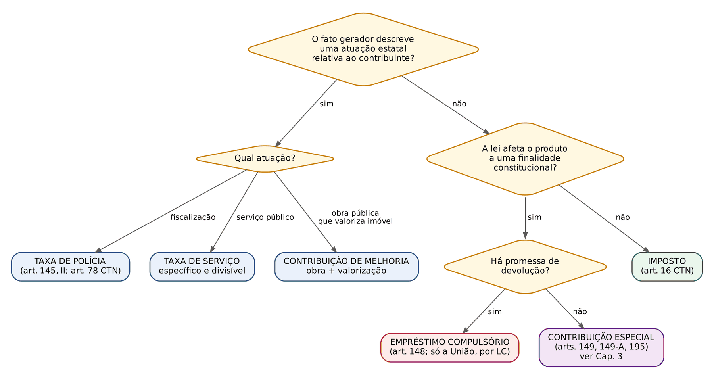
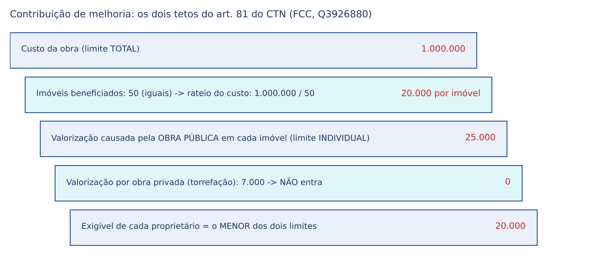
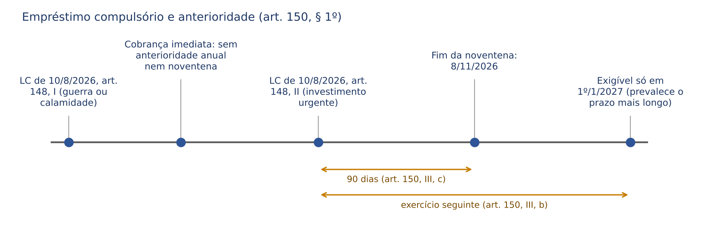

# CAPÍTULO 02 — ESPÉCIES TRIBUTÁRIAS I: TEORIAS DA CLASSIFICAÇÃO, IMPOSTOS, TAXAS, PREÇOS PÚBLICOS E TARIFAS, PEDÁGIO, CONTRIBUIÇÃO DE MELHORIA E EMPRÉSTIMOS COMPULSÓRIOS

:::INCIDENCIA
TRF5 p. 10; TJRS p. 3; TJSC p. 2 e 3. Nível A. Lote: 44 questões (FGV 30, FCC 14).
O que mais cai: taxa (fato gerador, base de cálculo, SV 19, 29 e 41, Temas 217, 721 e 1.282, taxas de fiscalização ambiental e minerária), taxa x tarifa e pedágio, e o cálculo dos limites da contribuição de melhoria.
:::

| Subtema | FGV | FCC | Padrão de cobrança |
|---|---|---|---|
| Conceito e identificação das espécies | 6 | 3 | Art. 16 do CTN literal; associar caso a espécie |
| Taxa de serviço e de polícia (constitucionalidade) | 11 | 5 | Caso de lei municipal ou estadual: "é constitucional?" |
| Base de cálculo de taxa | 6 | 1 | SV 29; número de empregados; valor venal; desproporção com o custo |
| Taxa x tarifa x pedágio | 4 | 0 | Súmula 545; ADI 800 |
| Contribuição de melhoria | 2 | 3 | Cálculo com limite total e individual |
| Empréstimo compulsório | 1 | 0 | LC, hipóteses, anterioridade |
| Classificação dos impostos | 0 | 2 | Direto/indireto, IVA *ad valorem* |

## 02.1 Teorias da classificação e identificação da espécie tributária

### 02.1.1 Por que a classificação importa para o juiz

Para quem vem do direito civil, a pergunta "que espécie de tributo é este?" pode parecer acadêmica. Não é. Cada espécie tem um regime jurídico próprio, e a resposta decide a causa: quem pode instituir (competência), por qual veículo (lei ordinária ou complementar), que limites a base de cálculo tem, se o produto pode ou não ser vinculado, se há dever de devolução e quais princípios se aplicam. Na prática do foro, a ação declaratória de inexistência de relação jurídico-tributária contra uma "taxa de expediente" municipal se resolve exatamente aqui: se o fato gerador não é poder de polícia nem serviço específico e divisível, a "taxa" é inconstitucional, ainda que a lei a chame assim.

O ponto de partida é o art. 4º do CTN: a natureza jurídica específica do tributo é dada pelo fato gerador, sendo irrelevantes o nome dado pela lei e a destinação legal do produto da arrecadação (desenvolvido no Cap. 1). Esse critério, porém, foi concebido para um sistema de três espécies e não basta, sozinho, para separar as contribuições especiais e os empréstimos compulsórios, como se verá.

### 02.1.2 As teorias

- Teoria bipartida (dualista): só há impostos e taxas; as demais figuras seriam variações de uma ou de outra, conforme o fato gerador seja ou não vinculado a uma atuação estatal. É a visão de parte da doutrina clássica (atribuída a Alfredo Augusto Becker e Pontes de Miranda).
- Teoria tripartida (tricotômica): impostos, taxas e contribuições de melhoria. É a literalidade do art. 145 da CF e do art. 5º do CTN ("Os tributos são impostos, taxas e contribuições de melhoria"). Para seus defensores, empréstimos compulsórios e contribuições assumem a natureza de imposto ou de taxa conforme seu fato gerador.
- Teoria quadripartida: acrescenta às três os empréstimos compulsórios, ou agrupa taxas e contribuições de melhoria como tributos vinculados e soma contribuições e empréstimos (as formulações variam entre autores).
- Teoria quinquipartida (pentapartida): impostos, taxas, contribuições de melhoria, empréstimos compulsórios e contribuições especiais. É a posição do STF, firmada no RE 138.284/CE (Rel. Min. Carlos Velloso), em que o Tribunal reconheceu a autonomia das contribuições (arts. 149 e 195) e dos empréstimos compulsórios (art. 148), e é a adotada pela doutrina majoritária para concursos (Ricardo Alexandre, Eduardo Sabbag, Alexandre Mazza).

:::PEGADINHA
Uma assertiva que diga "segundo o CTN, os tributos são impostos, taxas e contribuições de melhoria" está CERTA (art. 5º, literal). A que diga "segundo o STF, são três as espécies tributárias" está ERRADA. Leia o comando: "à luz do CTN" ou "à luz da jurisprudência".
:::

### 02.1.3 Os três critérios: fato gerador, destinação e restituição

A teoria quinquipartida precisa de critérios que o art. 4º do CTN não oferece. Por isso a doutrina (Ricardo Alexandre e Leandro Paulsen, entre outros) aponta três perguntas sucessivas:

1. O fato gerador está vinculado a uma atuação estatal específica relativa ao contribuinte? Se sim, é taxa (poder de polícia ou serviço) ou contribuição de melhoria (obra que valoriza imóvel). Se não, siga.
2. A Constituição exige que o produto seja afetado a uma finalidade? Se não, é imposto (e, como regra, a vinculação é até proibida: art. 167, IV). Se sim, siga.
3. Há promessa constitucional de devolução? Se sim, empréstimo compulsório; se não, contribuição especial.

Daí a conclusão que a banca adora: para contribuições especiais e empréstimos compulsórios, a destinação é relevante para definir a espécie, de modo que o inciso II do art. 4º do CTN não se aplica a elas com a mesma força.

:::ESQUEMA Mapa das cinco espécies
| Espécie | Fato gerador | Destinação do produto | Restituição | Competência | Instrumento |
|---|---|---|---|---|---|
| Imposto (art. 145, I; arts. 153 a 156-A) | Não vinculado (situação do contribuinte) | Vedada a vinculação, salvo exceções do art. 167, IV | Não | Privativa por ente (União, Estados, DF, Municípios); residual e extraordinária da União | Lei ordinária, salvo IGF, residuais e IBS (LC) |
| Taxa (art. 145, II) | Vinculado: poder de polícia ou serviço específico e divisível | Livre (a Constituição não vincula) | Não | Comum: de quem detém a atribuição administrativa | Lei ordinária |
| Contribuição de melhoria (art. 145, III) | Vinculado: obra pública com valorização imobiliária | Livre (custeia a obra) | Não | Comum: de quem fez a obra | Lei ordinária |
| Empréstimo compulsório (art. 148) | Não definido na CF; pode ser qualquer um | Vinculada à despesa que o fundamentou | SIM | Só a União | Lei complementar |
| Contribuições especiais (arts. 149, 149-A, 195) | Em regra não vinculado | Vinculada à finalidade | Não | União, em regra; Estados, DF e Municípios só nas hipóteses dos arts. 149, § 1º, e 149-A | Lei ordinária, salvo residuais (LC) — ver Cap. 3 |
:::

:::QUESTAO FCC 2025 — TRT 2ª Região — Analista Judiciário — Contabilidade (Q3596222)
O que se pediu: identificar a espécie em três cenários: (I) cobrança anual de proprietários de veículos, sem atuação estatal específica; (II) cobrança estadual pela fiscalização sanitária de bares e restaurantes; (III) cobrança dos proprietários de imóveis valorizados por pavimentação, com limite total no custo e individual na valorização.
Gabarito: C (imposto, taxa e contribuição de melhoria).
Armadilha: a alternativa que chama o cenário II de "contribuição especial". O que define a taxa é a atuação estatal (fiscalização) referida ao contribuinte, não o fato de o dinheiro custear o órgão.
No mesmo sentido (conceitos básicos): Q2362728 (FGV 2024, associação conceito-espécie, gabarito C), Q3786810 (FGV 2025, fato gerador da contribuição de melhoria é a valorização decorrente de obra, gabarito A), Q3590945 (FGV 2025, cobrança pelo serviço de manejo de resíduos sólidos urbanos é taxa, gabarito B) e Q3777948 (FGV 2025, correlata do Cap. 1: taxas e contribuições de melhoria são tributos vinculados).
:::

## 02.2 Impostos

### 02.2.1 Conceito: o tributo não vinculado

:::LEI CTN, art. 16
Imposto é o tributo cuja obrigação tem por fato gerador uma situação independente de qualquer atividade estatal específica, relativa ao contribuinte.
:::

O imposto incide sobre um fato do próprio contribuinte que revela riqueza (ser proprietário, auferir renda, vender mercadoria, prestar serviço). O Estado nada precisa fazer em favor daquele contribuinte para cobrá-lo. Por isso se diz que o imposto é tributo não vinculado quanto ao fato gerador e que sua justificativa é a capacidade contributiva (art. 145, § 1º; Cap. 5), e não a contraprestação. O dinheiro dos impostos financia os serviços gerais e indivisíveis (*uti universi*): segurança pública, diplomacia, defesa, iluminação das ruas antes da COSIP.

A competência para instituir impostos é privativa e nominada na Constituição (União: art. 153; Estados e DF: art. 155; Municípios e DF: art. 156; Estados, DF e Municípios, de forma compartilhada, o IBS: art. 156-A), com a competência residual e a extraordinária da União (art. 154, I e II). O desenvolvimento está no Cap. 4.

:::QUESTAO FGV 2024 — DATAPREV — Advogado (Q3085876)
O que se pediu: a repartição correta das competências para impostos.
Gabarito: B (a União institui IR, IPI, IOF, ITR e o imposto sobre bens e serviços prejudiciais à saúde ou ao meio ambiente — o Imposto Seletivo do art. 153, VIII, incluído pela EC 132/2023).
Armadilha: alternativas que trocam impostos de ente (IPI para Estados; ITR para Municípios; ICMS para a União). O ITR é federal, embora o Município possa optar por fiscalizá-lo e ficar com 100% da arrecadação (art. 153, § 4º, III; Cap. 7).
No mesmo sentido, o conceito literal do art. 16: Q3085992 (FGV 2024, gabarito A), Q3248840 (FGV 2024, gabarito A), Q3038852 (FGV 2024, gabarito E; erradas as alternativas que dizem ser o empréstimo compulsório "não restituível" e que a contribuição de melhoria serve para "melhorar obras públicas") e Q2564504 (FCC 2024: tributo é gênero e imposto é espécie, com o exemplo do IR — gabarito E; erradas as que dão a taxa de lixo como exemplo de imposto).
:::

### 02.2.2 A dupla não vinculação: art. 167, IV, da CF

Além de não vinculado quanto ao fato gerador, o imposto é, como regra, não vinculado quanto à receita: a Constituição proíbe que a lei amarre o produto de impostos a órgão, fundo ou despesa. A lógica é preservar a liberdade do orçamento: se cada imposto já nascesse comprometido, o legislador orçamentário nada teria a decidir.

:::LEI CF, art. 167, IV e § 4º
São vedados: [...] IV - a vinculação de receita de impostos a órgão, fundo ou despesa, ressalvadas a repartição do produto da arrecadação dos impostos a que se referem os arts. 158 e 159, a destinação de recursos para as ações e serviços públicos de saúde, para manutenção e desenvolvimento do ensino e para realização de atividades da administração tributária, como determinado, respectivamente, pelos arts. 198, § 2º, 212 e 37, XXII, e a prestação de garantias às operações de crédito por antecipação de receita, previstas no art. 165, § 8º, bem como o disposto no § 4º deste artigo;
§ 4º É permitida a vinculação das receitas a que se referem os arts. 155, 156, 156-A, 157, 158 e as alíneas "a", "b", "d", "e" e "f" do inciso I e o inciso II do caput do art. 159 desta Constituição para pagamento de débitos com a União e para prestar-lhe garantia ou contragarantia. (Redação dada pela EC 132/2023)
:::

As exceções, para memorizar: (1) repartição de receitas (arts. 158 e 159; Cap. 7); (2) saúde; (3) ensino; (4) administração tributária; (5) garantia de operações de crédito por antecipação de receita (ARO); (6) garantia ou contragarantia à União e pagamento de débitos com ela, com receitas próprias de impostos (inclusive o IBS, art. 156-A, acrescentado pela EC 132/2023) e com as transferências recebidas. Há ainda vinculações facultativas fora do art. 167 (fundos de combate à pobreza do ADCT; programas de cultura, art. 216, § 6º; fomento à pesquisa, art. 218, § 5º), que a banca às vezes cobra; o tema é de Direito Financeiro e não é desenvolvido aqui.

:::PEGADINHA
A vedação do art. 167, IV, alcança SÓ impostos. Taxas e contribuição de melhoria podem ter seu produto destinado pela lei (é até o natural); contribuições especiais e empréstimos compulsórios DEVEM ter (a destinação é da sua essência). Assertiva "é vedada a vinculação da receita de tributos a órgão, fundo ou despesa" está ERRADA.
:::

Correlatas de outros capítulos encontradas na busca: Q3656902 (FGV 2025: o Município pode vincular a integralidade do produto do IPTU para garantir obrigação assumida com a União — gabarito B, com base no § 4º; erra quem marca "é vedada a vinculação de impostos" ou inventa limite de 25%) e Q2510937 (FGV 2024, vinculação para saúde e ensino é permitida).

### 02.2.3 Classificações dos impostos (as que caem)

Diretos e indiretos, proporcionais, progressivos e regressivos, fiscalidade e extrafiscalidade estão no Cap. 1 (1.7). Aqui ficam as demais classificações próprias dos impostos, que respondem pelo ponto "tributação do consumo e da renda" do TRF5.

| Critério | Espécies | Exemplos | Detalhe que a banca cobra |
|---|---|---|---|
| Objeto | Real: incide sobre a coisa, sem considerar condições pessoais. Pessoal: leva em conta características do sujeito | Real: IPTU, ITBI. Pessoal: IR (deduções por dependentes) | Art. 145, § 1º: "sempre que possível, os impostos terão caráter pessoal" |
| Incidência na cadeia | Monofásico (uma etapa). Plurifásico cumulativo (em cascata). Plurifásico não cumulativo (compensa o que incidiu antes) | Cumulativo: ISS. Não cumulativo: ICMS, IPI, IBS, CBS | Cumulativo NÃO deduz o anterior; quem deduz é o não cumulativo |
| Base de cálculo | Específico (por unidade: litro, quilo). *Ad valorem* (percentual sobre o valor) | *Ad valorem*: ICMS, IVA. Específico: combustíveis no ICMS monofásico | O IVA clássico é *ad valorem*, plurifásico e não cumulativo |
| Base econômica | Renda; patrimônio; consumo (produção e circulação); comércio exterior | Renda: IR. Patrimônio: IPTU, IPVA, ITR. Consumo: ICMS, IPI, ISS, IBS, CBS | A EC 132/2023 concentrou a tributação do consumo no IVA dual (IBS e CBS) e no Imposto Seletivo (Caps. 32 e 33) |

:::QUESTAO FCC 2025 — MPE-PI — Analista Ministerial — Contabilidade (Q3819251)
O que se pediu: a afirmação correta sobre classificações de impostos.
Gabarito: A (direto é aquele em que o contribuinte de direito suporta o ônus, sem possibilidade de transferi-lo).
Armadilha: as demais invertem os conceitos: cumulativo que "deduz o que incidiu antes" (isso é não cumulatividade); indireto em que contribuinte de fato e de direito coincidem (é o contrário); progressivo pela "diminuição" da alíquota.
No mesmo sentido: Q4066841 (FCC 2026, SEFAZ-GO: o IVA, na forma consagrada, é *ad valorem* — gabarito E; erradas as que o chamam de direto, monofásico ou "não neutro").
:::

:::DICA
Tributação do consumo x da renda, em uma frase: a tributação da renda atinge a riqueza quando ela é ganha e permite pessoalidade e progressividade; a do consumo atinge a riqueza quando ela é gasta, é de arrecadação mais fácil, mas tende a ser regressiva (pesa proporcionalmente mais sobre quem ganha menos). Por isso a EC 132/2023 incluiu no art. 145 o § 4º ("As alterações na legislação tributária buscarão atenuar efeitos regressivos") e criou o *cashback* do IBS e da CBS (Cap. 32).
:::

## 02.3 Taxas

### 02.3.1 Conceito e traços gerais

:::LEI CTN, art. 77
As taxas cobradas pela União, pelos Estados, pelo Distrito Federal ou pelos Municípios, no âmbito de suas respectivas atribuições, têm como fato gerador o exercício regular do poder de polícia, ou a utilização, efetiva ou potencial, de serviço público específico e divisível, prestado ao contribuinte ou posto à sua disposição.
Parágrafo único. A taxa não pode ter base de cálculo ou fato gerador idênticos aos que correspondam a imposto nem ser calculada em função do capital das empresas.
:::

A taxa é a contrapartida de uma atuação estatal dirigida ao contribuinte. Se o imposto se justifica pela capacidade contributiva, a taxa se justifica pela retributividade (ou comutatividade): quem provoca ou usufrui a atividade estatal paga por ela, em vez de dividir o custo com toda a sociedade. Daí seus traços:

- Competência comum: União, Estados, DF e Municípios podem instituí-la, mas cada um SOMENTE em relação às atividades que lhe cabem (art. 80 do CTN). Município não cria taxa por atividade estadual, e vice-versa. Assertiva "taxa é de competência exclusiva dos Municípios" é falsa (Q3819252, FCC 2025: a taxa é tributo vinculado e de competência comum, gabarito B; no mesmo sentido Q3288594, alternativa A).
- Fato gerador vinculado, em duas modalidades: taxa de polícia e taxa de serviço (detalhadas abaixo). A obra pública NÃO é fato gerador de taxa; obra que valoriza imóvel enseja contribuição de melhoria.
- Base de cálculo que mensure a atuação estatal, e não a riqueza do contribuinte (art. 145, § 2º; 2.3.5).
- Lei ordinária do ente competente (legalidade estrita). O STF admite que a lei fixe o teto e deixe ao ato infralegal a fixação do valor em proporção razoável com os custos da atuação estatal, vedada a atualização por ato do próprio conselho acima dos índices de correção monetária (Tema 829, RE 838.284/SC, j. 19/10/2016); e, no plano infraconstitucional, o STJ julgou inexigível a Taxa de Saúde Suplementar devida por plano de saúde porque sua base de cálculo foi criada por resolução da ANS, em afronta ao art. 97, IV, do CTN (Tema 1.123, REsp 1.872.241/PE, j. 23/11/2022). A legalidade em geral está no Cap. 5.
- Sujeição às anterioridades anual e nonagesimal, sem exceção (Cap. 5).
- Produto de destinação livre: a Constituição não vincula a receita de taxas, e o STF, nos julgamentos das taxas minerárias, afirmou que não há norma que imponha essa vinculação, bastando a equivalência razoável entre o valor cobrado e o custo da atividade.

:::DICA
Não há reserva de iniciativa do Chefe do Executivo para leis tributárias: a taxa pode nascer de projeto de vereador ou de deputado (o STF tem orientação firme nesse sentido; ver Cap. 5). Por isso foi errada a alternativa A da Q3044212 (FGV 2024) e da Q3742945 (FGV 2025), que apontavam "vício de iniciativa".
:::

### 02.3.2 Taxa de polícia

Poder de polícia é a atividade da Administração que limita ou disciplina direitos e liberdades em razão do interesse público (art. 78, *caput*, do CTN, que lista segurança, higiene, ordem, costumes, mercado, atividades dependentes de autorização, tranquilidade pública, propriedade). Na linguagem do civilista: é a Administração fiscalizando, licenciando, vistoriando, autorizando. O particular que exerce atividade sujeita a controle provoca o gasto estatal com esse controle; a taxa o remunera. Exemplos: alvará de localização e funcionamento, licença para construir, vistoria sanitária, fiscalização ambiental, licença para publicidade.

:::LEI CTN, art. 78, parágrafo único
Considera-se regular o exercício do poder de polícia quando desempenhado pelo órgão competente nos limites da lei aplicável, com observância do processo legal e, tratando-se de atividade que a lei tenha como discricionária, sem abuso ou desvio de poder.
:::

O art. 77 exige o exercício "regular" do poder de polícia. Duas consequências:

1. Não existe taxa de polícia "potencial". A utilização potencial é figura só da taxa de serviço (art. 79, I, *b*). Mas, e esta é a sutileza cobrada, o STF não exige a prova de fiscalização individual, porta a porta, de cada contribuinte: basta que exista órgão estruturado e em funcionamento, apto a exercer a fiscalização.

:::JURIS STF, Tema 217 (RE 588.322, j. 16/6/2010)
"É constitucional taxa de renovação de funcionamento e localização municipal, desde que efetivo o exercício do poder de polícia, demonstrado pela existência de órgão e estrutura competentes para o respectivo exercício."
Leitura para a prova: a efetividade do poder de polícia se PRESUME da existência de aparato fiscalizatório em funcionamento; não é preciso provar a visita do fiscal ao estabelecimento do contribuinte. Sem órgão estruturado, a taxa é indevida.
:::

2. O valor deve guardar proporção com o custo da atividade fiscalizatória (equivalência razoável, não matemática). Esse é hoje o centro dos julgados sobre taxas de fiscalização ambiental e minerária (2.3.4).

:::QUESTAO FGV 2024 — Prefeitura de Vitória — Procurador (Q3044212)
O que se pediu: a afirmação correta sobre taxa municipal de renovação de funcionamento e localização instituída por lei de iniciativa de vereadores.
Gabarito: B (é necessária proporcionalidade entre o valor cobrado e o custo da fiscalização).
Armadilhas: (A) vício de iniciativa, inexistente em matéria tributária; (C) exigência de fiscalização efetiva de cada estabelecimento, contrária ao Tema 217; (E) atribuir a fiscalização de estabelecimentos ao Corpo de Bombeiros estadual.
Observação: a alternativa D ("se ainda não estiver implantado órgão específico, a taxa não pode ser cobrada") reproduz a lógica do próprio Tema 217 e, isoladamente, parece correta; a banca a tratou como errada, possivelmente por considerar que a questão perguntava pelo requisito de validade da lei, e não de exigibilidade. Gabarito discutível (ver nota).
:::

Competência para a taxa de polícia: segue a competência material para fiscalizar. Se a fiscalização da atividade é da União, só ela institui a taxa.

:::JURIS STF, Tema 919 (RE 776.594/SP, j. 2/12/2022)
"A instituição de taxa de fiscalização do funcionamento de torres e antenas de transmissão e recepção de dados e voz é de competência privativa da União, nos termos do art. 22, IV, da Constituição Federal, não competindo aos Municípios instituir referida taxa."
:::

Também por falta de atividade de polícia (e de serviço) o STF negou aos Municípios a cobrança de taxa pelo uso de espaços públicos por concessionárias de energia elétrica: "É inconstitucional a cobrança de taxa, espécie tributária, pelo uso de espaços públicos dos municípios por concessionárias prestadoras do serviço público de fornecimento de energia elétrica" (Tema 261, RE 581.947/RO). O uso de bem público não é fato gerador de taxa.

:::QUESTAO FGV 2025 — Prefeitura de Niterói — Advogado (Q3656901)
O que se pediu: entre três taxas municipais (I. conservação e limpeza de logradouros; II. renovação de funcionamento com fiscalização efetiva; III. uso de espaços públicos por concessionárias de energia), quais são constitucionais.
Gabarito: C (apenas a II).
Resolução: I é inconstitucional porque limpeza de ruas é serviço indivisível (Tema 146, item II; 2.3.3); II é a taxa do Tema 217; III esbarra no Tema 261 (uso de bem público não é polícia nem serviço).
:::

:::QUESTAO FCC 2026 — SEFAZ-SP — Auditor Fiscal — TI (Q3917725)
O que se pediu: julgar três assertivas sobre taxas à luz do CTN e de súmula vinculante: (I) não podem ser cobradas fora do âmbito das atribuições do ente; (II) podem usar elementos da base de imposto sem identidade integral; (III) definição de exercício regular do poder de polícia.
Gabarito: A (todas corretas). I é o art. 77 combinado com o art. 80; II é a SV 29 (2.3.5); III é o parágrafo único do art. 78, literal.
:::

### 02.3.3 Taxa de serviço

:::LEI CTN, art. 79
Os serviços públicos a que se refere o art. 77 consideram-se:
I - utilizados pelo contribuinte:
a) efetivamente, quando por ele usufruídos a qualquer título;
b) potencialmente, quando, sendo de utilização compulsória, sejam postos à sua disposição mediante atividade administrativa em efetivo funcionamento;
II - específicos, quando possam ser destacados em unidades autônomas de intervenção, de utilidade, ou de necessidades públicas;
III - divisíveis, quando suscetíveis de utilização, separadamente, por parte de cada um dos seus usuários.
:::

Três filtros cumulativos. Em linguagem simples:

- Específico: dá para identificar o serviço como uma prestação destacada (a coleta de lixo do imóvel, a emissão de um passaporte, a prestação jurisdicional numa causa).
- Divisível: dá para saber quanto cada usuário usou ou poderia usar, separadamente. Serviço *uti singuli* (fruível individualmente) x serviço *uti universi* (prestado à coletividade indistinta, como segurança pública, limpeza de praças, iluminação de ruas, defesa nacional). Os *uti universi* são custeados por impostos.
- Utilização efetiva ou potencial: a taxa é devida pelo uso efetivo ou pela mera disponibilidade, mas a disponibilidade só basta quando o serviço é de utilização compulsória e está em efetivo funcionamento. Exemplo: o caminhão de lixo passa na rua de Ana; ela composta seu lixo e nunca o põe para fora; ainda assim paga a taxa, porque o serviço é compulsório e está à disposição.

:::PEGADINHA
"Prestado ao contribuinte ou posto à sua disposição" NÃO se confunde com o poder de polícia. Não existe "poder de polícia potencial". E a disponibilidade só autoriza taxa em serviço de utilização COMPULSÓRIA (art. 79, I, b): serviço facultativo posto à disposição não gera taxa.
:::

Os casos que a jurisprudência resolveu (e que respondem a quase todas as questões do lote):

| Atividade | Pode ser taxa? | Fundamento |
|---|---|---|
| Coleta, remoção e tratamento ou destinação de lixo de imóveis | SIM | SV 19; Tema 146, item I |
| Conservação e limpeza de logradouros e bens públicos | NÃO | Tema 146, item II (serviço *uti universi*) |
| Iluminação pública | NÃO | SV 41 (ex-Súmula 670); custeio por contribuição do art. 149-A (Cap. 3) |
| Segurança pública ostensiva, policiamento preventivo | NÃO | Atividade *uti universi* custeada por impostos; STF, ADI 1.942 MC (Lei do Pará, 5/5/1999) |
| Atividades acessórias de órgãos de segurança fruíveis individualmente (vistoria para alvará, emissão de documentos, laudos, remoção e guarda de veículos) | SIM | STF, julgamento de 25/9/2019 sobre a taxa paranaense de fiscalização policial (ver nota) |
| Prevenção e combate a incêndio, busca, salvamento e resgate pelo Corpo de Bombeiros, por taxa ESTADUAL | SIM | Tema 1.282 (2025), que superou a ADI 4.411 |
| Mesma atividade por taxa MUNICIPAL | NÃO | Tema 16 (o Município não presta o serviço) |
| Emissão ou remessa de carnês e guias de recolhimento | NÃO | Tema 721 (não é serviço ao contribuinte) |
| Matrícula em universidade pública | NÃO | SV 12 (gratuidade do ensino público, art. 206, IV) |
| Custas e emolumentos judiciais | SIM (são taxas) | Prestação jurisdicional é serviço específico e divisível |
| Taxa judiciária sobre o valor da causa sem limite | NÃO | Súmula 667 do STF (acesso à jurisdição) |
| Certidão para defesa de direitos e esclarecimento de situações de interesse pessoal; direito de petição | NÃO (imunidade) | Art. 5º, XXXIV, a e b |
| Uso de espaços públicos por concessionária de energia | NÃO | Tema 261 |
| Fiscalização de torres e antenas, por Município | NÃO | Tema 919 (competência da União) |

:::JURIS STF, Súmula Vinculante 19 e Tema 146 (RE 576.321)
SV 19: "A taxa cobrada exclusivamente em razão dos serviços públicos de coleta, remoção e tratamento ou destinação de lixo ou resíduos provenientes de imóveis, não viola o art. 145, II, da CF."
Tema 146 (j. 4/12/2008): I — a taxa de coleta, remoção e tratamento de lixo de imóveis é constitucional; II — a taxa cobrada em razão dos serviços de conservação e limpeza de logradouros e bens públicos ofende o art. 145, II; III — é constitucional usar, no cálculo da taxa, elementos da base de cálculo de imposto, sem integral identidade (a SV 29).
O detalhe que derruba: a palavra "exclusivamente". Se a mesma taxa remunerar coleta domiciliar E varrição de ruas, ela é inconstitucional, porque mistura serviço divisível com indivisível.
:::

:::QUESTAO FGV 2025 — TJ-RS — Analista Judiciário (Q3742945)
O que se pediu: lei municipal, de iniciativa de vereador, criou taxa de coleta de lixo de imóveis e taxa de conservação e limpeza de logradouros, ambas com elementos da base de imposto, sem identidade.
Gabarito: D (inconstitucional apenas o fato gerador da segunda).
Armadilhas: vício de iniciativa (inexistente) e inconstitucionalidade da base de cálculo (a SV 29 a permite).
No mesmo sentido: Q2466074 (FGV 2024, taxa exclusivamente de coleta de lixo de imóveis é constitucional por ser serviço específico e divisível, gabarito B); Q2510934 (FGV 2024, item II falso: o STF NÃO declarou inconstitucional a taxa de lixo — gabarito E).
:::

Segurança pública e bombeiros: a virada de 2025. Por décadas a orientação foi a de que prevenção e combate a incêndio integram a segurança pública (art. 144, V e § 5º) e por isso só podem ser custeados por impostos. Com base nisso o STF negou a taxa municipal de combate a sinistros (Tema 16, RE 643.247/SP, j. 1º/8/2017) e, em 2020, também taxas estaduais (ADI 4.411). Em 2025 o Tribunal distinguiu: nem tudo que os órgãos de segurança fazem é *uti universi*.

:::JURIS STF, Tema 1.282 (RE 1.417.155/RN, j. 26/3/2025)
"São constitucionais as taxas estaduais pela utilização, efetiva ou potencial, dos serviços públicos de prevenção e combate a incêndios, busca, salvamento ou resgate prestados ao contribuinte ou postos a sua disposição pelos corpos de bombeiros militares."
Razões: os Estados têm competência material para a defesa civil (art. 144, § 5º); os serviços dos bombeiros podem ser destacados em unidades autônomas e usufruídos separadamente (há até empresas privadas que prestam serviços similares). O Tema 16, quanto à taxa MUNICIPAL, continua de pé: o Município não pode instituir taxa por serviço que não presta.
:::

:::QUESTAO FCC 2025 — PGE-TO — Procurador do Estado (Q3745542)
O que se pediu: lei estadual que institua taxa pelos serviços de prevenção e combate a incêndios, busca, salvamento e resgate prestados pelo Corpo de Bombeiros Militar.
Gabarito: C (constitucional quanto à competência material e quanto à taxa, por se tratar de serviço específico e divisível, de utilização efetiva ou potencial).
Armadilha: as alternativas que repetem a orientação superada (serviço "universal e indivisível") ou deslocam a competência para os Municípios ou para a União (defesa civil).
No mesmo sentido: Q3745781 (FCC 2025, PGE-MT, gabarito B, reproduz a tese do Tema 1.282) e Q3520632 (FGV 2025, TJ-ES Cartórios: lei estadual reinstituindo a taxa de incêndio declarada inconstitucional pelo TJ local em 2021 — gabarito B, é possível, pelo caráter específico e divisível da atividade; a decisão em representação de inconstitucionalidade não impede o legislador de editar nova lei, e a jurisprudência do STF mudou).
:::

:::QUESTAO FGV 2026 — ALERJ — Procurador Legislativo (Q3880822)
O que se pediu: constitucionalidade de taxa estadual destinada ao custeio de policiamento ostensivo e ações preventivas de vigilância.
Gabarito: C (inconstitucional: policiamento ostensivo é serviço geral e indivisível, custeado por impostos).
Armadilha: a alternativa que tenta salvar a taxa pela vinculação integral do produto à segurança. A destinação não muda a natureza do fato gerador (art. 4º, II, do CTN). E não confunda com o Tema 1.282, que só alcança os serviços dos bombeiros.
:::

:::QUESTAO FGV 2026 — AL-RO — Consultor Legislativo (Q3882056)
O que se pediu: V ou F para três taxas municipais: (i) vistoria prévia para alvará de estabelecimento; (ii) policiamento ostensivo em evento privado de grande porte; (iii) emissão de certidão para defesa em processo administrativo.
Gabarito: B (V, V, V). (i) é taxa de polícia válida; (ii) a assertiva afirmava a INconstitucionalidade, e está certa (policiamento ostensivo é atividade *uti universi* e, ademais, de competência estadual); (iii) a certidão para defesa de direitos é imune (art. 5º, XXXIV, b), admitido apenas o ressarcimento do custo material de reprodução.
Cuidado: a "verdade" da segunda afirmativa é a declaração de inconstitucionalidade, não a taxa.
:::

:::QUESTAO FGV 2025 — TCE-PE — Procurador do Tribunal de Contas (Q3592180)
O que se pediu: taxa estadual pela expedição de alvarás para estabelecimentos que fabricam, transportam ou comercializam armas, munições, explosivos, inflamáveis e produtos químicos e pela expedição de atestados de idoneidade para porte de arma.
Gabarito: E (constitucional: são atividades passíveis de aproveitamento individual pelos beneficiários).
Armadilhas: (B) chamar de "públicos e individuais" os serviços de segurança que o STF considera universais (a alternativa mistura os conceitos); (D) admitir que a taxa custeie policiamento ostensivo e repressivo.
:::

:::JURIS STF, Tema 721 (RE 789.218/MG, j. 17/4/2014)
"São inconstitucionais a instituição e a cobrança de taxas por emissão ou remessa de carnês/guias de recolhimento de tributos."
Por quê: emitir a guia é interesse da própria Administração arrecadadora, não serviço prestado ao contribuinte nem posto à sua disposição; e também não é poder de polícia.
:::

:::QUESTAO FGV 2024 — Prefeitura de Macaé — Procurador (Q3049939)
O que se pediu: o fundamento da inconstitucionalidade da taxa de emissão de carnê do IPTU.
Gabarito: B (não se trata de serviço público prestado ou posto à disposição do contribuinte).
Armadilha: as alternativas que culpam a falta de especificidade ou de divisibilidade, ou a reserva de lei complementar. O vício está antes: não há serviço AO contribuinte.
No mesmo sentido: Q2489704 (FGV 2024, TJ-MS Analista, gabarito E).
:::

:::QUESTAO FCC 2026 — TJ-CE — Analista Judiciário — Ciências Contábeis (Q4245624)
O que se pediu: a natureza das custas judiciais.
Gabarito: B (taxa, porque remunera serviço público específico e divisível).
Armadilha: chamar custas de tarifa ou preço público "porque não são obrigatórias". O acesso à Justiça não é atividade empresarial e a cobrança decorre de lei, de modo compulsório para quem litiga.
No mesmo sentido, para a diferença essencial: Q4221504 (FCC 2026, SEFAZ-CE: taxa é contraprestação por atuação estatal específica e o imposto não tem contraprestação direta — gabarito A).
:::

:::QUESTAO FCC 2025 — TRT 15ª Região — Analista Judiciário — Contabilidade (Q3288594)
O que se pediu: taxa municipal de "manutenção de creche municipal", com valor calculado sobre o valor venal dos imóveis de quem usa a rede.
Gabarito: D (inconstitucional porque a base de cálculo não pode ser o valor venal dos imóveis).
Comentário: o valor venal é a base do IPTU; usá-lo integralmente viola o art. 145, § 2º, e o art. 77, parágrafo único, do CTN. Há um segundo vício, que a banca não explorou: a educação infantil em estabelecimento oficial é gratuita (art. 206, IV, da CF; mesma razão da SV 12).
:::

:::QUESTAO FGV 2025 — TCE-PE — Procurador do Tribunal de Contas (Q3592125)
O que se pediu: lei municipal condicionou a realização de diligências e perícias, requeridas pelo contribuinte no processo administrativo fiscal, ao prévio recolhimento de taxa.
Gabarito oficial: A (a taxa insere-se na competência do Município e pode ser cobrada pela atividade desenvolvida, desde que não fixada em valor fixo).
Comentário: a banca viu na diligência requerida pelo contribuinte um serviço específico e divisível por ele provocado. O gabarito é DISCUTÍVEL por dois motivos: o STF admite taxas de valor fixo (não há regra que exija valor variável), e condicionar a produção de prova em defesa administrativa ao pagamento prévio aproxima-se da lógica da SV 21, que vedou o depósito prévio para recorrer (Cap. 13), o que daria sustentação à alternativa E. Em prova, siga o gabarito, mas saiba a crítica (ver nota).
:::

### 02.3.4 Taxas de fiscalização ambiental, de recursos hídricos, de energia e de mineração

Na última década, vários Estados criaram taxas de polícia sobre atividades de grande expressão econômica: mineração, uso de recursos hídricos, geração de energia. O padrão é sempre o mesmo, e o STF fixou as balizas em julgamentos de 2021 a 2023. Pense em três perguntas.

1. O Estado tem competência? SIM. A proteção do meio ambiente e a fiscalização da exploração de recursos hídricos e minerais é competência comum (art. 23, VI e XI), e quem fiscaliza pode cobrar a taxa de polícia. Não importa que os recursos minerais e os potenciais de energia hidráulica sejam bens da União, nem que a União legisle privativamente sobre energia e mineração: a taxa remunera a fiscalização, não regula a atividade nem tributa o bem. Também não há bitributação vedada pelo fato de o IBAMA cobrar taxa federal: cada ente remunera sua própria fiscalização.
2. A base de cálculo pode usar o volume (toneladas de minério, metros cúbicos de água, megawatts-hora gerados)? Em tese, SIM. O STF aceitou o volume como elemento de mensuração indireta da intensidade da fiscalização.
3. O valor pode exceder em muito o custo da fiscalização? NÃO. A taxa deve guardar equivalência razoável com o custo da atividade estatal; arrecadação muito superior ao orçamento do órgão fiscalizador revela imposto disfarçado.

:::JURIS STF, ADIs 4.785 (MG), 4.786 (PA) e 4.787 (AP), j. 1º/8/2022 — taxas minerárias
O Plenário, por maioria, julgou CONSTITUCIONAIS as taxas estaduais de controle, monitoramento e fiscalização das atividades de pesquisa, lavra, exploração e aproveitamento de recursos minerários. Pontos dos votos condutores: competência estadual de fiscalização; equivalência razoável, e não estrita, entre valor e custo; base de cálculo congruente com a hipótese de incidência; ausência de norma constitucional que vincule a receita de taxas; caráter em parte extrafiscal (desestímulo a atividades degradantes).
Contraponto: na ADI 7.400 (MT, Rel. Min. Luís Roberto Barroso, sessão virtual encerrada em 12/2023), o STF declarou inconstitucional a taxa minerária de Mato Grosso porque o valor excedia flagrante e desproporcionalmente o custo da fiscalização, revelando finalidade arrecadatória. A lucratividade da mineradora é dado para o imposto de renda, não para dimensionar taxa.
:::

:::JURIS STF, ADIs 5.374 (PA) e 5.489 (RJ), Rel. Min. Luís Roberto Barroso, j. 2/2021 — recursos hídricos e energia
O STF declarou, por unanimidade, inconstitucionais a Taxa de Controle, Acompanhamento e Fiscalização das Atividades de Exploração e Aproveitamento de Recursos Hídricos do Pará (TFRH, base por volume de água) e a taxa fluminense de fiscalização ambiental das atividades de geração, transmissão e distribuição de energia (base por energia gerada). O Tribunal reconheceu a competência estadual e admitiu o volume de água e a energia gerada como elementos da base, mas concluiu que os valores fixados excediam desproporcionalmente o custo da fiscalização.
Tese firmada (ideia central): viola o princípio da capacidade contributiva, na dimensão do custo/benefício, a taxa de polícia ambiental que exceda flagrante e desproporcionalmente os custos da atividade estatal de fiscalização.
:::

:::DICA
"Capacidade contributiva na dimensão do custo/benefício" é a expressão que o STF usa para taxas. Não significa que a taxa deva variar conforme a riqueza do contribuinte; significa que ela não pode cobrar mais do que o custo do benefício (a atuação estatal) justifica. Quando o enunciado disser que a taxa "viola a capacidade contributiva" porque arrecada muito mais do que o órgão gasta, é essa a ideia.
:::

:::QUESTAO FGV 2025 — TCE-PE — Auditor de Controle Externo (Q3593803)
O que se pediu: a TFRH estadual com base no volume de água utilizado.
Gabarito: C (é constitucional, desde que respeite a equivalência razoável entre o valor exigido e o custo da fiscalização).
Armadilhas: (A) competência só da União; (B) valor "livremente definido, inclusive com finalidade arrecadatória"; (D) volume de água como elemento típico de imposto (o STF o admitiu); (E) bitributação pela fiscalização de mais de um ente.
Correlata no Mapeamento FGV: PGE-SC 2023, Q55 (taxa estadual de fiscalização de recursos hídricos).
:::

:::QUESTAO FGV 2025 — TRF5 — Juiz Federal Substituto (Q3373901)
O que se pediu: lei estadual instituiu taxa de controle, monitoramento e fiscalização ambiental das atividades de geração, transmissão e distribuição de energia (hidráulica, térmica e termonuclear), com valor determinado pelo volume de energia gerado, pela receita bruta e pelo número de empregados do estabelecimento. Qual juízo é possível, em tese?
Gabarito oficial: A (materialmente constitucional quanto à receita bruta, porque o porte da empresa é critério idôneo para mensurar o custo da fiscalização).
Resolução em passos:
- A pergunta é sobre CRITÉRIOS de quantificação, não sobre o valor concreto.
- Volume de energia: o STF aceitou como elemento da base (ADI 5.489); o que derrubou a lei fluminense foi a desproporção do valor, não o critério. Por isso estão erradas a B (que diz que volume e empregados não guardam pertinência) e a E (que diz que o critério do volume, em si, é inconstitucional).
- Número de empregados: o STF tem orientação de que não mede o custo da fiscalização (foi esse o fundamento da inconstitucionalidade da antiga taxa paulistana de licença, localização e funcionamento). Errada a D.
- Porte econômico, aferido pela receita bruta: critério que o STF admitiu na Taxa de Controle e Fiscalização Ambiental federal cobrada pelo IBAMA (Lei 10.165/2000), graduada por potencial poluidor e porte. Daí a A.
- C: a taxa não regula energia nuclear nem explora minério nuclear; remunera fiscalização ambiental de competência comum.
:::

:::QUESTAO FGV 2025 — SEFAZ-PR — Auditor Fiscal (Q3363401)
O que se pediu: taxa municipal de fiscalização de estabelecimentos calculada pelo número de empregados e pela metragem da sede.
Gabarito: C (inconstitucional quanto ao número de empregados, porque a taxa deve guardar correlação com o custo da atividade de polícia).
Armadilhas: (A) a metragem como "elemento próprio de imposto" (a SV 29 a admite, e a área do estabelecimento tem relação com o esforço de vistoria); (D) dizer que a vedação do art. 145, § 2º, não se aplica às taxas de polícia; (E) negar a aplicação da proporcionalidade às taxas.
:::

### 02.3.5 Base de cálculo das taxas

:::LEI CF, art. 145, § 2º
As taxas não poderão ter base de cálculo própria de impostos.
:::

Por que a regra existe: a base de cálculo é o que revela a verdadeira natureza do tributo (Paulo de Barros Carvalho a chama de "perspectiva dimensível" do fato gerador). Se uma "taxa de conservação de estradas" é calculada sobre o valor da terra nua, o que se tributa é a propriedade rural, e o tributo é, na verdade, um ITR municipal sem competência. A base da taxa deve dimensionar a atuação estatal, e não a riqueza do contribuinte.

:::JURIS STF, Súmula Vinculante 29
"É constitucional a adoção, no cálculo do valor de taxa, de um ou mais elementos da base de cálculo própria de determinado imposto, desde que não haja integral identidade entre uma base e outra."
Exemplo clássico: taxa de coleta de lixo graduada pela área construída do imóvel. A área é UM dos elementos do valor venal (base do IPTU), mas não se confunde com ele; e ela indica, ainda que de forma aproximada, a quantidade de lixo gerada. Válida.
:::

O que o STF e o CTN já disseram em concreto:

| Critério de cálculo | Válido? | Fonte |
|---|---|---|
| Área do imóvel na taxa de lixo | SIM | SV 29; Tema 146, item III |
| Valor venal do imóvel | NÃO | Identidade com a base do IPTU (art. 145, § 2º) |
| Base idêntica à do ITR (taxa municipal de conservação de estradas) | NÃO | Súmula 595 do STF |
| Capital social da empresa | NÃO | Art. 77, parágrafo único, do CTN |
| Tipo de atividade exercida (taxa de fiscalização de estabelecimento) | SIM | Tema 1.035 (ARE 990.094/SP, j. 19/8/2025) |
| Número de empregados | NÃO | Não mede o custo da fiscalização (orientação do STF; ver nota) |
| Volume de recursos explorados (água, minério, energia) | SIM, como elemento | ADIs 4.785 a 4.787 e 5.374/5.489, respeitada a proporcionalidade |
| Patrimônio líquido das companhias na taxa da CVM, por faixas | SIM | Súmula 665 do STF |
| Valor da causa sem teto, na taxa judiciária | NÃO | Súmula 667 do STF |
| Taxa de melhoramento dos portos sobre o valor da mercadoria importada | SIM (base diversa da do imposto de importação) | Súmula 124 do STJ |

:::JURIS STF, Tema 1.035 (ARE 990.094/SP, Rel. Min. Gilmar Mendes, j. 19/8/2025)
"É constitucional considerar o tipo de atividade exercida pelo contribuinte como um dos critérios para fixação do valor de taxa de fiscalização do estabelecimento."
Razão: atividades diferentes exigem fiscalizações de complexidade diferente (vistoriar um posto de combustível não custa o mesmo que vistoriar uma papelaria). O critério se liga ao custo da atuação estatal.
:::

:::QUESTAO FGV 2025 — DPE-PE — Defensor Público (Q3390818)
O que se pediu: taxa municipal de lixo (serviço posto à disposição) com base que considera, entre outros aspectos, a metragem do imóvel, coincidindo parcialmente com elemento do IPTU.
Gabarito: D (o serviço pode ser custeado por taxa e a identidade parcial com a base do IPTU não é vedada).
Armadilha: a alternativa E, que condiciona a identidade de bases a tributos de entes diversos (critério inexistente: a vedação é de identidade INTEGRAL, seja de quem for o imposto).
:::

A Lei 11.445/2007 (marco do saneamento, na redação da Lei 14.026/2020) trouxe critérios legais para as taxas e tarifas de resíduos sólidos. O art. 35 determina que considerarão a destinação adequada dos resíduos coletados e o nível de renda da população da área atendida, de forma isolada ou combinada, e poderão considerar ainda as características dos lotes e as áreas edificáveis, o peso ou volume médio coletado por habitante ou domicílio, o consumo de água e a frequência de coleta. O § 2º estabelece que a não proposição de instrumento de cobrança pelo titular do serviço configura renúncia de receita, exigindo o cumprimento do art. 14 da LRF.

:::QUESTAO FGV 2025 — SEFAZ-RS — Auditor do Estado (Q3154672)
O que se pediu: critérios legais para taxas de coleta de resíduos sólidos.
Gabarito: E (devem considerar a adequada destinação dos resíduos coletados e o nível de renda da população atendida — art. 35 da Lei 11.445/2007).
Armadilhas: (B) proibir consumo de água e frequência de coleta (a lei os admite expressamente); (C) dizer que a não instituição da cobrança não é renúncia de receita (o § 2º diz o contrário); (D) vedar qualquer elemento da base de imposto (contraria a SV 29); (A) taxa de lixo inconstitucional.
No mesmo sentido, quanto ao cálculo por rateio do custo do serviço: Q3039676 (FGV 2024, Prefeitura de Nova Iguaçu, sobre o código tributário local; correta apenas a assertiva de que a base é o rateio individualizado do custo da atividade — gabarito D).
:::

:::SENTENCA Taxa inconstitucional na sentença
Onde entra: ação declaratória de inexistência de relação jurídico-tributária cumulada com repetição de indébito, mandado de segurança preventivo ou embargos à execução fiscal de taxa municipal ou estadual.
O que fundamentar: (1) qualificar o tributo pelo fato gerador, e não pelo nome (art. 4º do CTN); (2) verificar se há poder de polícia regular (órgão estruturado, Tema 217) ou serviço específico, divisível e de fruição efetiva ou potencial compulsória; (3) examinar a base de cálculo (SV 29; art. 145, § 2º) e a proporcionalidade com o custo.
Redação-modelo: "Embora denominada taxa, a exação incide sobre a conservação e limpeza de logradouros públicos, serviço prestado à coletividade de modo indivisível, insuscetível de custeio por taxa (art. 145, II, da CF; Tema 146 do STF). Declaro a inexistência de relação jurídico-tributária que obrigue a autora ao seu recolhimento."
Erro comum: declarar inconstitucional a taxa de lixo por usar a área do imóvel, ou exigir prova de fiscalização individual do estabelecimento para a taxa de alvará. Outro erro: declarar inconstitucionalidade de lei em sentença como se fosse pedido principal; no controle difuso ela é questão prejudicial, decidida na fundamentação, e o dispositivo declara a inexistência da relação jurídica ou condena à restituição.
:::

:::PROCESSO Taxa e tarifa: qual via e qual prazo
| Situação | Via | Prazo para restituir | Onde aprofundar |
|---|---|---|---|
| Taxa indevida já paga | Repetição de indébito (ou compensação) | 5 anos do pagamento (art. 168, I, do CTN) | Cap. 16 |
| Taxa a vencer | Declaratória, anulatória do lançamento ou MS | MS: 120 dias do ato concreto; preventivo sem prazo | Cap. 23 |
| Taxa em execução fiscal | Embargos ou exceção de pré-executividade (se não exigir prova) | 30 dias da garantia (embargos) | Caps. 21 e 22 |
| Tarifa de água e esgoto paga a maior | Repetição pelo regime civil (relação de consumo) | Prazo do Código Civil (Súmula 412 do STJ) | 2.4 |
:::

## 02.4 Taxa x preço público (tarifa) e pedágio

### 02.4.1 O problema

O Estado pode ser remunerado por serviços de duas formas: por taxa (tributo, regime de direito público, lei, anterioridade, CTN) ou por preço público, também chamado tarifa quando cobrado por concessionária ou permissionária (receita originária, regime contratual, fixação por ato administrativo ou contrato, Código Civil e CDC). A pergunta "o que é?" tem consequência prática enorme para o juiz cível: se for tarifa, não há tributo, não há legalidade estrita nem anterioridade, a prescrição da repetição é a do Código Civil, e a relação costuma ser de consumo.

### 02.4.2 O critério do STF: compulsoriedade

:::JURIS STF, Súmula 545
"Preços de serviços públicos e taxas não se confundem, porque estas, diferentemente daqueles, são compulsórias e têm sua cobrança condicionada à prévia autorização orçamentária, em relação à lei que as instituiu."
Leitura atual: vale a primeira parte (compulsoriedade como critério distintivo). A segunda parte reflete o princípio da anualidade tributária, que não existe na Constituição de 1988 (hoje vigora a anterioridade, Cap. 5). Mesmo assim, a FGV considerou correta assertiva que reproduzia a súmula por inteiro (Q2510934, item III).
:::

Compulsoriedade, aqui, não é a mera necessidade do serviço: é a obrigação jurídica de pagar independentemente de vontade de contratar. Na taxa, a obrigação nasce da lei, ainda que o contribuinte não queira o serviço (basta que esteja à disposição, se de uso compulsório). No preço público, a obrigação nasce da adesão ou da utilização voluntária. A doutrina (Ricardo Alexandre, Leandro Paulsen) acrescenta que o legislador tem margem de escolha: o serviço público delegável pode ser remunerado por taxa ou por tarifa, conforme o regime jurídico adotado para sua prestação (a própria Lei 11.445/2007, art. 29, prevê para saneamento "taxas, tarifas e outros preços públicos, conforme o regime de prestação"); mas serviços que são atividade típica e indelegável do Estado (prestação jurisdicional, emissão de documentos de identidade, fiscalização) só podem ser remunerados por taxa.

:::ESQUEMA Taxa x preço público (tarifa)
| Aspecto | Taxa | Preço público / tarifa |
|---|---|---|
| Natureza | Tributo (receita derivada) | Receita originária (contraprestação contratual) |
| Origem da obrigação | Lei (compulsória) | Vontade (contrato ou adesão) |
| Regime | Direito público, CTN | Direito privado / administrativo-contratual; CDC quando consumo |
| Instituição e reajuste | Lei; legalidade e anterioridades | Contrato ou ato administrativo (política tarifária, art. 175, parágrafo único, III, da CF) |
| Utilização potencial | Gera cobrança (se serviço compulsório) | Só a utilização efetiva gera pagamento |
| Quem cobra | Pessoa jurídica de direito público (ou quem recebeu capacidade tributária ativa) | Também concessionárias e permissionárias privadas |
| Prescrição da repetição | CTN, art. 168 (5 anos) | Código Civil (Súmula 412 do STJ, para água e esgoto) |
| Inadimplemento | Inscrição em dívida ativa tributária e execução fiscal | Cobrança civil; possibilidade de interrupção do serviço nos termos da lei |
:::

### 02.4.3 Os casos concretos

Água e esgoto: prestados por concessionária, são remunerados por tarifa (preço público), segundo entendimento consolidado no STF e no STJ; por isso a repetição observa o Código Civil.

:::JURIS STJ, Súmula 412
"A ação de repetição de indébito de tarifas de água e esgoto sujeita-se ao prazo prescricional estabelecido no Código Civil."
Ponte com o civil: aplicam-se o prazo geral de 10 anos (art. 205 do CC/2002) ou o de 20 anos do CC/1916, observada a regra de transição do art. 2.028; NÃO o prazo quinquenal do CTN. É o tipo de questão em que a intuição tributarista leva ao erro e a civilista acerta.
:::

Energia elétrica e transporte coletivo concedido: tarifa. Correlata: Q2482650 (FGV 2024, ch. 1: a remuneração de água e esgoto por concessionária é tarifa ou preço público, gabarito D).

:::QUESTAO FGV 2025 — PGM-RJ — Analista de Procuradoria (Q3607423)
O que se pediu: o Município vai conceder serviço público NÃO compulsório e quer ampliar a receita do consumo de energia elétrica, que no enunciado é distribuída com exclusividade pelo setor público e de forma COMPULSÓRIA.
Gabarito: A (tarifa pelo serviço não compulsório e taxa pelo consumo compulsório de energia).
Comentário: a questão é teste puro da Súmula 545: o enunciado define cada serviço como compulsório ou não, e o candidato aplica o critério. Na vida real, a energia elétrica é remunerada por tarifa; não leve o exemplo para fora da questão.
:::

### 02.4.4 Pedágio

O pedágio aparece na Constituição numa ressalva à liberdade de tráfego: é vedado estabelecer limitações ao tráfego de pessoas ou bens por meio de tributos interestaduais ou intermunicipais, "ressalvada a cobrança de pedágio pela utilização de vias conservadas pelo Poder Público" (art. 150, V). Por estar no capítulo das limitações ao poder de tributar, parte da doutrina sustentou que o pedágio seria taxa (de serviço de conservação). Outra parte (Ricardo Lobo Torres, Ricardo Alexandre) sempre o viu como preço público, sobretudo quando cobrado por concessionária. O STF resolveu.

:::JURIS STF, ADI 800/RS, Rel. Min. Teori Zavascki, j. 11/6/2014 (Info 750)
O pedágio cobrado pela efetiva utilização de rodovias conservadas pelo Poder Público, cobrado diretamente ou por concessionária, NÃO tem natureza de taxa, mas de preço público, por não ser compulsório: só paga quem efetivamente usa a via. Consequência: pode ser instituído e reajustado por decreto ou contrato, sem lei em sentido estrito.
Pontos que a banca explora:
- A existência de via alternativa gratuita é IRRELEVANTE: a Constituição não a exige, e o uso da rodovia continua facultativo (pode-se usar outro meio de transporte).
- O art. 150, V, não transforma o pedágio em tributo; apenas esclarece que sua cobrança não ofende a liberdade de tráfego.
- O antigo "selo-pedágio" federal (Lei 7.712/1988), exigido de todos os proprietários de veículos independentemente do uso, é apontado pela doutrina como exemplo de pedágio com natureza de taxa; o critério, de novo, é a compulsoriedade.
:::

:::QUESTAO FGV 2024 — Câmara dos Deputados — Consultor de Orçamento (Q2512335)
O que se pediu: Estado instala praças de pedágio em rodovia estadual e o cobra diretamente, para manter a via.
Gabarito: D (ainda que explorado diretamente pelo Estado, ausente a compulsoriedade, o pedágio é preço público).
Armadilhas: (B) taxa estadual pela utilização efetiva; (C) exigir lei estadual para a fixação do valor; (E) dizer que o pedágio só pode ser cobrado por concessionária "com delegação da capacidade tributária ativa" (não há tributo, logo não há capacidade tributária a delegar).
:::

:::QUESTAO FGV 2025 — TJ-MS — Juiz Substituto (Q3786408)
O que se pediu: empresa de ônibus questiona (i) taxa de fiscalização anual do transporte coletivo, (ii) tarifa cobrada dos usuários e (iii) pedágio de via concedida.
Gabarito: E (o pedágio, como a tarifa de transporte, tem natureza de preço público, não tributária).
Armadilhas: (A) e (B) submeter a tarifa à legalidade tributária; (C) chamar a tarifa de taxa por ser serviço essencial; (D) pôr pedágio e taxa de fiscalização na mesma espécie. Só a taxa de fiscalização (i) é tributo.
No mesmo sentido: Q2510934 (FGV 2024, Câmara dos Deputados: I correta — taxa de polícia da CVM é constitucional, Súmula 665; II falsa; III correta — Súmula 545; gabarito E).
:::

:::PEGADINHA
"Pedágio cobrado diretamente pelo Poder Público é taxa; cobrado por concessionária é tarifa." ERRADO segundo a ADI 800: o critério é a compulsoriedade, não quem cobra. Pedágio de uso efetivo é sempre preço público. Se a lei impusesse pagamento a todos os proprietários de veículos, usassem ou não a via, aí sim seria taxa (caso do selo-pedágio).
:::

## 02.5 Contribuição de melhoria

### 02.5.1 Fundamento e fato gerador

A Prefeitura asfalta e ilumina a rua de terra onde Bruno tem um terreno; o terreno, que valia 200.000 (duzentos mil) reais, passa a valer 260.000 (duzentos e sessenta mil) reais. A obra foi paga por todos os munícipes, mas o ganho patrimonial ficou concentrado em poucos proprietários. A contribuição de melhoria existe para evitar esse enriquecimento sem causa às custas da coletividade: recupera, de quem teve o imóvel valorizado, ao menos parte do custo da obra. A ponte com o direito civil é direta: é a vedação ao enriquecimento sem causa (arts. 884 e seguintes do Código Civil) transposta para o direito público.

Daí o ponto central, que as bancas exploram com insistência: o fato gerador NÃO é a obra, mas a VALORIZAÇÃO IMOBILIÁRIA decorrente da obra pública. Sem valorização, não há tributo, ainda que haja obra; e valorização causada por obra privada não conta.

:::LEI CTN, art. 81
A contribuição de melhoria cobrada pela União, pelos Estados, pelo Distrito Federal ou pelos Municípios, no âmbito de suas respectivas atribuições, é instituída para fazer face ao custo de obras públicas de que decorra valorização imobiliária, tendo como limite total a despesa realizada e como limite individual o acréscimo de valor que da obra resultar para cada imóvel beneficiado.
:::

Traços gerais:
- Tributo vinculado (a atuação estatal é a obra), de competência comum: cobra quem fez a obra (art. 145, III, da CF; art. 3º do DL 195/1967).
- Instituição por lei ordinária do ente, específica para cada obra (doutrina majoritária), sujeita às anterioridades.
- O texto atual da Constituição (art. 145, III) diz apenas "decorrente de obras públicas". Os limites total e individual vêm do CTN e do DL 195/1967; a supressão dos limites do texto constitucional em 1988 não os revogou, porque continuam previstos nas normas gerais.
- Contribuinte: o proprietário do imóvel ao tempo do lançamento; a responsabilidade se transmite aos adquirentes e sucessores (art. 8º do DL 195/1967; Cap. 10). Na enfiteuse, o enfiteuta.

:::PEGADINHA
Duas para o civilista: (1) é NULA a cláusula do contrato de locação que transfira ao locatário o pagamento da contribuição de melhoria (art. 8º, § 3º, do DL 195/1967), ao contrário do que ocorre com o IPTU, cuja transferência contratual ao inquilino é válida entre as partes (embora inoponível ao Fisco, art. 123 do CTN). O DL apenas permite ao locador elevar o aluguel em até 10% ao ano da contribuição paga (art. 8º, § 2º). (2) Bem indiviso é tratado como de um só proprietário; o lançado cobra dos condôminos as respectivas parcelas (art. 8º, § 4º).
:::

### 02.5.2 Os dois limites e o cálculo

O limite total é o custo da obra (incluídos estudos, projetos, fiscalização, desapropriações, administração, execução e financiamento, atualizados monetariamente: art. 4º do DL 195/1967). O limite individual é a valorização do imóvel. O valor de cada contribuinte resulta do rateio da parcela do custo a ser financiada pela contribuição entre os imóveis da zona beneficiada, em função dos respectivos fatores individuais de valorização (art. 82, § 1º, do CTN). O valor exigível é o MENOR dos dois tetos.

:::PASSO Como resolver uma questão de cálculo de contribuição de melhoria
1. Separe o custo da obra PÚBLICA (limite total). Desconte o que foi obra privada; benefícios fiscais concedidos a terceiros não alteram o custo da obra pública.
2. Liste a valorização de cada imóvel causada pela obra PÚBLICA (limite individual). Imóvel que não valorizou ou desvalorizou: contribuição zero.
3. Some as valorizações. Se a soma for MENOR que o custo, cada um paga no máximo a sua valorização (o total arrecadável fica abaixo do custo). Se for MAIOR, rateia-se o custo proporcionalmente, sem que ninguém pague acima de sua valorização.
:::

:::QUESTAO FCC 2026 — SEFAZ-SP — Auditor Fiscal — TI (Q3926880)
O que se pediu: obra pública de 1.000.000 (um milhão) de reais em vilarejo com 50 casas iguais, cada uma valorizada em 25.000 (vinte e cinco mil) reais; empresa privada fez, com dinheiro próprio e incentivo fiscal, obras que valorizaram cada casa em mais 7.000 (sete mil) reais. Quanto cada proprietário pode pagar, no máximo, de contribuição de melhoria?
Gabarito: D (20.000 (vinte mil) reais).
Resolução: limite total de 1.000.000 dividido por 50 imóveis iguais = 20.000 por imóvel; limite individual = 25.000 (a valorização de 7.000 decorre de obra privada e não entra). O menor é 20.000.
Armadilhas: 25.000 (esquecer o limite total), 32.000 (somar a valorização privada), 26.000 ou 27.000 (misturar o incentivo fiscal no cálculo).
:::

:::QUESTAO FCC 2026 — SEFAZ-SP — Auditor Fiscal — Gestão Tributária (Q3956689)
O que se pediu: obra de 100.000 (cem mil) reais afetou 10 imóveis: 4 perderam valor, 2 ficaram neutros, 2 valorizaram 15.000 (quinze mil) reais cada e 2 valorizaram 7.000 (sete mil) reais cada. Qual o valor máximo devido?
Gabarito: A (quem valorizou 7.000 paga no máximo 7.000).
Resolução: soma das valorizações = 2 x 15.000 + 2 x 7.000 = 44.000, abaixo do custo de 100.000; logo vale o limite individual de cada um: 15.000, 7.000, zero para neutros e para os que perderam valor. A desvalorização não gera contribuição (e, em tese, pode gerar pretensão indenizatória contra o ente, matéria de responsabilidade civil do Estado).
Armadilhas: ratear o custo de 100.000 pelos 10 imóveis (10.000 cada), inclusive para quem não valorizou ou valorizou menos.
:::

:::QUESTAO FCC 2025 — TRF 4ª Região — Analista Judiciário — Contabilidade (Q3538541)
O que se pediu: obra de 400.000 (quatrocentos mil) reais; valorizações de 300.000 (trezentos mil), 200.000 (duzentos mil) e 100.000 (cem mil) reais em três imóveis e nenhuma no quarto.
Gabarito: A (só os três imóveis valorizados podem ser cobrados, até o limite total de 400.000).
Resolução: a soma das valorizações (600.000) supera o custo; o total arrecadável é 400.000, rateado entre os três, sem que nenhum pague acima da própria valorização. Erradas: C (cobrar 600.000, acima do custo), B (cobrar 150.000 de quem valorizou 100.000), D (cobrar do imóvel não valorizado) e E (exigir lei complementar).
No mesmo sentido: Q3880746 (FGV 2026, AL-GO: obra de 40.000.000 (quarenta milhões) de reais que valorizou imóveis em 50.000.000 (cinquenta milhões) de reais — contribuição de melhoria até 40.000.000 (quarenta milhões) de reais, gabarito C).
:::

### 02.5.3 Procedimento: CTN, art. 82, e DL 195/1967

:::LEI CTN, art. 82
A lei relativa à contribuição de melhoria observará os seguintes requisitos mínimos:
I - publicação prévia dos seguintes elementos: a) memorial descritivo do projeto; b) orçamento do custo da obra; c) determinação da parcela do custo da obra a ser financiada pela contribuição; d) delimitação da zona beneficiada; e) determinação do fator de absorção do benefício da valorização para toda a zona ou para cada uma das áreas diferenciadas, nela contidas;
II - fixação de prazo não inferior a 30 (trinta) dias, para impugnação pelos interessados, de qualquer dos elementos referidos no inciso anterior;
III - regulamentação do processo administrativo de instrução e julgamento da impugnação a que se refere o inciso anterior, sem prejuízo da sua apreciação judicial.
:::

O Decreto-Lei 195/1967 continua sendo a norma geral de referência (a doutrina e a jurisprudência o tratam como recepcionado, com status de lei complementar de normas gerais, aplicável no que não conflitar com o CTN). Pontos cobráveis:

- Rol de obras que podem gerar a contribuição (art. 2º): abertura, alargamento, pavimentação, iluminação e arborização de vias; parques, pontes, túneis e viadutos; redes de água, esgoto, energia e comunicações; proteção contra secas e inundações; estradas, aeroportos; aterros e embelezamento.
- Edital prévio com delimitação das áreas e relação dos imóveis, memorial, orçamento e plano de rateio (art. 5º), aplicável também a obras em execução.
- Impugnação em 30 dias da publicação do edital, com ônus da prova do impugnante (art. 6º); a impugnação não suspende a obra nem impede o lançamento (art. 11).
- Lançamento depois de executada a obra no todo ou em parte suficiente para beneficiar determinados imóveis (art. 9º), com notificação do valor, prazos e elementos do cálculo (art. 10; art. 82, § 2º, do CTN), e prazo não inferior a 30 dias para reclamação contra o lançamento.
- Limite anual: a parcela anual não pode exceder 3% do maior valor fiscal do imóvel, atualizado (art. 12).

:::SENTENCA Contribuição de melhoria na sentença
Onde entra: anulatória do lançamento, embargos à execução fiscal ou MS.
O que fundamentar: (1) existência de lei específica e do edital prévio com os elementos do art. 82, I; (2) prova da VALORIZAÇÃO individual decorrente da obra (o ônus de demonstrar a valorização, em juízo, recai sobre o ente tributante, porque é o fato gerador; a perícia costuma ser indispensável); (3) observância dos dois limites.
Redação-modelo: "O fato gerador da contribuição de melhoria é a valorização do imóvel decorrente da obra pública, e não a obra em si (art. 81 do CTN). Ausente prova de acréscimo de valor do imóvel da embargante, o lançamento carece de suporte fático, impondo-se sua desconstituição."
Erro comum: presumir a valorização pela simples realização da obra, ou aceitar o rateio do custo total por testada sem verificar o limite individual.
:::

## 02.6 Empréstimos compulsórios

### 02.6.1 Natureza e regime

:::LEI CF, art. 148
A União, mediante lei complementar, poderá instituir empréstimos compulsórios:
I - para atender a despesas extraordinárias, decorrentes de calamidade pública, de guerra externa ou sua iminência;
II - no caso de investimento público de caráter urgente e de relevante interesse nacional, observado o disposto no art. 150, III, "b".
Parágrafo único. A aplicação dos recursos provenientes de empréstimo compulsório será vinculada à despesa que fundamentou sua instituição.
:::

O empréstimo compulsório é tributo: é prestação pecuniária compulsória, instituída em lei, que não constitui sanção de ato ilícito (art. 3º do CTN). A Súmula 418 do STF, de 1964, dizia o contrário e está superada (o próprio STF a declarou sem validade sob a Constituição de 1967/1969, e a CF de 1988 inseriu o instituto no capítulo do Sistema Tributário). A promessa de devolução não lhe tira o caráter tributário; é o seu traço distintivo.

Regime, item por item:
- Competência: EXCLUSIVA da União. Estados, DF e Municípios não podem instituí-lo, nem em calamidade local.
- Veículo: lei complementar. Por isso não cabe medida provisória (art. 62, § 1º, III: é vedada MP sobre matéria reservada a lei complementar).
- Hipóteses: só as duas do art. 148. A hipótese do art. 15, III, do CTN ("conjuntura que exija a absorção temporária de poder aquisitivo") NÃO foi recepcionada.
- Fato gerador: a Constituição não o define. A doutrina majoritária admite que a lei complementar escolha qualquer fato, inclusive coincidente com fato gerador de imposto (o empréstimo não está sujeito às restrições do art. 154, I).
- Destinação: vinculada à despesa que fundamentou a instituição (parágrafo único). Desvio de finalidade, por exemplo usar o dinheiro de empréstimo de guerra para pagar despesas correntes, é inconstitucional.
- Restituição: obrigatória; a lei fixa o prazo e as condições de resgate (art. 15, parágrafo único, do CTN). O STF exige devolução na mesma espécie em que foi recolhido (dinheiro): por isso declarou inconstitucionais os empréstimos compulsórios sobre aquisição de veículos e sobre consumo de combustíveis do DL 2.288/1986, cuja restituição se fazia em quotas do Fundo Nacional de Desenvolvimento (RE 121.336 e RE 175.385, este Rel. Min. Marco Aurélio, j. 24/2/1995). Já o empréstimo compulsório sobre energia elétrica em favor da Eletrobrás (Lei 4.156/1962) foi tido por constitucional e cobrado até 1993 (RE 146.615), e gerou longa litigância no STJ sobre a correção monetária da devolução.

### 02.6.2 Anterioridade: a distinção entre os incisos

:::LEI CF, art. 150, § 1º
A vedação do inciso III, b, não se aplica aos tributos previstos nos arts. 148, I, 153, I, II, IV e V; e 154, II; e a vedação do inciso III, c, não se aplica aos tributos previstos nos arts. 148, I, 153, I, II, III e V; e 154, II, nem à fixação da base de cálculo dos impostos previstos nos arts. 155, III, e 156, I.
:::

Tradução: o empréstimo do inciso I (calamidade, guerra) é exceção às DUAS anterioridades, porque a urgência é incompatível com espera (como o imposto extraordinário de guerra do art. 154, II, que, ao contrário do empréstimo, dispensa lei complementar e não é restituível; Cap. 25); o do inciso II (investimento urgente) não está em nenhuma das listas de exceção, logo observa a anterioridade anual (o próprio art. 148, II, remete ao art. 150, III, b) E a nonagesimal. Veja na linha do tempo.

:::QUESTAO FGV 2024 — TCE-PA — Auditor de Controle Externo (Q2564234)
O que se pediu: diante de grave crise econômica que comprometeu serviços essenciais prestados por concessão, debate-se a instituição de empréstimo compulsório cujas receitas seriam direcionadas ao serviço. Que regime?
Gabarito oficial: B (não se observam as anterioridades anual e nonagesimal, e o tributo exige lei complementar).
Resolução: a banca enquadrou a situação como despesa extraordinária decorrente de calamidade (art. 148, I), exceção às duas anterioridades. Erradas: A e D (lei ordinária), C (anterioridade anual sem noventena, regime que não corresponde a nenhum dos incisos), E (emenda constitucional).
Ressalva: "crise econômica" que exige recursos para um serviço concedido também poderia ser lida como investimento urgente (inciso II), o que atrairia as duas anterioridades. O enunciado é impreciso; na prova, a palavra-chave para o inciso I é despesa extraordinária ou calamidade (ver nota).
No mesmo sentido, sobre o caráter restituível: Q3038852 (FGV 2024; errada a alternativa que diz ser o empréstimo "não restituível") e Q3606029 (FGV 2025, correlata do Cap. 8; errada a que admite empréstimo compulsório por qualquer ente e por lei ordinária).
:::

## 02.7 Resumo para revisão pré-prova

| Instituto | Regra | Exceções e detalhes | Fundamento |
|---|---|---|---|
| Classificação | STF: cinco espécies (quinquipartida) | CTN e art. 145 da CF listam três | RE 138.284; art. 5º do CTN |
| Critérios de identificação | Fato gerador; destinação; restituição | Art. 4º, II, do CTN não resolve contribuições e empréstimos | Doutrina; art. 4º do CTN |
| Imposto | Fato gerador independente de atividade estatal específica | Competência privativa; residual e extraordinária da União | Art. 16 do CTN |
| Vinculação de impostos | Vedada | Repartição, saúde, ensino, administração tributária, ARO, garantia à União | Art. 167, IV e § 4º |
| Classificações de impostos | Direto/indireto, real/pessoal, fixo/proporcional/progressivo, cumulativo/não cumulativo, *ad valorem*/específico | Progressivo: alíquota sobe com a base | Art. 145, § 1º |
| Taxa | Poder de polícia ou serviço específico e divisível, efetivo ou potencial | Competência comum, no âmbito das atribuições | Art. 145, II; arts. 77 a 80 do CTN |
| Taxa de polícia | Exercício regular; presumido por órgão estruturado | Sem polícia potencial; valor proporcional ao custo | Art. 78; Tema 217 |
| Taxa de serviço | Uso efetivo, ou potencial se compulsório e em funcionamento | *Uti universi* não gera taxa | Art. 79 |
| Casos julgados de taxa | Válidas: lixo de imóveis, bombeiros (estadual), alvarás e vistorias, custas | Inválidas: limpeza de ruas, iluminação, policiamento, bombeiros (municipal), carnê, antenas (municipal), uso de solo por concessionária | SV 19, 41; Temas 146, 1.282, 16, 721, 919, 261; tabela de 2.3.3 |
| Base de cálculo da taxa | Não pode ser própria de imposto | Pode usar elementos, sem identidade integral; nem capital da empresa | Art. 145, § 2º; SV 29; art. 77, p. ú. |
| Critérios admitidos | Área (lixo), tipo de atividade, volume explorado, porte | Número de empregados e valor venal: não | Tema 1.035; ADIs ambientais |
| Taxas ambientais e minerárias | Competência estadual; equivalência razoável com o custo | Desproporção flagrante = inconstitucional | ADIs 4.785 a 4.787; 5.374; 5.489; 7.400 |
| Resíduos sólidos | Considerar destinação adequada e nível de renda | Pode considerar água, frequência, peso; não cobrar = renúncia | Lei 11.445/2007, art. 35 |
| Taxa x preço público | Critério: compulsoriedade | Anualidade da súmula está superada | Súmula 545 |
| Água e esgoto por concessionária | Tarifa | Repetição pelo prazo do Código Civil | Súmula 412 do STJ |
| Pedágio | Preço público | Irrelevante a via alternativa; irrelevante quem cobra | ADI 800; art. 150, V |
| Contribuição de melhoria | Fato gerador: valorização decorrente de obra pública | Limite total (custo) e individual (valorização) | Art. 145, III; art. 81 do CTN |
| Procedimento da melhoria | Edital prévio; impugnação de 30 dias; lançamento após a obra | Parcela anual até 3% do valor fiscal; cláusula de locação nula | Art. 82 do CTN; DL 195/1967 |
| Empréstimo compulsório | Só a União, por LC | Hipóteses: calamidade, guerra; investimento urgente | Art. 148 |
| Anterioridade do empréstimo | Inciso I: nenhuma | Inciso II: anual e nonagesimal | Art. 150, § 1º |
| Restituição | Obrigatória, na mesma espécie | Inconstitucional devolução em quotas do FND | RE 121.336; RE 175.385 |

## 02.8 Artigos de lei incidentes

- Constituição Federal: art. 5º, XXXIV; art. 62, § 1º, III; art. 145, I a III e §§ 1º a 4º; art. 148; art. 150, III, b e c, § 1º, e V; art. 153, VIII; art. 154, II; art. 167, IV e § 4º; art. 175, parágrafo único, III; art. 206, IV.
- CTN: arts. 3º, 4º, 5º, 15, 16, 77, 78, 79, 80, 81 e 82.
- Decreto-Lei 195/1967: arts. 1º a 12.
- Lei 11.445/2007: arts. 29 e 35 (redação da Lei 14.026/2020).
- Lei 6.938/1981, com a redação da Lei 10.165/2000 (Taxa de Controle e Fiscalização Ambiental), apenas como referência.

## 02.9 Julgados, temas e súmulas do capítulo

- RE 138.284/CE — STF adota a classificação quinquipartida.
- Tema 217 (RE 588.322) — taxa de renovação de alvará; poder de polícia presumido por órgão estruturado.
- Tema 146 (RE 576.321) — lixo sim, limpeza de logradouros não, base com elementos de imposto sim.
- Súmula Vinculante 19 — taxa de coleta de lixo de imóveis é constitucional.
- Súmula Vinculante 29 — elementos da base de imposto, sem identidade integral.
- Súmula Vinculante 41 e Súmula 670 do STF — iluminação pública não pode ser taxa.
- Súmula Vinculante 12 — taxa de matrícula em universidade pública é inconstitucional.
- Tema 1.282 (RE 1.417.155/RN, 2025) — taxa estadual de bombeiros é constitucional.
- Tema 16 (RE 643.247/SP) — Município não pode criar taxa de combate a incêndio.
- ADI 1.942 MC (PA) — policiamento preventivo não pode ser custeado por taxa.
- Tema 721 (RE 789.218/MG) — taxa de emissão de carnê é inconstitucional.
- Tema 919 (RE 776.594/SP) — taxa de fiscalização de antenas é da União.
- Tema 261 (RE 581.947/RO) — taxa pelo uso de espaço público por concessionária de energia é inconstitucional.
- Tema 1.035 (ARE 990.094/SP, 2025) — tipo de atividade como critério da taxa de fiscalização.
- Tema 829 (RE 838.284/SC) — lei pode fixar teto e delegar a fixação do valor da taxa.
- Tema 1.123 do STJ (REsp 1.872.241/PE) — base da Taxa de Saúde Suplementar fixada por resolução viola o art. 97 do CTN.
- ADIs 4.785, 4.786 e 4.787 (2022) — taxas minerárias estaduais válidas.
- ADI 7.400 (MT, 2023) — taxa minerária desproporcional é inválida.
- ADIs 5.374 (PA) e 5.489 (RJ) (2021) — taxas de recursos hídricos e de energia desproporcionais são inválidas.
- Súmula 595 do STF — taxa com base idêntica à do ITR é inconstitucional.
- Súmula 665 do STF — taxa de fiscalização da CVM é constitucional.
- Súmula 667 do STF — taxa judiciária sem limite sobre o valor da causa viola o acesso à jurisdição.
- Súmula 124 do STJ — taxa de melhoramento dos portos tem base diversa da do imposto de importação.
- Súmula 545 do STF — taxa e preço público distinguem-se pela compulsoriedade.
- ADI 800/RS (2014) — pedágio é preço público.
- Súmula 412 do STJ — repetição de tarifa de água e esgoto segue o prazo do Código Civil.
- Súmula 418 do STF — superada: empréstimo compulsório é tributo.
- RE 121.336 e RE 175.385 — empréstimo compulsório restituído em quotas do FND é inconstitucional.
- RE 146.615 — empréstimo compulsório da Eletrobrás constitucional até 1993.

Remissões a outros capítulos: art. 4º do CTN e classificações gerais (Cap. 1); COSIP, Súmula 732 do STF e contribuições (Cap. 3); competência privativa, residual e extraordinária (Cap. 4); legalidade, anterioridade, ausência de reserva de iniciativa e capacidade contributiva (Cap. 5); repartição de receitas (Cap. 7); responsabilidade do adquirente (Cap. 10); SV 21 (Cap. 13); repetição de indébito e art. 166 do CTN (Cap. 16); IBS, CBS, Imposto Seletivo e *cashback* (Caps. 32 e 33).

:::NOTA Notas de verificação
- Atualização LC 236/2026 e LC 227/2026 (conferido no Planalto em 22/10/2026, CTN compilado): arts. 4º, 5º, 15, 16, 77 a 82, 97 e 123 do CTN sem alteração; a LC 227 só acrescentou, depois do art. 82, o Título V-A (art. 82-A, COSIP; Cap. 3). Nenhum box QUESTAO do capítulo depende de dispositivo alterado.
- Conferido no Planalto (22/10/2026): CF, arts. 5º, XXXIV, 145, 148, 149-A, 150, § 1º, e 167 (IV e § 4º, este com redação da EC 132/2023); CTN, arts. 4º, 5º, 15, 16 e 77 a 82 (sem alteração pela LC 227/2026, que incluiu no CTN o Título V-A sobre a contribuição de iluminação e monitoramento, tema do Cap. 3); DL 195/1967 (texto vigente, arts. 1º a 12); Lei 11.445/2007, arts. 29 e 35 (redação da Lei 14.026/2020). Status do DL 195/1967 como recepcionado com força de lei complementar: afirmação doutrinária e jurisprudencial corrente, sem número de precedente conferido.
- Teses conferidas em fonte: Temas 217, 146 (tesesesumulas), 261 (IBET, com o RE 581.947), 721, 919, 829, 16, 1.282, 1.035 e Tema 1.123 do STJ (Dizer o Direito, caderno de Tributário, base local); SV 12, 19, 29, 41 e Súmulas 595, 665, 667, 670 do STF e 124 do STJ (Radar e base local); Súmula 545 (Damásio/Dizer o Direito; texto integral transcrito com alta segurança, só a primeira parte foi vista literalmente); ADI 800 (Dizer o Direito, 25/7/2014); ADIs 4.785 a 4.787 (Migalhas); ADI 7.400 (IBET, 26/12/2023; julgamento em sessão virtual encerrada em 18/12, ano inferido, 2023); ADIs 5.374 e 5.489 (Mattos Filho e NetCPA; data indicada como fevereiro de 2021, dia exato não conferido); ADI 1.942 MC (Damásio, 5/5/1999; o julgamento de mérito não foi conferido); Súmula 412 do STJ (portal do STJ); RE 138.284 (Gran Cursos); Súmula 418, RE 121.336, RE 175.385 e RE 146.615 (Enciclopédia Jurídica PUC-SP).
- Não citados por número, por não conferidos: o precedente do STF que validou a Taxa de Controle e Fiscalização Ambiental do IBAMA graduada pelo porte da empresa; o precedente que considerou inidôneo o número de empregados (o ARE 990.094 refere a inconstitucionalidade da antiga taxa paulistana com esse critério, sem número próprio); o julgado de 25/9/2019 sobre a taxa paranaense de fiscalização policial (a fonte grafou ADI 3.770 e ADI 3.370; número omitido).
- Tema 1.299 do STF (RE 1.487.051), listado no Radar sem tese: não desenvolvido; pela notícia localizada, parece tratar do repasse de parte de emolumentos a fundos do Judiciário; confirmar.
- Gabaritos discutíveis: Q3044212 (alternativa D coerente com o Tema 217); Q3592125 (gabarito A exige taxa de valor variável, critério sem base no STF, e a alternativa E tem apoio na lógica da SV 21); Q2564234 (enquadramento de "crise econômica" no art. 148, I); Q3373901 (gabarito A depende da aceitação do porte econômico como critério de taxa ambiental, apoiada no precedente da TCFA não conferido por número); Q3607423 (energia elétrica como serviço compulsório é premissa artificial do enunciado).
- Fontes do Drive: lido o Mapeamento FGV; Caderno Dizer o Direito de Tributário lido pela base local já extraída; Sinopse TJSC 2026, compilado TRF6, Ricardo Alexandre, Mazza e Legislação 360 não lidos (arquivos grandes; lei seca conferida diretamente no Planalto).
:::
