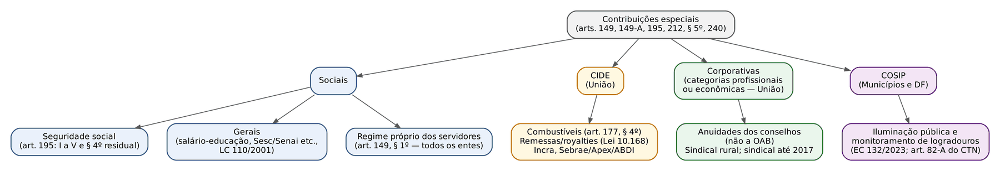
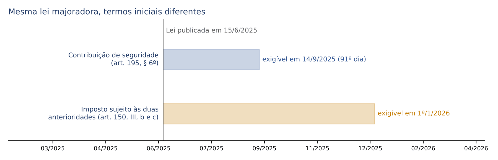
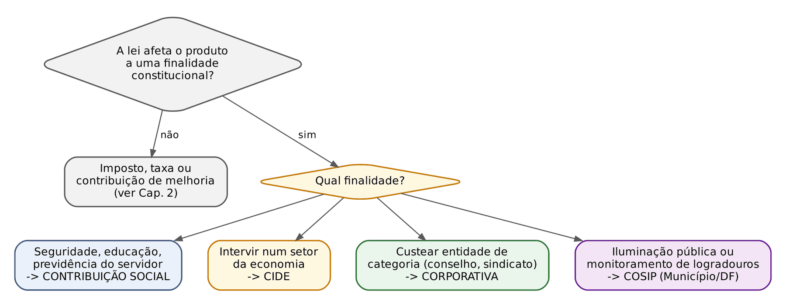

# CAPÍTULO 03 — ESPÉCIES TRIBUTÁRIAS II: CONTRIBUIÇÕES ESPECIAIS — SOCIAIS E DE SEGURIDADE, CIDE, DE INTERESSE DE CATEGORIAS PROFISSIONAIS E ECONÔMICAS, ILUMINAÇÃO PÚBLICA E SALÁRIO-EDUCAÇÃO

:::INCIDENCIA
TRF5 p. 10; TJRS p. 3; TJSC p. 3. Nível A. Lote: 14 questões (FGV 11, FCC 3).
O que mais cai: COSIP e a ampliação para monitoramento (EC 132/2023), competência exclusiva da União (e suas duas exceções), residual com lei complementar e noventena, anuidades de conselhos (legalidade, notificação, execução fiscal) e bases da CIDE.
:::

| Subtema | FGV | FCC | Padrão de cobrança |
|---|---|---|---|
| Competência e natureza das contribuições | 0 | 2 | Estado criando "contribuição" para o Judiciário; Estado custeando saúde do servidor por tributo |
| Seguridade social e residual | 1 | 1 | Fontes do art. 195; residual exige lei complementar; imunidade da exportação |
| CIDE | 2 | 0 | Bases do art. 149, § 2º, III; pessoa natural importadora |
| Conselhos profissionais | 2 | 0 | Execução fiscal de anuidade, notificação do lançamento, teto legal |
| COSIP e monitoramento | 5 | 0 | Não é taxa; competência municipal e distrital; progressividade; expansão da rede; EC 132 |
| Questão mista (V/F) | 1 | 0 | Estudo atuarial, Sebrae como CIDE |

## 03.1 Natureza jurídica e regime comum das contribuições especiais

### 03.1.1 O que distingue a contribuição dos demais tributos

O Cap. 2 já apresentou a classificação pentapartida adotada pelo STF (impostos, taxas, contribuições de melhoria, empréstimos compulsórios e contribuições especiais) e explicou por que o art. 4º do CTN, ao declarar irrelevante a destinação do produto da arrecadação, não resolve a classificação das espécies criadas depois de 1966. Aqui interessa a consequência prática: as contribuições especiais são TRIBUTO (cabem com folga na definição do art. 3º do CTN: prestação pecuniária compulsória, instituída em lei, que não é sanção de ato ilícito) e, por isso, sujeitam-se ao regime tributário, ao lançamento, à decadência e à prescrição do CTN e à execução fiscal da Lei 6.830/1980.

O traço que as individualiza é a FINALIDADE. O imposto é tributo não vinculado (o fato gerador nada tem a ver com o Estado) e de arrecadação, em regra, desvinculada (art. 167, IV, da CF). A taxa é vinculada a uma atuação estatal dirigida ao contribuinte. A contribuição especial, ao contrário, define-se pelo destino constitucionalmente qualificado do dinheiro: financiar a seguridade social, a educação básica, a intervenção num setor da economia, uma entidade de categoria profissional ou a iluminação pública. A doutrina costuma dizer que a Constituição, aqui, não descreve fatos geradores (como faz nos arts. 153, 155 e 156), mas FINALIDADES: é a norma de competência finalística. Por isso, para saber se uma "contribuição" é válida, a pergunta não é "qual o fato gerador?", e sim "para que serve o dinheiro e quem pode ser chamado a pagar?".

Para o juiz cível a analogia útil é a do encargo com destinação específica: assim como a doação modal ou a verba vinculada de um fundo têm finalidade que condiciona sua legitimidade, a contribuição especial nasce marcada pelo fim. A diferença é que, no tributo, o desvio posterior do dinheiro pelo Estado NÃO invalida a obrigação do contribuinte (ver 03.1.3).

### 03.1.2 Referibilidade: quem pode ser chamado a pagar

Referibilidade é a relação entre o grupo que paga e a finalidade custeada. Ela varia conforme a subespécie, e as bancas exploram justamente essa variação.

| Subespécie | Exige referibilidade? | Consequência prática |
|---|---|---|
| Sociais de seguridade (art. 195) | NÃO. A seguridade é financiada "por toda a sociedade" (solidariedade) | Empresa sem empregados ou que não usará o SUS paga COFINS e CSLL; o aposentado do RPPS paga contribuição (ver 03.2.6) |
| Sociais gerais (salário-educação, Sistema S do art. 240) | Fraca: o sujeito passivo é definido pela lei (empresas, empregadores) | Não importa se a empresa tem empregados matriculados no ensino público |
| CIDE | Mitigada: basta pertencer ao setor objeto da intervenção; o STF não exige benefício direto ao contribuinte | Empresa urbana paga CIDE-Incra; empresa de grande porte paga a contribuição do Sebrae |
| Corporativas | SIM: só os integrantes da categoria | Só o inscrito no conselho paga anuidade |
| COSIP | Grupo definido pela lei municipal (em regra, consumidores de energia), sem divisibilidade | O STF admitiu limitar o sujeito passivo aos consumidores de energia elétrica (ver 03.5) |

:::PEGADINHA
"A CIDE exige que o contribuinte seja beneficiário direto da intervenção" é ERRADO. O STF validou a contribuição ao Sebrae cobrada de empresas que não são micro nem pequenas, qualificando-a como CIDE que dispensa lei complementar (Tema 227 do STF), e a contribuição ao Incra cobrada de empresas urbanas (Tema 495 do STF). A referibilidade da CIDE é com o setor, não com o proveito individual.
:::

### 03.1.3 Destinação, desvio de finalidade e desvinculação (DRU)

A finalidade pode ser violada em dois planos, e a distinção é a chave das questões:

- Vício na NORMA: se a própria lei instituidora destina o produto a fim estranho ao autorizado pela Constituição (por exemplo, lei que cria "contribuição social" e manda aplicar o dinheiro em obras viárias), a contribuição é inconstitucional, porque a destinação integra o seu perfil constitucional. Aqui há direito à repetição (Cap. 16).
- Vício na EXECUÇÃO ORÇAMENTÁRIA: se a lei é correta, mas o administrador gasta o dinheiro em outra coisa, o problema é de Direito Financeiro e de responsabilidade do gestor; o tributo continua devido, e o contribuinte não tem direito à restituição.

A desvinculação constitucional de receitas (DRU) é o caso típico do segundo grupo, com a peculiaridade de ser autorizada pela própria Constituição. O art. 76 do ADCT, na redação da EC 135/2024, desvincula de órgão, fundo ou despesa, até 31/12/2032, 30% da arrecadação da União relativa às contribuições sociais (sem prejuízo das despesas do Regime Geral), às CIDE, às taxas e às receitas patrimoniais. Exceções do próprio art. 76: a arrecadação do salário-educação (§ 2º), as receitas das contribuições sociais destinadas ao custeio da seguridade social (§ 4º, incluído pela EC 103/2019) e os recursos que devam ser transferidos a Estados, DF e Municípios (§ 5º).

:::JURIS STF, Tema 277 (RE 566.007, j. 13/11/2014)
Tese em dois itens: (I) a eventual inconstitucionalidade da desvinculação de receita de contribuições sociais NÃO acarreta a devolução ao contribuinte do percentual desvinculado, porque a tributação em si não seria inconstitucional nem ilegal, única hipótese que autoriza a repetição do indébito; (II) não é inconstitucional a desvinculação, ainda que parcial, do produto das contribuições sociais pelo art. 76 do ADCT, nas redações então examinadas.
:::

:::PEGADINHA
A DRU foi prorrogada até 31/12/2032 pela EC 135/2024, e não pela EC 132/2023. Em questão da FGV sobre as alterações do ADCT pela EC 132 (Q3113977, de outro capítulo), a alternativa que atribuía à reforma a prorrogação da desvinculação estava errada exatamente por isso.
:::

:::SENTENCA
Onde entra: ação de repetição de indébito ou mandado de segurança em que o contribuinte alega que, desviado o dinheiro, a contribuição deixaria de ser devida. Fundamentar: separar o plano da norma instituidora (válida) e o da aplicação orçamentária; invocar o Tema 277. Redação-modelo: "A destinação diversa dada ao produto arrecadado, ainda que se admitisse sua irregularidade, situa-se no plano da execução orçamentária e não infirma a validade da exação, razão pela qual não gera direito à restituição (STF, Tema 277)". Erro comum: julgar procedente a repetição proporcional ao percentual desvinculado.
:::

### 03.1.4 Competência: regra da exclusividade da União e as duas exceções

O art. 149, caput, diz que compete EXCLUSIVAMENTE à União instituir contribuições sociais, de intervenção no domínio econômico e de interesse das categorias profissionais ou econômicas, "como instrumento de sua atuação nas respectivas áreas". Só há duas exceções, ambas expressas:

- art. 149, § 1º: União, Estados, DF e Municípios INSTITUIRÃO (é dever, não faculdade) contribuição dos servidores ativos, aposentados e pensionistas para custeio do respectivo regime próprio de previdência (ver 03.2.6);
- art. 149-A: Municípios e DF podem instituir a contribuição de iluminação pública e de monitoramento de logradouros (ver 03.5).

Estados, portanto, NÃO podem criar CIDE, contribuição social (salvo a do RPPS) ou contribuição corporativa. O tema da competência em geral (privativa, comum, residual, extraordinária) é do Cap. 4.

:::QUESTAO FCC 2026 — TJ-CE — Analista Judiciário — Ciências Contábeis (Q4245620)
Caso: Tribunal de Justiça e Governador articulam projeto de lei estadual criando "Contribuição Especial para Celeridade Processual", de valor fixo por fase do processo, com receita destinada a melhorar os sistemas da Justiça estadual. Gabarito oficial: B — a exação é inválida, porque a competência para contribuições sociais, de intervenção e corporativas é exclusiva da União. Armadilha: a alternativa que invoca a autonomia do Estado para organizar o próprio Judiciário (ela justifica taxas judiciárias, que são outra espécie, cobradas pela prestação do serviço; ver Cap. 2) e a que fala em "competência concorrente" para CIDE. Fundamento: 03.1.4.
:::

:::QUESTAO FCC 2024 — Prefeitura de Jaboatão dos Guararapes — Procurador (Q3542154)
Pergunta: competência estadual para contribuição destinada a custear serviços aos servidores. Gabarito oficial: E — os Estados têm competência APENAS para a contribuição de custeio do regime próprio de previdência de seus servidores. Armadilha: alternativas que admitem contribuição compulsória (ou "qualquer outra espécie tributária") para custear assistência médica, hospitalar, odontológica ou farmacêutica. O STF, em ação direta contra lei estadual, já declarou inconstitucional a contribuição compulsória para custeio de serviços de saúde do servidor, admitindo apenas a adesão facultativa a esses planos (o que torna a cobrança não tributária). Fundamento: art. 149, § 1º; 03.2.6.
:::

### 03.1.5 Regime constitucional comum: veículo legislativo, princípios e o art. 149, §§ 2º a 4º

Veículo. A regra é a LEI ORDINÁRIA. O art. 149 remete ao art. 146, III (normas gerais em lei complementar), mas isso NÃO significa que cada contribuição deva ser criada por lei complementar: o STF afirmou, nos Temas 227 (Sebrae) e 495 (Incra), que a CIDE dispensa lei complementar; e as contribuições de seguridade do art. 195, I a IV, também nascem por lei ordinária. Exigem lei complementar apenas: a contribuição RESIDUAL de seguridade (art. 195, § 4º, combinado com o art. 154, I; ver 03.2.3) e, por força da EC 132, a CBS do art. 195, V ("nos termos de lei complementar"; Cap. 32), cuja alíquota, porém, pode ser fixada em lei ordinária (art. 195, § 15).

Princípios. O art. 149 manda observar a legalidade (art. 150, I) e a irretroatividade e as anterioridades (art. 150, III), "sem prejuízo do previsto no art. 195, § 6º". Daí a regra que a FGV adora:

| Contribuição | Anterioridade anual (art. 150, III, b) | Noventena (art. 150, III, c, ou art. 195, § 6º) |
|---|---|---|
| Seguridade social (art. 195) | NÃO se aplica | Aplica-se a do § 6º (90 dias da lei que instituir ou modificar) |
| Sociais gerais, CIDE, corporativas, RPPS | Aplica-se | Aplica-se (art. 150, III, c) |
| CIDE-combustíveis, na redução e restabelecimento da alíquota por ato do Executivo | NÃO se aplica (art. 177, § 4º, I, b) | Aplica-se |
| COSIP | Aplica-se | Aplica-se |

O detalhamento das anterioridades (contagem, exceções, Súmula Vinculante 50 sobre alteração de prazo de recolhimento) é do Cap. 5. Aqui basta o exemplo comparativo.

:::EXEMPLO Mesma lei, datas diferentes
Lei federal publicada em 15/6/2025 majora, a um só tempo, a contribuição do empregador sobre a folha (art. 195, I, a) e um imposto federal sujeito às duas anterioridades.
1. Contribuição de seguridade: só a noventena do art. 195, § 6º. Contando 90 dias a partir do dia seguinte à publicação (16/6 é o 1º dia), o 90º dia é 13/9/2025; a majoração alcança fatos geradores a partir de 14/9/2025.
2. Imposto: precisa do exercício seguinte (1º/1/2026) e de 90 dias (14/9/2025); prevalece a data mais distante: 1º/1/2026.
3. Se a mesma lei tivesse sido publicada em 30/12/2024, as duas datas coincidiriam (o 90º dia seria 30/3/2025 para ambos), porque a noventena seria o termo mais distante também para o imposto.
:::

Art. 149, § 2º (EC 33/2001 e EC 42/2003). Aplica-se às contribuições SOCIAIS e às CIDE (não às corporativas nem à COSIP):

- I — não incidirão sobre as receitas decorrentes de exportação (imunidade; desenvolvida no Cap. 6, inclusive o alcance às exportações indiretas por *trading companies*, Tema 674 do STF, e a não extensão à CSLL, que incide sobre lucro e não sobre receita, decidida no RE 564.413);
- II — incidirão também sobre a importação de produtos estrangeiros ou serviços (fundamento do PIS/COFINS-Importação; Cap. 26);
- III — poderão ter alíquotas *ad valorem* (sobre faturamento, receita bruta ou valor da operação e, na importação, sobre o valor aduaneiro) ou específicas (por unidade de medida: reais por litro, por tonelada).

Art. 149, § 3º: a pessoa natural DESTINATÁRIA das operações de importação poderá ser equiparada a pessoa jurídica, na forma da lei. Art. 149, § 4º: a lei definirá as hipóteses de incidência monofásica ("uma única vez").

:::LEI CF, art. 149, § 2º, III, e § 3º
"III - poderão ter alíquotas: a) *ad valorem*, tendo por base o faturamento, a receita bruta ou o valor da operação e, no caso de importação, o valor aduaneiro; b) específica, tendo por base a unidade de medida adotada."
"§ 3º A pessoa natural destinatária das operações de importação poderá ser equiparada a pessoa jurídica, na forma da lei."
:::

O verbo "poderão" do inciso III é o ponto. O STF leu a lista de bases como NÃO exaustiva quando confirmou a recepção, pela EC 33/2001, das contribuições incidentes sobre a folha de salários destinadas ao Sebrae, à Apex e à ABDI (Tema 325) e ao Incra (Tema 495): a emenda ampliou possibilidades, não proibiu a folha como base. A mesma lógica explica o gabarito da Q3248841 (03.3).

:::JURIS STF, Tema 325 (RE 603.624, j. 23/9/2020)
"As contribuições devidas ao Sebrae, à Apex e à ABDI com fundamento na Lei nº 8.029/90 foram recepcionadas pela Emenda Constitucional 33/2001." No mesmo sentido, para o Incra: Tema 495 (RE 630.898, j. 7/4/2021).
:::

## 03.2 Contribuições sociais

### 03.2.1 Classificação

O STF (e a doutrina majoritária, com Ricardo Alexandre e Leandro Paulsen) divide as contribuições sociais em três grupos, e a classificação tem efeito prático, porque muda o regime:

| Grupo | Exemplos | Fundamento | Regime |
|---|---|---|---|
| De seguridade social | Do empregador sobre folha, receita/faturamento e lucro; do trabalhador; sobre concursos de prognósticos; do importador; CBS; residuais | Art. 195 | Só noventena (§ 6º); residual exige LC |
| Gerais | Salário-educação; Sesc, Senac, Sesi, Senai (art. 240); as da LC 110/2001 | Art. 149, art. 212, § 5º, art. 240 | Anterioridade anual e noventena; lei ordinária; NÃO integram o orçamento da seguridade |
| Do regime próprio dos servidores | Contribuição de ativos, aposentados e pensionistas | Art. 149, § 1º e §§ 1º-A a 1º-C | Todos os entes; alíquotas progressivas permitidas |

:::DICA
Pergunta de controle: "o dinheiro vai para saúde, previdência ou assistência social?" Se sim, é contribuição de seguridade (art. 195). Se vai para educação (salário-educação), para formação profissional e serviço social de entidades privadas (Sistema S do art. 240) ou para o FGTS (LC 110), é contribuição social GERAL e não goza da exceção à anterioridade anual.
:::

### 03.2.2 Contribuições para a seguridade social (art. 195)

A seguridade compreende saúde, previdência e assistência social (art. 194). O art. 195 diz que ela é financiada por toda a sociedade, de forma direta (contribuições) e indireta (orçamentos dos entes). As fontes diretas estão nos incisos:

| Inciso | Sujeito passivo | Base | Exemplos (desenvolvidos no Cap. 26) |
|---|---|---|---|
| I, a | Empregador, empresa e equiparada | Folha de salários e demais rendimentos do trabalho pagos a pessoa física, MESMO SEM VÍNCULO empregatício (EC 20/1998) | Contribuição patronal previdenciária; RAT/SAT |
| I, b | Idem | Receita ou faturamento | PIS/COFINS (até a extinção pela reforma; Caps. 32 e 33) |
| I, c | Idem | Lucro | CSLL |
| II | Trabalhador e demais segurados | Salário de contribuição; alíquotas progressivas permitidas (EC 103/2019); NÃO incide sobre aposentadoria e pensão do Regime Geral | Contribuição do segurado empregado, contribuinte individual |
| III | Concursos de prognósticos | Receita | Loterias |
| IV | Importador de bens ou serviços, ou quem a lei equiparar | Importação | PIS/COFINS-Importação |
| V | Contribuinte da CBS | Bens e serviços, nos termos de lei complementar (EC 132/2023; LC 214/2025) | CBS (Cap. 32) |

:::QUESTAO FCC 2026 — DPE-BA — Defensor Público (Q4037471)
Pergunta: quais são, nos termos da lei vigente, contribuições sociais da seguridade. Gabarito oficial: B — as das empresas, incidentes sobre faturamento e lucro (art. 11, parágrafo único, da Lei 8.212/1991, que reproduz o art. 195, I). Armadilha: "dos trabalhadores, incidentes sobre sua remuneração" (a base legal é o salário de contribuição, e não a remuneração em geral); "receita operacional líquida"; "pró-labore e distribuição de lucros" (lucro distribuído não é base de contribuição previdenciária); "servidores públicos" (contribuem para o RPPS, art. 149, § 1º, e não para a seguridade do art. 195).
:::

Outras regras do art. 195 que caem isoladas:

- § 3º: a pessoa jurídica em débito com a seguridade, como estabelecido em lei, não pode contratar com o Poder Público nem dele receber benefícios ou incentivos fiscais ou creditícios (ponte com certidões de regularidade, Cap. 19).
- § 5º: nenhum benefício ou serviço da seguridade será criado, majorado ou estendido sem a correspondente fonte de custeio total (regra da contrapartida, que vale para o legislador do benefício, não para o do tributo).
- § 7º: "são isentas" as entidades beneficentes de assistência social que atendam às exigências da lei. Apesar da palavra, trata-se de IMUNIDADE, regulada hoje pela LC 187/2021 (Cap. 6).
- § 8º: o segurado especial (produtor rural, pescador artesanal em economia familiar) contribui sobre o resultado da comercialização da produção (constitucionalidade afirmada no Tema 723 do STF; detalhes no Cap. 26).
- § 9º: as contribuições do inciso I podem ter alíquotas diferenciadas em razão da atividade econômica, da utilização intensiva de mão de obra, do porte da empresa ou da condição estrutural do mercado de trabalho; bases diferenciadas, só nas alíneas b e c (EC 103/2019). É o fundamento da alíquota adicional das instituições financeiras (Temas 204 e 470 do STF; Cap. 26).
- § 11: vedados moratória e parcelamento em prazo superior a 60 meses e, na forma de lei complementar, remissão e anistia das contribuições do inciso I, a, e do inciso II (folha e segurado).

Vinculação reforçada. O art. 167, XI, da CF proíbe usar as contribuições do art. 195, I, a, e II (folha e segurado) em despesas distintas do pagamento de benefícios do Regime Geral. Já a COFINS, a CSLL e as demais podem custear qualquer área da seguridade (saúde, assistência e previdência).

:::QUESTAO FGV 2024 — Câmara Municipal de São Paulo — Consultor Técnico Legislativo (Q2351941, do Cap. 26, correlata)
Gabarito: A — a arrecadação da contribuição do trabalhador e dos demais segurados só pode pagar benefícios previdenciários. Armadilha: dizer que a contribuição patronal sobre a folha pode pagar benefícios assistenciais (também está presa ao Regime Geral pelo art. 167, XI) ou que "todas" as contribuições de seguridade custeiam qualquer benefício.
:::

:::PROCESSO
Contribuições previdenciárias sobre a folha e de terceiros: o sujeito ativo é a União (Lei 11.457/2007, Receita Federal; cobrança pela PGFN). Ação contra a exigência: Justiça Federal, contra a União. Contribuição reconhecida em reclamação trabalhista: executada de ofício pela Justiça do Trabalho (art. 114, VIII, da CF). Prazos de decadência e prescrição: os do CTN (Súmula Vinculante 8; ver Cap. 15).
:::

### 03.2.3 Competência residual da seguridade (art. 195, § 4º)

O § 4º permite à União criar "outras fontes destinadas a garantir a manutenção ou expansão da seguridade social, obedecido o disposto no art. 154, I". A remissão ao art. 154, I (competência residual de IMPOSTOS) importa três requisitos: (1) LEI COMPLEMENTAR; (2) não cumulatividade; (3) fato gerador ou base de cálculo não próprios das contribuições já discriminadas no art. 195. Quanto ao terceiro requisito, o STF fez uma leitura própria: a nova contribuição não pode repetir fato gerador ou base das CONTRIBUIÇÕES já previstas, mas PODE coincidir com fato gerador ou base de IMPOSTO discriminado (posição tradicional da Corte; ver nota de verificação quanto ao precedente).

Exemplo de contribuição residual validada: a contribuição das empresas sobre a remuneração de autônomos, administradores e avulsos, instituída pela LC 84/1996 antes de a EC 20/1998 ampliar a alínea a do inciso I ("mesmo sem vínculo empregatício"). Também foi validada a contribuição da LC 84/1996 a cargo das cooperativas de trabalho (Tema 516 do STF; v. Cap. 1). A residual, por ser contribuição de seguridade, submete-se apenas à noventena do § 6º.

:::QUESTAO FGV 2025 — SEFAZ-PR — Auditor Fiscal (Q3363398)
Caso: lei ORDINÁRIA federal publicada em 30/12/2024 institui contribuição social residual (fora do rol do art. 195) sobre receitas de EXPORTAÇÃO de serviços de tecnologia, com efeitos imediatos.
1. O que se pergunta: validade formal, material e temporal.
2. Regra: residual exige lei complementar (art. 195, § 4º, c/c art. 154, I); contribuição social não incide sobre receitas de exportação (art. 149, § 2º, I).
3. Aplicação: dois vícios autônomos e suficientes; a discussão sobre noventena fica prejudicada.
Gabarito oficial: B. Armadilhas: C e E admitem lei ordinária (erro formal) e se concentram no prazo de 90 dias; A e D falam que a contribuição social escaparia de toda anterioridade (só escapa da anual).
:::

### 03.2.4 Contribuições sociais gerais I: salário-educação

O art. 212, § 5º, dispõe que a educação básica pública terá como fonte adicional de financiamento "a contribuição social do salário-educação, recolhida pelas empresas na forma da lei". É contribuição social GERAL (não financia a seguridade), instituída hoje pelo art. 15 da Lei 9.424/1996, com alíquota de 2,5% sobre o total de remunerações pagas ou creditadas, a qualquer título, aos segurados empregados. Suas cotas estaduais e municipais são distribuídas proporcionalmente ao número de alunos matriculados na educação básica pública (art. 212, § 6º, EC 53/2006), e é vedado usar esses recursos para pagar aposentadorias e pensões (§ 7º, EC 108/2020). Está fora da DRU (art. 76, § 2º, do ADCT).

:::JURIS STF, Súmula 732
"É constitucional a cobrança da contribuição do salário-educação, seja sob a Carta de 1969, seja sob a Constituição Federal de 1988, e no regime da Lei 9.424/96." Reafirmada em repercussão geral no Tema 518 (RE 660.933, j. 2/2/2012). O argumento derrotado era o de que a Lei 9.424/1996, por ser ordinária, não poderia criar contribuição: como contribuição social geral, ela dispensa lei complementar.
:::

Contribuinte é a EMPRESA, assim entendida qualquer firma individual ou sociedade que assuma o risco de atividade econômica, urbana ou rural, com ou sem fins lucrativos, bem como as entidades públicas e privadas vinculadas ao Regime Geral (definição do art. 15 da Lei 9.424/1996 e de seu regulamento). Daí duas exclusões recorrentes na jurisprudência do STJ:

:::JURIS STJ, Tema 1.228 (REsps 2.068.273-RS, 2.068.698-PR e 2.068.695-RS, j. 20/8/2026)
"A contribuição social do salário-educação [...] não é exigível da pessoa física que exerce serviço notarial ou registral, a qual não se enquadra na definição de contribuinte trazida na legislação que rege o tributo." O notário contrata empregados, mas como pessoa física titular da delegação, não como empresa.
:::

Na mesma linha, o STJ firmou que o produtor rural pessoa física, sem registro no CNPJ, não é contribuinte do salário-educação (orientação antiga e conhecida; o número do repetitivo não foi conferido nesta tarefa). Sobre a base de cálculo, o STJ fixou no Tema 1.390 (j. 11/2/2026) que a base das contribuições ao Incra, salário-educação, DPC, FAER, Senar, Sest, Senat, Sescoop, Sebrae, Apex e ABDI NÃO se limita a 20 salários mínimos (art. 4º, parágrafo único, da Lei 6.950/1981), na linha do que já decidira para Sesc, Senai, Sesi e Senac no Tema 1.079 (j. 13/3/2024).

:::SENTENCA
Onde entra: mandado de segurança de cartorário, produtor rural pessoa física ou empresa que pretende limitar a base a 20 salários mínimos. Fundamentar: definição legal de contribuinte (art. 15 da Lei 9.424/1996); repetitivos do STJ (Temas 1.228 e 1.390), de observância obrigatória (art. 927, III, do CPC). Redação-modelo: "O impetrante, pessoa física titular de serventia extrajudicial, não se enquadra no conceito legal de empresa, razão pela qual não é sujeito passivo do salário-educação (STJ, Tema 1.228)". Erro comum: concluir que, por ter empregados, o notário seria "equiparado a empresa" para fins de salário-educação, transpondo a equiparação previdenciária.
:::

### 03.2.5 Contribuições sociais gerais II: Sistema S, Incra, Sebrae e LC 110/2001

O art. 240 da CF ressalvou do art. 195 "as atuais contribuições compulsórias dos empregadores sobre a folha de salários, destinadas às entidades privadas de serviço social e de formação profissional vinculadas ao sistema sindical" (Sesc, Senac, Sesi, Senai e congêneres). São tributos (compulsórios, instituídos em lei), da espécie contribuição social geral na classificação prevalente; parte da doutrina as trata como contribuições de interesse de categorias econômicas. Já as contribuições do Sebrae, da Apex e da ABDI foram qualificadas pelo STF como CIDE (Temas 227 e 325), assim como a do Incra (Tema 495; Súmula 516 do STJ, que a chama de "contribuição de intervenção no domínio econômico para o Incra", não extinta pelas leis previdenciárias de 1989 a 1991 e não compensável com contribuições ao INSS).

:::JURIS STJ, Súmula 499
"As empresas prestadoras de serviços estão sujeitas às contribuições ao Sesc e Senac, salvo se integradas noutro serviço social." (No mesmo sentido, o repetitivo do Tema 496 do STJ.)
:::

As duas contribuições criadas pela LC 110/2001 (adicional de 10% sobre o saldo do FGTS na despedida sem justa causa e a de 0,5% sobre a remuneração) são contribuições sociais gerais. O STF afirmou a constitucionalidade da contribuição do art. 1º, "tendo em vista a persistência do objeto para a qual foi instituída" (Tema 846, j. 18/8/2020), e sua recepção pela EC 33/2001 (Tema 1.193, j. 4/2/2022). É um bom exemplo de que o exaurimento da finalidade PODERIA tornar a contribuição inválida, mas o STF não reconheceu o exaurimento no caso.

:::PROCESSO Quem responde na repetição das contribuições de terceiros
Só a União, que arrecada e fiscaliza, é parte passiva; as entidades meras destinatárias não têm legitimidade (Súmula 666 do STJ; v. Cap. 1). Na sentença, extingue-se o processo sem resolução de mérito quanto ao Sesc, Senai, Incra ou FNDE incluídos como litisconsortes (art. 485, VI, do CPC), prosseguindo contra a União (legitimidade e competência: Cap. 23).
:::

### 03.2.6 Contribuição dos servidores para o regime próprio (art. 149, § 1º)

Por que existe: o servidor titular de cargo efetivo não está no Regime Geral; tem regime próprio (RPPS, art. 40), que deve ser contributivo e solidário. A EC 103/2019 deu ao § 1º do art. 149 a redação atual: União, Estados, DF e Municípios INSTITUIRÃO, por meio de lei, contribuições para custeio do RPPS, cobradas dos servidores ativos, dos aposentados e dos pensionistas, que poderão ter ALÍQUOTAS PROGRESSIVAS de acordo com o valor da base de contribuição ou dos proventos.

:::LEI CF, art. 149, §§ 1º-A a 1º-C (EC 103/2019)
"§ 1º-A. Quando houver deficit atuarial, a contribuição ordinária dos aposentados e pensionistas poderá incidir sobre o valor dos proventos de aposentadoria e de pensões que supere o salário-mínimo."
"§ 1º-B. Demonstrada a insuficiência da medida prevista no § 1º-A para equacionar o deficit atuarial, é facultada a instituição de contribuição extraordinária, no âmbito da União, dos servidores públicos ativos, dos aposentados e dos pensionistas."
"§ 1º-C. A contribuição extraordinária de que trata o § 1º-B deverá ser instituída simultaneamente com outras medidas para equacionamento do deficit e vigorará por período determinado, contado da data de sua instituição."
:::

Atenção à literalidade: a contribuição EXTRAORDINÁRIA do § 1º-B é prevista "no âmbito da União"; a ampliação da base dos inativos em caso de déficit (§ 1º-A) vale para todos os entes.

Contribuição de inativos e pensionistas. Desde a EC 41/2003 os aposentados e pensionistas do RPPS contribuem. O STF, nas ADIs 3.105 e 3.128 (2004), afirmou a constitucionalidade dessa cobrança (não há direito adquirido a não ser tributado; o regime é solidário), mas invalidou o tratamento diferenciado entre os benefícios concedidos antes e depois da emenda, por ofensa à isonomia; o mesmo entendimento foi aplicado depois a leis estaduais.

Majoração das alíquotas. Três orientações cobráveis:

- Veículo: o STF decidiu que a majoração da alíquota dos servidores estaduais ao RPPS NÃO exige lei complementar; basta lei ordinária ou medida provisória (ADI 6.534/TO, j. 5/6/2024, Info 1139).
- Estudo atuarial: a ausência de estudo atuarial específico e prévio NÃO torna inconstitucional a lei que eleva a contribuição; é irregularidade sanável se demonstrado o déficit que justificou a medida; e a elevação de 11% para 13,25% não foi considerada confiscatória (Tema 933 do STF, ARE 875.958, j. 18/10/2021).
- Progressividade da EC 103 para os servidores federais: a constitucionalidade das alíquotas progressivas do art. 11, § 1º, V a VIII, da EC 103/2019 é objeto do Tema 1.226 do STF (Rel. Min. Luís Roberto Barroso) e de ações diretas. O Tema 1.226 está PENDENTE: a última notícia localizada (28/6/2023) registra que o julgamento virtual, com maioria parcial pela validade (relator e mais três ministros) e divergência do Min. Edson Fachin, foi interrompido por destaque do Min. Luiz Fux e será reiniciado no Plenário físico (ver nota).

:::QUESTAO FGV 2024 — Câmara dos Deputados — Consultor Legislativo, Área III (Q2510944)
Afirmativas V/F: (I) o STF exigiria estudo atuarial prévio para aumentar a contribuição dos servidores; (II) CIDE, como a do Sebrae, não exige lei complementar; (III) PIS e COFINS incidem sobre as receitas operacionais típicas das instituições financeiras. Gabarito oficial: C (F, V, V). O item I é falso pelo Tema 933 (ausência de estudo não invalida a lei); o II reproduz o Tema 227; o III é matéria do Cap. 26. Correlata: Q3179567 (FGV 2025, TRF3, Juiz Federal, do Cap. 22), em que a alternativa D estava errada por classificar o Sebrae como contribuição corporativa, quando o STF a qualifica como CIDE.
:::

:::QUESTAO FGV 2024 — Câmara dos Deputados — Consultor Legislativo, Área IV (Q2511358, do Cap. 4, correlata)
Os Municípios podem instituir impostos, taxas, contribuições de melhoria, contribuição de iluminação pública E contribuição para o regime próprio de previdência. Gabarito: B (todos os itens). Armadilha: esquecer a contribuição do RPPS, que é dever de todos os entes que mantenham regime próprio.
:::

:::NOTA Imunidades das contribuições (só remissão)
Receitas de exportação (art. 149, § 2º, I), entidades beneficentes de assistência social (art. 195, § 7º; LC 187/2021) e a não incidência sobre aposentadoria e pensão do Regime Geral (art. 195, II): desenvolvimento no Cap. 6.
:::

## 03.3 Contribuições de intervenção no domínio econômico (CIDE)

### 03.3.1 Conceito e pressupostos

A CIDE é o tributo que a União usa como instrumento de sua atuação num SETOR da economia: financiar a regulação, o fomento ou a correção de distorções de uma atividade econômica (arts. 149 e 170 a 181 da CF). Diferentemente do imposto extrafiscal (por exemplo, o imposto de importação usado para proteger a indústria), na CIDE o que é extrafiscal é o DESTINO do dinheiro: ele financia a intervenção. Por isso a doutrina aponta como pressupostos: (1) atividade econômica em sentido estrito como campo da intervenção; (2) finalidade interventiva declarada na lei; (3) destinação do produto à intervenção; (4) sujeitos passivos vinculados ao setor (referibilidade de grupo, não individual; ver 03.1.2); (5) caráter, em tese, transitório ou ao menos condicionado à persistência da necessidade de intervir.

Regime: competência exclusiva da União; lei ordinária (Temas 227 e 495); anterioridade anual e nonagesimal (salvo a exceção da CIDE-combustíveis); imunidade das receitas de exportação, incidência na importação e alíquotas *ad valorem* ou específicas (art. 149, §§ 2º a 4º). Parte do produto da CIDE-combustíveis é partilhada com Estados e Municípios (art. 159, III; Cap. 7).

:::QUESTAO FGV 2024 — EBSERH — Analista (Contabilidade, Estatística, Economia) (Q3248841)
Pergunta: característica correta das CIDE. Gabarito oficial: C — as bases de cálculo incluem faturamento, receita bruta, valor da operação e, na importação, valor aduaneiro, mas a Constituição não indica QUAL operação será tributada, o que amplia a liberdade do legislador ordinário. Armadilhas: "bases restritas ao faturamento", "a CF especifica exaustivamente as operações", "o STF proibiu bases além das mencionadas" (o STF, nos Temas 325 e 495, leu o rol como não exaustivo) e "não incidem na importação" (contraria o art. 149, § 2º, II). Fundamento: 03.1.5.
:::

:::QUESTAO FGV 2024 — prova não identificada no banco (Q3043796)
Caso: lei federal sujeita as pessoas naturais que realizem importação OU exportação às mesmas obrigações, principais e acessórias, das pessoas jurídicas, para fins de CIDE. Gabarito oficial: C — a lei é inconstitucional, porque a pessoa natural só pode ser equiparada à pessoa jurídica quando DESTINATÁRIA de operações de importação (art. 149, § 3º). Armadilhas: A e E afirmam que pessoa natural nunca (ou só pessoa jurídica) pode ser sujeito passivo de CIDE, o que é falso; B e D defendem a validade com base em extrafiscalidade ou isonomia. A literalidade do § 3º decide.
:::

### 03.3.2 CIDE-combustíveis (art. 177, § 4º)

É a única CIDE com regime traçado em detalhe pela Constituição (EC 33/2001), instituída pela Lei 10.336/2001 sobre importação e comercialização de petróleo e derivados, gás natural e derivados e álcool combustível.

:::LEI CF, art. 177, § 4º
"A lei que instituir contribuição de intervenção no domínio econômico relativa às atividades de importação ou comercialização de petróleo e seus derivados, gás natural e seus derivados e álcool combustível deverá atender aos seguintes requisitos: I - a alíquota da contribuição poderá ser: a) diferenciada por produto ou uso; b) reduzida e restabelecida por ato do Poder Executivo, não se lhe aplicando o disposto no art. 150, III, b; II - os recursos arrecadados serão destinados: a) ao pagamento de subsídios a preços ou transporte de álcool combustível, gás natural e seus derivados e derivados de petróleo; b) ao financiamento de projetos ambientais relacionados com a indústria do petróleo e do gás; c) ao financiamento de programas de infra-estrutura de transportes; d) ao pagamento de subsídios a tarifas de transporte público coletivo de passageiros." (alínea d incluída pela EC 132/2023)
:::

Três pegadinhas de literalidade:

- O Executivo pode REDUZIR E RESTABELECER a alíquota (não majorar acima do teto legal). É mitigação da legalidade (como no II, IE, IPI e IOF; Cap. 5).
- A exceção é só à anterioridade ANUAL ("art. 150, III, b"); a noventena continua aplicável ao restabelecimento.
- A EC 132/2023 acrescentou a quarta destinação: subsídios a tarifas de transporte público coletivo de passageiros.

:::QUESTAO FCC 2025 — TRT 15ª Região — Analista Judiciário, Contabilidade (Q3288596, do Cap. 1, correlata)
Assinalar a INCORRETA. Estava correta a afirmação de que a CIDE sobre importação de derivados de petróleo pode destinar recursos a programas de infraestrutura de transportes (art. 177, § 4º, II, c). Gabarito: C, que dizia ser vedado usar o PIS/PASEP para seguro-desemprego e abono (o art. 239 destina exatamente a isso).
:::

### 03.3.3 CIDE-remessas ou CIDE-tecnologia (Lei 10.168/2000) e outras CIDE

A Lei 10.168/2000 criou CIDE para financiar o Programa de Estímulo à Interação Universidade-Empresa para o Apoio à Inovação. Incide sobre valores pagos, creditados, entregues ou remetidos a residentes no exterior a título de royalties e de remuneração de contratos de exploração de tecnologia, assistência técnica e, após a Lei 10.332/2001, também de serviços técnicos e de assistência administrativa e semelhantes. A discussão era se a ampliação a serviços sem transferência de tecnologia desnaturava a intervenção (a CIDE estaria virando imposto sobre remessas).

:::JURIS STF, Tema 914 (RE 928.943, j. 13/8/2025)
Tese, conforme o Radar e a notícia do julgamento consultada: (I) é constitucional a CIDE instituída pela Lei 10.168/2000, com as alterações das Leis 10.332/2001 e 11.452/2007, destinada a financiar o Programa de Estímulo à Interação Universidade-Empresa; (II) a arrecadação deve ser integralmente aplicada na área de atuação Ciência e Tecnologia. Prevaleceu a leitura ampla da base (alcançando serviços técnicos, assistência administrativa e royalties em geral); ficaram vencidos, em parte, os ministros que restringiam a incidência às remessas ligadas à exploração de tecnologia.
:::

O item II da tese é a ponte com 03.1.3: a CIDE é constitucional, mas a destinação integral à ciência e tecnologia é parte do seu perfil.

Outras CIDE já reconhecidas pelo STF: Incra (Tema 495), Sebrae, Apex e ABDI (Temas 227 e 325). A doutrina e a jurisprudência também tratam como CIDE o Adicional ao Frete para Renovação da Marinha Mercante (AFRMM) e a contribuição ao FUST e ao FUNTTEL no setor de telecomunicações; os números dos precedentes não foram conferidos nesta tarefa.

:::QUESTAO FGV 2025 — Prefeitura de Abreu e Lima — Procurador (Q3841697, do Cap. 4, correlata)
Qual tributo a CF exige que seja instituído por lei complementar? Gabarito: A — imposto sobre grandes fortunas. A CIDE (alternativa C) é instituída por lei ordinária.
:::

## 03.4 Contribuições de interesse das categorias profissionais ou econômicas

São as contribuições "corporativas": financiam entidades que representam ou fiscalizam uma categoria. Hoje o grupo tem conteúdo bem delimitado pela jurisprudência:

| Exação | Tributo? | Fundamento | Cobrança |
|---|---|---|---|
| Anuidade de conselho de fiscalização profissional (CREA, CRM, COREN, CRC etc.) | SIM: contribuição de interesse de categoria profissional (art. 149) | Lei 12.514/2011 (valores máximos) e leis de cada conselho | Lançamento, inscrição em dívida ativa e execução fiscal (Lei 6.830/1980), na Justiça Federal |
| Anuidade da OAB | NÃO (STJ, com apoio no Tema 1.054 do STF) | Lei 8.906/1994, art. 46 | Execução de título extrajudicial pelo CPC, na Justiça Federal |
| Contribuição sindical (art. 578 da CLT) | Era tributo enquanto compulsória; tornou-se FACULTATIVA (Lei 13.467/2017; ADI 5.794) | CLT | Depende de autorização prévia e expressa |
| Contribuição sindical rural | SIM (recepcionada, sem bitributação: Tema 948 do STF; v. Cap. 4) | Decreto-Lei 1.661/1971 | Legitimidade ativa da CNA para cobrar (Súmula 396 do STJ; v. Cap. 4) |
| Contribuição confederativa (art. 8º, IV, da CF) | NÃO: fixada por assembleia, só obriga filiados | SV 40 | Não tributária |
| Contribuição assistencial (negocial) | NÃO: prevista em acordo ou convenção coletiva | Tema 935 do STF (revisto em 2023) | Pode alcançar não filiados, assegurado o direito de oposição |

### 03.4.1 Anuidades dos conselhos profissionais

Os conselhos são autarquias federais (exceto a OAB, que o STF trata como entidade *sui generis*), exercem poder de polícia sobre a profissão e são sujeitos ativos das anuidades por delegação de capacidade tributária ativa (art. 7º do CTN; Cap. 4). Como as anuidades são tributo, aplica-se a LEGALIDADE: valor, base e fato gerador em lei.

:::JURIS STF, Tema 540 (RE 704.292, j. 19/10/2016)
"É inconstitucional, por ofensa ao princípio da legalidade tributária, lei que delega aos conselhos de fiscalização de profissões regulamentadas a competência de fixar ou majorar, sem parâmetro legal, o valor das contribuições de interesse das categorias profissionais e econômicas, usualmente cobradas sob o título de anuidades, vedada, ademais, a atualização desse valor pelos conselhos em percentual superior aos índices legalmente previstos."
:::

Na mesma época (j. 6/10/2016), o STF julgou improcedentes as ADIs 4.697 e 4.762 e validou a Lei 12.514/2011, que fixa VALORES MÁXIMOS das anuidades (diferenciados por nível de formação para pessoas físicas e por capital social para pessoas jurídicas), deixando aos conselhos fixar o valor exato dentro desse teto. Para o STF, o teto legal satisfaz a legalidade (que não exige lei para cada centavo, mas parâmetros suficientes), dispensa-se lei complementar e o fato gerador é a inscrição no conselho durante o exercício.

:::EXEMPLO Teto legal x atualização acima da inflação
Conselho cobra 400 (quatrocentos) reais de anuidade em 2025. A lei específica fixa, para 2026, o máximo de 460 (quatrocentos e sessenta) reais, já atualizado pelo índice legal. A diretoria fixa a anuidade de 2026 em 460 (quatrocentos e sessenta) reais, aumento de 15%, embora a inflação do período tenha sido de 10%.
1. O que o Tema 540 proíbe: o conselho fixar valor SEM parâmetro legal ou ATUALIZAR acima do índice legal o valor que a lei fixou.
2. O que a Lei 12.514/2011 permite (ADIs 4.697 e 4.762): fixar o valor dentro do teto legal.
3. Aplicação: o novo valor não ultrapassa o máximo da lei; trata-se de escolha dentro da moldura legal, e não de atualização autônoma. Válido.
Se, ao contrário, a anuidade de 2026 fosse fixada em 500 (quinhentos) reais, acima do teto, a cobrança do excesso seria inconstitucional.
:::

:::QUESTAO FGV 2024 — Câmara dos Deputados — Consultor de Orçamento e Fiscalização Financeira (Q2512334)
Caso: diretoria colegiada de conselho aumenta a anuidade em 15%, "atingindo o máximo previsto em lei específica", com inflação de 10%. Gabarito oficial: A — não houve violação à Constituição. Armadilhas: B (violação à legalidade) e E (limite da inflação) aplicam mal o Tema 540, cuja vedação de atualização acima dos índices legais se refere a valores fixados sem moldura legal ou à atualização do próprio teto; C afirma que a anuidade não é tributo; D fala em confisco. Fundamento: exemplo anterior. A questão é sensível à leitura literal do Tema 540; o gabarito se sustenta porque o aumento respeitou o teto legal (ver nota de verificação).
:::

Sanções políticas. Como a anuidade é tributo, o conselho deve cobrá-la pelos meios próprios (execução fiscal), e não por coerção indireta.

Suspender o exercício profissional do inadimplente é sanção política inconstitucional (Tema 732 do STF; v. Cap. 11). Aspecto próprio deste capítulo: na mesma linha, a ADI 7.423 (j. 19/12/2023, Info 1121) invalidou normas do COFEN que exigiam a quitação de anuidades para obter, suspender ou reativar inscrição e para renovar a carteira profissional.

:::QUESTAO FGV 2025 — ENAC — Exame Nacional dos Cartórios (Q3328183, do Cap. 11, correlata)
Conselho suspende o exercício profissional de inadimplentes. Gabarito: A — agiu incorretamente, a medida é sanção política inconstitucional. A teoria das sanções políticas (Súmulas 70, 323 e 547 do STF) é desenvolvida no Cap. 5.
:::

Lançamento e notificação. A anuidade é tributo sujeito a lançamento de ofício; o crédito só se aperfeiçoa com a NOTIFICAÇÃO do profissional para pagar (e a oportunidade de impugnação), e cabe ao conselho comprovar a remessa da notificação. Esse é o entendimento do STJ (AgInt no AREsp 1.689.783/RS, citado pelo Dizer o Direito ao comentar a ADI 7.423). A lógica é a do Cap. 12: sem notificação regular, não há crédito exigível, e a CDA é nula.

:::QUESTAO FGV 2025 — TRF 6ª Região — Juiz Federal Substituto (Q3742393)
Caso: enfermeiro inadimplente desde 2021 é executado pelo COREN na Justiça Federal; alega (I) incompetência da Justiça Federal, (II) natureza não tributária da dívida e inadequação da execução fiscal, (III) falta de notificação do lançamento, embora soubesse do dever de pagar.
1. O que se pergunta: como o juiz decide cada argumento.
2. Regras: conselhos são autarquias federais (competência da Justiça Federal, art. 109, I, da CF; Súmula 66 do STJ, ver Cap. 21); anuidade é tributo (art. 149; ADIs 4.697 e 4.762), cobrável por execução fiscal; o lançamento de ofício só se aperfeiçoa com a notificação, requisito da exigibilidade.
3. Aplicação: rejeitar I e II; acolher III (o conhecimento genérico do dever de pagar não supre a notificação do lançamento).
Gabarito oficial: A. Armadilhas: B e D tratam a anuidade como dívida civil (é o regime da OAB, não dos demais conselhos); E ignora a notificação.
:::

:::SENTENCA Embargos à execução fiscal de conselho profissional
Onde entra: embargos ou exceção de pré-executividade em execução de anuidades. Roteiro: (1) competência da Justiça Federal; (2) natureza tributária e adequação da via; (3) legalidade do valor (lei específica ou Lei 12.514/2011; Tema 540); (4) notificação do lançamento comprovada nos autos; (5) prescrição quinquenal do art. 174 do CTN a partir da constituição definitiva (Cap. 15); (6) piso para ajuizar execução: os conselhos não executam judicialmente dívidas de valor total inferior a 5 (cinco) vezes a anuidade máxima de pessoa física de nível superior (art. 8º, caput, da Lei 12.514/2011, na redação da Lei 14.195/2021, com remissão ao art. 6º, I); abaixo do piso, cabem cobrança administrativa, cadastro de inadimplentes e protesto (§ 1º), e as execuções em curso de valor inferior são arquivadas sem baixa (§ 2º). Redação-modelo: "Tratando-se de tributo sujeito a lançamento de ofício, a exigibilidade da anuidade pressupõe a regular notificação do contribuinte, ônus do qual o exequente não se desincumbiu, o que conduz à nulidade da CDA e à extinção da execução". Erro comum: aplicar à anuidade de conselho o prazo do art. 206, § 5º, I, do Código Civil (que o STJ aplica à OAB, cuja anuidade não é tributo).
:::

### 03.4.2 A OAB

A OAB não é autarquia comum: o STF a trata como serviço público independente, entidade *sui generis*, não sujeita ao controle do Tribunal de Contas, e afirmou que ela não cobra tributos (Tema 1.054, RE 1.182.189). Daí o entendimento do STJ:

:::JURIS STJ, AREsp 2.451.645-SP, j. 9/4/2024 (Info 807)
"A anuidade cobrada pela Ordem dos Advogados do Brasil não tem natureza jurídica tributária." Consequências: a cobrança não segue a Lei 6.830/1980, e sim a execução de título extrajudicial do CPC (a certidão do art. 46, parágrafo único, do Estatuto é título executivo); a prescrição é a do art. 206, § 5º, I, do Código Civil (cinco anos); a competência é da Justiça Federal (Tema 258 do STF). Precedentes antigos no mesmo sentido: EREsp 463.258/SC e EREsp 503.252/SC.
:::

:::PEGADINHA
A Q3044209 (FGV 2024, Procurador de Vitória, do Cap. 6) anota "Conselho Regional de Fiscalização de Profissão Regulamentada (excluída a OAB), autarquia federal": a ressalva da OAB é exatamente o ponto. Na Q4079429 (FGV 2026, PGE-AC, do Cap. 19), a anuidade de conselho de profissão regulamentada gera dívida ativa TRIBUTÁRIA, ao passo que a taxa de ocupação de imóvel público é receita patrimonial (não tributária); gabarito D.
:::

### 03.4.3 Contribuições sindicais

A contribuição sindical da CLT (o antigo "imposto sindical", desconto de um dia de trabalho por ano) era tributo: contribuição de interesse de categoria (art. 149), compulsória, recepcionada pela parte final do art. 8º, IV, da CF ("independentemente da contribuição prevista em lei"), e o próprio CTN, no art. 217, I, ressalva sua exigibilidade. A Lei 13.467/2017 (reforma trabalhista) condicionou o desconto à autorização prévia e expressa do trabalhador, tornando-a FACULTATIVA. O STF, por 6 votos a 3, declarou constitucional a mudança (ADI 5.794 e apensos, com a ADC 55, j. 29/6/2018, redator para o acórdão o Min. Luiz Fux). Consequência doutrinária: perdida a compulsoriedade, a contribuição sindical deixou de ser tributo; e, por não ser tributo, a alteração não dependia de lei complementar nem de reforma constitucional.

:::DICA
Quatro figuras diferentes, quatro regimes:
- contribuição sindical (lei): facultativa após 2017 (ADI 5.794);
- contribuição confederativa (assembleia, art. 8º, IV, primeira parte): não é tributo e só obriga filiados (SV 40);
- contribuição assistencial (acordo ou convenção coletiva): não é tributo; pode alcançar todos os empregados da categoria, mesmo não sindicalizados, desde que assegurado o direito de oposição (Tema 935 do STF, tese revista nos embargos no ARE 1.018.459, sessão virtual encerrada em 11/9/2023);
- contribuição sindical rural (Decreto-Lei 1.661/1971): tributo (Tema 948 do STF e Súmula 396 do STJ; v. Cap. 4).
:::

:::JURIS STF, Súmula Vinculante 40
"A contribuição confederativa de que trata o artigo 8º, IV, da Constituição Federal, só é exigível dos filiados ao sindicato respectivo."
:::

## 03.5 Contribuição para o custeio do serviço de iluminação pública e de monitoramento de logradouros (COSIP ou CIP)

### 03.5.1 Por que existe

Iluminação pública é serviço *uti universi*: beneficia indistintamente quem mora, trabalha ou apenas passa pela rua, e não há como medir quanto cada um usa. Falta-lhe a especificidade e a divisibilidade que o art. 145, II, da CF exige para a taxa. Por isso o STF declarou inconstitucionais as "taxas de iluminação pública" (Súmula Vinculante 41: o serviço de iluminação pública não pode ser remunerado mediante taxa; desenvolvida no Cap. 2). A reação foi a EC 39/2002, que criou o art. 149-A e uma competência nova, dada a Municípios e ao DF, para uma CONTRIBUIÇÃO, espécie que não depende de divisibilidade porque se define pela finalidade.

### 03.5.2 Regime atual: EC 132/2023 e LC 227/2026

:::LEI CF, art. 149-A (redação da EC 132/2023)
"Os Municípios e o Distrito Federal poderão instituir contribuição, na forma das respectivas leis, para o custeio, a expansão e a melhoria do serviço de iluminação pública e de sistemas de monitoramento para segurança e preservação de logradouros públicos, observado o disposto no art. 150, I e III. Parágrafo único. É facultada a cobrança da contribuição a que se refere o caput, na fatura de consumo de energia elétrica."
:::

A EC 132/2023 fez duas ampliações: (1) do custeio para "custeio, expansão e melhoria", positivando o que o STF já admitira (Tema 696, abaixo); (2) da iluminação para os SISTEMAS DE MONITORAMENTO para segurança e preservação de logradouros públicos (câmeras, centros de controle). A LC 227/2026 incluiu no CTN o Título V-A, com o art. 82-A, que reproduz o art. 149-A e define o alcance das duas finalidades.

:::LEI CTN, art. 82-A, § 1º, II, e § 2º (incluídos pela LC 227/2026)
"II - custeio, expansão e melhoria de sistemas de monitoramento para segurança e preservação de logradouros públicos: a aquisição, a implementação, a instalação, a expansão, a manutenção, a operação, a gestão e o desenvolvimento dos projetos, dos sistemas, das tecnologias, dos meios de transmissão da informação, da infraestrutura e dos equipamentos destinados ao monitoramento para administração, controle, segurança, preservação e prevenção a desastres em vias, logradouros públicos e equipamentos públicos comunitários e urbanos, em qualquer área do território municipal ou distrital, incluídos os ativos necessários ao funcionamento de centros integrados de operação e controle e à integração de sistemas de gestão de monitoramento pela administração pública."
"§ 2º É facultada a cobrança da contribuição a que se refere o caput deste artigo na fatura de consumo de energia elétrica."
:::

O inciso I do mesmo § 1º define o custeio, a expansão e a melhoria da iluminação pública com a mesma estrutura (aquisição, implementação, instalação, expansão, manutenção, operação, gestão e desenvolvimento de projetos, equipamentos, tecnologias, serviços e ativos da rede de iluminação, temporária ou permanente, em vias, logradouros e equipamentos públicos, em qualquer área do território, urbana ou rural).

Ficha de consulta rápida:

| Item | COSIP |
|---|---|
| Competência | Municípios e DF (NUNCA Estados ou União) |
| Veículo | Lei ordinária municipal ou distrital |
| Finalidade | Custeio, expansão e melhoria da iluminação pública e dos sistemas de monitoramento de logradouros (art. 149-A; art. 82-A do CTN) |
| Princípios expressos | Legalidade (art. 150, I) e irretroatividade e anterioridades anual e nonagesimal (art. 150, III) |
| Sujeito passivo | Definido pela lei local; o STF validou restringi-lo aos consumidores de energia elétrica |
| Base e alíquotas | Livres na CF; o STF admitiu valores progressivos conforme a faixa de consumo |
| Arrecadação | Facultada na fatura de energia (a distribuidora atua como arrecadadora, e não como contribuinte) |
| Natureza | Tributo *sui generis* no grupo das contribuições; não é taxa nem imposto |
| Precedentes-chave | SV 41 (Cap. 2); RE 573.675; Tema 696 |

### 03.5.3 Jurisprudência

:::JURIS STF, RE 573.675/SC, Pleno, j. 25/3/2009 (Info 540)
O STF manteve a lei complementar do Município de São José/SC que instituiu a COSIP. Pontos assentados: (1) é tributo de caráter *sui generis*, que não se confunde com imposto nem com taxa; (2) é constitucional eleger como contribuintes os consumidores de energia elétrica, residenciais e não residenciais, urbanos e rurais, pois o serviço é *uti universi* e não seria possível alcançar todos os beneficiários; (3) a progressividade das alíquotas conforme a quantidade consumida não viola a isonomia nem a capacidade contributiva, pois presume-se maior capacidade em quem consome mais; (4) a COSIP não tem base de cálculo própria do ICMS, porque corresponde ao rateio do custo do serviço municipal. Vencido o Min. Marco Aurélio, que via na exação uma taxa.
:::

:::JURIS STF, Tema 696 (RE 666.404, j. 18/8/2020)
"É constitucional a aplicação dos recursos arrecadados por meio de contribuição para o custeio da iluminação pública na expansão e aprimoramento da rede." A EC 132/2023 positivou o entendimento ao incluir "expansão" e "melhoria" no art. 149-A.
:::

:::EXEMPLO COSIP progressiva por faixa de consumo
Lei do Município Alfa institui COSIP mensal, cobrada na fatura de energia: consumo até 100 kWh, isento; de 101 a 300 kWh, 10 (dez) reais; acima de 300 kWh, 30 (trinta) reais; imóveis não residenciais, 50 (cinquenta) reais. Problemas?
1. Competência e veículo: Município, lei ordinária. Ok.
2. Sujeito passivo: consumidores de energia (RE 573.675). Ok.
3. Valores crescentes por faixa de consumo: progressividade admitida (RE 573.675). Ok.
4. Lei publicada em 10/11/2025: a partir de quando? A anterioridade anual levaria a 1º/1/2026, mas a noventena vai além: contado o 1º dia em 11/11/2025, o 90º dia é 8/2/2026, e a cobrança alcança fatos a partir de 9/2/2026 (art. 150, III, b e c, aplicáveis por força do art. 149-A; prevalece o termo mais distante).
5. Se a lei mandar aplicar o produto em "segurança pública em geral" (viaturas da guarda municipal), há vício de destinação na própria norma: a finalidade autorizada é o monitoramento de logradouros, nos termos do art. 82-A, § 1º, II, do CTN, e não a segurança pública genérica.
:::

### 03.5.4 Questões do lote

:::QUESTAO FGV 2024 — Câmara dos Deputados — Consultor Legislativo, Área III (Q2510999)
Caso: vereadora quer criar exação para custear a iluminação pública; a assessoria conclui que (I) seria taxa, (II) poderia ter alíquota progressiva e (III) os recursos poderiam ser aplicados na expansão e no aprimoramento da rede. Gabarito oficial: E (apenas II e III). I é falso pela SV 41 e pelo art. 149-A; II, pelo RE 573.675; III, pelo Tema 696 e hoje pelo texto da EC 132. Armadilha: tratar a progressividade como privativa de impostos pessoais.
:::

:::QUESTAO FGV 2024 — prova não identificada no banco (Q3113966)
Município quer implantar câmeras de monitoramento para segurança e preservação de logradouros. À luz da EC 132/2023, pode instituir: Gabarito oficial: B — contribuição municipal, AINDA QUE o serviço não seja específico e divisível. Armadilhas: A e E (taxa: exige serviço específico e divisível, e o monitoramento é *uti universi*); C (empréstimo compulsório é da União, art. 148); D (imposto não pode ter como fato gerador atividade estatal específica, art. 16 do CTN).
:::

:::QUESTAO FGV 2024 — prova não identificada no banco (Q3157905)
Forma constitucionalmente adequada de financiar a melhoria da iluminação pública. Gabarito oficial: C — contribuição para o custeio do serviço de iluminação pública, de competência dos Municípios. Armadilhas: D ("competência comum dos entes"); A, B e E (taxas). No mesmo sentido: Q2362724 (FGV 2024, Prefeitura de São José dos Campos, Analista em Gestão Municipal, Direito; gabarito D: contribuição de iluminação pública dos Municípios). Observação: o enunciado da Q2362724 fala em "Emenda Constitucional nº 39/2012", quando a emenda é de 2002; o erro material não altera o gabarito.
:::

:::QUESTAO FGV 2024 — prova não identificada no banco; enunciado sobre o Município de Belo Horizonte (Q2365989)
Pergunta de administração tributária: qual tributo da capital normalmente não é instituído em pequenos Municípios pelo elevado custo político. Gabarito oficial: B — a taxa de coleta de resíduos sólidos. Lição para este capítulo: a contribuição de iluminação pública (alternativa C), cobrada na fatura de energia e de baixo valor unitário, é tributo difundido mesmo nos pequenos Municípios, justamente por arrecadar com facilidade. A questão é de gestão, não de dogmática; gabarito discutível (ver nota).
:::

:::PEGADINHA
A Q3186483 (FGV 2025, TCE-RR, do Cap. 4) trazia a alternativa "Os Estados e os Municípios podem instituir contribuição para o custeio [...] de iluminação pública e de sistemas de monitoramento": ERRADA, porque o art. 149-A fala em Municípios e DISTRITO FEDERAL, não em Estados. O gabarito foi a alternativa que atribui somente à União impostos residuais, empréstimos compulsórios e CIDE.
:::

:::PROCESSO
Discussão da COSIP: ação contra o MUNICÍPIO (sujeito ativo), na Justiça Estadual (Vara da Fazenda Pública ou Juizado Especial da Fazenda Pública, conforme o valor). A distribuidora de energia apenas arrecada e repassa: por isso, em regra, a pretensão de afastar ou repetir a contribuição deve ser dirigida ao Município, e não à concessionária (orientação geral, sem precedente conferido; ver nota).
:::

## 03.6 Resumo para revisão pré-prova

| Instituto | Regra | Exceções e detalhes | Fundamento |
|---|---|---|---|
| Natureza das contribuições especiais | Tributo definido pela finalidade e pela destinação | Desvio na execução orçamentária não gera restituição | Art. 149 da CF; Tema 277 do STF |
| DRU | 30% das contribuições sociais, CIDE, taxas e receitas patrimoniais da União desvinculados até 31/12/2032 | Fora: salário-educação, contribuições da seguridade, repasses a entes | Art. 76 do ADCT (EC 135/2024) |
| Competência | Exclusiva da União | RPPS (todos os entes, dever); COSIP (Municípios e DF) | Arts. 149, caput e § 1º, e 149-A |
| Veículo | Lei ordinária | Lei complementar: residual da seguridade e CBS (alíquota da CBS por lei ordinária) | Art. 195, §§ 4º e 15 |
| Anterioridade | Anual e nonagesimal | Seguridade: só noventena; CIDE-combustíveis: redução e restabelecimento por ato do Executivo sem anterioridade anual | Arts. 150, III, 195, § 6º, 177, § 4º, I, b |
| Art. 149, § 2º | Sociais e CIDE: imunes na exportação; incidem na importação; alíquotas *ad valorem* ou específicas | Rol de bases não exaustivo; CSLL não abrangida pela imunidade; exportação indireta abrangida | Temas 325, 495 e 674 do STF; RE 564.413 (Cap. 6) |
| Pessoa natural | Pode ser equiparada a pessoa jurídica | Só como destinatária de importação | Art. 149, § 3º |
| Seguridade (art. 195) | Empregador (folha, receita, lucro), trabalhador, prognósticos, importador, CBS | Folha e segurado só pagam benefícios do Regime Geral | Art. 195; art. 167, XI |
| Residual da seguridade | Lei complementar, não cumulativa, base e fato gerador distintos das contribuições já previstas | Pode coincidir com base de imposto; só noventena | Art. 195, § 4º, c/c art. 154, I |
| Salário-educação | Contribuição social geral, cobrada das empresas | Notário pessoa física não é contribuinte; base sem limite de 20 salários mínimos | Art. 212, § 5º; Súmula 732 do STF; Temas 1.228 e 1.390 do STJ |
| Sistema S | Sesc, Senac, Sesi, Senai: contribuições sociais gerais (art. 240) | Sebrae, Apex, ABDI e Incra: CIDE | Súmula 499 do STJ; Temas 227, 325 e 495 do STF |
| Contribuições de terceiros em juízo | Polo passivo: União | Entidades destinatárias são ilegítimas | Súmula 666 do STJ |
| LC 110/2001 | Contribuição social geral válida | Finalidade não exaurida | Temas 846 e 1.193 do STF |
| RPPS | Dever de todos os entes; ativos, aposentados e pensionistas; progressividade permitida | Base dos inativos ampliada no déficit; extraordinária só da União | Art. 149, §§ 1º a 1º-C; ADIs 3.105 e 3.128 |
| Majoração da contribuição do servidor | Lei ordinária ou MP basta | Falta de estudo atuarial é sanável; progressivas federais da EC 103: tema pendente | ADI 6.534; Tema 933; Tema 1.226 do STF |
| CIDE | Intervenção num setor; lei ordinária; referibilidade de grupo | Combustíveis: destinações do art. 177, § 4º, II (alínea d pela EC 132) | Arts. 149 e 177, § 4º |
| CIDE-remessas | Constitucional, inclusive com base ampliada | Produto integralmente aplicado em ciência e tecnologia | Tema 914 do STF |
| Anuidade de conselho | Tributo; lei fixa teto; execução fiscal na Justiça Federal; notificação do lançamento necessária | Conselho não fixa valor sem parâmetro legal nem atualiza acima do índice legal; suspensão por inadimplência é sanção política | Tema 540; ADIs 4.697 e 4.762; Tema 732; ADI 7.423; Lei 12.514/2011 |
| Anuidade da OAB | Não é tributo | Execução pelo CPC; prescrição do art. 206, § 5º, I, do CC | STJ, AREsp 2.451.645; Tema 1.054 do STF |
| Contribuições sindicais | Sindical: facultativa desde 2017; confederativa: só filiados | Assistencial: a todos, com direito de oposição; sindical rural: tributo | ADI 5.794; SV 40; Tema 935; Tema 948; Súmula 396 do STJ |
| COSIP | Municípios e DF; custeio, expansão e melhoria da iluminação e do monitoramento de logradouros; cobrança na fatura | Não é taxa; contribuintes: consumidores de energia; progressividade por consumo; anterioridades anual e nonagesimal | Art. 149-A (EC 132); art. 82-A do CTN (LC 227/2026); RE 573.675; Tema 696 |

## 03.7 Artigos de lei incidentes

- Constituição Federal: arts. 8º, IV; 145, II; 146, III; 149, caput, §§ 1º a 4º; 149-A; 150, I e III; 154, I; 159, III; 167, IV e XI; 177, § 4º; 194; 195, I a V e §§ 3º a 9º, 11, 12, 15; 212, §§ 5º a 7º; 239; 240.
- ADCT: art. 76 (EC 135/2024).
- CTN: arts. 3º, 4º, 7º, 82-A (LC 227/2026), 217, I.
- Lei 8.212/1991: arts. 11 e 25. Lei 9.424/1996: art. 15. Lei 10.336/2001 (CIDE-combustíveis). Lei 10.168/2000 e Lei 10.332/2001 (CIDE-remessas). Lei 8.029/1990 (Sebrae, Apex, ABDI). LC 110/2001: art. 1º. LC 84/1996. Lei 6.950/1981: art. 4º, parágrafo único.
- Lei 12.514/2011 (anuidades dos conselhos). Lei 8.906/1994: art. 46. CLT: art. 578 (Lei 13.467/2017). Decreto-Lei 1.661/1971.
- Lei 11.457/2007 (arrecadação pela Receita Federal). LC 187/2021 (remissão ao Cap. 6). LC 214/2025 (remissão ao Cap. 32).

## 03.8 Julgados, temas e súmulas do capítulo

- Tema 277 do STF (RE 566.007): DRU não gera restituição.
- Temas 227, 325 e 495 do STF: Sebrae, Apex, ABDI e Incra como CIDE, sem lei complementar; rol do art. 149, § 2º, III, não exaustivo.
- Tema 914 do STF (RE 928.943): CIDE-remessas constitucional; produto integral em ciência e tecnologia.
- Súmula 732 e Tema 518 do STF: salário-educação constitucional.
- Tema 1.228 do STJ: notário pessoa física não paga salário-educação.
- Temas 1.079 e 1.390 do STJ: contribuições de terceiros sem teto de 20 salários mínimos.
- Súmula 499 do STJ e Tema 496 do STJ: prestadoras de serviço pagam Sesc e Senac.
- Súmula 516 do STJ: CIDE-Incra não extinta nem compensável com contribuição ao INSS.
- Temas 846 e 1.193 do STF: contribuição do art. 1º da LC 110/2001 válida e recepcionada.
- ADIs 3.105 e 3.128: contribuição de inativos válida; tratamento diferenciado inválido.
- ADI 6.534 (Info 1139): majoração da contribuição do servidor por lei ordinária ou MP.
- Tema 933 do STF: falta de estudo atuarial prévio não invalida a majoração.
- Tema 1.226 do STF: progressividade da EC 103 para servidores federais (pendente na última informação).
- Tema 540 do STF: conselho não fixa nem atualiza anuidade sem parâmetro legal.
- ADIs 4.697 e 4.762: Lei 12.514/2011 válida (teto legal).
- ADI 7.423 (Info 1121): exigência de quitação de anuidades para inscrição e carteira profissional é sanção política.
- STJ, AgInt no AREsp 1.689.783/RS: lançamento da anuidade exige notificação.
- STJ, AREsp 2.451.645 (Info 807) e Tema 1.054 do STF: anuidade da OAB não é tributo.
- ADI 5.794: contribuição sindical facultativa.
- Tema 935 do STF (revisto em 2023): contribuição assistencial com direito de oposição.
- SV 40: confederativa só de filiados.
- RE 573.675: COSIP *sui generis*, consumidores de energia, progressividade por consumo.
- Tema 696 do STF: COSIP pode custear expansão e aprimoramento da rede.

- Remissões: Súmula 666 do STJ e Tema 516 do STF (Cap. 1); Tema 948 do STF e Súmula 396 do STJ (Cap. 4); Tema 732 do STF (Cap. 11); SV 41 e Súmula 545 do STF (Cap. 2); SV 50 e Súmulas 70, 323 e 547 do STF (Cap. 5); Tema 674 do STF, RE 564.413, LC 187/2021 e Tema 32 (Cap. 6); SV 8 (Cap. 15); Súmula 66 do STJ (Cap. 21); Temas 204, 470, 669, 723 e 801 do STF e demais contribuições previdenciárias, PIS, COFINS e CSLL (Cap. 26); CBS (Cap. 32).

:::NOTA Notas de verificação
- Conferidos no Planalto (22/10/2026): CF, arts. 8º, 149, 149-A, 177, 195, 212 e 240; ADCT, art. 76 (EC 135/2024, prazo até 31/12/2032); CTN, art. 82-A (LC 227/2026; box LEI conferido com o texto literal), arts. 3º, 4º, 7º e 217 (sem alteração pelas LC 227 e 236/2026; o art. 174, citado só por remissão, foi alterado pela LC 236, matéria do Cap. 15); Lei 9.424/1996, art. 15 (alíquota de 2,5% sobre as remunerações dos segurados empregados: conferido no Planalto em 22/10/2026); Lei 12.514/2011, art. 8º (redação da Lei 14.195/2021: conferido no Planalto em 22/10/2026; o texto do roteiro de sentença foi completado). Conteúdo da LC 227/2026 sobre a COSIP também conferido no PDF do Drive ("NL. LC 227 2026 - Altera o CTN").
- Teses conferidas: Tema 277 (tesesesumulas.com.br); Tema 914 (Radar e nota do escritório Felsberg; data do Radar, 13/8/2025); Tema 935 revisto (notícia do STF de 12/9/2023); Tema 732 e ADI 7.423 (Dizer o Direito); anuidade da OAB (Dizer o Direito, AREsp 2.451.645); RE 573.675 (Info 540, juris.damasio); Tema 933 (juris.damasio); ADI 5.794 (IBET; placar 6 x 3); Temas 540, 325, 495, 227, 696, 846, 1.193, 516, 948, 1.228, 1.390, 1.079, Súmulas 732, 499, 516, 666 e 396 e SV 40 (Radar); Tema 674 e RE 564.413 (notícia e artigo consultados, só para remissão).
- Pendências: (1) Tema 1.226: pendente; última notícia localizada de 28/6/2023 (IBDP: destaque do Min. Luiz Fux no Plenário Virtual, julgamento a ser reiniciado no Plenário físico), e o portal Trilhante o lista como "matéria ainda não julgada" (sem data); os números e a situação das ADIs contra a progressividade da EC 103 (o texto mencionava a ADI 6.254) não foram confirmados em fonte, e por isso o número foi retirado do texto; (2) número do precedente do STF sobre residual coincidente com base de imposto e do repetitivo do STJ sobre produtor rural pessoa física sem CNPJ no salário-educação (orientações descritas sem número); (3) número da ADI do STF que invalidou contribuição compulsória estadual para saúde do servidor, não localizado em fonte; (4) números de precedentes sobre AFRMM, FUST e FUNTTEL como CIDE não conferidos; (5) legitimidade da distribuidora de energia nas ações sobre COSIP: orientação geral, sem precedente conferido.
- Gabaritos sensíveis: Q2512334 (o aumento acima da inflação foi aceito porque respeitou o teto legal; leitura literal do Tema 540 poderia induzir a alternativa E); Q2365989 (questão de gestão tributária, de gabarito opinativo); Q2362724 (o enunciado cita a "Emenda Constitucional nº 39/2012", mas a EC 39, que criou o art. 149-A, é de 2002; erro material da banca, que não altera o gabarito D).
- Fontes grandes do Drive (Mazza, Ricardo Alexandre, Sinopse TJSC, compilado TRF6, Jurisprudência em Teses, caderno do Dizer o Direito) não foram lidas nesta tarefa, por limitação da ferramenta para leitura parcial; as posições doutrinárias foram atribuídas de forma genérica ("doutrina majoritária", "parte da doutrina").
:::
