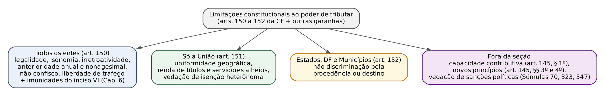
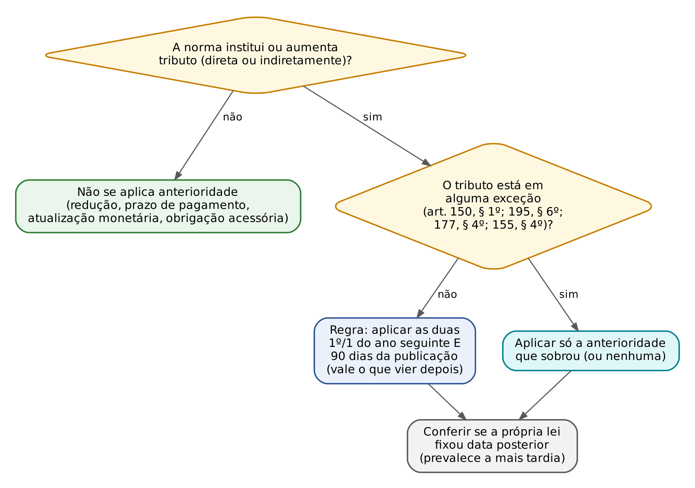
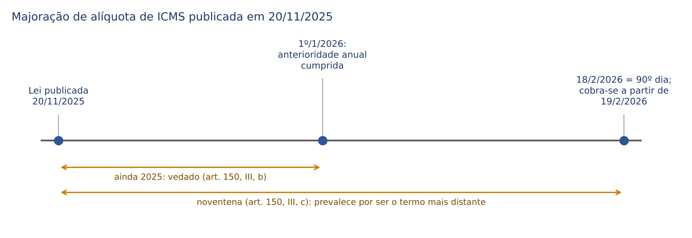
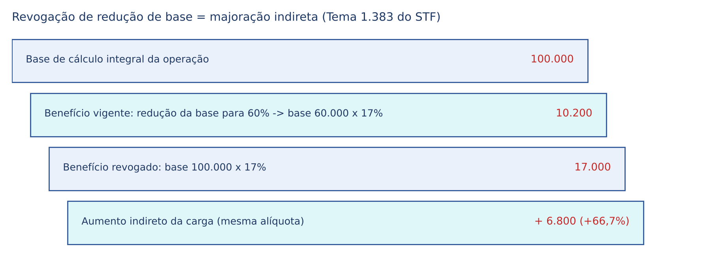
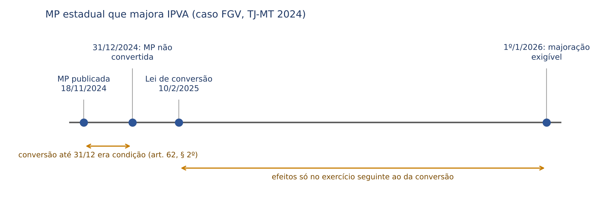
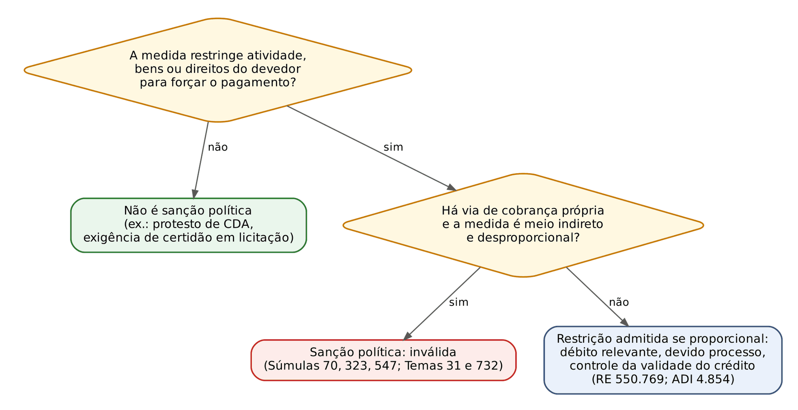

# CAPÍTULO 05 — LIMITAÇÕES CONSTITUCIONAIS AO PODER DE TRIBUTAR I: PRINCÍPIOS — LEGALIDADE, ANTERIORIDADE ANUAL E NONAGESIMAL, IRRETROATIVIDADE, ISONOMIA, CAPACIDADE CONTRIBUTIVA, VEDAÇÃO AO CONFISCO, LIBERDADE DE TRÁFEGO, UNIFORMIDADE, SEGURANÇA JURÍDICA E SANÇÕES POLÍTICAS

:::INCIDENCIA
Pontos: TRF5 p. 7; TJRS p. 1; TJSC p. 1 e 4. Nível A+. Lote: 63 questões (FGV 49, FCC 14).
O que mais cai: anterioridade com datas (exceções do art. 150, § 1º, revogação de benefício, medida provisória, prazo de pagamento) e legalidade e suas mitigações (alíquotas por decreto, atualização monetária, delegação em taxas); depois capacidade contributiva e progressividade, confisco e multas, sanções políticas.
:::

| Subtema | FGV | FCC | Padrão de cobrança |
|---|---|---|---|
| Anterioridade (exceções, contagem, MP, benefício fiscal, prazo de pagamento) | 20 | 6 | caso com datas; "pode cobrar a partir de quando?" |
| Legalidade e mitigações | 11 | 2 | decreto que fixa vencimento, atualiza base, altera alíquota de II/IE/IPI/IOF; taxa com teto em lei |
| Capacidade contributiva, progressividade, seletividade, regressividade | 9 | 3 | ITCMD progressivo; conceitos; art. 145, § 4º |
| Isonomia, uniformidade, arts. 151 e 152 | 4 | 3 | literalidade dos arts. 150, II, e 151 |
| Confisco e multas | 2 | 2 | multa também se submete; carga global |
| Irretroatividade e segurança jurídica | 3 | 1 | fato gerador futuro; IR; princípios que concretizam a segurança |
| Princípios novos e econômicos (EC 132/2023; neutralidade, equidade) | 6 | 3 | lista literal do art. 145, § 3º; conceitos de finanças |

## 05.1 O que são as limitações ao poder de tributar

### 05.1.1 Noção, função e natureza

O Cap. 4 mostrou que a Constituição dá a cada ente uma fatia do poder de criar tributos (competência). Este capítulo e o próximo tratam do outro lado da moeda: os limites que a mesma Constituição impõe ao exercício dessa competência. A lógica é a do direito civil aplicada ao Estado: quem tem um direito potestativo de invadir o patrimônio alheio sem consentimento individual deve exercê-lo por forma prescrita (lei), em tempo adequado (anterioridade e irretroatividade), na medida certa (capacidade contributiva e não confisco) e sem discriminar (isonomia, uniformidade, não discriminação pela procedência).

Três ideias organizam o tema.

- As limitações são GARANTIAS DO CONTRIBUINTE. O próprio art. 150 abre com "sem prejuízo de outras garantias asseguradas ao contribuinte", o que significa que o rol não é exaustivo (a vedação de sanções políticas, por exemplo, não está no art. 150 e é extraída da livre iniciativa e do devido processo). O STF já tratou a anterioridade como garantia individual protegida contra emenda constitucional (cláusula pétrea), no julgamento do antigo imposto provisório sobre movimentação financeira criado pela EC 3/1993 (ver nota de verificação).
- Algumas limitações são PRINCÍPIOS (mandados de otimização, aplicados "na medida do possível": capacidade contributiva, isonomia, não confisco) e outras funcionam como REGRAS de aplicação quase mecânica (legalidade, anterioridade, irretroatividade). Por isso a anterioridade gera questões de cálculo de datas, e a capacidade contributiva gera questões conceituais.
- As limitações têm DESTINATÁRIOS diferentes: umas valem para todos os entes (art. 150), outras só para a União (art. 151) e uma só para Estados, DF e Municípios (art. 152). A banca adora trocar o destinatário.

As imunidades (art. 150, VI) são limitações da mesma família, mas com regime próprio e jurisprudência abundante: ficam para o Cap. 6. As limitações próprias de cada tributo (a não cumulatividade do ICMS, a seletividade do IPI etc.) são estudadas nos capítulos dos tributos; aqui aparecem só quando o tema é o princípio em si.

:::LEI CF, art. 150, caput e incisos I a V
Art. 150. Sem prejuízo de outras garantias asseguradas ao contribuinte, é vedado à União, aos Estados, ao Distrito Federal e aos Municípios:
I - exigir ou aumentar tributo sem lei que o estabeleça;
II - instituir tratamento desigual entre contribuintes que se encontrem em situação equivalente, proibida qualquer distinção em razão de ocupação profissional ou função por eles exercida, independentemente da denominação jurídica dos rendimentos, títulos ou direitos;
III - cobrar tributos:
a) em relação a fatos geradores ocorridos antes do início da vigência da lei que os houver instituído ou aumentado;
b) no mesmo exercício financeiro em que haja sido publicada a lei que os instituiu ou aumentou;
c) antes de decorridos noventa dias da data em que haja sido publicada a lei que os instituiu ou aumentou, observado o disposto na alínea b;
IV - utilizar tributo com efeito de confisco;
V - estabelecer limitações ao tráfego de pessoas ou bens, por meio de tributos interestaduais ou intermunicipais, ressalvada a cobrança de pedágio pela utilização de vias conservadas pelo Poder Público;
:::

### 05.1.2 Princípios gerais do sistema e princípios "econômicos"

Os princípios do art. 145, §§ 3º e 4º, incluídos pela EC 132/2023 (simplicidade, transparência, justiça tributária, cooperação, defesa do meio ambiente e atenuação de efeitos regressivos), foram apresentados no Cap. 1 (1.2.2), com as questões que cobram a lista literal (no lote deste capítulo, também Q3542145, FCC 2024, gabarito D, e Q2654887, FCC 2024, gabarito B). Aqui interessa apenas como esses vetores se encaixam nos princípios clássicos: a justiça tributária é o nome sistêmico da isonomia e da capacidade contributiva (05.5 e 05.6); a defesa do meio ambiente dá base constitucional expressa à extrafiscalidade ambiental (IPVA diferenciado pelo impacto ambiental, art. 155, § 6º, II); o § 4º é diretriz dirigida ao legislador, não regra que invalide, por si, toda lei regressiva (ver nota sobre a Q3363392).

Provas de fiscos estaduais (FCC e FGV) cobram também princípios de finanças públicas, que não são normas jurídicas mas critérios de "boa tributação". Basta o quadro.

| Critério | Ideia central | Como cai |
|---|---|---|
| Neutralidade | o tributo deve interferir o mínimo possível nas decisões de consumo, poupança, investimento e produção | definição literal (Q3508704, FCC 2025, SEFAZ-PI: gabarito A); na reforma, princípio informador do IBS (art. 156-A, § 1º) |
| Equidade horizontal e vertical | iguais pagam igual; desiguais pagam desigualmente na medida da desigualdade | base econômica da isonomia e da progressividade |
| Princípio do benefício x capacidade de pagamento | pagar conforme o que se recebe do Estado x conforme a capacidade econômica | a capacidade de pagamento está "inerentemente associada" à progressividade (Q2387788, FGV 2024, CGE-PB: gabarito B) |
| Eficiência de Pareto | alocação em que ninguém melhora sem que outro piore; tributos geram "peso morto" | tensão eficiência x equidade: medidas redistributivas podem gerar ineficiência alocativa (Q3947180, FCC 2026, SEFAZ-MT: gabarito A) |
| Simplicidade e transparência | custos de conformidade baixos; contribuinte sabe quanto paga | complexidade de normas e obrigações acessórias viola eficiência e transparência (Q3777502, FGV 2025, AL-AM, a partir de auditoria do TCU: gabarito B) |
| Regressividade | peso relativo do tributo cai quando a renda sobe | mesmo tributo no combustível para rendas diferentes (Q3977887; ver 1.7.2) |

:::DICA Distratores recorrentes nessas questões conceituais
Na Q3777502, as alternativas erradas atribuíam à neutralidade o papel de "impedir renúncias" ou "compensar desigualdades setoriais" por alíquotas diferenciadas (o oposto da neutralidade) e diziam que a renúncia de receita dispensa registro nas demonstrações fiscais. Na Q3947180, o erro mais sedutor dizia que o imposto de montante fixo (*lump sum tax*) gera peso morto "calculável" ao considerar as especificidades de cada agente: o *lump sum* é justamente o tributo teórico que NÃO distorce, por não depender do comportamento.
:::

## 05.2 Legalidade tributária

### 05.2.1 A regra e o seu conteúdo

Nenhum tributo pode ser exigido ou aumentado sem lei que o estabeleça (art. 150, I). A raiz é histórica (consentimento dos tributados por seus representantes), mas o que interessa ao juiz é o conteúdo técnico, que a doutrina chama de legalidade estrita ou tipicidade fechada: a lei deve trazer TODOS os elementos essenciais da obrigação, sem deixar ao administrador escolha sobre o "se" e o "quanto". Esses elementos formam a regra-matriz de incidência (Cap. 9): fato gerador (aspectos material, espacial e temporal), sujeito passivo, base de cálculo e alíquota. O art. 97 do CTN detalha a reserva (instituição e extinção, majoração e redução, fato gerador, sujeito passivo, alíquota, base de cálculo, penalidades, causas de suspensão, exclusão e extinção do crédito) e foi comentado no Cap. 8 (08.2.3).

Lei aqui é lei em sentido formal e material, editada pelo ente competente. Em regra, LEI ORDINÁRIA. LEI COMPLEMENTAR só quando a Constituição exige: empréstimos compulsórios (art. 148), impostos residuais (art. 154, I), contribuições sociais residuais (art. 195, § 4º), imposto sobre grandes fortunas (art. 153, VII) e o Imposto Seletivo apenas quanto à definição de incidência ("nos termos de lei complementar", art. 153, VIII), além das normas gerais do art. 146 (Cap. 1). Tributo instituído por lei complementar quando bastava a ordinária é válido, e essa lei pode ser alterada por lei ordinária (é materialmente ordinária); o inverso é vício formal.

Também se exige lei para a REDUÇÃO de tributo e para benefícios: qualquer subsídio, isenção, redução de base, crédito presumido, anistia ou remissão depende de lei específica do ente (art. 150, § 6º; desenvolvimento no Cap. 17).

:::PEGADINHA Lei editada antes de existir a competência
O Estado Alfa instituiu, por lei publicada em 11/9/2023, IPVA sobre embarcações e aeronaves. A competência para tributar veículos aquáticos e aéreos só veio com a EC 132/2023, de 20/12/2023 (art. 155, § 6º, III), e antes dela o STF entendia que o IPVA não alcançava aeronaves e embarcações. A FGV (TCE-SC 2026, Q4088888) deu como correta a alternativa segundo a qual a lei NÃO poderá produzir efeitos em tempo algum, porque nasceu sem fundamento constitucional, e o direito brasileiro não admite constitucionalidade superveniente: a emenda posterior não "convalida" a lei anterior; é preciso lei nova. As alternativas sedutoras falavam em anterioridade a partir de 2024 ou exigiam lei complementar. Contraste com o DIFAL do ICMS, em que o STF considerou válidas as leis estaduais editadas após a EC 87/2015 e antes da LC 190/2022, apenas com eficácia diferida para a vigência da lei complementar (Tema 1.266; ver Cap. 27): lá a competência constitucional já existia e faltava só a norma geral.
:::

### 05.2.2 O que NÃO está sob reserva de lei

Saber o que pode ser feito por ato infralegal resolve metade das questões de legalidade.

| Matéria | Pode por ato infralegal? | Fundamento |
|---|---|---|
| Prazo de pagamento (data de vencimento) | SIM | não integra a regra-matriz; o STF admite fixação por ato infralegal (cuidado só com a hierarquia: se a própria lei fixou a data, o decreto não pode contrariá-la); também não se sujeita à anterioridade (SV 50; 05.3.4) |
| Atualização monetária da base de cálculo, até o índice oficial de inflação | SIM | não é majoração (art. 97, § 2º, do CTN); acima do índice, é aumento e exige lei: a planta de valores que "reavalia" imóveis acima da inflação só por lei (Tema 211 do STF; Súmula 160 do STJ; v. Cap. 29) |
| Base de cálculo do IPTU atualizada pelo Executivo "conforme critérios estabelecidos em lei municipal" | SIM, na forma do art. 156, § 1º, III (EC 132/2023) | nova autorização constitucional; o detalhamento está no Cap. 29 |
| Obrigações acessórias (forma de declarar, formulários, escrituração) | SIM | art. 113, § 2º, do CTN fala em "legislação tributária" (Cap. 9) |
| Multa pelo descumprimento | NÃO | penalidade exige lei (art. 97, V, do CTN) |
| Sujeição passiva, fato gerador, alíquota e base | NÃO, salvo as exceções constitucionais de 05.2.3 | art. 150, I; art. 97 |

:::QUESTAO FGV 2026 — MPE-MT — Promotor de Justiça Substituto (Q4116935)
Caso: Decreto X atualizou monetariamente o valor venal do IPTU com base em índice oficial e critérios fixados em lei municipal; Decreto Y fixou a data de vencimento do imposto; ambos editados no próprio exercício W.
Gabarito: C (nenhum dos decretos violou a legalidade ou a anterioridade).
Por quê: atualização monetária dentro do índice não é majoração (art. 97, § 2º; Tema 211) e prazo de pagamento não é elemento sob reserva de lei nem atrai anterioridade (SV 50).
Armadilhas: as alternativas que diziam ter havido ofensa à anterioridade (B e E) apostavam na intuição de que "mudou em W, só vale em W+1"; não houve instituição nem aumento.
No mesmo sentido: Q3917724 (FCC 2026, SEFAZ-SP; gabarito B: o prazo de pagamento pode estar previsto apenas em decreto; as erradas exigiam lei complementar estadual para contribuintes de impostos estaduais e lei complementar federal para o fato gerador das taxas); Q2486013 (FGV 2024, AL-SC; a atualização por decreto e o vencimento por decreto NÃO ofendem a legalidade).
:::

:::QUESTAO FGV 2026 — AL-RO — Consultor Legislativo (Q3881998)
Caso: lei do IPVA silente quanto a vencimento e índice de atualização, com autorização genérica para a Secretaria de Fazenda instituir obrigações acessórias. Resolução da SEFAZ (1) fixou o vencimento, (2) atualizou o imposto por índice SUPERIOR ao usado para os tributos federais e (3) criou obrigações acessórias.
Gabarito: E (somente o art. 2º viola a legalidade).
Passos: vencimento por ato infralegal: válido. Obrigação acessória por "legislação tributária": válida. Atualização acima de índice oficial de correção: majoração disfarçada, só por lei (art. 97, §§ 1º e 2º; mesma lógica dos Temas 211 e 829).
:::

:::QUESTAO FGV 2024 — Prefeitura de Macaé — Auditor Fiscal Tributário (Q3047244)
Caso: Resolução do Secretário de Fazenda, publicada em 27/11/2023, criou formulário eletrônico obrigatório para informações relativas a uma taxa municipal, com efeitos 30 dias após a publicação.
Gabarito: E (não violou legalidade nem anterioridade anual ou nonagesimal).
Armadilha: tratar obrigação acessória como "tributo". A anterioridade protege contra instituição ou aumento de TRIBUTO; dever instrumental pode ser criado por ato infralegal e exigido de imediato, respeitado apenas um prazo razoável de adaptação. No mesmo sentido, a Lei 003 da Q4221432 (FCC 2026, 05.3.4).
:::

### 05.2.3 Mitigações constitucionais: alíquotas alteradas pelo Executivo

A Constituição permite que o Poder Executivo ALTERE ALÍQUOTAS de alguns tributos, dentro de condições e limites fixados em lei. Não é exceção à legalidade em sentido absoluto (a lei continua instituindo o tributo e fixando os tetos), por isso a doutrina prefere falar em "mitigação" ou "atenuação". A razão é a extrafiscalidade: tributos que regulam comércio exterior, produção, crédito e câmbio, ou preço de combustíveis, precisam de ajuste rápido.

| Tributo | Quem altera | O que pode | Fundamento |
|---|---|---|---|
| II, IE, IPI, IOF | Poder Executivo federal (a Constituição fala em "Poder Executivo", não só em decreto presidencial) | alterar alíquotas, atendidas as condições e limites da lei | art. 153, § 1º |
| CIDE-combustíveis | Poder Executivo | reduzir e restabelecer a alíquota (não aumentar além do patamar legal) | art. 177, § 4º, I, b (Cap. 3) |
| ICMS monofásico sobre combustíveis | Estados e DF, por deliberação (convênio no CONFAZ) | definir alíquotas, que podem ser reduzidas e restabelecidas | art. 155, § 2º, XII, h, e § 4º, IV |
| PIS e COFINS sobre receitas financeiras e sobre combustíveis | Poder Executivo, com tetos e condições legais | reduzir e restabelecer | STF, Tema 939 e ADI 5.277 (abaixo; v. Cap. 26) |
| Imposto Seletivo | LEI ORDINÁRIA | alíquotas fixadas em lei, específicas ou *ad valorem* | art. 153, § 6º, VI (EC 132/2023): NÃO há delegação ao Executivo |
| IBS | lei específica de cada ente | cada ente fixa sua alíquota própria | art. 156-A, § 1º, V (Cap. 32) |

:::PEGADINHA Imposto Seletivo e decreto
Muita gente presume que o Imposto Seletivo, por ser extrafiscal e "parecido com o IPI", teria alíquotas alteráveis por decreto. NÃO: a EC 132/2023 determinou que ele "terá suas alíquotas fixadas em lei ordinária" (art. 153, § 6º, VI) e não o incluiu no art. 153, § 1º. Também não o incluiu nas exceções à anterioridade do art. 150, § 1º: o IS observa a anterioridade anual e a nonagesimal.
:::

O STF estendeu a lógica da "legalidade suficiente" para fora do art. 153, § 1º, quando há função extrafiscal e a lei fixa condições e tetos: validou a lei que permitiu ao Executivo reduzir e restabelecer, até os tetos legais, as alíquotas de PIS e COFINS sobre receitas financeiras (Tema 939, RE 1.043.313; v. Cap. 26) e, na ADI 5.277, a redução de alíquotas sobre a receita da venda de álcool. Atenção: o restabelecimento ou a redução de coeficientes que AUMENTA a carga deve respeitar a noventena (Tema 1.247; 05.3.4).

:::QUESTAO FGV 2024 — TCE-PA — Auditor de Controle Externo (Q2564264)
Três afirmações: I. prazo de recolhimento pode ser delegado a regulamento (VERDADEIRA); II. viola a legalidade a lei do PIS e da COFINS que permitiu ao Executivo, com condições e tetos, reduzir e restabelecer alíquotas sobre receitas financeiras (FALSA: Tema 939); III. não viola a legalidade a lei que, prescrevendo o teto, permite ao ato infralegal fixar o valor da taxa em proporção razoável com os custos (VERDADEIRA: Tema 829).
Gabarito: C (I e III).
:::

:::QUESTAO FGV 2025 — TRF1 — Juiz Federal Substituto (Q3179560)
Pediu-se o que a estrita legalidade prescreve. Gabarito: B (alguns tributos da União, por terem função extrafiscal, podem ter alíquotas fixadas por decreto, nos limites da lei).
Armadilhas: obrigações acessórias exigiriam lei como a principal (A); sujeição passiva por ato infralegal (C); multas por decreto "porque não são tributo" (D: multa exige lei, art. 97, V); regulamento fundado diretamente na Constituição (E: regulamento executa a lei).
No mesmo sentido: Q3114247 (FGV 2024, TJ-MT, Analista; gabarito A: lei de iniciativa parlamentar que autoriza o Presidente a aumentar alíquota do IPI por decreto, nos limites legais, com incidência no mesmo exercício, NÃO tem vício: matéria tributária não é de iniciativa privativa, o IPI está no art. 153, § 1º, e é exceção à anterioridade anual; a noventena, porém, continua devida). Q3028417 (FGV 2024; gabarito C: aumento do IPI por decreto deve observar a noventena).
:::

### 05.2.4 Taxas, conselhos e o "diálogo" entre lei e regulamento

Em taxas, cuja medida é o custo da atividade estatal, o STF admite que a lei fixe o TETO e deixe ao regulamento a fixação do valor concreto em proporção razoável com o custo. Não é delegação em branco: a lei diz o máximo e o critério; o regulamento apenas preenche a margem. Esse é o "diálogo" entre lei e regulamento, expressão usada no julgamento.

A evolução precisa ser lida em três tempos:

1. Tema 692 (ARE 748.445/SC, j. 31/10/2013): a Anotação de Responsabilidade Técnica (ART) cobrada pelo sistema CONFEA/CREA tem natureza de TAXA e, por isso, submete-se à legalidade; a lei da época (Lei 6.496/1977) deixava a fixação ao conselho sem parâmetro suficiente.
2. Tema 829 (RE 838.284/SC, j. 19/10/2016): a Lei 12.514/2011, que fixou TETO para a ART, é válida; o ato infralegal pode fixar o valor em proporção razoável com os custos, mas o conselho não pode ATUALIZÁ-LO em percentual superior aos índices de correção monetária legalmente previstos (v. Cap. 2).
3. Tema 1.085 (RE 1.258.934, j. 9/4/2020): se a delegação legislativa for defeituosa e o Executivo majorar excessivamente a taxa por ato infralegal, a inconstitucionalidade NÃO invalida o tributo em si nem impede que o Executivo atualize os valores previamente fixados em lei por índice não superior à correção monetária oficial. Consequência prática para a sentença: o juiz afasta o excesso, não a taxa inteira.

As anuidades dos conselhos profissionais são CONTRIBUIÇÕES de interesse de categorias (não taxas) e seguem a mesma lógica de legalidade com teto (Tema 540 do STF; ver Cap. 3). A FGV explorou isso na Câmara dos Deputados 2024 (Q2512334, Cap. 3): aumento de 15% decidido pela diretoria do conselho, dentro do máximo previsto em lei e acima da inflação de 10%, foi considerado válido (gabarito A), porque a lei específica fixou o teto; o limite da correção monetária vale para a atualização do valor já fixado, não para a fixação dentro do teto legal.

:::QUESTAO FGV 2024 — Câmara dos Deputados — Consultor Legislativo (Q2511000)
Caso: deputado quer projeto que fixe o teto de uma taxa federal, cabendo ao órgão competente fixar o valor em proporção razoável com os custos.
Gabarito: C (não há violação à legalidade, sendo possível também prever que o órgão atualize o valor observando os índices previstos em lei).
Armadilha: a alternativa E parecia idêntica, mas permitia que outro órgão "defina e reajuste" o valor sem amarrar o reajuste aos índices legais: reajuste livre é aumento sem lei.
:::

Custas e emolumentos judiciais são TAXAS (pela prestação de serviço público específico e divisível). Logo, só a lei pode instituí-las ou majorá-las; resolução ou provimento de tribunal não pode (Q2486013, FGV 2024, AL-SC: gabarito B, a majoração de custas por resolução do TJ ofende a legalidade; e Q2362726, FGV 2024, São José dos Campos: gabarito E, F-V-F: MP PODE instituir tributo, custas só se majoram por lei e a resolução do Senado sobre alíquotas interestaduais do ICMS NÃO ofende a legalidade, porque decorre de autorização constitucional expressa, art. 155, § 2º, IV). Em 2026 o STF acrescentou que, por terem natureza tributária, as custas majoradas sujeitam-se à anterioridade nonagesimal, modulando os efeitos para que a majoração do Espírito Santo valesse a partir da data do julgamento (ADI 7.935/ES, j. 23/9/2026, Info 1231).

:::SENTENCA Mandado de segurança contra aumento de tributo por ato infralegal
Onde entra: MS contra exigência de taxa, IPTU ou contribuição majorados por decreto, portaria ou resolução.
O que fundamentar: (i) identificar se o ato alterou elemento sob reserva de lei (alíquota, base, sujeito passivo) ou matéria liberada (vencimento, obrigação acessória, correção pelo índice oficial); (ii) se houver teto legal, verificar se o valor ficou dentro dele e se a atualização respeitou o índice; (iii) aplicar o Tema 1.085: afasta-se apenas o excesso.
Redação-modelo: "Concedo parcialmente a segurança para afastar a exigência da taxa no que exceder o valor fixado em lei, atualizado pelo índice oficial de correção monetária (STF, Tema 1.085), mantida a cobrança no montante remanescente."
Erro que a banca pune: declarar inexigível o tributo inteiro quando o vício é apenas o excesso, ou ver ilegalidade na mera fixação de vencimento por decreto.
:::

### 05.2.5 Medida provisória em matéria tributária

Medida provisória tem força de lei e pode instituir ou majorar tributos, inclusive no plano estadual e municipal, se a Constituição do Estado ou a Lei Orgânica a admitir por simetria. Há dois limites.

- Matéria reservada a lei complementar não pode ser objeto de MP (art. 62, § 1º, III): empréstimo compulsório, imposto e contribuição residuais, normas gerais.
- Para IMPOSTOS, a MP que institui ou majora "só produzirá efeitos no exercício financeiro seguinte se houver sido convertida em lei até o último dia daquele em que foi editada" (art. 62, § 2º). Ficam fora dessa regra os impostos do art. 153, I, II, IV e V (II, IE, IPI e IOF) e o imposto extraordinário de guerra (art. 154, II). A regra é só para impostos: contribuições, taxas e outros tributos criados por MP seguem apenas a anterioridade própria, contada da MP (o STF admitiu MP estadual para majorar a contribuição previdenciária dos servidores, observada a noventena: ADI 6.534/TO; v. Cap. 3).

O cálculo de datas com MP, inclusive a hipótese de a lei de conversão alterar o texto, está em 05.3.5.

## 05.3 Anterioridade anual e nonagesimal

### 05.3.1 A regra: não surpresa, em dois relógios

A anterioridade protege a NÃO SURPRESA: entre a lei que cria ou aumenta tributo e a cobrança deve haver tempo para o contribuinte se planejar. A Constituição montou dois relógios que correm juntos.

- Anterioridade anual, de exercício ou geral (art. 150, III, b): não se cobra tributo no mesmo exercício financeiro (que coincide com o ano civil) em que publicada a lei que o instituiu ou aumentou. Efeito: só a partir de 1º/1 do ano seguinte.
- Anterioridade nonagesimal, noventena ou mitigada (art. 150, III, c, incluída pela EC 42/2003): não se cobra antes de decorridos 90 dias da publicação. Para as contribuições de seguridade social, a noventena tem fonte própria e anterior (art. 195, § 6º), e é a ÚNICA anterioridade que elas observam.

As duas são CUMULATIVAS: vale o termo que vier depois. E correm SIMULTANEAMENTE a partir da publicação, e não uma depois da outra: o STF afirmou que, no tributo sujeito às duas, a lei só é eficaz no exercício seguinte e após 90 dias da publicação, "os prazos transcorrem simultaneamente, e não sucessivamente" (ADI 5.282/PR, j. 17/10/2022, Info 1072, caso do IPVA paranaense em que a lei mudou o aspecto temporal do fato gerador para conciliar as duas anterioridades, sem desvio de finalidade).

Não confunda com a antiga ANUALIDADE (exigência de prévia autorização orçamentária para cobrar tributo, da Constituição de 1946), que não existe mais. A anterioridade se mede pela PUBLICAÇÃO da lei; a vigência pode ser anterior, mas a eficácia (possibilidade de cobrar sobre fatos geradores) fica diferida. Atenção: a anterioridade regula a partir de quando os FATOS GERADORES podem ser alcançados, e não a data do lançamento ou do pagamento.

#### Como contar os 90 dias

Exclui-se o dia da publicação e conta-se o seguinte como 1º dia; completado o 90º dia, a cobrança alcança os fatos geradores a partir do dia seguinte. É o método das bancas: na Q3086991 (FGV, TJ-MT 2024), MP publicada em 18/11/2024 tem os 90 dias completos em 16/2/2025, e a alternativa C apontava 17/2/2025 como o primeiro dia de exigibilidade pela noventena. Na prática, as questões nunca exploram a diferença de um dia: o que decide é se o fato gerador caiu antes ou depois do termo.

| Publicação | 90º dia | Fato gerador alcançado a partir de |
|---|---|---|
| 15/10/2021 | 13/1/2022 | 14/1/2022 |
| 20/10/2023 | 18/1/2024 | 19/1/2024 |
| 20/11/2025 | 18/2/2026 | 19/2/2026 |
| 30/12/2025 | 30/3/2026 | 31/3/2026 |
| 3/10/2025 | 1º/1/2026 | 2/1/2026 |

Regra de bolso: publicação até o início de outubro, a noventena termina ainda no ano e prevalece a anual (1º/1); publicação de outubro em diante, a noventena "invade" o ano seguinte e prevalece.

### 05.3.2 Exceções: o quadro que decide a prova

:::LEI CF, art. 150, § 1º
§ 1º A vedação do inciso III, b, não se aplica aos tributos previstos nos arts. 148, I, 153, I, II, IV e V; e 154, II; e a vedação do inciso III, c, não se aplica aos tributos previstos nos arts. 148, I, 153, I, II, III e V; e 154, II, nem à fixação da base de cálculo dos impostos previstos nos arts. 155, III, e 156, I.
:::

Traduzindo os números e somando as exceções espalhadas pela Constituição:

| Tributo | Anterioridade anual | Noventena | Lógica |
|---|---|---|---|
| Empréstimo compulsório de calamidade ou guerra (art. 148, I) | NÃO | NÃO | urgência |
| Imposto extraordinário de guerra (art. 154, II) | NÃO | NÃO | urgência |
| II e IE (art. 153, I e II) | NÃO | NÃO | regulação do comércio exterior |
| IOF (art. 153, V) | NÃO | NÃO | política monetária e cambial |
| IPI (art. 153, IV) | NÃO | SIM | extrafiscal, mas a EC 42/2003 manteve 90 dias |
| IR (art. 153, III) | SIM | NÃO | lei publicada até 31/12 alcança o ano seguinte |
| Base de cálculo do IPVA (art. 155, III) e do IPTU (art. 156, I) | SIM | NÃO (só a FIXAÇÃO DA BASE) | permitir atualizar plantas e tabelas no fim do ano |
| Contribuições de seguridade social (art. 195, § 6º) | NÃO | SIM | regime próprio da seguridade (Cap. 3) |
| CIDE-combustíveis: redução e restabelecimento da alíquota (art. 177, § 4º, I, b) | NÃO | SIM | só o restabelecimento ao patamar legal; aumento acima segue a regra |
| ICMS monofásico sobre combustíveis: redução e restabelecimento (art. 155, § 4º, IV, c) | NÃO | SIM | idem |
| Empréstimo compulsório de investimento (art. 148, II), impostos residuais, ITR, ITCMD, ICMS (regra), ISS, ITBI, IPVA e IPTU (alíquota), taxas, contribuição de melhoria, contribuições gerais e CIDE em geral, Imposto Seletivo, COSIP | SIM | SIM | regra geral |

:::ESQUEMA Memorização por grupos
- Nenhuma anterioridade: II, IE, IOF, guerra (imposto extraordinário e empréstimo compulsório) e calamidade.
- Só noventena: IPI, contribuições de seguridade, restabelecimento de CIDE e ICMS dos combustíveis.
- Só anterioridade anual: IR e a base de cálculo de IPVA e IPTU.
- As duas: todo o resto, inclusive taxas e a alíquota do IPVA e do IPTU.
:::

:::PEGADINHA Base de cálculo x alíquota de IPVA e IPTU
A dispensa da noventena alcança só a FIXAÇÃO DA BASE DE CÁLCULO do IPVA e do IPTU. Aumento de ALÍQUOTA desses impostos segue as duas anterioridades; aumento de base de ITCMD e ICMS, também. Na Q2351940 (FGV 2024, Câmara Municipal de São Paulo), lei de 20 de novembro alterou a base de cálculo de ITCMD, IPVA e ICMS: só o IPVA podia ser cobrado com a nova base em 1º/1 (gabarito A). Na Q2348961 (FGV 2024, São José dos Campos), base do IPTU alterada por lei de 23/11/2021: pode ser cobrada em janeiro de 2022, porque observa a anual mas não a noventena (gabarito C). E na Q4289389 (FGV 2026, DPE-RJ), majoração da base do IPVA notificada no início do exercício seguinte: válida se observadas a legalidade e a anterioridade anual, não se aplicando a noventena (gabarito B).
:::

:::QUESTAO FCC 2026 — SEFAZ-SP — AFRE (Q3926873)
Quatro leis estaduais publicadas em 20/8/2025: aumento de alíquota de imposto existente, aumento de alíquota de taxa existente, instituição de imposto estadual previsto mas ainda não instituído, instituição de taxa nova. Quais se sujeitam às duas anterioridades?
Gabarito: E (todas).
Por quê: as exceções são numerus clausus e nenhuma alcança impostos estaduais (salvo a base do IPVA e o restabelecimento do ICMS monofásico dos combustíveis) nem taxas. A armadilha era supor que a anterioridade só protege contra AUMENTO, e não contra INSTITUIÇÃO, ou que taxas estariam fora.
:::

:::QUESTAO FGV 2024 — EPE — Advogado (Q2759030)
Caso: lei estadual alterou (para mais) a alíquota do ITCMD em 20/10/2023; doação feita em 10/1/2024.
Gabarito: A (não pode ser cobrada a nova alíquota, por violação da noventena).
Conta: 20/10/2023 + 90 dias = 18/1/2024. A anterioridade anual estava cumprida (doação em 2024), mas a noventena não; a doação de 10/1/2024 segue a alíquota antiga.
Armadilhas: "impostos estaduais só respeitam a anual" (D e E) e "não respeitam nenhuma" (C).
:::

:::QUESTAO FCC 2024 — TRF3 — Técnico Judiciário (Q2564691)
Caso: lei federal publicada em 15/10/2021 alterou apenas a alíquota do ITR. Que data de vigência a lei PODERIA estabelecer?
Gabarito: E (1º/2/2022, tanto para aumento quanto para redução).
Por quê: no aumento, valem as duas anterioridades (14/1/2022 é o primeiro dia possível, pela noventena); 1º/2/2022 é posterior e, portanto, válida. Na redução, nenhuma anterioridade se aplica, e a lei pode escolher qualquer data, inclusive 1º/2/2022. As alternativas com 1º/1/2022 para o aumento falham porque ignoram a noventena (15/10 + 90 = 13/1).
:::

Questões correlatas de outros capítulos, sobre a mesma tabela: Q2564234 (FGV 2024, TCE-PA, Cap. 2: empréstimo compulsório de calamidade dispensa as duas anterioridades e exige lei complementar), Q3363385 (FGV 2025, SEFAZ-PR, Cap. 4: imposto residual da União observa as duas anterioridades) e Q2654890 (FCC 2024, PGE-GO, Cap. 30: é FALSO que o IPVA não se submeta à noventena em nenhum de seus elementos).

### 05.3.3 Linhas do tempo

:::EXEMPLO ICMS majorado no fim do ano
O Estado Beta publica, em 20/11/2025, lei que eleva de 17% para 19% a alíquota do ICMS sobre cosméticos.
1. O ICMS não está em nenhuma exceção: aplicam-se as duas anterioridades.
2. Anterioridade anual: só fatos geradores a partir de 1º/1/2026.
3. Noventena: 90º dia em 18/2/2026; fatos geradores a partir de 19/2/2026.
4. Prevalece o termo mais distante: as saídas de 1º/1 a 18/2/2026 ainda pagam 17%; a partir de 19/2/2026, 19%.
Se a mesma lei fosse do IPI (federal), valeria só a noventena (19/2/2026). Se fosse do IR, valeria só a anual: lei publicada em 30/12/2025 que aumenta o IR alcança fatos geradores de 2026.
:::

:::EXEMPLO Mesmo dia, tributos diferentes
Lei publicada em 1º/7/2024 (data da Q4221432, FCC 2026, SEFAZ-CE):
- IOF ou II majorados: cobráveis desde 1º/7/2024 (sem anterioridade).
- IPI majorado: a partir de 30/9/2024 (90º dia em 29/9/2024).
- Contribuição de seguridade (COFINS) majorada: idem, a partir de 30/9/2024.
- IR majorado: a partir de 1º/1/2025.
- ICMS, ITCMD, ISS, taxas majorados: a partir de 1º/1/2025 (a noventena já terminou em 29/9/2024).
- Base do IPTU ou do IPVA majorada: a partir de 1º/1/2025.
:::

### 05.3.4 O que é "instituir ou aumentar": majoração direta e indireta

A anterioridade só protege contra INSTITUIÇÃO ou AUMENTO. Todo o resto da jurisprudência gira em torno de uma pergunta: a norma, embora não mexa na alíquota, aumenta a carga? O critério do STF é material: o que importa é o efeito sobre o encargo final, não a forma da norma.

| Situação | Atrai anterioridade? | Fundamento |
|---|---|---|
| Redução de tributo | NÃO (pode valer de imediato) | só aumento é protegido |
| Alteração do prazo de pagamento, inclusive antecipação | NÃO | SV 50 |
| Atualização monetária da base pelo índice oficial | NÃO | não é aumento (art. 97, § 2º) |
| Criação ou ampliação de obrigação acessória | NÃO | não é tributo |
| Revogação ou redução de isenção, redução de base, crédito presumido ou outro benefício que aumente a carga | SIM, observadas as exceções de cada tributo | Tema 1.383 do STF |
| Redução ou extinção de desconto para pagamento antecipado ou em cota única | NÃO | ADI 4.016 MC |
| Postergação do início do direito a NOVAS hipóteses de crédito (ICMS) | NÃO | Temas 382 e 346 |
| Restabelecimento de alíquota após redução que ainda não tinha produzido efeitos (Decreto 11.374/2023) | NÃO | Temas 1.337 e 1.368 |
| Redução de coeficientes de redução de alíquotas (PIS e COFINS sobre combustíveis), dentro dos limites legais | SIM (noventena) | Tema 1.247 |
| Redução ou revogação do REINTEGRA | SIM, só noventena (majora indiretamente PIS e COFINS) | Tema 1.108 |
| Aumento de base acompanhado de redução de alíquota com carga final menor | NÃO | não há aumento real (Q4221432) |

:::JURIS STF, Súmula Vinculante 50
Norma legal que altera o prazo de recolhimento da obrigação tributária não se sujeita ao princípio da anterioridade.
Duas consequências: (i) mesmo a ANTECIPAÇÃO do vencimento vale de imediato; (ii) somada à jurisprudência sobre legalidade (05.2.2), o prazo pode ser fixado e alterado por ato infralegal.
:::

:::QUESTAO FGV 2024 — Câmara dos Deputados — Consultor de Orçamento (Q2512331)
Caso: Instrução Normativa da Receita Federal reduziu o prazo de pagamento de tributo federal.
Gabarito: C (a norma que altera prazo de pagamento não se sujeita à anterioridade).
Armadilhas: exigir lei (A) ou decreto presidencial (B) para alterar o prazo; aplicar só uma das anterioridades (D e E).
No mesmo sentido: Q3917721 (FCC 2026, SEFAZ-SP; gabarito A, itens II e IV: é FALSO que a redução do prazo exija as duas anterioridades; VERDADEIRO que a irretroatividade vale também para taxas; FALSO que MP só possa criar imposto extraordinário; VERDADEIRO que a lei que REDUZ alíquotas pode ser aplicada no mesmo exercício). Q2375626 (FGV 2024, São José dos Campos; gabarito A: lei que cria ou aumenta carga observa, em regra, anterioridade e noventena; são falsas as afirmações de que a lei não pode fixar prazo MAIOR que o constitucional, de que a mudança de data de recolhimento se sujeita à anterioridade e de que a lei que reduz tributo tem eficácia postergada).
:::

#### Revogação ou redução de benefício fiscal

A redução ou supressão de benefício que aumenta a carga é majoração INDIRETA e se sujeita às anterioridades de cada tributo (Tema 1.383 do STF; v. Cap. 17): no quadro de 05.3.2, benefício de ICMS, as duas; de IPI ou de PIS e COFINS, só noventena (Tema 1.108, REINTEGRA); de II, IE ou IOF, nenhuma.

:::QUESTAO FGV 2026 — TJ-PR — Juiz Substituto (Q3898969)
Caso: lei estadual publicada em 28/11/2025 revogou benefício de ICMS que reduzia a carga de um setor; autos de infração cobraram a diferença sobre operações do início de janeiro de 2026.
Gabarito: E (inconstitucional: a supressão de benefício que aumenta indiretamente a carga deve observar a anterioridade geral e a nonagesimal).
Conta: 28/11/2025 + 90 dias = 26/2/2026. As operações de janeiro cumpriam a anual, mas não a noventena.
Armadilhas: (A) só a anual se aplicaria; (B) "toda e qualquer" revogação dependeria de prévia autorização do CONFAZ (a Constituição exige deliberação dos Estados para CONCEDER benefícios de ICMS; a generalização para qualquer revogação foi tida como errada; o regime dos convênios está no Cap. 17); (D) exigência de lei complementar.
No mesmo sentido: Q3673853 (FGV 2025, ENAC; decreto estadual de 15/12/2024 revogou redução de base de ICMS de insumos agrícolas com efeitos no dia seguinte: deve observar as duas anterioridades, gabarito A); Q2466076 (FGV 2024, Câmara de Fortaleza; gabarito C); Q3044204 (FGV 2024, Vitória; revogação de isenção de IPTU publicada em 26/12/2023 não produz efeitos em 1º/1/2024, data do fato gerador, pela noventena, que só termina em 25/3/2024; gabarito B; a isenção de sindicato patronal não é imunidade, que alcança só os sindicatos de trabalhadores, e o Código Tributário Municipal não é lei complementar).
:::

:::QUESTAO FGV 2025 — TRF1 — Juiz Federal Substituto (Q3425330)
Caso: isenção de IPI na compra de automóvel por pessoa com deficiência. MP publicada em 1º/6/2023 limitou o benefício a veículos de até 100.000 (cem mil) reais; a lei de conversão, de 14/10/2023, ampliou o limite para 150.000 (cento e cinquenta mil) reais. João formalizou, em 25/9/2023, a compra de veículo de 170.000 (cento e setenta mil) reais.
Gabarito: D (cobrança legítima: decorreu a noventena aplicável, porque a restrição do benefício é majoração indireta).
Passos: (1) restringir isenção é aumento indireto (Tema 1.383); (2) o IPI dispensa a anterioridade anual e exige noventena; (3) a noventena conta-se da MP, porque a lei de conversão não agravou a situação (ao contrário, ampliou o limite): 1º/6/2023 + 90 dias = 30/8/2023; (4) em 25/9/2023 o prazo já se cumprira, e o veículo de 170.000 reais excedia qualquer dos limites.
Armadilhas: (A) contar a noventena da conversão; (E) exigir também a anterioridade anual; (C) negar qualquer anterioridade. O caso foi comentado também no Cap. 17.
:::

#### O que NÃO é aumento indireto

O STF traça a fronteira com três grupos de casos.

- Desconto condicionado: a redução ou extinção de desconto para pagamento antecipado ou em cota única não equivale a majoração (ADI 4.016 MC, j. 1/8/2008, caso do IPVA). O desconto é vantagem para quem cumpre uma condição de pagamento, não elemento da regra-matriz. A FGV cobrou isso no TRF1 2024 (Q3028448, Analista: gabarito D, a extinção do desconto produz efeitos imediatamente).
- Novas hipóteses de crédito ainda não fruídas: adiar o início do direito de creditar ICMS sobre energia elétrica, bens de uso e consumo etc., hipóteses que a LC 87/1996 prometera para data futura, não aumenta o tributo, porque o contribuinte nunca teve esse crédito incorporado à sua carga (Tema 382, RE 603.917, j. 25/10/2019: não atrai a noventena; Tema 346, RE 601.967, j. 18/8/2020: a lei complementar que prorroga a compensação de créditos de uso e consumo também não viola a não cumulatividade).
- Restabelecimento de alíquota cuja redução nem chegou a produzir efeitos: em 30/12/2022 decretos reduziram pela metade as alíquotas de PIS e COFINS sobre receitas financeiras e do AFRMM; em 1º/1/2023 o novo governo os revogou. O STF entendeu que não houve aumento a exigir anterioridade, porque a redução não chegou a gerar expectativa legítima (Tema 1.337, RE 1.501.643/PR, j. 19/10/2024; ADC 84 e ADI 7.342, j. 14/10/2024; Tema 1.368, ARE 1.527.985/ES, j. 4/2/2025, AFRMM).

Contraste com o Tema 1.247 (RE 1.390.517/PE, j. 13/4/2023): os Decretos 9.101/2017 e 9.112/2017 reduziram os COEFICIENTES de redução das alíquotas de PIS e COFINS sobre combustíveis, ainda que nos limites da lei; isso é majoração indireta e exige noventena (art. 195, § 6º). No STJ, dois repetitivos seguem a mesma lógica material: a revogação da opção pela contribuição previdenciária sobre a receita bruta (CPRB) pela Lei 13.670/2018 não feriu direitos porque respeitou a noventena (Tema 1.184 do STJ, REsp 1.901.638/SC, j. 14/6/2023); e o varejista de combustíveis, sujeito ao regime monofásico de PIS e COFINS, nunca teve direito a créditos, de modo que a supressão de créditos pela MP 1.118/2022 e pela LC 194/2022 não foi majoração indireta para ele (Tema 1.339 do STJ, j. 10/6/2026, Info 892).

:::QUESTAO FGV 2025 — Prefeitura de Niterói — Advogado (Q3656909)
Caso: lei complementar postergou, com vigência imediata, o início do direito de crédito de ICMS sobre energia elétrica consumida em estabelecimento comercial; o contribuinte alegou violação da noventena.
Gabarito: B (lei constitucional: a postergação do creditamento não é majoração, logo não atrai a noventena; Tema 382).
No mesmo sentido: Q4279859 (FGV 2026; lei complementar de 15 de dezembro do ano W adiou por cinco anos um crédito que começaria em 1º/1 do ano seguinte: não há vício, gabarito D; as erradas falavam em direito adquirido a crédito ainda não nascido e em ofensa à noventena). Correlata: Q2449773 (FGV 2024, AL-PR, Cap. 27: é constitucional a lei complementar que afasta temporariamente o crédito de bens de uso e consumo, porque a Constituição delegou à lei complementar a disciplina do crédito).
:::

:::QUESTAO FCC 2026 — SEFAZ-CE — Auditor Fiscal (Q4221432)
Três leis publicadas em 1º/7/2024: (1) aumento de 1 ponto na alíquota de imposto, com vigência fixada pela própria lei para 1º/7/2025; (2) aumento de 10% na base de cálculo com redução da alíquota de 5% para 4%; (3) novas obrigações acessórias.
Gabarito: B (o imposto da Lei 002 pode ser exigido com as alterações desde a publicação).
Conta da Lei 002: carga antiga = base x 5%; carga nova = base x 1,10 x 4% = base x 4,4%. A carga caiu: não há aumento e, portanto, não há anterioridade.
Erros das demais: (D) a Lei 001 não pode ser aplicada em 1º/1/2025, porque a própria lei fixou data posterior (1º/7/2025), e a anterioridade é garantia MÍNIMA, que o legislador pode ampliar; (C) e (E) aplicam anterioridade a obrigação acessória.
:::

### 05.3.5 Anterioridade e medida provisória

Juntam-se três regras.

1. Impostos (salvo II, IE, IPI, IOF e imposto extraordinário): a MP só produz efeitos no exercício seguinte se convertida em lei até 31/12 do ano em que editada (art. 62, § 2º). Se convertida no ano seguinte, os efeitos ficam para o exercício seguinte ao da CONVERSÃO.
2. Noventena: conta-se da publicação da MP, se a lei de conversão mantiver o texto; se a majoração só surgir ou for agravada na conversão, conta-se da lei de conversão (Tema 278, RE 568.503/RS, j. 12/2/2014: a contribuição ao PIS majorada apenas na conversão só pode ser exigida após 90 dias da lei de conversão).
3. Tributos que não são impostos (contribuições, por exemplo): não há a condição do § 2º; aplica-se a anterioridade própria, contada da MP (ou da conversão, se houve agravamento).

:::QUESTAO FGV 2024 — TJ-MT — Juiz Substituto (Q3086991)
Caso: MP estadual publicada em 18/11/2024 elevou em 1 ponto a alíquota do IPVA; conversão em 10/2/2025, sem alteração substancial.
Gabarito: E (fatos geradores a partir de 1º/1/2026).
Passos: IPVA é imposto fora das exceções do art. 62, § 2º; a MP não foi convertida até 31/12/2024; logo, só produz efeitos no exercício seguinte ao da conversão (2026). A noventena (17/2/2025) e a anterioridade anual contadas da MP perdem relevância diante da regra específica.
Armadilhas: (B) 1º/1/2025, ignorando a exigência de conversão no próprio ano; (C) 17/2/2025, aplicando só a noventena; (D) 90 dias da lei de conversão, que só se aplicaria a agravamento introduzido na conversão.
No mesmo sentido: Q3028444 (FGV 2024, TRF1, Analista; aumento de imposto federal sujeito à anterioridade anual por MP: efeitos no exercício seguinte se convertida até o último dia do exercício em que editada, gabarito D).
:::

### 05.3.6 Anterioridade, vigência e o art. 104 do CTN

O art. 104 do CTN adia para 1º/1 do exercício seguinte a VIGÊNCIA de dispositivos de lei sobre impostos sobre patrimônio ou renda que instituam ou majorem tais impostos, definam novas hipóteses de incidência ou extingam ou reduzam isenções (salvo disposição mais favorável e observado o art. 178). A garantia constitucional é hoje mais ampla (todos os tributos não excepcionados, e com noventena), de modo que o art. 104 tem pouca relevância autônoma; o ponto que ainda cai é a combinação com o art. 178: isenção concedida por prazo certo e sob condição não pode ser revogada em prejuízo de quem cumpriu a condição (Cap. 17).

Duas observações finais. A lei pode fixar data de eficácia POSTERIOR ao mínimo constitucional (Q4221432, Lei 001; Q2564691), nunca anterior. E a lei complementar de normas gerais pode prever *vacatio* própria: o art. 3º da LC 190/2022 (DIFAL do ICMS) estabeleceu *vacatio* equivalente à noventena, e o STF julgou-o constitucional, sem exigir a anterioridade anual como imposição constitucional para a cobrança do DIFAL (Tema 1.266, RE 1.426.271/CE, j. 22/10/2025; detalhes e modulação no Cap. 27).

:::PASSO Como resolver qualquer questão de anterioridade
1. A norma institui ou aumenta tributo, direta ou indiretamente? Se é redução, prazo de pagamento, correção pelo índice, obrigação acessória, desconto condicionado ou adiamento de crédito novo: não há anterioridade, ponto final.
2. Qual é o tributo e qual elemento mudou (alíquota ou base)? Consulte o quadro de 05.3.2.
3. Se é MP e o tributo é imposto fora das exceções, a conversão ocorreu até 31/12?
4. Faça as contas: 1º/1 do ano seguinte e 90º dia após a publicação (excluindo o dia da publicação); vale o mais distante entre os aplicáveis.
5. A própria lei fixou data posterior? Prevalece a mais tardia.
6. Compare com a data do FATO GERADOR (e não do lançamento ou do vencimento).
:::

:::SENTENCA Anterioridade no mandado de segurança e nos embargos
Onde entra: MS preventivo contra cobrança imediata de tributo majorado ou de benefício revogado; embargos à execução fiscal ou anulatória contra auto de infração que aplicou a lei nova a fatos geradores anteriores ao termo constitucional.
O que fundamentar: a natureza da norma (majoração direta ou indireta, com o Tema 1.383 se for benefício), as anterioridades aplicáveis ao tributo, as datas e o fato gerador concreto.
Redação-modelo: "Tratando-se de revogação de benefício fiscal que implicou majoração indireta do ICMS, aplicam-se as anterioridades anual e nonagesimal (CF, art. 150, III, b e c; STF, Tema 1.383). Publicada a Lei n. X em 28/11/2025, a carga majorada somente pode alcançar fatos geradores ocorridos a partir de 27/2/2026. Concedo a segurança para assegurar à impetrante o recolhimento do ICMS com o benefício até 26/2/2026."
Erro que a banca pune: declarar a lei inconstitucional (a lei é válida; o que se afasta é a sua aplicação a fatos geradores anteriores ao termo); conceder a segurança "até 1º/1/2026" esquecendo a noventena; ou estender a proteção a tributo excepcionado (IPI, contribuições: só noventena).
:::

:::PROCESSO Via processual e efeitos
Mandado de segurança preventivo é a via natural (justo receio de cobrança com base em lei publicada), sem prazo decadencial enquanto não houver ato concreto; contra o auto de infração já lavrado, 120 dias da ciência do ato (Cap. 23). A ordem que assegura o recolhimento pela regra anterior até o termo constitucional não suspende a exigibilidade de nada além disso: passado o termo, a carga nova é devida. Se o contribuinte pagou a maior antes do termo, cabe repetição (Cap. 16).
:::

## 05.4 Irretroatividade

### 05.4.1 A regra e os fatos geradores "periódicos"

É vedado cobrar tributos em relação a fatos geradores ocorridos antes do início da vigência da lei que os houver instituído ou aumentado (art. 150, III, a). No direito civil, a proteção do passado vem do ato jurídico perfeito e do direito adquirido (art. 5º, XXXVI); no tributário, a Constituição foi além e criou uma regra específica, que não depende de investigar se há "direito adquirido" a não pagar: basta que o fato gerador seja anterior à vigência da lei mais gravosa. A garantia vale para todos os tributos, inclusive taxas (Q3917721, item II). A irretroatividade é a face "para trás" da não surpresa; a anterioridade é a face "para frente" (Q3038849, FGV 2024, Nova Iguaçu: o princípio que veda cobrança sobre fatos geradores anteriores à vigência da lei é a irretroatividade, gabarito D; e Q3085874, FGV 2024, DATAPREV: é FALSA a afirmação que atribui à irretroatividade o conteúdo da anterioridade).

As exceções da lei mais benéfica (lei interpretativa e retroatividade benigna em matéria de infrações, art. 106 do CTN) são temas de aplicação da legislação (Cap. 8), e a regra de que o lançamento se rege pela lei da data do fato gerador, com as ressalvas do art. 144, § 1º, é do Cap. 12. Aqui ficam os problemas constitucionais.

O mais cobrado é o dos fatos geradores periódicos ou complexivos, como o imposto de renda, que se forma ao longo do ano-base e se considera ocorrido em 31/12. A antiga Súmula 584 do STF mandava aplicar ao IR do ano-base a lei vigente no exercício da DECLARAÇÃO, o que permitia que lei publicada no fim do ano-base, ou até no ano seguinte, alcançasse renda já auferida. O STF cancelou a súmula (RE 159.180/MG, j. 22/6/2020, Info 987), por incompatibilidade com a irretroatividade e a anterioridade.

:::JURIS STF, Tema 168 (RE 592.396/SP, j. 3/12/2015)
É inconstitucional a aplicação retroativa de lei que majora a alíquota incidente sobre o lucro proveniente de operações incentivadas (exportação) ocorridas no passado, ainda que no mesmo ano-base, porque, à luz da extrafiscalidade, o fato gerador se consolida no momento de cada operação incentivada. O caso mostra que, quando a tributação tem função indutora, o STF olha para o momento da conduta que se quis estimular, e não para o encerramento formal do período.
:::

:::QUESTAO FGV 2026 — TCE-PE — Auditor de Controle Externo (Q4288560)
Caso: lei ordinária federal instituiu IOF sobre operações FUTURAS de transmissão de ações de companhias abertas e bonificações; o contribuinte alegou inconstitucionalidade.
Gabarito: D (constitucional: incide sobre operação futura com valores mobiliários, sem ofensa à anterioridade ou à irretroatividade).
Por quê: o fato gerador é a transmissão, que ocorrerá depois da lei, ainda que as ações tenham sido emitidas antes (B seduz por confundir a data da emissão com a do fato gerador); o IOF é exceção às duas anterioridades (A); o imposto está na competência ordinária da União (art. 153, V), sem exigência de lei complementar (C e E). O STF julgou exatamente esse dispositivo, o art. 1º, IV, da Lei 8.033/1990 (RE 583.712/SP, repercussão geral).
:::

### 05.4.2 Mudança de entendimento do Fisco

A irretroatividade também protege contra a mudança de critério jurídico da administração. O art. 146 do CTN (redação da LC 236/2026, que incluiu as decisões arbitrais da arbitragem tributária e aduaneira) proíbe aplicar o novo critério a fato gerador anterior à sua introdução, em relação ao mesmo sujeito passivo; e o STJ aplicou a irretroatividade à mudança de prática reiterada do Fisco que não cobrava determinado tributo (AREsp 1.688.160/RS, 2ª Turma, j. 17/10/2024, Info 831). Esses dois institutos foram desenvolvidos no Cap. 8 (08.4.1) e no Cap. 12; aqui basta reter que são concretizações infraconstitucionais da segurança jurídica (05.11).

## 05.5 Isonomia tributária

### 05.5.1 Conteúdo

O art. 150, II, proíbe tratamento desigual entre contribuintes em situação EQUIVALENTE e veda, de modo expresso, distinção "em razão de ocupação profissional ou função por eles exercida, independentemente da denominação jurídica dos rendimentos, títulos ou direitos". O segundo trecho tem endereço histórico: a Constituição de 1988 acabou com privilégios de categorias (magistrados, militares e parlamentares já tiveram parcelas isentas de IR). A literalidade cai com frequência (Q3289859, FGV 2025, CFC: gabarito C; Q3891289, FCC 2025, UNICAMP: item III correto).

Isonomia tributária não é tratar todos igualmente, mas tratar igualmente os iguais e desigualmente os desiguais, na medida da desigualdade, desde que o critério de diferenciação seja pertinente à finalidade (correlação lógica entre o fator de discrímen e o tratamento). Por isso convivem com ela, sem ofensa: a progressividade e a capacidade contributiva (05.6), o tratamento favorecido às microempresas (art. 146, III, d; Cap. 31), os incentivos regionais (art. 151, I), a seletividade e a extrafiscalidade ambiental. Já o benefício que escolhe destinatários por critério sem relação com a capacidade econômica ou com uma finalidade constitucional legítima viola o art. 150, II.

:::EXEMPLO Isenção de IPTU para servidores públicos
Lei municipal concede isenção de IPTU a "servidores públicos proprietários de imóvel residencial usado como moradia". Dois vizinhos, um servidor e um comerciário, têm casas idênticas, com o mesmo valor venal e o mesmo uso. O único fator de distinção é a função exercida: exatamente o que o art. 150, II, proíbe. Inconstitucional por ofensa à isonomia (Q2375635, FGV 2024, São José dos Campos: gabarito B). Se a isenção fosse para "proprietários de um único imóvel de até X reais, com renda familiar de até Y", o critério seria a capacidade econômica, e a lei seria válida.
:::

Correlato do mesmo princípio é o *pecunia non olet*: a tributação abstrai da licitude da atividade (art. 118 do CTN; Cap. 9). Tributar o lucro do traficante e não o do comerciante seria premiar o ilícito; a isonomia exige tributar ambos.

### 05.5.2 Regimes especiais e devedor contumaz

A isonomia não é apenas limite: também FUNDAMENTA tratamento mais rigoroso para quem está em situação diferente. O devedor contumaz, que usa a inadimplência sistemática como vantagem concorrencial, desequilibra o mercado e não está em situação equivalente à do contribuinte eventualmente inadimplente. Daí a validade de regimes especiais de fiscalização e de controle mais intenso, com base na isonomia material, na capacidade contributiva e na livre concorrência (art. 146-A da CF, que autoriza critérios especiais de tributação para prevenir desequilíbrios da concorrência).

O STF declarou constitucional o regime especial de fiscalização do Rio Grande do Sul para devedores contumazes de ICMS, afastando as alegações de sanção política e de ofensa à legalidade, à livre iniciativa e à igualdade (ADI 4.854/RS, j. 25/8/2025, Info 1187), e repetiu o raciocínio para lei paulista, ressalvando que a restrição será inconstitucional se desproporcional a ponto de inviabilizar a atividade (ADI 7.513/SP, j. 9/3/2026). No plano nacional, a LC 225/2026 (Código de Defesa do Contribuinte) definiu o devedor contumaz (inadimplência substancial, reiterada e injustificada) e o procedimento para identificá-lo, com prévia notificação (arts. 11 e seguintes; ver Cap. 19). A fronteira com a sanção política está em 05.10.

:::QUESTAO FGV 2026 — MPE-RJ — Promotor de Justiça Substituto (Q4088313)
Pediu-se o fundamento constitucional dos regimes especiais de fiscalização para grandes contribuintes e devedores contumazes.
Gabarito: B (isonomia material, capacidade contributiva e livre concorrência, que autorizam tratamento diferenciado para situações desiguais e evitam distorções concorrenciais).
Armadilhas: legalidade, anterioridade e irretroatividade (A), que regulam a exigência do tributo e não a fiscalização; vedação ao confisco e dignidade (D), que pressupõem caráter sancionatório; federalismo (E).
:::

## 05.6 Capacidade contributiva, progressividade e seletividade

### 05.6.1 Capacidade contributiva

:::LEI CF, art. 145, § 1º
§ 1º Sempre que possível, os impostos terão caráter pessoal e serão graduados segundo a capacidade econômica do contribuinte, facultado à administração tributária, especialmente para conferir efetividade a esses objetivos, identificar, respeitados os direitos individuais e nos termos da lei, o patrimônio, os rendimentos e as atividades econômicas do contribuinte.
:::

Capacidade contributiva é a aptidão de suportar o ônus tributário sem sacrificar o mínimo existencial. Funciona em três dimensões: como pressuposto (só se tributa fato que revele riqueza: renda, patrimônio, consumo), como limite (abaixo do mínimo existencial não há capacidade; acima de certo ponto há confisco, 05.7) e como critério de graduação (quem revela mais riqueza paga mais).

Pontos de prova:

- "Sempre que possível" não autoriza o legislador a ignorar o princípio quando lhe convier; refere-se à possibilidade técnica. Nos impostos INDIRETOS, em que o ônus é repassado ao consumidor final, cuja capacidade o legislador não conhece, a pessoalidade é inviável, e a capacidade contributiva se realiza por outra via: a seletividade (05.6.3).
- A Constituição fala em "capacidade econômica"; a doutrina (Ricardo Alexandre, entre outros) observa que tecnicamente o correto seria capacidade "contributiva", porque nem toda manifestação de riqueza revela aptidão para contribuir (o mínimo existencial é capacidade econômica sem capacidade contributiva).
- O texto fala em IMPOSTOS, mas o STF admite a aplicação do princípio a outras espécies: taxas com isenção ou graduação para hipossuficientes, contribuições com alíquotas diferenciadas pela atividade ou pela dimensão da empresa (art. 195, § 9º). Ao validar a COFINS não cumulativa instituída por lei ordinária, o STF falou expressamente em respeito à "capacidade contributiva global" (Tema 34, RE 570.122/RS; v. Cap. 26).
- A parte final (identificar patrimônio, rendimentos e atividades) é a base constitucional dos poderes de fiscalização, inclusive do acesso a dados bancários (LC 105/2001; Cap. 19).

:::QUESTAO FGV 2024 — Câmara dos Deputados — Consultor Legislativo (Q2510931)
Três afirmações: I. a capacidade contributiva pode servir de contraponto à progressividade, permitindo benefícios para situações individuais que merecem tratamento menos oneroso; II. lei que extinguisse TODAS as deduções do IRPF seria inconstitucional por ofensa à capacidade contributiva; III. embora de aplicação mais fácil aos impostos diretos, o STF reconhece o princípio como parâmetro para os demais.
Gabarito: E (todas corretas).
Comentário: o item II é o mais discutível, porque o STF não tem julgado afirmando essa inconstitucionalidade em abstrato; a FGV o tomou como decorrência da pessoalidade do IR e da proteção do mínimo existencial (deduções de dependentes, saúde e educação). Na prova, se o item vier assim, siga a banca; na sentença, a fundamentação exige demonstrar a tributação do mínimo existencial no caso concreto (ver nota).
No mesmo sentido, conceitos: Q2510985 (FGV 2024, Câmara dos Deputados; gabarito A: a progressividade busca adequar a carga à capacidade econômica); Q3888054 (FGV 2024, São José dos Campos; gabarito A: a gradação segundo a capacidade contributiva se faz por progressividade e seletividade); Q3039624 (FGV 2024, Nova Iguaçu; gabarito B, itens I e IV: são FALSOS que a progressividade varie conforme a essencialidade, o que é seletividade, e que a solidariedade imponha contribuição só aos de maior capacidade); Q3085874 (FGV 2024, DATAPREV; gabarito D: corretos só os itens sobre progressividade e solidariedade; a isonomia NÃO é "tributar segundo as condições econômicas", que é capacidade contributiva, e a não cumulatividade NÃO veda tributação excessiva, que é o não confisco).
:::

### 05.6.2 Progressividade

Progressividade é a técnica de elevar a ALÍQUOTA à medida que cresce a base de cálculo (não basta o valor absoluto crescer, o que acontece em qualquer alíquota proporcional). É o instrumento mais forte da capacidade contributiva. Distinga a progressividade FISCAL (pela base, para graduar segundo a riqueza) da EXTRAFISCAL (para induzir comportamento: IPTU progressivo no tempo, art. 182, § 4º, II; ITR progressivo para desestimular propriedade improdutiva, art. 153, § 4º, I).

| Imposto | Progressividade | Fonte e observação |
|---|---|---|
| IR | OBRIGATÓRIA ("informado pelos critérios da generalidade, da universalidade e da progressividade") | art. 153, § 2º, I (Cap. 24); o adicional do IRPJ sobre o lucro que excede certo valor é aplicação da progressividade (Q3085993, FGV 2024; ver 1.7.2) |
| ITR | obrigatória, de caráter extrafiscal | art. 153, § 4º, I (Cap. 25) |
| IPTU | facultativa pelo valor, pela localização e pelo uso (EC 29/2000) e no tempo (função social) | art. 156, § 1º, e art. 182, § 4º, II (Súmula 668 do STF; ver Cap. 29) |
| ITCMD | admitida pelo STF mesmo sem previsão expressa (Tema 21); desde a EC 132/2023, OBRIGATÓRIA em razão do valor do quinhão, do legado ou da doação | art. 155, § 1º, VI (Cap. 30) |
| ITBI | vedada a progressividade pelo valor venal (Súmula 656 do STF), entendimento editado antes da virada do STF sobre impostos reais e ainda não cancelado | Cap. 29 |

A virada do STF é o ponto conceitual mais cobrado. Por muito tempo prevaleceu a tese de que impostos REAIS (que incidem sobre a coisa, sem considerar a pessoa: IPTU, ITBI, ITCMD) não poderiam ser progressivos sem autorização constitucional expressa, porque não seriam "pessoais". No julgamento do ITCMD, o STF superou essa ideia: o valor transmitido é signo presuntivo de riqueza, e todos os impostos, reais ou pessoais, podem e devem guardar relação com a capacidade contributiva.

:::JURIS STF, Tema 21 (repercussão geral, j. 6/2/2013)
Tese: é constitucional a fixação de alíquota progressiva para o Imposto sobre Transmissão Causa Mortis e Doação (ITCD). A EC 132/2023 transformou a faculdade em dever (art. 155, § 1º, VI).
:::

:::QUESTAO FGV 2026 — TCE-PE — Analista de Controle Externo (Q4283114)
Caso: lei estadual criou alíquotas progressivas de ITCMD conforme o valor do quinhão, do legado ou da doação; o contribuinte alegou que imposto real não pode ser graduado pela capacidade econômica.
Gabarito: B (constitucional, porque o valor transmitido revela capacidade econômica e justifica a graduação).
Armadilhas: (A) exigir a renda global do beneficiário como critério (o critério é o valor transmitido, e a Constituição agora o impõe); (C) restringir a capacidade contributiva aos impostos sobre renda; (D) e (E) negar faixas de valor a impostos estaduais ou reais.
:::

### 05.6.3 Seletividade e regressividade

Seletividade é a graduação da alíquota pela ESSENCIALIDADE do bem ou serviço: alíquotas menores para o essencial, maiores para o supérfluo ou nocivo. É obrigatória no IPI (art. 153, § 3º, I) e facultativa no ICMS (art. 155, § 2º, III), mas, se o Estado adotá-la, não pode tributar energia elétrica e telecomunicações acima da alíquota geral (tese do STF desenvolvida no Cap. 27). É a forma de realizar a capacidade contributiva nos tributos indiretos e o principal antídoto contra a regressividade (art. 145, § 4º; 1.7.2).

:::QUESTAO FGV 2024 — Câmara dos Deputados — Consultor Legislativo (Q2510932)
Três afirmações sobre seletividade e progressividade: (I) o STF admitiu alíquota de IPI maior que zero para garrafas plásticas usadas no acondicionamento de produto essencial, como água mineral; (II) a seletividade gradua alíquotas pela essencialidade, obrigatoriamente no IPI; (III) embora facultativa no ICMS, o STF considerou inconstitucional alíquota de energia elétrica e comunicação acima da alíquota geral.
Gabarito: C (V-V-V).
Comentário: o item I lembra que a seletividade se mede pelo PRODUTO tributado (a embalagem é insumo, não o bem essencial final), e não pelo uso que o adquirente dará a ele. O item III remete ao Cap. 27.
:::

A FGV também cobrou a defesa do meio ambiente como fundamento de alíquota diferenciada de IPVA para veículo elétrico, com finalidade EXTRAFISCAL expressamente autorizada pelo art. 155, § 6º, II (Q3453289, FGV 2025, TJ-TO; comentada em 1.2.2), e a atenuação de efeitos regressivos como limite à majoração do ICMS sobre alimentos básicos (Q3363392; ver 1.2.2 e a nota de verificação).

## 05.7 Vedação ao confisco

### 05.7.1 Conceito e parâmetros

É vedado utilizar tributo com efeito de confisco (art. 150, IV). Confisco, no direito brasileiro, só existe como PENA (perda de bens, art. 5º, XLVI, b; expropriação do art. 243); como tributo não pode ser sanção de ato ilícito (art. 3º do CTN), segue-se que o tributo não pode ter efeito confiscatório. O efeito confiscatório se verifica quando a tributação absorve parcela tão expressiva da renda ou do patrimônio que inviabiliza a atividade, a propriedade ou o mínimo para uma vida digna. A Constituição não fixa percentual: o conceito é indeterminado, e o controle judicial se faz com razoabilidade e proporcionalidade, caso a caso.

Três consequências jurisprudenciais:

- O confisco se afere pela CARGA TOTAL. O STF, ao suspender a contribuição previdenciária progressiva de servidores federais que, somada ao IR, consumiria parcela excessiva da remuneração, afirmou que a identificação do efeito confiscatório deve considerar a totalidade da carga tributária imposta pela mesma pessoa política ao contribuinte, no mesmo período, em face da capacidade de suportar todos os tributos (ADI 2.010 MC, j. 30/9/1999). Daí a Q2611665 (FGV 2024, TCE-PA): no exame do aumento de contribuição previdenciária, apura-se se ele é necessário ao custeio do regime e se compromete o patrimônio e a renda de modo incompatível com as necessidades primordiais da vida digna (itens I e II; gabarito B); a exigência de estudo atuarial prévio específico (item III) não foi tomada como requisito do exame de confisco.
- Aplica-se também às MULTAS, embora multa não seja tributo: sanção pecuniária desproporcional ofende a mesma garantia. O STF julgou confiscatória multa mínima de duas vezes o valor do tributo (ADI 551/RJ, j. 24/10/2002), e fixou parâmetros para as multas moratória, punitiva e qualificada em repercussão geral (Temas 863 e 736; ver Cap. 11, dono das multas). Também é constitucional, sem ofensa ao não confisco, a multa por atraso na entrega de declaração do art. 7º, II, da Lei 10.426/2002 (Tema 872, RE 606.010; v. Cap. 11).
- Não é confisco: a pena de perdimento de mercadoria em contrabando ou descaminho (é sanção, não tributo); a alíquota elevada com fim extrafiscal sobre produtos nocivos (cigarros, bebidas), desde que não inviabilize a atividade lícita; a substituição tributária para frente (art. 150, § 7º). Taxas podem ser confiscatórias se não guardarem razoável equivalência com o custo da atividade estatal.

:::QUESTAO FCC 2026 — SEFAZ-GO — Auditor Fiscal (Q4067499)
Pediu-se o alcance do art. 150, IV. Gabarito: A (é vedado utilizar TRIBUTO com efeito de confisco, e o STF estendeu a regra às penalidades pecuniárias por sonegação).
Armadilhas: trocar "tributo" por "imposto" (B, D, E); afirmar que o STF classifica as penalidades como tributo (C): a extensão às multas decorre da proporcionalidade, não da natureza tributária da multa.
Correlata: Q3745782 (FCC 2025, PGE-MT; pedia a INCORRETA; o gabarito foi D, que estendia a imunidade dos fonogramas a obras "produzidas no Brasil ou no exterior", quando o art. 150, VI, e, exige produção no Brasil; a alternativa C, sobre limite de 100% para a multa qualificada, podendo chegar a 150% na reincidência, foi tida como correta à luz da tese do Tema 863; ver Cap. 11).
:::

## 05.8 Liberdade de tráfego

É vedado estabelecer limitações ao tráfego de pessoas ou bens por meio de tributos INTERESTADUAIS ou INTERMUNICIPAIS, ressalvado o pedágio pela utilização de vias conservadas pelo Poder Público (art. 150, V; repetido no art. 9º, III, do CTN). O que se proíbe é o tributo cujo fato gerador seja a simples TRANSPOSIÇÃO de fronteira entre Estados ou Municípios, que fragmentaria o mercado nacional (a velha "barreira alfandegária interna"). Não se proíbe que um tributo incida sobre operações interestaduais: o ICMS incide sobre circulação de mercadoria e transporte interestaduais, e o fato gerador é a operação ou a prestação, não o cruzamento da divisa.

A ressalva do pedágio gerou a discussão sobre sua natureza (taxa ou preço público), examinada pelo STF na ADI 800 (ver Cap. 2). Para este capítulo, basta: o pedágio é compatível com a liberdade de tráfego por expressa ressalva constitucional, desde que vinculado à conservação da via.

## 05.9 Limitações específicas: União (art. 151) e Estados e Municípios (art. 152)

:::LEI CF, arts. 151 e 152
Art. 151. É vedado à União:
I - instituir tributo que não seja uniforme em todo o território nacional ou que implique distinção ou preferência em relação a Estado, ao Distrito Federal ou a Município, em detrimento de outro, admitida a concessão de incentivos fiscais destinados a promover o equilíbrio do desenvolvimento sócio-econômico entre as diferentes regiões do País;
II - tributar a renda das obrigações da dívida pública dos Estados, do Distrito Federal e dos Municípios, bem como a remuneração e os proventos dos respectivos agentes públicos, em níveis superiores aos que fixar para suas obrigações e para seus agentes;
III - instituir isenções de tributos da competência dos Estados, do Distrito Federal ou dos Municípios.
Art. 152. É vedado aos Estados, ao Distrito Federal e aos Municípios estabelecer diferença tributária entre bens e serviços, de qualquer natureza, em razão de sua procedência ou destino.
:::

| Limitação | Conteúdo | Exceção ou ponto sensível |
|---|---|---|
| Uniformidade geográfica (art. 151, I) | tributo federal com a mesma alíquota e regime em todo o território; sem preferência a ente | ADMITIDOS incentivos regionais para equilibrar o desenvolvimento (Zona Franca de Manaus, SUDENE, SUDAM); a ressalva é a pegadinha preferida (Q3538949, FCC 2025, TRF4: a alternativa A dizia "não sendo admitida"; Q3891289, FCC 2025: item I, "proibida", é falso) |
| Tributação da renda de títulos e servidores alheios (art. 151, II) | a União não pode tributar juros da dívida pública e remuneração de agentes de outros entes acima do que tributa os seus | protege a isonomia federativa; é a alternativa C, correta, da Q3538949 |
| Vedação de isenção heterônoma (art. 151, III) | a União não pode isentar tributo estadual ou municipal; só quem tem competência para instituir pode isentar | exceções: lei complementar que exclui da incidência do ISS as exportações de serviços (art. 156, § 3º, II) e, segundo o STF, isenções previstas em TRATADO internacional, firmado pela República Federativa do Brasil e não pela União como ente (ver Cap. 8); a FCC usou a vedação como distrator (Q3538949, D e E) |
| Não discriminação pela procedência ou destino (art. 152) | Estados, DF e Municípios não podem diferenciar bens e serviços por virem de outro ente ou se destinarem a ele | exemplo: alíquota maior de IPVA para veículo adquirido em outro Estado, ou ISS menor para serviço prestado a tomador local; a diferença entre alíquotas interestaduais e internas do ICMS tem base constitucional própria (art. 155, § 2º, IV a VIII) |

A uniformidade do art. 151, I, não impede alíquotas diferenciadas por critério objetivo nacional (essencialidade, impacto ambiental, porte da empresa); o que proíbe é a preferência geográfica sem finalidade de equilíbrio regional.

Questão do lote que foge ao tema dos princípios, mas foi classificada aqui: Q3656902 (FGV 2025, Niterói). A regra geral é a não afetação da receita de impostos (art. 167, IV), mas o art. 167, § 4º (redação da EC 132/2023), PERMITE vincular as receitas próprias de impostos (arts. 155, 156 e 156-A) e as transferências constitucionais para pagamento de débitos com a União e para prestar-lhe garantia ou contragarantia. Logo, o Município pode oferecer o produto do IPTU em garantia de obrigação com a União, sem limite percentual no texto (gabarito B). O tema pertence ao Cap. 7 (7.5.3).

## 05.10 Vedação de sanções políticas

### 05.10.1 Conceito e súmulas

Sanções políticas são restrições impostas ao contribuinte inadimplente como meio INDIRETO de coagi-lo a pagar: interditar o estabelecimento, apreender mercadorias, negar inscrição ou alteração cadastral, impedir a emissão de notas, suspender o exercício profissional. O Fisco tem meios próprios de cobrança (lançamento, inscrição em dívida ativa, execução fiscal, medida cautelar fiscal); usar o poder de polícia para forçar o pagamento contorna o devido processo legal (art. 5º, LIV), ofende o livre exercício de trabalho e de atividade econômica (arts. 5º, XIII, e 170, parágrafo único) e o direito de defesa (o contribuinte é coagido a pagar sem discutir). A comparação com o processo civil é direta: o credor privado não pode fechar a loja do devedor para receber; a Fazenda também não.

:::JURIS STF, Súmulas 70, 323 e 547
Súmula 70: é inadmissível a interdição de estabelecimento como meio coercitivo para cobrança de tributo.
Súmula 323: é inadmissível a apreensão de mercadorias como meio coercitivo para pagamento de tributos.
Súmula 547: não é lícito à autoridade proibir que o contribuinte em débito adquira estampilhas, despache mercadorias nas alfândegas e exerça suas atividades profissionais.
:::

Na mesma linha, o STF declarou inconstitucional lei que exigia de empresa em débito garantia (fiança, por exemplo) para emitir notas fiscais (Tema 31, RE 565.048/RS, j. 29/5/2014) e considerou sanção política a suspensão do exercício profissional, pelo conselho, do inscrito inadimplente com as anuidades (Tema 732; desenvolvido nos Caps. 3 e 11; cobrado na Q3328183, FGV 2025, ENAC: gabarito A). A Súmula 323 não impede a apreensão para a lavratura do auto e identificação da infração (mercadoria desacompanhada de documento fiscal): o que se proíbe é RETER a mercadoria até o pagamento.

### 05.10.2 Onde não há sanção política

Nem toda medida que incomoda o devedor é sanção política. O STF construiu um teste: a restrição é legítima se for proporcional, e não será proporcional se faltar (i) relevância do valor dos créditos em aberto, (ii) devido processo legal no controle do ato que aplica a restrição e (iii) devido processo no controle da validade dos créditos cujo inadimplemento a justifica. Com esse teste, validou o cancelamento do registro especial de fabricante de cigarros devedor contumaz (RE 550.769, j. 22/5/2013, Info 707), e depois os regimes especiais de fiscalização para devedores contumazes de ICMS (ADI 4.854 e ADI 7.513; 05.5.2).

| Medida | Sanção política? | Fonte |
|---|---|---|
| Interdição de estabelecimento, apreensão de mercadoria até o pagamento, proibição de exercer atividade | SIM | Súmulas 70, 323 e 547 |
| Exigir garantia para emitir nota fiscal | SIM | Tema 31 |
| Suspensão profissional por anuidade em atraso | SIM | Tema 732 (Caps. 3 e 11) |
| Exigir quitação de tributos como condição genérica para atos da vida civil e empresarial (registro, arquivamento, despacho) | SIM | STF, ADIs 173 e 394 (DJe 20/3/2009), que invalidaram dispositivos da Lei 7.711/1988 |
| Exigir REGULARIDADE FISCAL para licitar e contratar com o Poder Público ou receber benefícios | NÃO | art. 195, § 3º, da CF e lei de licitações; nas mesmas ADIs, o STF admitiu a exigência para habilitação; certidão positiva com efeito de negativa equivale à negativa (Caps. 13 e 19) |
| Protesto da CDA | NÃO | ADI 5.135 (Cap. 19) |
| Regime especial de fiscalização para devedor contumaz, com contraditório e proporcionalidade | NÃO | ADI 4.854; ADI 7.513; LC 225/2026 (Cap. 19) |
| Cancelamento de registro especial de cigarros, com débito relevante e devido processo | NÃO | RE 550.769 |
| Averbação pré-executória da CDA e comunicação a cadastros de inadimplentes; indisponibilidade administrativa de bens | averbação e comunicação: NÃO; indisponibilidade sem juiz: inconstitucional | Cap. 19 (cobrado na Q3373906, FGV 2025, TRF5) |

Correlatas: Q2375634 (FGV 2024, São José dos Campos, Cap. 19; é FALSO que as administrações tributárias tenham a prerrogativa de aplicar sanções políticas); Q3049406 (FGV 2024, TJ-SC, Cap. 19; é ilegítimo recusar certidão de regularidade fiscal para licitar só porque a empresa está em recuperação judicial).

:::SENTENCA Mandado de segurança contra apreensão de mercadoria ou interdição
Onde entra: MS contra retenção de mercadorias ou lacração de estabelecimento por débito tributário; MS contra indeferimento de inscrição ou de autorização para emitir documentos fiscais.
O que fundamentar: (i) a medida tem por finalidade forçar o pagamento?; (ii) havia via própria de cobrança?; (iii) se a medida tem base legal e alvo legítimo (devedor contumaz, setor sensível), aplicar o teste de proporcionalidade do RE 550.769; (iv) apreensão para lavratura do auto é legítima, retenção até o pagamento não.
Redação-modelo: "A retenção das mercadorias, lavrado o auto de infração e identificada a infração, passou a funcionar como meio coercitivo de cobrança, vedado pela Súmula 323 do STF, porque a Fazenda dispõe de meios próprios (inscrição em dívida ativa e execução fiscal). Concedo a segurança para determinar a liberação das mercadorias, sem prejuízo do prosseguimento do procedimento fiscal."
Erro que a banca pune: anular o próprio auto de infração ou declarar inexigível o tributo (a sanção política vicia a MEDIDA, não o crédito); ou, ao contrário, ver sanção política na exigência de regularidade fiscal para licitar.
:::

## 05.11 Segurança jurídica e proteção da confiança

A segurança jurídica é o valor que reúne legalidade, irretroatividade e anterioridade: saber de antemão a regra (certeza), não ser surpreendido (não surpresa) e poder confiar nos atos do Estado (proteção da confiança). Por isso a FGV considerou que a segurança jurídica é garantida pelos princípios da legalidade e da anterioridade (Q2565246, FGV 2024, TCE-PA: gabarito A; capacidade contributiva, confisco e uniformidade são princípios de justiça e de federalismo, não de segurança).

A proteção da confiança aparece em vários pontos já estudados ou que serão estudados em outros capítulos; o quadro abaixo serve de índice.

| Expressão da proteção da confiança | Regra | Onde |
|---|---|---|
| Mudança de critério jurídico do lançamento | só para fatos geradores posteriores, quanto ao mesmo sujeito passivo (art. 146 do CTN, redação da LC 236/2026) | 05.4.2; Cap. 12 |
| Observância de normas complementares e práticas reiteradas | exclui multa, juros e atualização (art. 100, parágrafo único); mudança de prática reiterada não retroage (AREsp 1.688.160) | Cap. 8 |
| Isenção onerosa por prazo certo | não pode ser revogada em prejuízo de quem cumpriu a condição (art. 178 do CTN) | Cap. 17 |
| Revogação de benefício | anterioridade (Tema 1.383) | 05.3.4 |
| Decisões judiciais que mudam jurisprudência | modulação de efeitos (art. 27 da Lei 9.868/1999; art. 927, § 3º, do CPC), como na ADI 7.935 (custas) e no Tema 1.266 (DIFAL); coisa julgada em relações de trato continuado (Temas 881 e 885) | Cap. 23 |
| Orientação geral e decisões da administração | art. 24 da LINDB e normas da LC 225/2026 | Caps. 1 e 19 |

## 05.12 Resumo para revisão pré-prova

| Instituto | Regra | Exceções e detalhes | Fundamento |
|---|---|---|---|
| Legalidade | instituir, aumentar, reduzir, isentar: só lei (em regra ordinária) | ato infralegal pode: prazo de pagamento, obrigação acessória, correção da base pelo índice oficial; Executivo altera alíquotas de II, IE, IPI, IOF; reduz e restabelece CIDE-combustíveis e ICMS monofásico; IS só por lei ordinária | art. 150, I; art. 153, § 1º; art. 177, § 4º; art. 155, § 4º, IV; art. 153, § 6º, VI; Temas 211 e 939 |
| Taxas e delegação | lei com teto + ato infralegal fixando valor proporcional ao custo é válido | atualização acima da inflação é inválida; o excesso cai, a taxa fica; custas só por lei e com noventena | Temas 692, 829 e 1.085; ADI 7.935 |
| Medida provisória | pode instituir e majorar tributo | não em matéria de lei complementar; impostos (salvo II, IE, IPI, IOF e guerra): conversão até 31/12 | art. 62, §§ 1º, III, e 2º |
| Anterioridade anual | só a partir de 1º/1 do ano seguinte à publicação | não se aplica: II, IE, IOF, IPI, guerra, calamidade, contribuições de seguridade, restabelecimento de CIDE e ICMS combustíveis | art. 150, III, b, e § 1º; art. 195, § 6º |
| Noventena | só após 90 dias da publicação (exclui-se o dia da publicação) | não se aplica: II, IE, IOF, IR, guerra, calamidade e base de cálculo de IPVA e IPTU | art. 150, III, c, e § 1º |
| Cumulação | os dois prazos correm juntos da publicação; vale o mais distante | lei pode fixar data posterior, nunca anterior | ADI 5.282 |
| O que não atrai anterioridade | redução, prazo de pagamento (inclusive antecipação), correção monetária, obrigação acessória, desconto condicionado, adiamento de crédito novo, restabelecimento de redução que não produziu efeitos | | SV 50; ADI 4.016 MC; Temas 382, 346, 1.337 e 1.368 |
| Benefício fiscal | redução ou revogação que aumenta a carga é majoração indireta | segue as exceções de cada tributo (PIS e COFINS: só noventena) | Temas 1.383, 1.108 e 1.247 |
| MP e anterioridade | noventena conta-se da MP, salvo agravamento na conversão | impostos: art. 62, § 2º | Tema 278 |
| Irretroatividade | lei mais gravosa não alcança fato gerador anterior à vigência | IR: Súmula 584 cancelada; operações incentivadas: fato gerador em cada operação; operação futura com ações antigas: sem retroatividade | art. 150, III, a; RE 159.180; Tema 168; RE 583.712 |
| Isonomia | vedada distinção por ocupação ou função | isonomia material fundamenta regimes especiais para devedor contumaz | art. 150, II; ADIs 4.854 e 7.513; art. 146-A |
| Capacidade contributiva | impostos pessoais e graduados "sempre que possível" | aplica-se também a outras espécies; nos indiretos, via seletividade | art. 145, § 1º; Tema 34 |
| Progressividade | IR e ITR obrigatórias; IPTU facultativa; ITCMD obrigatória desde a EC 132 | ITBI progressivo pelo valor: vedado (Súmula 656) | arts. 153, §§ 2º e 4º; 156, § 1º; 155, § 1º, VI; Tema 21 |
| Não confisco | aferido pela carga total do mesmo ente; alcança multas | perdimento não é confisco; parâmetros das multas no Cap. 11 | art. 150, IV; ADI 2.010 MC; ADI 551; Tema 872 |
| Liberdade de tráfego | sem tributo cujo fato gerador seja cruzar divisa | pedágio ressalvado; ICMS interestadual é válido | art. 150, V |
| Art. 151 | uniformidade; renda de títulos e servidores alheios; sem isenção heterônoma | incentivos regionais admitidos; tratados e LC do ISS-exportação | art. 151; art. 156, § 3º, II |
| Art. 152 | sem diferença por procedência ou destino | alíquotas interestaduais do ICMS têm base própria | art. 152 |
| Sanções políticas | vedadas: interdição, apreensão até o pagamento, proibição de atividade, garantia para nota fiscal | regularidade fiscal para licitar, protesto de CDA e regimes do devedor contumaz são válidos se proporcionais | Súmulas 70, 323 e 547; Tema 31; RE 550.769; ADIs 173 e 394 |
| Segurança jurídica | certeza, não surpresa e confiança | concretizada por legalidade e anterioridade; arts. 100, 146 e 178 do CTN; modulação | art. 5º, XXXVI; CTN |

## 05.13 Artigos de lei incidentes

- Constituição Federal: arts. 5º, XIII, XXXVI, XLVI e LIV; 62, §§ 1º, III, e 2º; 145, §§ 1º, 3º e 4º; 146-A; 148; 150, I a V, §§ 1º e 6º; 151; 152; 153, §§ 1º, 2º, I, 3º, I, 4º, I, e 6º, VI; 154; 155, § 1º, VI, § 2º, IV e XII, h, § 4º, IV, c, § 6º, II e III; 156, § 1º, III, e § 3º, II; 156-A, § 1º, V; 167, IV e § 4º; 170, parágrafo único; 177, § 4º, I, b; 182, § 4º, II; 195, §§ 3º, 6º e 9º.
- CTN: arts. 3º; 9º, I e III; 97, §§ 1º e 2º; 100, parágrafo único; 104; 106; 113, § 2º; 118; 144; 146 (redação da LC 236/2026); 178.
- LC 225/2026: arts. 11 e 12 (devedor contumaz).
- LC 190/2022: art. 3º (vacatio do DIFAL).
- Lei 10.865/2004: art. 27, § 2º. Lei 8.033/1990: art. 1º, IV. Lei 12.514/2011 (teto da ART e das anuidades). Lei 7.711/1988 (dispositivos invalidados nas ADIs 173 e 394). Lei 9.868/1999: art. 27.

## 05.14 Julgados, temas e súmulas do capítulo

- Súmula Vinculante 50: alteração do prazo de recolhimento não se sujeita à anterioridade.
- Súmulas 70, 323 e 547 do STF: interdição, apreensão até o pagamento e proibição de atividade como meio de cobrança são vedadas.
- Súmula 584 do STF (cancelada no RE 159.180, j. 22/6/2020): lei do exercício da declaração não alcança o ano-base.
- Tema 692 do STF (ARE 748.445): ART tem natureza de taxa e se submete à legalidade.
- Tema 1.085 do STF (RE 1.258.934): delegação defeituosa invalida o excesso, não a taxa; atualização pelo índice permitida.
- ADI 5.277: redução de alíquotas de PIS e COFINS sobre o álcool pelo Executivo, com tetos legais.
- ADI 7.935/ES (j. 23/9/2026): custas são taxas e a majoração observa a noventena; efeitos modulados.
- ADI 5.282/PR: anterioridades anual e nonagesimal correm simultaneamente da publicação.
- Tema 1.247 do STF (RE 1.390.517): redução de coeficientes de PIS e COFINS sobre combustíveis exige noventena.
- Temas 1.337 (RE 1.501.643) e 1.368 (ARE 1.527.985) do STF; ADC 84 e ADI 7.342: restabelecimento pelo Decreto 11.374/2023 dispensa anterioridade.
- Temas 382 (RE 603.917) e 346 (RE 601.967) do STF: adiamento de novas hipóteses de crédito de ICMS não é majoração.
- ADI 4.016 MC: redução ou extinção de desconto para pagamento antecipado não é majoração.
- Tema 278 do STF (RE 568.503): majoração surgida na conversão da MP conta a noventena da lei de conversão.
- Tema 1.184 do STJ (REsp 1.901.638): revogação da opção pela CPRB válida, respeitada a noventena.
- Tema 1.339 do STJ: varejista monofásico de combustíveis sem crédito a suprimir; não há majoração indireta.
- Tema 168 do STF (RE 592.396): majoração retroativa sobre lucro de operações incentivadas é inconstitucional.
- RE 583.712 (repercussão geral): IOF sobre transmissão de ações (Lei 8.033/1990) sem ofensa à anterioridade e à irretroatividade.
- Tema 21 do STF: ITCMD progressivo é constitucional.
- ADI 2.010 MC: confisco aferido pela carga total do mesmo ente.
- ADI 551/RJ: multa mínima de duas vezes o tributo é confiscatória.
- Tema 31 do STF (RE 565.048): garantia para emitir nota fiscal é sanção política.
- RE 550.769: cancelamento de registro especial de cigarros não é sanção política se proporcional (três critérios).
- ADIs 4.854/RS e 7.513/SP: regime especial para devedor contumaz de ICMS é constitucional.
- ADIs 173 e 394: exigência genérica de quitação é sanção política; regularidade fiscal para licitar é válida.

- Remissões: Tema 211 (RE 648.245) e Súmula 160 do STJ (Cap. 29); Tema 829 (RE 838.284) (Cap. 2); ADI 6.534 (Cap. 3); Temas 939 (RE 1.043.313) e 34 (RE 570.122) (Cap. 26); Temas 1.383 (RE 1.473.645) e 1.108 (ARE 1.285.177), RE 564.225 AgR e RE 1.053.254 AgR (Cap. 17); Tema 872 (RE 606.010) (Cap. 11).

Remissões a outros capítulos: Tema 540 do STF (Cap. 3); Tema 732 do STF (Caps. 3 e 11); Temas 863 e 736 do STF (Cap. 11); Súmula 668 e Súmula 656 do STF (Cap. 29); ADI 800 (Cap. 2); Tema 1.266 do STF (Cap. 27); ADI 5.135 e averbação pré-executória (Cap. 19); Temas 881 e 885 do STF (Cap. 23); AREsp 1.688.160 e art. 100 do CTN (Cap. 8); art. 178 do CTN e benefícios fiscais (Cap. 17).

:::NOTA Notas de verificação
- Conferido no Planalto (22/10/2026): CF, arts. 62, 145, 146-A, 150, 151, 152, 153 (§§ 1º e 6º), 155 (§ 1º, § 4º, IV, c, § 6º), 156 (§ 1º, III), 156-A (§ 1º, V), 167 (IV e § 4º), 177 (§ 4º, I, b) e 195 (§§ 3º, 6º, 16 e 17); CTN, arts. 9º, 97, 100, 104, 146 (redação da LC 236/2026) e 178; LC 225/2026, arts. 11 e 12. O art. 150, § 1º, não foi alterado pela EC 132/2023: o Imposto Seletivo não figura entre as exceções à anterioridade.
- Temas e julgados conferidos no Radar do briefing (SV 50; Súmulas 70, 323, 547; Temas 1.383, 1.108, 1.247, 1.337, 1.368, 1.266, 1.085, 692, 829, 872, 34, 382, 31, 168, 278; Tema 1.184 do STJ; AREsp 1.688.160), na Sinopse TJSC 2026 (ADIs 4.854 e 7.513, ADI 551, ADI 5.135, ADI 5.282 com tese; RE 583.712 sem número de tema), no caderno do Dizer o Direito (Temas 346, 894, 1.339 do STJ, ADC 84/ADI 7.342, ADI 6.534) e no resumo de princípios do Drive (RE 564.225 AgR, RE 1.053.254 AgR, AgR-EDv-AgR, ADI 4.016 MC). Na web: Tema 211 (tesesesumulas), Súmula 584 cancelada no RE 159.180 (Dizer o Direito), Tema 939 e ADI 5.277 (COAD), Tema 732 (Dizer o Direito), Tema 21 e ADI 5.282 e RE 550.769 (Damásio), ADI 7.935 (Damásio, Info 1231), ADIs 173 e 394 (artigo doutrinário, DJe 20/3/2009), ADI 2.010 MC (artigo doutrinário: data 30/9/1999; relator não confirmado).
- Não confirmado em fonte primária e por isso descrito sem número: julgamento do STF que tratou a anterioridade como cláusula pétrea (IPMF, EC 3/1993). O número do tema do RE 583.712 (uma fonte secundária indica Tema 109) não foi citado. A afirmação de que a Súmula 323 não impede a apreensão para lavratura do auto é orientação corrente, mas não foi conferida em julgado nesta tarefa.
- Método de contagem da noventena (exclui o dia da publicação; exigível a partir do dia seguinte ao 90º) adotado conforme a Q3086991 e o Cap. 3; há variações doutrinárias de um dia que as questões não exploram.
- Gabaritos discutíveis: Q3363392 (FGV 2025) trata o art. 145, § 4º, como limite que invalida a majoração do ICMS sobre alimentos básicos, embora o dispositivo seja diretriz ("buscarão"); Q2510931 (FGV 2024), item II, afirma inconstitucional a extinção de todas as deduções do IRPF sem precedente do STF nesse sentido; Q2512331 aceita a alteração de prazo por instrução normativa, ponto não enfrentado pelo gabarito. Q3745782 (FCC 2025) tomou como correta a alternativa sobre multa qualificada de 100%, até 150% na reincidência, com apoio na tese do Tema 863 (conferir no Cap. 11).
- Deduplicação (22/10/2026): Temas 211, 829, 939, 34, 1.383, 1.108 e 872 e ADI 6.534 reduzidos a remissão aos capítulos titulares (29, 2, 26, 17, 11 e 3), mantido só o ângulo do princípio; Tema 732 (Caps. 3 e 11) e art. 145, §§ 3º e 4º (Cap. 1) já estavam em remissão.
- LC 236/2026 e LC 227/2026: conferido no Planalto em 22/10/2026 que, dos artigos do CTN citados, só o art. 146 foi alterado (LC 236, inclusão da sentença arbitral), redação já usada no texto; arts. 3º, 9º, 97, 100, 104, 106, 113, 118, 144 e 178 seguem inalterados.
- Fontes do Drive com texto truncado na leitura (só as primeiras partes vieram): Ricardo Alexandre 2026, Mazza, compilado TRF6 e Jurisprudência em Teses; a seção de princípios dessas obras não pôde ser lida.
:::
