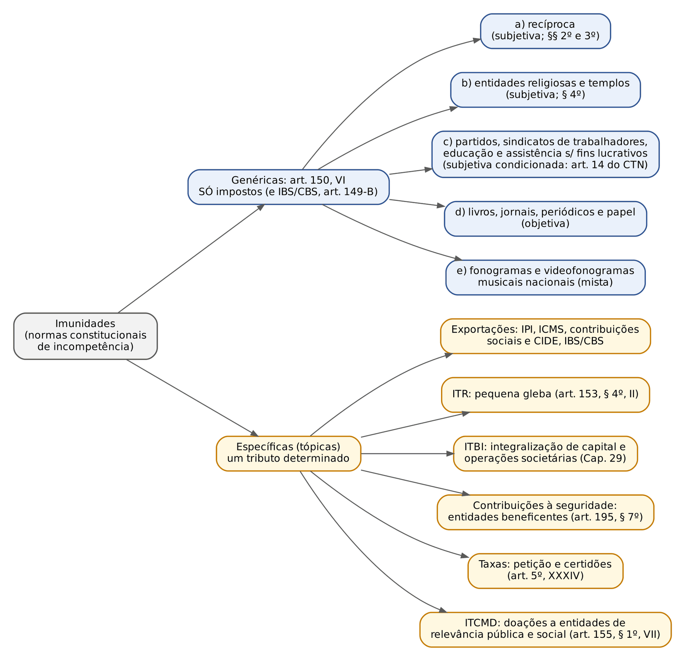
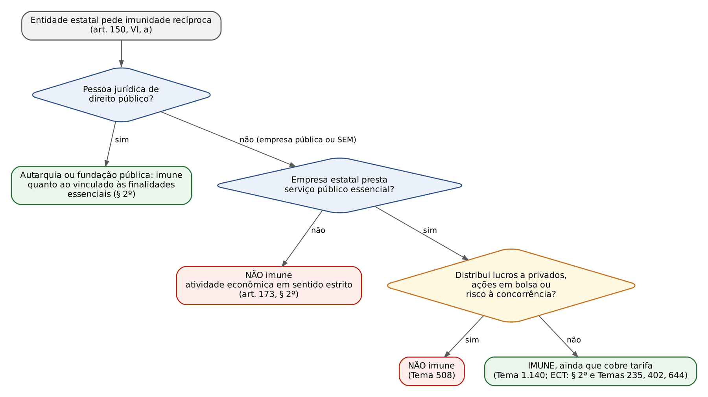
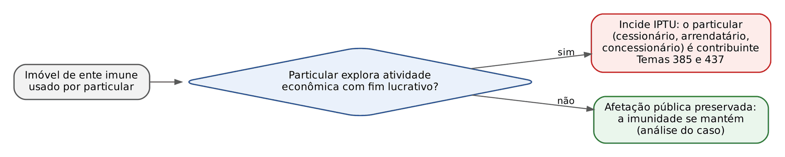
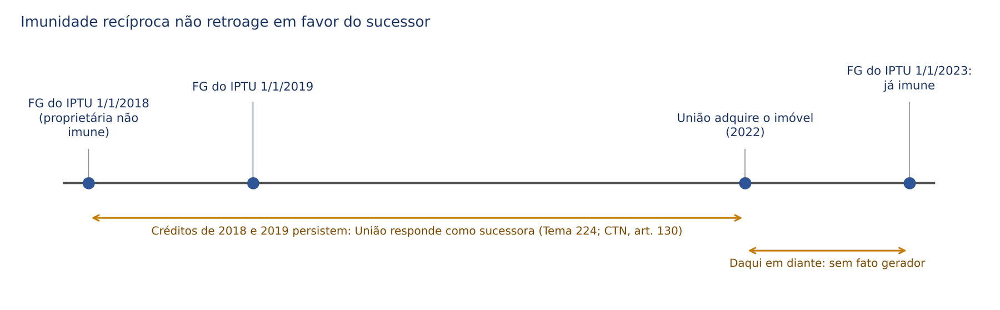
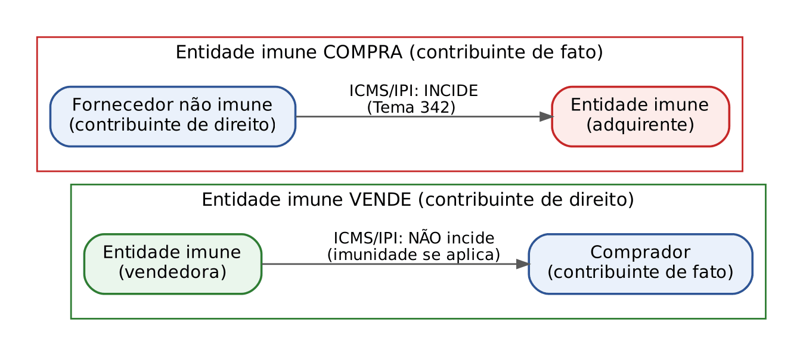
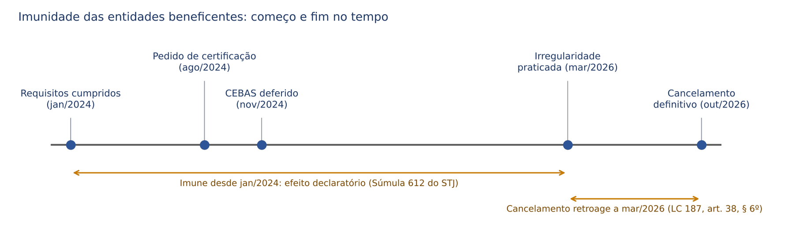

# CAPÍTULO 06 — LIMITAÇÕES CONSTITUCIONAIS AO PODER DE TRIBUTAR II: IMUNIDADES

:::INCIDENCIA
TRF5 p. 7; TJRS p. 1; TJSC p. 5. Nível A+. Lote: 38 questões (FGV 36, FCC 2).
O que mais cai: imunidade recíproca de estatais (Temas 508 e 1.140, Correios, imóvel público cedido a particular), entidade religiosa (imóvel alugado, locatária, cemitério, EC 132/2023), alínea c com IOF e importação, contribuinte de fato (Tema 342), e-book e fonogramas importados.
:::

| Subtema | FGV | FCC | Padrão de cobrança |
|---|---|---|---|
| Imunidade recíproca (estatais, Correios, cessão de imóvel público, sucessão) | 14 | 1 | caso concreto com empresa estatal ou concessionária; "cobra tarifa?", "ações em bolsa?", "particular explora atividade lucrativa?" |
| Entidades religiosas e templos | 10 | 1 | imóvel alugado a terceiros, templo em imóvel locado (EC 116/2022), cemitério, EC 132/2023, taxa x imposto |
| Alínea c (partidos, sindicatos, educação e assistência) e contribuinte de fato | 7 | 0 | IOF, II e IPI na importação, ICMS embutido no preço, EC 133/2024 |
| Entidades beneficentes e contribuições (art. 195, § 7º) | 3 | 0 | natureza de imunidade, lei complementar, efeitos no tempo da certificação |
| Livros e fonogramas | 4 | 0 | e-book e e-reader, álbum de figurinhas, insumos, vinil importado |
| Conceito, classificação, outras imunidades | 3 | 1 | imunidade x isenção, ITR de pequena gleba |

## 06.1 Conceito, natureza e distinções

### 06.1.1 O que é imunidade

O Cap. 4 mostrou que a Constituição não cria tributos: ela distribui competências, isto é, desenha para cada ente o "terreno" dentro do qual a lei poderá definir fatos geradores. A imunidade é o recorte desse terreno feito pela própria Constituição. Ela diz, por exemplo, que o Estado tem competência para o IPVA sobre veículos automotores, MENOS os veículos da União, dos Municípios e de outros Estados (art. 150, VI, a). O ente nunca teve competência sobre aquela fatia; por isso a doutrina majoritária (Paulo de Barros Carvalho, Roque Carrazza, Regina Helena Costa) qualifica a imunidade como norma constitucional de incompetência, ou norma negativa de competência: ela não "dispensa" um tributo que nasceu, ela impede que a lei tributária alcance aquela situação.

Para o juiz cível, a imagem útil é a da capacidade. A isenção se parece com uma remissão legal antecipada de uma dívida que a lei poderia criar; a imunidade se parece com a incapacidade absoluta do credor para constituir aquele crédito. Por isso a lei que pretenda tributar situação imune é inconstitucional, e não apenas "ineficaz".

Consequências práticas desse conceito, todas cobradas:

- Só a Constituição cria imunidade. Lei complementar não pode criar imunidade nova (pode apenas regular as existentes, art. 146, II; ver Cap. 1); o que a lei cria é isenção.
- O nome não importa. A Constituição usa "é vedado instituir", "não incidirá", "são isentas" (art. 195, § 7º) e "são isentas de impostos" (art. 184, § 5º). Em todos esses casos, por estar no texto constitucional, há imunidade. A EC 132/2023 passou a usar o próprio termo "imunidades" (art. 149-B, II).
- Imunidade pode alcançar qualquer espécie tributária, desde que o texto diga: há imunidades de impostos (art. 150, VI), de taxas (art. 5º, XXXIV), de contribuições (arts. 149, § 2º, I, e 195, § 7º e II). Mas a do art. 150, VI, alcança SOMENTE impostos e, por força do art. 149-B, parágrafo único, também a CBS (o IBS já é imposto).
- Imunidades ligadas a direitos fundamentais (recíproca, como garantia do pacto federativo; religiosa; cultural) são tratadas como cláusulas pétreas. O STF afirmou isso para a recíproca no julgamento da ADI 939 (IPMF instituído por emenda).
- Imunidade não dispensa deveres instrumentais. O imune continua sujeito à fiscalização, deve manter livros e documentos e pode ser responsável por retenção na fonte (CTN, arts. 9º, § 1º, e 194, § 1º; STF, RE 250.844, Info 668). Ver 06.4.5.

:::QUESTAO FGV 2025 — TRF 3ª Região — Juiz Federal Substituto (Q3179561)
O que se cobrou: afirmações gerais sobre imunidades. Gabarito: C — as entidades beneficentes de assistência social são IMUNES às contribuições para a seguridade social, apesar de o art. 195, § 7º, dizer "isentas", e só lei complementar pode fixar requisitos (Tema 32).
Armadilhas: a alternativa que dizia que imunidades "mutilam" apenas impostos e taxas (há imunidade de contribuições); a que admitia que lei complementar crie novas imunidades (só a Constituição cria); a que negava imunidade a estatais delegatárias de serviço público (ver 06.3.3); a que dizia que todo cemitério privado é extensão de templo (só o cemitério que é extensão da entidade religiosa e sem fins lucrativos; ver 06.4.4).
:::

### 06.1.2 Imunidade, isenção, não incidência e alíquota zero

As quatro figuras levam ao mesmo resultado prático (nada a pagar), por isso a banca as mistura. A diferença está no plano em que atuam.

| Figura | Onde está | Plano de atuação | O fato gerador ocorre? | Pode ser retirada por | Exemplo |
|---|---|---|---|---|---|
| Imunidade | Constituição | delimita a competência (o ente não pode legislar sobre aquilo) | não: a situação está fora do campo tributável | só emenda constitucional, e nem por ela se for cláusula pétrea | IPTU sobre imóvel do Estado |
| Isenção | lei do ente competente (CTN, art. 176) | exercício da competência: o ente podia tributar e dispensou | para a corrente do CTN, sim (exclusão do crédito, art. 175, I); para a doutrina moderna, a lei isentiva mutila a hipótese de incidência | lei (observadas a anterioridade e a regra da isenção onerosa, art. 178; ver Cap. 17) | lei municipal que isenta de IPTU o aposentado |
| Não incidência pura | ausência de previsão | o fato está fora da hipótese de incidência, por falta de competência ou por opção do legislador | não | não se "retira": basta a lei passar a prever (se houver competência) | IPVA sobre bicicleta; ITCMD de lei que só prevê imóveis |
| Alíquota zero | lei ou ato do Executivo, nos tributos em que a Constituição permite alterar alíquota (II, IE, IPI, IOF; ver Cap. 5) | quantificação: a obrigação nasce, mas o cálculo dá zero | sim | ato do Executivo, dentro dos limites legais | IE zerado para estimular exportação |

:::DICA
Teste rápido na prova: pergunte "QUEM afastou o tributo?". Se foi a Constituição, é imunidade (ainda que ela diga "isento"). Se foi a lei do próprio ente tributante, é isenção. Se ninguém afastou e o fato simplesmente não cabe na lei, é não incidência. Se a lei manteve a incidência mas zerou o percentual, é alíquota zero.
:::

Dois desdobramentos são frequentes em prova. Primeiro, a isenção heterônoma (concedida por ente diverso do titular da competência) é vedada à União quanto a tributos estaduais e municipais (art. 151, III), com a exceção dos tratados internacionais firmados pela República (ver Cap. 8). A chamada "imunidade" dos Estados estrangeiros, prevista nas Convenções de Viena de 1961 e 1963, é tecnicamente isenção, porque não está na Constituição (Ricardo Alexandre). Segundo, o art. 111, II, do CTN manda interpretar LITERALMENTE a legislação que outorga isenção; essa regra NÃO vale para imunidade, que é interpretada pela finalidade (06.2.2).

## 06.2 Classificações e interpretação

### 06.2.1 Classificações que caem

| Critério | Espécies | Exemplos e consequência prática |
|---|---|---|
| Objeto do recorte | subjetivas (pessoa), objetivas (bem ou operação), mistas | subjetivas: recíproca, religiosa, alínea c. Objetiva: livros (o livro é imune, a livraria não: paga IR e IPTU). Mistas: ITR da pequena gleba (área definida em lei + proprietário sem outro imóvel) e fonogramas (produção no Brasil + autor ou intérprete brasileiro) |
| Alcance | genéricas (todos os entes, vários impostos) e específicas ou tópicas (um tributo) | genéricas: art. 150, VI. Específicas: exportações (IPI, ICMS, contribuições), ITR de pequena gleba, ITBI na integralização de capital |
| Fundamento | ontológicas (decorreriam dos princípios mesmo sem texto: pacto federativo, ausência de capacidade contributiva) e políticas (opção do constituinte) | ontológicas: recíproca e alínea c. Políticas: templos, livros (classificação de Ricardo Alexandre) |
| Eficácia | incondicionadas (eficácia plena) e condicionadas (dependem de lei complementar) | incondicionadas: recíproca, templos, livros. Condicionadas: educação e assistência (art. 14 do CTN) e entidades beneficentes (LC 187/2021) |
| Forma | explícitas e implícitas | no Brasil, constituição analítica, todas as relevantes são explícitas; a recíproca nos EUA nasceu implícita (*McCulloch v. Maryland*) |

A distinção subjetiva x objetiva tem efeitos que a FGV explora:

- Na imunidade subjetiva, o bem só é imune enquanto pertencer à pessoa imune. O carro do Município vendido a particular passa a ser tributável pelo IPVA, conforme o fato gerador fixado na lei estadual.
- A imunidade subjetiva protege o imune quando ele ocupa a posição de contribuinte de direito, não quando apenas suporta o preço (Tema 342; ver 06.5.6).
- A imunidade subjetiva não impede que o imune seja responsável tributário: a prefeitura imune ao IR retém o IR na fonte do salário de seus servidores (CTN, art. 9º, § 1º).

### 06.2.2 Interpretação: teleológica, nem literal nem ilimitada

O STF repete que imunidades se interpretam pela finalidade constitucional que protegem, o que normalmente significa interpretação ampliativa (Hugo de Brito Machado e Regina Helena Costa defendem essa linha). Mas a finalidade também serve para restringir. O que separa os dois movimentos é a pergunta: estender a imunidade a este caso serve ao valor protegido (federação, liberdade religiosa, assistência, cultura) ou cria vantagem concorrencial sem relação com esse valor?

| Interpretação ampliativa (finalidade atendida) | Interpretação restritiva (finalidade não atendida) |
|---|---|
| "Patrimônio, renda e serviços" não é classificação do CTN: alínea c alcança IOF (Tema 328) e II e IPI na importação (Tema 336) | Imunidade subjetiva não protege o contribuinte de fato (Tema 342) |
| Templo é a entidade religiosa inteira, não só o prédio (RE 325.822) | Sociedade de economia mista com ações em bolsa não é imune (Tema 508) |
| Imóvel alugado continua imune se a renda volta às finalidades (SV 52) | Particular que explora imóvel público com lucro paga IPTU (Temas 385 e 437) |
| Livro eletrônico e e-reader são imunes (SV 57); álbum de figurinhas e apostilas também | Tinta e maquinário gráfico não são "papel"; encartes só publicitários não são imunes |
| Correios imunes inclusive em atividades concorrenciais, pelo subsídio cruzado (Tema 235) | Vinil prensado no exterior não é imune, ainda que com artista brasileiro (Tema 1.083) |

## 06.3 Imunidade recíproca (art. 150, VI, a, e §§ 2º e 3º)

### 06.3.1 Fundamento e alcance

:::LEI CF, art. 150, VI, a, b, c, e §§ 2º a 4º (redação da EC 132/2023)
Art. 150. [...] é vedado à União, aos Estados, ao Distrito Federal e aos Municípios: [...] VI - instituir impostos sobre: a) patrimônio, renda ou serviços, uns dos outros; b) entidades religiosas e templos de qualquer culto, inclusive suas organizações assistenciais e beneficentes; c) patrimônio, renda ou serviços dos partidos políticos, inclusive suas fundações, das entidades sindicais dos trabalhadores, das instituições de educação e de assistência social, sem fins lucrativos, atendidos os requisitos da lei; [...]
§ 2º A vedação do inciso VI, "a", é extensiva às autarquias e às fundações instituídas e mantidas pelo poder público e à empresa pública prestadora de serviço postal, no que se refere ao patrimônio, à renda e aos serviços vinculados a suas finalidades essenciais ou às delas decorrentes.
§ 3º As vedações do inciso VI, "a", e do parágrafo anterior não se aplicam ao patrimônio, à renda e aos serviços, relacionados com exploração de atividades econômicas regidas pelas normas aplicáveis a empreendimentos privados, ou em que haja contraprestação ou pagamento de preços ou tarifas pelo usuário, nem exonera o promitente comprador da obrigação de pagar imposto relativamente ao bem imóvel.
§ 4º As vedações expressas no inciso VI, alíneas "b" e "c", compreendem somente o patrimônio, a renda e os serviços, relacionados com as finalidades essenciais das entidades nelas mencionadas.
:::

A razão de ser é o pacto federativo: se um ente pudesse tributar o outro, teria um instrumento de pressão e até de destruição ("o poder de tributar envolve o poder de destruir", na fórmula de Marshall). Daí três conclusões:

- Alcança SÓ impostos (e a CBS). Município pode cobrar da União e do Estado a taxa de coleta de lixo de suas repartições; as taxas seguem sua disciplina própria (ver Cap. 2).
- "Patrimônio, renda ou serviços" é lido amplamente: abrange qualquer imposto que onere esses elementos, inclusive o IOF e o IR sobre aplicações financeiras dos entes (precedentes citados por Ricardo Alexandre) e o IPVA de veículo adquirido por pessoa jurídica de direito público mediante alienação fiduciária (Tema 685: "Não incide IPVA sobre veículo automotor adquirido, mediante alienação fiduciária, por pessoa jurídica de direito público").
- Os entes políticos (União, Estados, DF, Municípios) são imunes mesmo quanto a bens desvinculados de finalidades essenciais (um terreno ocioso da União), desde que não haja exploração de atividade econômica (§ 3º). Já autarquias e fundações só são imunes quanto ao patrimônio, renda e serviços vinculados às finalidades essenciais ou delas decorrentes (§ 2º).

:::QUESTAO FGV 2025 — Prefeitura de Abreu e Lima — Procurador (Q3841698)
O que se cobrou: nomear a vedação de impostos sobre patrimônio, renda ou serviços uns dos outros. Gabarito: E — imunidade recíproca. As distratoras eram "imunidade heterônoma" (expressão sem sentido técnico; o que existe é isenção heterônoma, vedada pelo art. 151, III), alíquota zero, não incidência legal e isenção.
:::

:::QUESTAO FGV 2024 — AL-PR — Analista Legislativo — Advogado (Q2449753)
O que se cobrou: literalidade do art. 150, VI. Gabarito: E — vedação de impostos sobre entidades religiosas e templos, inclusive organizações assistenciais e beneficentes, quanto ao patrimônio, renda e serviços relacionados com as finalidades essenciais (§ 4º).
Armadilhas: a alternativa C dizia que a recíproca vale "com exceção" das autarquias e fundações (o § 2º as INCLUI); a D dizia que a recíproca vale "ainda que" haja exploração de atividade econômica ou cobrança de tarifa (o § 3º EXCLUI); a A e a B diziam "é permitido" tributar fonogramas nacionais e partidos.
:::

Dois detalhes do § 3º: a cláusula do promitente comprador impede que um particular use contrato com ente imune para escapar do IPTU (Súmula 583 do STF: o promitente comprador de imóvel transcrito em nome de autarquia é contribuinte do IPTU); e, na compra e venda em que o ente imune é o vendedor, o ITBI é devido porque o contribuinte é o comprador (Súmula 75 do STF). Pela mesma lógica, a imunidade da autarquia que financia a operação não se estende à compra e venda entre particulares feita no mesmo instrumento (Súmula 336 do STF).

### 06.3.2 Autarquias, fundações, conselhos profissionais e OAB

Autarquias e fundações públicas têm imunidade "condicionada à finalidade". Quem tem o ônus de provar que um imóvel de autarquia NÃO está afetado à finalidade institucional? O Fisco: "O ônus de provar que o imóvel não está afetado à destinação institucional da autarquia ou da fundação recai sobre o ente tributante que pretende afastar a imunidade" (STJ, Jurisprudência em Teses, ed. 55, tese 12). O STF trilha a mesma linha ao tratar dos imóveis dos Correios (Tema 644: a imunidade alcança o IPTU dos imóveis de sua propriedade e dos por ela utilizados; havendo dúvida, cabe ao Fisco provar a desafetação).

Os conselhos de fiscalização profissional são autarquias federais e, por isso, imunes nos termos do § 2º. A OAB, embora não integre a Administração indireta (ADI 3.026), também é imune, porque exerce atividade própria de Estado; e o Plenário estendeu a imunidade às Caixas de Assistência dos Advogados, por integrarem a estrutura da Ordem (RE 405.267, 2018).

:::QUESTAO FGV 2024 — Prefeitura de Vitória — Procurador (Q3044209)
O caso: conselho regional de fiscalização profissional (autarquia federal) cobrado por taxa de coleta de lixo do imóvel-sede. Gabarito: A — vencido o Município, o conselho NÃO paga pelo regime de precatórios.
Por que interessa aqui: a alternativa B, sedutora, dizia que a taxa seria indevida pela imunidade recíproca. Errado: a recíproca só alcança impostos. Quanto ao gabarito, o STF firmou que os pagamentos devidos por conselhos de fiscalização em razão de decisão judicial não se submetem a precatórios (número do tema não conferido nesta tarefa; ver nota).
:::

### 06.3.3 Empresas públicas e sociedades de economia mista

O texto originário do § 2º só falava em autarquias e fundações; a extensão às estatais foi obra do STF, a partir do caso dos Correios (RE 407.099, 2004). O raciocínio distingue duas espécies de estatais:

- estatal que explora atividade econômica em sentido estrito (art. 173): não pode ter privilégio fiscal não extensivo ao setor privado (art. 173, § 2º). NÃO é imune;
- estatal que presta serviço público, em especial de prestação obrigatória e exclusiva do Estado: é instrumento do ente federado e pode ser imune, mesmo sendo pessoa de direito privado.

Para as sociedades de economia mista, o STF construiu, no caso da Companhia Docas do Estado de São Paulo (Codesp, RE 253.472, 2010), três "estágios" de verificação: (a) a imunidade se restringe aos bens e serviços usados nos objetivos institucionais do ente federado; (b) não beneficia atividades destinadas primordialmente a aumentar o patrimônio do Estado ou de particulares; (c) não pode quebrar a livre concorrência. A Codesp, com 99,97% do capital da União, foi considerada imune.

Duas teses de repercussão geral fecharam o quadro:

:::JURIS STF, Tema 508 (RE 600.867, j. 29/6/2020)
"Sociedade de economia mista, cuja participação acionária é negociada em Bolsas de Valores, e que, inequivocamente, está voltada à remuneração do capital de seus controladores ou acionistas, não está abrangida pela regra de imunidade tributária prevista no art. 150, VI, 'a', da Constituição, unicamente em razão das atividades desempenhadas." (Sabesp.)
:::

:::JURIS STF, Tema 1.140 (RE 1.320.054, 2021)
"As empresas públicas e as sociedades de economia mista delegatárias de serviços públicos essenciais, que não distribuam lucros a acionistas privados nem ofereçam risco ao equilíbrio concorrencial, são beneficiárias da imunidade tributária recíproca prevista no artigo 150, VI, a, da Constituição Federal, independentemente de cobrança de tarifa como contraprestação do serviço."
:::

Note a aparente contradição com o § 3º, que exclui a imunidade quando há "contraprestação ou pagamento de preços ou tarifas pelo usuário". Para o STF, o § 3º mira o ente que atua como empresário; a estatal que presta serviço público essencial sem lucro distribuído a privados está sob o § 2º. Cobrar tarifa, por si só, não afasta a imunidade.

Outros casos com imunidade reconhecida: Infraero (administração aeroportuária), Casa da Moeda (apenas nas atividades em regime de monopólio), hospital organizado como sociedade de economia mista com 99,99% de capital da União e atendimento exclusivo pelo SUS (RE 580.264), e os bens do fundo do Programa de Arrendamento Residencial operado pela Caixa (Tema 884: "Os bens e direitos que integram o patrimônio do fundo vinculado ao Programa de Arrendamento Residencial (PAR), criado pela Lei nº 10.188/2001, beneficiam-se da imunidade tributária prevista no art. 150, VI, 'a', da Constituição Federal"). Está pendente o Tema 1.122 do STF (imunidade de sociedade de economia mista com capital quase totalmente estatal voltada à moradia popular), que constava sem tese fixada na consulta feita para esta apostila.

Por outro lado, NÃO são imunes: o delegatário de serviço notarial e de registro, que presta o serviço em caráter privado e paga ISS (ADI 3.089; v. Cap. 28); a concessionária privada de serviço público, cujo regime tributário é definido pelo poder concedente (CTN, art. 13); e a empresa privada de iluminação pública remunerada pelo Município (a imunidade pressupõe imposto sobre patrimônio, renda ou serviço do próprio ente).

:::QUESTAO FGV 2024 — Câmara dos Deputados — Consultor Legislativo (Q2510962)
O que se cobrou: três assertivas sobre a jurisprudência da recíproca. Gabarito: E (I e III).
I — certa: sociedades de economia mista de água e esgoto podem ser imunes, embora isso não esteja expresso no texto (construção do STF).
II — errada: o STF reconhece a imunidade da OAB e a ESTENDEU à Caixa de Assistência dos Advogados (RE 405.267). A banca contava com o leitor que se lembrasse dos antigos julgados de Turma, superados.
III — certa: é a tese do Tema 1.140.
:::

:::QUESTAO FGV 2024 — EBSERH — Advogado (Q3248768)
Caso: sociedade de economia mista autuada por IPTU de imóveis usados na prestação de serviço público. Gabarito: C — pode ser imune se prestar serviço público essencial em caráter exclusivo, sem finalidade lucrativa e sem risco concorrencial.
Erros das demais: a recíproca não se limita à Administração direta (A); cobrar tarifa não descaracteriza (B; Tema 1.140); não há vedação de extensão às sociedades de economia mista (D); o registro patrimonial próprio é irrelevante (E).
No mesmo sentido: Q2351283 (FGV 2024; gabarito E: NÃO é imune a sociedade de economia mista com ações em bolsa que distribui lucros; as demais alternativas descreviam situações imunes).
:::

:::QUESTAO FGV 2024 — Questão de prova sem identificação de cargo no banco (Q3113989)
Caso: sociedade de economia mista estadual, que não distribui lucros a acionistas privados, explora com exclusividade, por concessão do Estado, o gás canalizado e cobra tarifa. Seus dirigentes sustentam imunidade ao IPTU. Gabarito: A — os dirigentes estão certos.
Passo a passo: (1) presta serviço público essencial (art. 25, § 2º, da CF)? Sim. (2) Distribui lucro a privados? Não. (3) Atua em concorrência? Não, há exclusividade. (4) Cobra tarifa? Irrelevante (Tema 1.140). A alternativa D, segundo a qual a imunidade só valeria contra impostos do próprio Estado controlador, inverte a lógica: a recíproca existe justamente contra OUTROS entes. A E (só imóveis da atividade finalística) não é exigência do caso.
:::

:::QUESTAO FGV 2026 — ALERJ — Procurador Legislativo (Q3880821)
Caso: empresa pública federal importa mercadorias para suas finalidades essenciais e apresenta guia de liberação sem recolhimento do ICMS-importação, invocando imunidade. Gabarito: A — o ICMS-importação é devido pelo importador no desembaraço, e a empresa pública é imune se prestar serviço público essencial, exclusivo e não concorrencial, sem distribuir lucro a acionista privado.
Armadilhas: C (capital integralmente público basta, "independentemente da natureza da atividade": falso, a atividade é decisiva); D (imune "desde que não cobre tarifa": falso, Tema 1.140); E (a guia afasta automaticamente o imposto: falso, a guia é documento de controle, não fonte de imunidade).
:::

### 06.3.4 Correios: do STF à EC 132/2023

A ECT é o caso-símbolo. O STF reconheceu a imunidade não apenas no serviço postal, mas em todas as atividades, inclusive as exercidas em concorrência com o setor privado (banco postal, entrega de encomendas), pela teoria do subsídio cruzado: as atividades rentáveis financiam o serviço postal universal, deficitário nos rincões do país.

| Tema | Tese (síntese) |
|---|---|
| 235 (RE 601.392, 2013) | os serviços prestados pela ECT, inclusive aqueles em que não age em regime de monopólio, estão abrangidos pela imunidade recíproca (o caso era de ISS) |
| 402 (RE 627.051, 2014) | "Não incide o ICMS sobre o serviço de transporte de bens e mercadorias realizado pelos Correios" |
| 644 (RE 773.992, 2014) | "A imunidade tributária recíproca reconhecida aos Correios alcança o IPTU incidente sobre imóveis de sua propriedade, bem assim os por ela utilizados"; a dúvida sobre a afetação é ônus do Fisco |

A EC 132/2023 incluiu no § 2º a "empresa pública prestadora de serviço postal". Duas leituras precisam ser evitadas, conforme alerta Ricardo Alexandre: (a) que a menção expressa aos Correios teria excluído as demais estatais imunes por construção jurisprudencial (não há indicação disso; a jurisprudência dos Temas 508 e 1.140 continua aplicável); e (b) que a cláusula "vinculados a suas finalidades essenciais ou às delas decorrentes" teria reduzido a imunidade dos Correios às atividades postais (os precedentes já aplicavam esse mesmo § 2º, entendendo as atividades concorrenciais como "decorrentes" da finalidade essencial).

:::QUESTAO FGV 2024 — Prefeitura de Cuiabá — Auditor Fiscal (Q3158452)
Caso: Município cobra IPTU de centro de distribuição da ECT, usado exclusivamente em atividade postal. Gabarito: C — a ECT é imune, por previsão constitucional expressa (art. 150, § 2º, na redação da EC 132/2023) e pelo uso do imóvel na finalidade essencial (Tema 644).
As distratoras restringiam a imunidade a autarquias e fundações (A), condicionavam a cobrança à destinação da receita (B, confusão com vinculação de receitas, que é tema de impostos e não de imunidade) ou diziam que a imunidade alcança serviços e não patrimônio (E).
:::

### 06.3.5 Imóvel público cedido, arrendado ou concedido a particular

O IPTU tem por contribuinte o proprietário, o titular do domínio útil ou o possuidor a qualquer título (CTN, art. 34; ver Cap. 29). Durante muito tempo se entendeu que o cessionário de bem público, por ter posse precária e sem *animus domini*, não seria contribuinte, e o ente proprietário era imune: resultado, ninguém pagava IPTU, mesmo quando o imóvel abrigava uma revendedora de veículos.

Em 2017 o STF mudou o quadro. O fundamento é teleológico: se o próprio ente perde a imunidade quando explora atividade econômica (§ 3º), não faz sentido que um particular a conserve ao explorar atividade lucrativa em imóvel público; isso desequilibraria a concorrência e mutilaria a competência municipal.

:::JURIS STF, Temas 385 e 437 (RE 594.015 e RE 601.720, j. 6/4/2017)
Tema 385: "A imunidade recíproca, prevista no art. 150, VI, a, da Constituição Federal, não se estende a empresa privada arrendatária de imóvel público, quando seja ela exploradora de atividade econômica com fins lucrativos. Nessa hipótese é constitucional a cobrança do IPTU pelo Município." (Petrobras, arrendatária de terreno da União no Porto de Santos.)
Tema 437: "Incide o IPTU, considerado imóvel de pessoa jurídica de direito público cedido a pessoa jurídica de direito privado, devedora do tributo." (Concessionária de veículos em imóvel da União no Rio de Janeiro.)
No mesmo mês, o Plenário aplicou a orientação a imóvel da Infraero concedido a revendedora de automóveis: não se aplica a imunidade recíproca se o bem está desvinculado de finalidade estatal (RE 434.251, Info 861).
:::

:::PEGADINHA
O critério é a atividade do particular (lucrativa, em concorrência), não o tipo de contrato. Arrendamento, cessão de uso e concessão de uso levam ao mesmo resultado. E a cláusula do contrato que atribui ao particular o pagamento dos tributos é irrelevante para definir o sujeito passivo (CTN, art. 123): o particular paga porque a lei e a Constituição o colocam como contribuinte, não porque o contrato manda.
:::

:::QUESTAO FGV 2025 — TJ-TO — Juiz Substituto (Q3453290)
Caso: imóvel da União afetado à Infraero é objeto de concessão de uso a revendedora de veículos; o contrato atribui a ela os tributos municipais; o Município cobra IPTU da concessionária. Gabarito: A — a cobrança é devida, porque a imunidade recíproca não alcança a sociedade empresária que explora atividade econômica lucrativa em imóvel desvinculado de finalidade estatal.
Resolução: (1) quem é cobrado? A concessionária privada. (2) Ela é imune? Não: é empresa privada com fim lucrativo (Temas 385 e 437; RE 434.251). (3) Pode ser contribuinte sem ser proprietária? Sim, como possuidora a qualquer título, superada a tese da posse precária (alternativa B). Erros: C (a natureza pública do bem não basta); D (o fundamento não é o contrato; a cobrança é devida por força de lei); E (nega imunidade à própria Infraero, que a tem).
No mesmo sentido: Q2375616 (FGV 2024; empresa pública estadual cede imóvel a vendedora de bicicletas elétricas; gabarito B: não se aplica a imunidade se o bem está desvinculado de finalidade pública). De outros capítulos: Q3009028 (gabarito C: incide IPTU, sendo a cessionária contribuinte) e Q3044211 (gabarito E: a Petrobras arrendatária pode figurar como contribuinte ainda que a proprietária seja a União).
:::

:::QUESTAO FGV 2024 — Câmara dos Deputados — Consultor de Orçamento e Fiscalização Financeira (Q2512330)
Caso: companhia do metrô, sociedade de economia mista com 97,5% do Estado, 2,4% do Município e 0,1% do BNDES, sem lucros a privados e sem concorrentes, aluga imóveis desocupados a terceiros que neles exploram comércio, e investe os aluguéis no serviço público. Gabarito oficial: B — pode incidir IPTU sobre os imóveis alugados, mas só pode ser cobrado dos locatários.
Raciocínio da banca: a companhia é imune (Tema 1.140; o BNDES é estatal, não acionista privado, por isso a D está errada); quem explora atividade lucrativa no imóvel é o particular, a quem se aplica a lógica dos Temas 385 e 437. A alternativa E (aluguéis revertidos tornam os imóveis imunes) aplicaria à recíproca o raciocínio da SV 52, que o STF formulou para a alínea c, não para a alínea a.
Atenção: o gabarito é discutível, porque o locatário comum, sem *animus domini*, não costuma ser contribuinte do IPTU (ver nota de verificação). Na prova FGV, siga a linha: na imunidade recíproca, importa a atividade lucrativa de quem ocupa o imóvel.
:::

### 06.3.6 Sucessão: a imunidade não apaga o passado

A imunidade atua sobre o fato gerador. Se, na data do fato gerador, o bem pertencia a pessoa não imune, a obrigação nasceu e não se extingue porque o bem passou depois para um ente imune. O STF julgou o caso da extinta Rede Ferroviária Federal (RFFSA), sociedade de economia mista exploradora de atividade econômica sucedida pela União.

:::JURIS STF, Tema 224 (RE 599.176, j. 5/6/2014)
"A imunidade tributária recíproca não exonera o sucessor das obrigações tributárias relativas aos fatos jurídicos tributários ocorridos antes da sucessão (aplicação 'retroativa' da imunidade tributária)." A União, sucessora, responde pelos débitos da RFFSA (responsabilidade por sucessão: ver Cap. 10).
:::

:::QUESTAO FGV 2024 — Questão de prova sem identificação de cargo no banco (Q3157899)
Caso: execução fiscal de IPTU de 2018 e 2019 contra a empresa que era proprietária; em 2022 a União adquire o imóvel e invoca a imunidade recíproca. Gabarito: B — a União está errada; a imunidade não exonera o sucessor quanto aos fatos geradores anteriores (Tema 224).
Armadilhas: A e E falam em "isenção" da União (é imunidade); C e D criam marcos inexistentes (ajuizamento da execução ou inscrição em dívida ativa antes da sucessão). O único marco relevante é a data do fato gerador (1º de janeiro de cada exercício, no IPTU, pela lei municipal usual).
No mesmo sentido: Q2506985 (FGV 2024, ENAM; sociedade de economia mista exploradora de atividade econômica, cobrada por dois impostos municipais, é liquidada e sucedida pela União no curso do processo; gabarito B: a obrigação não é afastada pela sucessão por ente imune).
:::

:::SENTENCA Imunidade recíproca em embargos à execução fiscal de IPTU
Onde entra: no mérito dos embargos ou da exceção de pré-executividade (cabível se a imunidade puder ser aferida sem dilação probatória; ver Cap. 22). Fundamentar em três passos: (1) titularidade do bem na data do fato gerador; (2) natureza do titular (ente político, autarquia ou fundação, estatal prestadora de serviço público sem lucro a privados); (3) uso do bem (finalidade essencial ou exploração econômica por particular). Lembrar que o ônus de provar a desafetação é do Fisco.
Redação-modelo: "O imóvel pertencia, em 1º de janeiro dos exercícios cobrados, à autarquia embargante, e o Município não se desincumbiu do ônus de demonstrar sua desafetação das finalidades essenciais (STJ, Jurisprudência em Teses, ed. 55, tese 12). Incide, pois, a imunidade do art. 150, VI, a, e § 2º, da Constituição, o que torna nula a CDA."
Erro comum punido: estender a imunidade a taxa cobrada na mesma CDA (a imunidade do art. 150, VI, só alcança impostos); ou reconhecer imunidade em favor do sucessor imune quanto a fatos geradores anteriores à aquisição (Tema 224).
:::

## 06.4 Entidades religiosas e templos de qualquer culto (art. 150, VI, b)

### 06.4.1 Fundamento e evolução do texto

A imunidade protege a liberdade de crença e de culto (art. 5º, VI) e a laicidade: o Estado não pode usar o tributo para embaraçar ou favorecer cultos (art. 19, I). Como garantia de direito individual, é tratada como cláusula pétrea. Vale para qualquer culto, majoritário ou minoritário, sem juízo sobre o conteúdo da fé.

O texto originário dizia apenas "templos de qualquer culto". O STF nunca o leu como referência ao prédio: lido com o § 4º, que fala em "patrimônio, renda e serviços relacionados com as finalidades essenciais das entidades", o dispositivo imuniza a ENTIDADE religiosa (RE 325.822, Plenário, 2002). Se fosse só o prédio, o IR poderia incidir sobre os dízimos e o ISS sobre a celebração de casamentos.

A EC 132/2023 positivou esse entendimento e foi além: a alínea b passou a abranger "entidades religiosas e templos de qualquer culto, inclusive suas organizações assistenciais e beneficentes". A consequência prática é que as obras assistenciais ligadas a entidades religiosas passaram a ter imunidade pela alínea b, que NÃO exige os requisitos do art. 14 do CTN, ao contrário da alínea c (posição de Ricardo Alexandre; parte da doutrina admite que lei complementar, com base no art. 146, II, venha a disciplinar requisitos também para a alínea b).

:::QUESTAO FGV 2024 — Prefeitura de Macaé — Procurador (Q3049936)
O que se cobrou: o que mudou com a EC 132/2023 na alínea b. Gabarito: D — a emenda ampliou os sujeitos da imunidade para alcançar também as entidades religiosas e suas organizações assistenciais e beneficentes.
Erros: A (só patrimônio dos templos); B (imunidade "ampla e irrestrita", inclusive sobre o que não se relaciona às finalidades essenciais, o que contraria o § 4º); C (aquisição de bens e serviços: a entidade como compradora é contribuinte de fato, sem imunidade; ver 06.5.6); E (subsídios dos líderes religiosos: a renda da pessoa física do ministro é tributável).
No mesmo sentido: Q4102402 (FGV 2026, ENAM; a assertiva III, transcrição da nova alínea b, era verdadeira; ver box em 06.7.2).
:::

### 06.4.2 Vinculação às finalidades essenciais e o imóvel alugado

O § 4º exige que patrimônio, renda e serviços estejam "relacionados com as finalidades essenciais". O STF interpreta essa relação de forma generosa: basta que a RENDA obtida com o bem seja aplicada nas finalidades da entidade. Assim, o imóvel da igreja alugado a uma lanchonete continua imune ao IPTU, e o aluguel recebido é imune ao IR, desde que revertidos às atividades religiosas (RE 325.822). Também é imune o estacionamento explorado em imóvel de entidade imune com renda revertida, e é imune o imóvel temporariamente vago ou sem edificação, porque a ociosidade momentânea não prova desvio de finalidade (RE 767.332, repercussão geral; Tema 693).

A regra está sumulada para a alínea c (SV 52, ver 06.5.4), mas o STF a aplica por igual à alínea b, em razão da equiparação feita pelo § 4º. Repare no contraste com a recíproca: nas alíneas b e c, o critério é a DESTINAÇÃO DA RENDA, e o STF não pergunta o que o locatário faz no imóvel; na alínea a, importa a ATIVIDADE DO OCUPANTE (06.3.5).

:::QUESTAO FGV 2024 — Prefeitura de Nova Iguaçu — Auditor Fiscal (Q3039625)
Caso: a igreja possui três imóveis contíguos; no do meio celebra cultos; os laterais estão alugados a uma lanchonete e a uma livraria, com aluguéis revertidos à igreja. O Município cobra IPTU dos dois imóveis alugados e taxa de coleta de lixo do imóvel do culto. Gabarito: C — as duas cobranças de IPTU são inválidas (imóveis alugados com renda revertida); a taxa é válida, porque a imunidade só alcança impostos.
Passo a passo: (1) a imunidade é da entidade, não do prédio do culto; (2) aluguel revertido mantém a vinculação (§ 4º); (3) taxa de coleta domiciliar é tributo vinculado a serviço específico e divisível (SV 19; ver Cap. 2) e não é alcançada pelo art. 150, VI.
No mesmo sentido: Q2346684 (FGV 2024; imóvel da igreja alugado a pessoa jurídica com aluguéis aplicados nas atividades religiosas; gabarito B: o imóvel é IMUNE, e não "isento" como dizia a alternativa A).
:::

### 06.4.3 Templo em imóvel alugado: EC 116/2022

O problema inverso: a igreja é LOCATÁRIA. O contribuinte do IPTU é o proprietário (locador); o locatário sem *animus domini* não é contribuinte. Como o locador não é imune, o IPTU incidia e, pelo contrato, era repassado ao templo. A EC 116/2022 resolveu o caso com uma imunidade específica.

:::LEI CF, art. 156, § 1º-A (EC 116/2022)
§ 1º-A O imposto previsto no inciso I do caput deste artigo não incide sobre templos de qualquer culto, ainda que as entidades abrangidas pela imunidade de que trata a alínea "b" do inciso VI do caput do art. 150 desta Constituição sejam apenas locatárias do bem imóvel.
:::

Leitura cuidadosa:

- É imunidade só de IPTU (o "imposto previsto no inciso I" do art. 156), não de outros impostos sobre o imóvel.
- Beneficia só as entidades da alínea b (religiosas), não as da alínea c. Uma escola sem fins lucrativos que aluga o prédio continua sujeita ao IPTU devido pelo locador.
- Durante a locação, o imposto não incide, de modo que nem o locador nem o locatário pagam, qualquer que seja a cláusula contratual.

:::QUESTAO FGV 2024 — TJ-SC — Juiz Substituto (Q3049407)
O que se cobrou: afirmações sobre IPTU e ITBI. Gabarito: D — não incide IPTU sobre templos de qualquer culto, ainda que a entidade religiosa seja apenas locatária do imóvel (art. 156, § 1º-A).
As demais alternativas pertencem ao Cap. 29: bases de cálculo do ITBI e do IPTU não coincidem necessariamente; a atualização do IPTU por decreto não pode superar a correção monetária (o art. 156, § 1º, III, introduzido pela EC 132/2023, exige critérios fixados em lei municipal); o critério da destinação do imóvel para ITR x IPTU é outro tema.
No mesmo sentido: Q3387046 (FCC 2025) e Q3047243 (FGV 2024).
:::

:::QUESTAO FGV 2024 — CGM de Belo Horizonte — Auditor Interno (Q2387530)
Caso: organização religiosa, dona do templo, aluga sala comercial de pessoa física para seu escritório administrativo; o contrato prevê reembolso do IPTU ao locador; o Fisco nega a imunidade. Gabarito oficial: D — o Fisco agiu incorretamente, porque, embora a organização não seja contribuinte de direito, faz jus à não incidência de IPTU sobre imóvel locado usado para suas finalidades essenciais.
Leitura crítica: a banca deu ao art. 156, § 1º-A, alcance que abrange imóvel locado para atividade-meio da entidade religiosa, ligando "templo" à entidade e não ao local de culto (mesma lógica de 06.4.1). A literalidade fala em "templos", e a alternativa B explorava justamente isso. Na FGV, prevalece a leitura ampla; registre a divergência (ver nota).
A alternativa C estava errada porque generalizava para "entidades imunes" a regra que só vale para as religiosas.
:::

### 06.4.4 Cemitérios, maçonaria e outros limites

| Situação | Imune? | Fundamento |
|---|---|---|
| Cemitério que é extensão da entidade religiosa, sem fins lucrativos, dedicado a serviços religiosos e funerários | sim (IPTU) | RE 578.562, Plenário, 2008 (cemitério anglicano em Salvador) |
| Cemitério privado explorado comercialmente, com venda de jazigos | não | mesmo precedente: há capacidade contributiva e risco à concorrência |
| Lojas maçônicas | não pela alínea b | RE 562.351 (1ª Turma, 2012): na maçonaria não se professa religião |
| Remuneração dos ministros religiosos e salários dos empregados da entidade | não: IRPF devido pelas pessoas físicas | a imunidade é da entidade, não de quem dela recebe |
| Taxas e contribuições da entidade religiosa | não alcançadas pelo art. 150, VI | só impostos e CBS |
| Herdeiro ou legatário pessoa física que é ministro religioso | não | Q3520636 (FGV 2025; o pastor legatário paga ITCMD sobre seu quinhão) |

:::QUESTAO FGV 2025 — ENAM 2025.2 — Exame Nacional da Magistratura (Q3692363)
Caso: entidade religiosa mantém cemitério para seus fiéis, cobrando valores similares aos do cemitério público, e aplica tudo na manutenção do cemitério, nos salários dos empregados e na remuneração dos ministros que prestam assistência funeral; o Município executa IPTU e taxa de coleta de lixo, alegando falta de lei isentiva. Gabarito: C — os salários dos empregados e as remunerações eclesiásticas são tributáveis pelo IRPF.
Passo a passo: (1) o cemitério é extensão da entidade, sem finalidade lucrativa: IPTU imune (RE 578.562), sem necessidade de lei isentiva (imunidade não depende de lei; erro do Município). (2) A taxa de lixo é devida, porque a imunidade não alcança taxas; por isso as alternativas A (nenhuma das duas) e B (IPTU sim, taxa não) estão erradas. (3) Cobrar valores semelhantes aos do cemitério público e pagar empregados e ministros não configura lucro distribuído (D e E erradas). (4) Os rendimentos recebidos pelas pessoas físicas são renda delas, sem imunidade (C certa).
:::

:::QUESTAO FGV 2026 — PGE-AC — Procurador do Estado (Q4079407)
Caso: organização religiosa vai doar embarcação a entidade religiosa coirmã na África, para deslocamento de ministros em atividade religiosa; o Fisco estadual nega imunidade e exige ITCMD. Gabarito: D — o Fisco está errado; doar a organização religiosa estrangeira congênere, para fins igualmente religiosos, não afasta a imunidade.
Por que as distratoras falham: A invoca a exigência de aplicar recursos "no País", que é requisito do art. 14, II, do CTN para a alínea c, NÃO para a alínea b; B trata a doação como distribuição de patrimônio, mas a destinação é a própria finalidade religiosa; C inventa distinção entre donatário pessoa física e jurídica; E afirma isenção no CTN, que não existe. Observe ainda que a EC 132/2023 criou imunidade específica de ITCMD para transmissões e doações às instituições sem fins lucrativos de relevância pública e social, inclusive organizações assistenciais e beneficentes de entidades religiosas, "e por elas realizadas" (art. 155, § 1º, VII), nas condições de lei complementar.
:::

### 06.4.5 Imunidade não dispensa obrigações acessórias

:::LEI CTN, art. 9º, § 1º
§ 1º O disposto no inciso IV não exclui a atribuição, por lei, às entidades nêle referidas, da condição de responsáveis pelos tributos que lhes caiba reter na fonte, e não as dispensa da prática de atos, previstos em lei, assecuratórios do cumprimento de obrigações tributárias por terceiros.
:::

Em reforço, o art. 194, § 1º, do CTN (redação da LC 236/2026) submete à legislação de fiscalização as pessoas "contribuintes ou não, inclusive às que gozem de imunidade tributária ou de isenção de caráter pessoal". O STF decidiu que a entidade imune deve cumprir as obrigações acessórias, inclusive manter livros fiscais (RE 250.844, Info 668). Note que a LC 214/2025 deu nova redação ao art. 9º, IV, do CTN para estender a lista à CBS e para reproduzir a nova alínea b.

:::QUESTAO FGV 2024 — TJ-PE — Juiz Substituto (Q3117577)
Caso: entidade religiosa autuada pelo Município quanto a três imóveis (templo em edifício alugado; chácara urbana doada e usada para tratamento de dependentes químicos; apartamento residencial de autoridade religiosa). Gabarito: C — o auto de infração se justifica pela não exibição de documentos relativos a colaborador, quando a fiscalização apura o cumprimento de obrigações por terceiros (CTN, art. 9º, § 1º).
Por que não as outras: o templo em imóvel alugado é imune (art. 156, § 1º-A); a chácara usada em atividade assistencial está vinculada às finalidades (EC 132/2023 incluiu as organizações assistenciais na alínea b); a residência do ministro religioso relaciona-se às finalidades da entidade, conforme a leitura ampla do STF; e livros relativos a créditos já prescritos não precisam ser conservados (CTN, art. 195, parágrafo único).
:::

:::QUESTAO FCC 2025 — TRF 4ª Região — Analista Judiciário — Contabilidade (Q3538540)
O que se cobrou: segundo a IN RFB 1.234/2012, a quais entidades os órgãos públicos federais não retêm IR e contribuições nos pagamentos que fazem. Gabarito: C — templos de qualquer culto e partidos políticos.
A lógica constitucional ajuda a acertar sem decorar a instrução normativa: condomínios edilícios não têm imunidade; sindicatos de EMPREGADORES estão fora da alínea c, que só protege os de trabalhadores.
:::

## 06.5 Partidos, sindicatos de trabalhadores, instituições de educação e de assistência social (art. 150, VI, c)

### 06.5.1 Quem está protegido e por quê

| Beneficiário | Valor protegido | Observações de prova |
|---|---|---|
| Partidos políticos e suas fundações | pluralismo político, democracia | EC 133/2024 "reforçou" a imunidade e criou anistia de sanções (06.5.5) |
| Entidades sindicais dos trabalhadores | liberdade sindical (art. 8º) | sindicatos PATRONAIS não são imunes; o STJ admitiu ISS sobre o serviço de proteção ao crédito de sindicato do comércio (AREsp 654.401) |
| Instituições de educação sem fins lucrativos | direito à educação; ausência de capacidade contributiva | inclui escolas profissionalizantes do Sistema S (SENAC, SENAI; RE 235.737) |
| Instituições de assistência social sem fins lucrativos | atuam onde o Estado deveria atuar (art. 203) | inclui entidade religiosa que se caracterize como assistencial (Tema 336); fundos de pensão só se não houver contribuição dos beneficiários (Súmula 730) |

:::QUESTAO FGV 2024 — Prefeitura de Nova Iguaçu — Analista Tributário (Q3038850)
O que se cobrou: fundamentos e alcance das imunidades subjetivas e objetivas. Gabarito: B — a imunidade dos fonogramas exige dois elementos de conexão nacional: produção no Brasil e obra de autor brasileiro ou interpretada por artista brasileiro (ver 06.7).
Erros: A (templo restrito ao prédio); C (e-book sem imunidade; contraria a SV 57); D (assistência social "não precisa atender requisitos legais": a alínea c diz "atendidos os requisitos da lei"); E (sindicatos de empregadores: só os de trabalhadores).
:::

### 06.5.2 "Sem fins lucrativos" e os requisitos do art. 14 do CTN

A alínea c é imunidade condicionada: depende dos "requisitos da lei". Como se trata de limitação constitucional ao poder de tributar, a lei exigida é COMPLEMENTAR (art. 146, II). O CTN, recepcionado como lei complementar, cumpre esse papel em seu art. 14.

:::LEI CTN, art. 14 (redação da LC 104/2001)
Art. 14. O disposto na alínea c do inciso IV do art. 9º é subordinado à observância dos seguintes requisitos pelas entidades nêle referidas:
I – não distribuírem qualquer parcela de seu patrimônio ou de suas rendas, a qualquer título;
II - aplicarem integralmente, no País, os seus recursos na manutenção dos seus objetivos institucionais;
III - manterem escrituração de suas receitas e despesas em livros revestidos de formalidades capazes de assegurar sua exatidão.
§ 1º Na falta de cumprimento do disposto neste artigo, ou no § 1º do art. 9º, a autoridade competente pode suspender a aplicação do benefício.
§ 2º Os serviços a que se refere a alínea c do inciso IV do art. 9º são exclusivamente, os diretamente relacionados com os objetivos institucionais das entidades de que trata este artigo, previstos nos respectivos estatutos ou atos constitutivos.
:::

Pontos que decidem questões:

- "Sem fins lucrativos" NÃO significa sem superávit. A entidade pode e deve ter resultado positivo; o que não pode é distribuí-lo, "a qualquer título" (expressão da LC 104/2001, mais rigorosa que a anterior, que falava em "lucro ou participação no resultado").
- A lei ordinária pode tratar de aspectos procedimentais (constituição e funcionamento, fiscalização), mas não pode criar requisitos materiais novos (contrapartidas, percentuais de gratuidade). É a orientação do Tema 32 e das ADIs 2.028, 2.036 e 2.228 (06.8.1).
- O § 1º prevê a suspensão do benefício pela autoridade, em processo regular; na esfera federal, o procedimento está no art. 32 da Lei 9.430/1996. A presunção milita em favor da entidade: cabe ao Fisco provar o desvio de finalidade (RE 470.520, citado por Ricardo Alexandre).
- Na esfera federal, as entidades religiosas que se caracterizarem como assistenciais (Tema 336) foram submetidas aos requisitos do art. 14 por parecer da PGFN de 2022; após a EC 132/2023, as organizações assistenciais de entidades religiosas passaram à alínea b, sem esses requisitos (06.4.1).

### 06.5.3 Vinculação às finalidades e as receitas "atípicas"

O STF aceita que a entidade da alínea c explore atividades que, isoladamente, nada têm de educacionais ou assistenciais, desde que o resultado seja revertido às finalidades: aluguel de imóvel (SV 52), estacionamento, livraria mantida por entidade beneficente (RE 345.830), venda de ingressos de cinema pelo SESC, clube de lazer para os funcionários (RE 236.174). O raciocínio é sempre o mesmo: o § 4º exige relação com as finalidades, e o reinvestimento da renda estabelece essa relação.

### 06.5.4 Imóvel alugado: Súmula Vinculante 52

:::JURIS STF, Súmula Vinculante 52 (2015)
"Ainda quando alugado a terceiros, permanece imune ao IPTU o imóvel pertencente a qualquer das entidades referidas pelo art. 150, VI, c, da CF, desde que o valor dos aluguéis seja aplicado nas atividades para as quais tais entidades foram constituídas."
A SV converteu a antiga Súmula 724 do STF, que falava em "atividades essenciais"; a nova redação remete às atividades estatutárias, critério mais objetivo.
:::

:::EXEMPLO Escola Esperança e o imóvel da praia
A Associação Escola Esperança, sem fins lucrativos e cumpridora do art. 14 do CTN, é dona de três imóveis no Município de Alfa: (1) o prédio onde funcionam as aulas; (2) uma casa de praia alugada por 4.000 (quatro mil) reais mensais a uma família, com o aluguel integralmente aplicado na compra de material didático; (3) um terreno vazio comprado para futura expansão. O Município lança IPTU sobre os três e IR sobre os aluguéis é exigido pela Receita.
Solução: (1) imune, uso direto. (2) Imune ao IPTU (SV 52) e o aluguel imune ao IR, porque revertido às finalidades; se o aluguel fosse distribuído aos diretores, cairiam a imunidade e o próprio art. 14, I. (3) Imune: imóvel vago ou sem edificação não perde, por si só, a imunidade (RE 767.332; Tema 693). Se a Escola fosse LOCATÁRIA do prédio das aulas, o IPTU seria devido pelo locador: o art. 156, § 1º-A, só vale para entidades religiosas.
:::

### 06.5.5 Partidos políticos e a EC 133/2024

A EC 133/2024, além de tratar de cotas de candidaturas de pessoas pretas e pardas, dedicou-se à imunidade dos partidos. Seu art. 4º "assegura" a imunidade da alínea c aos partidos e a seus institutos ou fundações e, no § 1º, determina que ela "estende-se a todas as sanções de natureza tributária, exceto as previdenciárias", abrangendo devolução e recolhimento de valores, inclusive os determinados em prestação de contas eleitorais e anuais, juros, multas e condenações, com cancelamento das sanções, extinção dos processos e levantamento de inscrições em cadastros de dívida. O § 2º restringe esse efeito aos processos em que a decisão administrativa, a execução ou a inscrição tenham ocorrido em prazo superior a 5 (cinco) anos. O art. 5º institui Refis específico para partidos (juros e multas dispensados; até 60 (sessenta) meses para obrigações previdenciárias e 180 (cento e oitenta) para as demais).

Tecnicamente, chamar de "imunidade" o perdão de sanções e de débitos já constituídos é impróprio: trata-se de anistia e remissão veiculadas por emenda constitucional. Mas é a literalidade da emenda que a banca cobra.

:::QUESTAO FGV 2025 — SEFAZ-RS — Auditor do Estado (Q3154673)
O que se cobrou: imunidade dos partidos e EC 133/2024. Gabarito oficial: C — a partir da EC 133/2024, os processos que discutem infrações tributárias, exceto as previdenciárias, devem ser extintos, independentemente da fase processual.
Erros claros: A diz "todas as sanções" (o texto excetua as previdenciárias); B diz "quaisquer tributos" (só impostos); D chama partidos de pessoas de direito público e nega o Refis (são pessoas de direito privado e a EC 133 criou Refis específico); E nega o alcance às prestações de contas (o § 1º as inclui expressamente).
Ressalva: a alternativa C omite o corte temporal do § 2º do art. 4º (decisão, execução ou inscrição ocorridas "em prazo superior a 5 (cinco) anos"); o gabarito se sustenta pelo § 1º (extinção dos processos "em trâmite, em execução ou transitados em julgado") e pelo art. 7º. Texto da EC 133/2024 conferido no Planalto em 22/10/2026.
:::

### 06.5.6 Que impostos a alínea c alcança: IOF, importação e o contribuinte de fato

O STF rejeita a ideia de que "patrimônio, renda ou serviços" corresponda à classificação dos impostos no CTN (que separa impostos sobre patrimônio e renda, sobre produção e circulação, sobre comércio exterior). Para a Corte, a imunidade afasta qualquer imposto que desfalque o patrimônio, diminua a renda ou embarace os serviços do imune, desde que a entidade seja o CONTRIBUINTE DE DIREITO.

:::JURIS STF, Temas 328 e 336
Tema 328 (RE 611.510, 2021): "A imunidade assegurada pelo art. 150, VI, 'c', da Constituição da República aos partidos políticos, inclusive suas fundações, às entidades sindicais dos trabalhadores e às instituições de educação e de assistência social, sem fins lucrativos, que atendam aos requisitos da lei, alcança o IOF, inclusive o incidente sobre aplicações financeiras."
Tema 336 (RE 630.790, 2022): "As entidades religiosas podem se caracterizar como instituições de assistência social a fim de se beneficiarem da imunidade tributária prevista no art. 150, VI, 'c', da Constituição, que abrangerá não só os impostos sobre o seu patrimônio, renda e serviços, mas também os impostos sobre a importação de bens a serem utilizados na consecução de seus objetivos estatutários." O caso era a associação das Testemunhas de Jeová, que importava papel especial para imprimir bíblias. A universalidade exigida da assistência privada é a de atender indistintamente a coletividade alcançada, sem discriminação nem coação à adesão religiosa.
:::

Na importação, a entidade é a importadora, isto é, a contribuinte de direito do II, do IPI-importação e do ICMS-importação. Já na compra no mercado interno, o contribuinte de direito do ICMS e do IPI é o vendedor; a entidade apenas suporta o imposto embutido no preço. Aqui a resposta muda.

:::JURIS STF, Tema 342 (RE 608.872, j. 23/2/2017)
"A imunidade tributária subjetiva aplica-se a seus beneficiários na posição de contribuinte de direito, mas não na de simples contribuinte de fato, sendo irrelevante para a verificação da existência do beneplácito constitucional a repercussão econômica do tributo envolvido."
No sentido inverso, quando a entidade imune VENDE, ela é a contribuinte de direito e a imunidade se aplica ao ICMS da venda, mesmo que o ônus fosse repassado ao comprador (RE 186.175-EDv-ED, Plenário).
:::

:::QUESTAO FGV 2025 — TRF 5ª Região — Juiz Substituto (Q3373900)
Caso: entidade religiosa, associação sem fins lucrativos com objetivos estatutários de divulgação dogmática, educação e assistência social, impetra mandado de segurança preventivo para não pagar IOF sobre aplicações de curto prazo e II e IPI na importação de máquina gráfica destinada às suas finalidades. Gabarito: C — conceder a segurança, porque a alínea c abrange os impostos que possam desfalcar o patrimônio, prejudicar as atividades ou reduzir as rendas da entidade, ainda que só indiretamente relacionados às finalidades, desde que os recursos sejam destinados a elas.
Resolução: (1) entidade religiosa pode ser assistencial (Tema 336); (2) IOF: imune (Tema 328); (3) II e IPI na importação de bem para os objetivos estatutários: imunes (Tema 336); (4) a entidade é contribuinte de direito em todas essas operações. As alternativas A, D e E concedem a ordem só em parte, cada uma com um falso limite (extrafiscalidade do II e do IPI; vinculação estrita à assistência; IOF desvinculado); a B nega que entidade religiosa possa ser assistencial, tese que o TRF3 adotara e o STF reformou no Tema 336.
No mesmo sentido: Q3742412 (FGV 2025, TRF 6ª Região; associação religiosa com assistência gratuita importa equipamentos hospitalares e aplica reservas; gabarito C: a imunidade alcança II, IPI e IOF) e Q3888049 (FGV 2024; liminar em MS para desembaraço, sem II e IPI, de papel para impressão de bíblias por entidade religiosa assistencial; gabarito B: deferida, desde que os bens sejam usados nas finalidades da entidade).
:::

:::QUESTAO FGV 2026 — TJ-PA — Juiz Substituto (Q3951784)
Caso: entidade beneficente certificada compra equipamentos no mercado interno com ICMS e IPI destacados e pede restituição, por ser imune. Gabarito: E — a imunidade subjetiva só se aplica ao contribuinte de direito; como contribuinte de fato, a entidade paga um preço que embute os impostos, e o pedido não procede.
Armadilhas: A, C e D estendem a imunidade ao contribuinte de fato; B propõe apurar a repercussão no caso concreto, o que o Tema 342 declarou irrelevante.
No mesmo sentido: Q3339791 (FGV 2025, MPU; entidade beneficente compra medicamentos com ICMS e impetra MS para restituição; gabarito A: não tem direito, porque a imunidade subjetiva não incide na hipótese).
:::

:::PROCESSO Imunidade e legitimidade para a repetição de indébito
A entidade imune que compra mercadoria não tem legitimidade para pedir a restituição do ICMS ou do IPI embutido no preço: falta-lhe a condição de contribuinte de direito (Tema 342), e a repetição de tributo indireto segue o art. 166 do CTN (ver Cap. 16). Já a entidade que importou e pagou II e IPI pode repetir o que pagou, como contribuinte de direito (prazo e consectários: Cap. 16; via processual: Cap. 23).
:::

### 06.5.7 Previdência privada fechada: Súmula 730

A Constituição separa previdência (contributiva, art. 201) de assistência (não contributiva, art. 203). A alínea c imuniza a assistência. Daí a regra:

:::JURIS STF, Súmula 730
"A imunidade tributária conferida a instituições de assistência social sem fins lucrativos pelo art. 150, VI, c, da Constituição, somente alcança as entidades fechadas de previdência social privada se não houver contribuição dos beneficiários."
Previdência aberta (vendida por instituição financeira) nunca é imune. O fundo de pensão em que só o patrocinador contribui funciona como assistência, como no caso da entidade de previdência dos empregados da Shell (RE 259.756). Como o art. 202, § 3º, proíbe que o patrocinador estatal contribua com mais do que o segurado, os fundos de pensão de estatais jamais se enquadram.
:::

## 06.6 Livros, jornais, periódicos e o papel destinado à sua impressão (art. 150, VI, d)

### 06.6.1 Natureza objetiva e consequências

A imunidade cultural protege a liberdade de expressão, a difusão da cultura e o acesso à informação (art. 5º, IV, IX e XIV). É a única puramente OBJETIVA do inciso VI: o livro é imune, não quem o produz ou vende. Por isso:

- não incidem sobre o livro o IPI na saída da indústria, o ICMS na venda, o II e o ICMS na importação, o IE na exportação, nem o IBS e a CBS;
- a editora e a livraria pagam IR sobre o lucro, IPTU sobre seus imóveis e ISS sobre serviços (o STF admitiu ISS sobre serviços de composição gráfica, ainda que para impressão de livros);
- contribuições (PIS, COFINS) não são alcançadas pela imunidade do art. 150, VI; a CBS, por força do art. 149-B, parágrafo único, é.

O conteúdo é irrelevante: não cabe ao intérprete avaliar o valor cultural ou didático da publicação. O STF reconheceu a imunidade ao álbum de figurinhas (RE 221.239), às apostilas (RE 183.403) e às listas telefônicas, ainda que com publicidade (RE 199.183). O limite está na finalidade: encartes de propaganda com finalidade exclusivamente comercial, ainda que distribuídos dentro do jornal, NÃO são imunes (RE 213.094); a publicidade inserida no corpo da publicação não lhe tira a imunidade.

### 06.6.2 Insumos: só o papel e o que a ele se assemelha

O texto imuniza o "papel destinado a sua impressão". O STF manteve a leitura restritiva quanto aos insumos:

| Imune | Não imune |
|---|---|
| papel de impressão de livros, jornais e periódicos | tinta para jornal (RE 273.308) |
| filmes e papéis fotográficos necessários à publicação (Súmula 657 do STF) | máquinas e equipamentos do parque gráfico (RE 202.149-EDv-AgR, Plenário) |
| filmes que integram o produto final, como capas de livros sem capa dura (RE 392.221) | chapas de gravação e demais insumos não assimiláveis ao papel |

:::JURIS STF, Súmula 657
"A imunidade prevista no art. 150, VI, d, da CF abrange os filmes e papéis fotográficos necessários à publicação de jornais e periódicos."
:::

### 06.6.3 Livro eletrônico e e-reader

Por anos se discutiu se o livro digital seria imune, porque o constituinte de 1988 rejeitou proposta que estendia a imunidade a outros meios de difusão. Em 2017 o STF fez interpretação evolutiva: o papel não é elemento essencial do conceito de livro; o suporte é acidental. Teses de repercussão geral: Tema 593 (RE 330.817): "A imunidade tributária constante do art. 150, VI, 'd', da Constituição Federal (CF), aplica-se ao livro eletrônico ('e-book'), inclusive aos suportes exclusivamente utilizados para fixá-lo"; Tema 259 (RE 595.676): "A imunidade da alínea 'd' do inciso VI do art. 150 da CF/88 alcança componentes eletrônicos destinados, exclusivamente, a integrar unidade didática com fascículos" (as "pecinhas" de cursos de montagem em fascículos). Ricardo Alexandre inclui o audiolivro.

:::JURIS STF, Súmula Vinculante 57 (2020)
"A imunidade tributária constante do art. 150, VI, d, da CF/88 aplica-se à importação e comercialização, no mercado interno, do livro eletrônico (e-book) e dos suportes exclusivamente utilizados para fixá-los, como leitores de livros eletrônicos (e-readers), ainda que possuam funcionalidades acessórias."
Funcionalidades acessórias à leitura (dicionário, marcadores, ajuste de fonte, iluminação) não retiram a imunidade. Tablets, smartphones e notebooks, multifuncionais, NÃO são imunes.
:::

:::QUESTAO FGV 2025 — AL-AM — Procurador (Q3777907)
Caso: editora de publicações culturais impressas e digitais figura em operações de ICMS com (I) livro eletrônico e seus suportes exclusivos, (II) tintas e chapas de gravação importadas para jornal, (III) álbuns de figurinhas. Gabarito: D — apenas I e III são imunes.
Resolução: I é a SV 57; III é o RE 221.239 (o valor cultural é irrelevante); II não é papel nem material assimilável (Súmula 657 abrange filmes e papéis fotográficos; tinta e chapas, não).
:::

:::QUESTAO FGV 2024 — Questão de prova sem identificação de cargo no banco (Q3157897)
Caso: empresa estuda lançar aparelho destinado exclusivamente à leitura de e-books e consulta especialista sobre a incidência de impostos. Gabarito: B — em razão de suas características, o suporte não pode ser alcançado por impostos (SV 57).
Armadilhas: C (só se vendido junto com o livro: a imunidade do suporte é autônoma); D (qualquer aparelho que, entre outras funções, leia livros: multifuncionais não são imunes); E (livro eletrônico imune, mas o suporte não: contraria a SV 57). No mesmo sentido, a alternativa E da Q3542137 (FCC 2024) era falsa por negar imunidade aos suportes.
:::

## 06.7 Fonogramas e videofonogramas musicais (art. 150, VI, e)

### 06.7.1 Os elementos da norma

Introduzida pela EC 75/2013 ("PEC da Música"), com o objetivo declarado de baratear o produto original e combater a pirataria, a imunidade veda impostos sobre "fonogramas e videofonogramas musicais produzidos no Brasil contendo obras musicais ou literomusicais de autores brasileiros e/ou obras em geral interpretadas por artistas brasileiros bem como os suportes materiais ou arquivos digitais que os contenham, salvo na etapa de replicação industrial de mídias ópticas de leitura a laser".

Decomponha:

| Elemento | Exigência | Observação |
|---|---|---|
| Objeto | fonograma (fixação de sons) ou videofonograma (som e imagem) MUSICAL | suporte físico (CD, DVD, vinil) ou arquivo digital vendido em plataforma |
| Conexão territorial | produzido no Brasil | requisito absoluto |
| Conexão pessoal | autor brasileiro OU intérprete brasileiro ("e/ou") | basta um: cantor brasileiro interpretando música estrangeira, ou artista estrangeiro interpretando obra de compositor brasileiro |
| Exceção | replicação industrial de mídias ópticas de leitura a laser (CD, DVD, Blu-ray) | protege a Zona Franca de Manaus, onde se concentram as fábricas; o vinil, que não é mídia óptica, tem também a replicação imune |
| Tributos | impostos (e CBS) incidentes diretamente sobre o produto: IPI e ICMS na produção e na venda, IE na exportação | o IR dos artistas, produtores e lojistas e o ISS sobre serviços de estúdio e mixagem continuam devidos (posição de Ricardo Alexandre quanto ao ISS) |

Por exigir requisitos do objeto e da pessoa, é imunidade mista.

### 06.7.2 Suporte importado: Tema 1.083

:::JURIS STF, Tema 1.083 (ARE 1.244.302, 2024)
"A imunidade tributária prevista no art. 150, inciso VI, alínea e, da Constituição Federal não se aplica às importações de suportes materiais produzidos fora do Brasil, ainda que contenham obra musical de artista brasileiro."
No caso, os fonogramas haviam sido produzidos no Brasil, com artistas brasileiros, e só a prensagem do vinil ocorrera na Argentina. Para o STF, a "produção no Brasil" abrange o suporte, porque o objetivo é proteger a cultura e a indústria fonográfica nacionais. Ricardo Alexandre critica a tese por não distinguir fonograma de suporte, mas ela vincula.
:::

:::QUESTAO FGV 2025 — TJ-SE — Juiz Substituto (Q3301295)
Caso: empresa sergipana importa do Paraguai discos de vinil com fonogramas interpretados por artista sergipano de forró; o Estado exige ICMS-importação; mandado de segurança. Gabarito: C — denegar a ordem, porque a imunidade não se aplica a suportes materiais produzidos fora do Brasil, ainda que contenham obra de artista brasileiro (Tema 1.083).
Armadilhas: A (interpretação teleológica levaria à concessão: o STF usou a teleologia em sentido contrário); B (a norma seria inconstitucional por afrontar a Zona Franca: não há tal declaração); D (imunidade subjetiva "em razão do artista": é mista e exige produção nacional); E (a exceção da replicação óptica não se aplica ao vinil, mas isso não resolve a importação).
:::

:::QUESTAO FGV 2026 — ENAM 2026.1 — Exame Nacional da Magistratura (Q4102402)
O que se cobrou: três assertivas sobre imunidades. Gabarito: D (II e III).
I — falsa: o Tema 1.083 nega a imunidade dos fonogramas às importações de suportes produzidos no exterior.
II — verdadeira: é a tese do Tema 508 (sociedade de economia mista com ações em bolsa, voltada à remuneração do capital).
III — verdadeira: é o texto da alínea b após a EC 132/2023 (entidades religiosas e templos, inclusive suas organizações assistenciais e beneficentes).
:::

## 06.8 Entidades beneficentes e contribuições para a seguridade social (art. 195, § 7º)

### 06.8.1 Imunidade, apesar do "são isentas"

O art. 195, § 7º, diz que "são isentas de contribuição para a seguridade social as entidades beneficentes de assistência social que atendam às exigências estabelecidas em lei". Por estar na Constituição, é imunidade (STF, RMS 22.192). Ela complementa a alínea c, que só alcança impostos.

Que lei regula? A discussão se arrastou por décadas porque a matéria era tratada em lei ordinária (Lei 8.212/1991, art. 55, e depois Lei 12.101/2009). O STF decidiu:

:::JURIS STF, Tema 32 (RE 566.622) e ADIs 2.028, 2.036 e 2.228 (2017; embargos de declaração julgados em 2019)
Tese, na redação final após os embargos de declaração: "A lei complementar é forma exigível para a definição do modo beneficente de atuação das entidades de assistência social contempladas pelo art. 195, § 7º, da CF, especialmente no que se refere à instituição de contrapartidas a serem por elas observadas."
Leitura útil: os requisitos MATERIAIS (o que é ser beneficente, contrapartidas, gratuidades) exigem lei complementar (art. 146, II); aspectos meramente PROCEDIMENTAIS (certificação, fiscalização, controle) podem estar em lei ordinária.
:::

A lei complementar veio com a LC 187/2021. Seus pontos mais cobráveis:

- Entidade beneficente é pessoa jurídica de direito privado, sem fins lucrativos, que presta serviço nas áreas de assistência social, saúde ou educação, certificada na forma da lei (art. 2º).
- Requisitos cumulativos do art. 3º: não remunerar dirigentes estatutários em razão das funções (com as exceções do § 1º, que admitem remuneração dentro de tetos); aplicar rendas e superávit integralmente no território nacional; regularidade fiscal e com o FGTS; escrituração segregada, inclusive das gratuidades; não distribuir resultados nem transferir a terceiros os benefícios da imunidade; conservar documentos por 10 (dez) anos; auditoria independente acima do limite de receita da empresa de pequeno porte; destinação do patrimônio remanescente, em caso de extinção, a entidades beneficentes certificadas ou públicas.
- Alcance: contribuições do art. 195, I, III e IV, e PIS (art. 239), relativas à entidade, a todas as suas atividades e aos seus empregados e demais segurados; não se estende a outra pessoa jurídica mantida pela entidade (art. 4º).
- A CBS NÃO é alcançada pelo art. 195, § 7º (art. 149-B, parágrafo único); as entidades beneficentes ficam protegidas da CBS apenas se enquadradas no art. 150, VI.
- O art. 41 extinguiu créditos de contribuições lançados com base nos dispositivos de lei ordinária declarados inconstitucionais nas ADIs 2.028 e 4.480.

:::QUESTAO FGV 2024 — AL-PR — Procurador (Q2448967)
Caso: entidade beneficente que preenche os requisitos legais tem negado, na via administrativa, o reconhecimento de imunidade da contribuição ao PIS e, ainda no prazo de recurso administrativo, ajuíza ação declaratória. Gabarito: E — procedência, com efeitos *ex tunc*, retroagindo ao momento em que preenchidos os requisitos legais.
Resolução: (1) não se exige esgotamento da via administrativa (art. 5º, XXXV; erro da A); (2) o PIS é contribuição para a seguridade, alcançada pelo art. 195, § 7º, e expressamente pela LC 187/2021, art. 4º (erros da B e da C); (3) a decisão que reconhece imunidade é declaratória (STJ, Jurisprudência em Teses, ed. 70, tese 3) e retroage (erro da D).
:::

### 06.8.2 Certificação no tempo: o começo e o fim da imunidade

:::JURIS STJ, Súmulas 612 e 352
Súmula 612: "O certificado de entidade beneficente de assistência social (CEBAS), no prazo de sua validade, possui natureza declaratória para fins tributários, retroagindo seus efeitos à data em que demonstrado o cumprimento dos requisitos estabelecidos por lei complementar para a fruição da imunidade."
Súmula 352: "A obtenção ou a renovação do Certificado de Entidade Beneficente de Assistência Social (Cebas) não exime a entidade do cumprimento dos requisitos legais supervenientes."
:::

A Súmula 612 fala em retroação à data em que "demonstrado" o cumprimento; os precedentes e a doutrina (Ricardo Alexandre) indicam que o marco é a data em que os requisitos foram efetivamente CUMPRIDOS. Na prova objetiva, a literalidade da súmula é dada como certa. A Súmula 352 dialoga com o entendimento do STF de que não há direito adquirido a regime jurídico de imunidade: a relação é de trato sucessivo, e vale a lei vigente quando a fiscalização é feita (ADI 5.319).

No sentido inverso, a LC 187/2021 dispõe que, cancelada a certificação em processo administrativo, "os efeitos do cancelamento da imunidade tributária retroagirão à data em que houver sido praticada a irregularidade pela entidade" (art. 38, § 6º). A certificação permanece válida até a decisão administrativa definitiva sobre o cancelamento (art. 38, § 5º), e o auto de infração lavrado pela Receita fica com a exigibilidade suspensa até essa decisão (art. 38, § 2º).

:::QUESTAO FGV 2024 — TRF 1ª Região — Analista Judiciário (Q3028447)
Caso: entidade assistencial tem cancelado, após fiscalização, o certificado de entidade beneficente. Gabarito: E — os atos de cancelamento retroagem à data em que os requisitos deixaram de ser atendidos.
Resolução: a decisão sobre imunidade é declaratória nos dois sentidos: declara que os requisitos estavam cumpridos (Súmula 612) ou que deixaram de estar (LC 187/2021, art. 38, § 6º; o STJ entende igualmente que o ato de suspensão retroage à data do descumprimento comprovado). Erros: B retroage ao início do reconhecimento (puniria períodos regulares); C e D fixam efeitos a partir do cancelamento.
:::

:::SENTENCA Ação declaratória de imunidade de entidade beneficente
Onde entra: ação declaratória (ou mandado de segurança, se houver prova pré-constituída do preenchimento dos requisitos; ver Cap. 23) contra a União, na Justiça Federal. Fundamentar: (1) natureza de imunidade do art. 195, § 7º; (2) requisitos do art. 3º da LC 187/2021 e certificação; (3) prova do cumprimento a partir de determinada data; (4) efeitos declaratórios e retroativos.
Redação-modelo: "Comprovado que a autora atende, desde 1/1/2024, aos requisitos do art. 3º da Lei Complementar 187/2021, declaro sua imunidade às contribuições do art. 195, I, III e IV, e do art. 239 da Constituição a partir dessa data, dado o caráter declaratório do reconhecimento (Súmula 612 do STJ), e condeno a ré a restituir os valores recolhidos desde então, observada a prescrição quinquenal."
Erro comum punido: dar efeitos apenas *ex nunc* à sentença ou à certificação; exigir esgotamento da via administrativa; fundamentar os requisitos materiais em lei ordinária.
:::

## 06.9 Outras imunidades específicas

### 06.9.1 Exportações

A Constituição adota o princípio do país de destino: não se exportam tributos. Daí uma série de imunidades tópicas:

| Tributo | Dispositivo | Alcance e jurisprudência |
|---|---|---|
| Contribuições sociais e CIDE | art. 149, § 2º, I: "não incidirão sobre as receitas decorrentes de exportação" | alcança só RECEITAS, não o lucro, a folha ou movimentações financeiras; vale também nas exportações indiretas, por *trading companies* (Tema 674) e para optantes do Simples Nacional (Tema 207, que vale também para o IPI) |
| IPI | art. 153, § 3º, III: não incidirá sobre produtos industrializados destinados ao exterior | Tema 207 (Simples) |
| ICMS | art. 155, § 2º, X, a: não incidirá sobre operações que destinem mercadorias ao exterior nem sobre serviços prestados a destinatários no exterior, assegurada a manutenção e o aproveitamento do imposto cobrado nas etapas anteriores | Tema 475: a imunidade "não alcança operações ou prestações anteriores à operação de exportação"; Tema 633: o crédito de bens de uso e consumo depende de lei complementar (detalhes no Cap. 27) |
| IBS e CBS | art. 156-A, § 1º, III, e art. 149-B | não incidem sobre exportações, assegurados os créditos (Caps. 32 e 33) |
| ISS | a não incidência na exportação de serviços está na lei complementar (ver Cap. 28) | é isenção heterônoma autorizada (art. 156, § 3º, II), não imunidade |

:::JURIS STF, Tema 633 (RE 704.815, j. 8/11/2023)
"A imunidade a que se refere o art. 155, § 2º, X, 'a', CF/88 não alcança, nas operações de exportação, o aproveitamento de créditos de ICMS decorrentes de aquisições de bens destinados ao uso e consumo da empresa, que depende de lei complementar para sua efetivação." Fundamento: a EC 42/2003 ampliou a imunidade a todas as mercadorias, mas não converteu o regime de crédito físico em crédito financeiro.
:::

### 06.9.2 ITR da pequena gleba

O art. 153, § 4º, II, veda o ITR "sobre pequenas glebas rurais, definidas em lei, quando as explore o proprietário que não possua outro imóvel". Três requisitos cumulativos: área dentro do limite legal; exploração pelo próprio proprietário; inexistência de outro imóvel. É exemplo clássico de imunidade mista.

:::QUESTAO FCC 2024 — Prefeitura de Jaboatão dos Guararapes — Procurador (Q3542137)
O que se cobrou: imunidades segundo a Constituição e a jurisprudência vinculante. Gabarito: B — são imunes ao ITR as pequenas propriedades rurais, assim definidas em lei, exploradas por proprietários que não possuam outros imóveis.
Erros: A (imóvel da União cedido a particular para atividade lucrativa: Tema 437); C (templos em imóvel locado: art. 156, § 1º-A); D (estatais que distribuem lucros e atuam em concorrência: Temas 508 e 1.140); E (e-book sem os suportes: SV 57).
:::

### 06.9.3 ITBI, ITCMD e operações com energia, combustíveis e minerais

- ITBI (art. 156, § 2º, I): não incide sobre a transmissão de bens incorporados ao patrimônio de pessoa jurídica em realização de capital, nem na fusão, incorporação, cisão ou extinção. Na integralização de capital, a imunidade é incondicionada, qualquer que seja a atividade preponderante da adquirente, ressalvadas simulação e fraude (Tema 1.348 do STF, 19/10/2026); a ressalva da atividade preponderante de compra e venda, locação de imóveis ou arrendamento mercantil vale só para fusão, incorporação, cisão e extinção. O valor que excede o capital integralizado não é imune (Tema 796). Ver Cap. 29.
- ITCMD: não incide sobre doações destinadas, no âmbito do Executivo federal, a projetos socioambientais ou de mitigação das mudanças climáticas e às instituições federais de ensino (art. 155, § 1º, V, EC 126/2022), nem sobre transmissões e doações para instituições sem fins lucrativos de relevância pública e social, inclusive organizações assistenciais e beneficentes de entidades religiosas e institutos científicos e tecnológicos, e por elas realizadas na consecução de seus objetivos sociais, observadas as condições de lei complementar (art. 155, § 1º, VII, EC 132/2023). Ver Cap. 30.
- Energia elétrica, telecomunicações, derivados de petróleo, combustíveis e minerais (art. 155, § 3º, na redação da EC 132/2023): sobre essas operações só incidem, entre os impostos, ICMS, II, IE e IBS, e, quanto a derivados de petróleo, combustíveis e minerais, também o Imposto Seletivo (art. 153, VIII). Os demais impostos são vedados.
- ICMS (art. 155, § 2º, X, b, c e d): não incide sobre operações que destinem a outros Estados petróleo, lubrificantes, combustíveis e energia elétrica (ver Cap. 27), sobre o ouro ativo financeiro (que só sofre IOF, art. 153, § 5º) e sobre comunicação por radiodifusão de recepção livre e gratuita (regra repetida para o IBS no art. 156-A, § 1º, XI).
- Desapropriação para reforma agrária (art. 184, § 5º): as operações de transferência dos imóveis desapropriados são "isentas" de impostos federais, estaduais e municipais; por estar na Constituição, é imunidade.

### 06.9.4 Contribuições previdenciárias sobre aposentadorias e taxas

- Não incide contribuição previdenciária sobre aposentadoria e pensão concedidas pelo Regime Geral (art. 195, II). O aposentado que volta a trabalhar contribui sobre o novo salário.
- Taxas: são imunes o direito de petição aos Poderes Públicos e a obtenção de certidões em repartições públicas para defesa de direitos e esclarecimento de situações de interesse pessoal (art. 5º, XXXIV). A Constituição prevê ainda gratuidade da ação popular, salvo má-fé (art. 5º, LXXIII), do registro civil de nascimento e da certidão de óbito para os reconhecidamente pobres (LXXVI), do *habeas corpus* e do *habeas data* (LXXVII) e da celebração do casamento civil (art. 226, § 1º); como custas e emolumentos são taxas para o STF, essas gratuidades também operam como imunidades.

:::LEI CF, art. 5º, XXXIV
XXXIV - são a todos assegurados, independentemente do pagamento de taxas: a) o direito de petição aos Poderes Públicos em defesa de direitos ou contra ilegalidade ou abuso de poder; b) a obtenção de certidões em repartições públicas, para defesa de direitos e esclarecimento de situações de interesse pessoal;
:::

### 06.9.5 Imunidades e a reforma tributária

:::LEI CF, art. 149-B, parágrafo único (EC 132/2023)
Parágrafo único. Os tributos de que trata o caput observarão as imunidades previstas no art. 150, VI, não se aplicando a ambos os tributos o disposto no art. 195, § 7º.
:::

Três consequências: (a) IBS e CBS têm as mesmas imunidades (art. 149-B, II); (b) a CBS, embora contribuição, segue as imunidades do art. 150, VI, que normalmente só valem para impostos; (c) a imunidade do art. 195, § 7º, não protege da CBS, de modo que a entidade beneficente que não se enquadre no art. 150, VI, c, pagará CBS. A disciplina operacional das imunidades no IBS e na CBS está na LC 214/2025 (ver Cap. 32).

:::PROCESSO Como a imunidade chega ao Judiciário
| Situação | Via usual | Ponto de atenção |
|---|---|---|
| Ameaça de lançamento ou de exigência futura | mandado de segurança preventivo ou ação declaratória | MS exige prova pré-constituída dos requisitos (ex.: estatutos, CEBAS, destinação dos bens) |
| Bens retidos na alfândega por falta de pagamento de II, IPI e ICMS-importação | mandado de segurança com pedido liminar | vedações à liminar para liberar mercadorias importadas: ver Cap. 23 |
| Crédito já lançado, sem execução | ação anulatória (depósito suspende a exigibilidade: Cap. 13) | o Fisco deve provar o desvio de finalidade se a entidade goza de presunção |
| Execução fiscal ajuizada | embargos à execução ou exceção de pré-executividade (se não houver necessidade de prova) | Cap. 22 |
| Tributo já pago | repetição de indébito | só o contribuinte de direito tem legitimidade (Tema 342; art. 166 do CTN; Cap. 16) |
:::

:::SENTENCA Mandado de segurança preventivo para reconhecer imunidade da alínea c
Onde entra: no mérito, após superar preliminares de cabimento (justo receio, prova pré-constituída). Fundamentar: enquadramento subjetivo (finalidade estatutária, ausência de fins lucrativos); requisitos do art. 14 do CTN demonstrados documentalmente; relação entre o bem ou a renda e as finalidades (§ 4º; SV 52); posição de contribuinte de direito na operação.
Redação-modelo: "A impetrante comprovou ser instituição de assistência social sem fins lucrativos, com estatuto que veda a distribuição de patrimônio e rendas e impõe a aplicação integral dos recursos no País (CTN, art. 14), e figura como importadora, contribuinte de direito do Imposto de Importação e do IPI. Tratando-se de bens destinados às finalidades estatutárias, incide a imunidade do art. 150, VI, c, da Constituição (STF, Tema 336). Concedo a segurança."
Erro comum punido: negar a imunidade a IOF, II ou IPI por não serem impostos "sobre patrimônio, renda ou serviços" na classificação do CTN (contraria os Temas 328 e 336); conceder a imunidade ao ICMS embutido em compras no mercado interno (contraria o Tema 342).
:::

## 06.10 Resumo para revisão pré-prova

| Instituto | Regra | Exceções e detalhes | Fundamento |
|---|---|---|---|
| Conceito | imunidade é norma constitucional de incompetência; só a Constituição a cria | "são isentas" no texto constitucional = imunidade; lei complementar só regula | CF, arts. 146, II, 150, VI, 195, § 7º |
| Imunidade x isenção | imunidade delimita a competência; isenção é exercício dela, por lei do próprio ente | isenção se interpreta literalmente (CTN, art. 111); imunidade, teleologicamente | CTN, arts. 111, 175 e 176 |
| Art. 150, VI | só impostos e CBS | não alcança taxas nem outras contribuições | CF, art. 149-B, parágrafo único |
| Deveres instrumentais | imune cumpre obrigações acessórias, retém na fonte e se submete à fiscalização | o descumprimento autoriza suspender o benefício | CTN, arts. 9º, § 1º, 14, § 1º, e 194, § 1º |
| Recíproca: entes políticos | imunes a impostos sobre patrimônio, renda e serviços uns dos outros | perdem quanto a atividade econômica ou com tarifa (§ 3º); promitente comprador paga | CF, art. 150, VI, a, e § 3º; Súmulas 583, 75 e 336 do STF |
| Recíproca: autarquias, fundações e Correios | imunes no vinculado às finalidades essenciais ou delas decorrentes | ônus de provar a desafetação é do Fisco; OAB e Caixas de Assistência imunes | CF, art. 150, § 2º; Temas 235, 402 e 644 |
| Recíproca: estatais | imunes se prestam serviço público essencial, sem lucro a privados e sem risco concorrencial | tarifa irrelevante; ações em bolsa afastam | Temas 1.140 e 508; Codesp |
| Imóvel público com particular | particular que explora atividade lucrativa paga IPTU | o contrato não define o sujeito passivo | Temas 385 e 437 |
| Sucessão por ente imune | imunidade não alcança fatos geradores anteriores | o sucessor responde | Tema 224 |
| Entidades religiosas | imunidade da entidade inteira e, após a EC 132, de suas organizações assistenciais, sem requisitos do art. 14 | taxas devidas; renda dos ministros tributável; maçonaria fora | CF, art. 150, VI, b, e § 4º; RE 325.822; RE 578.562 |
| Templo em imóvel locado | IPTU não incide durante a locação | só entidades religiosas; só IPTU | CF, art. 156, § 1º-A |
| Alínea c | partidos e fundações, sindicatos de trabalhadores, educação e assistência sem fins lucrativos | sindicato patronal fora; superávit permitido, distribuição vedada | CF, art. 150, VI, c; CTN, art. 14 |
| Imóvel alugado (alíneas b e c) | continua imune se o aluguel é aplicado nas finalidades | a atividade do locatário é irrelevante | SV 52 |
| Impostos alcançados | IOF, II, IPI e ICMS-importação quando a entidade é contribuinte de direito | contribuinte de fato não se beneficia | Temas 328, 336 e 342 |
| Previdência fechada | só imune se os beneficiários não contribuírem | previdência aberta nunca | Súmula 730 do STF |
| Partidos | EC 133/2024: imunidade "estendida" a sanções tributárias, exceto previdenciárias, com corte de mais de 5 anos; Refis próprio | natureza de anistia e remissão | EC 133/2024, arts. 4º e 5º |
| Livros | objetiva: livro, jornal, periódico e papel | editora paga IR e IPTU; conteúdo irrelevante; encarte só publicitário fora | CF, art. 150, VI, d |
| Insumos | papel e filmes e papéis fotográficos | tinta, chapas e máquinas não | Súmula 657 do STF |
| Livro eletrônico | e-book e suporte exclusivo (e-reader) imunes | tablet e smartphone não | SV 57; Temas 593 e 259 |
| Fonogramas | produção no Brasil + autor ou intérprete brasileiro | replicação de mídia óptica tributada; suporte importado não imune | CF, art. 150, VI, e; Tema 1.083 |
| Entidades beneficentes | imunes às contribuições da seguridade e ao PIS | requisitos materiais só por lei complementar; CBS fora | CF, art. 195, § 7º; LC 187/2021; Tema 32 |
| Efeitos no tempo | reconhecimento retroage ao cumprimento dos requisitos; cancelamento retroage à irregularidade | requisitos supervenientes devem ser observados | Súmulas 612 e 352 do STJ; LC 187, art. 38, § 6º |
| Exportações | IPI, ICMS, contribuições sobre receitas, IBS e CBS | etapas anteriores e crédito de uso e consumo fora da imunidade do ICMS | CF, arts. 149, § 2º, I, 153, § 3º, III, 155, § 2º, X, a; Temas 674, 207, 475 e 633 |
| ITR | pequena gleba explorada por proprietário sem outro imóvel | arrendada a terceiro, não | CF, art. 153, § 4º, II |
| Outras | ITBI na integralização (Tema 1.348; Cap. 29); ITCMD para entidades de relevância pública; petição e certidões; aposentadoria do RGPS; reforma agrária | | CF, arts. 156, § 2º, I, 155, § 1º, V e VII, 5º, XXXIV, 195, II, 184, § 5º |

## 06.11 Artigos de lei incidentes

- Constituição Federal: art. 5º, XXXIV, LXXIII, LXXVI e LXXVII; art. 146, II; art. 149, § 2º, I; art. 149-B, II e parágrafo único; art. 150, VI, a a e, e §§ 2º, 3º e 4º; art. 151, III; art. 153, § 3º, III, § 4º, II, e § 5º; art. 155, § 1º, V e VII, § 2º, X, e § 3º; art. 156, § 1º-A, e § 2º, I; art. 156-A, § 1º, III e XI; art. 173, § 2º; art. 184, § 5º; art. 195, II, e § 7º; art. 202, § 3º; art. 226, § 1º.
- Emendas Constitucionais: EC 75/2013 (fonogramas); EC 116/2022 (templo locatário); EC 132/2023 (alínea b, § 2º do art. 150, art. 149-B, ITCMD); EC 133/2024, arts. 4º a 7º (partidos).
- CTN: arts. 9º, IV, e § 1º (redação da LC 214/2025 no inciso IV); 12; 13; 14; 111; 123; 130; 175; 176; 194, § 1º (redação da LC 236/2026).
- Lei Complementar 187/2021: arts. 2º, 3º, 4º, 37, 38 e 41.
- Lei 9.430/1996, art. 32 (suspensão da imunidade na esfera federal).

## 06.12 Julgados, temas e súmulas do capítulo

- STF, Tema 235 (RE 601.392): imunidade dos Correios inclusive fora do monopólio.
- STF, Tema 402 (RE 627.051): sem ICMS sobre transporte de mercadorias pelos Correios.
- STF, Tema 644 (RE 773.992): IPTU dos imóveis dos Correios; ônus do Fisco.
- STF, Tema 508 (RE 600.867): economia mista com ações em bolsa não é imune.
- STF, Tema 1.140 (RE 1.320.054): estatal de serviço essencial é imune ainda que cobre tarifa.
- STF, Tema 1.122: economia mista de habitação popular; pendente.
- STF, Temas 385 (RE 594.015) e 437 (RE 601.720): particular em imóvel público paga IPTU.
- STF, RE 434.251: imóvel da Infraero concedido a revendedora de veículos.
- STF, Tema 224 (RE 599.176): imunidade não exonera o sucessor.
- STF, Tema 685 (RE 727.851): IPVA de veículo em alienação fiduciária a pessoa de direito público.
- STF, Tema 884 (RE 928.902): imóveis do PAR imunes.
- STF, RE 253.472 (Codesp): três estágios da imunidade de estatais.
- STF, RE 405.267: Caixa de Assistência dos Advogados imune.
- STF, RE 325.822: imunidade religiosa alcança a entidade e imóveis alugados.
- STF, RE 578.562: cemitério extensão de entidade religiosa.
- STF, RE 562.351: maçonaria não goza da imunidade religiosa.
- STF, RE 250.844: imune cumpre obrigações acessórias.
- STF, Tema 693 (RE 767.332): imóvel vago não perde a imunidade.
- STF, Súmula Vinculante 52 (antiga Súmula 724): imóvel alugado com renda aplicada.
- STF, Tema 328 (RE 611.510): alínea c alcança o IOF.
- STF, Tema 336 (RE 630.790): entidade religiosa assistencial; importação.
- STF, Tema 342 (RE 608.872): só o contribuinte de direito.
- STF, Súmula 730: previdência fechada sem contribuição dos beneficiários.
- STF, Súmula 657: filmes e papéis fotográficos.
- STF, Súmula Vinculante 57: e-book e e-reader.
- STF, Temas 593 (RE 330.817) e 259 (RE 595.676): livro eletrônico; componentes de fascículos.
- STF, RE 221.239: álbum de figurinhas.
- STF, Tema 1.083 (ARE 1.244.302): suporte musical importado não é imune.
- STF, Tema 32 (RE 566.622) e ADIs 2.028, 2.036 e 2.228: lei complementar para o modo beneficente.
- STF, Súmulas 583, 75 e 336: promitente comprador; ITBI do comprador; financiamento por autarquia.
- STJ, Súmulas 612 e 352: CEBAS declaratório; requisitos supervenientes.
- STJ, Jurisprudência em Teses, ed. 55, tese 12, e ed. 70, tese 3: ônus do Fisco; decisão declaratória retroativa.
- STF, Temas 674, 207, 475 e 633: imunidades na exportação.

- Remissões: ADI 3.089 (ISS sobre serviços notariais; Cap. 28).

Remissões a outros capítulos: art. 146 e normas gerais (Cap. 1); SV 19 e taxas (Cap. 2); competência (Cap. 4); isenção, art. 111 e art. 178 do CTN (Caps. 8 e 17); responsabilidade por sucessão (Cap. 10); repetição de indébito e art. 166 do CTN (Cap. 16); embargos e exceção de pré-executividade (Cap. 22); mandado de segurança e tutelas (Cap. 23); ICMS na exportação (Cap. 27); ISS (Cap. 28); Temas 796 e 1.348 (ITBI) e IPTU (Cap. 29); ITCMD (Cap. 30); IBS e CBS (Caps. 32 e 33).

:::NOTA Notas de verificação
Conferido no Planalto (22/10/2026): CF, arts. 5º, XXXIV, 149, § 2º, 149-B, 150, VI e §§ 1º a 6º, 153, §§ 3º a 5º, 155, § 1º, § 2º, X, e § 3º, 156, § 1º-A e § 2º, 156-A, § 1º, 184, § 5º, 195, II e § 7º; CTN, arts. 9º, 12 a 14, 176, 177 e 194 (o § 1º do art. 194 tem redação da LC 236/2026 e o art. 9º, IV, da LC 214/2025; o conteúdo geral da LC 236/2026 não foi examinado); EC 133/2024 (íntegra); LC 187/2021, arts. 1º a 4º, 37, 38, 40 e 41. CF, art. 5º, LXXIII, LXXVI e LXXVII, 156, § 3º, II, 202, § 3º, e 226, § 1º (citados por paráfrase): conferido no Planalto em 22/10/2026. LC 236/2026 e LC 227/2026: conferido no Planalto em 22/10/2026 que, dos artigos do CTN citados, só o art. 194 foi alterado (o antigo parágrafo único virou § 1º, com a mesma regra para imunes; §§ 2º e 3º novos, sobre autorregularização e conformidade); arts. 9º (redação da LC 214/2025), 12, 13, 14, 111, 123, 130, 175, 176 e 195 seguem com a redação usada.
Teses e números conferidos no Radar do capítulo, na Sinopse de Jurisprudência TJSC 2026, em Ricardo Alexandre (2026) e, para o Tema 235, em base pública de temas (juris.damasio.com.br e tesesesumulas.com.br). RE 562.351 (maçonaria) conferido em página do Estratégia Concursos (relator Lewandowski, 4/9/2012); a indicação de 1ª Turma veio de título de notícia, não do acórdão. Tema 693: o Radar o associa ao RE 385.091, mas a Sinopse indica o RE 767.332 como o julgado com repercussão geral; adotou-se o RE 767.332. Tema 1.122: constava sem tese na consulta; confirmar a situação atual.
Não citado por número: o tema do STF sobre pagamentos de conselhos profissionais fora do regime de precatórios (Q3044209), por não ter sido visto em fonte nesta tarefa.
Gabaritos discutíveis: Q2512330 (a cobrança do IPTU "só dos locatários" contraria a orientação de que o locatário sem *animus domini* não é contribuinte; a banca aplicou os Temas 385 e 437); Q2387530 (estende o art. 156, § 1º-A, a escritório administrativo locado, além da literalidade "templos"); Q3154673 (a alternativa dada como certa omite o corte de mais de 5 anos do art. 4º, § 2º, da EC 133/2024, cujo texto foi conferido no Planalto em 22/10/2026; não verificado se há ADI contra a EC 133 com decisão posterior); Q3538540 (baseada na IN RFB 1.234/2012, não conferida).
Atribuições doutrinárias: a qualificação de imunidade como norma de incompetência é corrente difundida; as críticas aos Temas 1.083 e às leituras restritivas da EC 132/2023 sobre o § 2º do art. 150 são de Ricardo Alexandre.
Não foram lidos nesta tarefa: Mazza, Jurisprudência em Teses 2026 do Drive, compilado TRF6 (falha de download) e EC 132 anotada; nenhuma afirmação deles foi utilizada.
:::
