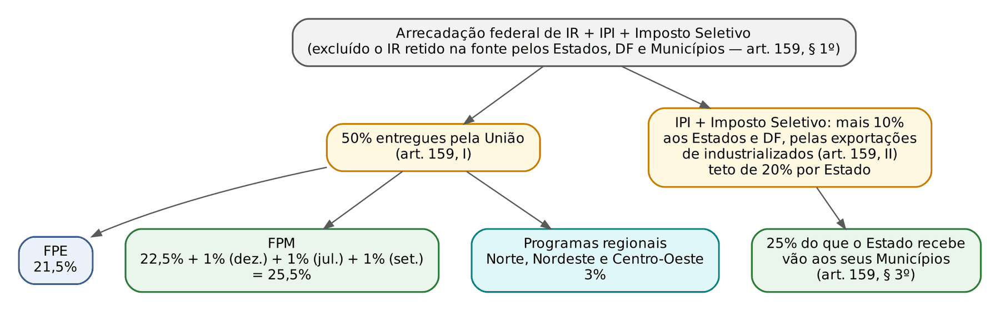
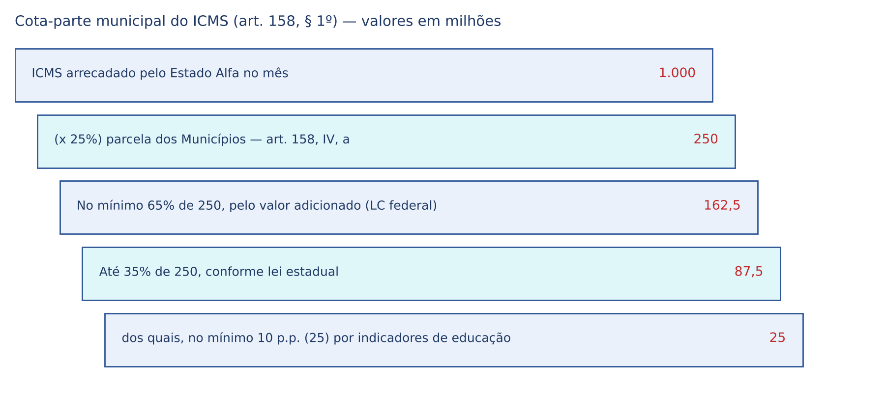
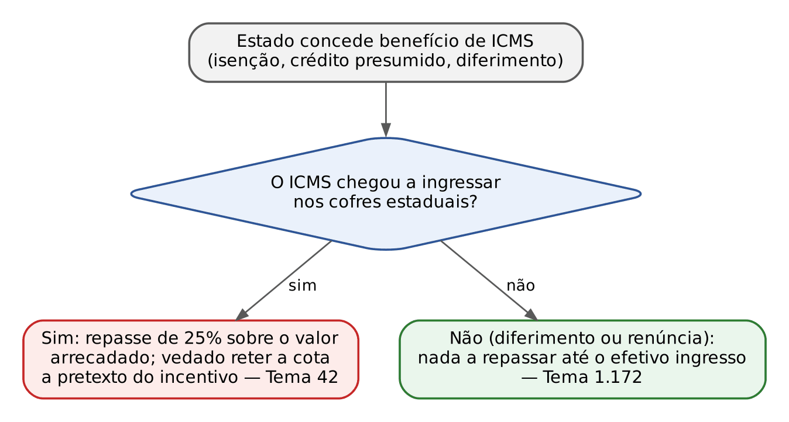

# CAPÍTULO 07 — REPARTIÇÃO CONSTITUCIONAL DAS RECEITAS TRIBUTÁRIAS: PARTICIPAÇÕES DIRETAS, FUNDOS DE PARTICIPAÇÃO, TRANSFERÊNCIAS E CONDICIONAMENTOS

:::INCIDENCIA
TRF5 p. 6; TJRS p. 1; TJSC p. 1. Nível B. Lote: 33 questões (FGV 29, FCC 4).
O que mais cai: percentuais dos arts. 157 a 159 (quem recebe o quê e quanto), IR retido na fonte pelos entes (Tema 1.130), critérios da cota-parte do ICMS e do IBS, benefícios fiscais x cota dos Municípios (Temas 653, 42 e 1.172) e as exceções do art. 160.
:::

| Subtema | FGV | FCC | Padrão de cobrança |
|---|---|---|---|
| Percentuais e destinatários (arts. 157 a 159) | 13 | 2 | "Pertencem aos Municípios..." com um número trocado (50% x 25% x 20%; Estado x Município) |
| IR retido na fonte pelos entes (Tema 1.130) | 8 | 1 | Caso de pagamento a pessoa jurídica contratada; legitimidade na repetição; União que cobra o IR retido |
| Critérios de rateio (ICMS, IBS, IPI-exportação) | 3 | 1 | Pesos do art. 158, §§ 1º e 2º; 2,5% do IPI-exportação para os Municípios |
| Benefícios fiscais e cotas (Temas 653, 42 e 1.172) | 4 | 0 | Renúncia federal x FPM; diferimento estadual do ICMS x cota municipal |
| Vedações, condicionamentos e vinculação de receitas | 5 | 0 | Art. 160, § 1º; art. 167, IV (não afetação) |
| Reforma (IBS, Imposto Seletivo, art. 149-C, FNDR) | 4 | 1 | 25,5% do Imposto Seletivo ao FPM; compras públicas; local da operação |

## 07.1 O que é a repartição de receitas e por que ela existe

### 07.1.1 Competência x produto da arrecadação

O Cap. 4 mostrou que a Constituição distribui entre os entes a competência para INSTITUIR tributos. A repartição de receitas é outra coisa: a Constituição pega o dinheiro já arrecadado por um ente (o "produto da arrecadação") e determina que uma parte dele pertence a outro ente. Nada se transfere quanto ao poder de legislar: o IPVA continua sendo imposto estadual, com lei estadual, lançamento estadual e execução fiscal estadual, embora metade do que se arrecada pertença ao Município onde o veículo está licenciado.

A razão é o federalismo fiscal: a Constituição concentrou na União e nos Estados os impostos de maior base econômica, mas deu aos Municípios boa parte dos serviços públicos. A repartição corrige o desequilíbrio vertical (muitas tarefas e pouca receita nos entes menores) e, pelos fundos, o horizontal (regiões ricas e pobres). Por isso a autonomia financeira, protegida pelo art. 160, é pilar do pacto federativo.

:::DICA
Para o civilista: a parcela que "pertence" ao Município é crédito dele desde a origem, com titularidade fixada pela Constituição; o Estado apenas arrecada. Por isso não pode retê-la (art. 160) e, no IR retido pelos entes, quem se apropria da receita responde pela restituição.
:::

### 07.1.2 Repartição direta e indireta

A doutrina de direito financeiro distingue duas técnicas, e a Constituição usa ambas:

- repartição direta (arts. 157 e 158): o ente beneficiário recebe a parcela sem intermediário, ou porque ele próprio a arrecada e a retém (IR retido na fonte), ou porque o ente arrecadador lhe entrega diretamente a fração (IPVA, ICMS, ITR);
- repartição indireta (art. 159): parte da arrecadação vai para um fundo (FPE, FPM, fundos regionais) e depois é rateada entre os participantes segundo critérios fixados em lei complementar (art. 161, II).

Três regras gerais orientam qualquer questão de "quem recebe":

- a repartição é vertical: a União reparte com Estados, Distrito Federal e Municípios; o Estado reparte com os seus Municípios; nenhum tributo municipal é repartido (ISS, IPTU e ITBI ficam inteiros com o Município);
- reparte-se, em regra, produto de IMPOSTOS; a única contribuição repartida é a CIDE-combustíveis (art. 159, III); taxas, contribuições de melhoria, empréstimos compulsórios e demais contribuições ficam com quem os institui;
- vários impostos NÃO são repartidos: II, IE, IGF (não instituído), impostos extraordinários de guerra (art. 154, II), ITCMD, ISS, IPTU e ITBI, e o IOF em geral (só o IOF-ouro é repartido).

:::PEGADINHA
O imposto residual (art. 154, I) é repartido (20% aos Estados e DF, nada aos Municípios); o extraordinário de guerra (art. 154, II) NÃO é. Em Q3363385 (FGV 2025, SEFAZ-PR, Auditor Fiscal), um imposto criado por emenda constitucional e outro criado por lei complementar no exercício da competência residual: gabarito B, só o produto do segundo é repartido com Estados e Distrito Federal.
:::

### 07.1.3 Quadro-mestre: tributo, arrecadador, destinatário

:::ESQUEMA Quem arrecada, para quem vai e quanto (redação vigente em 22/10/2026)
| Tributo (competência) | Quem arrecada | Para quem vai e quanto | Fundamento |
|---|---|---|---|
| IR retido na fonte sobre pagamentos dos Estados, DF, suas autarquias e fundações | O próprio Estado ou DF (fonte pagadora) | 100% do Estado ou DF | art. 157, I; Tema 1.130 |
| IR retido na fonte sobre pagamentos dos Municípios, suas autarquias e fundações | O próprio Município | 100% do Município | art. 158, I; Tema 1.130 |
| Imposto residual (União) | União | 20% aos Estados e DF | art. 157, II |
| IOF-ouro ativo financeiro (União) | União | 30% ao Estado, DF ou Território de origem; 70% ao Município de origem | art. 153, § 5º |
| ITR (União) | União, ou o Município que optar por fiscalizar e cobrar | 50% ao Município do imóvel; 100% se o Município optar | arts. 153, § 4º, III, e 158, II |
| IPVA (Estado) | Estado | 50% ao Município do licenciamento; veículos aquáticos e aéreos: Município do domicílio do proprietário | art. 158, III |
| ICMS (Estado) | Estado | 25% aos Municípios (critérios do art. 158, § 1º) | art. 158, IV, a (revogação em 2033) |
| IBS (Estados e Municípios) | Comitê Gestor | 25% da parcela distribuída aos Estados vai aos Municípios (critérios do art. 158, § 2º) | art. 158, IV, b |
| IR + IPI + Imposto Seletivo (União) | União | 50%: FPE 21,5%; FPM 25,5% (22,5 + 1 + 1 + 1); programas regionais 3% | art. 159, I |
| IPI + Imposto Seletivo (União) | União | mais 10% aos Estados e DF, proporcionalmente às exportações de industrializados; os Estados repassam 25% disso aos Municípios | art. 159, II e § 3º |
| CIDE-combustíveis (União) | União | 29% aos Estados e DF; os Estados repassam 25% disso aos Municípios | art. 159, III e § 4º |
:::

:::DICA
Memorização: o que o Estado passa ao Município é sempre 25% da sua parcela (ICMS, IBS, IPI-exportação, CIDE); sobre o total, 2,5% do IPI-exportação e 7,25% da CIDE. "50%": IPVA, ITR e art. 159, I; "100%": IR retido e ITR com opção; "70/30": IOF-ouro; "20%": residual.
:::

:::QUESTAO FGV 2024 — TJ-SC — Juiz Substituto (Q3049405)
Pergunta-se o que o Estado de Santa Catarina deve transferir aos seus Municípios. Gabarito C: 25% do ICMS sobre prestações de serviços de comunicação (o ICMS inteiro, inclusive sobre comunicação, entra na cota de 25%). Armadilhas: ITCMD não se reparte; o IOF-ouro é imposto FEDERAL e os 70% vão da União ao Município, não do Estado; taxas e contribuições de melhoria estaduais não se repartem.
:::

:::QUESTAO FGV 2024 — TJ-SC — Juiz Substituto (Q2387024)
O que cabe ao Estado em impostos da União. Gabarito D: 10% do IPI, proporcionalmente às exportações de industrializados (art. 159, II). Armadilhas: o FPE é 21,5%, não 22,5% (este é o FPM-base); imposto residual dá 20%, não 25%; o ITR é repartido com Municípios, não com Estados; 20% é o TETO por Estado no IPI-exportação (art. 159, § 2º), não o percentual de entrega.
:::

No mesmo sentido, cobrando a lista de receitas repartidas: Q2351942 (FGV 2024, Câmara Municipal de São Paulo; gabarito E, 50% do IPVA e 25% do ICMS; ITCMD, COSIP e ITR são distratores); com um percentual trocado, Q3841699 (FGV 2025, Procurador de Abreu e Lima; gabarito B, 50% do IPVA; o residual vai a Estados e o ITR com opção é 100%), Q3265482 (FGV 2025, Procurador de Canaã dos Carajás; gabarito C, 50% do IPVA; o IR pago pela União a seus servidores é da União), Q3009027 (FGV 2024, Técnico de Controle Interno; gabarito A, IR retido pelo Município), Q2346687 (FGV 2024, Procurador de Caraguatatuba; gabarito A, V-V-F: o ITR é 50%, não 25%), Q2387532 (FGV 2024, CGM-BH; gabarito D, F-F-F: IPVA é 50%, não 65%; o IR retido é 100%, não 50%; o residual não é dos Municípios), Q2512327 (FGV 2024, Câmara dos Deputados; gabarito B, 20% do residual) e Q3745569 (FCC 2025, PGE-TO, assinalar a incorreta; gabarito E, porque o ICMS não se reparte "50% aos Estados": 25% vão aos Municípios).

## 07.2 Participações diretas dos Estados e do Distrito Federal (art. 157)

### 07.2.1 IR retido na fonte pelo próprio ente

O imposto de renda é federal: a lei é federal, a base de cálculo e as alíquotas são federais, e a Receita Federal fiscaliza. Mas, quando o pagador do rendimento é um Estado, o Distrito Federal, uma autarquia ou uma fundação por eles instituída e mantida, o IR que esse pagador retém na fonte PERTENCE a ele (art. 157, I). Na prática, o Estado desconta o imposto do pagamento e simplesmente não o repassa à União: a receita nasce estadual. O mesmo vale para os Municípios (art. 158, I).

Por muito tempo se discutiu o alcance da expressão "rendimentos pagos, a qualquer título". A União sustentava que só o IR sobre a remuneração de servidores e empregados do ente pertenceria a ele, e que o IR retido sobre pagamentos a fornecedores e prestadores de serviço (pessoas jurídicas contratadas) seria federal. O STF rejeitou a leitura restritiva.

:::JURIS STF, Tema 1.130 (RE 1.293.453/RS, Pleno, j. 11/10/2021, Info 1033)
Tese: pertence ao Município, aos Estados e ao Distrito Federal a titularidade das receitas arrecadadas a título de imposto de renda retido na fonte incidente sobre valores pagos por eles, suas autarquias e fundações a pessoas físicas ou jurídicas contratadas para a prestação de bens ou serviços, conforme os arts. 158, I, e 157, I, da CF. Razão: o texto constitucional diz "a qualquer título", e restringir a regra aos servidores esvaziaria a autonomia financeira desenhada pelo constituinte.
:::

Do Tema 1.130 decorrem quatro desdobramentos cobrados:

- o critério é QUEM PAGA (a fonte pagadora é o ente, sua autarquia ou fundação), e não quem recebe: servidor, aposentado, pessoa física autônoma ou pessoa jurídica contratada, inclusive por licitação ou por dispensa;
- o texto fala em autarquias e fundações; empresas públicas e sociedades de economia mista NÃO estão incluídas, e o IR que elas retêm continua federal;
- a receita é tributária própria do ente, e não "transferência corrente da União": o ente retém o valor e o contabiliza como receita tributária (Q3607426, abaixo);
- a União não pode exigir do ente o repasse do IR retido nem lançar contra ele esse valor (Q3362316, abaixo).

:::PEGADINHA
É falso que caiba à União o IR retido sobre vencimentos de servidores estaduais e municipais (Q2510936) ou sobre pagamentos dos Municípios a contratados (Q2466068). O erro inverso também aparece: o IR retido pela UNIÃO sobre seus servidores lotados no Município, ou por empresas privadas nele sediadas, é federal (Q3265482).
:::

:::QUESTAO FGV 2025 — ENAM — Exame Nacional da Magistratura 2025.1 (Q3362316)
Caso: a União lançou o IR na fonte relativo a pagamentos que o Município Alfa fez a uma sociedade contratada por licitação e a uma pessoa física contratada sem licitação; o imposto foi descontado, mas não repassado à União. Passo 1, o que se pergunta: a quem pertencem os valores retidos. Passo 2, a regra: art. 158, I, e Tema 1.130, sem distinção entre pessoa física e jurídica, nem entre licitação e dispensa. Passo 3, aplicação: os valores pertencem a Alfa, que agiu corretamente ao retê-los sem repassar. Gabarito A. As alternativas sedutoras dizem que a União poderia "repassar por transferência voluntária" (não há o que repassar: a receita nunca foi federal) ou que os valores iriam ao FPM (o IR retido pelos entes é justamente EXCLUÍDO da base do FPM, art. 159, § 1º).
:::

No mesmo sentido do Tema 1.130: Q3786407 (FGV 2025, TJ-MS, Juiz Substituto; gabarito C, inclusive pagamentos de autarquia hospitalar a médicos organizados em pessoas jurídicas; a alternativa que exclui as autarquias e a que exige lei complementar estão erradas, pois o dispositivo é autoaplicável), Q3605997 (FGV 2025, PGM-RJ; gabarito C, pessoas naturais e jurídicas), Q3592178 (FGV 2025, TCE-PE, Procurador; gabarito C, limpeza urbana contratada) e Q2466077, item I (abaixo). A FGV já cobrara o mesmo raciocínio no TJSC 2022 (Município que retém o IR sem repassar à União), segundo o mapeamento de provas.

Q3607426 (FGV 2025, PGM-RJ, Analista de Procuradoria) cobrou a contabilização: o Município desconta o IR da nota fiscal da construtora e o registra como receita tributária, não como "transferência corrente da União" (gabarito D).

:::QUESTAO FGV 2025 — SEFAZ-RS — Auditor do Estado (Q3154682)
Gabarito D (II e III): os órgãos da administração direta dos entes retêm o IR sobre pagamentos a pessoas jurídicas contratadas, e a legislação gaúcha manda recolher de imediato ao Tesouro o IR retido por órgãos, autarquias e fundações estaduais. O item I é falso por estender a retenção a entidades filantrópicas, recreativas, culturais e científicas, que a regulamentação federal dispensa.
:::

:::SENTENCA Repetição de IR retido de servidor estadual ou municipal
Onde entra: servidor pede a devolução de IR retido a maior, contra o Estado (ou o Município) e a União. O que fundamentar: legitimidade passiva do ente que reteve e se apropriou da receita (arts. 157, I, e 158, I; Súmula 447 do STJ, ver Cap. 16); a União é ilegítima; competência da Justiça estadual. Redação-modelo: "Pertencendo ao Estado o produto do imposto de renda que retém na fonte (CF, art. 157, I; Súmula 447 do STJ), reconheço a ilegitimidade passiva da União e excluo-a da lide." Erro punido: litisconsórcio necessário com a União "instituidora" (Q3058620, abaixo). Prazo e juros da repetição: Cap. 16.
:::

:::QUESTAO FGV 2024 — ENAM — Exame Nacional da Magistratura 2024.2 (Q3058620)
Servidor pede, contra o Estado Alfa e a União, a devolução de IR retido a maior; ambos alegam ilegitimidade. Gabarito E: só o Estado permanece, porque é o destinatário integral do IR retido (art. 157, I). Erram as alternativas que exigem litisconsórcio necessário com a União "instituidora".
:::

:::PROCESSO Conflitos entre entes sobre repartição
- Município x Estado (cota de ICMS ou IPVA): procedimento comum ou mandado de segurança na Justiça estadual.
- Município x União (FPM): Justiça Federal (art. 109, I). Estado x União (FPE, IPI-exportação): ação cível originária no STF (art. 102, I, f).
- União que lança ou executa IR retido por ente: defesa por embargos ou anulatória, com base nos arts. 157, I, ou 158, I (Caps. 21 a 23).
:::

### 07.2.2 Vinte por cento do imposto residual

Se a União criar imposto novo por lei complementar (art. 154, I; Cap. 4), 20% do produto pertencem aos Estados e ao DF (art. 157, II), como compensação pelo espaço econômico que o novo imposto pode ocupar (ver a PEGADINHA de 7.1.2).

### 07.2.3 IOF-ouro

O ouro definido em lei como ativo financeiro ou instrumento cambial sujeita-se EXCLUSIVAMENTE ao IOF, devido na operação de origem, com alíquota mínima de 1%; a União transfere 30% ao Estado, Distrito Federal ou Território de origem e 70% ao Município de origem (art. 153, § 5º). A União, portanto, nada retém do IOF-ouro: é a única hipótese em que o ente competente transfere 100% do produto. O ouro como mercadoria (joalheria, indústria) sofre ICMS e IPI normalmente; o IOF-ouro e a imunidade do ouro-ativo financeiro estão no Cap. 25.

:::PEGADINHA
Em Q2510936 (FGV 2024, Câmara dos Deputados), a alternativa sobre o IOF "incidente sobre a lavra de ouro" foi dada como errada: a União de fato nada retém, mas o IOF-ouro incide na operação de origem do ativo financeiro, não na extração. Em Q2564693 (FCC 2024, TRF3, Técnico), cobrou-se a literalidade: só incide IOF, assegurada ao Município de origem a transferência de 70%.
:::

## 07.3 Participações diretas dos Municípios (art. 158)

### 07.3.1 IR retido na fonte

Vale tudo o que se disse em 7.2.1, com o Município, suas autarquias e fundações no lugar do Estado (art. 158, I).

### 07.3.2 ITR: 50% ou 100%

O ITR é da União, mas 50% do produto pertence ao Município onde o imóvel está situado, e 100% se o Município optar por fiscalizar e cobrar o imposto, desde que isso não implique redução do imposto ou qualquer outra forma de renúncia fiscal (arts. 158, II, e 153, § 4º, III). A opção se faz por convênio com a União, nos termos de lei federal.

A opção NÃO transfere competência tributária, que é indelegável (art. 7º do CTN; Cap. 4): a União continua a legislar sobre o ITR. O que se transfere é a capacidade tributária ativa (fiscalizar, lançar, cobrar), e o Município passa a ser o sujeito ativo da obrigação.

:::QUESTAO FCC 2026 — SEFAZ-SP — Auditor Fiscal da Receita Estadual (Q3926874)
Município optou por fiscalizar e cobrar o ITR sem renúncia. Gabarito B: a competência continua da União, mas o Município passa a ser sujeito ativo. Erram as alternativas que transferem a competência ao Município (contraria a indelegabilidade) ou que dão competência "conjunta". Ver Cap. 4 (competência x capacidade tributária ativa).
:::

### 07.3.3 IPVA: 50%

Pertencem aos Municípios 50% do IPVA dos veículos licenciados em seus territórios e, desde a EC 132/2023 (que estendeu o IPVA aos veículos aquáticos e aéreos; ver Cap. 30), dos veículos aquáticos e aéreos cujos proprietários sejam domiciliados em seus territórios (art. 158, III). O critério muda porque embarcação e aeronave não têm "licenciamento municipal" como o carro: o elemento de conexão passa a ser o domicílio do proprietário.

:::QUESTAO FGV 2024 — Prova sem identificação no banco (Q3113975)
Alterações da EC 132 na repartição. Gabarito C: 25,5% do Imposto Seletivo vão ao FPM (22,5 + 1 + 1 + 1). Distratores: 10% do IBS (são 25%), 25% do IPVA de aquáticos e aéreos (são 50%), 20,5% ao FPE (são 21,5%) e 20% pelas exportações (são 10%).
:::

### 07.3.4 ICMS: 25% e os critérios do art. 158, § 1º

Do ICMS, 25% pertencem aos Municípios (art. 158, IV, a). A Constituição não manda dividir esses 25% em partes iguais; o § 1º (antigo parágrafo único, renumerado pela EC 132) fixa os critérios, na redação da EC 108/2020:

- no mínimo 65% na proporção do valor adicionado nas operações e prestações realizadas no território de cada Município (critério devolutivo: quem gera a riqueza recebe mais);
- até 35% conforme lei estadual, com no mínimo 10 pontos percentuais distribuídos com base em indicadores de melhoria nos resultados de aprendizagem e de aumento da equidade, considerado o nível socioeconômico dos educandos (critério redistributivo e indutor).

Antes da EC 108/2020 a divisão era de três quartos, no mínimo, pelo valor adicionado e até um quarto por lei estadual, sem a vinculação à educação; questões antigas ainda trazem essa proporção.

O conceito de "valor adicionado" é definido por lei complementar federal (art. 161, I), hoje a LC 63/1990, para que cada Estado não manipule o índice a favor de uns Municípios em detrimento de outros. Por isso o STF declarou inconstitucional lei estadual que criava método próprio de cálculo do valor adicionado.

:::JURIS STF, ADI 7.685/PA, Pleno, j. 13/12/2024 (Info 1163)
É inconstitucional, por invadir o campo reservado à lei complementar federal (arts. 158, § 1º, I, e 161, I, da CF), norma estadual que dispõe sobre o cálculo do valor adicionado para fins de repartição do ICMS com os Municípios. No caso, lei paraense fixava, para mineradoras, valor adicionado igual a 32% da receita bruta, método que a LC 63/1990 só admite para contribuintes de regimes simplificados ou dispensados de controles de entrada.
:::

:::EXEMPLO Cota-parte do ICMS do Estado Alfa
O Estado Alfa arrecadou 1.000.000.000 (um bilhão de) reais de ICMS no mês: 250.000.000 (duzentos e cinquenta milhões de) reais pertencem aos Municípios; desses, ao menos 162.500.000 (cento e sessenta e dois milhões e quinhentos mil) reais seguem o valor adicionado, e os até 87.500.000 (oitenta e sete milhões e quinhentos mil) reais restantes seguem a lei estadual, com ao menos 25.000.000 (vinte e cinco milhões de) reais por indicadores educacionais. O Município Beta, com 4% do valor adicionado estadual, recebe ao menos 6.500.000 (seis milhões e quinhentos mil) reais pelo primeiro critério.
:::

O momento do repasse também é cobrado. O Estado deve creditar a parcela municipal à medida que o ICMS ingressa nos cofres; a LC 63/1990 (art. 4º, § 1º) determina que, extinto o crédito de ICMS por compensação ou transação, a repartição faça no mesmo ato o depósito dos 25% municipais. Aplicando essa regra, o STJ entendeu que, quando o Estado aceita precatório para quitar ICMS, a cota municipal deve ser repassada no momento da aceitação, e não quando o precatório for pago em dinheiro segundo a ordem cronológica (REsp 1.894.736/PR, 1ª Turma, Info 710 do STJ).

### 07.3.5 Benefícios fiscais estaduais e a cota dos Municípios

Dois temas de repercussão geral, aparentemente contraditórios, resolvem os casos de incentivo estadual. A chave é perguntar se o ICMS chegou a ser arrecadado.

:::JURIS STF, Tema 42 (RE 572.762)
A retenção, pelo Estado, da parcela do ICMS constitucionalmente devida aos Municípios, a pretexto de concessão de incentivos fiscais, configura indevida interferência do Estado no sistema constitucional de repartição de receitas tributárias. No caso, o imposto já havia sido arrecadado, e o Estado pretendia calcular a cota municipal descontando a parcela destinada ao programa estadual de incentivo.
:::

:::JURIS STF, Tema 1.172 (RE 1.288.634)
Os programas de diferimento ou postergação de pagamento de ICMS (no caso, FOMENTAR e PRODUZIR, de Goiás) não violam o sistema constitucional de repartição de receitas tributárias previsto no art. 158, IV, da CF, desde que seja preservado o repasse da parcela pertencente aos Municípios quando do efetivo ingresso do tributo nos cofres públicos estaduais. O STF distinguiu o caso do Tema 42, porque ali o ICMS já havia ingressado.
:::

A síntese é a do Tema 653 no plano federal (7.4.2): o ente competente pode renunciar regularmente à receita, e o beneficiário participa do que é efetivamente arrecadado; o que não pode é arrecadar e depois reter a cota alheia por via oblíqua.

:::QUESTAO FGV 2025 — Prova sem identificação no banco (Q3154428)
O Estado Beta difere o recolhimento do ICMS para empresas que se instalarem na região de menor IDH; Municípios alegam inconstitucionalidade. Gabarito B: não há afronta à repartição, desde que a parcela municipal seja repassada quando do recolhimento do ICMS (Tema 1.172). Armadilhas: a alternativa D antecipa o repasse ao momento do fato gerador (o Estado não repassa o que não recebeu); as alternativas C e E inventam depósito prévio no FPM ou compensação com outros impostos; e a A nega qualquer correlação, o que é falso.
:::

No mesmo sentido: Q3777251 (FGV 2025, AL-AM, Analista de Controle; gabarito B, postergação de dez anos lícita, repartição no ingresso do tributo). A FGV cobrou o Tema 42 no ENAM com o gabarito de que a retenção da cota a pretexto de incentivo é indevida interferência, segundo a prova comentada consultada (ver nota).

:::SENTENCA Ação de Município contra o Estado por cota de ICMS
Onde entra: Município pede a diferença da cota-parte calculada "líquida" de benefícios. O que fundamentar: se o benefício impediu o ingresso do imposto, nada há a repassar antes dele (Tema 1.172); se o imposto foi arrecadado, a cota incide sobre o total (Tema 42). Redação-modelo: "Tendo o ICMS efetivamente ingressado nos cofres estaduais, a posterior destinação de parte dele a programa de incentivo não autoriza o cálculo da cota municipal sobre o valor remanescente, sob pena de indevida interferência no sistema constitucional de repartição (CF, arts. 158, IV, e 160; Tema 42 do STF)." Erro punido: aplicar o Tema 42 a diferimento, ou o Tema 1.172 a imposto já recolhido.
:::

### 07.3.6 IBS: 25% da parcela estadual e critérios do art. 158, § 2º

Com a reforma, o ICMS será extinto: a EC 132 revoga em 2033 o art. 155, II, o art. 158, IV, a, e § 1º, e o art. 161, I (art. 22, II, a, da EC 132). Em seu lugar, os Municípios recebem 25% do produto do IBS distribuído aos Estados (art. 158, IV, b), com critérios próprios, todos fixados na Constituição (art. 158, § 2º):

| Critério (art. 158, § 2º) | Peso |
|---|---|
| Proporção da população | 80% |
| Indicadores de melhoria da aprendizagem e equidade (lei estadual) | 10% |
| Indicadores de preservação ambiental (lei estadual) | 5% |
| Montantes iguais para todos os Municípios do Estado | 5% |

Note a mudança de lógica: o ICMS municipal premia quem gera valor adicionado (65% no mínimo); o IBS municipal premia a população (80%), coerente com o princípio do destino do novo imposto. A distribuição do IBS entre os entes na transição (2029 a 2077, retenções dos arts. 131 e 132 do ADCT) é matéria do Cap. 33.

:::QUESTAO FGV 2026 — TCE-SC — Auditor Fiscal de Controle Externo (Q4088889)
Pede a ordem de peso, do maior para o menor, entre educação (1), preservação ambiental (2) e população (3) na cota municipal do IBS. Gabarito D (3, 1, 2): 80%, 10% e 5%. Armadilha: quem decora os critérios do ICMS (em que a educação tem "no mínimo 10 pontos") pode supor que educação pesa mais que população.
:::

No mesmo sentido: Q4221431 (FCC 2026, SEFAZ-CE, Auditor Fiscal; gabarito A, 5% por indicadores ambientais; os distratores trocam os números: 10% em montantes iguais, 80% pela área, 15% por frequência escolar, 20% pelo PIB).

## 07.4 Participação indireta: fundos e transferências do art. 159

### 07.4.1 O bloco do art. 159, I: FPE, FPM e fundos regionais

Do produto da arrecadação do IR, do IPI e, desde a EC 132, do Imposto Seletivo (art. 153, VIII), a União entrega 50%, assim distribuídos:

| Destino | Percentual | Observação |
|---|---|---|
| FPE (Fundo de Participação dos Estados e do DF) | 21,5% | alínea a |
| FPM (Fundo de Participação dos Municípios) | 22,5% | alínea b, entregas regulares |
| FPM adicional | 1% | alínea d (EC 55/2007), primeiro decêndio de dezembro |
| FPM adicional | 1% | alínea e (EC 84/2014), primeiro decêndio de julho |
| FPM adicional | 1% | alínea f (EC 112/2021), primeiro decêndio de setembro |
| Programas de financiamento ao setor produtivo do Norte, Nordeste e Centro-Oeste | 3% | alínea c, por instituições financeiras regionais; metade dos recursos do Nordeste para o semiárido |
| Total | 50% | FPM = 25,5% |

Duas regras de cálculo completam o quadro:

- a base do art. 159, I, EXCLUI o IR retido na fonte que pertence aos Estados, Distrito Federal e Municípios (art. 159, § 1º): seria absurdo o ente receber 100% do IR que reteve e ainda participar dele de novo pelo fundo;
- o rateio entre os participantes de cada fundo é definido em lei complementar, com o objetivo de promover o equilíbrio socioeconômico entre Estados e entre Municípios (art. 161, II), e o cálculo das quotas é feito pelo Tribunal de Contas da União (art. 161, parágrafo único). A lei complementar também deve permitir que os beneficiários acompanhem o cálculo das quotas e a liberação das participações dos arts. 157 a 159 (art. 161, III).

:::EXEMPLO Quanto do IR e do IPI fica com a União
Arrecadação federal de IR e IPI de 100.000 (cem mil) reais (excluído o IR retido pelos entes), dos quais 20.000 (vinte mil) reais de IPI. Art. 159, I: 50.000 (cinquenta mil) reais, sendo 21.500 (vinte e um mil e quinhentos) ao FPE, 25.500 (vinte e cinco mil e quinhentos) ao FPM e 3.000 (três mil) aos programas regionais. Art. 159, II: mais 2.000 (dois mil) reais aos Estados exportadores, que repassam 500 (quinhentos) reais aos Municípios. Total entregue: 52.000 (cinquenta e dois mil) reais, mais da metade da soma de IR e IPI, como cobrado em Q2510936 (FGV 2024, Câmara dos Deputados, gabarito A).
:::

:::QUESTAO FGV 2024 — Prefeitura de São José dos Campos — Técnico Tributário (Q2375618)
Sobre os 21,5% do FPE, pergunta-se qual vinculação é VEDADA. Gabarito C: aporte em programa governamental de caráter assistencial. As demais (garantia de operação de crédito por antecipação de receita, administração tributária, ensino e saúde) estão entre as ressalvas do art. 167, IV (ver 7.5.3).
:::

### 07.4.2 Renúncias federais e a base do FPM (Tema 653)

Quando a União concede isenção ou redução de IR ou IPI, a arrecadação diminui e, com ela, o FPM. Os Municípios sustentaram que a União estaria "dando com o chapéu alheio". O STF rejeitou a tese: a participação incide sobre o produto da ARRECADAÇÃO, conceito técnico que corresponde ao que efetivamente ingressa, e a União, titular da competência, pode exercê-la inclusive para desonerar.

:::JURIS STF, Tema 653 (RE 705.423, Pleno, j. 17/11/2016)
É constitucional a concessão regular de incentivos, benefícios e isenções fiscais relativos ao Imposto de Renda e ao Imposto sobre Produtos Industrializados por parte da União em relação ao Fundo de Participação de Municípios e respectivas quotas devidas às Municipalidades.
:::

A base do FPM não pode, porém, ser reduzida por deduções que a Constituição não autoriza. Foi o que se decidiu quanto às parcelas do IR destinadas a programas federais de desenvolvimento regional.

:::JURIS STF, Tema 1.187 (RE 1.346.658)
É inconstitucional a dedução dos valores advindos das contribuições ao Programa de Integração Nacional (PIN) e ao Programa de Redistribuição de Terras e de Estímulo à Agroindústria do Norte e do Nordeste (PROTERRA) da base de cálculo do FPM. A diferença em relação ao Tema 653: aqui o IR foi arrecadado e a União o subtraía da base depois; lá, a renúncia impede a própria arrecadação.
:::

Está pendente de julgamento, com repercussão geral reconhecida, o Tema 1.275 do STF (RE 1.362.061), que discute a composição da base de cálculo do FPM, inclusive o uso de portarias da Secretaria do Tesouro Nacional, deduções relativas a fundos de estabilização fiscal e a dedução do IR retido por entidades federais (situação consultada em outubro de 2026: aguardava julgamento).

:::QUESTAO FGV 2024 — Prova sem identificação no banco (Q3157901)
Município questiona incentivos de IR e IPI concedidos pela União que reduziram o FPM. Gabarito C: é constitucional a concessão regular de incentivos, à luz do conceito técnico de arrecadação e dos estágios da receita pública (Tema 653). Armadilhas: incluir as renúncias na base (A e E) ou proibir a União de concedê-las (B).
:::

:::QUESTAO FGV 2024 — Câmara de Fortaleza — Consultor Legislativo (Q2466068)
Três afirmativas. A primeira (vedada a concessão de benefícios de IR e IPI em relação ao FPM) é falsa pelo Tema 653; a segunda (IR retido pelos Municípios sobre contratados pertence à União) é falsa pelo Tema 1.130; a terceira (a reforma criou o Fundo Nacional de Desenvolvimento Regional, com recursos da União entregues aos Estados e ao DF) é verdadeira (art. 159-A). Gabarito C (F-F-V).
:::

### 07.4.3 O rateio do FPE e a ADI 5.069

O art. 161, II, exige critérios de rateio que promovam o equilíbrio socioeconômico. Depois de o STF invalidar, em 2010, os coeficientes fixos da redação original da LC 62/1989 (ADIs 875, 1.987, 2.727 e 3.243), veio a LC 143/2013. Na ADI 5.069 (junho de 2023, Info 1099), o STF declarou inconstitucionais também esses critérios (art. 2º, II e III, da LC 62/1989), por manterem dissimuladamente a sistemática anterior com transição desarrazoadamente longa, e modulou os efeitos até 31/12/2025. Sem a nova lei, o STF prorrogou a eficácia por 90 dias (Ref-segundo, Info 1209, 23/3/2026) e, em 17/6/2026, manteve os critérios até 30/6/2027, em prazo declarado improrrogável; depois disso, sem lei, o rateio seguirá a população e o inverso da renda domiciliar *per capita*.

Na mesma linha de proteção dos fundos, o STF julgou inconstitucional norma da Constituição do Rio de Janeiro que destinava recursos recebidos do FPE a fundo estadual de desenvolvimento econômico, por violar a vedação de vinculação de receita de impostos do art. 167, IV (ADI 553/RJ, Pleno, j. 13/6/2018, Info 906).

### 07.4.4 IPI-exportação (art. 159, II e §§ 2º e 3º)

A Constituição imuniza do ICMS as exportações (Cap. 27). Para compensar os Estados exportadores de industrializados pela perda de arrecadação, a União entrega 10% do IPI e, desde a EC 132, também 10% do Imposto Seletivo, aos Estados e ao Distrito Federal, proporcionalmente ao valor das respectivas exportações de produtos industrializados (art. 159, II). Duas regras completam:

- nenhum Estado pode receber mais de 20% do montante; o excedente é redistribuído entre os demais pelo mesmo critério (art. 159, § 2º);
- os Estados repassam 25% do que recebem aos seus Municípios, pelos critérios do art. 158, § 1º (do ICMS) para a parcela do IPI e do art. 158, § 2º (do IBS) para a parcela do Imposto Seletivo (art. 159, § 3º). Em termos do total arrecadado, os Municípios ficam com 2,5% do IPI (25% de 10%).

Em Q2348965 (FGV 2024, Auditor Tributário de São José dos Campos), gabarito C: os Municípios têm 2,5% do IPI-exportação arrecadado pela União; os distratores "10%" e "25%" confundem as frações parciais com o total.

### 07.4.5 CIDE-combustíveis (art. 159, III e § 4º)

A CIDE sobre importação e comercialização de petróleo, gás natural, seus derivados e álcool combustível (art. 177, § 4º; Cap. 3) é a única contribuição repartida: 29% aos Estados e ao Distrito Federal, distribuídos na forma da lei e observadas as destinações do art. 177, § 4º, II, c (infraestrutura de transportes) e d (subsídios a tarifas de transporte público coletivo, acrescida pela EC 132); dos 29% de cada Estado, 25% vão aos seus Municípios (art. 159, § 4º), isto é, 7,25% do total.

:::PEGADINHA
Em Q2510936 (FGV 2024, Câmara dos Deputados), a alternativa B afirma que a parcela da CIDE-combustíveis destinada aos Estados não precisa ser dividida com Municípios: falsa, pelo art. 159, § 4º. A alternativa E da mesma questão diz que o IPI-exportação é "dividido igualmente entre os entes": falsa, a divisão é proporcional às exportações.
:::

### 07.4.6 Fundo Nacional de Desenvolvimento Regional (art. 159-A)

A EC 132 criou o FNDR: recursos da União entregues aos Estados e ao DF para infraestrutura, fomento a atividades produtivas (inclusive subvenções) e inovação, por coeficientes com peso de 30% para a população e 70% para o coeficiente do FPE, calculados pelo TCU, vedada a retenção. Não é repartição do produto de um tributo; o restante está no Cap. 33 (Q3113970, FGV 2024, gabarito E, os três destinos do art. 159-A).

## 07.5 Condicionamentos, vedações e controle

### 07.5.1 Vedação de retenção (art. 160, caput) e exceções (§ 1º)

:::LEI CF, art. 160
Art. 160. É vedada a retenção ou qualquer restrição à entrega e ao emprego dos recursos atribuídos, nesta seção, aos Estados, ao Distrito Federal e aos Municípios, neles compreendidos adicionais e acréscimos relativos a impostos.
§ 1º A vedação prevista neste artigo não impede a União e os Estados de condicionarem a entrega de recursos:
I – ao pagamento de seus créditos, inclusive de suas autarquias;
II – ao cumprimento do disposto no art. 198, § 2º, incisos II e III.
§ 2º Os contratos, os acordos, os ajustes, os convênios, os parcelamentos ou as renegociações de débitos de qualquer espécie, inclusive tributários, firmados pela União com os entes federativos conterão cláusulas para autorizar a dedução dos valores devidos dos montantes a serem repassados relacionados às respectivas cotas nos Fundos de Participação ou aos precatórios federais.
:::

A regra protege a autonomia do ente beneficiário: o dinheiro é dele, e o ente que arrecada não pode retê-lo nem dizer como deve ser gasto ("emprego"). As exceções são duas e taxativas:

- a União e os Estados podem condicionar a entrega ao pagamento de seus créditos, inclusive de suas autarquias (por exemplo, dívidas previdenciárias de Município com o INSS);
- podem condicioná-la ao cumprimento dos percentuais mínimos de aplicação em ações e serviços públicos de saúde (art. 198, § 2º, II e III).

O § 2º, incluído pela EC 113/2021, obriga a União a inserir, nos parcelamentos e renegociações firmados com entes federativos, cláusula que autorize deduzir as parcelas devidas das cotas dos fundos de participação ou de precatórios federais.

:::PEGADINHA
O condicionamento é permitido à UNIÃO e aos ESTADOS (quem entrega recursos); não há hipótese de o Município condicionar algo. E o condicionamento é "da entrega" ao pagamento de créditos do ente que repassa ou ao cumprimento do mínimo da saúde; a banca troca "saúde" por "educação", ou acrescenta "cumprimento de metas fiscais", hipóteses que NÃO estão no § 1º.
:::

:::JURIS STJ, Tema 1.401 (REsp 2.238.302/DF e REsp 2.177.031/PI, j. 7/5/2026)
Não são aplicáveis aos bloqueios do FPM, em razão de dívidas com contribuições previdenciárias, os limites de 9% da cota-parte (art. 1º, *caput*, da Lei 9.639/1998) e de 15% da receita corrente líquida (art. 5º, § 4º, da mesma lei). Ligação com o art. 160: o bloqueio aplica a exceção do § 1º, I (crédito da União e de suas autarquias), e o STJ não estendeu a ele os tetos que a Lei 9.639/1998 fixa.
:::

:::QUESTAO FGV 2024 — Câmara de Fortaleza — Consultor Legislativo (Q2466077)
Três itens, todos corretos (gabarito A): I, o Tema 1.130 (IR retido pelos entes sobre pagamentos a contratados); II, viola a reserva de lei complementar federal a norma estadual sobre o cálculo do valor adicionado (art. 161, I; ADI 7.685); III, é vedado ao Estado impor condições à entrega das parcelas municipais, salvo como condição ao recebimento de seus créditos ou ao cumprimento dos mínimos da saúde (art. 160, § 1º).
:::

### 07.5.2 Desvinculação de receitas da União e transferências

A DRU (art. 76 do ADCT, na redação da EC 135/2024) desvincula, até 31/12/2032, 30% da arrecadação da União com contribuições sociais, CIDEs, taxas e receitas patrimoniais. O § 5º, incluído pela EC 135/2024, esclarece que a desvinculação NÃO opera sobre recursos que, por norma constitucional ou legal, devam ser transferidos a Estados, Distrito Federal e Municípios. Na CIDE-combustíveis, portanto, a DRU não reduz os 29% dos Estados. Em sentido inverso, os Estados sustentaram que as contribuições desvinculadas pela DRU teriam virado "impostos" e deveriam ser partilhadas como o residual (20%, art. 157, II); o STF rejeitou a tese: a DRU, criada pelo poder constituinte derivado, não transforma contribuições em impostos residuais, e a regra do art. 157, II, não se estende a esses recursos (ADPF 523, Pleno, Info 1004, 2021).

### 07.5.3 Não afetação da receita de impostos (art. 167, IV) e suas ressalvas

É vedada a vinculação de receita de impostos a órgão, fundo ou despesa (art. 167, IV), ressalvadas a repartição dos arts. 158 e 159, saúde, ensino, administração tributária, garantia de operações de crédito por antecipação de receita e o § 4º. O tema é de direito financeiro; aqui interessa:

- o § 4º do art. 167 (redação da EC 132) permite vincular as receitas próprias de impostos (arts. 155, 156 e 156-A) e as recebidas por repartição (arts. 157, 158, 159, I, a, b, d, e e f, e II) para pagar débitos com a União e prestar-lhe garantia ou contragarantia; os 3% dos fundos regionais (art. 159, I, c) não entram;
- o IR retido na fonte que pertence ao ente é receita de imposto e se submete à mesma vedação de vinculação.

:::QUESTAO FGV 2026 — AL-RO — Consultor Legislativo, Orçamento (Q3882024)
Fundo de inovação abastecido por percentual fixo do IPVA, do ICMS e do IR retido no Estado. Gabarito E: fere a não afetação. Armadilha (D): o IR retido pelo Estado é receita estadual (art. 157, I); o vício é a vinculação, não a titularidade.
:::

No mesmo sentido, com ressalvas do art. 167, IV: Q3117579 (FGV 2024, TJ-PE, Juiz Substituto; gabarito D, a faculdade de os Estados vincularem percentual da receita tributária líquida a fundo estadual de fomento à cultura, prevista no art. 216, § 6º, da CF) e Q2510937 (FGV 2024, Câmara dos Deputados; gabarito E, F-F-F: saúde e ensino são justamente ressalvas constitucionais; as duas afirmações sobre jurisprudência do STF quanto a fundos estaduais e a vinculação do ICMS a programas de cultura foram dadas como falsas; ver nota).

### 07.5.4 Publicidade (art. 162) e controle

Cada ente deve divulgar, até o último dia do mês subsequente ao da arrecadação, os montantes de cada tributo arrecadado, os recursos recebidos, os valores de origem tributária entregues e a entregar e a expressão numérica dos critérios de rateio; a União discrimina os dados por Estado e por Município, e os Estados, por Município (art. 162). Some-se a isso o cálculo das quotas dos fundos pelo TCU (art. 161, parágrafo único) e dos coeficientes do FNDR também pelo TCU (art. 159-A, § 5º).

## 07.6 Reforma tributária e repartição: o que cai agora

A distribuição do IBS na transição é do Cap. 33, e a regra-matriz do IBS e da CBS, do Cap. 32. Além do Imposto Seletivo nas bases do art. 159 (7.4.1 e 7.4.4) e da cota municipal do IBS (7.3.6), dois pontos já foram cobrados:

- nas compras públicas, o produto do IBS e da CBS incidentes sobre operações contratadas pela administração direta, autarquias e fundações, inclusive importações, é integralmente destinado ao ente contratante, mediante redução a zero das alíquotas devidas aos demais entes e elevação equivalente da alíquota do ente contratante (art. 149-C). É uma "repartição às avessas": em vez de dividir, a Constituição concentra a receita no ente que compra, neutralizando o efeito do tributo sobre o seu próprio orçamento;
- a repartição do IBS entre entes depende do local da operação, que segue o destino (LC 214/2025, art. 11); no transporte de carga, por exemplo, considera-se local da operação o da entrega ou disponibilização do bem ao destinatário constante no documento fiscal (art. 11, VII).

:::QUESTAO FCC 2026 — SEFAZ-GO — Auditor Fiscal da Receita Estadual (Q4067506)
Destino do IBS e da CBS nas operações contratadas pela administração pública direta, autarquias e fundações. Gabarito D: integralmente ao ente contratante, com alíquota zero para os demais entes e elevação equivalente da alíquota do contratante (art. 149-C). Armadilha: a alternativa A fala em destino ao Município de localização do órgão, e a B em partilha entre União e Estado com repasse de 25%.
:::

:::QUESTAO FGV 2026 — TCE-SC — Auditor Fiscal de Controle Externo (Q4088891)
Transportadora sediada em Alfa leva carga de Beta para Gama; o destinatário tem sede em Delta. Pergunta-se o local da operação para o IBS. Gabarito C: Gama, local da entrega ao destinatário constante no documento fiscal (LC 214/2025, art. 11, VII). Armadilhas: sede do prestador (Alfa), início do transporte (Beta, critério que a lei reserva ao transporte de PASSAGEIROS, inciso VI) e sede do destinatário (Delta). Ver Cap. 32.
:::

## 07.7 Resumo para revisão pré-prova

| Instituto | Regra | Exceções e detalhes | Fundamento |
|---|---|---|---|
| Repartição | Divide-se o produto da arrecadação, não a competência | Vertical; tributos municipais, taxas e contribuições (salvo CIDE-combustíveis) não se repartem | arts. 157 a 162 |
| IR retido pelos entes | 100% do ente pagador, suas autarquias e fundações | Inclui pagamentos a contratados; não alcança estatais; base do art. 159 o exclui | arts. 157, I, e 158, I; Tema 1.130 |
| Repetição desse IR | Réu é o ente que reteve; Justiça estadual | União ilegítima | Súmula 447 do STJ (Cap. 16) |
| Residual / IOF-ouro | 20% aos Estados e DF / 30% Estado e 70% Município de origem | Extraordinário não se reparte | arts. 157, II, e 153, § 5º |
| ITR | 50% ao Município; 100% com opção | Opção sem renúncia; transfere capacidade ativa | arts. 153, § 4º, III, e 158, II |
| IPVA | 50% ao Município do licenciamento | Aquáticos e aéreos: domicílio do proprietário | art. 158, III |
| ICMS | 25%: mínimo 65% valor adicionado; até 35% lei estadual (mínimo 10 p.p. educação) | Valor adicionado só por LC federal; revogação em 2033 | art. 158, § 1º; ADI 7.685 |
| IBS | 25% da parcela estadual: 80/10/5/5 | População, educação, ambiente, partes iguais | art. 158, § 2º |
| Benefício estadual | Diferimento válido; repasse no ingresso | ICMS já arrecadado: vedado reter a cota | Temas 1.172 e 42 |
| Art. 159, I | 50% de IR + IPI + IS: FPE 21,5; FPM 25,5; regionais 3 | Renúncia federal regular não viola o FPM; deduções não autorizadas, sim | Temas 653 e 1.187 |
| Rateio do FPE | Deve promover equilíbrio socioeconômico | Critérios da LC 143/2013 mantidos até 30/6/2027 | art. 161, II; ADI 5.069 |
| IPI e IS exportação | 10% aos Estados pelas exportações | Teto 20% por Estado; 2,5% do total aos Municípios | art. 159, II, §§ 2º e 3º |
| CIDE-combustíveis | 29% aos Estados e DF | 7,25% do total aos Municípios; DRU não alcança | art. 159, III, § 4º; ADCT, art. 76, § 5º |
| Art. 160 | Vedada retenção ou restrição | Condicionar a créditos do ente repassador ou ao mínimo da saúde; dedução em parcelamentos | art. 160; Tema 1.401 do STJ |
| Não afetação | Vedada vinculação de impostos | Repartição, saúde, ensino, administração tributária, ARO, débitos com a União | art. 167, IV e § 4º |
| Controle | LC de rateio; TCU calcula quotas; divulgação mensal | | arts. 161 e 162 |
| Compras públicas | IBS e CBS ao ente contratante | Alíquota zero aos demais entes | art. 149-C |

## 07.8 Artigos de lei incidentes

- Constituição Federal: arts. 149-C; 153, § 4º, III, e § 5º; 154, I e II; 157; 158; 159; 159-A; 160; 161; 162; 167, IV e § 4º; 177, § 4º; 198, § 2º; 216, § 6º.
- ADCT: art. 76, § 5º (EC 135/2024); arts. 131 e 132 (remissão ao Cap. 33).
- Emenda Constitucional 132/2023: art. 22, II, a (revogação, em 2033, do art. 158, IV, a, e § 1º, e do art. 161, I).
- Emenda Constitucional 108/2020: critérios do art. 158, § 1º.
- CTN: art. 7º (indelegabilidade da competência, remissão ao Cap. 4).
- LC 62/1989 (rateio do FPE e do FPM), com a LC 143/2013.
- LC 63/1990: valor adicionado e repasse da cota municipal do ICMS (art. 4º, § 1º).
- LC 214/2025: art. 11 (local da operação para IBS e CBS).
- Lei 9.639/1998: arts. 1º e 5º, § 4º (limites afastados pelo Tema 1.401 do STJ).

## 07.9 Julgados, temas e súmulas do capítulo

- STF, Tema 1.130 (RE 1.293.453/RS): IR retido pelos entes sobre qualquer pagamento, inclusive a contratados, pertence a eles.
- STF, Tema 653 (RE 705.423): benefícios regulares de IR e IPI não violam o FPM.
- STF, Tema 1.187 (RE 1.346.658): inconstitucional deduzir PIN e PROTERRA da base do FPM.
- STF, Tema 1.275 (RE 1.362.061): composição da base do FPM; pendente.
- STF, Tema 42 (RE 572.762): Estado não pode reter a cota municipal do ICMS arrecadado a pretexto de incentivo.
- STF, Tema 1.172 (RE 1.288.634): diferimento do ICMS é válido; repasse no efetivo ingresso.
- STF, ADI 7.685/PA: lei estadual não pode definir o cálculo do valor adicionado.
- STF, ADI 5.069: critérios do FPE da LC 143/2013 inconstitucionais; vigência mantida até 30/6/2027.
- STF, ADPF 523: contribuições desvinculadas pela DRU não se partilham como imposto residual.
- STF, ADI 553/RJ: inconstitucional vincular recursos do FPE a fundo estadual.
- STJ, REsp 1.894.736/PR: ICMS quitado com precatório; cota municipal repassada na aceitação.
- STJ, Tema 1.401: limites da Lei 9.639/1998 não se aplicam aos bloqueios do FPM por dívida previdenciária.

- Remissões: Súmula 447 do STJ (legitimidade na repetição do IR retido, Cap. 16); competência e capacidade tributária ativa (Cap. 4); CIDE-combustíveis (Cap. 3); imunidade do ouro e IOF-ouro, ITR e IPI (Cap. 25); IPVA de aeronaves e embarcações (Cap. 30); imunidade do ICMS nas exportações (Cap. 27); benefícios fiscais e guerra fiscal (Cap. 17); repetição do indébito (Cap. 16); IBS, CBS e local da operação (Cap. 32); transição, Comitê Gestor e distribuição do IBS (Cap. 33).

:::NOTA Notas de verificação
- Conferidos no Planalto (22/10/2026): arts. 149-C, 153, §§ 4º e 5º, 157 a 162, 167 e 177, § 4º, da CF; arts. 76, 131 e 132 do ADCT; art. 22 da EC 132/2023; art. 11 da LC 214/2025.
- Temas 1.130, 653 e 1.172: teses conferidas em portais de jurisprudência e notícia do STF (Tema 653: julgamento em 17/11/2016, tese aprovada em 23/11/2016). Tema 42: conteúdo conferido em notícia (Conjur) e prova comentada do ENAM, não no portal do STF; texto oficial não transcrito. Temas 1.187 e 1.401: Radar. Tema 1.275: pendente, sem data de movimentação localizada.
- ADI 5.069: mérito e modulação pelo material "Receita Pública" do Drive (Dizer o Direito); prorrogação pelo Radar; manutenção até 30/6/2027 (17/6/2026) só por notícia de portal jurídico. ADI 553, REsp 1.894.736 e ADIs de 2010: mesmo material do Drive. ADI 7.685, ADPF 523 e Súmula 447: portal Damásio (ADI 7.685 também no Trilhante).
- Art. 216, § 6º, da CF (Q3117579: faculdade de vincular até 0,5% da receita tributária líquida a fundo estadual de cultura) conferido no Planalto em 22/10/2026. Art. 7º do CTN (indelegabilidade) conferido no Planalto em 22/10/2026: não alterado pelas LCs 227 e 236/2026.
- Não conferidos: lei da opção municipal pelo ITR (não citada pelo número); competência para conflitos Município x União e Estado x União (orientação consolidada); legislação gaúcha do item III de Q3154682. Q2510937: o precedente sobre "fundos atípicos" e cultura não foi localizado; o capítulo não afirma a tese. Q3113975, Q3157901 e Q3154428 sem identificação da prova no banco.
- Drive lido: Mapeamento FGV; "Receita Pública" (30/7/2025), seção de repartição. Demais obras indicadas não abertas.
:::
