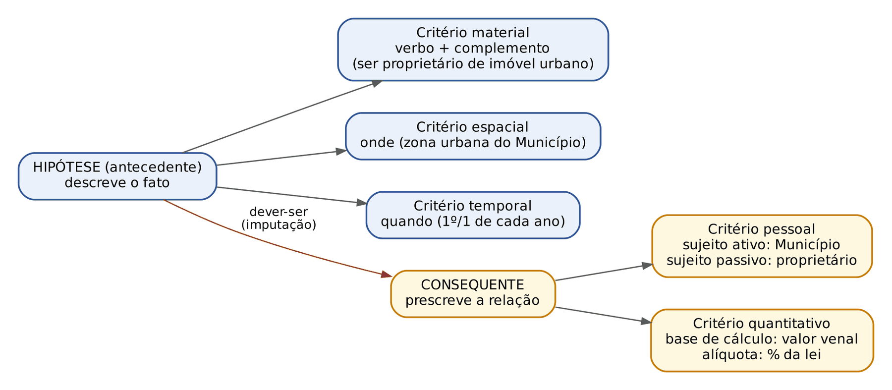
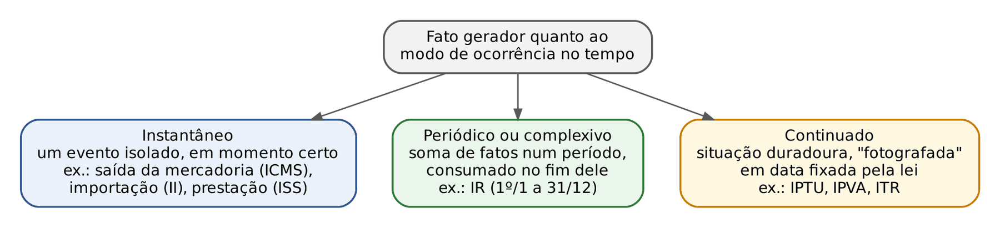
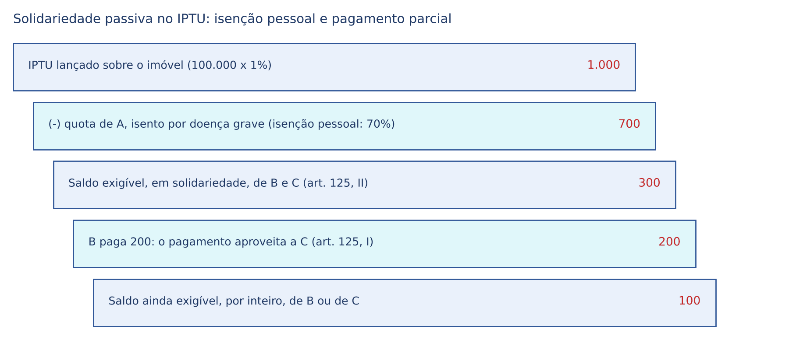
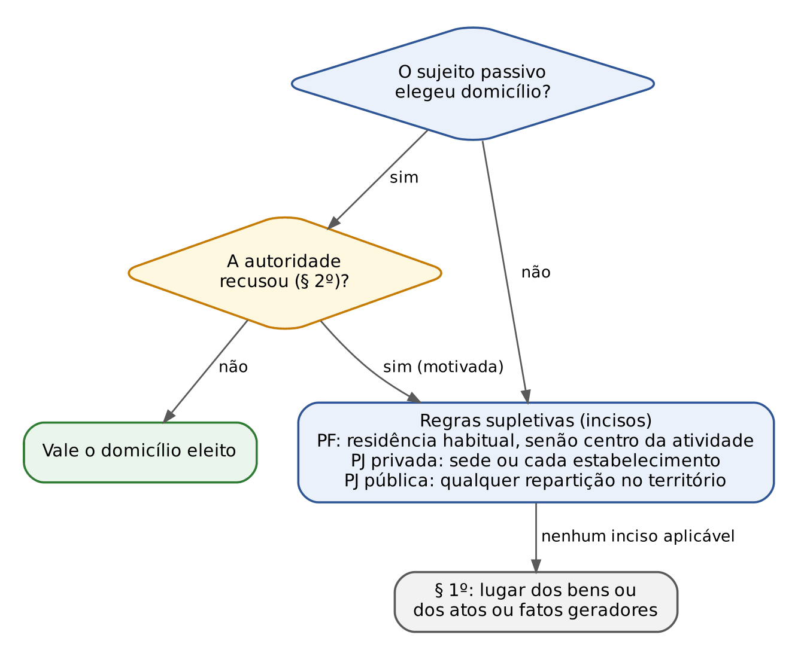
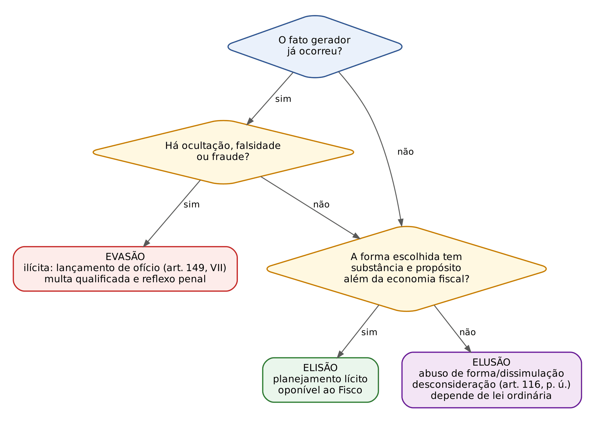

# CAPÍTULO 09 — OBRIGAÇÃO TRIBUTÁRIA E REGRA-MATRIZ DE INCIDÊNCIA: OBRIGAÇÃO PRINCIPAL E ACESSÓRIA, FATO GERADOR E SUAS CLASSIFICAÇÕES, BASE DE CÁLCULO E ALÍQUOTA, SUJEITOS ATIVO E PASSIVO, SOLIDARIEDADE, CAPACIDADE TRIBUTÁRIA, DOMICÍLIO; PLANEJAMENTO TRIBUTÁRIO, ELISÃO, EVASÃO E NORMA GERAL ANTIELISIVA

:::INCIDENCIA
Pontos: TRF5 p. 9; TJRS p. 4; TJSC p. 7, 8, 9 e 20 (este, só quanto a evasão e elisão). Nível A.
Lote: 30 questões (FGV 20, FCC 10).
O que mais cai: literalidade dos arts. 113 a 127 do CTN (conversão da acessória em principal, art. 118 e *pecunia non olet*, art. 123, solidariedade e domicílio) e a eficácia limitada da norma antielisiva (art. 116, parágrafo único; ADI 2.446).
:::

| Subtema | FGV | FCC | Padrão de cobrança |
|---|---|---|---|
| Obrigação principal x acessória | 8 | 4 | literalidade do art. 113; acessória autônoma (imunes, isentos, crédito suspenso); conversão em principal |
| Fato gerador, art. 118, presunções | 5 | 3 | conceito "necessária e suficiente"; situação de fato x jurídica; tributação do ilícito |
| Sujeito passivo, art. 123, capacidade | 4 | 2 | contribuinte x responsável; cláusula contratual inoponível; criança contribuinte |
| Solidariedade | 1 | 0 | efeitos do art. 125 (isenção pessoal, pagamento, regresso) |
| Domicílio tributário | 1 | 1 | eleição, recusa e regras supletivas do art. 127 |
| Norma antielisiva | 1 | 0 (e 2 alternativas) | dependência de lei ordinária; não autoriza analogia |

## 09.1 Norma jurídica tributária e regra-matriz de incidência

### 09.1.1 Por que estudar a "norma" antes da "obrigação"

O juiz cível encontra a obrigação no contrato. No tributário a vontade é irrelevante (a obrigação é *ex lege*): a lei descreve um fato; ocorrido o fato, nasce automaticamente o vínculo. O lançamento não cria a obrigação, apenas a formaliza e a torna exigível (Cap. 12). Por isso toda controvérsia tributária se decompõe em perguntas fixas: o fato descrito ocorreu? Onde e quando? Quem deve a quem? Quanto? A sentença tributária responde, no fundo, a uma delas.

Norma tributária em sentido amplo é qualquer norma sobre tributos; em sentido estrito, é a norma que institui o tributo (norma de incidência ou regra-matriz). A doutrina separa normas de estrutura (regulam a produção de outras normas: competência, imunidade, procedimento) e normas de comportamento (regulam condutas: a regra-matriz, os deveres instrumentais, as sanções).

### 09.1.2 Estrutura lógica da regra-matriz (Paulo de Barros Carvalho)

Paulo de Barros Carvalho propõe que toda norma de incidência tem a estrutura de um juízo hipotético-condicional: "se ocorrer o fato F, então deve ser a relação jurídica R". A primeira parte é a hipótese (antecedente, descritor); a segunda, o consequente (prescritor). O vínculo entre as duas não é de causalidade natural, mas de imputação: é o "dever-ser" que a lei estabelece.

- A hipótese tem três critérios:
  - material: um verbo e seu complemento, que descrevem um comportamento de pessoas ou uma situação (ser proprietário de imóvel urbano; auferir renda; prestar serviço; realizar operação de circulação de mercadoria). O verbo é sempre pessoal e de predicação incompleta; por isso o critério material nunca é "o imóvel", mas "ser proprietário do imóvel";
  - espacial: onde o fato deve ocorrer para ser relevante (zona urbana do Município; território nacional; estabelecimento do prestador);
  - temporal: o instante em que se considera ocorrido o fato e nascida a obrigação (1º de janeiro, para o IPTU na maioria das leis; saída da mercadoria do estabelecimento, para o ICMS; 31 de dezembro, para o IR).
- O consequente tem dois critérios:
  - pessoal: sujeito ativo (credor) e sujeito passivo (devedor);
  - quantitativo: base de cálculo e alíquota, que, combinadas, dão o valor da prestação.

:::DOUTRINA Terminologia: hipótese de incidência, fato gerador e fato imponível
O CTN usa "fato gerador" ora para a descrição legal (art. 114), ora para o acontecimento concreto (art. 113, § 1º). A doutrina separa: hipótese de incidência (Geraldo Ataliba) é a descrição legal; fato imponível ou fato jurídico tributário (Paulo de Barros Carvalho) é o evento ocorrido, como o tipo penal e o fato típico. Nas provas, a literalidade do art. 114 está certa; e "hipótese de incidência" refere-se sempre ao plano abstrato.
:::

:::QUESTAO FCC 2025 — PGE-TO — Procurador do Estado (Q3745568)
O enunciado distinguiu hipótese de incidência (descrição legal abstrata) e fato gerador (ocorrência concreta) e perguntou o que o CTN determina sobre a interpretação da "definição legal do fato gerador". Gabarito: B, deve ser interpretada abstraindo-se da validade jurídica dos atos efetivamente praticados (art. 118, I).
Armadilhas: a ordem de integração do art. 108 começa pela analogia e termina na equidade (Cap. 8); a interpretação literal do art. 111 não abrange o fato gerador; o art. 112 favorece o acusado só em infrações (Cap. 11).
:::

### 09.1.3 A regra-matriz montada: IPTU e ICMS

O quadro abaixo é o exercício que a banca TJSC (ponto 7) espera: preencher cada critério a partir do texto constitucional, do CTN e da lei do ente.

| Critério | IPTU (art. 156, I, da CF; arts. 32 a 34 do CTN) | ICMS-mercadorias (art. 155, II, da CF; LC 87/1996) |
|---|---|---|
| Material | ser proprietário, titular do domínio útil ou possuidor (com *animus domini*) de imóvel | realizar operação de circulação de mercadoria (negócio jurídico que transfere a titularidade) |
| Espacial | zona urbana do Município (art. 32, §§ 1º e 2º, do CTN) | território do Estado; em regra, o estabelecimento de onde sai a mercadoria |
| Temporal | data fixada na lei municipal (em geral, 1º/1 de cada exercício) | saída da mercadoria do estabelecimento (art. 12, I, da LC 87/1996) |
| Pessoal: ativo | Município | Estado (ou DF) |
| Pessoal: passivo | contribuinte: proprietário, titular do domínio útil ou possuidor (art. 34 do CTN) | contribuinte: quem realiza, com habitualidade ou em volume comercial, operações de circulação (art. 4º da LC 87/1996); responsáveis: substitutos (Cap. 10 e 27) |
| Quantitativo: base | valor venal do imóvel (art. 33 do CTN) | valor da operação (art. 13, I, da LC 87/1996) |
| Quantitativo: alíquota | percentual da lei municipal (admite progressividade; Cap. 29) | percentual da lei estadual, observadas as resoluções do Senado (Cap. 27) |

Os detalhes são dos Caps. 27 e 29. Aqui interessa o método: a regra-matriz mostra o que a lei pode fazer em cada critério e quando uma obrigação acessória extrapola a hipótese (09.2.4).

:::QUESTAO FGV 2024 — Câmara dos Deputados — Consultor Legislativo (Q2510940)
Itens: (I) a acessória decorre da principal e a substitui, de modo que pagar a multa por não declarar o IR afasta o dever de declarar; (II) o critério espacial representa a dimensão territorial da conduta, essencial para verificar competência e jurisdição; (III) o critério quantitativo compreende base de cálculo e alíquota, sendo vedadas alíquotas específicas. Gabarito: B (só II).
Por que: I erra duas vezes (a acessória não decorre da principal e o pagamento da multa não extingue o dever instrumental; ver 09.2.3); III erra porque a CF admite expressamente alíquotas específicas (art. 149, § 2º, III, b; art. 155, § 4º, IV, a; ver 09.4.2).
:::

## 09.2 A obrigação tributária: estrutura, principal e acessória

### 09.2.1 Elementos e diferença em relação ao direito civil

A relação obrigacional tributária tem os elementos que o civilista conhece: sujeito ativo (credor), sujeito passivo (devedor), objeto (a prestação) e causa (o vínculo que a justifica, que aqui é a lei somada ao fato gerador). As diferenças relevantes são três.

- Fonte: sempre a lei. Nenhuma convenção cria, modifica ou transfere a obrigação perante o Fisco (art. 123; ver 09.6.4).
- Objeto: a obrigação principal é sempre de dar dinheiro; a acessória é de fazer, não fazer ou tolerar.
- Acessoriedade: os termos "principal" e "acessória" NÃO têm o sentido civil de que o acessório segue o principal. A acessória tributária é instrumental (serve à fiscalização e à arrecadação), mas é autônoma: existe mesmo sem obrigação principal e não se extingue com ela.

:::LEI CTN, art. 113
Art. 113. A obrigação tributária é principal ou acessória.
§ 1º A obrigação principal surge com a ocorrência do fato gerador, tem por objeto o pagamento de tributo ou penalidade pecuniária e extingue-se juntamente com o crédito dela decorrente.
§ 2º A obrigação acessória decorre da legislação tributária e tem por objeto as prestações, positivas ou negativas, nela previstas no interêsse da arrecadação ou da fiscalização dos tributos.
§ 3º A obrigação acessória, pelo simples fato da sua inobservância, converte-se em obrigação principal relativamente à penalidade pecuniária.
:::

### 09.2.2 Obrigação principal: tributo OU penalidade

A obrigação principal tem por objeto o pagamento de tributo ou de penalidade pecuniária. A multa não é tributo (o art. 3º do CTN exclui da definição a sanção de ato ilícito; ver Cap. 1), mas a obrigação de pagá-la é tributária e principal. O legislador fez isso para submeter a cobrança da multa ao mesmo regime do tributo: lançamento, inscrição em dívida ativa, execução fiscal, garantias e privilégios. A equiparação não é total: na falência, a multa tributária fica abaixo dos créditos quirografários (art. 186, parágrafo único, III, do CTN, e art. 83 da Lei 11.101/2005; ver Cap. 18).

O critério, portanto, é o conteúdo patrimonial: se a prestação é pagar dinheiro ao Fisco, a obrigação é principal, seja tributo, seja multa (moratória ou punitiva), seja juros.

:::QUESTAO FCC 2025 — TRF4 — Analista Judiciário, Oficial de Justiça Avaliador Federal (Q3562229)
Pergunta seca: qual o conteúdo da obrigação principal segundo o CTN? Gabarito: A, tributo e penalidades pecuniárias (art. 113, § 1º).
Armadilha: "somente o tributo" é a resposta intuitiva de quem pensa no conceito de tributo do art. 3º. As demais alternativas (declaração de faturamento, envio de declaração, escrituração) descrevem obrigações acessórias.
No mesmo sentido: Q3289860 (FGV 2025, CFC; principal é pagar tributo, acessória é emitir notas e declarações) e a alternativa A da Q2466081 (FGV 2024, Câmara de Fortaleza), que errava ao chamar de acessória o pagamento de juros e mora.
:::

### 09.2.3 Obrigação acessória (deveres instrumentais)

A obrigação acessória tem por objeto prestações positivas (emitir nota fiscal, escriturar livros, entregar declarações, inscrever-se em cadastro) ou negativas (não transportar mercadoria sem documento, não rasurar a escrita, não embaraçar a fiscalização), no interesse da arrecadação ou da fiscalização. Parte da doutrina (Paulo de Barros Carvalho) prefere chamá-las de deveres instrumentais ou formais, porque não têm conteúdo patrimonial e, por isso, não seriam obrigações em sentido técnico. Para a prova, os termos são equivalentes.

Quatro traços são cobrados com frequência.

- Fonte normativa: a acessória decorre da "legislação tributária" (art. 113, § 2º), que abrange decretos e normas complementares (art. 96; Cap. 8); a principal exige lei (art. 97). Admite-se que o regulamento detalhe deveres instrumentais para a fiel execução da lei (art. 84, IV, da CF). É FALSO dizer que "legislação", aqui, significa só lei (Q2449775).
- Autonomia: a acessória existe sem tributo a pagar. Imunes mantêm escrita (art. 14, III) e se sujeitam à fiscalização (art. 194, § 1º, na redação da LC 236/2026); isenção e anistia não dispensam acessórias (art. 175, parágrafo único); a suspensão da exigibilidade também não (art. 151, § 1º, antigo parágrafo único, renumerado pela LC 236/2026).
- Sujeito passivo próprio: quem a legislação obriga (art. 122), ainda que sem relação com o fato gerador (fonte pagadora, cartório).
- Conversão em principal (art. 113, § 3º): a expressão é atécnica. O descumprimento é fato gerador de nova obrigação principal (a multa), e o dever instrumental NÃO desaparece: quem não entregou a declaração paga a multa e continua obrigado a entregá-la. Em prova, a literalidade do § 3º é considerada correta.

:::PEGADINHA Três inversões clássicas do art. 113
- "A obrigação principal converte-se em acessória" (Q3039632, alternativa C): é o contrário.
- "A acessória somente surge com o fato gerador da principal, pois ambas dependem do pagamento" (Q4338787, alternativa C): falso; a acessória tem fato gerador próprio (art. 115).
- "A inobservância da acessória extingue o dever instrumental e cria novo tributo" (Q4338787, alternativa A): falso duas vezes; multa não é tributo e o dever subsiste.
:::

:::QUESTAO FCC 2026 — SEFAZ-SP — Auditor Fiscal (Q3926879)
Caso: o estabelecimento vende (a) mercadoria isenta; (b) mercadoria tributada com exigibilidade suspensa por liminar em MS; (c) mercadoria sujeita a substituição tributária com retenção antecipada, sendo ele o substituto. Afirmou-se que ele (I) não está dispensado de emitir documentos fiscais na mercadoria isenta; (II) está dispensado na mercadoria com liminar; (III) está dispensado na mercadoria da ST, se provar a retenção. Gabarito: A (só I).
Passo a passo: a falta de tributo a pagar não dispensa o dever instrumental (autonomia). Isenção: art. 175, parágrafo único; liminar: art. 151, § 1º; ST: a retenção não elimina a emissão do documento. Só I está correta.
:::

:::QUESTAO FGV 2024 — Prefeitura de São José dos Campos — Técnico Tributário (Q2375638)
Gabarito: C, a fruição de imunidade não dispensa o cumprimento das acessórias nem a sujeição à fiscalização. Armadilhas: a multa NÃO é "subordinada" ao pagamento do tributo (A); a conversão em principal não tem a exceção inventada para acessórias "de natureza sancionatória" (B); terceiros também podem ser obrigados a deveres instrumentais (D); a entidade isenta pode ser obrigada a manter escrita (E).
No mesmo sentido: Q2449775 (FGV 2024, AL-PR; gabarito D: V, V, F; o terceiro item erra ao restringir "legislação" a lei); Q3538778 (FCC 2025, TRF4; gabarito D: a acessoriedade consiste em dar meio à fiscalização, e não em dependência ou subordinação à principal).
:::

:::QUESTAO FGV 2024 — Câmara de Fortaleza — Consultor Legislativo (Q2466081)
Gabarito: C, a responsabilidade pelo pagamento pode ser atribuída a quem descumpre o dever de reter e recolher o tributo devido por outrem. É a lógica do responsável por substituição na fonte (art. 128 do CTN; Cap. 10): o dever de reter é instrumental, mas sua inobservância gera responsabilidade pelo próprio tributo.
Armadilhas: B (acessória dependente da matriz e restrita a contribuinte ou responsável); D (o descumprimento "não" converte a acessória em principal, contra o § 3º); E (a acessória cairia com a inconstitucionalidade do tributo, ignorando sua base própria).
No mesmo sentido, quanto ao sujeito passivo da acessória que não deve o tributo: Q3851818 (FGV 2026, AMAZUL; gabarito B, autarquias e fundações federais informam na DIRF as retenções que fazem; ver a nota de verificação).
:::

:::QUESTAO FCC 2026 — PGM-Manaus — Procurador do Município (Q4338787)
Gabarito: E, a obrigação principal tem por objeto o pagamento de tributo ou penalidade, e a autoridade pode desconsiderar atos dissimulatórios mediante procedimento estabelecido em lei ordinária (arts. 113, § 1º, e 116, parágrafo único).
Armadilhas: B diz que convenções particulares modificam o sujeito passivo se atribuírem expressamente o dever a terceiro (art. 123; ver 09.6.4); D diz que o Fisco pode desconsiderar qualquer ato que reduza a carga, sem finalidade dissimulatória nem procedimento (ver 09.10). As alternativas A e C estão na PEGADINHA acima.
:::

### 09.2.4 Limites às obrigações acessórias

A liberdade do ente para criar deveres instrumentais não é ilimitada. Os limites cobrados são:

- Pertinência com a competência e com a regra-matriz: o ente só pode impor deveres relacionados aos tributos que pode cobrar e aos fatos que se passam no seu território. O STF, no Tema 1.020, declarou incompatível com a CF a norma que obriga o prestador de serviço NÃO estabelecido no Município a cadastrar-se no órgão municipal, sob pena de o tomador reter o ISS. A lei, a pretexto de criar uma acessória, deslocava o critério espacial do ISS e a sujeição passiva (o ISS, em regra, é devido no local do estabelecimento prestador; ver Cap. 28).
- Proporcionalidade das multas: as multas por descumprimento de deveres instrumentais sofrem os limites fixados pelo STF no Tema 487 (RE 640.452/RO, j. 17/12/2025) e, agora, os do art. 113-A do CTN, incluído pela LC 236/2026 (razoabilidade, proporcionalidade e tetos de 75%, 100% em fraude, sonegação ou conluio e 150% na reincidência, salvo multas isoladas desvinculadas de tributo); desenvolvimento no Cap. 11.
- Finalidade: o STJ (REsp 1.694.816/SC, j. 3/6/2025) afastou multa por erro na classificação fiscal de mercadoria importada que levou a recolhimento MAIOR que o devido, sem prejuízo à fiscalização ou à arrecadação: a acessória não é um fim em si mesmo.
- Proporcionalidade da nova acessória: o STF julgou constitucionais os arts. 43 e 44 da Lei 14.973/2024, que obrigam as pessoas jurídicas a declarar os benefícios fiscais usufruídos (DIRBI), com multas limitadas a 30% do benefício, por servirem à transparência e ao controle da renúncia de receita (ADI 7.765/DF, j. 20/10/2025).

:::QUESTAO FGV 2024 — Prova não identificada no banco (Q3157908)
Caso: o Município Y obriga prestadores estabelecidos em outros Municípios a se cadastrarem na sua Secretaria de Finanças, sob pena de o tomador situado em Y reter o ISS. Gabarito: B, a lei é inconstitucional (Tema 1.020 do STF).
Armadilha: as alternativas que fundamentam a validade na "autonomia municipal" ou no "controle e fiscalização" (A e D) usam o argumento que o STF rejeitou: a acessória não pode servir para alterar a sujeição passiva e o critério espacial do imposto.
Correlata: Q2387027 (FGV 2024, TJSC, Juiz Substituto; mesmo caso, gabarito A: a lei viola o critério espacial e a sujeição passiva do ISS).
:::

:::JURIS STF, Tema 1.020 (RE 1.167.509/SP, j. 27/2/2021)
É incompatível com a Constituição Federal disposição normativa a prever a obrigatoriedade de cadastro, em órgão da Administração municipal, de prestador de serviços não estabelecido no território do Município e imposição ao tomador da retenção do Imposto Sobre Serviços – ISS quando descumprida a obrigação acessória.
:::

:::SENTENCA Obrigação acessória em embargos e em mandado de segurança
Onde entra: MS contra exigência de dever instrumental e embargos à execução de multa isolada. Fundamentar: base normativa do dever (art. 113, § 2º); pertinência com a competência e com a regra-matriz; proporcionalidade da multa (Tema 487; Cap. 11).
Redação-modelo: "A obrigação acessória, embora possa ser instituída pela legislação tributária (art. 113, § 2º, do CTN), não pode, a pretexto de facilitar a fiscalização, alterar o critério espacial e a sujeição passiva do imposto, conforme fixado pelo Supremo Tribunal Federal no Tema 1.020 da repercussão geral."
Erro comum que a banca pune: concluir que a imunidade, a isenção ou a liminar dispensam os deveres instrumentais; ou aceitar a tese de que, paga a multa, o dever de declarar desaparece.
:::

## 09.3 Fato gerador (arts. 114 a 118 do CTN)

### 09.3.1 Conceito: situação necessária e suficiente

Fato gerador da obrigação principal é "a situação definida em lei como necessária e suficiente à sua ocorrência" (art. 114). Necessária, porque sem ela a obrigação não nasce; suficiente, porque, presente ela, nada mais se exige. A entrada de mercadoria no território nacional é necessária para o imposto de importação, mas não suficiente: a mercadoria precisa ser estrangeira. Por isso a assertiva que define o fato gerador como situação apenas "necessária" está errada.

Fato gerador da obrigação acessória é "qualquer situação que, na forma da legislação aplicável, impõe a prática ou a abstenção de ato que não configure obrigação principal" (art. 115). Exemplo: ter, em 31 de dezembro, bens acima do limite fixado na legislação do IR faz nascer o dever de entregar a declaração no ano seguinte, ainda que não haja imposto a pagar.

Note a assimetria cobrada: o fato gerador da principal está "definido em lei" (reserva legal, art. 97, III); o da acessória decorre da "legislação aplicável".

:::QUESTAO FCC 2026 — PGM-Manaus — Procurador do Município (Q4338773)
Gabarito: E, reprodução combinada dos arts. 114 e 115.
Armadilhas: B condiciona a incidência à validade jurídica e à licitude dos atos (contraria o art. 118); C atribui à obrigação PRINCIPAL o conceito de fato gerador da acessória (prestação positiva ou negativa); D troca os incisos do art. 116 (situação de fato com "definitivamente constituída" e situação jurídica com "circunstâncias materiais"); A trata da norma antielisiva como se autorizasse desconsiderar qualquer ato que dificulte a arrecadação.
No mesmo sentido: Q3039632 (FGV 2024, Nova Iguaçu, Auditor Fiscal; gabarito B, a definição legal do fato gerador é interpretada abstraindo-se dos efeitos dos fatos efetivamente ocorridos, art. 118, II; a alternativa A transcreve o art. 115 como se fosse o fato gerador da principal; a E chama de sujeito ativo quem é obrigado ao pagamento).
:::

### 09.3.2 Momento da ocorrência: situação de fato x situação jurídica

O critério temporal é decisivo: fixa a lei aplicável ao fato (art. 144, que é do Cap. 12), a taxa de câmbio (art. 143), o termo inicial de anterioridades e de decadência (Caps. 5 e 15) e quem é o sujeito passivo. Na falta de regra específica na lei do tributo ("salvo disposição de lei em contrário"), o art. 116 separa dois grupos.

:::LEI CTN, art. 116, caput e incisos
Art. 116. Salvo disposição de lei em contrário, considera-se ocorrido o fato gerador e existentes os seus efeitos:
I - tratando-se de situação de fato, desde o momento em que o se verifiquem as circunstâncias materiais necessárias a que produza os efeitos que normalmente lhe são próprios;
II - tratando-se de situação jurídica, desde o momento em que esteja definitivamente constituída, nos têrmos de direito aplicável.
:::

- Situação de fato: acontecimento sem disciplina jurídica própria antes da lei tributária (entrada física da mercadoria estrangeira). Ocorre com as circunstâncias materiais; a lei pode fixar outro momento (no II, o registro da declaração de importação; Cap. 25).
- Situação jurídica: instituto já regulado por outro ramo (propriedade, transmissão). Ocorre quando "definitivamente constituída" segundo o direito aplicável, normalmente o civil. Aqui o juiz cível tem vantagem: a transmissão de imóvel só se completa com o registro (art. 1.245 do CC), e por isso o ITBI só incide com o registro (Tema 1.124 do STF; Cap. 29).

### 09.3.3 Negócios condicionais (art. 117)

O art. 117 aplica ao direito tributário a classificação civil das condições (arts. 121 a 130 do CC), sempre "salvo disposição de lei em contrário":

| Condição | Efeito no negócio (CC) | Momento do fato gerador (art. 117) | Exemplo |
|---|---|---|---|
| Suspensiva | o direito não se adquire enquanto não verificada (art. 125 do CC) | com o implemento da condição | doação de imóvel "se o donatário se casar": o ITCMD só nasce com o casamento (e, sendo imóvel, com o registro) |
| Resolutiva | o negócio produz efeitos desde logo e se desfaz com o evento (art. 127 do CC) | desde a prática do ato ou a celebração do negócio | doação com cláusula de reversão em caso de divórcio: o imposto nasce na doação; o divórcio posterior não gera restituição nem nova incidência |

Não confunda condição (evento futuro e incerto) com termo (evento futuro e certo): o termo não suspende a aquisição do direito (art. 131 do CC).

### 09.3.4 Classificações do fato gerador

A classificação cobrada é quanto ao modo de ocorrência no tempo.

- Instantâneo: um evento isolado, que ocorre em momento certo e se esgota nele; cada repetição gera nova obrigação (cada saída de mercadoria, cada importação, cada prestação de serviço).
- Periódico ou complexivo (complexo): formado por uma sucessão de fatos ao longo de um período, que a lei considera em conjunto e dá por consumado ao fim dele. O exemplo é o IR: os rendimentos de 1º/1 a 31/12 formam um único fato gerador, que se completa no último dia do período. Daí o antigo debate sobre aplicar ao IR a lei publicada até o último dia do período (ou mesmo a vigente no exercício da declaração), que envolve irretroatividade e anterioridade (ver Cap. 5).
- Continuado (duradouro): situação estável que se prolonga no tempo e que a lei "fotografa" em data fixa, normalmente uma vez por exercício (propriedade de imóvel, de veículo, de terra rural).

A classificação em fatos geradores vinculados (atuação estatal: taxas, contribuição de melhoria) e não vinculados (fato do contribuinte: impostos) é a base das espécies tributárias (Cap. 2).

### 09.3.5 Efeitos do fato gerador

Ocorrido o fato gerador, produzem-se os seguintes efeitos, cada um estudado no capítulo próprio:

- nasce a obrigação tributária principal, ainda ilíquida e inexigível; o crédito só se constitui com o lançamento (Cap. 12);
- fica definida a legislação material aplicável ao lançamento (art. 144) e a taxa de câmbio (art. 143);
- identifica-se a natureza jurídica específica do tributo, dada pelo fato gerador, e não pela denominação (art. 4º do CTN; Cap. 1; correlata Q4067501, FCC 2026: "ICMS-Circulação Única" sobre a propriedade de relógios é, na verdade, imposto sobre propriedade fora da competência estadual);
- fixam-se o sujeito passivo (quem tinha relação pessoal e direta com o fato naquele momento) e o termo de referência para decadência (Cap. 15).

### 09.3.6 Fato gerador presumido e presunções

O art. 150, § 7º, da CF permite que a lei atribua a sujeito passivo a responsabilidade pelo pagamento de imposto ou contribuição cujo fato gerador deva ocorrer posteriormente (substituição tributária "para frente"), assegurada a imediata e preferencial restituição se o fato gerador presumido não se realizar. Do ângulo deste capítulo, o ponto é que a regra-matriz admite, por autorização constitucional, a antecipação do critério temporal e uma base de cálculo estimada. A disciplina da substituição para frente, a restituição quando a base efetiva for menor que a presumida (Tema 201 do STF) e a mecânica de cálculo ficam no Cap. 27 (ICMS-ST) e no Cap. 10 (substituição como espécie de responsabilidade).

As presunções também aparecem na construção da base de cálculo e na prova do fato gerador. A doutrina distingue:

| Figura | O que é | Exemplo |
|---|---|---|
| Presunção simples (humana, *hominis*) | raciocínio do aplicador que, a partir de fatos conhecidos e da experiência comum, conclui pela ocorrência de outro fato | o fiscal infere omissão de receita a partir de indícios convergentes |
| Presunção legal relativa (*iuris tantum*) | a lei estabelece a conclusão, admitindo prova em contrário | depósitos bancários de origem não comprovada como receita omitida (art. 42 da Lei 9.430/1996) |
| Presunção legal absoluta (*iuris et de iure*) | a lei estabelece a conclusão e veda prova em contrário | rara e criticada em matéria tributária |
| Ficção jurídica | a lei atribui a um fato consequências que sabe não corresponderem à realidade, criando uma "verdade jurídica" diversa | equiparações legais (o estabelecimento "considerado" autônomo) |

:::QUESTAO FCC 2025 — TRF4 — Analista Judiciário, Oficial de Justiça Avaliador Federal (Q3562233)
Pergunta: o que são as presunções humanas na definição do fato gerador? Gabarito: E, as que, a partir de observação empírica, estabelecem determinado raciocínio.
Armadilhas: "negam conscientemente a ocorrência de um fato real" e "constroem realidade jurídica diversa da fática" (A e B) descrevem a ficção; "com base em definição legal, concluem pela ocorrência do fato gerador" (D) descreve a presunção legal.
:::

### 09.3.7 Interpretação objetiva do fato gerador e *pecunia non olet* (art. 118)

:::LEI CTN, art. 118
Art. 118. A definição legal do fato gerador é interpretada abstraindo-se:
I - da validade jurídica dos atos efetivamente praticados pelos contribuintes, responsáveis, ou terceiros, bem como da natureza do seu objeto ou dos seus efeitos;
II - dos efeitos dos fatos efetivamente ocorridos.
:::

A regra manda olhar para o fato tal como ocorreu, sem perguntar se o negócio é válido no direito civil, se o objeto é lícito ou se os efeitos se concretizaram. Para o juiz cível, é o ponto de maior estranhamento: um contrato nulo por incapacidade do agente ou por ilicitude do objeto (art. 104 do CC) pode perfeitamente gerar tributo, porque o que se tributa é a manifestação de riqueza, e não o negócio. Duas consequências práticas:

- Atos inválidos: a venda feita por pessoa incapaz gera ITBI se houve a transmissão; a sociedade irregular paga tributos (art. 126, III; ver 09.8).
- Atos ilícitos: a renda do tráfico, da corrupção ou do jogo ilegal é tributável. É o princípio do *pecunia non olet* ("o dinheiro não tem cheiro"), atribuído ao imperador Vespasiano. O STF, ao julgar caso de tráfico de entorpecentes (HC 77.530/RS), entendeu que tributar o resultado econômico de atividade criminosa não agride a moralidade; ao contrário, decorre da isonomia fiscal, pois seria injusto cobrar de quem trabalha honestamente e "imunizar" o criminoso.

A conciliação com o art. 3º do CTN, segundo o qual tributo não é sanção de ato ilícito, está na distinção entre a hipótese e o fato. A HIPÓTESE de incidência não pode descrever um ato ilícito (a lei não pode criar um "imposto sobre o tráfico"); mas o FATO concreto que se subsume a uma hipótese lícita (auferir renda) é tributado ainda que tenha origem ilícita. O imposto de renda não incide sobre o tráfico; incide sobre o acréscimo patrimonial que o traficante obteve.

:::QUESTAO FGV 2025 — SEFAZ-PR — Auditor Fiscal (Q3363399)
Itens: (I) o STF admite tributar renda de atividade ilícita, pois o tributo não é sanção, mas arrecadação sobre o lucro, qualquer que seja a fonte; (II) segundo o STJ, abstrai-se da validade dos atos, considerando a expressão econômica do fato; (III) flagrado o ilícito durante a execução (contrabando, descaminho), não deveria haver tributação, mas penas administrativas como o perdimento. Gabarito oficial: B (I e II).
Comentário: I e II aplicam o art. 118; III foi tido por falso pela generalização. É discutível no descaminho, porque o imposto de importação não incide sobre mercadoria objeto de pena de perdimento, salvo se não localizada, consumida ou revendida (art. 1º, § 4º, III, do DL 37/1966).
No mesmo sentido: Q3841696 (FGV 2025, Abreu e Lima, Procurador; gabarito C, a tributação de rendimentos do tráfico decorre do *pecunia non olet*); Q2565250 (FGV 2024, TCE-PA; gabarito C, tributa-se o acréscimo patrimonial, e não o tráfico; erradas as alternativas que exigem validade dos atos ou demonstração da ilicitude penal, ou que veem "exoneração" do produto do crime).
:::

:::QUESTAO FGV 2025 — TCE-RR — Auditor de Controle Externo (Q3186484)
Caso de identificação de fatos geradores: João, aposentado, vende seu imóvel com os móveis, transfere vultosos recursos ao filho e doa terreno à namorada do filho, em contemplação de casamento futuro. Gabarito: D, podem incidir, em tese, IRPF sobre o ganho de capital na venda do imóvel e ITCMD sobre os recursos transferidos ao filho.
Passo a passo: para cada fato, pergunte que hipótese ele realiza. Venda onerosa de imóvel: ITBI e IR sobre ganho de capital; doação: ITCMD, não ITBI; móveis usados vendidos por pessoa física sem habitualidade: não há ICMS; pessoa física não paga PIS/COFINS. A doação em contemplação de casamento futuro (art. 546 do CC) atrai ITCMD quando implementada a condição (art. 117, I).
:::

## 09.4 Critério quantitativo: base de cálculo e alíquota

### 09.4.1 Base de cálculo

Base de cálculo é a grandeza que a lei toma para dimensionar o fato gerador: o valor venal do imóvel, o valor da operação, a renda líquida, o número de unidades. Multiplicada pela alíquota (ou associada a ela), dá o montante do tributo. Paulo de Barros Carvalho atribui à base três funções:

- mensuradora: mede a intensidade do fato descrito no critério material (quanto vale a propriedade, quanto valeu a operação);
- objetiva: compõe, com a alíquota, a determinação concreta da dívida;
- comparativa: confirma, infirma ou afirma o verdadeiro critério material. Se a lei diz instituir imposto sobre a renda, mas toma como base o faturamento, a base denuncia que o tributo real é outro. É por essa função que a base de cálculo é, ao lado do fato gerador, o binômio que revela a natureza do tributo, e é por ela que se identifica a taxa com base própria de imposto, vedada pelo art. 145, § 2º, da CF (ver Cap. 2).

A base está sob reserva de lei (art. 97, IV, e § 1º, do CTN), mas a atualização monetária não é majoração (art. 97, § 2º; Caps. 5 e 29); nos impostos discriminados na CF, é definida em lei complementar de normas gerais (art. 146, III, a; Cap. 1).

### 09.4.2 Alíquota

Alíquota é o critério legal que, aplicado à base, fornece o valor devido. Pode ser:

| Espécie | Como funciona | Exemplo |
|---|---|---|
| *Ad valorem* | percentual sobre uma base expressa em dinheiro | ICMS de 17% sobre o valor da operação |
| Específica | valor fixo em dinheiro por unidade de medida (litro, quilo, maço) | CIDE-combustíveis em reais por metro cúbico; ICMS monofásico sobre combustíveis |
| Progressiva | cresce à medida que cresce a base | IR (tabela por faixas); IPTU e ITR progressivos (Caps. 24, 25 e 29) |
| Seletiva | varia conforme a essencialidade do bem | IPI (obrigatória) e ICMS (Caps. 25 e 27) |

A CF autoriza expressamente as alíquotas específicas para as contribuições sociais e de intervenção no domínio econômico (art. 149, § 2º, III, b) e para o ICMS monofásico sobre combustíveis (art. 155, § 4º, IV, a). Por isso está errada a afirmação de que são vedadas (Q2510940, item III).

Alíquota zero é a técnica de manter a hipótese de incidência e a base intactas, mas fixar em zero o percentual: o fato gerador ocorre, a obrigação nasce e seu valor é nulo. Difere da isenção, em que a lei exclui o crédito (art. 175, I; Cap. 17), e da não incidência, em que o fato está fora da hipótese. Tem relevância prática porque o Poder Executivo pode reduzir a zero (e restabelecer) as alíquotas dos impostos extrafiscais do art. 153, § 1º (II, IE, IPI, IOF), sem lei, o que não pode fazer com a isenção (Cap. 5). O quadro comparativo completo entre imunidade, isenção, não incidência e alíquota zero está no Cap. 6.

## 09.5 Sujeito ativo (arts. 119 e 120)

Sujeito ativo é "a pessoa jurídica de direito público, titular da competência para exigir o seu cumprimento" (art. 119). Três observações bastam para a prova.

- Competência x capacidade ativa: a competência (instituir por lei) é indelegável; a capacidade ativa (arrecadar, fiscalizar, executar a legislação) é delegável a outra pessoa jurídica de direito público (art. 7º), que passa a ocupar o polo ativo. A mera função de arrecadar pode ser cometida a pessoas de direito privado, como bancos (art. 7º, § 3º). Desenvolvimento e parafiscalidade: Cap. 4.
- Só pessoa jurídica de direito público: empresa pública, sociedade de economia mista, serviço social autônomo e o simples destinatário da arrecadação não são sujeitos ativos.
- Desmembramento (art. 120): o novo ente sub-roga-se nos direitos do originário e aplica a legislação deste até editar a própria, salvo lei em contrário.
- Em regra não há solidariedade ativa, pela rígida repartição de competências (peculiaridade do Simples Nacional: Cap. 31).

:::PROCESSO Quem é o réu na ação do contribuinte
A identificação do sujeito ativo define a legitimidade passiva nas ações de repetição de indébito, declaratórias e anulatórias: réu é quem detém a capacidade tributária ativa, e não o simples destinatário da receita (Súmula 666 do STJ, sobre contribuições de terceiros; v. Cap. 1). Legitimidade e competência nas ações tributárias: Cap. 23.
:::

:::QUESTAO FGV 2024 — Prefeitura de Nova Iguaçu — Analista Tributário (Q3038853)
O enunciado decompôs a obrigação em causa, prestação e partes e afirmou: (I) a causa é a subsunção do fato à hipótese de incidência; (II) a principal tem por objeto dar dinheiro ou prestar algum serviço ao Estado, e a acessória visa ao interesse arrecadatório; (III) o sujeito ativo pode ser da administração direta ou indireta, inclusive empresa pública e sociedade de economia mista, e o sujeito passivo é o devedor, a quem se pode chamar de contribuinte. Gabarito: C (só I).
Onde estão os erros: II, porque a obrigação principal nunca é "prestar serviço" (é pagar tributo ou penalidade); III, porque sujeito ativo é sempre pessoa jurídica de DIREITO PÚBLICO (art. 119) e porque o sujeito passivo não se resume ao contribuinte (há o responsável, art. 121, parágrafo único, II).
:::

## 09.6 Sujeito passivo (arts. 121 a 123)

### 09.6.1 Contribuinte e responsável

Sujeito passivo da obrigação principal é a pessoa obrigada ao pagamento de tributo ou penalidade pecuniária (art. 121). O parágrafo único separa duas espécies, a partir de uma única pergunta: a pessoa tem relação pessoal e direta com a situação que constitui o fato gerador?

- Sim: contribuinte (sujeito passivo direto), quem manifesta a riqueza tributada (o proprietário no IPTU, o titular da renda no IR).
- Não, mas a lei o obriga expressamente: responsável (sujeito passivo indireto), terceiro vinculado ao fato (art. 128): a fonte pagadora que retém o IR, o adquirente do imóvel (art. 130), o administrador com excesso de poderes (art. 135). As espécies de responsabilidade são do Cap. 10.

Também o contribuinte depende de definição legal. O STJ já afirmou que o juiz não pode ampliar o conceito legal de sujeito passivo para alcançar todo um grupo econômico (REsp 1.232.968/SC, citado por Ricardo Alexandre), e, em repetitivo de 2026, afastou o salário-educação da pessoa física titular de serventia notarial ou registral por não se enquadrar no conceito legal de contribuinte (Tema 1.228 do STJ; ver Cap. 3). Grupo econômico e responsabilidade: Cap. 10.

:::LEI CTN, art. 121
Art. 121. Sujeito passivo da obrigação principal é a pessoa obrigada ao pagamento de tributo ou penalidade pecuniária.
Parágrafo único. O sujeito passivo da obrigação principal diz-se:
I - contribuinte, quando tenha relação pessoal e direta com a situação que constitua o respectivo fato gerador;
II - responsável, quando, sem revestir a condição de contribuinte, sua obrigação decorra de disposição expressa de lei.
:::

:::QUESTAO FCC 2024 — TRF3 — Analista Judiciário, Área Judiciária (Q2564502)
Pergunta: segundo o CTN, quem é o responsável tributário? Gabarito: D, aquele que, sem revestir a condição de contribuinte, tem obrigação decorrente de disposição expressa de lei, como o adquirente de imóvel, pessoalmente responsável pelos tributos relativos ao bem não quitados (art. 130).
Armadilhas: A exige "lei complementar" e dá exemplo de contribuinte (a indústria no IPI); B, C e E usam a definição de contribuinte.
:::

:::QUESTAO FGV 2024 — TCE-PA — Auditor de Controle Externo (Q2565252)
Caso: o Estado X executa IPVA contra a pessoa jurídica Y, proprietária dos veículos, e contra o administrador João, que agiu com excesso de poderes. Qual a posição de cada um? Gabarito: D, Estado X é sujeito ativo; Y, sujeito passivo contribuinte; João, sujeito passivo responsável.
Passo a passo: credor é o ente competente (art. 119); o proprietário tem relação pessoal e direta com o fato gerador (contribuinte); o administrador não o realizou, mas a lei o obriga pelo excesso de poderes (art. 135, III; responsável; Cap. 10).
:::

### 09.6.2 Contribuinte de direito e contribuinte de fato

Nos tributos indiretos, o contribuinte de direito (o comerciante) integra a relação e paga; o contribuinte de fato (o consumidor) suporta o ônus embutido no preço, mas NÃO é sujeito passivo. Repercussões: restituição e art. 166 (Cap. 16); imunidade e contribuinte de fato (Cap. 6).

:::QUESTAO FGV 2024 — Câmara dos Deputados — Consultor de Orçamento (Q2512328)
Uma criança de 10 anos é proprietária de imóvel urbano, recebido em doação do avô e registrado em seu nome. Gabarito: A, ela é contribuinte de direito do IPTU.
Por que: é a proprietária (relação pessoal e direta) e a capacidade passiva independe da civil (art. 126, I; 09.8). Pais ou tutores podem ser responsáveis (art. 134, I e II; Cap. 10), não contribuintes; o avô não tem mais relação com o fato gerador; "contribuinte de fato" é categoria dos tributos indiretos.
:::

### 09.6.3 Sujeito passivo da obrigação acessória (art. 122)

É a pessoa obrigada às prestações que constituem o objeto da acessória. Não precisa ser contribuinte nem responsável pelo tributo: o tabelião que deve informar as operações imobiliárias, a instituição financeira que presta informações, a entidade imune que mantém escrita. Sobre a autonomia da acessória, ver 09.2.3.

### 09.6.4 Convenções particulares (art. 123)

:::LEI CTN, art. 123
Art. 123. Salvo disposições de lei em contrário, as convenções particulares, relativas à responsabilidade pelo pagamento de tributos, não podem ser opostas à Fazenda Pública, para modificar a definição legal do sujeito passivo das obrigações tributárias correspondentes.
:::

A cláusula do contrato de locação que atribui ao locatário o pagamento do IPTU, ou a do contrato de prestação de serviços que transfere ao tomador o ISS do prestador, é válida ENTRE AS PARTES (direito civil), mas é inoponível ao Fisco. Se o locatário não paga, o Município cobra do proprietário (contribuinte), que terá ação de regresso contra o locatário na esfera cível. O mesmo vale para o edital de leilão: a previsão de que o arrematante assume os débitos anteriores não modifica a sujeição passiva definida no art. 130, parágrafo único, do CTN (Tema 1.134 do STJ; ver Cap. 10).

Duas sutilezas:

- A ressalva "salvo disposições de lei em contrário" permite que a própria lei tributária dê eficácia a convenções particulares; é raro e não se presume.
- O locatário não é sequer contribuinte do IPTU: a posse que gera a incidência é a com ânimo de dono (posse *ad usucapionem*), e não a posse direta decorrente de contrato (Cap. 29). Por isso a alternativa que coloca locador e locatário como devedores solidários "porque um é proprietário e o outro possuidor" está errada.

:::QUESTAO FGV 2025 — SEFAZ-PR — Auditor Fiscal (Q3363405)
Caso: contrato de prestação de serviços atribui à contratante (tomadora) o pagamento de todos os tributos, inclusive o ISS devido pela prestadora; a prestadora emite a nota e não recolhe; autuada, alega a cláusula. Gabarito: E, a alegação não vale perante o Fisco; as convenções particulares não podem ser opostas à Fazenda e a prestadora continua contribuinte.
Armadilhas: a cláusula não cria responsável solidário (C) nem substituição tributária "para frente" (B), porque responsabilidade tributária só nasce da lei (art. 121, II, e art. 128); o direito de regresso existe, mas é contratual, e não "por força da solidariedade tributária" (D).
No mesmo sentido: Q3038854 (FGV 2024, Nova Iguaçu; locação com cláusula de IPTU a cargo da locatária; gabarito D: o sujeito passivo é o proprietário, João, qualquer que seja o contrato, art. 123).
:::

:::SENTENCA A cláusula contratual nos embargos à execução fiscal
Onde entra: embargos, exceção de pré-executividade ou anulatória em que o proprietário ou prestador alega que o débito é do locatário ou do tomador por contrato.
Redação-modelo: "A cláusula contratual que transfere ao locatário o pagamento do IPTU produz efeitos apenas entre as partes e não pode ser oposta à Fazenda Pública para modificar a definição legal do sujeito passivo (art. 123 do CTN), ressalvado ao embargante o direito de regresso, a ser exercido nas vias próprias."
Erro comum: extinguir a execução por ilegitimidade passiva do proprietário, ou determinar a "substituição" do executado pelo locatário. Também é erro aplicar a lógica civil da assunção de dívida (art. 299 do CC), que exige consentimento do credor: o Fisco não pode consentir, porque a sujeição passiva é matéria de lei.
:::

## 09.7 Solidariedade (arts. 124 e 125)

### 09.7.1 Hipóteses

:::LEI CTN, arts. 124 e 125
Art. 124. São solidàriamente obrigadas:
I - as pessoas que tenham interêsse comum na situação que constitua o fato gerador da obrigação principal;
II - as pessoas expressamente designadas por lei.
Parágrafo único. A solidariedade referida neste artigo não comporta benefício de ordem.
Art. 125. Salvo disposição de lei em contrário, são os seguintes os efeitos da solidariedade:
I - o pagamento efetuado por um dos obrigados aproveita aos demais;
II - a isenção ou remissão de crédito exonera todos os obrigados, salvo se outorgada pessoalmente a um dêles, subsistindo, nesse caso, a solidariedade quanto aos demais pelo saldo;
III - a interrupção da prescrição, em favor ou contra um dos obrigados, favorece ou prejudica aos demais.
:::

No direito civil, a solidariedade "não se presume; resulta da lei ou da vontade das partes" (art. 265 do CC). No tributário, só resulta da lei: ou do próprio CTN (inciso I) ou da lei de cada tributo (inciso II). A vontade das partes é irrelevante (art. 123).

- Solidariedade natural (inciso I): interesse comum é a posição conjunta no mesmo polo da situação tributada (coproprietários no IPTU; coprestadores de um único serviço no ISS), e não qualquer interesse econômico no resultado. Partes em lados opostos do negócio (comprador e vendedor) têm interesses contrapostos. O STJ é rigoroso:
  - não há solidariedade entre o banco e a empresa de arrendamento mercantil do mesmo grupo pelo ISS do *leasing* contratado entre esta e o arrendatário, pois o banco não integrou a prestação (REsp 884.845/SC);
  - a declaração conjunta de IR pelos cônjuges não basta para fazê-los solidários quanto à renda omitida por um deles; seria necessária a participação ativa de ambos na produção do fato gerador (REsp 1.273.396/DF).
- Solidariedade legal (inciso II): a lei do ente competente pode designar outros solidários, respeitado o vínculo com o fato gerador (art. 128) e as normas gerais do CTN (o STF invalidou a solidariedade genérica dos sócios de limitadas por débitos previdenciários: RE 562.276, Tema 13; Cap. 10). Decreto não pode criá-la (correlatas Q3882058 e Q2448969, IPVA do antigo proprietário que não comunica a venda; ver Cap. 10).

A responsabilidade de empresas do mesmo grupo econômico, que o STJ não admite pela mera participação no grupo, sem interesse comum no fato gerador ou previsão legal específica, é desenvolvida no Cap. 10, que trata também da alteração do art. 124, I, vetada na LC 236/2026 (o dispositivo mantém a redação original).

:::QUESTAO FGV 2024 — Prefeitura de São José dos Campos — Técnico Tributário (Q2375625, correlata do Cap. 10)
Caso: casal faz declaração conjunta de IR, omitindo rendimento recebido pelo marido por serviços prestados; a Receita autua o casal. Gabarito: C, a corresponsabilidade só se caracteriza quando há interesse comum na situação que constitui o fato gerador. Erradas: a solidariedade "de terceiro sem relação com o fato gerador" (A), a tese de que usufruir da renda torna o outro cônjuge corresponsável (B) e a criação administrativa de novas hipóteses de obrigação (D).
:::

### 09.7.2 Características e efeitos

- Sem benefício de ordem: o Fisco cobra a totalidade de qualquer coobrigado; a cota interna é irrelevante para ele.
- Pagamento (art. 125, I): o parcial de um reduz a dívida de todos.
- Isenção e remissão (art. 125, II): objetivas exoneram todos; pessoais excluem só o beneficiado e sua parcela, ficando os demais solidários pelo saldo.
- Prescrição (art. 125, III): a interrupção contra um coobrigado (por exemplo, o despacho que ordena sua citação) alcança todos (Cap. 15).
- Regresso: quem paga pode cobrar dos demais as respectivas quotas, mas essa é relação de DIREITO CIVIL (art. 283 do CC), alheia ao Fisco.
- Parcelamento: o pedido de parcelamento feito por um dos devedores solidários não implica renúncia do Fisco à solidariedade quanto aos demais (REsp 1.978.780/SP; v. Cap. 13).

:::EXEMPLO Três coproprietários, uma isenção pessoal e um pagamento parcial
Imóvel de valor venal 100.000 (cem mil) reais, alíquota de 1%: IPTU de 1.000 (mil) reais. A (70%) tem isenção pessoal; B tem 20%; C, 10%. B e C ficam solidários por 300 (trezentos) reais; B paga 200 (duzentos) reais, que aproveitam a C; os 100 (cem) reais restantes são exigíveis por inteiro de qualquer dos dois. Ordenada a citação de C na execução, a prescrição se interrompe também contra B.

:::

:::QUESTAO FGV 2024 — Câmara dos Deputados — Consultor Legislativo (Q2510939)
Caso: cinco coproprietários, cada um com 20% de um prédio; E é isento por doença. Afirmações: (1) a Prefeitura lançou o IPTU já descontada a parcela isenta de E; se A paga o valor lançado, a obrigação se extingue para os demais; (2) a isenção de E não se comunica aos outros; (3) o valor pode ser exigido de qualquer coobrigado e quem paga não tem direito de regresso. Gabarito: D (V, V, F).
Passo a passo: (1) art. 125, I; (2) art. 125, II, isenção pessoal; (3) sem benefício de ordem, sim, mas o regresso existe no plano civil (art. 283 do CC): "irrelevante para o Fisco" não é "inexistente".
:::

:::DICA Civil x tributário na solidariedade
- Fonte: lei ou contrato (CC, art. 265) x só lei (CTN, art. 124).
- Remissão: no civil, a remissão a um devedor aproveita aos outros até a concorrência da quota dele (art. 388 do CC); no tributário, a remissão objetiva extingue para todos e a pessoal exclui só o beneficiado e sua parte (art. 125, II).
- Benefício de ordem: o fiador pode tê-lo (art. 827 do CC); o solidário tributário nunca.
:::

## 09.8 Capacidade tributária passiva (art. 126)

Capacidade tributária passiva é a aptidão para ocupar o polo passivo da obrigação. Coerente com o art. 118, o CTN a desvincula da capacidade civil e da regularidade formal.

:::LEI CTN, art. 126
Art. 126. A capacidade tributária passiva independe:
I - da capacidade civil das pessoas naturais;
II - de achar-se a pessoa natural sujeita a medidas que importem privação ou limitação do exercício de atividades civis, comerciais ou profissionais, ou da administração direta de seus bens ou negócios;
III - de estar a pessoa jurídica regularmente constituída, bastando que configure uma unidade econômica ou profissional.
:::

- Inciso I: a criança proprietária de imóvel é contribuinte do IPTU e, se o imóvel está alugado, do IR sobre os aluguéis. O que muda é QUEM cumpre os deveres em nome dela: os pais, tutores ou curadores, que podem responder como terceiros (art. 134; Cap. 10).
- Inciso II: o preso, o interdito, o falido e o servidor que advoga em situação de incompatibilidade continuam sujeitos passivos.
- Inciso III: a sociedade não registrada que atua como unidade econômica deve os tributos da atividade; na prática a cobrança alcança os sócios (lógica da sociedade em comum, art. 990 do CC).

Não confunda com capacidade tributária ativa (09.5; Cap. 4) nem com capacidade contributiva (Cap. 5).

:::QUESTAO FCC 2024 — TRF3 — Técnico Judiciário (Q2564690)
Caso: quatro filhos herdam por igual; na data do óbito, Silas estava preso; Adelina, sob curatela; Mateus tinha 13 anos; só Marcos estava em situação regular. Pergunta: quem tem capacidade tributária passiva? Gabarito: D, os quatro herdeiros.
Passo a passo: prisão (limitação de atividades) é irrelevante pelo inciso II; curatela e idade (incapacidade civil) são irrelevantes pelo inciso I. As alternativas que excluem um ou outro herdeiro aplicam a lógica civil da capacidade de exercício, que o art. 126 afasta.
:::

## 09.9 Domicílio tributário (art. 127)

### 09.9.1 Regra da eleição e regras supletivas

Domicílio tributário é o lugar onde o sujeito passivo é encontrado pelo Fisco para cumprir seus deveres, receber notificações e ser fiscalizado. Ele determina a unidade administrativa competente e o endereço das intimações. Diferentemente do direito civil, em que o domicílio é fixado pela lei a partir da residência com ânimo definitivo (art. 70 do CC), no tributário a REGRA é a eleição pelo próprio sujeito passivo. As hipóteses dos incisos do art. 127 só se aplicam na falta de eleição ou quando a eleição for recusada.

:::LEI CTN, art. 127
Art. 127. Na falta de eleição, pelo contribuinte ou responsável, de domicílio tributário, na forma da legislação aplicável, considera-se como tal:
I - quanto às pessoas naturais, a sua residência habitual, ou, sendo esta incerta ou desconhecida, o centro habitual de sua atividade;
II - quanto às pessoas jurídicas de direito privado ou às firmas individuais, o lugar da sua sede, ou, em relação aos atos ou fatos que derem origem à obrigação, o de cada estabelecimento;
III - quanto às pessoas jurídicas de direito público, qualquer de suas repartições no território da entidade tributante.
§ 1º Quando não couber a aplicação das regras fixadas em qualquer dos incisos dêste artigo, considerar-se-á como domicílio tributário do contribuinte ou responsável o lugar da situação dos bens ou da ocorrência dos atos ou fatos que deram origem à obrigação.
§ 2º A autoridade administrativa pode recusar o domicílio eleito, quando impossibilite ou dificulte a arrecadação ou a fiscalização do tributo, aplicando-se então a regra do parágrafo anterior.
:::

Pontos de prova:

- Recusa (§ 2º): basta que o domicílio eleito impossibilite OU dificulte a arrecadação ou a fiscalização; não é preciso que faça as duas coisas, nem que torne impossível. A recusa deve ser motivada. A inviolabilidade do domicílio (art. 5º, XI, da CF) não autoriza recusar a residência do contribuinte como domicílio fiscal; a jurisprudência do STJ afasta esse argumento.
- Consequência da recusa: o § 2º remete ao § 1º (lugar dos bens ou dos fatos); Ricardo Alexandre sustenta que se percorram antes os incisos (leitura seguida no fluxograma). Em questão literal, responda com o § 2º.
- Pessoa natural: residência habitual; só se for incerta ou desconhecida, o centro habitual de atividade. A ordem é cobrada.
- Pessoa jurídica de direito privado: a sede ou, quanto aos fatos nele ocorridos, cada estabelecimento (base da autonomia dos estabelecimentos; certidão por filial: Cap. 19).
- Pessoa jurídica de direito público: qualquer de suas repartições no território da entidade TRIBUTANTE (e não do território em que a pessoa pública tem sede).
- Restrições legais à eleição: a lei pode limitá-la quando a natureza do tributo o exige; a lei do ITR, por exemplo, fixa como domicílio do contribuinte o Município de localização do imóvel (art. 4º, parágrafo único, da Lei 9.393/1996).

:::QUESTAO FCC 2026 — PGM-Manaus — Procurador do Município (Q4338779)
Gabarito: D, para a pessoa jurídica de direito público, qualquer repartição no território da entidade tributante; subsidiariamente, o lugar dos bens ou dos atos geradores.
Armadilhas: A exige que o domicílio eleito impossibilite "simultaneamente" a arrecadação e a fiscalização, "não bastando mera dificuldade" (o § 2º diz impossibilite OU dificulte, arrecadação OU fiscalização); B manda usar o centro de atividade mesmo com residência conhecida (inverte o inciso I); C diz que a eleição não pode ser recusada; E fala "exclusivamente" na sede, ignorando o estabelecimento.
No mesmo sentido: Q2375627 (FGV 2024, São José dos Campos; gabarito C, eleição válida se não dificultar nem impossibilitar arrecadação ou fiscalização; erradas a fixação pela autoridade "em regra" e a moradia como critério "preferencial").
:::

:::PROCESSO Domicílio tributário, notificação e execução fiscal
- Notificação de lançamento enviada a endereço diverso do domicílio tributário conhecido do Fisco é nula por cerceamento de defesa, alegável em anulatória ou embargos (Caps. 12 e 20). A LC 236/2026 incluiu o art. 127-A no CTN: as intimações dos atos do processo podem ser feitas por Domicílio Tributário Eletrônico (DTE), inclusive a do procurador, nos termos das leis do processo administrativo.
- A não localização da empresa no domicílio fiscal informado é o indício de dissolução irregular que embasa o redirecionamento (Súmula 435 do STJ; ver Cap. 22). Competência da execução fiscal: Cap. 21.
:::

## 09.10 Planejamento tributário: elisão, evasão, elusão e norma geral antielisiva

### 09.10.1 O problema

Ninguém é obrigado a escolher, entre caminhos lícitos, o mais tributado: a livre iniciativa (art. 170 da CF) e a legalidade (art. 150, I) legitimam o planejamento, isto é, a escolha, antes do fato gerador, da forma que evite, reduza ou adie o tributo. Do outro lado, a isonomia e a capacidade contributiva (art. 145, § 1º) repelem que o mesmo resultado econômico seja tributado de modo diverso só por causa de uma forma artificial. A banca cobra os conceitos que demarcam essa fronteira.

### 09.10.2 Elisão, evasão e elusão

| Figura | Licitude | Momento típico | Meio | Consequência |
|---|---|---|---|---|
| Elisão | lícita | antes do fato gerador (exceção: escolha do modelo de declaração do IR, posterior ao período) | opção por forma ou regime previsto em lei (lucro presumido x real; Simples; localização do estabelecimento; declaração simplificada x completa) | oponível ao Fisco |
| Evasão | ilícita | em regra depois do fato gerador (exceção: nota fiscal "fria" emitida antes da saída) | ocultação do fato ou de seus elementos: dolo, fraude, simulação, sonegação | lançamento de ofício (art. 149, VII), multa qualificada e possível crime (Lei 8.137/1990) |
| Elusão (elisão ineficaz ou abusiva) | formalmente lícita, materialmente abusiva | antes ou depois do fato gerador | atos lícitos encadeados, sem substância ou propósito além da economia fiscal, para dissimular o fato gerador (abuso de forma) | desconsideração dos efeitos tributários (art. 116, parágrafo único) e cobrança do tributo |

Algumas definições legais ajudam a identificar a evasão. A Lei 4.502/1964 (arts. 71 a 73) define sonegação (ação ou omissão dolosa para impedir ou retardar o conhecimento do fato gerador pelo Fisco), fraude (ação ou omissão dolosa para impedir ou retardar a ocorrência do fato gerador ou modificar suas características) e conluio (ajuste doloso entre pessoas para sonegação ou fraude). Essas figuras qualificam a multa no lançamento de ofício federal (Cap. 11) e são a porta de entrada dos crimes contra a ordem tributária, cujo estudo é da Apostila de Direito Penal (DP, Cap. 45); o reflexo tributário está no Cap. 11.

:::EXEMPLO "Temporária Ltda.": o caso clássico de elusão no ITBI
A quer vender a B um imóvel de 1.000.000 (um milhão) de reais. Em vez da compra e venda, os dois constituem a "Temporária Ltda.", com capital de 2.000.000 (dois milhões) de reais: A integraliza o imóvel; B, dinheiro. A integralização de imóvel ao capital é imune ao ITBI (art. 156, § 2º, I, da CF). Semanas depois, os sócios extinguem a sociedade e partilham o acervo: A recebe o dinheiro; B, o imóvel (também imune, por ser extinção de pessoa jurídica). Resultado: o imóvel passou de A para B sem ITBI.
Análise: cada ato, isoladamente, é lícito. Mas a sociedade não teve estabelecimento, empregados, clientes, conta bancária nem atividade (ausência de substância e de propósito negocial, art. 966 do CC); a sequência de atos (*step transaction*) só se explica pela economia do imposto. O Fisco tende a qualificar o conjunto como compra e venda dissimulada. Se a qualificação depender do art. 116, parágrafo único, esbarra na falta de lei procedimental (09.10.4); se a prova mostrar simulação propriamente dita (os atos não correspondem à vontade real), abre-se o lançamento de ofício do art. 149, VII. Para o ITBI há, ainda, regra antielisiva específica: a imunidade não se aplica quando a atividade preponderante do adquirente for compra e venda, locação ou arrendamento de imóveis (art. 156, § 2º, I, parte final, da CF; art. 37 do CTN; Cap. 29).
:::

### 09.10.3 Os conceitos que medem o abuso

- Simulação (art. 167 do CC): absoluta (nenhum negócio é querido) ou relativa (dissimulação: o negócio aparente esconde o real, que subsiste se válido). No tributário, autoriza o lançamento de ofício (art. 149, VII).
- Abuso de forma: forma jurídica atípica, inadequada ao fim econômico perseguido.
- Abuso de direito (art. 187 do CC) e fraude à lei (art. 166, VI, do CC): exercício que excede o fim econômico ou social do direito; contorno de norma imperativa por via oblíqua.
- Propósito negocial (*business purpose test*, origem norte-americana): o negócio deve ter razão extratributária relevante.
- Interpretação econômica (origem alemã): qualifica os fatos pelos efeitos econômicos, e não pelo rótulo; no Brasil, esbarra na legalidade, na vedação de tributo por analogia (art. 108, § 1º) e nos arts. 109 e 110 do CTN (Cap. 8).

O ponto central da prova: a norma antielisiva brasileira, tal como lida pelo STF, NÃO incorpora a interpretação econômica nem autoriza a analogia. Ela é limitada à dissimulação do fato gerador.

### 09.10.4 A norma geral antielisiva (art. 116, parágrafo único, do CTN)

:::LEI CTN, art. 116, parágrafo único (incluído pela LC 104/2001)
Parágrafo único. A autoridade administrativa poderá desconsiderar atos ou negócios jurídicos praticados com a finalidade de dissimular a ocorrência do fato gerador do tributo ou a natureza dos elementos constitutivos da obrigação tributária, observados os procedimentos a serem estabelecidos em lei ordinária.
:::

Leitura palavra por palavra:

- "desconsiderar", e não anular: o negócio vale entre as partes; o Fisco ignora seus efeitos tributários e tributa o fato dissimulado, no próprio lançamento, sem prévia ação judicial.
- "com a finalidade de dissimular": o alvo é o ato que esconde o fato gerador ou seus elementos, e não qualquer ato que reduza a carga ou "dificulte a arrecadação".
- "procedimentos a serem estabelecidos em lei ordinária": a eficácia depende de lei de cada ente. A União tentou regulamentar pela MP 66/2002 e pela MP 685/2015 (esta com declaração de operações relevantes e referência ao propósito negocial); nas duas, os dispositivos caíram na conversão em lei. Não há lei federal regulamentadora (ver a nota de verificação).

:::JURIS STF, ADI 2.446/DF, Rel. Min. Cármen Lúcia, julgada em abril de 2022
O STF julgou improcedente a ação e declarou constitucional o parágrafo único do art. 116 do CTN. Fundamentos da maioria: a norma não autoriza tributação por analogia nem introduz a interpretação econômica; limita-se a permitir a desconsideração de atos praticados com o intuito de dissimular o fato gerador, combatendo a evasão; não viola a legalidade nem a separação de poderes; e sua aplicação depende da lei ordinária que estabeleça os procedimentos. Ficou vencido, ao menos, o Ministro Ricardo Lewandowski, para quem somente o Judiciário poderia desconsiderar negócios supostamente dissimulados.
:::

:::JURIS STJ, AREsp 2.848.456/SP, 2ª Turma, Rel. Min. Teodoro Silva Santos, j. 5/5/2026 (Info 888)
Caso de ITCMD paulista sobre estrutura de planejamento patrimonial internacional (integralização de bens em sociedade estrangeira, circulação de quotas e controle final por fundação no exterior), autuada com base direta no art. 116, parágrafo único. O STJ afirmou que é ilegal a desconsideração de atos ou negócios fundada exclusivamente nesse dispositivo enquanto não editada a lei ordinária regulamentadora, e que o art. 167 do CC (simulação) não pode ser invocado como fundamento autônomo de requalificação fiscal para suprir, por via lateral, a ausência da lei, sob pena de violar a legalidade estrita (art. 97 do CTN).
:::

:::ATENCAO Desconsideração (art. 116, p. ú.) x lançamento por simulação (art. 149, VII)
A falta de lei ordinária impede a desconsideração pelo art. 116, parágrafo único, mas não elimina o lançamento de ofício quando comprovados dolo, fraude ou simulação (art. 149, VII), norma autoaplicável. A fronteira entre dissimulação (art. 116) e simulação (art. 149, VII) é o campo de disputa: o Fisco enquadra a operação como simulação; o contribuinte, como planejamento lícito. O precedente do STJ de 2026 veda usar o conceito civil de simulação como atalho para requalificar negócios; a prova da simulação continua sendo ônus do Fisco. Em prova objetiva: sem lei ordinária, não há desconsideração com base no art. 116, parágrafo único.
:::

:::QUESTAO FGV 2024 — Câmara Municipal de Fortaleza — Advogado (Q2450556)
Caso: a autoridade federal, com base em dispositivo de lei complementar, desconsiderou de ofício negócio praticado para dissimular o fato gerador e lavrou auto de infração. Gabarito: D, o dispositivo não é autoaplicável, dependendo de lei ordinária nas esferas federal, estadual e municipal.
Armadilhas: A diz que a nulidade não pode ser reconhecida no lançamento e exige ação judicial (é a tese vencida de Lewandowski e confunde desconsiderar com anular); B diz que o dispositivo veda o planejamento legítimo (não veda: só alcança a dissimulação); C diz que o STF o declarou inconstitucional por introduzir interpretação econômica e analogia (o STF disse o contrário); E diz que a autoridade pode alterar a definição do fato gerador (não pode: ela tributa o fato que efetivamente ocorreu e foi escondido).
No mesmo sentido: Q3039632 (FGV 2024, Nova Iguaçu; a alternativa D, falsa, negava a possibilidade de desconsiderar atos dissimulatórios); Q4338787 e Q4338773 (FCC 2026, PGM-Manaus; alternativas falsas autorizavam desconsiderar qualquer ato que reduza a carga ou dificulte a arrecadação, sem finalidade dissimulatória nem procedimento legal).
:::

### 09.10.5 Normas antielisivas específicas e autuações de planejamento

Além da norma geral, o sistema tem regras antielisivas específicas, que não dependem do parágrafo único do art. 116 porque já descrevem, elas mesmas, o fato tributável:

- art. 43, § 1º, do CTN: a incidência do IR independe da denominação da receita ou do rendimento, da condição jurídica da fonte e da forma de percepção;
- art. 156, § 2º, I, da CF, e art. 37 do CTN: perda da imunidade do ITBI nas operações societárias quando a atividade preponderante do adquirente é imobiliária (na integralização de capital, o STF passou a ler a imunidade como incondicionada no Tema 1.348, ressalvadas simulação e fraude; v. Cap. 29);
- regras de preços de transferência, de subcapitalização, de lucros no exterior e de tributação de serviços intelectuais prestados por pessoa jurídica, estudadas no Cap. 24.

No CARF (Cap. 20), as autuações de planejamento envolvem, em linhas gerais: ágio gerado dentro do grupo ou com "empresa-veículo"; incorporação "às avessas" para aproveitar prejuízos; segregação artificial de atividades para permanecer no Simples ou no lucro presumido; "pejotização" de profissionais; e operações sucessivas sem razão extratributária. Os critérios usuais são propósito negocial, substância das pessoas jurídicas, sequência e intervalo entre os atos e coerência entre forma e resultado. Imputada simulação ou fraude, vem a multa qualificada (Caps. 11 e 20).

Em tributação internacional (TJSC, ponto 20), a elisão usa diferenças entre sistemas (deslocamento de lucros para jurisdições de baixa tributação; *treaty shopping*, uso abusivo de tratado por residente de terceiro país interposto) e a evasão oculta rendimentos e bens no exterior. Tratados: Cap. 8; rendimentos no exterior: Cap. 24.

:::SENTENCA Anulatória de auto de infração por "planejamento abusivo"
Onde entra: ação anulatória ou MS contra lançamento que desconsiderou negócios do contribuinte (integralização e cisão, reorganização societária, estrutura no exterior), e embargos à execução da CDA resultante.
Roteiro: (1) identificar o fundamento: art. 116, parágrafo único, art. 149, VII, ou norma antielisiva específica; (2) se só o art. 116, verificar a lei ordinária do ente; sem ela, o lançamento é nulo (ADI 2.446; AREsp 2.848.456/SP); (3) se simulação, examinar a prova do Fisco (substância, propósito negocial); (4) mantida a autuação, controlar a multa qualificada (Cap. 11).
Redação-modelo: "A norma do parágrafo único do art. 116 do CTN, embora constitucional (STF, ADI 2.446), depende, para sua eficácia, de lei ordinária que estabeleça os procedimentos de desconsideração, inexistente no âmbito do ente tributante, razão pela qual não pode fundamentar, por si só, o lançamento impugnado."
Erro comum: tratar todo planejamento que reduz tributo como ilícito; ou, no extremo oposto, entender que a falta de lei ordinária impede qualquer lançamento fundado em simulação comprovada (art. 149, VII).
:::
## 09.11 Resumo para revisão pré-prova

| Instituto | Regra | Exceções e detalhes | Fundamento |
|---|---|---|---|
| Regra-matriz | hipótese (material, espacial, temporal) + consequente (pessoal, quantitativo) | critério material = verbo + complemento; base e alíquota sob reserva de lei | doutrina (Paulo de Barros Carvalho); art. 97 do CTN |
| Obrigação principal | pagar tributo OU penalidade pecuniária; nasce com o fato gerador | multa não é tributo, mas sua cobrança é tributária | art. 113, § 1º |
| Obrigação acessória | prestações positivas ou negativas no interesse da arrecadação ou fiscalização; decorre da legislação | autônoma: subsiste para imunes, isentos, crédito suspenso; inobservância gera multa (principal) sem extinguir o dever | arts. 113, §§ 2º e 3º, 115, 122, 151, § 1º, 175, p. ú., 194, § 1º |
| Limites da acessória | pertinência com a competência e com a regra-matriz; proporcionalidade da multa | cadastro de prestador de fora + retenção: inconstitucional | Tema 1.020 do STF; Tema 487 (Cap. 11); REsp 1.694.816/SC |
| Fato gerador da principal | situação definida em LEI como necessária e suficiente | só "necessária" está errado | art. 114 |
| Momento | situação de fato: circunstâncias materiais; situação jurídica: definitivamente constituída | "salvo disposição de lei em contrário" | art. 116, I e II |
| Condições | suspensiva: no implemento; resolutória: na celebração | resolução posterior não gera restituição | art. 117 |
| Classificação | instantâneo, periódico (complexivo), continuado | IR complexivo; IPTU continuado | doutrina |
| Fato gerador presumido | lei pode antecipar o pagamento de fato futuro, com restituição se não ocorrer | restituição da diferença: Tema 201 (Cap. 27) | art. 150, § 7º, da CF |
| Interpretação objetiva | abstrai validade, natureza do objeto e efeitos | hipótese não pode ser ilícita; o fato concreto pode (*pecunia non olet*) | art. 118; art. 3º; HC 77.530/RS |
| Base de cálculo | mensura, compõe e confirma o critério material | atualização monetária não é majoração | arts. 97, §§ 1º e 2º; 145, § 2º, da CF |
| Alíquota | *ad valorem* ou específica; progressiva; seletiva; zero | alteração por ato do Executivo só nas exceções da CF | arts. 149, § 2º, III; 153, § 1º, da CF |
| Sujeito ativo | pessoa jurídica de direito público com competência para exigir | capacidade ativa delegável; desmembramento: sub-rogação | arts. 7º, 119 e 120; Súmula 666 do STJ |
| Sujeito passivo | contribuinte (relação pessoal e direta) x responsável (lei expressa) | contribuinte de fato não integra a relação | arts. 121 e 128 |
| Convenções particulares | inoponíveis ao Fisco | salvo lei em contrário; regresso no cível; edital de leilão não muda a sujeição (Cap. 10) | art. 123 |
| Solidariedade | interesse comum no fato gerador ou lei expressa | sem benefício de ordem; declaração conjunta de cônjuges não basta | art. 124; REsp 1.273.396/DF; REsp 884.845/SC |
| Efeitos da solidariedade | pagamento aproveita; isenção/remissão objetiva aproveita; prescrição interrompida alcança todos | isenção pessoal: demais pelo saldo; regresso é civil; parcelamento de um não renuncia a solidariedade | art. 125; REsp 1.978.780/SP |
| Capacidade passiva | independe de capacidade civil, de restrições e de regularidade da PJ | basta unidade econômica | art. 126 |
| Domicílio | eleição; recusa se impossibilitar OU dificultar | PF: residência, senão centro de atividade; PJ: sede ou estabelecimento; PJ pública: repartição no território do tributante; § 1º: bens ou fatos | art. 127 |
| Elisão / evasão / elusão | lícita (antes do FG) / ilícita (oculta o FG) / abuso de forma, dissimulação | evasão: art. 149, VII, multa qualificada, crime | doutrina; Lei 4.502/1964, arts. 71 a 73 |
| Norma antielisiva | desconsiderar atos que dissimulam o fato gerador | constitucional; não autoriza analogia nem interpretação econômica; depende de lei ordinária de cada ente; sem lei, desconsideração é ilegal | art. 116, p. ú.; ADI 2.446; AREsp 2.848.456/SP |

## 09.12 Artigos de lei incidentes

- Constituição Federal: arts. 145, §§ 1º e 2º; 146, III, a; 149, § 2º, III; 150, I, e § 7º; 153, § 1º; 155, § 4º, IV, a; 156, § 2º, I; 170.
- CTN (Lei 5.172/1966): arts. 3º; 4º; 7º; 37; 43, § 1º; 96; 97; 108, § 1º; 113 a 127; 128; 130; 134; 135; 143; 144; 149, VII; 151, § 1º (redação da LC 236/2026); 175, parágrafo único; 194, § 1º (redação da LC 236/2026). LC 236/2026: inclusão dos arts. 113-A e 127-A do CTN.
- Código Civil: arts. 70; 104; 121 a 131; 166, VI; 167; 187; 265; 283; 299; 388; 546; 827; 966; 990; 1.245.
- LC 104/2001 (inclusão do parágrafo único do art. 116 do CTN).
- LC 87/1996: arts. 4º, 12, I, e 13, I (exemplo da regra-matriz do ICMS).
- Lei 4.502/1964: arts. 71 a 73 (sonegação, fraude e conluio).
- Lei 9.393/1996: art. 4º, parágrafo único (domicílio no ITR).
- Lei 9.430/1996: art. 42 (presunção de omissão de receita).
- Lei 14.973/2024: arts. 43 e 44 (DIRBI).

## 09.13 Julgados, temas e súmulas do capítulo

- STF, ADI 2.446/DF (2022): art. 116, parágrafo único, do CTN é constitucional; não autoriza analogia; depende de lei ordinária.
- STJ, AREsp 2.848.456/SP (j. 5/5/2026, Info 888): sem a lei ordinária, a desconsideração com base no art. 116, parágrafo único, é ilegal; o art. 167 do CC não supre a lacuna.
- STF, Tema 1.020 (RE 1.167.509/SP, j. 27/2/2021): inconstitucional exigir cadastro de prestador de fora do Município sob pena de retenção do ISS pelo tomador.
- STF, ADI 7.765/DF (j. 20/10/2025): constitucional a declaração de benefícios fiscais (DIRBI) e suas multas.
- STJ, REsp 1.694.816/SC (j. 3/6/2025): multa por informação imprecisa em dever instrumental exige prejuízo à fiscalização ou à arrecadação.
- STF, HC 77.530/RS: tributar o produto de atividade ilícita decorre da isonomia (*pecunia non olet*).
- STJ, REsp 1.273.396/DF: declaração conjunta de IR não gera, por si, interesse comum dos cônjuges.
- STJ, REsp 884.845/SC: integrar o mesmo grupo não gera solidariedade no ISS sem participação no fato gerador.
- STJ, REsp 1.232.968/SC: o juiz não pode ampliar o conceito legal de sujeito passivo a todo o grupo econômico.
- Remissões: Súmula 666 do STJ (Cap. 1); REsp 1.978.780/SP (Cap. 13); Tema 487 do STF (multas por deveres instrumentais) — Cap. 11; Tema 201 do STF — Cap. 27; Tema 1.124 do STF e Tema 122 do STJ — Cap. 29; Tema 1.134 do STJ e RE 562.276 (Tema 13 do STF) — Cap. 10; Tema 1.228 do STJ — Cap. 3; Súmula 435 do STJ — Cap. 22.

:::NOTA Notas de verificação
- Texto dos arts. 113 a 127, 127-A, 149 e 194 do CTN conferido no Planalto (compilado) em 22/10/2026: a redação dos arts. 113 a 127 está inalterada (o art. 124 mantém a redação original; a alteração do inciso I foi vetada); também conferidos em 22/10/2026 os arts. 7º, 34, 104, 113-A, 151 e 175 do CTN; ERRO corrigido: a LC 236/2026 renumerou o parágrafo único do art. 151 para § 1º (com nova redação) ao incluir os §§ 2º e 3º, e o capítulo citava o "parágrafo único"; a LC 236/2026 alterou, no CTN, os arts. 107, 113-A, 127-A, 138, 142, 146, 150, 151, 156, 161, 165-A, 168, 171-A a 171-C, 174, 194, 194-A, 196, 199-A, 201, 202, 205, 208, 208-A a 208-J, 211-A e 211-B, nenhum deles sobre a norma antielisiva (levantamento das anotações do compilado); a LC 236/2026 incluiu os arts. 113-A (limites das multas; Cap. 11) e 127-A (intimação por DTE) e deu nova redação ao art. 194, § 1º (antigo parágrafo único); não li a íntegra da LC 236/2026 nem confirmei que ela não trate da norma antielisiva; a LC 227/2026 alterou apenas os arts. 35, 38 e 41 e incluiu o art. 82-A (fonte: resumo da LC 227 no Drive). Não localizei no Código de Defesa do Contribuinte (LC 225/2026, pelo capítulo de Ricardo Alexandre) regulamentação do art. 116, parágrafo único.
- ADI 2.446: relatora e resultado conferidos em notícia jurídica (Mattos Filho) e no Dizer o Direito (via AREsp 2.848.456); a data exata do julgamento virtual (a fonte indica 9/4/2022; outras indicam abril de 2022) e a lista completa de votos vencidos não foram conferidas no portal do STF. Ricardo Lewandowski vencido conferido; se houve outro voto vencido, não confirmei.
- "Não há lei federal regulamentadora" do art. 116, parágrafo único: afirmação baseada em Ricardo Alexandre (2026) e no AREsp 2.848.456 (5/5/2026); não fiz busca exaustiva de leis estaduais e municipais, algumas das quais podem ter procedimento próprio.
- Q3363399, item III: art. 1º, § 4º, III, do DL 37/1966 conferido no Planalto em 22/10/2026. O gabarito oficial (B) foi mantido, mas o item é discutível no caso específico do descaminho.
- Q3851818 (DIRF): a DIRF teria sido substituída por informações na EFD-Reinf e no eSocial a partir de 2025 (não conferido); a questão pode estar desatualizada quanto ao nome da declaração.
- HC 77.530/RS, REsp 884.845/SC, REsp 1.273.396/DF e REsp 1.232.968/SC: vistos em Ricardo Alexandre (2026), não nos portais. Tema 1.020 do STF desenvolvido aqui como limite da acessória (o Cap. 28 deve remeter).
- A regra aduaneira que fixa o fato gerador do II no registro da declaração de importação (art. 23 do DL 37/1966, mercadoria despachada para consumo) conferida no Planalto em 22/10/2026. Os tipos de autuação de planejamento no CARF são descritos em linhas gerais, sem citação de acórdãos.
- Fontes do Drive lidas: mapeamento FGV; Caderno Dizer o Direito (Tributário); resumo da LC 227/2026; Ricardo Alexandre, Direito Tributário, 2026 (Caps. 4, 5 e 19 e trecho do Cap. 20). Não li Mazza, a Sinopse TJSC 2026 nem o compilado do TRF6 para este capítulo.
:::
