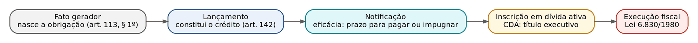
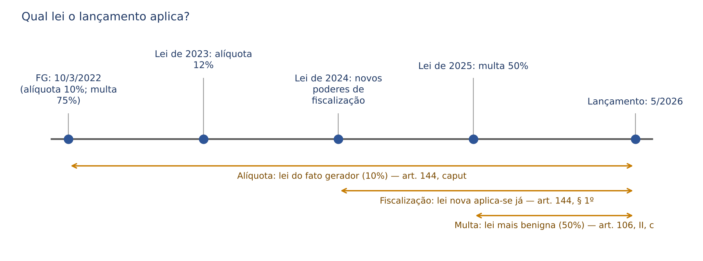
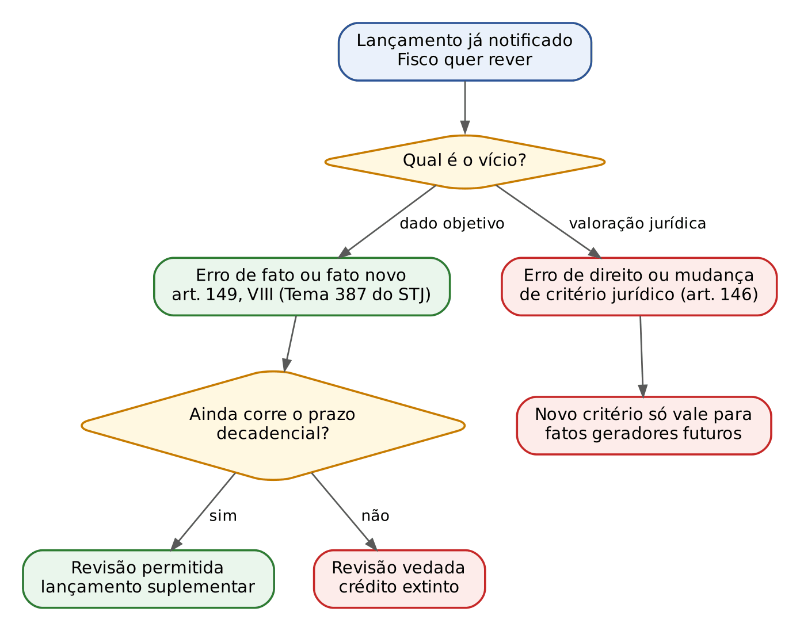
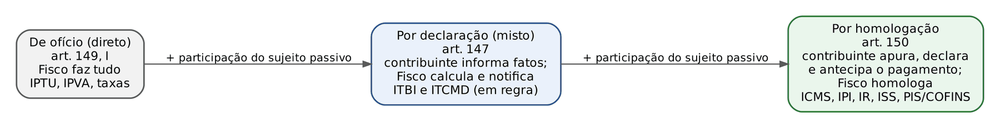
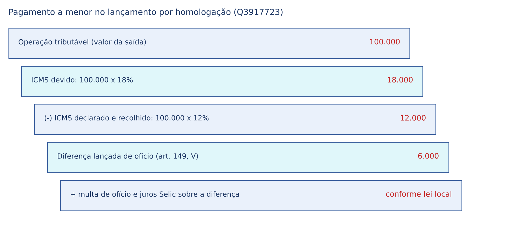
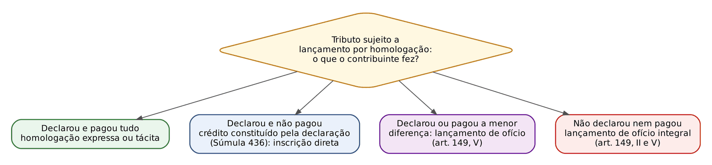

# CAPÍTULO 12 — CRÉDITO TRIBUTÁRIO E LANÇAMENTO

:::INCIDENCIA
TRF5 p. 14; TJRS p. 6; TJSC p. 11. Nível A+; 20 questões do lote (FGV 12, FCC 8), mais correlatas por palavra-chave.
O que mais cai: literalidade dos arts. 142, 144, 145, 147 e 149; erro de fato x mudança de critério jurídico (TRF5 2025); modalidades e exemplos; Súmulas 397 e 436 do STJ; e a novidade da LC 236/2026 (arts. 142, 146 e 150 do CTN).
:::

| Subtema | FGV | FCC | Padrão de cobrança |
|---|---|---|---|
| Conceito, natureza e elementos do lançamento (arts. 139 e 142) | 4 | 1 | literalidade; "constitui o crédito, declara a obrigação"; quem pode lançar |
| Lei aplicável (arts. 144 e 106) | 2 | 1 | lei do fato gerador x lei procedimental x multa mais benigna |
| Alteração e revisão (arts. 145, 146 e 149) | 3 | 3 | rol do art. 149; prazo decadencial; erro de fato x critério jurídico |
| Modalidades (arts. 147, 148 e 150) | 5 | 4 | classificação; retificação da declaração; pagamento a menor; IPTU por carnê |
| Declaração como constituição do crédito (Súmula 436) | 2 | 0 | DCTF/GIA dispensam lançamento; efeitos (inscrição, prescrição, denúncia espontânea) |

## 12.1 Crédito tributário: o que é e de onde vem

### 12.1.1 A lógica do CTN: obrigação primeiro, crédito depois

Quem vem do direito civil está acostumado a pensar que, nascida a obrigação, nasce simultaneamente o crédito: são duas faces do mesmo vínculo (o devedor deve; o credor tem crédito). O CTN, deliberadamente, separou os dois momentos. Primeiro ocorre o fato gerador e nasce a obrigação tributária (art. 113, § 1º; ver Cap. 9). Mas essa obrigação ainda é, por assim dizer, "bruta": o Fisco nem sabe que ela existe, não há valor apurado, devedor identificado nem prazo de pagamento formalizado. Para que ela possa ser cobrada, o CTN exige um ato oficial que a torne certa e líquida: o lançamento. Do lançamento resulta o crédito tributário, que é a obrigação "em estado de exigibilidade".

A fórmula didática que as bancas adoram é: hipótese de incidência + fato gerador = obrigação; obrigação + lançamento = crédito. Daí duas frases que caem literalmente. A primeira, do art. 139: o crédito tributário decorre da obrigação principal e tem a mesma natureza desta. A segunda, extraída do art. 142: compete privativamente à autoridade administrativa constituir o crédito pelo lançamento.

A figura mostra o percurso completo. Cada passagem tem um efeito jurídico próprio que o juiz precisa ter na cabeça ao sentenciar: antes do lançamento (ou da declaração que o substitui, ver 12.6) corre prazo de DECADÊNCIA (direito de constituir o crédito); depois da constituição definitiva corre prazo de PRESCRIÇÃO (pretensão de cobrar); com a inscrição em dívida ativa forma-se o título executivo (CDA), que aparelha a execução fiscal. Os prazos são do Cap. 15; a inscrição, do Cap. 19; a execução, dos Caps. 21 e 22.

:::DICA
Exigibilidade x exequibilidade. O crédito constituído e notificado, vencido o prazo de pagamento, é exigível: o Fisco pode cobrá-lo administrativamente, recusar certidão negativa e inscrevê-lo. Ele só se torna exequível (cobrável em juízo) depois da inscrição em dívida ativa e da extração da CDA. É exatamente a lógica do título executivo no CPC: sem título não há execução.
:::

### 12.1.2 Natureza do crédito e autonomia em relação à obrigação (arts. 139 a 141)

O art. 139 diz que o crédito tem a "mesma natureza" da obrigação principal. Consequência prática: o crédito tributário é sempre pecuniário (a obrigação principal tem por objeto pagamento de tributo ou penalidade pecuniária, art. 113, § 1º) e sempre de direito público, ainda que nele se inclua multa. Por isso o crédito tributário abrange tributo e penalidade: a multa, embora não seja tributo (art. 3º), integra o crédito tributário quando lançada.

Embora decorra da obrigação, o crédito tem certa autonomia formal, expressa no art. 140: as circunstâncias que modificam o crédito, sua extensão ou efeitos, as garantias e privilégios, ou que excluem sua exigibilidade, NÃO afetam a obrigação que lhe deu origem. O exemplo clássico é o lançamento anulado por vício formal (auto de infração lavrado por servidor incompetente, falta de intimação para impugnar): cai o crédito, mas a obrigação continua de pé, e o Fisco pode lançar de novo, se ainda houver prazo decadencial (o art. 173, II, traz inclusive regra específica para a anulação por vício formal; ver Cap. 15). Por outro lado, se o vício for material (o fato gerador não ocorreu), não há obrigação, e o crédito que porventura tenha sido constituído terá, nas palavras de Ricardo Alexandre, existência meramente formal, devendo ser extinto por decisão administrativa ou judicial.

:::EXEMPLO Vício formal x vício material
A Construtora Alfa recebe auto de infração de ISS lavrado por agente sem competência legal para lançar. Em embargos à execução, o juiz reconhece a nulidade. Desconstituiu-se o crédito, não a obrigação (art. 140): o Município pode lavrar novo lançamento pelo agente competente, se ainda não decorrido o prazo decadencial. Se, ao contrário, o juiz reconhecer que o serviço tributado não está na lista da LC 116/2003, a obrigação não existe: não há o que relançar.
:::

O art. 141 fecha o sistema com uma regra de indisponibilidade: o crédito regularmente constituído somente se modifica, extingue, tem a exigibilidade suspensa ou é excluído nos casos previstos no CTN, sob pena de responsabilidade funcional de quem dispensar sua efetivação ou garantias. É o fundamento normativo da ideia de que suspensão (art. 151), extinção (art. 156) e exclusão (art. 175) são matéria de lei complementar de normas gerais e de que o administrador não perdoa tributo por ato próprio (remissão e anistia dependem de lei específica, art. 150, § 6º, da CF; ver Caps. 14 e 17).

:::PEGADINHA
"O crédito tributário constitui-se com a ocorrência do fato gerador, sendo o lançamento ato apenas declaratório" (FGV 2025, Q3777950, alternativa A, ERRADA). Para o CTN, o fato gerador faz nascer a OBRIGAÇÃO; o CRÉDITO só se constitui com o lançamento. Na mesma linha, "a existência do crédito exige lançamento prévio, de modo que, se não houver lançamento, não há crédito nem obrigação" (FGV 2024, Q2510942, C, ERRADA): pode haver obrigação sem crédito; o que não pode haver é crédito sem obrigação.
:::

:::QUESTAO FGV 2024 — Prefeitura de São José dos Campos — Técnico Tributário (Q2375629)
Pediu a afirmativa correta sobre o crédito tributário. Gabarito A: decorre da obrigação principal e tem a mesma natureza desta (literalidade do art. 139). Armadilhas: "origina-se por ato da autoridade, no lançamento" (B) parece certa, mas a banca quis a literalidade do art. 139 e a alternativa omite que o crédito decorre da obrigação; "constitui-se a partir da prática do fato gerador" (C) confunde obrigação com crédito; "é constituído simultaneamente com a obrigação" (E) repete o erro.
:::

## 12.2 Lançamento: conceito, natureza jurídica e atributos

### 12.2.1 Conceito legal e seus cinco elementos

:::LEI CTN, art. 142 (redação após a LC 236/2026)
Art. 142. Compete privativamente à autoridade administrativa constituir o crédito tributário pelo lançamento, assim entendido o procedimento administrativo tendente a verificar a ocorrência do fato gerador da obrigação correspondente, determinar a matéria tributável, calcular o montante do tributo devido, identificar o sujeito passivo e, sendo caso, propor a aplicação da penalidade cabível.
§ 1º A atividade administrativa de lançamento é vinculada e obrigatória, sob pena de responsabilidade funcional.
§ 2º No lançamento destinado a prevenir a decadência de crédito tributário cuja exigibilidade houver sido suspensa na forma dos incisos II, IV e V do caput do art. 151 desta Lei, não será cominada multa de ofício ou multa de mora a ele relativo.
§ 3º O disposto no § 2º deste artigo aplica-se, exclusivamente, aos casos em que a suspensão da exigibilidade do crédito tenha ocorrido antes do início de qualquer procedimento de ofício a ele relativo.
:::

O caput é a definição mais cobrada do capítulo: ele aparece quase palavra por palavra em enunciados que pedem só o nome do instituto (FCC 2024, Q2564505; FGV 2025, Q3780951). Decore os cinco verbos, porque a banca costuma trocar um deles: VERIFICAR a ocorrência do fato gerador; DETERMINAR a matéria tributável; CALCULAR o montante; IDENTIFICAR o sujeito passivo; PROPOR, sendo o caso, a penalidade.

Duas observações técnicas sobre a redação. Primeira: o CTN fala em "propor" a penalidade, mas na prática a autoridade lançadora aplica a multa no próprio auto de infração; a doutrina critica a impropriedade, e as bancas cobram a literalidade. Segunda: "identificar o sujeito passivo" abrange contribuinte e responsável; é por isso que o auto de infração pode, desde logo, apontar responsáveis solidários (FCC 2025, Q3596246, comentada em 12.5.3).

:::QUESTAO FCC 2024 — TRF 3ª Região — Analista Judiciário (Q2564505)
Enunciado reproduzia os elementos do art. 142 e pedia o nome do procedimento. Gabarito A: lançamento tributário. Distratores: fiscalização (que é atividade preparatória e pode nem resultar em lançamento), inscrição em dívida ativa (ato posterior, de controle de legalidade e formação do título) e execução fiscal. No mesmo sentido, FGV 2025, CGE-SP (Q3780951): ato que verifica a procedência do crédito e identifica o devedor é o lançamento (gabarito C), e não "liquidação" (termo de direito financeiro, fase da despesa) nem "arrecadação".
:::

### 12.2.2 Ato ou procedimento?

O art. 142 chama o lançamento de "procedimento administrativo". A maioria da doutrina, porém, entende que o lançamento é ATO administrativo, resultado de um procedimento: a fiscalização, as intimações, a apuração e o cálculo são providências preparatórias de um único ato final, que é o lançamento (posição exposta por Ricardo Alexandre, que lembra que praticamente toda a teoria do ato administrativo se aplica ao lançamento: motivo, competência, forma, presunção de legitimidade, anulação). Em prova objetiva, prevalece a letra da lei: se a assertiva disser "procedimento administrativo", está correta. Em prova discursiva ou na sentença, vale registrar a crítica.

A distinção tem utilidade prática: se o lançamento é ato, ele tem requisitos de validade (competência, motivação, forma) cuja ausência gera nulidade aferível pelo juiz; e tem momento de perfeição (a lavratura) distinto do momento de eficácia (a notificação).

### 12.2.3 Natureza jurídica: declaratório ou constitutivo?

É a discussão teórica mais cobrada. Três posições:

| Corrente | O que sustenta | Consequência |
|---|---|---|
| Declaratória | O crédito nasce com o fato gerador (como no direito civil); o lançamento apenas o declara, tornando-o líquido | Lançamento com efeitos *ex tunc* puros |
| Constitutiva | Não há crédito antes do lançamento; o lançamento o cria | Explica a decadência como perda do direito de constituir |
| Mista (adotada pelo CTN, pela jurisprudência e pelas bancas) | DECLARA a obrigação (verifica fato pretérito) e CONSTITUI o crédito | Lei aplicável é a do fato gerador (art. 144), mas o crédito só existe após o lançamento (art. 142) |

O STJ já afirmou, textualmente, que o crédito tributário não surge com o fato gerador, sendo constituído com o lançamento (julgado da 1ª Turma citado por Ricardo Alexandre). A redação do art. 142 ("constituir o crédito") dá a natureza constitutiva quanto ao crédito; a expressão "verificar a ocorrência do fato gerador" e o art. 144 ("reporta-se à data da ocorrência do fato gerador") dão a natureza declaratória quanto à obrigação. Note como o próprio auto de infração é redigido: no passado, quando descreve o fato ("em março de 2022 o contribuinte promoveu saídas sem nota"), e no presente, quando constitui ("fica constituído o crédito de...").

:::DICA
Fórmula para a prova: o lançamento é DECLARATÓRIO da obrigação e CONSTITUTIVO do crédito. Por ser declaratório quanto à obrigação, "reporta-se" ao passado e por isso a FCC já considerou correta a afirmação de que o lançamento produz efeitos *ex tunc*. Não confunda: o que retroage é a referência ao fato gerador e à lei material; o crédito, esse, só existe a partir do lançamento.
:::

### 12.2.4 Atributos do lançamento

O edital do TJSC fala expressamente em "atributos". Organize-os assim:

| Atributo | Conteúdo | Fundamento e reflexo prático |
|---|---|---|
| Vinculação | A autoridade não escolhe se, quando ou quanto lança: ocorrido o fato gerador, aplica a lei | Art. 142, § 1º, e art. 3º; não há juízo de conveniência e oportunidade |
| Obrigatoriedade | O lançamento é dever, sob pena de responsabilidade funcional | Art. 142, § 1º; por isso o Fisco deve lançar até mesmo para prevenir a decadência quando a exigibilidade está suspensa (ver 12.2.6) |
| Privatividade (exclusividade) | Só a autoridade administrativa competente lança; indelegável e não avocável | Art. 142, caput; o juiz não lança nem corrige lançamento (ver 12.2.5) |
| Presunção de legitimidade e veracidade | O lançamento notificado presume-se válido; cabe ao sujeito passivo desconstituí-lo | Teoria do ato administrativo; reforçada, após a inscrição, pela presunção de certeza e liquidez da dívida ativa (art. 204; ver Cap. 19) |
| Imperatividade e exigibilidade | Notificado, impõe-se ao sujeito passivo, que deve pagar ou impugnar no prazo | Art. 145 (estabilidade relativa) e art. 160 (prazo de pagamento) |
| Estabilidade relativa (inalterabilidade, salvo exceções) | Notificado, só pode ser alterado nas hipóteses do art. 145 | Ver 12.4 |
| Ausência de autoexecutoriedade | O Fisco não expropria bens por conta própria: precisa de título (CDA) e de processo de execução | Lei 6.830/1980; diferença marcante em relação ao poder de polícia |

:::ATENCAO
"Vinculado" não significa "insuscetível de arbitramento". O arbitramento (art. 148) é técnica de apuração da base de cálculo, também vinculada, cabível quando o valor declarado é omisso ou não merece fé (FGV 2024, Q2510942, alternativa E, ERRADA ao dizer que o CTN veda o arbitramento). Ver 12.5.4.
:::

### 12.2.5 Competência privativa: quem pode lançar e quem pode constituir o crédito

A lei de cada ente define qual autoridade lança (na União, o Auditor-Fiscal da Receita Federal do Brasil). A competência é privativa no sentido de exclusiva: o superior hierárquico de outra carreira não avoca, o auditor não delega ao auxiliar.

Consequência que todo juiz precisa dominar: o JUDICIÁRIO NÃO LANÇA. Se o lançamento tiver vício, o juiz o anula (total ou parcialmente); não pode substituí-lo por outro, com base de cálculo ou alíquota diversa escolhida por ele. Na prática, isso explica a técnica correta da sentença na anulatória ou nos embargos: o juiz pode reduzir o crédito por simples cálculo aritmético quando o vício é destacável (excluir uma parcela indevida, afastar a multa confiscatória, recalcular juros), porque aí não refaz o lançamento, apenas o expurga. O que não pode é refazer a apuração de mérito (por exemplo, arbitrar outro valor venal), papel da Administração.

:::PEGADINHA
"O lançamento dos tributos é ato privativo da Administração Pública ou do Poder Judiciário" (FGV 2025, TRF 3ª Região, Juiz Federal, Q3179565, A, ERRADA). Só a autoridade administrativa lança. A banca de magistratura gosta dessa armadilha justamente porque o candidato-juiz tende a imaginar que pode "corrigir" o crédito.
:::

Isso não significa que o crédito só possa ser constituído pelo lançamento. A jurisprudência admite outras vias de constituição que, por não serem "lançamento", não esbarram na privatividade do art. 142:

- a declaração do contribuinte que reconhece o débito (Súmula 436 do STJ; desenvolvida em 12.6);
- o depósito judicial do montante integral, que, convertido em renda, dispensa o lançamento formal (remissão ao Cap. 13; FGV 2025, TRF 1ª Região, Q3425335);
- a sentença trabalhista que reconhece verbas sobre as quais incidem contribuições previdenciárias: a 1ª Turma do STJ afirmou que ela "substitui as fases tradicionais de constituição do crédito tributário" (lançamento, notificação, apuração e intimação), afastando a alegação de decadência (STJ, AgInt no REsp 1.648.628-RS, j. 18/6/2024).

Ricardo Alexandre resume a leitura atual do art. 142: o LANÇAMENTO é privativo da autoridade administrativa, mas o lançamento não é a única forma de CONSTITUIR o crédito.

:::NOTA LC 236/2026 e a competência para lançar
A LC 236/2026 (de 4/9/2026, em vigor na publicação) inseriu no CTN o art. 199-A, que autoriza União, Estados, DF e Municípios a estabelecer entre si, mediante convênio, o compartilhamento das atividades de fiscalização, lançamento e cobrança e da estrutura do processo administrativo fiscal. Não se trata de delegar a competência tributária (indelegável, art. 7º), mas de cooperação administrativa; a regra é nova e ainda não tem jurisprudência.
:::

### 12.2.6 Lançamento para prevenir a decadência (art. 142, §§ 2º e 3º, LC 236/2026)

A suspensão da exigibilidade (art. 151) impede a COBRANÇA, não a CONSTITUIÇÃO do crédito. Se o contribuinte obtém liminar antes de qualquer fiscalização, o Fisco continua obrigado a lançar dentro do prazo decadencial, sob pena de perder o direito; esse lançamento, que só documenta o crédito e fica com a cobrança suspensa, é chamado de "lançamento para prevenir a decadência". O tema da suspensão é do Cap. 13; aqui interessa a novidade legislativa, que é regra sobre o próprio lançamento.

A LC 236/2026 positivou que, no lançamento destinado a prevenir a decadência de crédito com exigibilidade suspensa por depósito integral (art. 151, II), liminar em mandado de segurança (IV) ou liminar ou tutela provisória em outras ações (V), NÃO será cominada multa de ofício nem multa de mora (§ 2º). O benefício só vale se a suspensão tiver ocorrido ANTES do início de qualquer procedimento de ofício relativo ao crédito (§ 3º): quem corre ao Judiciário depois de intimado do início da fiscalização não escapa da multa.

:::EXEMPLO Aplicando o novo § 2º do art. 142
A Indústria Beta discute em juízo a incidência de uma contribuição e, em 2/2/2026, antes de qualquer fiscalização, obtém liminar em mandado de segurança. Em 10/11/2026, o auditor, para evitar a decadência de fatos geradores de 2021, lavra o lançamento. Pela redação atual do art. 142, § 2º, esse lançamento traz o tributo e os juros, mas não multa de ofício nem de mora. Se a liminar tivesse sido obtida em 2/2/2026, mas o Termo de Início de Fiscalização datasse de 15/1/2026, o § 3º afastaria o benefício.
:::

Dois outros acréscimos da LC 236/2026 ao art. 142 merecem registro, embora o desenvolvimento seja do Cap. 11 (sanções): o § 5º, que prevê reduções escalonadas da penalidade aplicada em lançamento de ofício para quem paga ou parcela no prazo de impugnação (50% e 40%) ou antes da inscrição em dívida ativa (30% e 20%), na forma das legislações locais (com prazo de 2 anos para Estados, DF e Municípios adaptarem suas leis, art. 211-A); e o § 8º, segundo o qual a aplicação de penalidade será acompanhada de demonstração da conduta infratora de forma individualizada por sujeito passivo, requisito de motivação que o juiz deve conferir ao examinar autos de infração com vários autuados. Também foi vetado o § 4º projetado, que exigiria apuração prévia em processo administrativo ou judicial para atribuir responsabilidade a terceiros (as razões de veto invocaram o retardamento da cobrança); permanece, portanto, a possibilidade de o responsável ser incluído no próprio lançamento, com contraditório no PAF.

### 12.2.7 Notificação: condição de eficácia do lançamento

O lançamento só produz efeitos em relação ao sujeito passivo depois de NOTIFICADO. Antes da notificação não corre prazo para pagar nem para impugnar. Lançamento e notificação não se confundem: aquele é o ato; esta, a comunicação oficial que lhe dá eficácia e abre a fase contenciosa (impugnação). Ricardo Alexandre divide o procedimento em fase oficiosa (até a notificação) e fase contenciosa (se houver impugnação). O STJ considera irregular a notificação que não abre prazo para impugnação, com nulidade do lançamento, por violação ao contraditório (REsp 1.227.676/PR, citado pela doutrina; julgado não conferido na íntegra nesta pesquisa).

A notificação, em regra, deve ser pessoal, postal ou eletrônica, conforme a lei de cada ente (a LC 236/2026 incluiu o art. 127-A, autorizando intimações por Domicílio Tributário Eletrônico). Nos tributos lançados de ofício em massa, porém, a jurisprudência admite a notificação pelo envio do carnê:

:::JURIS STJ, Súmula 397 e Tema 116 (REsp 1.111.124/PR, j. 22/4/2009)
"O contribuinte do IPTU é notificado do lançamento pelo envio do carnê ao seu endereço." A remessa do carnê ao endereço do contribuinte é ato suficiente para a notificação do lançamento (Tema 116). Fundamentos do repetitivo: o proprietário conhece a periodicidade anual do imposto, o carnê traz as informações necessárias para impugnar e exigir procedimento individualizado tornaria a cobrança inviável.
:::

:::JURIS STJ, Tema 248 (REsp 1.114.780/SC, j. 12/5/2010)
O envio da guia de cobrança (carnê) da taxa de licença para funcionamento ao endereço do contribuinte configura notificação PRESUMIDA do lançamento, passível de ser ilidida pelo contribuinte, a quem cabe comprovar o não recebimento. A Jurisprudência em Teses do STJ (ed. 70) generalizou: cabe ao contribuinte comprovar a ausência de notificação pelo não recebimento do carnê de IPTU.
:::

O raciocínio vale, por analogia, para outros tributos lançados de ofício por carnê, como o IPVA (FGV 2024, TCE-PA, Q2611662: IPVA é lançado de ofício, constituído definitivamente com a notificação, e a prescrição corre do dia seguinte ao vencimento; o termo inicial é do Cap. 15). Para não confundir: cobrar TAXA pela emissão ou remessa do carnê é inconstitucional (Tema 721 do STF; ver Cap. 2).

:::SENTENCA Notificação do IPTU por carnê
Onde entra: embargos à execução fiscal ou exceção de pré-executividade em que o executado alega nulidade da CDA por ausência de processo administrativo ou de notificação pessoal do lançamento de IPTU.
O que fundamentar: lançamento de ofício; notificação pela remessa do carnê (Súmula 397; Tema 116); presunção relativa, cujo afastamento exige prova do não recebimento a cargo do contribuinte (Tema 248, por analogia); desnecessidade de PAF prévio quando o contribuinte não impugnou.
Redação-modelo: "Tratando-se de IPTU, tributo lançado de ofício, a remessa do carnê ao endereço do contribuinte é suficiente para a notificação do lançamento (Súmula 397 do STJ), presunção que o embargante não ilidiu, pois não trouxe prova do não recebimento. Rejeito a alegação de nulidade."
Erro que a banca pune: acolher a nulidade só porque não houve "processo administrativo"; ou, ao contrário, aplicar a Súmula 397 a tributo sujeito a lançamento por homologação, em que o problema é outro (ver 12.6).
:::

:::QUESTAO FGV 2024 — TCE-PA — Auditor de Controle Externo (Q2564269)
Pediu a modalidade de lançamento do IPTU segundo legislação e jurisprudência. Gabarito B: lançamento de ofício, com notificação pelo envio do carnê ao endereço. Erradas: homologação (A), declaração (C), "autodeclaração" (D) e "misto" com homologação (E). Correlata (FCC 2025, DPE-SP, Q3304067, Cap. 29): o locatário que recebe o carnê NÃO tem legitimidade para discutir o IPTU, pois o carnê notifica o contribuinte, não quem o recebe.
:::

:::PROCESSO Lançamento notificado: o que o sujeito passivo pode fazer e em que prazo
| Via | Prazo | Efeito sobre o crédito | Onde estudar |
|---|---|---|---|
| Pagar | prazo fixado na notificação (supletivamente, 30 dias do art. 160) | extingue (art. 156, I) | Cap. 14 |
| Impugnar administrativamente | lei de cada ente; o novo art. 208-D do CTN (LC 236/2026) prevê 20 dias, contados em dias úteis, como norma geral | suspende a exigibilidade (art. 151, III) e adia a constituição definitiva | Cap. 20 |
| Ação anulatória (com ou sem depósito) ou mandado de segurança | anulatória: 5 anos (orientação dominante, com base no Decreto 20.910/1932); MS: 120 dias | suspensão só com depósito ou tutela (art. 151, II e V) | Cap. 23 |
| Não fazer nada | — | constituição definitiva; corre a prescrição | Cap. 15 |
:::
## 12.3 Lei aplicável ao lançamento (arts. 143 e 144)

### 12.3.1 A regra: lei do fato gerador para o direito material

Como o lançamento declara uma obrigação nascida no passado, ele se rege pela lei material vigente à data do fato gerador, ainda que essa lei tenha sido depois modificada ou revogada.

:::LEI CTN, art. 144
Art. 144. O lançamento reporta-se à data da ocorrência do fato gerador da obrigação e rege-se pela lei então vigente, ainda que posteriormente modificada ou revogada.
§ 1º Aplica-se ao lançamento a legislação que, posteriormente à ocorrência do fato gerador da obrigação, tenha instituído novos critérios de apuração ou processos de fiscalização, ampliado os poderes de investigação das autoridades administrativas, ou outorgado ao crédito maiores garantias ou privilégios, exceto, neste último caso, para o efeito de atribuir responsabilidade tributária a terceiros.
§ 2º O disposto neste artigo não se aplica aos impostos lançados por períodos certos de tempo, desde que a respectiva lei fixe expressamente a data em que o fato gerador se considera ocorrido.
:::

O civilista reconhece aqui o *tempus regit actum* (a lei do tempo do fato rege seus efeitos) e o paralelo com o direito intertemporal do CPC (a lei processual nova aplica-se aos atos futuros do processo em curso). O art. 144 separa exatamente esses dois planos:

| Plano | Que normas | Lei aplicável | Fundamento |
|---|---|---|---|
| Material do TRIBUTO | fato gerador, base de cálculo, alíquota, sujeito passivo, isenções, RESPONSABILIDADE de terceiros | lei vigente na data do fato gerador, mesmo revogada ou mais gravosa | art. 144, caput |
| Formal ou procedimental | critérios de apuração, processos de fiscalização, poderes de investigação, garantias e privilégios do crédito | lei vigente na data do lançamento (aplicação imediata a fatos geradores pretéritos) | art. 144, § 1º |
| Material da PENALIDADE | tipificação da infração e valor da multa | lei do fato, salvo lei posterior mais benigna enquanto o ato não estiver definitivamente julgado | art. 106, II (ver Cap. 8) |
| Câmbio | conversão de valor expresso em moeda estrangeira | taxa do dia do fato gerador, salvo lei em contrário | art. 143 |

:::EXEMPLO Três leis, três respostas
Fato gerador de imposto em 10/3/2022, com alíquota de 10% e multa de 75% pela omissão. Em 2023, lei eleva a alíquota para 12%; em 2024, lei amplia os poderes de fiscalização (acesso a novas bases de dados); em 2025, lei reduz a multa para 50%. O lançamento, em 5/2026, deve: (1) aplicar a alíquota de 10%, porque a lei de 2023 é material e posterior ao fato (art. 144, caput; aplicar 12% seria violar a irretroatividade, art. 150, III, a, da CF); (2) usar os novos poderes de investigação de 2024, porque a lei é procedimental (art. 144, § 1º); (3) aplicar a multa de 50%, lei mais benigna superveniente, porque o ato não está definitivamente julgado (art. 106, II, c). Se a lei de 2024, em vez de fiscalização, tivesse criado nova hipótese de responsabilidade de terceiros, ela NÃO alcançaria o fato de 2022 (ressalva final do § 1º): responsabilidade é matéria de direito material.
:::

:::PEGADINHA
"A legislação aplicável ao lançamento é aquela do momento em que o procedimento do lançamento é realizado" (FGV 2024, Prefeitura de Nova Iguaçu, Q3039636, A, ERRADA). É a lei do fato gerador (caput), ressalvadas as normas procedimentais do § 1º. Na outra ponta, "se a fiscalização desenvolver um novo software para apurar a contabilidade, ele só poderá ser usado para fatos posteriores à sua criação" (FGV 2024, Câmara dos Deputados, Q2510942, D, ERRADA): novos critérios de apuração e processos de fiscalização aplicam-se de imediato (§ 1º).
:::

### 12.3.2 O § 1º e o sigilo bancário

O exemplo histórico do § 1º é a LC 105/2001, que permitiu à Receita acessar dados bancários sem ordem judicial, e a Lei 10.174/2001, que autorizou o uso dos dados da CPMF para lançar outros tributos. Contribuintes alegaram retroatividade vedada quanto a fatos geradores anteriores; prevaleceu a aplicação imediata, porque essas leis não alteram o fato gerador nem a alíquota, apenas o modo de descobrir o que já ocorreu. No ponto que interessa a este capítulo, o STF afirmou que a Lei 10.174/2001 não atrai a irretroatividade, dado o caráter instrumental da norma, nos termos do art. 144, § 1º, do CTN (Tema 225; v. Cap. 19, onde está a tese completa sobre o sigilo bancário).

### 12.3.3 O § 2º: tributos lançados por períodos certos

O § 2º afasta a regra do caput para impostos "lançados por períodos certos de tempo", desde que a lei fixe a data em que o fato gerador se considera ocorrido (IPTU, IPVA, ITR: fatos geradores continuados, que a lei "fotografa" em uma data, normalmente 1º de janeiro). Ricardo Alexandre observa que a regra é, a rigor, desnecessária: se a lei define que o fato gerador ocorre em 1º de janeiro, aplica-se a lei vigente nessa data, o que é o próprio caput. A utilidade é afastar a dúvida sobre aplicar ao IPTU de um exercício lei alterada no meio dele. Lembre que a lei que majora IPTU e IPVA também se submete à anterioridade (com as exceções do art. 150, § 1º, da CF; ver Cap. 5).

:::QUESTAO FCC 2025 — SEFAZ-PI — Auditor Fiscal (Q3596249)
Caso: lei estadual criou hipótese de incidência de ITCMD sobre doação de móveis e multa específica; Joaquim doou sem pagar; depois a alíquota e a multa variaram; o Estado lançou de ofício tributo e multa; durante o processo administrativo, lei nova revogou inteiramente a lei instituidora. Gabarito B: na decisão final o imposto ainda podia ser exigido, mas a penalidade não.
Passo 1 (o tributo): o lançamento rege-se pela lei do fato gerador, ainda que revogada (art. 144, caput); a revogação posterior não apaga a obrigação nascida.
Passo 2 (a multa): a lei que deixa de definir o ato como infração retroage enquanto o ato não estiver definitivamente julgado (art. 106, II, a); o processo administrativo pendente impede a definitividade.
Armadilhas: C e E (lançar com a menor alíquota do período, ou com a lei da data do lançamento) ignoram que a retroatividade benigna vale só para penalidades, nunca para o tributo; A estende a abolição ao tributo.
:::

:::QUESTAO FGV 2024 — Prefeitura de Nova Iguaçu — Auditor Fiscal (Q3039636)
Pediu a afirmação correta sobre lançamento. Gabarito C: o lançamento é efetuado de ofício quando deva ser apreciado fato não conhecido ou não provado por ocasião do lançamento anterior (art. 149, VIII). Erradas: A (lei do momento do lançamento; ver acima); B e D trocam as hipóteses de ofício (penalidade, fraude ou falta funcional, art. 149, VI e IX) por "declaração" e "homologação"; E inventa prazo de homologação de um ano (o supletivo é de cinco anos do fato gerador, art. 150, § 4º).
:::

## 12.4 Alterabilidade e revisão do lançamento

### 12.4.1 A regra da estabilidade e suas três exceções (art. 145)

Notificado, o lançamento presume-se definitivo e, em princípio, não pode ser alterado. O CTN abre três portas, e só três:

:::LEI CTN, art. 145
Art. 145. O lançamento regularmente notificado ao sujeito passivo só pode ser alterado em virtude de:
I - impugnação do sujeito passivo;
II - recurso de ofício;
III - iniciativa de ofício da autoridade administrativa, nos casos previstos no artigo 149.
:::

1. Impugnação do sujeito passivo (I). Instaura o contencioso administrativo (art. 5º, LV, da CF) e pode levar à anulação ou redução do crédito. Atenção para dois pontos que o civilista costuma errar. Primeiro: no processo administrativo fiscal NÃO vigora a proibição de *reformatio in pejus*; se diligência determinada pelo julgador revela tributo maior, faz-se lançamento suplementar com reabertura de prazo de impugnação quanto à parte nova (na esfera federal, art. 18, § 3º, do Decreto 70.235/1972), por força da verdade material. Segundo: o contribuinte pode impugnar o lançamento ainda que feito com base em dados que ele mesmo declarou (STJ, REsp 396.875/PR, citado por Ricardo Alexandre): a legalidade prevalece sobre a suposta "preclusão lógica".
2. Recurso de ofício (II). É a remessa necessária do processo administrativo: a decisão de primeira instância que exonera o contribuinte acima de um valor de alçada sobe obrigatoriamente ao órgão de segundo grau (na União, o CARF), que pode restabelecer o crédito. O CTN esqueceu o recurso VOLUNTÁRIO do contribuinte, que também altera o lançamento; a doutrina o inclui no inciso I ou II por interpretação. A LC 236/2026 incluiu no CTN os arts. 208-A a 208-J, com normas gerais de processo administrativo fiscal (recurso voluntário e remessa necessária, prazos de 20 dias, vinculação a precedentes): matéria do Cap. 20.
3. Iniciativa de ofício da autoridade (III), nos casos do art. 149. É a autotutela tributária: verificado vício, a Administração tem o poder-dever de corrigir o lançamento, mas somente nas hipóteses taxativas do art. 149 e dentro do prazo decadencial. Exemplo citado pela doutrina: impugnação intempestiva que não é conhecida, mas revela erro evidente; a autoridade corrige de ofício com base no inciso III.

:::PEGADINHA
O art. 145 fala em lançamento "regularmente notificado". Antes da notificação, o lançamento ainda não produziu efeitos perante o sujeito passivo e pode ser corrigido internamente pela própria Administração (no lançamento por declaração, o art. 147, § 1º, usa justamente a notificação como limite para a retificação pelo declarante; ver 12.5.2).
:::

### 12.4.2 Revisão de ofício: as hipóteses do art. 149

O art. 149 é o dispositivo mais cobrado do capítulo, porque serve a duas funções ao mesmo tempo: lista os casos de lançamento ORIGINÁRIO de ofício (inciso I) e os casos de lançamento de ofício SUBSTITUTIVO ou REVISIONAL (incisos II a IX), quando o lançamento em outra modalidade não foi feito ou foi feito com vício.

:::LEI CTN, art. 149
Art. 149. O lançamento é efetuado e revisto de ofício pela autoridade administrativa nos seguintes casos:
I - quando a lei assim o determine;
II - quando a declaração não seja prestada, por quem de direito, no prazo e na forma da legislação tributária;
III - quando a pessoa legalmente obrigada, embora tenha prestado declaração nos termos do inciso anterior, deixe de atender, no prazo e na forma da legislação tributária, a pedido de esclarecimento formulado pela autoridade administrativa, recuse-se a prestá-lo ou não o preste satisfatoriamente, a juízo daquela autoridade;
IV - quando se comprove falsidade, erro ou omissão quanto a qualquer elemento definido na legislação tributária como sendo de declaração obrigatória;
V - quando se comprove omissão ou inexatidão, por parte da pessoa legalmente obrigada, no exercício da atividade a que se refere o artigo seguinte;
VI - quando se comprove ação ou omissão do sujeito passivo, ou de terceiro legalmente obrigado, que dê lugar à aplicação de penalidade pecuniária;
VII - quando se comprove que o sujeito passivo, ou terceiro em benefício daquele, agiu com dolo, fraude ou simulação;
VIII - quando deva ser apreciado fato não conhecido ou não provado por ocasião do lançamento anterior;
IX - quando se comprove que, no lançamento anterior, ocorreu fraude ou falta funcional da autoridade que o efetuou, ou omissão, pela mesma autoridade, de ato ou formalidade essencial.
Parágrafo único. A revisão do lançamento só pode ser iniciada enquanto não extinto o direito da Fazenda Pública.
:::

Para memorizar, agrupe os incisos pela causa:

| Grupo | Incisos | Situação | Exemplo |
|---|---|---|---|
| Lançamento originário | I | a lei elegeu a modalidade de ofício | IPTU, IPVA, taxas, contribuição de melhoria, COSIP |
| Falha na DECLARAÇÃO (lançamento por declaração) | II, III, IV | declaração não entregue; esclarecimentos negados; declaração falsa, errada ou omissa | ITBI sem declaração; ITCMD com valor omitido |
| Falha na atividade do contribuinte no lançamento por HOMOLOGAÇÃO | V ("artigo seguinte" = art. 150) | omissão ou inexatidão na apuração e no pagamento antecipado | ICMS recolhido com alíquota menor (Q3917723) |
| Infração | VI, VII | conduta que gera multa; dolo, fraude ou simulação | omissão de receitas; nota fiscal "fria" |
| Falha do PRÓPRIO Fisco ou fato novo | VIII, IX | fato não conhecido ou não provado; fraude, falta funcional ou omissão de formalidade essencial pela autoridade | cadastro do imóvel com área menor (Tema 387); auditor que lançou a menor por conluio |

:::ATENCAO
O inciso V remete ao "artigo seguinte", isto é, ao art. 150 (lançamento por homologação). A FCC gosta de trocar "art. 150" por "art. 147". E o inciso IX, na redação compilada do Planalto conferida em 22/10/2026, fala em "formalidade essencial" (várias obras transcrevem "especial"; ver nota de verificação).
:::

O parágrafo único é o limite temporal: a revisão só pode ser INICIADA enquanto não extinto o direito da Fazenda, isto é, dentro do prazo decadencial. O STJ consolidou na Jurisprudência em Teses (ed. 70, tese 4) que a revisão pode ser exercida nas hipóteses do art. 149, desde que observado o prazo decadencial para a constituição do crédito. Mesmo nos casos de dolo, fraude ou simulação a revisão é limitada pela decadência: o que muda nesses casos é o TERMO INICIAL do prazo (que passa a ser o do art. 173, I, e não mais o fato gerador; a LC 236/2026 explicitou isso no novo § 5º do art. 150). Os prazos são do Cap. 15.

:::QUESTAO FGV 2025 — Prefeitura de Abreu e Lima — Procurador Municipal (Q3841701)
Pediu a hipótese em que é VEDADA a revisão de ofício. Gabarito B: extinto o direito da Fazenda Pública (art. 149, parágrafo único). As demais alternativas (declaração não prestada, falsidade em elemento de declaração obrigatória, omissão que dá lugar a penalidade, dolo, fraude ou simulação) são justamente hipóteses que AUTORIZAM a revisão (incisos II, IV, VI e VII).
:::

:::QUESTAO FCC 2026 — SEFAZ-MT — Fiscal de Tributos Estaduais (Q3947166)
Pediu o que o CTN estabelece em certas situações. Gabarito B: comprovada falsidade, erro ou omissão quanto a elemento de declaração obrigatória, o lançamento deve ser efetuado ou revisto de ofício (art. 149, IV). As demais alternativas usam o mesmo "gancho" de algum inciso do art. 149 e lhe acrescentam consequência inexistente: multa em dobro ou quádruplo (A), vedação de denúncia espontânea (C), recomeço do prazo de homologação "no primeiro dia do mês seguinte" (D) e proibição de o julgador administrativo reduzir multa (E).
:::

### 12.4.3 Erro de fato x erro de direito: o art. 146 e a proteção da confiança

Aqui está a questão mais sofisticada do capítulo e a que mais cai em prova de juiz. O art. 149 permite rever o lançamento por erro de FATO (incisos IV e VIII, sobretudo), mas não prevê revisão por erro de DIREITO. E o art. 146 ainda proíbe aplicar retroativamente ao mesmo contribuinte a mudança de critério jurídico.

:::LEI CTN, art. 146 (redação da LC 236/2026)
Art. 146. A modificação introduzida, de ofício ou em consequência de decisão administrativa ou judicial ou sentença arbitral proferida no âmbito da arbitragem especial tributária e aduaneira, nos critérios jurídicos adotados pela autoridade administrativa no exercício do lançamento, somente pode ser efetivada, em relação a um mesmo sujeito passivo, quanto a fato gerador ocorrido posteriormente à sua introdução.
:::

A novidade de 2026 é só a menção à sentença arbitral (a LC 236/2026 também incluiu os arts. 171-A a 171-C, que preveem arbitragem especial tributária e aduaneira e mediação, a serem disciplinadas por lei; ver Cap. 14). O núcleo continua o mesmo: proteção da confiança e não surpresa.

Como distinguir:

| | Erro de fato | Erro de direito (mudança de critério jurídico) |
|---|---|---|
| O que é | equívoco sobre dado objetivo, verificável sem interpretar norma: quantidade, área, valor, existência de um fato, cálculo | escolha, entre interpretações possíveis, de uma valoração jurídica dos fatos (enquadramento, classificação, qualificação) que depois a Administração muda |
| Exemplos | importaram-se 10 toneladas e o lançamento considerou 8; cadastro do imóvel com área construída menor do que a real; requantificação monetária da base de cálculo | a Receita aceitou a classificação tarifária X no desembaraço e depois quer a Y; o Município classificava apart-hotel como residencial e muda para comercial |
| Revisão do lançamento já feito | PERMITIDA (art. 149, VIII), dentro do prazo decadencial | VEDADA quanto aos fatos já lançados; o novo critério vale para fatos geradores posteriores à sua introdução (art. 146) |
| Fonte | Tema 387 do STJ | art. 146; Súmula 227 do TFR; STJ (REsp 412.904/SC e outros) |

:::JURIS STJ, Tema 387 (REsp 1.130.545/RJ, j. 9/8/2010)
A retificação de dados cadastrais do imóvel, após a constituição do crédito, autoriza a revisão do lançamento pela autoridade administrativa, desde que não extinto o direito potestativo da Fazenda pelo decurso do prazo decadencial, quando decorrer da apreciação de fato não conhecido por ocasião do lançamento anterior (art. 149, VIII). O acórdão distingue: o erro de fato reclama o desconhecimento da existência do fato ou a impossibilidade de comprová-lo à época; nas hipóteses de erro de direito (equívoco na valoração jurídica dos fatos), o lançamento é imodificável, em virtude da proteção à confiança (art. 146), na linha da Súmula 227 do TFR ("a mudança de critério jurídico adotado pelo Fisco não autoriza a revisão de lançamento").
:::

Dois precedentes mais recentes ajudam a afinar a fronteira. De um lado, a 2ª Turma do STJ entendeu que a requantificação monetária da base de cálculo, para adequá-la ao valor efetivamente devido, configura erro de fato e autoriza a revisão (AREsp 2.362.445-SP, j. 4/6/2024). De outro, a mesma Turma aplicou o art. 146, combinado com o art. 100, III, do CTN, a uma "prática reiterada" de não cobrar: o Estado deixara, por anos, de incluir determinada subvenção na base de cálculo do ICMS sobre energia; ao mudar de entendimento, só pôde cobrar a partir dos fatos geradores posteriores à ciência da nova orientação (AREsp 1.688.160-RS, j. 17/10/2024).

:::ATENCAO Art. 146 x art. 100, parágrafo único
Não confunda as duas proteções. Se o contribuinte seguiu uma NORMA COMPLEMENTAR geral e abstrata (instrução normativa, prática reiterada) que depois se revela ilegal, o art. 100, parágrafo único, o livra de multa, juros e correção, mas NÃO do tributo (ver Cap. 8). Já o art. 146 protege o contribuinte contra a mudança do critério adotado em LANÇAMENTO concreto já feito em relação a ele: o tributo do lançamento anterior não pode ser complementado. O AREsp 1.688.160-RS foi além do art. 100 porque havia critério reiteradamente aplicado à própria contribuinte.
:::

:::QUESTAO FGV 2025 — TRF 5ª Região — Juiz Substituto (Q3373903)
Caso: a ABC comprou produtos importados por conta e ordem pela DEF em 2019 a 2021, sempre com a classificação "X", e as importações foram regularmente homologadas (desembaraço). Em 15/12/2022, a fiscalização reclassificou os mesmos produtos como "Y" e lavrou auto de infração contra ABC e DEF para cobrar diferenças de II e IPI de 2019 a 2021, com juros e multa. Gabarito B: lançamento suplementar insubsistente, por se tratar de mudança de critério jurídico.
Passo 1 (o que se pergunta): pode o Fisco rever lançamentos de importação já desembaraçados porque passou a entender correta outra classificação?
Passo 2 (a regra): classificação tarifária é valoração jurídica de mercadoria corretamente descrita; trocá-la é mudar o critério jurídico, o que o art. 146 só permite para fatos geradores futuros; o STJ aplica a Súmula 227 do TFR exatamente ao caso da classificação aceita no desembaraço (REsp 412.904/SC).
Passo 3 (as alternativas sedutoras): C fala em "erro de fato" e no poder-dever de revisão; seria correta se a mercadoria tivesse sido descrita de forma falsa (outro produto), não quando o mesmo produto foi apenas reclassificado. E invoca a revisão aduaneira do Decreto-Lei 37/1966 no prazo de cinco anos, mas o procedimento de revisão não autoriza o que o art. 146 proíbe. A é falsa porque o adquirente na importação por conta e ordem é sujeito passivo: hoje a lei o considera o próprio importador (contribuinte, art. 31, parágrafo único, do Decreto-Lei 37/1966, incluído pela LC 227/2026), e a importadora que registra a declaração em seu nome responde solidariamente (art. 32, parágrafo único, III, na redação da LC 227/2026); ele responde também pelas infrações (art. 95, V). D mistura o art. 100, parágrafo único, com a hipótese.
:::

:::QUESTAO FGV 2024 — Prefeitura de São José dos Campos — Técnico Tributário (Q2375639, correlata, Cap. 16)
O contribuinte obteve, na impugnação de IPTU, a correção de alíquota aplicada por critério jurídico equivocado. Gabarito D: a modificação só se efetiva, em relação ao mesmo contribuinte, quanto a fato gerador ocorrido após a revisão (literalidade do art. 146). A questão mostra que a banca aplica o art. 146 mesmo quando a mudança favorece o contribuinte; na prática, quem pagou a mais pelo critério ilegal tem a repetição de indébito (Cap. 16).
:::

:::SENTENCA Mudança de critério jurídico em embargos ou anulatória
Onde entra: no mérito dos embargos à execução fiscal, da ação anulatória ou do mandado de segurança contra auto de infração que "revisa" exercícios anteriores.
O que fundamentar: (1) identificar se a revisão decorre de fato novo ou de dado objetivo errado (art. 149, VIII, Tema 387) ou de nova valoração jurídica (art. 146); (2) no primeiro caso, verificar se a revisão foi iniciada dentro do prazo decadencial (art. 149, parágrafo único); (3) no segundo, afastar a cobrança dos fatos geradores anteriores à introdução do novo critério, preservando-a para os posteriores.
Redação-modelo: "A autuação não decorreu da descoberta de fato desconhecido, mas da adoção, pelo Fisco, de nova classificação para mercadoria idêntica e corretamente descrita, que fora aceita no desembaraço. Trata-se de mudança de critério jurídico, que, nos termos do art. 146 do CTN e da Súmula 227 do TFR, só alcança fatos geradores posteriores à sua introdução. Julgo procedente o pedido para desconstituir o lançamento quanto aos fatos geradores anteriores a [data]."
Erro que a banca pune: tratar toda reclassificação como "erro de fato" (porque envolve "fatos" da mercadoria) ou, ao contrário, invocar o art. 146 para impedir revisão de lançamento baseado em dado objetivo falso.
:::
## 12.5 Modalidades de lançamento

### 12.5.1 O critério: grau de participação do sujeito passivo

O CTN classifica o lançamento em três modalidades conforme a intensidade da colaboração do sujeito passivo na atividade de apurar o crédito: de ofício (art. 149, I), por declaração (art. 147) e por homologação (art. 150). O arbitramento (art. 148) NÃO é quarta modalidade, mas técnica de apuração da base de cálculo (12.5.4).

:::ESQUEMA Ficha comparativa das modalidades
| | De ofício (direto) | Por declaração (misto) | Por homologação ("autolançamento") |
|---|---|---|---|
| Base legal | art. 149, I (originário); II a IX (substitutivo ou revisional) | art. 147 | art. 150 |
| Quem apura | o Fisco, com dados próprios (cadastros) | o Fisco, com base em fatos informados pelo sujeito passivo ou por terceiro | o próprio sujeito passivo: apura, declara e paga |
| Quem calcula o tributo | o Fisco | o Fisco | o sujeito passivo |
| Pagamento | após notificação | após notificação | ANTECIPADO, sem prévio exame da autoridade |
| Ato que aperfeiçoa o lançamento | notificação do lançamento | notificação do lançamento | homologação expressa ou tácita (5 anos do fato gerador, art. 150, § 4º) |
| Exemplos de prova | IPTU, IPVA, taxas, contribuição de melhoria, COSIP | ITBI e ITCMD (em regra, conforme a lei local) | ICMS, IPI, IR, ISS, PIS, COFINS, contribuições previdenciárias, ITR, IBS e CBS |
| Se o sujeito passivo falha | — | lançamento de ofício (art. 149, II a IV) | lançamento de ofício (art. 149, V) |
:::

Duas cautelas antes de memorizar a coluna de exemplos. Primeira: não há norma geral que imponha a cada tributo uma modalidade; cada ente escolhe na sua lei. A FCC já considerou correta a assertiva de que lei estadual pode submeter o IPVA ao lançamento por homologação (exemplo lembrado por Ricardo Alexandre). Em prova objetiva, use a classificação tradicional, salvo se o enunciado indicar a lei local. Segunda: qualquer tributo pode, em determinadas circunstâncias, ser lançado de ofício (para suprir omissão ou corrigir vício); por isso "todo tributo pode ser lançado de ofício" é afirmação correta.

:::QUESTAO FGV 2024 — Prefeitura de Nova Iguaçu — Analista Tributário (Q3038856)
Pediu as modalidades previstas nos arts. 147 a 150 do CTN. Gabarito E: por declaração, de ofício e por homologação. As demais misturam figuras inexistentes: "lançamento retroativo", "lançamento em dívida ativa", "lançamento por sucessão", "lançamento de terceiros".
:::

### 12.5.2 Lançamento por declaração (art. 147) e a retificação da declaração

Na modalidade mista, o sujeito passivo (ou terceiro, como o tabelião no ITBI) presta à autoridade informações sobre MATÉRIA DE FATO indispensáveis ao lançamento; a autoridade aplica o direito, calcula e notifica. A entrega da declaração é obrigação acessória; o crédito só nasce com o lançamento feito pela autoridade.

:::DICA Lançamento por declaração x lançamento com declaração
Não confunda lançamento POR declaração com lançamento em cuja sistemática EXISTE uma declaração. Na declaração de ajuste do IRPF, o contribuinte não se limita a informar fatos: enquadra rendimentos como tributáveis ou isentos, escolhe deduções, calcula o imposto e paga. Isso é lançamento por HOMOLOGAÇÃO. O mesmo vale para DCTF, GIA, GFIP e semelhantes. Por isso o lançamento por declaração é hoje raro (ITBI, nas leis municipais que mandam o Fisco calcular a partir da declaração; ITCMD, em vários Estados; o imposto de importação sobre bagagem, segundo Ricardo Alexandre, migrou para a homologação com a declaração eletrônica de bens de viajante).
:::

:::LEI CTN, art. 147
Art. 147. O lançamento é efetuado com base na declaração do sujeito passivo ou de terceiro, quando um ou outro, na forma da legislação tributária, presta à autoridade administrativa informações sobre matéria de fato, indispensáveis à sua efetivação.
§ 1º A retificação da declaração por iniciativa do próprio declarante, quando vise a reduzir ou a excluir tributo, só é admissível mediante comprovação do erro em que se funde, e antes de notificado o lançamento.
§ 2º Os erros contidos na declaração e apuráveis pelo seu exame serão retificados de ofício pela autoridade administrativa a que competir a revisão daquela.
:::

O § 1º é a pegadinha do artigo. Ele impõe DOIS requisitos (comprovação do erro + antes da notificação), mas só quando a retificação vise a REDUZIR ou EXCLUIR tributo. A retificação para AUMENTAR o tributo devido não sofre essas restrições. E a exigência de "comprovação do erro" afasta a retificação para trocar uma opção válida que se revelou desvantajosa (por exemplo, trocar a declaração simplificada pela completa depois de verificar que pagaria menos; não houve erro, houve escolha infeliz). Notificado o lançamento, o caminho para reduzir o tributo deixa de ser a retificação e passa a ser a impugnação (art. 145, I).

O § 2º trata de erros evidentes, apuráveis pelo simples exame da declaração (rendimento claramente isento lançado como tributável, soma errada): a autoridade corrige de ofício, a favor ou contra o declarante.

Embora o art. 147 trate do lançamento por declaração, a lógica da retificação é aplicada por analogia às declarações dos tributos lançados por homologação. A 1ª Turma do STJ admitiu a apresentação de declaração retificadora do imposto de renda durante o procedimento de fiscalização, porque ainda não havia lançamento (AgInt no REsp 1.798.667-PB, j. 17/6/2024).

:::QUESTAO FCC 2025 — SEFAZ-PI — Auditor Fiscal (Q3596243)
Caso: o contribuinte prestou as informações para o lançamento por declaração e, semanas depois, percebeu erro que levaria a pagar MENOS do que o devido. Itens: I (erros apuráveis pelo exame são retificados de ofício), II (retificação pelo declarante só mediante comprovação do erro) e III (retificação pelo declarante inadmissível após notificado o lançamento). Gabarito D: só o I.
Passo 1: o item I é a literalidade do § 2º.
Passo 2: os itens II e III transcrevem os requisitos do § 1º, mas o caso é de retificação que AUMENTA o tributo; os requisitos do § 1º só se aplicam quando a retificação vise a reduzir ou excluir tributo. Por isso II e III são falsos "neste caso".
Armadilha: o candidato que memorizou o § 1º sem a condicionante marca a alternativa E (I, II e III).
:::

:::QUESTAO FCC 2026 — SEFAZ-SP — AFRE (Q3926876)
Caso: Claudio prestou informações de fato para lançamento por declaração; após o pagamento do valor lançado, a fiscalização comprovou omissão de elementos de declaração obrigatória, com valor lançado inferior ao devido. Gabarito A: a Fazenda pode lançar de ofício (art. 149, IV), no prazo de 5 anos contado do primeiro dia do exercício seguinte àquele em que o lançamento poderia ter sido efetuado (art. 173, I; contagem no Cap. 15). Erradas: as que negam o lançamento de ofício e mandam "intimar o contribuinte a lançar por homologação" (B e E), a que conta do fato gerador (C, regra do art. 150, § 4º, inaplicável ao lançamento por declaração) e a que conta da constatação da irregularidade (D).
:::

:::QUESTAO FGV 2025 — TRF 3ª Região — Juiz Federal Substituto (Q3179565)
Pediu a assertiva correta segundo o CTN. Gabarito D: o lançamento misto ou por declaração é aquele em que a Administração constitui o crédito com informações próprias, do sujeito passivo ou de terceiros. Erradas: A (Judiciário não lança, ver 12.2.5); B (a homologação é ato da Administração, não "da Administração e do sujeito passivo"); C (o sujeito passivo não "constitui o crédito" em qualquer modalidade; a constituição por declaração, Súmula 436, refere-se aos tributos por homologação); E (no lançamento por homologação com pagamento, o prazo corre do fato gerador, art. 150, § 4º, e não do primeiro dia do exercício seguinte).
Observação: a redação da alternativa D é imprecisa (no lançamento por declaração as informações vêm do sujeito passivo ou de terceiro; "informações próprias" da Administração caracterizariam o de ofício), mas era a única compatível com o CTN.
:::

### 12.5.3 Lançamento por homologação (art. 150)

É a modalidade dominante: a maior parte da arrecadação brasileira (ICMS, IPI, IR, PIS, COFINS, contribuições previdenciárias, ISS e, a partir da reforma, IBS e CBS) segue esse modelo, porque transfere ao contribuinte o trabalho de apurar e permite ao Fisco fiscalizar por amostragem e cruzamento eletrônico de dados.

:::LEI CTN, art. 150, caput e §§ 1º a 6º (§§ 5º e 6º incluídos pela LC 236/2026)
Art. 150. O lançamento por homologação, que ocorre quanto aos tributos cuja legislação atribua ao sujeito passivo o dever de antecipar o pagamento sem prévio exame da autoridade administrativa, opera-se pelo ato em que a referida autoridade, tomando conhecimento da atividade assim exercida pelo obrigado, expressamente a homologa.
§ 1º O pagamento antecipado pelo obrigado nos termos deste artigo extingue o crédito, sob condição resolutória da ulterior homologação do lançamento.
§ 2º Não influem sobre a obrigação tributária quaisquer atos anteriores à homologação, praticados pelo sujeito passivo ou por terceiro, visando à extinção total ou parcial do crédito.
§ 3º Os atos a que se refere o parágrafo anterior serão, porém, considerados na apuração do saldo porventura devido e, sendo o caso, na imposição de penalidade, ou sua graduação.
§ 4º Se a lei não fixar prazo a homologação, será ele de cinco anos, a contar da ocorrência do fato gerador; expirado esse prazo sem que a Fazenda Pública se tenha pronunciado, considera-se homologado o lançamento e definitivamente extinto o crédito, salvo se comprovada a ocorrência de dolo, fraude ou simulação.
§ 5º No caso de dolo, fraude ou simulação, o prazo previsto no § 4º deste artigo é contado na forma do inciso I do caput do art. 173 desta Lei.
§ 6º No caso de pagamento parcial do tributo sujeito a lançamento por homologação, o prazo decadencial é contado da ocorrência do fato gerador.
:::

Leia o caput com atenção a três detalhes de redação:

1. O que caracteriza a modalidade é o DEVER DE ANTECIPAR O PAGAMENTO sem prévio exame da autoridade. Não é a existência de declaração.
2. O que a autoridade homologa é a ATIVIDADE do sujeito passivo ("a homologa" refere-se a "atividade"). Por isso o STJ prefere falar em homologação do pagamento ou da atividade, e não em "homologação do lançamento" (embora o § 1º use esta expressão). O sujeito passivo não lança: o lançamento só se "opera" com o ato da autoridade, o que preserva a privatividade do art. 142.
3. O dispositivo fala em "tributos". A homologação não serve para constituir crédito de PENALIDADE: multa sempre exige lançamento de ofício (art. 149, VI). É o que cobrou a FCC (2026, SEFAZ-SP, Q3926871): a modalidade descrita pode ser utilizada APENAS em relação a tributos (gabarito B), e não a impostos apenas, nem a penalidades.

O § 1º é tecnicamente criticado: a homologação não "resolve" a extinção, confirma-a; o que pode desfazê-la é a NÃO homologação, quando o Fisco, discordando do valor pago, lança de ofício a diferença. A ideia correta é: o pagamento antecipado extingue o crédito provisoriamente; a homologação (expressa ou tácita) torna a extinção definitiva (art. 156, VII; ver Cap. 14).

Os §§ 2º e 3º se completam. Atos praticados antes da homologação para extinguir o crédito (pagamentos, compensações, retenções) não afetam a OBRIGAÇÃO: se ela é maior do que o pago, o Fisco lança a diferença. Mas esses atos são considerados na apuração do SALDO e na graduação da multa: o que foi pago é abatido, e a multa incide sobre o que faltou.

:::QUESTAO FCC 2026 — SEFAZ-SP — AFRE (Q3917723)
Caso: contribuinte de ICMS emitiu nota com alíquota de 12% quando a correta era 18%, escriturou, apurou e recolheu no prazo; a fiscalização, dentro do prazo decadencial, constatou o erro. Gabarito E: a autoridade deve lançar de ofício o ICMS devido na operação, porque o pagamento antecipado não extinguiu definitivamente o crédito, computando a favor do contribuinte o valor já recolhido.
Passo 1: o pagamento antecipado extingue o crédito só sob condição resolutória (§ 1º); a obrigação permanece íntegra (§ 2º).
Passo 2: a omissão ou inexatidão na atividade do art. 150 autoriza lançamento de ofício (art. 149, V).
Passo 3: o valor pago é considerado na apuração do saldo (§ 3º): na escada acima, 18.000 (dezoito mil) reais devidos menos 12.000 (doze mil) reais recolhidos resultam em diferença de 6.000 (seis mil) reais, sobre a qual incidem juros e multa de ofício.
Armadilhas: B (o recolhimento teria extinguido definitivamente o crédito) ignora o § 1º; C e D transferem ao contribuinte ou a "lançamentos corretivos na escrita" a função de lançar, que é privativa da autoridade; A manda lançar o total sem abater o pago e remete o contribuinte à restituição, contrariando o § 3º.
:::

:::QUESTAO FGV 2025 — AL-AM — Procurador (Q3777950)
Pediu a assertiva correta sobre o regime do crédito tributário. Gabarito C: o lançamento por homologação ocorre quando o contribuinte apura e paga antecipadamente, sob condição resolutória de posterior homologação, expressa ou tácita. Erradas: A (crédito nasce com o fato gerador; ver 12.1); B (moratória, parcelamento e depósito SUSPENDEM, não extinguem; Cap. 13); D (isenção e anistia EXCLUEM; Cap. 17); E (confunde prescrição com decadência; Cap. 15).
:::

:::QUESTAO FCC 2025 — SEFAZ-PI — Auditor Fiscal (Q3596246)
Caso: tributo lançado por homologação; o contribuinte foi omisso e inexato; a Fazenda reviu de ofício e indicou no instrumento do lançamento não só o contribuinte, mas também os responsáveis tributários. Gabarito E: correto, pois identificar o sujeito passivo, de modo geral, é elemento do lançamento (art. 142).
Por que as demais erram: A e C negam o lançamento de ofício em caso de omissão ou inexatidão (contraria o art. 149, V); B e D restringem a identificação dos responsáveis à execução fiscal ou à impossibilidade de achar o contribuinte. Atualização: o projeto da LC 236/2026 previa novo § 4º no art. 142 exigindo apuração prévia em processo administrativo ou judicial para atribuir responsabilidade a terceiro; o dispositivo foi VETADO, de modo que o gabarito permanece válido. O tema da inclusão do responsável na CDA e do redirecionamento é dos Caps. 10, 21 e 22.
:::

A homologação pode ser expressa (ato formal da autoridade concordando com a atividade, raríssimo na prática) ou tácita (decurso do prazo de cinco anos do fato gerador sem pronunciamento, § 4º). Expirado o prazo, considera-se homologado o lançamento e definitivamente extinto o crédito, SALVO dolo, fraude ou simulação. Esse prazo do § 4º é, a um só tempo, prazo de homologação e prazo DECADENCIAL para o Fisco lançar diferenças. Toda a dogmática da contagem (pagamento parcial x ausência de pagamento, Súmula 555 do STJ, art. 173, I, e os novos §§ 5º e 6º do art. 150, que positivaram a orientação jurisprudencial) é desenvolvida no Cap. 15; aqui basta a lógica: só se homologa o que existe. Sem pagamento (e sem declaração constitutiva), não há o que homologar, e o caso é de lançamento de ofício.

:::PEGADINHA
"Se a lei não fixar prazo, a homologação será de um ano a contar do fato gerador" (Q3039636, E, ERRADA): são cinco anos. E a "lei" que pode fixar prazo diverso é a lei complementar, porque prazos de decadência são normas gerais (art. 146, III, b, da CF; Súmula Vinculante 8; ver Cap. 15).
:::

### 12.5.4 Arbitramento (art. 148): técnica, não modalidade

:::LEI CTN, art. 148
Art. 148. Quando o cálculo do tributo tenha por base, ou tome em consideração, o valor ou o preço de bens, direitos, serviços ou atos jurídicos, a autoridade lançadora, mediante processo regular, arbitrará aquele valor ou preço, sempre que sejam omissos ou não mereçam fé as declarações ou os esclarecimentos prestados, ou os documentos expedidos pelo sujeito passivo ou pelo terceiro legalmente obrigado, ressalvada, em caso de contestação, avaliação contraditória, administrativa ou judicial.
:::

O arbitramento é a técnica pela qual a autoridade, diante de declaração omissa ou inidônea sobre VALOR ou PREÇO, fixa a base de cálculo por estimativa razoável (pesquisa de mercado, valores de referência, médias). Seus requisitos, extraídos da letra do artigo, formam um roteiro de controle judicial:

:::PASSO Como controlar um arbitramento na sentença
1. A base de cálculo depende de valor ou preço de bens, direitos, serviços ou atos? (ITBI, ITCMD, ICMS, IR por omissão de receitas; não cabe para alíquota nem para fato gerador.)
2. A declaração, os esclarecimentos ou os documentos do sujeito passivo foram OMISSOS ou NÃO MERECEM FÉ? O ônus de demonstrar a inidoneidade é do Fisco; não basta divergência com tabela.
3. Houve "processo regular", isto é, procedimento individualizado e prévio, com motivação?
4. Foi assegurada a avaliação contraditória (administrativa ou judicial)?
5. O valor arbitrado é razoável, não arbitrário? Arbitramento não é sanção: se o valor real pode ser apurado com exatidão (ainda que a escrita seja irregular), ele deve ser usado, sem prejuízo da multa pela irregularidade.
:::

:::JURIS STJ, Tema 1.371 (REsp 2.175.094-SP e REsp 2.213.551-SP, 1ª Seção, j. 10/12/2025)
O Fisco pode arbitrar o valor venal de imóvel para fins de ITCMD quando a declaração do contribuinte for omissa ou não merecer fé, ainda que a legislação estadual estabeleça critério específico de apuração. A prerrogativa decorre diretamente do art. 148 do CTN (norma geral) e não pode ser genericamente suprimida por decisão judicial; seu exercício exige procedimento individualizado, regular e prévio, cabendo à Administração comprovar que o valor declarado está absolutamente fora do valor de mercado, com ampla defesa e contraditório.
:::

O mesmo art. 148 explica outras teses que pertencem a capítulos de impostos em espécie e aqui ficam só como remissão: o Município não pode arbitrar PREVIAMENTE a base do ITBI por valor de referência unilateral, porque o valor declarado goza de presunção que só se afasta pelo procedimento do art. 148 (Tema 1.113 do STJ; ver Cap. 29; FGV 2024, Câmara de Fortaleza, Q2450557); a LC 227/2026 incluiu no art. 38 do CTN critérios técnicos para o valor venal do ITBI e a possibilidade de o contribuinte contestá-lo por avaliação contraditória em procedimento específico (Cap. 29); a pauta fiscal usada como presunção absoluta é ilegal (Súmula 431 do STJ; ver Cap. 27); e a avaliação individualizada de imóvel novo para o IPTU, com critérios em lei e contraditório, é constitucional (Tema 1.084 do STF; ver Cap. 29; FGV 2025, TJTO, Q3453291, em que a alternativa E erra ao exigir "lançamento por arbitramento" e inclusão do imóvel na planta para os anos seguintes).

:::PEGADINHA
"O ITBI está sujeito ao lançamento de ofício, por estimativa" (Q2450557, B, ERRADA) e "nos termos do CTN, é vedado o arbitramento da base de cálculo" (Q2510942, E, ERRADA). Lembre a frase de Ricardo Alexandre: valor arbitrado não é valor arbitrário; e o arbitramento leva a um lançamento de ofício, não constitui modalidade autônoma.
:::
## 12.6 A declaração do contribuinte como constituição do crédito (Súmula 436 do STJ)

### 12.6.1 O problema e a solução jurisprudencial

Imagine o ciclo do lançamento por homologação "funcionando mal": a empresa apura o ICMS do mês, informa na GIA que deve 50.000 (cinquenta mil) reais e não paga. Pela letra do CTN, não houve pagamento antecipado a homologar; o Fisco teria, então, de lavrar auto de infração (lançamento de ofício, art. 149, V) para cobrar um valor que o próprio devedor já reconheceu? Durante anos, contribuintes sustentaram em embargos que a CDA era nula por falta de lançamento e de processo administrativo. O STJ rejeitou a tese em recurso repetitivo e sumulou:

:::JURIS STJ, Súmula 436 e Tema 96 (recurso repetitivo)
"A entrega de declaração pelo contribuinte reconhecendo débito fiscal constitui o crédito tributário, dispensada qualquer outra providência por parte do fisco." A Jurisprudência em Teses (ed. 70, tese 5) reproduz o enunciado e o vincula ao Tema 96.
:::

A lógica é a do direito civil sobre confissão de dívida: quem declara, em documento formal exigido pela lei tributária, o fato gerador, a base, o valor e a si mesmo como devedor fez tudo o que o lançamento faria. Lançar de ofício seria redundante. A declaração funciona, assim, como confissão de dívida com eficácia de constituição do crédito, e a legislação federal atribui expressamente a diversas declarações (como a DCTF) o caráter de confissão de dívida suficiente para a exigência do débito (ver nota). A própria legislação recente incorporou a expressão: a LC 225/2026 (Código de Defesa do Contribuinte) fala em "débitos constantes de declaração constitutiva de crédito tributário" ao tratar da autorregularização no Programa Sintonia (art. 32), e a LC 236/2026, ao regular o envio para inscrição em dívida ativa, menciona créditos "definitivamente constituídos ou reconhecidos pelo sujeito passivo" (novo art. 201, § 3º).

:::ESQUEMA Declarações que constituem o crédito (exemplos de prova)
| Declaração | Tributo | Ente |
|---|---|---|
| DCTF (Declaração de Débitos e Créditos Tributários Federais) e sucessoras eletrônicas | IRPJ, CSLL, PIS, COFINS, IPI e outros federais | União |
| GFIP (e sua substituta no eSocial/DCTFWeb) | contribuições previdenciárias | União |
| Declaração de ajuste anual do IRPF com imposto a pagar | IRPF | União |
| GIA (Guia de Informação e Apuração do ICMS) e declarações estaduais equivalentes | ICMS | Estados e DF |
| PGDAS-D/DAS (Simples Nacional) | tributos do Simples | todos (Cap. 31) |
| Declarações municipais de ISS próprio, quando a lei lhes atribua esse efeito | ISS | Municípios |
:::

O STJ, na Jurisprudência em Teses sobre o Simples Nacional, afirmou que o DAS, instrumento declaratório de natureza de autolançamento, fixa o termo inicial da prescrição nesse regime (detalhe do Cap. 31).

:::QUESTAO FGV 2024 — Câmara dos Deputados — Consultor Legislativo (Q2510942)
Pediu a afirmativa correta sobre o lançamento. Gabarito A: segundo o STJ, a apresentação da DCTF é forma de constituição do crédito, dispensando o lançamento pelo Fisco (Súmula 436). Erradas: B (pagamento a menor não legitimaria recusa de certidão; tema da Súmula 446 do STJ, ver Cap. 19); C (obrigação sem crédito existe; ver 12.1); D (software novo de fiscalização aplica-se de imediato; art. 144, § 1º); E (o CTN admite o arbitramento; art. 148).
:::

### 12.6.2 Efeitos práticos da declaração constitutiva

| Efeito | Explicação | Onde estudar |
|---|---|---|
| Dispensa lançamento de ofício e processo administrativo | o crédito declarado e não pago pode ser inscrito diretamente em dívida ativa, sem notificação prévia nem PAF, porque não há litígio a resolver: o próprio devedor reconheceu o débito | aqui e Cap. 19 |
| Afasta a discussão de decadência quanto ao valor declarado | o crédito já está constituído; o que passa a correr é a PRESCRIÇÃO, em regra do vencimento ou da entrega da declaração, o que ocorrer por último | Cap. 15 |
| Legitima a recusa de certidão negativa | declarado e não pago, o débito é exigível (Súmula 446 do STJ) | Cap. 19 |
| Afasta a denúncia espontânea | não há espontaneidade em pagar com atraso tributo já declarado (Súmula 360 do STJ) | Cap. 10 |
| Só abrange o que foi DECLARADO | a diferença não declarada continua dependendo de lançamento de ofício, dentro do prazo decadencial | 12.7 |
| Não ressuscita crédito extinto | confissão feita para parcelamento depois de consumada a decadência não constitui crédito (Jurisprudência em Teses, ed. 70, tese 8; Tema 604 do STJ) | Cap. 15 |

:::QUESTAO FGV 2024 — Câmara de Fortaleza — Consultor Legislativo (Q2466080)
Premissa do enunciado: a entrega da DCTF equivale ao próprio lançamento. Julgar V ou F: (1) autoriza a inscrição em dívida ativa; (2) fixa o termo inicial da prescrição; (3) afasta a denúncia espontânea. Gabarito C: V-V-V. Fundamentos: Súmula 436 (dispensa de outra providência, logo inscrição direta); constituído o crédito, o prazo deixa de ser decadencial e passa a ser prescricional, contado a partir do vencimento ou da entrega, o que for posterior (Cap. 15); Súmula 360 (Cap. 10).
:::

:::QUESTAO FGV 2024 — TJ-MT — Juiz Substituto (Q3086992)
Caso: a Delta, contribuinte de tributo lançado por homologação, descobriu por auditoria interna que declarou e pagou a menor em vários meses de 2023, sem qualquer procedimento fiscal em curso, e quer afastar a multa moratória de 20%. Gabarito C: retificar a declaração, comunicar a diferença ao Fisco e quitá-la imediatamente. É denúncia espontânea quanto à DIFERENÇA não declarada: a Súmula 360 só barra a denúncia espontânea para o que foi regularmente declarado e pago a destempo; a parcela antes omitida não estava constituída. Erradas: parcelamento (A) não configura denúncia espontânea; pagar no exercício seguinte (B) ou após o início da fiscalização (D) também não; a tese do confisco (E) é estranha ao caso. No mesmo sentido, FGV 2025, TJ-MS (Q3786406, correlata, Cap. 10). O desenvolvimento do instituto é do Cap. 10.
:::

:::ATENCAO Declaração retificadora
Se o contribuinte retifica a declaração para REDUZIR o débito antes de qualquer procedimento fiscal, a declaração retificadora substitui a original; o crédito constituído passa a ser o novo valor, ressalvada a possibilidade de o Fisco, dentro do prazo decadencial, lançar de ofício a diferença se discordar. Se retifica para AUMENTAR, o acréscimo também fica constituído pela retificadora. A pergunta-chave na execução é sempre: qual declaração estava vigente e qual valor ela confessava.
:::

### 12.6.3 Outras formas de constituição sem lançamento de ofício

Além da declaração, a prova pode explorar o DEPÓSITO JUDICIAL do montante integral: para o STJ, o depósito constitui o crédito quanto ao valor depositado, dispensando o Fisco de lançá-lo; se o contribuinte perde a ação, o depósito é convertido em renda. A FGV explorou o tema na prova de juiz do TRF 1ª Região (Q3425335): o levantamento do depósito pelo contribuinte após desistir da ação foi considerado INDEVIDO, e a Fazenda pode executar o valor, observada a prescrição. Desenvolvimento no Cap. 13. E, como visto em 12.2.5, a sentença trabalhista que reconhece verbas sujeitas a contribuição previdenciária também foi tratada pela 1ª Turma do STJ como título que constitui o crédito.

## 12.7 Tributos "autolançados", inscrição sem processo administrativo e mapa de quem cobra

### 12.7.1 Os quatro cenários do lançamento por homologação

Para o juiz da execução fiscal, a pergunta prática é: o que o Fisco precisava fazer antes de inscrever o débito em dívida ativa? A resposta depende do que o contribuinte fez.

| Cenário | Situação do crédito | O que o Fisco precisa fazer | Prazo que corre | Defesa típica do executado |
|---|---|---|---|---|
| 1. Declarou e pagou integralmente | extinto sob condição resolutória; homologação tácita em 5 anos | nada; se discordar, lançar a diferença de ofício dentro de 5 anos do fato gerador | decadencial (art. 150, § 4º) | — |
| 2. Declarou e não pagou (ou pagou parte do declarado) | constituído pela declaração no valor declarado (Súmula 436) | inscrever diretamente em dívida ativa; não há lançamento nem PAF | prescricional (Cap. 15) | nulidade da CDA por falta de PAF: improcede; prescrição |
| 3. Declarou e pagou a menor do que o devido (diferença não declarada) | o declarado está constituído; a diferença NÃO | lançar de ofício a diferença (art. 149, V), com notificação e direito a impugnação | decadencial do fato gerador, havendo pagamento (art. 150, § 4º e § 6º) | decadência da diferença; vícios do auto de infração |
| 4. Não declarou nem pagou | nada constituído | lançamento de ofício integral (art. 149, II e V), com multa de ofício | decadencial pelo art. 173, I (Súmula 555 do STJ; Cap. 15) | decadência; nulidade do lançamento |

:::EXEMPLO Uma empresa, quatro meses, quatro soluções
A Comercial Gama deve ICMS de 100.000 (cem mil) reais por mês. Em janeiro, declara e paga 100.000: crédito extinto, sujeito a homologação. Em fevereiro, declara 100.000 na GIA e não paga: o Estado inscreve em dívida ativa os 100.000 sem lavrar auto de infração. Em março, declara e paga 70.000, omitindo 30.000 de vendas: os 30.000 dependem de auto de infração, a ser lavrado em até cinco anos do fato gerador. Em abril, nada declara nem paga: o Estado precisa lançar os 100.000 de ofício, com prazo decadencial contado do primeiro dia do exercício seguinte (art. 173, I).
:::

:::SENTENCA Embargos à execução: "nulidade da CDA por ausência de lançamento e de processo administrativo"
Onde entra: preliminar de mérito dos embargos à execução fiscal ou matéria de exceção de pré-executividade (questão de direito, aferível pela própria CDA, que indica a origem do débito: "declaração", "GIA", "DCTF", "auto de infração").
O que fundamentar: (1) a natureza do débito inscrito (declarado pelo contribuinte ou apurado em lançamento de ofício); (2) se declarado, a Súmula 436 dispensa lançamento, notificação e PAF; (3) se lançado de ofício, verificar notificação e oportunidade de impugnação; (4) em seguida, enfrentar prescrição (crédito declarado) ou decadência (crédito lançado de ofício), conforme o caso (Cap. 15).
Redação-modelo: "O crédito exequendo foi constituído pela própria executada, mediante entrega de [GIA/DCTF], na qual reconheceu o débito e não o pagou. Nos termos da Súmula 436 do STJ, a declaração constitui o crédito tributário, dispensada qualquer outra providência do Fisco, de modo que a inscrição em dívida ativa prescindia de lançamento de ofício e de processo administrativo. Rejeito a alegação de nulidade."
Erro que a banca pune: (a) aplicar a Súmula 436 à diferença NÃO declarada, que exige lançamento; (b) analisar decadência de crédito declarado (o prazo é prescricional); (c) anular a CDA de crédito declarado por falta de notificação.
:::

:::PROCESSO Defesas conforme a origem do crédito
| Origem do crédito na CDA | Questão central | Via adequada | Onde estudar |
|---|---|---|---|
| Declaração do contribuinte | prescrição; pagamento; erro na própria declaração (pode ser demonstrado por prova) | exceção de pré-executividade (se não exigir dilação probatória) ou embargos | Caps. 15 e 22 |
| Lançamento de ofício | decadência; vícios do auto de infração (competência, motivação, individualização da conduta, art. 142, § 8º); notificação; mérito | embargos (com garantia), anulatória ou MS | Caps. 15, 20, 22 e 23 |
| Lançamento revisional | erro de fato x critério jurídico (art. 146); revisão fora do prazo (art. 149, parágrafo único) | embargos, anulatória ou MS | 12.4 e Cap. 23 |
:::

### 12.7.2 Lançamento e crime contra a ordem tributária

Reflexo que o juiz criminal e o cível precisam conectar: a Súmula Vinculante 24 exige o lançamento DEFINITIVO do tributo para tipificar crime material contra a ordem tributária (art. 1º, I a IV, da Lei 8.137/1990), e, consumada a decadência sem lançamento, não há crédito constituído nem crime material. Desenvolvimento na Apostila de Direito Penal, Cap. 45.

### 12.7.3 Novidades da LC 236/2026 que repercutem no controle judicial do lançamento

A LC 236/2026 trouxe para o CTN normas gerais de processo administrativo fiscal (arts. 208-A a 208-J; desenvolvimento no Cap. 20). Três delas interessam diretamente ao controle de validade do lançamento:

- requisitos obrigatórios do auto de infração (art. 208-B): identificação do autuado, descrição clara dos fatos, dispositivo infringido e penalidade, subsunção dos fatos ao dispositivo, determinação da exigência com intimação para cumprir ou impugnar, local, data e hora, assinatura, cargo e matrícula do autuante;
- nulidades (art. 208-H): são nulos os atos lavrados por autoridade incompetente e os "lançamentos sem fundamentação legal"; aplica-se o princípio do prejuízo (a nulidade só atinge os atos dependentes, e não se pronuncia quando o mérito puder ser decidido a favor de quem dela se beneficiaria), regra que o processualista civil reconhece do art. 282, § 2º, do CPC;
- vinculação a precedentes (art. 208-G, § 1º): não será lavrado auto de infração nem inscrito em dívida ativa crédito fundado em matéria decidida favoravelmente ao sujeito passivo por súmula vinculante, repetitivo ou repercussão geral transitados em julgado, controle concentrado, resolução do Senado ou súmula do tribunal administrativo.

Os entes têm 2 anos para adaptar suas leis a esses parâmetros; não o fazendo, aplicam-se diretamente os arts. 208-A a 208-J (art. 211-B).

## 12.8 Resumo para revisão pré-prova

| Instituto | Regra | Exceções e detalhes | Fundamento |
|---|---|---|---|
| Crédito tributário | decorre da obrigação principal e tem a mesma natureza | abrange tributo e penalidade pecuniária | art. 139 |
| Autonomia do crédito | o que modifica o crédito não afeta a obrigação | vício formal derruba o crédito, não a obrigação (relançamento no prazo) | art. 140 |
| Indisponibilidade | crédito só se modifica, extingue, suspende ou exclui nos casos do CTN | responsabilidade funcional de quem dispensar | art. 141 |
| Conceito de lançamento | verificar FG, determinar matéria, calcular, identificar sujeito passivo, propor penalidade | lei diz "procedimento"; doutrina majoritária vê ato | art. 142 |
| Natureza jurídica | declaratório da obrigação, constitutivo do crédito | por isso "reporta-se" ao fato gerador | arts. 142 e 144 |
| Atributos | vinculado, obrigatório, privativo, presumido legítimo | sem autoexecutoriedade; juiz não lança | art. 142 e § 1º |
| Outras formas de constituição | declaração do contribuinte; depósito integral; sentença trabalhista | não são "lançamento" | Súmula 436; STJ |
| Lançamento para prevenir decadência | obrigatório mesmo com exigibilidade suspensa | sem multa de ofício ou de mora se suspensão (art. 151, II, IV ou V) anterior a procedimento fiscal | art. 142, §§ 2º e 3º (LC 236/2026) |
| Notificação | condição de eficácia do lançamento | IPTU e taxas: carnê no endereço; presunção relativa, ônus do contribuinte | Súmula 397; Temas 116 e 248 do STJ |
| Lei aplicável | lei material do fato gerador, ainda que revogada | normas procedimentais e de fiscalização: imediatas, salvo responsabilidade de terceiros; multa: lei mais benigna; câmbio do dia do FG | arts. 143, 144 e 106 |
| Períodos certos | lei fixa a data do FG (IPTU, IPVA) | aplica-se a lei vigente nessa data | art. 144, § 2º |
| Alteração do lançamento notificado | só por impugnação, recurso de ofício ou revisão de ofício do art. 149 | sem vedação de *reformatio in pejus* no PAF | art. 145 |
| Revisão de ofício | hipóteses taxativas do art. 149 | só enquanto não extinto o direito (prazo decadencial) | art. 149 e parágrafo único; JT ed. 70, tese 4 |
| Erro de fato | autoriza revisão | fato não conhecido ou não provado; requantificação da base | art. 149, VIII; Tema 387 |
| Mudança de critério jurídico | não autoriza revisão; vale para FG posteriores | inclui decisão administrativa, judicial ou sentença arbitral; reclassificação tarifária aceita no desembaraço | art. 146; Súmula 227 do TFR |
| De ofício | Fisco apura com dados próprios | todo tributo pode ser lançado de ofício para suprir falha | art. 149, I a IX |
| Por declaração | sujeito passivo ou terceiro informa matéria de fato; Fisco lança | retificação para reduzir: só com prova do erro e antes da notificação; erros evidentes corrigidos de ofício | art. 147 |
| Por homologação | dever de antecipar pagamento sem exame prévio; Fisco homologa a atividade | só para tributos (não penalidades); pagamento extingue sob condição resolutória; homologação tácita em 5 anos do FG, salvo dolo, fraude ou simulação | art. 150 |
| Arbitramento | técnica de apuração do valor quando declaração omissa ou sem fé | processo regular, contraditório, ônus do Fisco; não é modalidade | art. 148; Tema 1.371 do STJ |
| Declaração constitutiva | declaração reconhecendo débito constitui o crédito | inscrição direta; prescrição em vez de decadência; afasta denúncia espontânea; não abrange o não declarado | Súmula 436; Tema 96 |
| Mapa de cobrança | declarado e não pago: inscrição direta; não declarado: lançamento de ofício | pago a menor: lançar a diferença | Súmulas 436 e 555; art. 149, V |

## 12.9 Artigos de lei incidentes

- CTN (Lei 5.172/1966): arts. 139, 140, 141, 142 (caput e §§ 1º a 3º, 5º e 8º, na redação da LC 236/2026), 143, 144, 145, 146 (redação da LC 236/2026), 147, 148, 149, 150 (§§ 5º e 6º incluídos pela LC 236/2026); remissões: arts. 106, 113, 127-A, 151, 156, 173, 199-A, 201, § 3º, 208-B, 208-G, 208-H e 211-B.
- Constituição Federal: art. 5º, LV (contraditório no processo administrativo); art. 150, III, a (irretroatividade).
- LC 236/2026 (normas gerais de solução de controvérsias, consensualidade e processo administrativo fiscal).
- LC 225/2026 (Código de Defesa do Contribuinte): arts. 26 e 32 (lançamento de ofício no Confia; declaração constitutiva no Sintonia).
- LC 227/2026: art. 38, §§ 1º a 4º, do CTN (valor venal do ITBI e avaliação contraditória; remissão).
- LC 105/2001 e Lei 10.174/2001 (aplicação imediata, art. 144, § 1º).
- Decreto 70.235/1972, art. 18, § 3º (lançamento suplementar no curso do PAF federal).

## 12.10 Julgados, temas e súmulas do capítulo

- Súmula 436 do STJ (Tema 96): declaração que reconhece débito constitui o crédito, dispensada outra providência.
- Súmula 397 do STJ (Tema 116): IPTU notificado pelo envio do carnê ao endereço.
- Tema 248 do STJ: carnê de taxa gera notificação presumida; ônus do contribuinte provar o não recebimento.
- Tema 387 do STJ: revisão por erro de fato (art. 149, VIII) dentro da decadência; erro de direito é imodificável.
- Súmula 227 do TFR: mudança de critério jurídico não autoriza revisão de lançamento.
- Jurisprudência em Teses do STJ, ed. 70, tese 4: revisão do art. 149 limitada ao prazo decadencial.
- Tema 1.371 do STJ: arbitramento do valor venal para o ITCMD pelo art. 148, com procedimento prévio e contraditório.
- STJ, AREsp 2.362.445-SP (2024): requantificação monetária da base de cálculo é erro de fato.
- STJ, AREsp 1.688.160-RS (Info 831, 2024): mudança de prática reiterada só alcança fatos geradores posteriores.
- STJ, AgInt no REsp 1.798.667-PB (2024): retificadora do IR admitida durante a fiscalização, antes do lançamento.
- STJ, AgInt no REsp 1.648.628-RS (2024): sentença trabalhista substitui a constituição do crédito previdenciário.
- STJ, REsp 412.904/SC: classificação aceita no desembaraço não pode ser alterada retroativamente.

- Remissões: Tema 225 do STF (RE 601.314), aplicação imediata da Lei 10.174/2001 pelo art. 144, § 1º, e sigilo bancário (Cap. 19).

Remissões a outros capítulos: Súmula Vinculante 8 e Súmulas 555 e 622 do STJ, Tema 604 do STJ e JT ed. 70, teses 6 a 8 (Cap. 15); Súmula 360 do STJ (Cap. 10); Súmula 446 do STJ (Cap. 19); Súmula 653 do STJ e depósito judicial (Cap. 13); Súmula 431 do STJ (Cap. 27); Tema 1.113 do STJ, Tema 1.084 do STF e LC 227/2026 no ITBI (Cap. 29); Tema 721 do STF (Cap. 2); Súmula Vinculante 24 (Apostila de Direito Penal, Cap. 45).

:::NOTA Notas de verificação
- Conferido novamente no Planalto em 22/10/2026 (rodada de limpeza): literalidade de todos os boxes LEI deste capítulo (arts. 142, 144, 145, 146, 147, 148, 149 e 150) contra o CTN compilado, inclusive o art. 149, IX ("formalidade essencial"); nenhuma lei posterior à LC 236/2026 alterou esses artigos.
- Redação dos arts. 139 a 150 do CTN conferida no Planalto (texto compilado) em 22/10/2026, com as alterações da LC 236, de 4/9/2026 (vigência na publicação, DOU de 4/9/2026, edição extra); conferidos também o texto da LC 236/2026 e a mensagem de veto 743/2026 (vetos ao § 4º e ao § 11 do art. 142). O inciso IX do art. 149 consta no Planalto como "formalidade essencial"; várias obras transcrevem "formalidade especial": em prova, prevalece a redação oficial, mas fique atento à variação.
- LC 236/2026 é posterior a todas as questões do lote: nenhum gabarito foi alterado por ela (Q3596246 continua válida porque o § 4º do art. 142 foi vetado). Os efeitos do novo art. 142, § 2º, sobre lançamentos anteriores à lei não têm ainda jurisprudência.
- LC 227/2026 e LC 225/2026: conferidas por resumos da Pro Leges (Drive); não alteram os arts. 139 a 150. A LC 225/2026 foi citada só nos arts. 26 e 32.
- Tema 225 do STF: aqui só o aspecto do art. 144, § 1º; a tese completa é desenvolvida e conferida no Cap. 19.
- REsp 1.227.676/PR (notificação sem prazo de impugnação), REsp 396.875/PR, REsp 412.904/SC e o julgado da 1ª Turma sobre o crédito não surgir com o fato gerador: citados a partir de Ricardo Alexandre (2026), sem conferência do inteiro teor.
- Efeito de confissão da DCTF na legislação federal: afirmado com base na doutrina; o dispositivo específico (Decreto-Lei 2.124/1984 e atos da RFB) não foi conferido nesta tarefa, por isso não foi citado pelo número.
- Q3373903 (TRF5 2025): gabarito B coerente com o art. 146 e a Súmula 227 do TFR. Decreto-Lei 37/1966 conferido no Planalto em 22/10/2026: desde a LC 227/2026, o adquirente na importação por conta e ordem é o importador (art. 31, parágrafo único) e a importadora que registra a declaração é responsável solidária (art. 32, parágrafo único, III); responsabilidade pelas infrações no art. 95, V. O box foi ajustado (antes afirmava, sem conferência, que o adquirente seria responsável solidário). A redação do art. 32 vigente à época dos fatos da questão (2019 a 2021) não foi conferida, por estar suprimida no texto compilado; o gabarito B não se altera.
- Q3179565 (TRF3 2025): redação da alternativa correta é imprecisa; comentário no box.
- Sinopse de Jurisprudência TJSC 2026 e Compilado TRF6 não puderam ser lidos (limite de download do Drive); fontes efetivamente usadas: Ricardo Alexandre (2026), resumos de Crédito Tributário e Lançamento, mapeamento FGV, CTN Legislação 360, buscador Dizer o Direito (base local), Jurisprudência em Teses (base local) e Planalto.
:::
