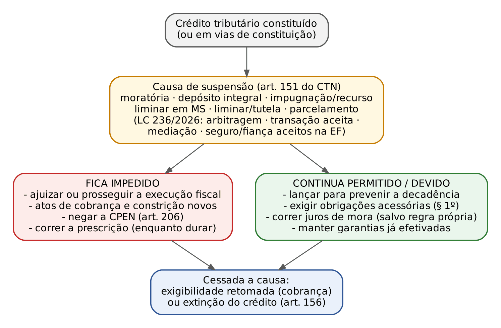
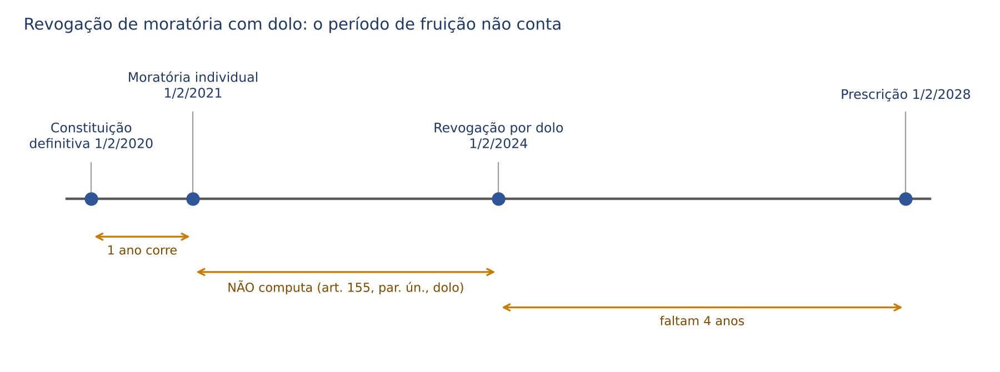
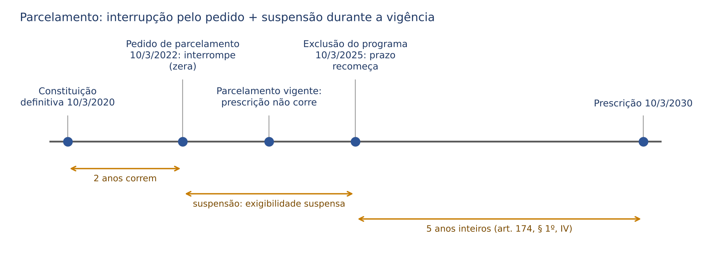
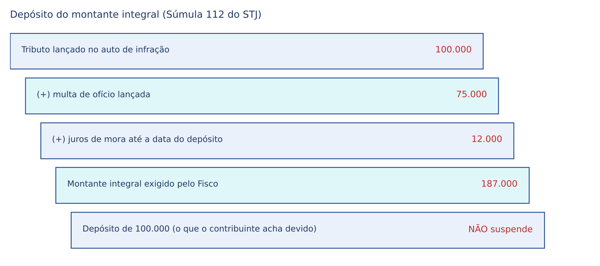
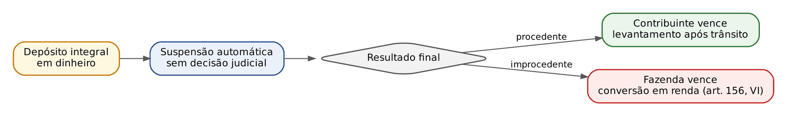

# CAPÍTULO 13 — SUSPENSÃO DA EXIGIBILIDADE DO CRÉDITO TRIBUTÁRIO: MORATÓRIA, PARCELAMENTO, DEPÓSITO DO MONTANTE INTEGRAL, RECLAMAÇÕES E RECURSOS ADMINISTRATIVOS, LIMINARES E TUTELAS; EFEITOS SOBRE CERTIDÃO, PRESCRIÇÃO E EXECUÇÃO

:::INCIDENCIA
TRF5 p. 14; TJRS p. 6; TJSC p. 12. Nível A. Lote: 24 questões (FGV 18, FCC 6).
Mais cobrado: identificar o rol do art. 151 (e separá-lo de exclusão e extinção), parcelamento (lei específica, recuperação judicial, efeitos sobre prescrição e penhora), depósito integral em dinheiro e efeito suspensivo da impugnação administrativa. ATENÇÃO: a LC 236/2026 (DOU de 4/9/2026) reescreveu o art. 151 e ainda não aparece nas questões do lote.
:::

| Subtema | FGV | FCC | Padrão de cobrança |
|---|---|---|---|
| Rol do art. 151 x exclusão x extinção | 6 | 3 | listas de "causas de suspensão" com intrusos (pagamento, anistia, remissão, compensação) |
| Parcelamento | 6 | 2 | lei específica; recuperação judicial (§§ 3º e 4º); penhora anterior (Tema 1.012); depósito x parcelamento (Tema 573) |
| Moratória | 2 | 2 | geral x individual; heterônoma da União; créditos abrangidos e dolo (art. 154) |
| Depósito integral | 3 | 1 | Súmula 112; depósito parcial não suspende; depósito como lançamento |
| Impugnação e recursos administrativos | 4 | 1 | efeito suspensivo automático; inscrição só após decisão final |
| Liminar, tutela e efeitos (prescrição, certidão) | 2 | 0 | prescrição não corre durante a suspensão; CPEN |

## 13.1 O que é suspender a exigibilidade

### 13.1.1 Exigibilidade: o "poder cobrar já"

Recorde a sequência do Cap. 12: a obrigação nasce com o fato gerador; o lançamento a torna líquida e certa (crédito constituído); vencido o prazo de pagamento sem pagamento, o crédito se torna EXIGÍVEL, isto é, a Fazenda pode adotar os atos de cobrança: inscrever em dívida ativa, protestar a CDA, negar certidão de regularidade e ajuizar a execução fiscal. Suspender a exigibilidade é paralisar temporariamente esse "poder cobrar já", sem extinguir o crédito e sem impedir a sua formação.

O paralelo civilista ajuda, com uma ressalva. No direito civil, a moratória convencional ou o prazo concedido pelo credor tornam a dívida inexigível até o novo termo, e a pendência de condição suspensiva impede o curso da prescrição (art. 199, I e II, do CC). No direito tributário a lógica é a mesma (sem exigibilidade, não há pretensão executiva e, portanto, não corre a prescrição), mas a diferença está na FONTE: o credor público não concede favores por vontade própria; cada causa de suspensão precisa estar prevista em lei complementar de normas gerais (art. 146, III, b, da CF) e, em regra, em lei do ente.

### 13.1.2 Suspensão, exclusão e extinção

:::ESQUEMA Suspensão x exclusão x extinção do crédito tributário
| | Suspensão (art. 151) | Exclusão (art. 175) | Extinção (art. 156) |
|---|---|---|---|
| O que acontece | a cobrança fica paralisada; o crédito sobrevive | o crédito não chega a ser constituído (ou é dispensado) | o crédito desaparece |
| É temporária? | SIM: cessada a causa, a exigibilidade volta (ou o crédito se extingue) | não | não |
| Hipóteses | moratória, depósito integral, impugnações e recursos, liminar em MS, liminar ou tutela provisória, parcelamento; e, desde a LC 236/2026, arbitragem, transação aceita, mediação, seguro garantia ou fiança aceitos na execução fiscal | isenção e anistia | pagamento, compensação, transação, remissão, prescrição e decadência, conversão do depósito em renda, consignação, decisões definitivas, dação de imóveis e outras |
| Obrigações acessórias | continuam devidas (art. 151, § 1º) | continuam devidas (art. 175, parágrafo único) | não se cogita |
| Onde se estuda | este capítulo | Cap. 17 | Caps. 14 e 15 |
:::

:::DICA Mnemônico das seis causas clássicas
MO-DE-RE-LI-LI-PA: MOratória, DEpósito, REclamações e recursos, LIminar em MS, LIminar ou tutela em outras ações, PArcelamento. A ordem do art. 151 é exatamente essa (incisos I a VI). Quem cai na prova como intruso: pagamento, compensação, transação (como extinção), remissão, anistia, isenção, prescrição, decadência e conversão do depósito em renda.
:::

### 13.1.3 Rol taxativo, interpretação literal e reserva de lei complementar

Três ideias sustentam o regime:

- Taxatividade: só suspende a exigibilidade o que o CTN prevê. O art. 141 do CTN diz que o crédito regularmente constituído "somente se modifica ou extingue, ou tem sua exigibilidade suspensa ou excluída, nos casos previstos nesta Lei". Por isso, garantias que não constam do rol (por exemplo, fiança bancária oferecida em cautelar antes da execução) não suspendem a exigibilidade, ainda que produzam outros efeitos (ver 13.5.3).
- Interpretação literal (art. 111, I): a legislação sobre suspensão interpreta-se literalmente. A palavra "literal" deve ser lida como "restritiva quanto à extensão": o intérprete não amplia hipóteses por analogia nem por equidade.
- Reserva de lei complementar: como a suspensão da exigibilidade integra o regime do crédito tributário (art. 146, III, b, da CF), lei ordinária não pode criar nem suprimir os efeitos que o CTN atribui às causas do art. 151. É o que o STF decidiu no Tema 874 (ver 13.4.6).

:::LEI CTN, art. 151 (redação da LC 236/2026)
Art. 151. Suspendem a exigibilidade do crédito tributário:
I - moratória;
II - o depósito do seu montante integral;
III – as impugnações, os recursos e a manifestação de inconformidade, nos termos das leis reguladoras do processo tributário administrativo;
IV - a concessão de medida liminar em mandado de segurança.
V – a concessão de medida liminar ou de tutela provisória, em outras espécies de ação judicial;
VI – o parcelamento.
VII – a instituição da arbitragem especial tributária e aduaneira, nos termos da legislação específica;
VIII – a proposta de transação aceita pela administração, nos termos da legislação específica;
IX – o acordo decorrente de mediação, até a sua eventual dissolução, nos termos da legislação específica;
X – a aceitação, pelo credor, nos termos da regulamentação estabelecida pelos órgãos de cobrança judicial dos créditos tributários, de apólice de seguro garantia ou de carta de fiança bancária oferecidas em execução fiscal, inclusive quando convencionadas por meio de negócio jurídico processual, enquanto estiverem em conformidade com as normas que regem sua aceitação e enquanto não caracterizada hipótese de sinistro.
§ 1º O disposto neste artigo não dispensa o cumprimento das obrigações assessórios dependentes da obrigação principal cujo crédito seja suspenso, ou dela conseqüentes.
§ 2º É vedada a exigência de caução ou garantia de depósito para apresentação de impugnações, recursos ou pedidos, nos termos do inciso III do caput deste artigo.
§ 3º Estando em curso a execução fiscal do crédito tributário, a suspensão de sua exigibilidade, nos termos do inciso VII do caput deste artigo, estará condicionada: I – à prévia suspensão da exigibilidade do crédito tributário na execução fiscal por outra das hipóteses previstas no caput deste artigo; ou II – ao oferecimento, pelo sujeito passivo, na arbitragem especial tributária e aduaneira, de garantia integral.
:::

:::ATENCAO LC 236/2026: o que mudou no art. 151
A LC 236, de 4/9/2026 (vigência na publicação, DOU de 4/9/2026), alterou o art. 151: (a) o inciso III passou a falar em "impugnações, recursos e manifestação de inconformidade" (antes: "reclamações e recursos"); (b) o inciso V trocou "tutela antecipada" por "tutela provisória" (linguagem do CPC/2015, que abrange urgência e evidência); (c) foram incluídos os incisos VII a X; (d) o antigo parágrafo único virou § 1º; (e) o § 2º positivou a vedação de caução ou depósito prévio para impugnar e recorrer (ver 13.6); (f) o § 3º condicionou a suspensão pela arbitragem quando já houver execução fiscal. Questões anteriores a setembro de 2026 cobram o rol de seis incisos; numa prova de 2027, a afirmação "o art. 151 do CTN arrola seis causas de suspensão" estará ERRADA.
:::

:::QUESTAO FGV 2024 — Prefeitura de Nova Iguaçu — Analista Tributário (Q3038857)
Pediu-se o conjunto que contivesse apenas causas de suspensão. Gabarito: D (moratória, depósito integral, reclamações e recursos, liminar em MS e parcelamento). As demais alternativas misturavam pagamento, remissão, prescrição, decadência, anistia, isenção, compensação, transação e conversão do depósito em renda, que são causas de extinção ou de exclusão.
No mesmo sentido: Q3562231 (FCC 2025, TRF4: gabarito D, parcelamento), Q3009030 (FGV 2024: moratória, impugnações e parcelamento), Q3265483 (FGV 2025: gabarito D, parcelamento; a alternativa E, depósito "ainda que parcial", é a armadilha), Q3841700 (FGV 2025: parcelar o IPTU), Q3881999 (FGV 2026: impugnar o auto de infração), Q3157904 (FGV 2024: moratória é suspensão e dilação do prazo), Q2466073 (FGV 2024: associar moratória a suspensão, anistia e isenção a exclusão, remissão a extinção; gabarito A) e, entre as correlatas, Q3777950 e Q3542146 (moratória, parcelamento e depósito NÃO extinguem).
:::

:::QUESTAO FCC 2024 — TRF3 — Analista Judiciário (Q2564501)
Quatro assertivas: depósito integral suspende (I, correta); a exclusão dispensa as obrigações acessórias, de modo que quem vende com isenção não precisa emitir nota fiscal (II, errada: art. 175, parágrafo único); pagamento extingue (III, correta); parcelamento na forma e condição de lei específica (IV, correta). Gabarito: C (I, III e IV). A armadilha é a II: nem a suspensão (art. 151, § 1º) nem a exclusão dispensam deveres instrumentais. Na mesma linha, Q3039637 (FGV 2024): gabarito A, a moratória heterônoma da União; erradas as alternativas que diziam que o parcelamento se rege por decreto (é lei específica) e que a exclusão dispensa as acessórias.
:::

## 13.2 Efeitos comuns da suspensão

Antes de estudar cada causa, convém fixar os efeitos que valem para todas. Assim cada causa é estudada só no que tem de próprio.

### 13.2.1 O lançamento continua possível (e necessário)

A suspensão atinge a EXIGIBILIDADE, não a CONSTITUIÇÃO do crédito. Se o contribuinte obtém liminar antes do lançamento, o prazo decadencial continua correndo contra o Fisco (decadência não se suspende nem se interrompe; ver Cap. 15), e a autoridade pode e deve lançar para evitá-la, abstendo-se apenas de cobrar. A Primeira Seção do STJ fixou essa orientação ao julgar embargos de divergência (EREsp 572.603/PR, Rel. Min. Castro Meira, DJ de 5/9/2005): a suspensão impede atos de cobrança, mas não impede a constituição regular do crédito para prevenir a decadência. Pelo mesmo motivo, decisão judicial que proíba o próprio lançamento é anômala; o que se pode impedir é a cobrança.

A LC 236/2026 deu tratamento expresso ao tema no art. 142: no lançamento destinado a prevenir a decadência de crédito cuja exigibilidade esteja suspensa por depósito integral, liminar em MS ou liminar ou tutela em outras ações (incisos II, IV e V do art. 151), não se comina multa de ofício nem multa de mora (§ 2º), desde que a suspensão tenha ocorrido ANTES do início de qualquer procedimento de ofício relativo ao crédito (§ 3º). A lógica: quem se antecipou e obteve a suspensão não é infrator; se a suspensão veio depois de iniciada a fiscalização, a multa é cabível.

:::PEGADINHA "A liminar impede o lançamento"
Errado. A liminar (ou o depósito, ou qualquer causa do art. 151) impede a COBRANÇA. O Fisco lança para não perder o direito pela decadência; a partir da LC 236/2026, sem multa de ofício ou de mora quando a suspensão por depósito, liminar ou tutela antecedeu o procedimento fiscal.
:::

### 13.2.2 Inscrição em dívida ativa e execução fiscal

A execução fiscal pressupõe título exigível: crédito com exigibilidade suspensa não pode ser executado. O efeito prático depende do momento:

- Suspensão ANTERIOR ao ajuizamento: falta exigibilidade ao título no momento da propositura; a orientação do STJ é de que a execução ajuizada nessas condições deve ser extinta, e não meramente suspensa.
- Suspensão POSTERIOR ao ajuizamento (por exemplo, parcelamento obtido no curso da execução): a execução fica SUSPENSA (art. 922 do CPC, aplicado subsidiariamente), sem extinção; descumprido o parcelamento, retoma-se do ponto em que parou. As penhoras já feitas permanecem (ver 13.4.7).

Quanto à inscrição em dívida ativa, distinga. Quando a causa de suspensão existe antes da constituição definitiva (impugnação ou recurso administrativo pendente), não há sequer crédito definitivamente constituído e a inscrição é indevida: ela só ocorre depois da decisão administrativa final. Quando a suspensão sobrevém a um crédito já inscrito (parcelamento de débito inscrito, liminar posterior), a inscrição feita não se desfaz; apenas os atos de cobrança ficam paralisados. A própria LC 225/2026 (Código de Defesa do Contribuinte) trabalha com a categoria de "créditos tributários inscritos em dívida ativa com exigibilidade suspensa".

:::QUESTAO FGV 2025 — SEFAZ-RS — Auditor do Estado (Q3154678)
Empresa autuada pela Receita Federal apresentou recurso administrativo. Gabarito: E (a exigibilidade fica suspensa até a decisão final administrativa). Armadilhas: A (inscrever em dívida ativa "independentemente do desfecho" para resguardar o Fisco: a inscrição pressupõe crédito definitivamente constituído e exigível); B (exigir depósito para suspender: a impugnação suspende por si); D (a concomitância é o inverso: é a ação judicial que importa renúncia à via administrativa, não o recurso administrativo que impede a ação; ver 13.6.3).
:::

### 13.2.3 Prescrição

Prescrição tributária pressupõe pretensão exercitável (*actio nata*): se o Fisco não pode cobrar, a prescrição não corre. Por isso, durante a vigência de qualquer causa de suspensão posterior à constituição definitiva, o prazo do art. 174 fica suspenso e volta a correr, pelo saldo, quando a causa cessa. O CTN só prevê uma suspensão de forma expressa (art. 155, parágrafo único, na moratória revogada por dolo; ver 13.3.5), mas doutrina e jurisprudência extraem a regra geral da própria lógica da exigibilidade.

Dois cuidados. Primeiro: na impugnação administrativa, rigorosamente, a prescrição nem começou, porque o termo inicial é a constituição DEFINITIVA, que só ocorre com a decisão final do processo administrativo (Cap. 15). Segundo: o pedido de parcelamento produz efeito duplo, interrompe (porque é reconhecimento do débito) e, deferido, suspende (ver 13.4.4). Revogada a liminar que suspendia a exigibilidade, retoma-se o curso da prescrição, salvo se subsistir outra causa do art. 151 ou recurso com efeito suspensivo (STJ, EAREsp 407.940/RS, Primeira Seção, j. 10/5/2017).

:::QUESTAO FGV 2025 — SEFAZ-PR — Auditor Fiscal (Q3363406)
Lançamento de IRPF impugnado; processo administrativo de três anos; no curso dele, liminar em MS suspendendo a exigibilidade; ao final, decisão administrativa desfavorável e cassação da liminar; inscrição em dívida ativa. Gabarito oficial: A (impugnação e liminar suspenderam a exigibilidade e impediram a fluência da prescrição; a inscrição só foi possível depois da decisão final e da cassação).
Passos: (1) a impugnação suspende a exigibilidade (art. 151, III) e impede a constituição definitiva, logo a prescrição sequer se inicia; (2) a liminar é outra causa de suspensão; enquanto vigente, nada corre; (3) só com a decisão administrativa final e a cassação da liminar o crédito fica definitivamente constituído e exigível, autorizando a inscrição. Armadilhas: D (a liminar não INTERROMPE a prescrição: interrupção é fenômeno do art. 174, § 1º; suspensão da exigibilidade gera suspensão, não interrupção) e E (o prazo não corre enquanto a exigibilidade está suspensa). A redação da alternativa A ("impedindo a fluência do prazo prescricional durante todo o período") é imprecisa quanto à fase administrativa, em que a prescrição nem começara, mas é a única compatível com o sistema.
:::

### 13.2.4 Certidão positiva com efeito de negativa

Crédito com exigibilidade suspensa não impede a obtenção de certidão de regularidade fiscal: o art. 206 do CTN dá à certidão em que conste crédito "cuja exigibilidade esteja suspensa" os mesmos efeitos da certidão negativa (CPEN). É uma das consequências práticas mais relevantes da suspensão: licitação, financiamento público, recuperação judicial (o art. 57 da Lei 11.101/2005 exige certidões "nos termos dos arts. 151, 205, 206" do CTN). O regime das certidões, os prazos e as recusas indevidas são estudados no Cap. 19.

:::QUESTAO FGV 2025 — TCE-RR — Auditor de Controle Externo (Q3186485)
Empresa com moratória municipal deferida, tutela antecipada em ação anulatória e parcelamento do restante. Gabarito: E (moratória, decisão judicial e parcelamento suspendem a exigibilidade e dão direito à CPEN, ainda que sem garantia). Armadilhas: A (o PEDIDO de moratória não suspende; suspende a moratória concedida); B (a tutela não pressupõe depósito; ver 13.7); C (a prescrição tributária extingue o próprio crédito, art. 156, V; não sobra dívida negociável); D (a confissão para parcelar, em regra, não se revê quanto aos FATOS; só os aspectos jurídicos são livremente discutíveis; ver 13.4.5).
:::

### 13.2.5 Obrigações acessórias, juros e multa de mora

A suspensão não dispensa as obrigações acessórias dependentes da obrigação principal ou dela consequentes (art. 151, § 1º): a empresa com ICMS parcelado continua a emitir notas, escriturar livros e entregar declarações. A suspensão também não congela, por si, os encargos: juros de mora continuam a correr enquanto o crédito não é pago, salvo regra própria (o depósito integral cessa a responsabilidade do executado pelos juros e pela correção a partir da sua efetivação, como decidiu a 2ª Turma do STJ para a execução fiscal no REsp 2.213.669-PR, j. 2/9/2025, inclusive para o bloqueio via SISBAJUD; ver Cap. 21).

Quanto à multa de mora, a LC 236/2026 acrescentou o § 3º ao art. 161: a propositura de ação em que foi concedida liminar ou tutela provisória interrompe a incidência da multa de mora, desde a concessão da medida até 30 dias após a publicação da decisão que considerar devido o tributo. É a positivação, para a liminar e a tutela, de uma solução de boa-fé: quem estava amparado por decisão judicial não estava em mora culposa, mas tem 30 dias para pagar após perdê-la.

:::DICA Suspensão não é "zona livre"
Durante a suspensão, a Fazenda pode: lançar, fiscalizar, exigir acessórias, manter garantias e penhoras já feitas, manter arrolamento de bens (a suspensão não cancela o arrolamento do art. 64 da Lei 9.532/1997: Jurisprudência em Teses do STJ, ed. 70, tese 11; arrolamento é tema do Cap. 20). Não pode: executar, praticar novos atos de cobrança, recusar a CPEN, nem ver correr a prescrição a seu desfavor.
:::

## 13.3 Moratória (arts. 152 a 155)

### 13.3.1 Conceito e finalidade

Moratória é a prorrogação, concedida por lei, do prazo de pagamento do tributo, em parcela única ou em parcelas. Pressupõe situação excepcional (calamidade, crise setorial, catástrofe regional): é um favor fiscal de crise, ao passo que o parcelamento é instrumento ordinário de recuperação de créditos inadimplidos (ver quadro em 13.3.6). Assim como a isenção, a moratória só pode ser concedida pelo ente competente para instituir o tributo, com uma exceção (a moratória heterônoma da União).

### 13.3.2 Espécies: geral e individual; autônoma e heterônoma

:::LEI CTN, art. 152
Art. 152. A moratória somente pode ser concedida:
I - em caráter geral:
a) pela pessoa jurídica de direito público competente para instituir o tributo a que se refira;
b) pela União, quanto a tributos de competência dos Estados, do Distrito Federal ou dos Municípios, quando simultâneamente concedida quanto aos tributos de competência federal e às obrigações de direito privado;
II - em caráter individual, por despacho da autoridade administrativa, desde que autorizada por lei nas condições do inciso anterior.
Parágrafo único. A lei concessiva de moratória pode circunscrever expressamente a sua aplicabilidade à determinada região do território da pessoa jurídica de direito público que a expedir, ou a determinada classe ou categoria de sujeitos passivos.
:::

- Moratória em caráter GERAL: concedida diretamente pela lei a todos que se enquadrem em critérios objetivos (todos os contribuintes do IPTU do Município atingido pela enchente). Não depende de requerimento nem de despacho.
- Moratória em caráter INDIVIDUAL: a lei autoriza; a fruição depende de requerimento e de despacho da autoridade que verifica o preenchimento de requisitos subjetivos (comprovar prejuízo, capacidade de pagamento). O despacho tem natureza declaratória do direito previsto em lei.
- Moratória AUTÔNOMA: concedida pelo próprio ente titular da competência (art. 152, I, a).
- Moratória HETERÔNOMA: concedida pela União sobre tributos estaduais, distritais e municipais (art. 152, I, b), com duas condições cumulativas: que a União a conceda, ao mesmo tempo, aos tributos federais e às obrigações de direito privado. A ideia é uma medida nacional de emergência (guerra, colapso econômico).

A heterônoma convive com a vedação de isenção heterônoma do art. 151, III, da CF: a União NÃO pode isentar tributos estaduais ou municipais (salvo tratados internacionais e as hipóteses constitucionais específicas; ver Cap. 17), mas o CTN admite que conceda moratória geral sobre eles. Parte da doutrina questiona a compatibilidade dessa moratória com a autonomia federativa, mas para a prova vale a literalidade do art. 152, I, b.

:::QUESTAO FCC 2026 — SEFAZ-SP — AFRE (Q3955862)
Gabarito: E (a União não pode conceder isenção de tributos estaduais, distritais e municipais, ainda que simultaneamente aos federais; mas pode conceder moratória em caráter geral desses tributos se a conceder simultaneamente aos tributos federais e às obrigações de direito privado). Armadilhas: B (moratória heterônoma "em caráter individual, mediante despacho de autoridade federal": o art. 152, I, b, só prevê a heterônoma em caráter GERAL; a individual depende de lei "nas condições do inciso anterior" e é despachada pela autoridade do ente); C e D (isenção heterônoma admitida: vedada pelo art. 151, III, da CF).
:::

### 13.3.3 Conteúdo obrigatório da lei (art. 153)

A lei que concede moratória geral ou autoriza a individual deve especificar, sem prejuízo de outros requisitos: o prazo de duração do favor; as condições da concessão individual; e, "sendo caso", os tributos alcançados, o número de prestações e seus vencimentos (podendo deixar a fixação à autoridade, na individual) e as garantias exigidas na individual. Note o "sendo caso": a lei pode alcançar todos os tributos do ente e pode prever pagamento único ao fim do prazo.

### 13.3.4 Créditos abrangidos e exclusão do dolo (art. 154)

:::LEI CTN, art. 154
Art. 154. Salvo disposição de lei em contrária, a moratória sòmente abrange os créditos definitivamente constituídos à data da lei ou do despacho que a conceder, ou cujo lançamento já tenha sido iniciado àquela data por ato regularmente notificado ao sujeito passivo.
Parágrafo único. A moratória não aproveita aos casos de dolo, fraude ou simulação do sujeito passivo ou do terceiro em benefício daquele.
:::

Duas regras. (1) Alcance temporal: salvo lei em contrário, a moratória só alcança créditos já definitivamente constituídos na data da lei ou do despacho, ou cujo lançamento já tenha sido iniciado por ato regularmente notificado. Créditos constituídos depois ficam de fora, a menos que a lei os inclua. (2) Exclusão subjetiva: não aproveita a casos de dolo, fraude ou simulação do sujeito passivo ou de terceiro em seu benefício. Essa segunda regra NÃO tem a ressalva "salvo disposição de lei em contrário" (que está só no caput).

:::QUESTAO FCC 2026 — SEFAZ-GO — Auditor Fiscal (Q4067494)
Caso com datas: (I) ICMS não pago por erro DELIBERADO na alíquota, com simulação de operações (decisão administrativa definitiva em maio de 2025); (II) falta de emissão de documentos fiscais (decisão definitiva em outubro de 2025); (III) denúncia espontânea de creditamento indevido em maio de 2025, com depósito da importância arbitrada em julho, mas crédito definitivamente constituído só em novembro de 2025. Em setembro de 2025, lei específica concede moratória individual para a infração (I) e geral para (II) e (III). Gabarito: C (a moratória não alcança nem as infrações lançadas de ofício, nem a denunciada espontaneamente).
Passos: (1) Infração I: crédito definitivo em maio, antes da lei, mas com simulação deliberada; o art. 154, parágrafo único, exclui o favor. (2) Infração II: sem dolo, mas a decisão definitiva só veio em outubro, DEPOIS da lei de setembro; a banca aplicou o filtro temporal do caput (crédito não definitivamente constituído na data da lei). (3) Infração III: crédito definitivamente constituído só em novembro, também depois da lei; a denúncia é ato do contribuinte e o arbitramento não é lançamento notificado. Armadilhas: A (não há vedação genérica de moratória para créditos objeto de denúncia espontânea); E (inclui a infração dolosa).
Ponto discutível: o caput do art. 154 também abrange créditos "cujo lançamento já tenha sido iniciado" na data da lei "por ato regularmente notificado ao sujeito passivo". O lançamento de ofício da infração II foi notificado antes de setembro (houve processo administrativo), de modo que, pela letra do CTN, ele estaria alcançado. O gabarito só se sustenta se se ignorar essa segunda parte (ver Nota de verificação). Para a prova, memorize os DOIS filtros do caput (crédito definitivo OU lançamento iniciado e notificado na data da lei) e o filtro do parágrafo único (sem dolo, fraude ou simulação).
:::

### 13.3.5 Revogação da moratória individual (art. 155)

A moratória individual NÃO gera direito adquirido: deve ser revogada de ofício sempre que se apure que o beneficiário não satisfazia ou deixou de satisfazer as condições ou requisitos. Os efeitos da revogação dependem do comportamento do beneficiário:

:::ESQUEMA Revogação da moratória individual (art. 155)
| | Com dolo ou simulação do beneficiado ou de terceiro em seu benefício (inciso I) | Sem dolo (inciso II) |
|---|---|---|
| Cobrança | crédito + juros de mora + PENALIDADE cabível | crédito + juros de mora, SEM penalidade |
| Prescrição | o tempo entre a concessão e a revogação NÃO se computa | a revogação só pode ocorrer ANTES de prescrito o direito de cobrar |
| Natureza do efeito | hipótese expressa de suspensão da prescrição no CTN | limite temporal à revogação |
:::

:::EXEMPLO Contando a prescrição na moratória revogada
Crédito de ITCMD definitivamente constituído em 1/2/2020. Em 1/2/2021, o Estado defere moratória individual a Beatriz, que declarou falsamente ter perdido a colheita. Em 1/2/2024, apurada a fraude, a moratória é revogada. Como houve dolo, os três anos de fruição não contam: correu 1 ano antes da concessão; faltam 4 anos a partir da revogação; a prescrição ocorrerá em 1/2/2028, e a cobrança incluirá juros e multa. Se Beatriz tivesse apenas deixado de cumprir uma condição, sem fraude, o período contaria normalmente: a prescrição ocorreria em 1/2/2025, e a revogação teria de ser feita antes dessa data; a cobrança teria juros, mas não multa.
:::

O mesmo regime de revogação do art. 155 aplica-se, por remissão expressa do CTN, à isenção individual (art. 179, § 2º), à anistia individual (art. 182, parágrafo único) e à remissão (art. 172, parágrafo único) e, por força do art. 155-A, § 2º, ao parcelamento.

### 13.3.6 Moratória x parcelamento

| | Moratória | Parcelamento |
|---|---|---|
| Base legal | arts. 152 a 155 | art. 155-A (aplica a moratória subsidiariamente) |
| Função | favor de crise: adiar o vencimento | instrumento ordinário de regularização de débito vencido |
| Dívida | normalmente ainda não vencida (prorroga o vencimento) | já vencida e inadimplida |
| Juros e multa | prorrogado o vencimento, não há mora enquanto a moratória é cumprida; na revogação, juros sempre e multa só com dolo (art. 155) | salvo lei em contrário, NÃO exclui juros e multas (art. 155-A, § 1º) |
| Heterônoma | admitida (art. 152, I, b) | não há previsão |

Parte da doutrina (por exemplo, Ricardo Alexandre, que trata de "moratória parcelada" e "parcelamento" separadamente) observa que a moratória pode ser concedida com pagamento em parcelas, o que a aproxima do parcelamento; a diferença decisiva, cobrada em prova, é a regra do § 1º do art. 155-A sobre juros e multas.

## 13.4 Parcelamento (art. 155-A)

### 13.4.1 Fonte: lei específica do ente

:::LEI CTN, art. 155-A (incluído pela LC 104/2001; §§ 3º e 4º pela LC 118/2005)
Art. 155-A. O parcelamento será concedido na forma e condição estabelecidas em lei específica.
§ 1o Salvo disposição de lei em contrário, o parcelamento do crédito tributário não exclui a incidência de juros e multas.
§ 2o Aplicam-se, subsidiariamente, ao parcelamento as disposições desta Lei, relativas à moratória.
§ 3o Lei específica disporá sobre as condições de parcelamento dos créditos tributários do devedor em recuperação judicial.
§ 4o A inexistência da lei específica a que se refere o § 3o deste artigo importa na aplicação das leis gerais de parcelamento do ente da Federação ao devedor em recuperação judicial, não podendo, neste caso, ser o prazo de parcelamento inferior ao concedido pela lei federal específica.
:::

Parcelamento é o pagamento do crédito vencido em prestações, nos termos de LEI ESPECÍFICA do ente credor. Decorrências cobradas:

- Não é direito subjetivo extraído do CTN: o contribuinte só tem direito ao parcelamento previsto e nas condições previstas em lei; o juiz não pode criar parcelamento, alongar prazos ou dispensar requisitos legais por equidade (o art. 155-A e a literalidade do art. 111 vedam). No mesmo espírito, o STJ recusou estender os limites de um parcelamento especial a débitos não parcelados com base nele (Tema 1.401; v. Cap. 7).
- Atos infralegais não podem criar requisitos que a lei não prevê, mas podem regulamentar a gestão. Exemplo de limite: o STJ admitiu que ato infralegal fixe teto de valor para adesão ao parcelamento simplificado federal, salvo quando a própria lei fixar o valor e o regulamento o reduzir em prejuízo do contribuinte (Tema 997 do STJ, j. 20/6/2024).
- Cada ente legisla sobre o parcelamento dos SEUS tributos. Por isso, optantes do Simples Nacional, cujo documento único abrange tributos de vários entes, não podem aderir a parcelamentos instituídos por lei federal ordinária: só lei complementar pode criar parcelamento que englobe tributos de entes diversos (Jurisprudência em Teses do STJ, ed. 275, tese 5; ver Cap. 31).
- Subsidiariamente, aplicam-se as regras da moratória (§ 2º): o parcelamento alcança, salvo lei em contrário, créditos já constituídos ou com lançamento iniciado (art. 154); não aproveita a casos de dolo, fraude ou simulação (art. 154, parágrafo único); a exclusão segue a lógica do art. 155 (juros sempre; multa e não cômputo do prazo prescricional se houver dolo).
- Juros e multas: diferentemente do que ocorre na moratória cumprida, o parcelamento NÃO exclui juros e multas, salvo lei em contrário (§ 1º). Programas especiais (os "Refis") costumam reduzir multas e juros; isso é anistia ou remissão parcial embutida no programa, regida pela lei do programa. Exemplo de controvérsia: na quitação antecipada do parcelamento da Lei 11.941/2009, a redução dos juros incide após a consolidação, sobre o montante original de juros, e a exclusão de 100% das multas não implica exclusão proporcional dos juros sem previsão expressa (Tema 1.187 do STJ, j. 25/10/2023).

:::QUESTAO FGV 2024 — Prefeitura de Macaé — Procurador (Q3049979)
O pai do contribuinte pede o parcelamento do IPTU do filho. Gabarito: C (é possível, mas as parcelas não podem ultrapassar o prazo prescricional, devendo a última vencer até o décimo segundo mês anterior ao fim desse prazo). O fundamento é a lei específica do Município (art. 155-A), não o CTN: o terceiro que pode pagar (art. 304, parágrafo único, do CC, aplicável por analogia) também pode, se a lei local o admitir, requerer o parcelamento, sem com isso tornar-se sujeito passivo. Armadilhas: A e B (vedar ao terceiro), E (criar "responsável tributário consensual", figura inexistente: responsabilidade decorre de lei, art. 128 do CTN). O limite temporal da alternativa C reproduz a legislação municipal de Macaé, que não foi conferida nesta tarefa (ver Nota de verificação).
:::

### 13.4.2 Parcelamento na recuperação judicial

A LC 118/2005, junto com a Lei 11.101/2005, criou um regime próprio: lei específica de cada ente deve disciplinar o parcelamento dos créditos tributários do devedor em recuperação judicial (§ 3º). Na ausência dessa lei, aplicam-se as leis gerais de parcelamento do ente, mas o prazo não pode ser inferior ao da lei FEDERAL específica (§ 4º). A Lei 11.101/2005, art. 68, completa: as Fazendas Públicas e o INSS "poderão deferir, nos termos da legislação específica, parcelamento de seus créditos, em sede de recuperação judicial", e as microempresas e empresas de pequeno porte farão jus a prazos 20% SUPERIORES aos concedidos às demais empresas (parágrafo único, incluído pela LC 147/2014). No plano federal, a Lei 14.112/2020 ampliou as modalidades de parcelamento e transação para empresas em recuperação, alterando a Lei 10.522/2002 (números de parcelas e percentuais não conferidos nesta tarefa; ver Nota de verificação).

Duas consequências práticas: (a) o crédito tributário não se sujeita ao plano de recuperação; o parcelamento é a via própria de regularização; (b) a certidão de regularidade exigida pelo art. 57 da Lei 11.101 pode ser a CPEN obtida com o parcelamento (ver 13.2.4). A execução fiscal não se suspende pelo deferimento da recuperação, ressalvada a competência do juízo da recuperação para substituir constrições sobre bens de capital essenciais (art. 6º, § 7º-B, da Lei 11.101, incluído pela Lei 14.112/2020); o tema é desenvolvido nos Caps. 18 e 22.

:::QUESTAO FGV 2024 — CGM de Belo Horizonte — Auditor Interno (Q2387534)
Município sem lei específica de parcelamento para empresas em recuperação judicial. Gabarito: C (aplicam-se as leis gerais municipais de parcelamento, com prazo não inferior ao da lei FEDERAL específica). Armadilhas: A e B (aplicar a lei federal ou a estadual "em sua integralidade": o § 4º manda aplicar a lei geral do próprio ente e usa a lei federal só como piso de prazo); D (o piso é o da lei federal, não o da estadual).
No mesmo sentido: Q3947203 (FCC 2026, SEFAZ-MT): gabarito D (o parcelamento para ME e EPP em recuperação é admissível, deferido pela Fazenda nos termos da legislação específica); a armadilha A inverte o art. 68, parágrafo único, da Lei 11.101 (prazo 20% SUPERIOR, não inferior). E Q2510949 (FGV 2024, Câmara dos Deputados): gabarito C; a assertiva III (o CTN não distingue devedores em recuperação) é falsa pelos §§ 3º e 4º do art. 155-A; a I (impugnação ou liminar entre a ciência do lançamento e o vencimento) e a II (depois do vencimento, moratória ou parcelamento) são verdadeiras.
:::

### 13.4.3 Quando o parcelamento suspende: pedido x deferimento

O que suspende a exigibilidade é o parcelamento CONCEDIDO, não o simples pedido. O STJ, em recurso repetitivo (REsp 957.509), condicionou o efeito suspensivo à homologação expressa ou tácita do pedido pela Administração, nos termos da lei do programa. Leis federais de parcelamento costumam prever o deferimento tácito ou a suspensão desde o pedido com pagamento da primeira parcela; vale sempre a lei específica. Um corolário: o parcelamento de ofício, feito unilateralmente pela Administração (como o carnê de IPTU dividido em cotas sem pedido do contribuinte), não é parcelamento no sentido do art. 151, VI, e não interrompe a prescrição, porque falta o reconhecimento do débito pelo devedor (Tema 980 do STJ, REsp 1.658.517-PA, j. 14/11/2018, cuja parte sobre o termo inicial da prescrição do IPTU é desenvolvida no Cap. 15).

:::PEGADINHA Parcelamento suspende; não extingue
Parcelamento deferido SUSPENDE a exigibilidade; só o pagamento da última parcela EXTINGUE o crédito (art. 156, I). A FGV insiste: "o parcelamento regularmente deferido extingue o crédito tributário" é falso (Q3179564, FGV 2025, TRF3, alternativa D; Q3966708, alternativa D).
:::

### 13.4.4 Parcelamento e prescrição: interrupção e suspensão

O pedido de parcelamento tem dois efeitos distintos sobre a prescrição do crédito:

- INTERROMPE, porque é "ato inequívoco ainda que extrajudicial, que importe em reconhecimento do débito pelo devedor" (art. 174, § 1º, IV, do CTN, renumerado pela LC 236/2026; antes, parágrafo único, IV). A interrupção ocorre com o PEDIDO, ainda que indeferido.
- SUSPENDE, enquanto o parcelamento estiver vigente, porque a exigibilidade está suspensa (13.2.3). Rescindido o parcelamento, o prazo, já zerado pela interrupção, recomeça por inteiro a partir da exclusão (data do inadimplemento ou da exclusão formal, conforme a lei do programa).

:::JURIS Súmula 653 do STJ (Primeira Seção, 2/12/2021)
"O pedido de parcelamento fiscal, ainda que indeferido, interrompe o prazo prescricional, pois caracteriza confissão extrajudicial do débito."
:::

:::EXEMPLO Contando a prescrição com parcelamento
Crédito de ICMS da Comercial Delta definitivamente constituído em 10/3/2020. Em 10/3/2022, a empresa pede parcelamento: a prescrição é interrompida e, deferido o pedido, fica suspensa durante a vigência. Em 10/3/2025, a empresa é excluída por inadimplência. O prazo de cinco anos recomeça por inteiro: a prescrição ocorrerá em 10/3/2030. Se o pedido tivesse sido INDEFERIDO em 10/6/2022, a interrupção teria ocorrido mesmo assim (Súmula 653), mas sem período de suspensão: o novo quinquênio correria de 10/3/2022 e terminaria em 10/3/2027.
:::

Dois limites. Primeiro: parcelamento não ressuscita crédito extinto. Se o crédito já estava prescrito ou decaído, a confissão e o parcelamento posteriores não restabelecem a exigibilidade, porque prescrição e decadência tributárias extinguem o próprio crédito (art. 156, V) e não admitem renúncia (Jurisprudência em Teses do STJ, ed. 70, tese 8; Tema 604 do STJ, quanto à decadência; ver Cap. 15). Para o civilista, eis a diferença: no Código Civil, a renúncia tácita à prescrição consumada é possível (art. 191 do CC); no tributário, o pagamento de crédito prescrito é indevido e repetível. Segundo: no plano penal, o parcelamento suspende a pretensão punitiva e a prescrição penal nos crimes contra a ordem tributária, e o pagamento integral extingue a punibilidade (ver Apostila de Direito Penal, Caps. 22 e 45).

:::QUESTAO FGV 2024 — TJ-SC — Juiz Substituto (Q3049408), correlata
A alternativa B ("o pedido de parcelamento interrompe a prescrição, CASO DEFERIDO") é falsa: pela Súmula 653 do STJ, o pedido interrompe ainda que indeferido. Na mesma linha, Q4079417 (FGV 2026, PGE-AC), alternativa B (pedido indeferido "não interfere na prescrição": falso).
:::

### 13.4.5 Confissão irretratável: o que ainda se pode discutir (Tema 375 do STJ)

As leis de parcelamento exigem confissão irrevogável e irretratável do débito e, quando há ação judicial, desistência com renúncia ao direito em que se funda. A pergunta do briefing ("adesão implica renúncia ao direito de discutir?") tem resposta em duas camadas:

- Quanto aos ASPECTOS JURÍDICOS (inconstitucionalidade da lei, ilegalidade da cobrança, não incidência), a confissão não inibe o questionamento judicial: o contribuinte não pode "confessar" que deve tributo que a lei não prevê. A obrigação tributária nasce da lei, não da vontade.
- Quanto aos FATOS confessados, a regra é a irretratabilidade: não se pode rever judicialmente a matéria de fato da confissão, salvo quando presente defeito causador de nulidade do ato jurídico (erro, dolo, simulação, fraude).

:::JURIS STJ, Tema 375 (REsp 1.133.027/SP, Primeira Seção, j. 13/10/2010)
A confissão da dívida não inibe o questionamento judicial da obrigação tributária quanto aos seus aspectos jurídicos. Quanto aos aspectos fáticos, a regra é que não se pode rever judicialmente a confissão feita para obter parcelamento; mas a matéria de fato pode ser invalidada quando presente defeito causador de nulidade do ato jurídico (erro, dolo, simulação e fraude).
:::

Distinga a renúncia PROCESSUAL. Se a lei do programa exige desistência da ação com renúncia ao direito (art. 487, III, c, do CPC), e o contribuinte a formula, a sentença homologatória faz coisa julgada material: aí não se discute mais. Se apenas confessou, sem renunciar em juízo, aplica-se o Tema 375. Na extinção da execução ou dos embargos decorrente da adesão a programa que já inclui os honorários, não cabe nova condenação em honorários (AREsp 2.523.152-CE, 2ª Turma do STJ, j. 21/5/2024; Tema 1.317 do STJ, j. 12/11/2025, para a desistência dos embargos; ver Cap. 22).

:::SENTENCA Embargos à execução ou anulatória após parcelamento
Onde entra: preliminar de "falta de interesse" ou "confissão irretratável" arguida pela Fazenda quando o contribuinte parcelou e depois ajuizou ação. O que fundamentar: separar questão jurídica (sempre discutível) de questão fática (só com vício de consentimento ou erro de fato demonstrado); verificar se houve renúncia ao direito homologada.
Redação-modelo: "A adesão ao parcelamento, com confissão irretratável, não impede o exame da legalidade da exigência, pois a confissão não cria obrigação tributária sem lei (STJ, Tema 375); rejeito a preliminar." Erro comum punido: extinguir o processo sem mérito por "renúncia" que não foi formulada nem homologada, ou, ao contrário, reabrir fatos confessados sem prova de erro, dolo, simulação ou fraude.
:::

### 13.4.6 Exclusão do programa, garantias e solidariedade

- Notificação da exclusão: é válida a notificação do ato de exclusão do Refis pelo Diário Oficial ou pela internet (Súmula 355 do STJ); mas o STF declarou inconstitucional a resolução do Comitê Gestor do Refis que suprimiu a notificação PRÉVIA ao ato de exclusão (Tema 668 do STF, RE 669.196, j. 23/10/2020). Conciliação: a forma da notificação pode ser a eletrônica ou a oficial; o que não se admite é excluir sem notificar antes, suprimindo o contraditório.
- Garantia como condição da SUSPENSÃO: lei ordinária não pode retirar o efeito suspensivo do parcelamento sem garantia. O STF declarou inconstitucional, por afronta ao art. 146, III, b, da CF, a expressão "ou parcelados sem garantia" do parágrafo único do art. 73 da Lei 9.430/1996 (incluída pela Lei 12.844/2013), que retirava os efeitos da suspensão prevista no CTN (Tema 874 do STF, RE 917.285, j. 18/8/2020). Coisa diversa é a lei do programa exigir garantia como requisito de ADESÃO: isso é condição de concessão, permitida pelo art. 153, III, c, aplicado subsidiariamente. Exemplo histórico: no Refis, a suspensão de créditos superiores a 500.000 (quinhentos mil) reais pressupunha homologação expressa do comitê gestor e arrolamento de bens (Súmula 437 do STJ).
- Solidariedade: o parcelamento requerido por um dos devedores solidários não importa renúncia à solidariedade quanto aos demais coobrigados (REsp 1.978.780-SP, STJ, Info 732, j. 5/4/2022). O pagamento das parcelas aproveita aos demais (art. 125, I, do CTN), mas o Fisco não perde o direito de cobrar dos outros o saldo.

### 13.4.7 Parcelamento, penhora e depósito judicial

:::JURIS STJ, Tema 1.012 (REsp 1.696.270/MG, 1.703.535/PA e 1.756.406/PA, Primeira Seção, j. 8/6/2022)
O bloqueio de ativos financeiros feito ANTES da concessão do parcelamento deve ser mantido: o parcelamento suspende a exigibilidade e a execução, mas não desconstitui garantias já efetivadas. Se o parcelamento for ANTERIOR à constrição, o bloqueio deve ser levantado. Ressalva-se a substituição excepcional da penhora *on-line* por fiança bancária ou seguro garantia, diante das peculiaridades do caso e de prova irrefutável, pelo executado, da necessidade para observar a menor onerosidade.
:::

:::QUESTAO FGV 2026 — TJ-GO — Juiz Substituto (Q3966708)
Bloqueio via sistema eletrônico; depois, adesão a parcelamento, com pagamentos em dia; pedido de levantamento. Gabarito: C (o bloqueio, anterior ao parcelamento, deve ser mantido, sendo possível a substituição da garantia se comprovada onerosidade excessiva). Armadilhas: A (suspensão da exigibilidade não equivale a desconstituição de garantia já feita); D (parcelamento não extingue); E (a manutenção não depende da natureza do bem).
:::

:::SENTENCA Pedido de liberação de penhora por parcelamento superveniente
Fundamentação em três linhas: (1) data da constrição x data da concessão do parcelamento; (2) se a constrição é anterior, mantém-se e a execução fica suspensa (Tema 1.012 do STJ; art. 151, VI, do CTN); (3) substituição só com prova concreta de necessidade.
Redação-modelo: "Deferido o parcelamento depois do bloqueio, suspendo a execução fiscal enquanto vigente o acordo (art. 151, VI, do CTN), mas mantenho a constrição já efetivada, que não é desconstituída pela suspensão superveniente (STJ, Tema 1.012)." Erro comum: extinguir a execução pelo parcelamento ou liberar automaticamente a penhora.
:::

O STF examinou situação simétrica: a lei de parcelamento pode excluir débitos que estejam garantidos por depósito judicial em ação na qual o contribuinte discute o tributo. A restrição não viola a isonomia nem o acesso à justiça, porque o contribuinte que depositou está em situação jurídica distinta da do inadimplente: seu débito já está garantido e com exigibilidade suspensa (RE 640.905/SP, Plenário, j. 15/12/2016, Tema 573 da repercussão geral, sobre a Portaria 655/1993 e a COFINS).

:::QUESTAO FGV 2026 — TRF2 — Juiz Federal Substituto (Q3996883)
Empresa discute a COFINS com depósito judicial integral; lei posterior institui parcelamento vedando a adesão de débitos garantidos por depósito judicial. Gabarito: A (a restrição é constitucional: quem depositou está em situação distinta da do inadimplente; não há ofensa à isonomia nem ao acesso à justiça). Armadilhas: C e D (isonomia e acesso à justiça: rejeitados pelo STF no Tema 573); E (não se exige lei complementar para condições de parcelamento; a reserva do art. 146, III, b, protege os EFEITOS que o CTN dá ao parcelamento, não o desenho de cada programa, que é matéria da lei específica do ente).
:::

## 13.5 Depósito do montante integral (art. 151, II)

### 13.5.1 Natureza: faculdade do contribuinte, efeito automático

O depósito é a forma mais segura de suspender a exigibilidade: o contribuinte que quer discutir o tributo, sem pagar e sem ficar inadimplente, deposita o valor exigido. Três características:

- Faculdade, não ônus: ninguém é obrigado a depositar para discutir o tributo. Condicionar o ajuizamento de ação ao depósito é inconstitucional (Súmula Vinculante 28, sobre o art. 38 da LEF; ver Cap. 23), e a exigência de depósito prévio para recorrer administrativamente também o é (SV 21; ver 13.6).
- Efeito automático: feito o depósito integral, a suspensão decorre da lei; não depende de decisão judicial deferindo-a, nem de concordância da Fazenda. Por isso o depósito pode ser feito nos autos de qualquer ação (anulatória, declaratória, MS) ou administrativamente, quando a lei o preveja, e o juiz que "indefere o depósito" para fins de suspensão erra.
- Momento: pode ser anterior ao lançamento (impede que o crédito, uma vez constituído, se torne exigível) ou posterior (suspende o crédito já constituído).

No plano federal, a Lei 9.703/1998 disciplina os depósitos judiciais e extrajudiciais de tributos federais, feitos na Caixa Econômica Federal e repassados à Conta Única do Tesouro, atualizados pela taxa Selic (Jurisprudência em Teses do STJ, ed. 70, tese 2). Ao final, conforme o resultado, o valor é devolvido ao depositante ou transformado em pagamento definitivo.

### 13.5.2 Integral e em dinheiro (Súmula 112 do STJ)

:::JURIS Súmula 112 do STJ
"O depósito somente suspende a exigibilidade do crédito tributário se for integral e em dinheiro."
:::

"Integral" é o montante exigido PELO FISCO, e não o que o contribuinte entende devido: tributo, multa e juros lançados, atualizados até a data do depósito. Depósito parcial não suspende a exigibilidade da parte depositada nem da parte não depositada; serve, no máximo, para evitar encargos sobre a parcela depositada. "Em dinheiro" afasta títulos públicos, bens, fiança e seguro garantia como formas de depósito para fins do art. 151, II.

:::QUESTAO FCC 2024 — TRF3 — Técnico Judiciário (Q2564692)
Lançamento de ofício de tributo e multa; defesa administrativa tempestiva e, ao mesmo tempo, depósito PARCIAL por dificuldade financeira. Gabarito: C (a exigibilidade ficou suspensa pela reclamação tempestiva). Passos: (1) o depósito parcial não suspende (Súmula 112); (2) mas a reclamação administrativa tempestiva suspende por si (art. 151, III), independentemente de depósito; (3) logo, o crédito está suspenso, por outra causa. Armadilhas: B (negar a suspensão por causa do depósito parcial); A, D e E (confundem depósito com extinção ou exclusão).
:::

### 13.5.3 Fiança bancária e seguro garantia: o que mudou com a LC 236/2026

Até setembro de 2026, a resposta era simples: fiança bancária e seguro garantia NÃO suspendem a exigibilidade do crédito TRIBUTÁRIO, porque não são dinheiro (Súmula 112) e o rol do art. 151 é taxativo. Servem para garantir a execução fiscal (art. 9º, II, e § 3º, da LEF) e, antes da execução, para antecipar a garantia e obter a CPEN, porque o art. 206 dá efeito de negativa à certidão de crédito "em curso de cobrança executiva em que tenha sido efetivada a penhora", e a garantia antecipada é equiparada à penhora pela jurisprudência do STJ (Cap. 19). Para crédito NÃO tributário (multa administrativa, por exemplo), o STJ admite a suspensão da exigibilidade por fiança ou seguro de valor não inferior ao débito acrescido de 30% (Tema 1.203 do STJ, j. 11/6/2025), solução que não se transporta ao crédito tributário, em razão do art. 151 e da Súmula 112.

A LC 236/2026 incluiu o inciso X no art. 151: suspende a exigibilidade a ACEITAÇÃO, pelo credor, de seguro garantia ou fiança bancária OFERECIDOS EM EXECUÇÃO FISCAL, nos termos da regulamentação dos órgãos de cobrança, enquanto conformes às normas de aceitação e enquanto não caracterizado o sinistro. Note os requisitos cumulativos: execução fiscal em curso, aceitação pelo credor (não basta o oferecimento) e regularidade da apólice ou carta. A garantia oferecida em ação cautelar ou de antecipação de garantia, antes da execução, continua fora do inciso X: produz CPEN pela via do art. 206, mas não suspensão. A LC 225/2026 acrescentou, entre os direitos do contribuinte, o de ter a garantia prestada por fiança bancária ou seguro garantia liquidada apenas após o trânsito em julgado de decisão de mérito em seu desfavor (art. 4º, XVII).

:::QUESTAO FGV 2024 — Prefeitura de Macaé — Procurador (Q3049944)
Contribuinte ajuíza medida cautelar e oferece fiança bancária para suspender a exigibilidade de imposto municipal; o juiz exige depósito em dinheiro; o Município ajuíza a execução. Gabarito: D (a fiança não suspende a exigibilidade, mas é equiparável à penhora antecipada e viabiliza a certidão de regularidade). Armadilhas: A (fiança "equivale à penhora" e por isso suspenderia: penhora não é causa do art. 151); B (fiança integral suspenderia "por súmula": a Súmula 112 exige DINHEIRO); E (a fiança não obsta o ajuizamento da execução, apenas a garante).
Atualização (gabarito oficial anterior à LC 236/2026; questão PARCIALMENTE SUPERADA): a premissa genérica de que "fiança não suspende a exigibilidade" deixou de ser verdadeira em termos absolutos. O gabarito D continua correto para o caso do enunciado, porque a fiança foi oferecida em CAUTELAR, antes da execução, e o art. 151, X, exige garantia oferecida NA execução fiscal e ACEITA pelo credor. Se a mesma fiança fosse oferecida na execução e aceita pelo Município, haveria suspensão da exigibilidade (art. 151, X), e a alternativa D, lida como regra geral, estaria errada; também a armadilha B ("fiança integral suspenderia") passaria a ter um caso verdadeiro.
:::

### 13.5.4 O depósito como lançamento e o destino do valor

Nos tributos sujeitos a lançamento por homologação, o depósito judicial do valor apurado pelo próprio contribuinte equivale à constituição do crédito: o sujeito passivo, ao depositar, reconhece o montante e o põe à disposição do juízo, o que dispensa lançamento formal pela autoridade quanto ao valor depositado; não há falar em decadência desse valor (STJ, EREsp 686.479/RJ, Primeira Seção, Rel. Min. Denise Arruda, j. 27/8/2008). Se o Fisco entender que o devido é MAIOR que o depositado, deve lançar a diferença no prazo decadencial.

Ao final da ação, o depósito segue o resultado: procedente o pedido do contribuinte, levantamento após o trânsito em julgado; improcedente, conversão em renda, que extingue o crédito (art. 156, VI; a disciplina da conversão está no Cap. 14). O depósito judicial em ação tributária não é mera garantia à disposição do depositante: ele fica vinculado à solução da lide, e o levantamento antes do trânsito em julgado, em regra, não é admitido (para a execução fiscal, art. 32, § 2º, da LEF). A orientação do STJ é de que, extinto o processo sem resolução de mérito, o valor depositado também se converte em renda da Fazenda, porque o depósito já constituiu o crédito e cessou a causa que impedia a cobrança.

:::QUESTAO FGV 2025 — TRF1 — Juiz Federal Substituto (Q3425335)
Empresa depositou integralmente o IRPJ (23/4/2019) em ação para obstar o lançamento; desistiu, o processo foi extinto sem mérito, ela levantou o depósito (12/7/2021) e a sentença transitou em 5/9/2021. Gabarito: A (o levantamento foi indevido; como o depósito integral constituiu o crédito, a União pode executar a quantia, observada a prescrição quinquenal contada da extinção do depósito).
Passos: (1) o depósito em tributo sujeito a homologação constituiu o crédito (EREsp 686.479): não há decadência a contar, nem necessidade de novo lançamento; isso elimina B e C, que falam em lançamento de ofício e prazo decadencial a partir de 1/1/2022; (2) extinto o processo sem mérito, o depósito deveria ter sido convertido em renda, e não levantado: o levantamento foi indevido; isso elimina B e D; (3) com o levantamento, cessou a suspensão: o crédito, já constituído, tornou-se exigível e a prescrição de cinco anos começa a correr daí. Entre A e E, a banca preferiu o termo da "extinção do depósito" (o levantamento) ao trânsito em julgado. A alternativa E é sedutora porque usa a fórmula correta ("equivaleu a um lançamento por homologação"), mas desloca o termo inicial para o trânsito, quando a exigibilidade já fora restabelecida com a retirada do dinheiro.
:::

:::PROCESSO Depósito judicial: como se faz e o que o juiz decide
Onde: nos próprios autos da ação do contribuinte (anulatória, declaratória, MS), por guia própria (tributos federais: Lei 9.703/1998). Decisão: o juiz não "defere a suspensão"; apenas intima a Fazenda para verificar a integralidade. Fazenda alega insuficiência: o juiz determina a complementação; enquanto não integral, não há suspensão. Sentença: dispor expressamente sobre o destino do depósito após o trânsito (levantamento ou conversão em renda). Na execução fiscal, o depósito em dinheiro garante o juízo (art. 9º, I, da LEF) e faz cessar a responsabilidade do executado pelos juros e pela correção (STJ, REsp 2.213.669-PR, j. 2/9/2025; ver Cap. 21).
:::

## 13.6 Impugnações, recursos e manifestação de inconformidade (art. 151, III)

### 13.6.1 Efeito suspensivo automático

A impugnação (no CTN original, "reclamação") e os recursos do processo administrativo tributário suspendem a exigibilidade desde que apresentados tempestivamente e nos termos da lei reguladora do processo administrativo do ente. O efeito é automático e decorre da lei: não depende de despacho, garantia ou depósito. A razão é lógica: enquanto o lançamento está sendo discutido na própria Administração, o crédito ainda não está definitivamente constituído; seria contraditório cobrar o que a própria Administração ainda está revisando (art. 145, I, do CTN).

A LC 236/2026 reforçou o desenho: o inciso III passou a mencionar também a "manifestação de inconformidade" (no plano federal, a defesa contra a não homologação de compensação, prevista na Lei 9.430/1996), e o novo art. 208-C, I, do CTN dispõe que a impugnação tempestiva instaura o contencioso e suspende "imediatamente" a exigibilidade do crédito impugnado. O mesmo diploma criou normas gerais de processo administrativo fiscal (arts. 208-A a 208-J: prazos de 20 dias para impugnar e recorrer, contagem em dias úteis, duplo grau para entes com mais de 100.000 habitantes), estudadas no Cap. 20.

Dois limites cobrados:

- A suspensão alcança a parcela IMPUGNADA. Matéria não impugnada torna-se definitiva e pode ser cobrada (a lei do processo administrativo costuma prever a cobrança em separado).
- Recurso intempestivo ou incabível não suspende: a exigibilidade, que voltou com a decisão definitiva, não é paralisada por peça que a lei não admite. Pedidos que não discutem o lançamento (requerimento genérico, pedido de revisão fora das hipóteses legais) também não suspendem; a lei do processo administrativo é que define os recursos com esse efeito.

### 13.6.2 Vedação de depósito ou arrolamento prévio

:::JURIS Súmula Vinculante 21 e Súmula 373 do STJ
SV 21: "É inconstitucional a exigência de depósito ou arrolamento prévios de dinheiro ou bens para admissibilidade de recurso administrativo."
Súmula 373 do STJ: "É ilegítima a exigência de depósito prévio para admissibilidade de recurso administrativo."
:::

O fundamento é o direito de petição e o contraditório e a ampla defesa no processo administrativo (art. 5º, XXXIV, a, e LV, da CF): condicionar o recurso a depósito excluiria da revisão administrativa justamente quem não tem dinheiro. A LC 236/2026 positivou a regra no CTN: "É vedada a exigência de caução ou garantia de depósito para apresentação de impugnações, recursos ou pedidos" (art. 151, § 2º). A LC 225/2026 também veda exigir garantia ou prova de quitação para o exercício dos direitos do contribuinte, salvo previsão legal (art. 4º, § 2º).

:::QUESTAO FGV 2024 — TJ-SC — Juiz Substituto (Q3049409), correlata
Sobre o TAT/SC: gabarito D (a fase contenciosa começa com a reclamação contra a notificação fiscal, que suspende a exigibilidade). Armadilha A: arrolamento prévio como requisito do recurso ao TAT (SV 21). A legislação catarinense do processo administrativo (LC 465/2009) é estudada nos Caps. 20 e 34.
No mesmo sentido, quanto ao efeito suspensivo da impugnação: Q2565249 (FGV 2024, TCE-PA: gabarito C) e Q3113982 (FGV 2024: recurso administrativo municipal).
:::

### 13.6.3 Concomitância: ação judicial e processo administrativo

Se o contribuinte leva ao Judiciário a mesma matéria discutida no processo administrativo, a propositura da ação importa renúncia ao poder de recorrer na esfera administrativa e desistência do recurso interposto. No plano federal a regra estava no art. 38, parágrafo único, da LEF; a LC 236/2026 a generalizou como norma geral (art. 208-E, parágrafo único, do CTN) e impôs ao sujeito passivo o dever de informar a judicialização. Consequência para este capítulo: com a desistência do recurso administrativo, cessa a suspensão do art. 151, III; para manter a exigibilidade suspensa, o contribuinte precisa de outra causa no processo judicial (depósito, liminar ou tutela). A independência das instâncias, invocada como armadilha, não afasta essa regra.

## 13.7 Liminar em mandado de segurança e liminar ou tutela provisória em outras ações (art. 151, IV e V)

### 13.7.1 Duas causas, um regime

O inciso IV é original do CTN (liminar em MS); o inciso V foi incluído pela LC 104/2001 para alcançar a liminar e a tutela antecipada nas demais ações (anulatória, declaratória, cautelar) e, desde a LC 236/2026, fala em "tutela provisória", termo que abrange a tutela de urgência (cautelar ou antecipada) e a tutela da evidência do CPC/2015. Em todos os casos, o que suspende é a DECISÃO concessiva, enquanto vigorar; o simples ajuizamento da ação não suspende nada.

Requisitos: os da lei processual (no MS, fundamento relevante e risco de ineficácia, art. 7º, III, da Lei 12.016/2009; nas demais ações, os do CPC). Os pontos tributários próprios:

- Independem de depósito. A liminar e a tutela são causas AUTÔNOMAS de suspensão; exigir depósito integral como condição para concedê-las é, na prática, indeferi-las, já que o depósito, por si, já suspenderia (art. 151, II). O juiz pode, porém, facultar a caução quando o caso concreto o justifique, nos termos da lei processual.
- Independem de esgotamento da via administrativa: o acesso ao Judiciário não está condicionado ao processo administrativo (art. 5º, XXXV, da CF).
- Liminar para compensar: a vedação do art. 7º, § 2º, da Lei 12.016/2009 foi declarada inconstitucional (ADI 4.296) e a Súmula 212 do STJ foi cancelada, mas o art. 170-A do CTN continua a impedir a compensação antes do trânsito em julgado (Caps. 14 e 23).
- Não impedem o lançamento (13.2.1) e interrompem a multa de mora desde a concessão até 30 dias após a decisão que considere devido o tributo (art. 161, § 3º, incluído pela LC 236/2026; 13.2.5).
- Cassada ou revogada a medida, a exigibilidade volta e a prescrição retoma o curso pelo saldo, salvo outra causa de suspensão ou recurso com efeito suspensivo (EAREsp 407.940/RS; 13.2.3).

:::SENTENCA Mandado de segurança tributário com pedido liminar
Onde entra: decisão inicial e dispositivo da sentença. O que fundamentar: relevância do fundamento e risco (a negativa de CPEN, a iminência de inscrição ou de protesto e a exclusão de regime especial configuram o risco); deixar claro o alcance: suspende a EXIGIBILIDADE, não proíbe o lançamento.
Redação-modelo: "Defiro a liminar para suspender a exigibilidade do crédito tributário relativo a [tributo e período] (art. 151, IV, do CTN), sem prejuízo de sua constituição pela autoridade para prevenir a decadência, vedados atos de cobrança, inscrição em dívida ativa, protesto e recusa de certidão positiva com efeito de negativa (art. 206 do CTN) com base nesse crédito." Erro comum punido: condicionar a liminar ao depósito integral; ou proibir a autoridade de lançar.
:::

## 13.8 As novas causas da LC 236/2026 (art. 151, VII a X)

A LC 236/2026 integrou ao CTN os métodos consensuais e arbitrais de solução de controvérsias e lhes deu efeito suspensivo. São normas gerais que dependem, em parte, de "legislação específica" de cada ente; a disciplina material de cada instituto está em outros capítulos (transação: Cap. 14; mediação, arbitragem e processo administrativo: Cap. 20; garantias na execução fiscal: Cap. 21).

| Inciso | Causa | Momento em que suspende | Detalhe cobrável |
|---|---|---|---|
| VII | instituição da arbitragem especial tributária e aduaneira | com a instituição | com execução fiscal em curso, só suspende se já houver suspensão por outra causa na execução ou se o sujeito passivo oferecer garantia integral na arbitragem (§ 3º); a instituição da arbitragem também interrompe a prescrição, retroagindo ao requerimento (art. 174, § 1º, VI) |
| VIII | proposta de transação ACEITA pela administração | com a aceitação | a mera apresentação da proposta não suspende; o cumprimento da transação extingue o crédito (art. 156, III) |
| IX | acordo decorrente de mediação | até a eventual dissolução do acordo | a instauração da mediação interrompe a prescrição (art. 174, § 1º, V); o cumprimento do acordo extingue o crédito (art. 156, XIII) |
| X | aceitação, pelo credor, de seguro garantia ou fiança bancária oferecidos na execução fiscal | com a aceitação e enquanto regular, sem sinistro | não alcança a garantia oferecida fora da execução (13.5.3) |

:::PEGADINHA Interromper x suspender na LC 236/2026
A mesma lei usou os dois verbos em dispositivos diferentes. Mediação: a INSTAURAÇÃO interrompe a prescrição (art. 174, § 1º, V) e o ACORDO suspende a exigibilidade (art. 151, IX). Arbitragem: a INSTITUIÇÃO interrompe a prescrição, com efeito retroativo ao requerimento (art. 174, § 1º, VI), e também suspende a exigibilidade (art. 151, VII). Transação: só a proposta ACEITA suspende. O veto à "interrupção uma única vez" (proposta de nova redação do art. 174, § 1º) manteve a possibilidade de interrupções sucessivas por causas diversas.
:::

## 13.9 Ficha de consulta rápida das causas de suspensão

| Causa | Quem toma a iniciativa | Exige lei do ente? | Efeito suspensivo começa | Prescrição | Fundamento e súmulas |
|---|---|---|---|---|---|
| Moratória | ente (geral) ou contribuinte que requer (individual) | SIM (art. 152) | com a lei (geral) ou o despacho (individual) | não corre durante; na revogação com dolo, o período não conta | arts. 152 a 155 |
| Parcelamento | contribuinte | SIM, lei específica (art. 155-A) | com o deferimento (expresso ou tácito) | o PEDIDO interrompe, ainda que indeferido; durante a vigência, suspende | art. 155-A; art. 174, § 1º, IV; Súmula 653; Temas 375 e 1.012 do STJ; Tema 874 do STF |
| Depósito integral | contribuinte | não (o CTN basta) | com o depósito, automaticamente | suspende; em tributo por homologação, o depósito constitui o crédito | art. 151, II; Súmula 112; EREsp 686.479 |
| Impugnação, recurso e manifestação de inconformidade | contribuinte | a lei do processo administrativo define os recursos | com a apresentação tempestiva | nem começa (crédito não definitivo) | art. 151, III e § 2º; SV 21; Súmula 373 |
| Liminar em MS | juiz | não | com a decisão | suspende; cassada, retoma | art. 151, IV; Lei 12.016/2009 |
| Liminar ou tutela provisória em outras ações | juiz | não | com a decisão | suspende; cassada, retoma | art. 151, V; art. 161, § 3º |
| Arbitragem, transação aceita, mediação, seguro ou fiança aceitos na execução | partes ou credor | SIM, legislação específica (VII a IX) e regulamentação da cobrança (X) | com a instituição, a aceitação ou o acordo | arbitragem e mediação também interrompem (art. 174, § 1º, V e VI) | art. 151, VII a X e § 3º (LC 236/2026) |

:::PROCESSO Suspensão da exigibilidade e a execução fiscal: qual providência cabe
| Situação | Providência do executado | Decisão do juiz |
|---|---|---|
| Causa de suspensão ANTERIOR ao ajuizamento (depósito, liminar, impugnação pendente, parcelamento já deferido) | exceção de pré-executividade (matéria documental) ou embargos | extinção da execução por inexigibilidade do título (art. 803, I, do CPC; art. 3º da LEF), com honorários contra a Fazenda (Cap. 22) |
| Causa POSTERIOR ao ajuizamento (parcelamento, liminar superveniente, seguro aceito) | petição simples comunicando a causa | suspensão da execução enquanto vigente; penhoras anteriores mantidas (Tema 1.012) |
| Parcelamento rescindido | Fazenda requer o prosseguimento | prosseguimento pelo saldo; prescrição recontada desde a exclusão |
| Pagamento integral do parcelamento | Fazenda informa a quitação | extinção (art. 924, II, do CPC); sem nova verba honorária se o programa já a incluiu |
:::

:::SENTENCA Embargos ou exceção alegando suspensão da exigibilidade
Roteiro: (1) qual causa do art. 151 e em que data começou; (2) comparar com a data do ajuizamento; (3) se anterior: extinguir; se posterior: suspender; (4) verificar prescrição considerando interrupções (pedido de parcelamento) e suspensões (período de vigência). Erro comum: tratar a suspensão como extinção, ou acolher como causa de suspensão algo fora do rol (fiança em cautelar antes da execução; pedido de parcelamento indeferido; mero ajuizamento de anulatória sem depósito nem tutela).
:::

## 13.10 Resumo para revisão pré-prova

| Instituto | Regra | Exceções e detalhes | Fundamento |
|---|---|---|---|
| Suspensão (noção) | paralisa a cobrança; não extingue nem impede a constituição do crédito | cessada a causa, a exigibilidade volta ou o crédito se extingue | art. 151 |
| Rol | taxativo; interpretação literal; efeitos fixados por lei complementar | LC 236/2026 incluiu arbitragem, transação aceita, mediação e seguro ou fiança aceitos na execução | arts. 111, I, 141 e 151; art. 146, III, b, da CF; Tema 874 do STF |
| Lançamento | possível e necessário durante a suspensão, para prevenir a decadência | sem multa de ofício ou de mora se a suspensão (depósito, liminar ou tutela) precedeu o procedimento fiscal | EREsp 572.603; art. 142, §§ 2º e 3º |
| Execução e inscrição | crédito suspenso não se executa; suspensão anterior ao ajuizamento leva à extinção, posterior à suspensão do feito | impugnação pendente impede inscrição; suspensão superveniente não desfaz inscrição | art. 151; LEF |
| Prescrição | não corre enquanto suspensa a exigibilidade | moratória revogada com dolo: período não conta; sem dolo: revogar antes de prescrito | art. 155, parágrafo único; EAREsp 407.940 |
| Certidão | crédito suspenso dá direito à CPEN | também crédito em execução garantida por penhora | art. 206 (Cap. 19) |
| Acessórias e encargos | obrigações acessórias continuam; juros correm | depósito na execução faz cessar juros; liminar ou tutela interrompe a multa de mora até 30 dias após decisão desfavorável | art. 151, § 1º; art. 161, § 3º |
| Moratória | prorrogação legal do prazo; geral (lei) ou individual (despacho autorizado por lei) | heterônoma da União só em caráter geral e com tributos federais e obrigações privadas | arts. 152 e 153 |
| Moratória: alcance | créditos definitivos ou com lançamento iniciado e notificado na data da lei ou do despacho | salvo lei em contrário; nunca em dolo, fraude ou simulação | art. 154 |
| Moratória individual | não gera direito adquirido; revogação de ofício | com dolo: juros + multa + período não conta; sem dolo: só juros | art. 155 |
| Parcelamento | lei específica; não exclui juros e multas, salvo lei | regras da moratória subsidiariamente; Simples só por lei complementar | art. 155-A, §§ 1º e 2º; JT 275 |
| Parcelamento em recuperação judicial | lei específica; sem ela, lei geral do ente com prazo não inferior ao da lei federal | ME e EPP: prazos 20% superiores | art. 155-A, §§ 3º e 4º; art. 68 da Lei 11.101 |
| Parcelamento e prescrição | pedido interrompe, ainda que indeferido; vigência suspende | parcelamento de ofício não interrompe; não reaviva crédito prescrito ou decaído | art. 174, § 1º, IV; Súmula 653; Tema 980; JT 70 |
| Confissão para parcelar | aspectos jurídicos sempre discutíveis | fatos só com erro, dolo, simulação ou fraude | Tema 375 do STJ |
| Parcelamento e garantias | penhora anterior mantida; posterior ao parcelamento deve ser levantada | substituição excepcional por fiança ou seguro | Tema 1.012 do STJ |
| Parcelamento: exclusão e condições | notificação prévia; lei ordinária não condiciona a suspensão a garantia | pode-se vedar adesão de débitos com depósito judicial | Súmula 355; Tema 668 e Tema 874 do STF; Tema 573 do STF |
| Depósito | integral (valor exigido pelo Fisco) e em dinheiro; faculdade; efeito automático | depósito parcial não suspende | Súmula 112; SV 28 (Cap. 23) |
| Depósito: efeitos | em tributo por homologação, constitui o crédito; final: levantamento ou conversão em renda | levantamento indevido restabelece a exigibilidade | EREsp 686.479; art. 156, VI |
| Fiança e seguro | não suspendem o crédito tributário (fora da execução); garantem e dão CPEN | aceitos pelo credor na execução fiscal: suspendem (LC 236) | art. 151, X; Tema 1.203 é de crédito não tributário |
| Impugnação e recursos | suspensão automática se tempestivos | só a parcela impugnada; ação judicial idêntica implica renúncia | art. 151, III; art. 208-C, I; art. 208-E |
| Depósito prévio para recorrer | vedado | também arrolamento e caução | SV 21; Súmula 373; art. 151, § 2º |
| Liminar e tutela | suspendem enquanto vigentes; independem de depósito e de esgotamento administrativo | não impedem o lançamento; cassação retoma a prescrição | art. 151, IV e V |

## 13.11 Artigos de lei incidentes

- Constituição Federal: art. 5º, XXXIV, a, XXXV e LV; art. 146, III, b; art. 151, III.
- CTN: arts. 111, I; 141; 142, §§ 2º e 3º; 151 (incisos I a X e §§ 1º a 3º); 152; 153; 154; 155; 155-A (§§ 1º a 4º); 156, I, III, VI e XIII; 161, § 3º; 172, parágrafo único; 174, § 1º, IV a VI; 179, § 2º; 182, parágrafo único; 206; 208-C, I; 208-E.
- LC 236/2026: art. 1º (alterações nos arts. 142, 151, 161, 174 e 208-A a 208-J do CTN).
- LC 225/2026: art. 4º, XVII e § 2º.
- Lei 11.101/2005: arts. 6º, § 7º-B; 57; 68 e parágrafo único.
- Lei 9.703/1998 (depósitos de tributos federais); Lei 9.430/1996, art. 73, parágrafo único (Tema 874); Lei 9.532/1997, art. 64 (arrolamento); Lei 12.016/2009, art. 7º, III e § 2º; Lei 6.830/1980, arts. 9º e 32, § 2º.
- Código Civil: arts. 191 e 199 (contraste com o regime tributário).

## 13.12 Julgados, temas e súmulas do capítulo

- Súmula 112 do STJ: depósito só suspende se integral e em dinheiro.
- Súmula Vinculante 21: inconstitucional depósito ou arrolamento prévio para recurso administrativo.
- Súmula 373 do STJ: ilegítimo depósito prévio para recurso administrativo.
- Súmula 653 do STJ: pedido de parcelamento, ainda que indeferido, interrompe a prescrição.
- Súmula 355 do STJ: notificação da exclusão do Refis pelo Diário Oficial ou internet.
- Súmula 437 do STJ: Refis acima de 500.000 reais exige homologação do comitê e arrolamento.
- Tema 375 do STJ (REsp 1.133.027/SP): confissão para parcelar não impede discutir aspectos jurídicos; fatos só com vício.
- Tema 1.012 do STJ: penhora anterior ao parcelamento é mantida; posterior, levantada.
- Tema 997 do STJ: teto para parcelamento simplificado pode ser fixado por ato infralegal, salvo se reduzir o valor fixado em lei.
- Tema 1.187 do STJ: redução de juros na quitação antecipada da Lei 11.941 após consolidação.
- REsp 957.509 (repetitivo): parcelamento suspende após homologação expressa ou tácita.
- REsp 1.978.780-SP (Info 732): parcelamento por um devedor solidário não renuncia à solidariedade.
- EREsp 572.603/PR: suspensão não impede o lançamento para prevenir a decadência.
- EREsp 686.479/RJ: depósito em tributo por homologação constitui o crédito.
- EAREsp 407.940/RS: revogada a liminar, retoma-se a prescrição.
- REsp 2.213.669-PR: depósito integral na execução fiscal faz cessar juros e correção.
- Tema 874 do STF: lei ordinária não pode retirar a suspensão do parcelamento sem garantia.
- Tema 668 do STF: exclusão do Refis exige notificação prévia.
- Tema 573 do STF (RE 640.905): válida a vedação de parcelamento a débitos com depósito judicial.
- Jurisprudência em Teses do STJ, ed. 70, teses 2, 8 e 11: Selic nos depósitos da Lei 9.703; parcelamento não reaviva crédito extinto; suspensão não cancela arrolamento.
- Jurisprudência em Teses do STJ, ed. 275, tese 5: Simples não adere a parcelamento de lei federal ordinária.

Remissões a outros capítulos: Tema 1.401 do STJ (Cap. 7); Tema 980 e Tema 604 do STJ (Cap. 15); Súmula Vinculante 28 (Cap. 23); Súmula 212 do STJ, cancelada (Cap. 14); ADI 4.296 (Cap. 23); Tema 1.203 do STJ (Cap. 21); Tema 1.317 do STJ e AREsp 2.523.152-CE (Cap. 22); arrolamento de bens (Cap. 20); certidões e art. 206 (Cap. 19); conversão do depósito em renda e transação (Cap. 14); parcelamento e crimes tributários (Apostila de Direito Penal, Caps. 22 e 45).

:::NOTA Notas de verificação
- Conferido no Planalto (22/10/2026): arts. 111, 151 a 155-A, 174 e 205-206 do CTN (compilado), a LC 236/2026 (texto integral e Mensagem de veto 743/2026), arts. 57 e 68 e o § 7º-B do art. 6º da Lei 11.101/2005, art. 4º da LC 225/2026. A LC 236/2026 (DOU de 4/9/2026, vigência na publicação) alterou os arts. 142, 151, 161 e 174 do CTN; os incisos VII a IX do art. 151 dependem de legislação específica, e não se localizou ainda jurisprudência sobre eles.
- Conferidos no Planalto em 22/10/2026 (limpeza): arts. 142 (§§ 1º a 3º), 172, parágrafo único, 179, § 2º, e 182, parágrafo único, do CTN compilado; arts. 9º, 32, § 2º, e 38, parágrafo único, da LEF; art. 7º, III e § 2º, da Lei 12.016/2009 (o § 2º segue no texto, com remissão à ADI 4.296). Sem divergência com o texto. Não conferidos: art. 10-A da Lei 10.522/2002 e as modalidades da Lei 14.112/2020 (não se afirmaram números de parcelas).
- Julgados conferidos em fonte: Súmulas 112, 355, 373, 437 e 653, Temas 375, 980, 997, 1.012, 1.187, 1.203, 1.317, 1.401 e 604 do STJ, Temas 573, 668 e 874 do STF, EREsp 686.479 (ementa no IBET), EREsp 572.603 (voto citado em acórdão do STJ publicado pelo Conjur), EAREsp 407.940 e REsp 957.509 (resumo do Drive), REsp 2.213.669 (Dizer o Direito). Sem número confirmado, por isso descritas sem citação: a orientação do STJ de extinguir a execução ajuizada quando a suspensão é anterior, e a de converter em renda o depósito quando o processo é extinto sem mérito.
- Inscrição em dívida ativa de crédito suspenso: há divergência doutrinária sobre a inscrição durante liminar ou parcelamento anteriores à inscrição; adotou-se a distinção entre causa anterior à constituição definitiva (impede) e causa superveniente (não desfaz).
- Gabaritos discutíveis: Q4067494 (FCC 2026): a infração II, com lançamento de ofício notificado antes da lei, estaria alcançada pela segunda parte do caput do art. 154; Q3425335 (FGV 2025): termo inicial da prescrição no levantamento, e não no trânsito; Q3363406 (FGV 2025): alternativa A fala em suspensão da prescrição na fase administrativa, em que ela nem começara; Q3049979 (FGV 2024): o limite da alternativa C vem da legislação de Macaé, não conferida; Q3049944 (FGV 2024): parcialmente superada pela LC 236/2026; correto para fiança em cautelar, mas o art. 151, X, passou a dar efeito suspensivo à fiança aceita na execução fiscal.
- Fontes do Drive: mapeamento FGV, resumo "Crédito Tributário", Sinopse TJSC 2026 (trecho do tema), caderno Dizer o Direito (busca por tema), nota sobre a LC 227/2026 (sem alterações no tema). Do Ricardo Alexandre 2026 só foi extraído o sumário; Jurisprudência em Teses 2026 e compilado TRF6 não foram abertos (consultada a base local de teses do STJ).
:::
