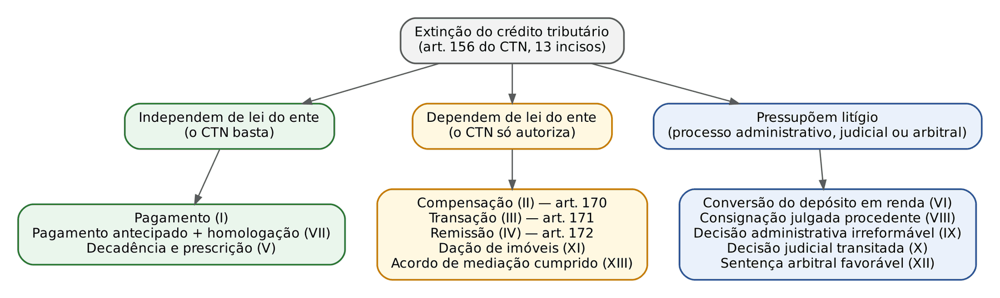
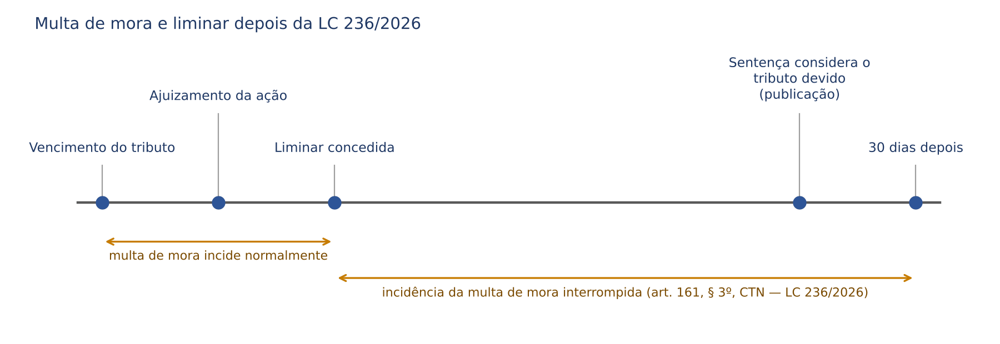
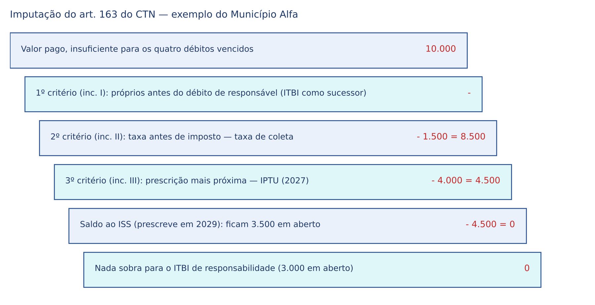
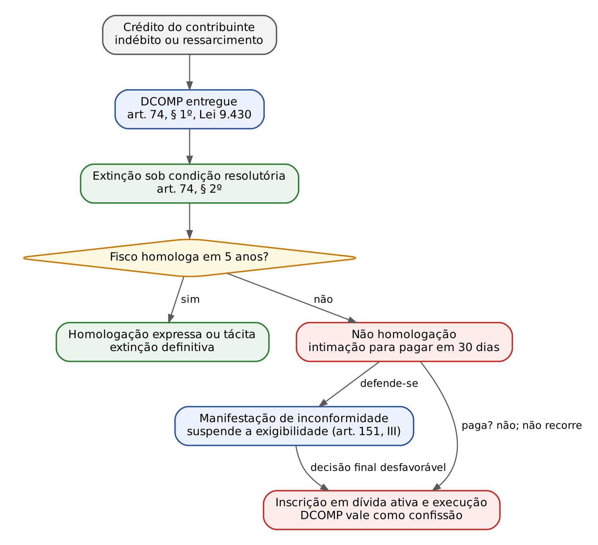
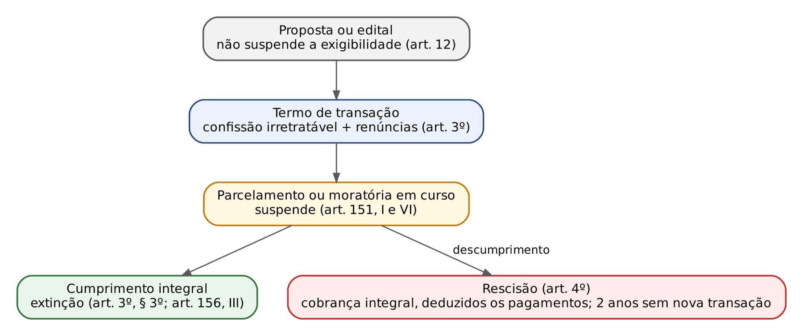

# CAPÍTULO 14 — EXTINÇÃO DO CRÉDITO TRIBUTÁRIO I: PAGAMENTO E IMPUTAÇÃO, CONSIGNAÇÃO EM PAGAMENTO, COMPENSAÇÃO, TRANSAÇÃO TRIBUTÁRIA, REMISSÃO, CONVERSÃO DE DEPÓSITO EM RENDA, DAÇÃO EM PAGAMENTO DE IMÓVEIS, DECISÕES ADMINISTRATIVA E JUDICIAL, PAGAMENTO ANTECIPADO E HOMOLOGAÇÃO; CAUSAS FORA DO CTN

:::INCIDENCIA
TRF5 p. 14; TJRS p. 6, 8; TJSC p. 13. Nível A. Lote: 14 questões (FGV 9, FCC 5).
O que mais cai: rol do art. 156 (inclusive o que NÃO está nele), compensação (art. 170-A, Súmulas 213 e 460 do STJ, alegação em embargos), transação (cumprimento como momento da extinção), dação em pagamento (só imóveis no CTN x lei local) e imputação do art. 163.
Novidade obrigatória: a LC 236/2026 (4/9/2026) acrescentou ao art. 156 os incisos XII (sentença arbitral) e XIII (acordo de mediação) e criou o § 3º do art. 161.
:::

| Subtema | FGV | FCC | Padrão de cobrança |
|---|---|---|---|
| Rol do art. 156 e causas impróprias | 2 | 3 | listar causas; distinguir de suspensão e exclusão; decadência como causa "imprópria" |
| Compensação | 3 | 0 | 170-A; MS declara, não convalida; compensação em embargos |
| Pagamento e imputação | 2 | 0 | art. 158 (sem presunção); consulta e juros; ordem do art. 163 |
| Transação | 2 | 0 | conceito; extinção só com o cumprimento |
| Dação em pagamento | 2 | 0 | só imóveis (CTN e Lei 13.259) x lei estadual pode prever móveis (STF) |
| Lei local criando causa nova / prescrição | 0 | 2 | art. 141 (responsabilidade funcional); prazo de cobrança (ver Cap. 15) |

## 14.1 Visão geral: o que significa extinguir o crédito tributário

### 14.1.1 A lógica do instituto

O crédito tributário nasce da obrigação (fato gerador) e se torna exigível com o lançamento (Cap. 12). A partir daí, três coisas podem acontecer com ele: ter a exigibilidade SUSPENSA (a cobrança fica paralisada, mas o crédito continua existindo: art. 151, Cap. 13), ser EXCLUÍDO (isenção e anistia impedem a própria constituição do crédito: art. 175, Cap. 17) ou ser EXTINTO (o vínculo desaparece: art. 156). Como o crédito tem a mesma natureza da obrigação de que decorre (art. 139), extinguir o crédito equivale, na prática, a extinguir a obrigação principal; a doutrina majoritária lê o art. 156 nesse sentido, ressalvando apenas a anulação do lançamento por vício formal, que extingue aquele crédito mas permite novo lançamento (art. 173, II; Cap. 15).

| | Suspensão (art. 151) | Exclusão (art. 175) | Extinção (art. 156) |
|---|---|---|---|
| O que acontece | a cobrança fica paralisada | o crédito não chega a ser constituído | o crédito (e a obrigação) desaparece |
| Exemplos | moratória, parcelamento, depósito integral, impugnação, liminar | isenção, anistia | pagamento, compensação, transação, remissão, decadência, prescrição |
| Obrigações acessórias | continuam (art. 151, § 1º, renumerado pela LC 236/2026) | continuam (art. 175, parágrafo único) | as ligadas ao crédito extinto perdem objeto |
| Pegadinha | depósito, liminar e parcelamento NÃO extinguem | anistia NÃO está no art. 156 | remissão (perdão do crédito) x anistia (perdão da infração) |

Para o civilista, a armadilha é a indisponibilidade do crédito público: a autoridade administrativa não pode perdoar, transigir, compensar ou aceitar coisa diversa de dinheiro sem LEI do ente credor que o autorize. É a ideia do art. 141 do CTN: o crédito regularmente constituído só se extingue nos casos previstos em lei, "sob pena de responsabilidade funcional" de quem o dispensar.

### 14.1.2 O rol do art. 156 depois da LC 236/2026

:::LEI CTN, art. 156 (redação vigente)
Art. 156. Extinguem o crédito tributário: I - o pagamento; II - a compensação; III - a transação; IV - remissão; V - a prescrição e a decadência; VI - a conversão de depósito em renda; VII - o pagamento antecipado e a homologação do lançamento nos termos do disposto no artigo 150 e seus §§ 1º e 4º; VIII - a consignação em pagamento, nos termos do disposto no § 2º do artigo 164; IX - a decisão administrativa irreformável, assim entendida a definitiva na órbita administrativa, que não mais possa ser objeto de ação anulatória; X - a decisão judicial passada em julgado. XI – a dação em pagamento em bens imóveis, na forma e condições estabelecidas em lei. XII – a sentença arbitral, proferida no âmbito da arbitragem especial tributária e aduaneira, favorável ao sujeito passivo transitada em julgado; XIII – o cumprimento do acordo de mediação.
Parágrafo único. A lei disporá quanto aos efeitos da extinção total ou parcial do crédito sôbre a ulterior verificação da irregularidade da sua constituição, observado o disposto nos artigos 144 e 149.
:::

A frase "o CTN arrola onze modalidades de extinção", repetida em questões de 2024 a 2026, está DESATUALIZADA desde a LC 236, de 4/9/2026: agora são treze incisos. Em prova de 2026 em diante, desconfie de alternativa que fale em "onze" como número fechado, mas não brigue com o enunciado se a questão foi elaborada antes da lei; responda pelo conteúdo.

A doutrina (Ricardo Alexandre, entre outros) agrupa as causas em três blocos, o que ajuda a memorizar quais delas exigem lei do ente:

:::DICA Como ler o mapa
O verbo do CTN denuncia o bloco. Nos arts. 170, 171 e 172 o Código diz "a lei PODE autorizar" (compensação, transação, remissão), e no inciso XI diz "na forma e condições estabelecidas em lei" (dação). Sem lei do ente credor, essas causas simplesmente não existem para aquele tributo. Pagamento, homologação, decadência e prescrição operam pela força do próprio CTN.
:::

:::QUESTAO FCC 2024 — Prefeitura de Jaboatão dos Guararapes — Procurador (Q3542146)
Pediu-se a alternativa que reunisse apenas causas de extinção. Gabarito: A (compensação, transação, remissão e conversão do depósito em renda). As demais misturam causas de suspensão (moratória, depósito integral, liminar em MS) e de exclusão (isenção, anistia). Armadilha: "anistia" ao lado de "remissão" e "liminar" ao lado de "prescrição". No mesmo sentido, as correlatas Q3038857, Q3009030 e Q3039637 (FGV 2024), classificadas no Cap. 13.
:::

### 14.1.3 O rol é taxativo? Lei local pode criar causa nova de extinção?

A resposta mudou com o tempo, e as bancas cobram as duas fases.

- Fase restritiva: na ADI 1.917 (cautelar, 1998), o STF suspendeu lei distrital que admitia quitar débitos com dação de materiais para programas do governo, invocando a reserva de lei complementar. No mérito (2007), manteve a inconstitucionalidade por outro fundamento: burla à licitação. A lição que sobrou foi a da licitação, não a da taxatividade.
- Fase atual: na ADI 2.405 (cautelar em 2002 e mérito em 2019, Rel. Min. Alexandre de Moraes, lei do Rio Grande do Sul), o STF afirmou que os entes federados podem, por lei própria, estabelecer novas hipóteses de suspensão e de extinção dos seus créditos tributários. Fundamentos: autonomia federativa e "quem pode o mais pode o menos" (se o ente pode até perdoar, por remissão, pode admitir outra forma de quitação). Segundo Ricardo Alexandre, o voto condutor admitiu expressamente a dação de bens móveis prevista em lei local, desde que não sirva de atalho à licitação.

Conclusão para a prova: (1) segundo o CTN, o rol é fechado e a dação em pagamento é só de IMÓVEIS; (2) segundo o STF, lei do próprio ente (complementar ou ordinária) pode prever outras formas de extinção, inclusive dação de bens móveis, respeitada a licitação. Quando o enunciado diz "de acordo com o CTN", responda pela letra do Código; quando diz "à luz da jurisprudência do STF", responda pela ADI 2.405.

:::QUESTAO FGV 2024 — Câmara dos Deputados — Consultor de Orçamento (Q2512326)
Pergunta: lei estadual pode criar nova modalidade de extinção por dação de bens? Gabarito: E (pode abranger bens móveis e imóveis, prevista em lei estadual complementar ou ordinária). Fundamento: ADI 2.405. Armadilhas: (a) dizer que a dação ofende o conceito de tributo "em moeda" (o art. 3º admite prestação "cujo valor nela se possa exprimir"); (b) exigir lei complementar estadual (a reserva do art. 146, III, b, é de lei complementar NACIONAL para normas gerais; o ente regula seus créditos por lei ordinária).
:::

:::QUESTAO FCC 2025 — SEFAZ-PI — Auditor Fiscal (Q3596245)
Caso: código tributário estadual criou o "perdão cívico" (extinção de créditos de quem doou para a campanha do governador), a ser aplicado pelos julgadores administrativos. Pergunta: segundo o CTN, o que acontece com o julgador que aplica o perdão? Gabarito: C (responsabilização funcional na forma da lei). Fundamento: art. 141 do CTN, que manda responsabilizar quem dispensa o crédito fora dos casos legais. Observação: a questão foi resolvida pela letra do CTN; mesmo à luz da ADI 2.405, a hipótese é inválida por outra razão (benefício pessoal, sem critério isonômico, ofende a impessoalidade e a isonomia tributária). A armadilha é o "dever de comunicar ao Ministério Público", que o CTN não prevê.
:::

### 14.1.4 Causas de extinção fora do CTN

O ponto do TJSC pede expressamente as "causas extintivas não previstas no CTN". As que a doutrina costuma citar:

| Causa | Como opera | Observação de prova |
|---|---|---|
| Confusão | credor e devedor se reúnem na mesma pessoa (CC, art. 381) | exemplo clássico: o Município adquire o imóvel sobre o qual pesava IPTU de exercícios anteriores; parte da doutrina a admite, outra entende que o crédito se extingue por outra via; não está no art. 156 |
| Novação | substituição da dívida por outra | a Lei 13.988/2020 diz expressamente que a transação aceita NÃO implica novação (art. 12, § 3º); o parcelamento também não implica novação |
| Dação de bens móveis por lei local | lei do ente prevê a entrega de bens móveis | admitida pelo STF (ADI 2.405), com o limite da licitação; no Rio Grande do Sul, a Lei 6.537/1973 (art. 122, incluído pela Lei 11.475/2000) prevê a dação em bens sem restringi-la a imóveis, segundo Ricardo Alexandre |
| Outras formas criadas por lei local | ex.: compensação com precatórios em regime especial, quitação por créditos de programas estaduais | válidas se previstas em lei do ente (ADI 2.405) |
| Arbitragem e mediação | eram "fora do CTN" até 3/9/2026 | desde a LC 236/2026, estão no art. 156, XII e XIII |

:::PEGADINHA Duas perguntas diferentes
"Lei estadual pode criar hipótese de extinção não prevista no CTN?" Sim (STF, ADI 2.405). "A dação em pagamento de bens móveis é causa de extinção prevista no CTN?" Não (art. 156, XI, só imóveis). A banca troca uma pela outra.
:::

O parágrafo único do art. 156 resolve um problema prático: se o crédito foi extinto (pago, por exemplo) e depois se descobre que o lançamento estava errado para menos, a extinção não impede o lançamento complementar, desde que ainda haja prazo e seja caso de revisão (arts. 144 e 149; Cap. 12).

## 14.2 Pagamento (arts. 157 a 163)

### 14.2.1 A penalidade não substitui o tributo e o pagamento não se presume

O pagamento é a forma natural de extinção: entrega, em dinheiro, do valor do crédito. Duas regras iniciais desmontam intuições civilistas.

Primeira: "A imposição de penalidade não ilide o pagamento integral do crédito tributário" (art. 157). Multa não é preço de licença para não pagar: quem é multado por não recolher o ICMS paga o ICMS E a multa. Diferente da cláusula penal compensatória do direito civil, que pode substituir a prestação (CC, art. 410), a multa tributária soma-se ao tributo.

Segunda: no direito tributário, o pagamento não gera presunções em favor do devedor.

:::LEI CTN, art. 158
Art. 158. O pagamento de um crédito não importa em presunção de pagamento: I - quando parcial, das prestações em que se decomponha; II - quando total, de outros créditos referentes ao mesmo ou a outros tributos.
:::

:::ATENCAO A intuição civilista leva ao erro
No Código Civil, "quando o pagamento for em quotas periódicas, a quitação da última estabelece, até prova em contrário, a presunção de estarem solvidas as anteriores" (CC, art. 322). No CTN é o CONTRÁRIO: pagar a última parcela do IPVA não prova que as anteriores foram pagas, e quitar o IPTU de 2026 não presume quitado o de 2025. A explicação é a indisponibilidade do crédito público e a massa de lançamentos, que tornaria a presunção perigosa para o Fisco.
:::

### 14.2.2 Local, prazo e desconto (arts. 159 e 160)

Se a legislação nada disser, o pagamento é feito na repartição competente do DOMICÍLIO do sujeito passivo (art. 159). Na prática, as leis determinam pagamento por guia em rede bancária.

Se a legislação não fixar o vencimento, ele ocorre 30 (trinta) dias depois da notificação do lançamento (art. 160). Atenção à aplicação: o prazo supletivo pressupõe lançamento notificado, por isso é típico de tributos lançados de ofício ou por declaração (IPTU, IPVA, ITBI). Nos tributos lançados por homologação, o contribuinte paga antes de qualquer ato do Fisco, no prazo fixado em lei. A legislação pode conceder desconto pela antecipação (parágrafo único), como o abatimento do IPTU em cota única. Lembre que o prazo de pagamento pode ser fixado por norma infralegal, pois não está entre as matérias reservadas à lei no art. 97 (tema de legalidade; ver Cap. 5).

### 14.2.3 Mora: juros, multa, consulta e a novidade da LC 236/2026 (art. 161)

:::LEI CTN, art. 161
Art. 161. O crédito não integralmente pago no vencimento é acrescido de juros de mora, seja qual fôr o motivo determinante da falta, sem prejuízo da imposição das penalidades cabíveis e da aplicação de quaisquer medidas de garantia previstas nesta Lei ou em lei tributária. § 1º Se a lei não dispuser de modo diverso, os juros de mora são calculados à taxa de um por cento ao mês. § 2º O disposto neste artigo não se aplica na pendência de consulta formulada pelo devedor dentro do prazo legal para pagamento do crédito. § 3º A propositura de ação judicial na qual foi concedida medida liminar ou tutela provisória interrompe a incidência da multa de mora, desde a concessão da medida judicial, até 30 (trinta) dias após a data de publicação da decisão judicial que considerar devido o tributo. (Incluído pela Lei Complementar nº 236, de 2026)
:::

Pontos cobráveis:

- A mora é automática (*mora ex re*): basta o vencimento, sem interpelação, e os juros correm "seja qual for o motivo" da falta. Os juros têm natureza compensatória da indisponibilidade do dinheiro, não punitiva; por isso convivem com a multa.
- O 1% ao mês é SUPLETIVO ("se a lei não dispuser de modo diverso"). A União aplica a Selic; os limites para os índices estaduais e municipais estão no Cap. 11 (Tema 1.062 do STF e Súmula 523 do STJ).
- Consulta tempestiva (§ 2º): formulada dentro do prazo de pagamento, afasta juros e penalidades enquanto pendente. A consulta NÃO está no art. 151 e, portanto, não suspende a exigibilidade; ela apenas impede os acréscimos moratórios. A LC 236/2026 deu nova redação ao art. 107 do CTN para disciplinar a solução de consulta (efeitos vinculantes restritos ao órgão emissor e ao consulente; ver Cap. 20).
- Novo § 3º (LC 236/2026): se o contribuinte ajuíza ação e obtém liminar ou tutela provisória, a MULTA DE MORA deixa de incidir desde a concessão da medida até 30 dias após a publicação da decisão que considerar o tributo devido. O dispositivo fala só em multa de mora: os juros não foram mencionados. A lógica é não punir quem deixou de pagar amparado por ordem judicial e dar-lhe um prazo para pagar sem multa quando perder.

:::QUESTAO FGV 2024 — Câmara dos Deputados — Consultor Legislativo (Q2510950)
Três afirmativas sobre pagamento. I: juros de mora incidem mesmo na pendência de consulta tempestiva (FALSA: art. 161, § 2º). II: os selos de controle do IPI não comprovam pagamento e não se confundem com o pagamento por estampilha (VERDADEIRA: o selo é instrumento de controle; a estampilha do art. 162 é forma de pagamento). III: o comprovante da última parcela do IPVA não atesta o pagamento das anteriores (VERDADEIRA: art. 158, I). Gabarito: B (II e III).
:::

### 14.2.4 Formas de pagamento (art. 162)

O pagamento é feito em moeda corrente, cheque ou vale postal e, nos casos previstos em lei, em estampilha, papel selado ou processo mecânico. As garantias exigidas para o cheque não podem tornar o pagamento impossível ou mais oneroso que o feito em dinheiro (§ 1º). Dois momentos de extinção caem em prova: pelo cheque, o crédito só se extingue com o RESGATE pelo sacado (§ 2º: cheque devolvido não extingue nada); pela estampilha, com a sua inutilização regular, ressalvado o art. 150 (§ 3º). A perda da estampilha ou o erro no pagamento por ela não dá direito a restituição, salvo previsão legal ou erro imputável à autoridade (§ 4º). O papel selado e o processo mecânico equiparam-se à estampilha (§ 5º).

### 14.2.5 Imputação do pagamento (art. 163)

Imputar é decidir QUAL débito um pagamento insuficiente quita. No Código Civil, a escolha é primeiro do devedor (CC, art. 352), depois do credor na quitação (art. 353) e, por último, da lei (juros antes do capital e dívidas vencidas primeiro, arts. 354 e 355). No CTN, a escolha é da AUTORIDADE ADMINISTRATIVA, vinculada a uma ordem legal de quatro critérios, aplicados sucessivamente: só se passa ao critério seguinte quando o anterior não desempata.

:::LEI CTN, art. 163
Art. 163. Existindo simultaneamente dois ou mais débitos vencidos do mesmo sujeito passivo para com a mesma pessoa jurídica de direito público, relativos ao mesmo ou a diferentes tributos ou provenientes de penalidade pecuniária ou juros de mora, a autoridade administrativa competente para receber o pagamento determinará a respectiva imputação, obedecidas as seguintes regras, na ordem em que enumeradas: I - em primeiro lugar, aos débitos por obrigação própria, e em segundo lugar aos decorrentes de responsabilidade tributária; II - primeiramente, às contribuições de melhoria, depois às taxas e por fim aos impostos; III - na ordem crescente dos prazos de prescrição; IV - na ordem decrescente dos montantes.
:::

| Ordem | Critério | Primeiro | Depois | Racionalidade |
|---|---|---|---|---|
| 1º | natureza do vínculo | débito próprio (contribuinte) | débito como responsável | quem deve como contribuinte tem relação pessoal e direta com o fato gerador |
| 2º | espécie tributária | contribuição de melhoria | taxas, e por fim impostos | tributos vinculados a uma atuação estatal específica primeiro |
| 3º | prescrição | o que prescreve ANTES (prazo crescente) | o que prescreve depois | protege o Fisco contra a perda do crédito mais ameaçado |
| 4º | valor | o MAIOR (ordem decrescente) | o menor | maior proveito na cobrança |

Pressupostos: débitos VENCIDOS, do MESMO sujeito passivo, para com a MESMA pessoa jurídica de direito público. Débitos com entes diferentes não se imputam entre si.

:::EXEMPLO Município Alfa
A empresa Beta deve ao Município Alfa, todos vencidos: taxa de coleta de lixo própria (1.500 (mil e quinhentos) reais), IPTU próprio (4.000 (quatro mil) reais, que prescreve em 2027), ISS próprio (8.000 (oito mil) reais, que prescreve em 2029) e ITBI que deve como sucessora (responsabilidade, 3.000 (três mil) reais). Paga 10.000 (dez mil) reais sem dizer o que está quitando. A autoridade aplica o inciso I (o ITBI de responsável vai para o fim da fila), o inciso II (a taxa antes dos impostos), o inciso III (entre IPTU e ISS, primeiro o IPTU, cuja prescrição está mais próxima) e lança o saldo no ISS.

Resultado: taxa e IPTU quitados; ISS com saldo de 3.500 (três mil e quinhentos) reais; ITBI integralmente em aberto. O quarto critério (maior valor) só seria usado se dois impostos próprios tivessem o mesmo prazo prescricional.
:::

:::QUESTAO FGV 2024 — Câmara dos Deputados — Consultor Legislativo (Q2510947)
Empresa com débitos vencidos de IR, PIS e COFINS paga valor insuficiente. Gabarito: A (a administração imputa primeiro aos débitos por obrigação própria: art. 163, I). Por que as outras erram: B nega a compensação com créditos VINCENDOS do sujeito passivo, que o art. 170 admite; C atribui ao STF entendimento sobre a contagem concorrente dos arts. 150, § 4º, e 173, I (ver Cap. 15); D chama a consignação de causa de "exclusão" (é extinção, e só se procedente); E veda a complementação em dinheiro na dação, que a Lei 13.259/2016 assegura (ver 14.9).
:::

:::PEGADINHA Súmula 464 do STJ
"A regra de imputação de pagamentos estabelecida no art. 354 do Código Civil não se aplica às hipóteses de compensação tributária." O contribuinte que compensa um indébito não pode exigir que o valor abata primeiro os juros e só depois o principal, como faria um credor civil. A FGV explorou a mesma ideia ao considerar válida resolução estadual que, autorizada por lei, fixou a imputação proporcional de principal e juros na compensação (Q2486010, FGV 2024, AL-SC, gabarito D; questão classificada no Cap. 16).
:::

O pagamento indevido e a sua restituição (arts. 165 a 169) são objeto do Cap. 16. Registre aqui apenas que, como a prescrição tributária extingue o próprio crédito (art. 156, V), o pagamento de tributo prescrito é pagamento indevido e pode ser restituído, ao contrário do que ocorre no direito civil, em que a prescrição atinge só a pretensão e o pagamento de dívida prescrita não se repete (CC, art. 882). Pela mesma razão, a confissão e o parcelamento posteriores não ressuscitam crédito já extinto por decadência ou prescrição (Jurisprudência em Teses do STJ, ed. 70, tese 8; ver Cap. 15).

## 14.3 Pagamento antecipado e homologação (art. 156, VII)

Nos tributos lançados por homologação (ICMS, IPI, IR, PIS, COFINS, ISS em regra), o contribuinte apura e paga sem prévio exame do Fisco. O art. 150, § 1º, diz que esse pagamento "extingue o crédito, sob condição resolutória da ulterior homologação". Por isso o art. 156, VII, não fala em "pagamento" isolado, mas no binômio pagamento antecipado + homologação: a extinção definitiva só se perfaz com a homologação, que pode ser expressa (ato da autoridade, raríssimo) ou tácita (decurso de 5 anos do fato gerador sem manifestação, art. 150, § 4º, salvo dolo, fraude ou simulação).

Condição resolutória significa que o pagamento já produz efeito extintivo desde logo, mas esse efeito pode ser desfeito se o Fisco, dentro do prazo, verificar que o valor estava errado; nesse caso, lança de ofício a diferença (art. 149, V). Por isso o contribuinte que pagou pode desde logo pedir restituição do indébito: o prazo do art. 168, I, conta do pagamento antecipado, e não da homologação tácita (art. 3º da LC 118/2005; ver Cap. 16). A contagem dos prazos de homologação e de decadência (inclusive o novo § 6º do art. 150, incluído pela LC 236/2026, sobre pagamento parcial) é matéria do Cap. 15.

:::QUESTAO FGV 2025 — TRF 3ª Região — Juiz Federal (Q3179564)
Afirmações sobre causas de extinção. Gabarito: A (prazos de decadência e prescrição só por lei complementar: SV 8 e art. 146, III, b, da CF; ver Cap. 15). Erros das demais: B diz que o pagamento só extingue quando "expressamente homologado" (a homologação pode ser tácita, e o pagamento em tributos lançados de ofício extingue de imediato); C manda contar sempre pelo art. 173, I, ignorando o art. 150, § 4º; D chama o parcelamento de extinção (é suspensão, art. 151, VI); E diz que a transação federal extingue o crédito "a partir do momento em que é celebrada" (só extingue com o cumprimento integral das condições: Lei 13.988/2020, art. 3º, § 3º; ver 14.7).
:::

## 14.4 Consignação em pagamento (art. 164; art. 156, VIII)

### 14.4.1 Para que serve

A consignação tributária protege o contribuinte que QUER pagar e é impedido, ou que não sabe a quem pagar. Não é ação para discutir se o tributo é devido ou quanto é devido em abstrato: quem não concorda com a exigência usa anulatória, declaratória, mandado de segurança ou embargos (Cap. 23).

:::LEI CTN, art. 164
Art. 164. A importância de crédito tributário pode ser consignada judicialmente pelo sujeito passivo, nos casos: I - de recusa de recebimento, ou subordinação dêste ao pagamento de outro tributo ou de penalidade, ou ao cumprimento de obrigação acessória; II - de subordinação do recebimento ao cumprimento de exigências administrativas sem fundamento legal; III - de exigência, por mais de uma pessoa jurídica de direito público, de tributo idêntico sôbre um mesmo fato gerador. § 1º A consignação só pode versar sobre o crédito que o consignante se propõe pagar. § 2º Julgada procedente a consignação, o pagamento se reputa efetuado e a importância consignada é convertida em renda; julgada improcedente a consignação no todo ou em parte, cobra-se o crédito acrescido de juros de mora, sem prejuízo das penalidades cabíveis.
:::

| Inciso | Situação | Exemplo |
|---|---|---|
| I | recusa ou condicionamento do recebimento a outro tributo, a penalidade ou a obrigação acessória | o Município só emite a guia do IPTU de 2026 se o contribuinte pagar também a multa de 2024 que ele contesta |
| II | exigência administrativa sem base legal como condição para receber | a repartição exige certidão não prevista em lei para aceitar o pagamento |
| III | dois entes exigindo tributo IDÊNTICO sobre o mesmo fato | dois Municípios cobrando ISS do mesmo serviço (conflito de local da prestação) |

Sobre o inciso III, duas observações. A palavra "idêntico" é lida pela doutrina com tolerância: o caso clássico de manual inclui o conflito ICMS (Estado) x ISS (Município) sobre a mesma operação, em que os tributos não são idênticos, mas as exigências se excluem; a FGV, nas questões recentes, usou o exemplo literal de dois Municípios exigindo ISS (Q3009029 e Q3113981, FGV 2024). E o conflito não se confunde com bitributação admitida pela Constituição; aqui, só um dos credores tem razão, e o juiz decide quem.

:::DICA Consignação comum x consignação tributária
As hipóteses do art. 164 são próprias e mais estreitas que as do CC (art. 335), mas o rito é o do CPC (arts. 539 a 549); no inciso III, os dois entes são réus. A diferença de efeito é decisiva: no direito civil, o depósito julgado procedente extingue a obrigação; no tributário, julgada procedente, a importância é CONVERTIDA EM RENDA e só então se reputa feito o pagamento. Aspectos processuais (competência, legitimidade, valor da causa): Cap. 23.
:::

### 14.4.2 Efeitos e o que exatamente se deposita

O § 1º limita o objeto: o contribuinte deposita o que se PROPÕE a pagar, que pode ser menos do que o Fisco exige. Daí a consequência do § 2º, com efeitos opostos conforme o resultado:

| Resultado | Efeito | Acréscimos |
|---|---|---|
| Procedência | o pagamento se reputa efetuado; o valor é convertido em renda do ente vencedor; crédito extinto (art. 156, VIII) | nenhum: a mora era do credor |
| Improcedência total ou parcial | cobra-se o crédito (ou a diferença) | juros de mora + penalidades cabíveis |

:::PEGADINHA Consignação não suspende, nem exclui, nem é direito de discutir o tributo
(1) A consignação NÃO está no art. 151; o que suspende é o depósito do montante INTEGRAL exigido (art. 151, II), que é coisa diferente: quem consigna deposita o que quer pagar, não necessariamente o que o Fisco cobra. (2) A consignação não é causa de exclusão (Q2510947, alternativa D). (3) "Se o sujeito passivo não concordar com a incidência do tributo, poderá consignar" é falso (Q3542141, FCC 2024, alternativa D, questão do Cap. 16). (4) Improcedente a consignação, cobram-se juros E penalidades, não só juros: a FCC cobrou exatamente o "apenas" das alternativas (Q3956707, FCC 2026, SEFAZ-SP, gabarito A).
:::

:::QUESTAO FGV 2024 — Consignação (Q3113981; Q3009029)
Q3113981 (V/F): cabe consignatória para obter parcelamento negado na via administrativa? FALSO (parcelamento depende de lei e de requisitos; a recusa não é recusa de receber o tributo). Cabe quando dois Municípios exigem ISS sobre o mesmo serviço? VERDADEIRO (art. 164, III). A procedência, com conversão em renda, extingue o crédito? VERDADEIRO (art. 156, VIII). Gabarito: B (F, V, V). Q3009029: dois Municípios cobram imposto sobre o mesmo serviço; a ação adequada é a consignação (gabarito C), não a repetição de indébito nem a execução fiscal. Ambas classificadas no Cap. 23.
:::

## 14.5 Conversão do depósito em renda (art. 156, VI)

O contribuinte que discute o crédito pode depositar o montante integral para suspender a exigibilidade (art. 151, II; Súmula 112 do STJ; Cap. 13). O depósito é uma garantia que fica à espera do resultado da causa:

- se o contribuinte VENCE, levanta o depósito (corrigido);
- se PERDE, o depósito é convertido em renda do ente credor, e é ESSA conversão que extingue o crédito (art. 156, VI). O depósito em si não extingue nada: ele suspende.

Na esfera federal, os depósitos judiciais e extrajudiciais são repassados à Conta Única do Tesouro (Lei 9.703/1998) e atualizados pela Selic (Jurisprudência em Teses do STJ, ed. 70, tese 2). A conversão também é o destino do valor consignado na consignatória julgada procedente (art. 164, § 2º), que é a outra porta para o mesmo efeito.

O destino do depósito quando o processo é extinto sem resolução de mérito (conversão em renda, e não levantamento) e o depósito como constituição do crédito estão no Cap. 13 (13.5.4).

:::QUESTAO FCC 2026 — SEFAZ-SP — Auditor Fiscal (Q3956704)
Auto de infração com quatro itens; o contribuinte: impugnou os itens 1 e 2, fazendo depósito PARCIAL no item 1; foi a juízo e obteve liminar no item 3; pediu parcelamento no item 4. Pergunta: em quais itens houve extinção? Gabarito: C (em nenhum). Passo a passo: impugnação suspende (art. 151, III); depósito parcial não suspende nem extingue (só o integral suspende, e só a conversão extingue); liminar suspende (art. 151, IV/V); parcelamento suspende (art. 151, VI) e só o pagamento de todas as parcelas extingue. Armadilha: ver "depósito" e "parcelamento" e marcar extinção. No mesmo sentido, Q2564692 (FCC 2024, depósito parcial com defesa tempestiva: exigibilidade suspensa pela defesa, gabarito C; classificada no Cap. 13).
:::

:::SENTENCA Depósito e conversão na sentença
Onde entra: em anulatória, declaratória ou MS com depósito judicial, a sentença (ou o acórdão) deve dar destino ao depósito. Fundamentar: o depósito do montante integral suspendeu a exigibilidade (art. 151, II) e, rejeitado o pedido, converte-se em renda, com efeito extintivo (art. 156, VI). Redação-modelo: "Julgo improcedente o pedido. Após o trânsito em julgado, converta-se em renda da União o depósito de fls., extinguindo-se o crédito tributário correspondente (CTN, art. 156, VI); havendo saldo, intime-se a ré para cobrança." Erro comum: determinar a conversão imediata, antes do trânsito em julgado (na esfera federal, a Lei 9.703/1998 vincula a destinação do depósito ao encerramento da lide), ou declarar extinto o crédito apenas pela existência do depósito.
:::

## 14.6 Compensação (arts. 170 e 170-A; art. 156, II)

### 14.6.1 Conceito e a necessidade de lei

Compensar é extinguir duas obrigações recíprocas até onde se equivalem: o contribuinte é devedor do tributo e, ao mesmo tempo, credor do mesmo ente (por um indébito, um ressarcimento, um precatório). No Código Civil, presentes os requisitos (dívidas líquidas, vencidas e de coisas fungíveis), a compensação opera por força da lei e independe da vontade do credor (CC, arts. 368 e 369). No CTN, não.

:::LEI CTN, art. 170
Art. 170. A lei pode, nas condições e sob as garantias que estipular, ou cuja estipulação em cada caso atribuir à autoridade administrativa, autorizar a compensação de créditos tributários com créditos líquidos e certos, vencidos ou vincendos, do sujeito passivo contra a Fazenda Pública. Parágrafo único. Sendo vincendo o crédito do sujeito passivo, a lei determinará, para os efeitos dêste artigo, a apuração do seu montante, não podendo, porém, cominar redução maior que a correspondente ao juro de 1% (um por cento) ao mês pelo tempo a decorrer entre a data da compensação e a do vencimento.
:::

Leitura em cinco pontos:

1. "A lei pode autorizar": sem lei do ente credor, não há compensação tributária. A lei pode restringir tributos e créditos compensáveis (STF, ADI 7.587 e 7.609, j. 14/9/2026, Info 1229: a compensação é instituto "sujeito à conformação do legislador", e por isso é constitucional o limite mensal do art. 74-A da Lei 9.430/1996 para a compensação de créditos reconhecidos por decisão judicial transitada em julgado acima de 10.000.000 (dez milhões) de reais, fixado pelo Ministro da Fazenda com piso de 1/60 do crédito por mês; a repercussão sobre a restituição do indébito está no Cap. 16).
2. A lei do ente pode delegar à autoridade a fixação das condições em cada caso. A FGV considerou válida, formal e materialmente, resolução estadual que fixou a metodologia de imputação na compensação, porque havia lei estadual autorizando a compensação e a regulamentação (Q2486010).
3. O crédito do contribuinte deve ser líquido e certo; pode ser vencido ou VINCENDO (pegadinha recorrente: Q2510947, B). Se vincendo, a lei pode aplicar deságio, limitado a 1% ao mês até o vencimento.
4. A compensação exige reciprocidade: o crédito do contribuinte tem de ser contra o MESMO ente credor do tributo. Precatórios adquiridos de terceiros só podem ser usados se houver lei específica autorizadora (Jurisprudência em Teses do STJ, ed. 70, tese 15); o crédito de precatório de pessoa jurídica distinta não compensa ICMS (ed. 177, tese 1).
5. Lei estadual ou municipal pode disciplinar a compensação dos seus tributos; não é matéria reservada a lei complementar, porque o art. 170 já é a norma geral (Q2486010, alternativa C, errada).

### 14.6.2 A compensação federal na prática: a DCOMP (art. 74 da Lei 9.430/1996)

Na União, o contribuinte compensa por conta própria, mediante declaração (DCOMP), créditos e débitos de tributos administrados pela Receita Federal.

| Etapa | Regra | Fundamento |
|---|---|---|
| Entrega da DCOMP | extingue o crédito sob condição resolutória da homologação | art. 74, § 2º; Jurisprudência em Teses do STJ, ed. 70, tese 16 |
| Prazo para homologar | 5 anos da entrega; depois, homologação tácita | art. 74, § 5º |
| Efeito da declaração | confissão de dívida e título para exigir o débito indevidamente compensado | art. 74, § 6º |
| Não homologação | intimação para pagar em 30 dias | art. 74, § 7º |
| Defesa | manifestação de inconformidade e recurso ao CARF, com suspensão da exigibilidade (art. 151, III) | art. 74, §§ 9º a 11 |
| Compensação "não declarada" | hipóteses do § 12 (crédito de terceiro, título público, decisão não transitada, tese de inconstitucionalidade sem pronúncia do STF etc.): não extingue nada e não admite manifestação de inconformidade | art. 74, §§ 12 e 13 |
| Vedações | débitos já enviados para inscrição, débitos parcelados, estimativas mensais de IRPJ/CSLL, valores acima do limite mensal do art. 74-A, entre outros | art. 74, § 3º |
| Forma | exclusivamente eletrônica (PER/DCOMP) é exigência válida; a compensação apresentada fora dessa forma não comporta recurso com efeito suspensivo | STJ, REsp 2.167.208/PE, j. 7/10/2025 |

Duas observações de jurisprudência recente. A multa isolada de 50% pela simples não homologação da compensação (art. 74, § 17) foi declarada inconstitucional, salvo má-fé (Tema 736 do STF e ADI 4.905; ver Cap. 11); a LC 236/2026 tentou positivar a regra no art. 113-A, § 2º, do CTN, mas o dispositivo foi VETADO. E o STJ validou a restrição à chamada compensação cruzada entre créditos de tributos fazendários e débitos de contribuições previdenciárias quando o crédito se refere a período anterior ao eSocial (art. 26-A da Lei 11.457/2007): "período de apuração" é o do tributo, e não o do trânsito em julgado da decisão que reconheceu o indébito (STJ, REsp 2.109.311, 1ª Turma, j. 11/3/2025).

### 14.6.3 Art. 170-A: nada de compensar antes do trânsito em julgado

:::LEI CTN, art. 170-A
Art. 170-A. É vedada a compensação mediante o aproveitamento de tributo, objeto de contestação judicial pelo sujeito passivo, antes do trânsito em julgado da respectiva decisão judicial. (Artigo incluído pela Lcp nº 104, de 2001)
:::

A regra impede o "compensar primeiro e ver depois": se o próprio contribuinte foi a juízo para dizer que o tributo é indevido, o crédito correspondente só pode ser usado depois do trânsito em julgado. O STJ fixou dois complementos:

- o art. 170-A aplica-se também quando o indébito decorre de inconstitucionalidade da lei (Tema 346 do STJ; Jurisprudência em Teses, ed. 70, tese 14). Não importa se a inconstitucionalidade parece evidente;
- a vedação não alcança ações ajuizadas antes da LC 104/2001, isto é, antes de 10/1/2001 (ed. 70, tese 13), por ser regra nova de natureza material sobre o regime da compensação.

:::QUESTAO FGV 2024 — AL-PR — Procurador (Q2448970)
V ou F: (1) a vedação do art. 170-A não se aplica quando reconhecida a inconstitucionalidade do tributo: FALSO (Tema 346 do STJ); (2) é incabível MS para convalidar compensação já realizada: VERDADEIRO (Súmula 460 do STJ); (3) a multa isolada pela mera negativa de homologação de compensação viola a CF: VERDADEIRO (Tema 736 do STF; Cap. 11). Gabarito: A (F, V, V). Armadilha: a palavra "inconstitucionalidade" seduz para o "V" no primeiro item.
:::

### 14.6.4 Liminar para compensar: Súmula 212 cancelada e o art. 170-A em pé

Por décadas valeu a Súmula 212 do STJ: a compensação de créditos tributários "não pode ser deferida em ação cautelar ou por medida liminar cautelar ou antecipatória". Declarada inconstitucional a vedação equivalente do art. 7º, § 2º, da Lei 12.016/2009 (ADI 4.296; v. Cap. 23), a 1ª Seção do STJ CANCELOU a Súmula 212 em 2022.

O que isso muda na prova: (1) não se pode mais afirmar que "é vedada a concessão de liminar para compensação" com base na Lei do MS ou na Súmula 212; (2) o art. 170-A do CTN, que é lei complementar e não foi objeto da ADI 4.296, continua a impedir a compensação do crédito discutido NA PRÓPRIA AÇÃO antes do trânsito em julgado. Em questão objetiva, a resposta segura é: Súmula 212 cancelada, art. 170-A vigente (o alcance da conciliação ainda é discutido na doutrina). O art. 1º, § 5º, da Lei 8.437/1992 (cautelares contra o Poder Público) ainda traz vedação semelhante no texto do Planalto (Cap. 23, 23.8.1).

### 14.6.5 Mandado de segurança: declarar sim, convalidar não (Súmulas 213 e 460 do STJ)

:::JURIS STJ, Súmula 213 e Súmula 460 (Tema 258)
Súmula 213: "O mandado de segurança constitui ação adequada para a declaração do direito à compensação tributária." Súmula 460: "É incabível o mandado de segurança para convalidar a compensação tributária realizada pelo contribuinte." (tese repetitiva no Tema 258, REsp 1.124.537, 1ª Seção, j. 25/11/2009)
:::

A diferença é de objeto e de prova. No MS declaratório, o impetrante pede que se reconheça o DIREITO de compensar (porque o tributo é indevido) e se fixem os critérios jurídicos (correção pela Selic, tributos compensáveis, prazo prescricional), deixando a apuração dos valores e a fiscalização para a Receita. Para isso basta provar que é contribuinte do tributo (que ocupa a posição de credor), sem juntar todas as guias (Tema 118 do STJ). Já pedir que o juiz HOMOLOGUE uma compensação feita por conta própria, declare extinto o crédito ou impeça a fiscalização exige exame de valores, liquidez e certeza, que o MS não comporta: é convalidação, vedada pela Súmula 460. A vertente processual (prova pré-constituída, efeitos patrimoniais, Súmulas 269 e 271 do STF) está no Cap. 23.

:::QUESTAO FGV 2026 — TJ-BA — Juiz Substituto (Q4083786)
Caso: empresa compensou por conta própria indébito de IRPJ com débito de COFINS, sem procedimento administrativo; autuada, impetrou MS para que se reconhecesse a compensação já feita e se declarasse extinto o crédito. Pergunta: o que é correto? Gabarito: B (cabe MS para declarar o direito à compensação e impedir a cobrança ou autuação fundada na negativa desse direito, mas não para obter a extinção do crédito, que depende da verificação fiscal). Passo a passo: o que se pede é homologação judicial de compensação já feita (Súmula 460: incabível); o MS pode apenas declarar o direito (Súmula 213). Erros: A (MS "homologa" e dispensa fiscalização: contraria a Súmula 460); C (MS inadequado até para declarar: contraria a Súmula 213); D (sentença não poderia fixar critérios: o Tema 258 admite a fixação de critérios jurídicos); E (revisão "a qualquer tempo": há prazo de 5 anos para homologar a DCOMP, art. 74, § 5º).
:::

:::SENTENCA MS para declarar o direito à compensação
Onde entra: MS contra o Delegado da Receita Federal (ou autoridade estadual/municipal) em que se pede a declaração de inexigibilidade do tributo e o direito de compensar o indébito. Fundamentar: (1) cabimento (Súmula 213); (2) prova suficiente da condição de contribuinte (Tema 118); (3) prazo de 5 anos anteriores à impetração (art. 168, I, do CTN e LC 118/2005; Cap. 16); (4) art. 170-A; (5) critérios (Selic, tributos administrados pelo mesmo órgão, legislação vigente no encontro de contas); (6) ressalva da fiscalização. Redação-modelo: "Concedo a segurança para declarar o direito da impetrante de compensar os valores recolhidos indevidamente nos cinco anos anteriores à impetração, atualizados pela taxa Selic, com débitos de tributos administrados pela Receita Federal, observados o art. 170-A do CTN e a legislação vigente à época do encontro de contas, ressalvado o poder-dever da autoridade de fiscalizar a exatidão dos valores." Erros comuns: autorizar a compensação antes do trânsito; "homologar" valores; condenar a pagar parcelas pretéritas no MS (Súmula 269 do STF).
:::

### 14.6.6 Compensação de ofício

O Fisco também compensa: antes de restituir ou ressarcir, a Receita verifica se o contribuinte tem débitos e, havendo, usa o crédito para quitá-los (art. 73 da Lei 9.430/1996; Decreto-Lei 2.287/1986, art. 7º). O STJ, em recurso repetitivo, considerou legal o procedimento, qualificando a compensação de ofício como ato vinculado da Fazenda, ao qual o contribuinte não pode se opor, mas afirmou ser incabível quando o débito estiver com a exigibilidade suspensa nas hipóteses do art. 151 do CTN, como no parcelamento (Tema 484 do STJ, REsp 1.213.082, Rel. Min. Mauro Campbell Marques, j. 10/8/2011). No mesmo sentido, o STF afastou a compensação de ofício de débitos parcelados sem garantia (Tema 874; ver Cap. 13, 13.4.6).

### 14.6.7 Compensação alegada em embargos à execução fiscal

O art. 16, § 3º, da LEF diz que, nos embargos, "não será admitida reconvenção, nem compensação". O STJ interpretou a regra de modo a preservar a defesa: o que se veda é pedir, nos embargos, uma compensação NOVA; mas a compensação já efetuada antes da execução, com observância dos requisitos legais, pode ser alegada para afastar a liquidez e a certeza da CDA (Tema 294 do STJ, REsp 1.008.343, 1ª Seção). Em 2021, a 1ª Seção (EREsp 1.795.347, Rel. Min. Gurgel de Faria) uniformizou a leitura restritiva: compensação INDEFERIDA ou NÃO HOMOLOGADA na via administrativa não pode ser alegada nos embargos; para atacar a decisão administrativa, o contribuinte deve usar a ação própria (anulatória).

:::QUESTAO FGV 2025 — Prefeitura de Niterói — Advogado (Q3656905)
Caso: execução de PIS; nos embargos, a empresa demonstra que compensou o débito ANTES do ajuizamento, com crédito de PIS reconhecido por decisão transitada em julgado. Gabarito oficial: B (a compensação pode ser arguida nos embargos, independentemente de autorização prévia da Receita, para ilidir a presunção de liquidez e certeza da CDA). Fundamento: Tema 294. Cuidado: a alternativa fala em "independentemente de autorização prévia", o que é correto no regime da DCOMP (o contribuinte compensa por declaração, sem autorização prévia), mas não pode ser lido como dispensa de homologação: compensação já NÃO homologada não se alega em embargos (EREsp 1.795.347). As erradas: A e C negam a defesa; D admite compensação "ainda não realizada" (é exatamente o que o art. 16, § 3º, veda); E exige autorização expressa da Receita.
:::

:::PROCESSO Compensação: qual via, em que momento
| Situação | Via adequada | Observação |
|---|---|---|
| Quero que se reconheça o direito de compensar | MS (Súmula 213) ou ação declaratória | crédito discutido só se usa após o trânsito (art. 170-A) |
| Já compensei e o Fisco não homologou | manifestação de inconformidade e recurso (suspendem); depois, anulatória | MS para convalidar: não (Súmula 460) |
| Fui executado por débito que compensei e foi homologado ou reconhecido | embargos à execução | Tema 294; compensação nova ou não homologada: não (art. 16, § 3º, LEF; EREsp 1.795.347) |
| Tenho sentença declaratória transitada | escolho compensar ou receber por precatório | Súmula 461 do STJ; ver Cap. 16 |
:::

## 14.7 Transação (art. 171; Lei 13.988/2020)

### 14.7.1 Conceito e regime do CTN

:::LEI CTN, art. 171
Art. 171. A lei pode facultar, nas condições que estabeleça, aos sujeitos ativo e passivo da obrigação tributária celebrar transação que, mediante concessões mútuas, importe em determinação de litígio e conseqüente extinção de crédito tributário. Parágrafo único. A lei indicará a autoridade competente para autorizar a transação em cada caso.
:::

Transação é acordo com concessões RECÍPROCAS que põe fim a um litígio. Cinco traços para a prova:

1. Depende de lei do ente e de autoridade indicada na lei (indisponibilidade do crédito). O "determinação" do texto é lido como "terminação" do litígio: a doutrina majoritária entende que, no CTN, a transação é TERMINATIVA, não preventiva; exige litígio já instaurado (administrativo, judicial ou a cobrança da dívida ativa, que a Lei 13.988 trata como litígio).
2. Concessões mútuas: o Fisco abre mão de parte dos acréscimos ou dá prazo; o contribuinte confessa, desiste das defesas e renuncia ao direito em que elas se fundam. Sem reciprocidade, é remissão ou anistia, não transação.
3. Quem extingue o crédito não é a assinatura do termo, é o CUMPRIMENTO do acordo (Lei 13.988/2020, art. 3º, § 3º). Enquanto há parcelas a pagar, o crédito está suspenso, não extinto.
4. Não é renúncia de receita para fins do art. 14 da LRF (LC 174/2020, art. 3º, e agora art. 171-C do CTN, incluído pela LC 236/2026, que estende a regra à mediação e à arbitragem).
5. A transação não implica novação (Lei 13.988, art. 12, § 3º): rescindido o acordo, volta-se ao crédito original, deduzido o que foi pago.

| | Transação | Parcelamento | Remissão | Anistia |
|---|---|---|---|---|
| Natureza | acordo bilateral com concessões mútuas | dilação de prazo de pagamento | perdão do crédito (tributo e/ou multa já lançados) | perdão da infração antes do lançamento da multa |
| Efeito no CTN | extinção, com o cumprimento (art. 156, III) | suspensão (art. 151, VI) | extinção (art. 156, IV) | exclusão (art. 175, II) |
| Pressuposto | litígio | lei do ente | lei + despacho em hipóteses do art. 172 | lei; infrações anteriores à lei (art. 180) |
| Renúncia de receita (LRF) | não (art. 171-C) | não, em regra | sim | sim |

:::QUESTAO FGV 2024 — Prefeitura de São José dos Campos — Técnico Tributário (Q2375630)
Pediu-se a definição de transação. Gabarito: E (acordo entre contribuinte e Fisco, mediante concessões mútuas, que põe fim ao litígio). As distratoras definem compensação (A: credor e devedor ao mesmo tempo), remissão (B: perdão legal), parcelamento (C) e impugnação administrativa (D). Na Q3179564 (14.3), a alternativa E errou justamente ao dizer que a transação federal extingue o crédito "a partir do momento em que é celebrada".
:::

### 14.7.2 A Lei 13.988/2020 (transação federal)

A Lei 13.988/2020 (alterada pelas Leis 14.375/2022, 14.689/2023, 14.973/2024 e 15.103/2025) é a lei da UNIÃO; Estados e Municípios precisam de leis próprias (ver 14.7.4). Ela se aplica aos créditos tributários administrados pela Receita Federal em contencioso administrativo, à dívida ativa da União cobrada pela PGFN e, no que couber, à dívida ativa de autarquias e fundações federais (art. 1º, § 4º). O § 1º do art. 1º afirma o juízo de oportunidade e conveniência da União: a transação NÃO é direito subjetivo do devedor.

Modalidades (art. 2º):

| Modalidade | Onde | Quem propõe | Limites principais |
|---|---|---|---|
| Na cobrança (individual ou por adesão) | dívida ativa (PGFN) e contencioso administrativo fiscal (Receita, art. 10-A) | PGFN, Receita ou o devedor | descontos só sobre multas, juros e encargos de créditos irrecuperáveis ou de difícil recuperação; até 65% do total e 120 meses; pessoa natural, ME, EPP, Santas Casas, cooperativas, OSCs e instituições de ensino: até 70% e 145 meses (art. 11, §§ 2º a 4º) |
| Por adesão no contencioso de relevante e disseminada controvérsia jurídica | teses que ultrapassam os interesses subjetivos da causa (arts. 16 a 22) | Ministro da Fazenda, por edital, ouvidas PGFN e Receita | até 65% do crédito e 120 meses (70% e 145 meses para pessoa natural, ME e EPP) (art. 17, §§ 2º e 4º) |
| Por adesão no contencioso de pequeno valor | crédito até 60 salários mínimos, sujeito passivo pessoa natural, ME ou EPP (arts. 23 a 27) | edital | descontos até 50% do total e quitação em até 60 meses (art. 25) |

Benefícios possíveis na transação na cobrança (art. 11): descontos (só para créditos irrecuperáveis ou de difícil recuperação), prazos e formas especiais de pagamento (inclusive diferimento e moratória), oferecimento ou substituição de garantias, uso de prejuízo fiscal e base negativa da CSLL até 70% do saldo após os descontos e uso de precatórios ou de direito creditório com sentença transitada em julgado.

Vedações que caem em prova:

- reduzir o PRINCIPAL do crédito (art. 11, § 2º, I): o desconto incide sobre multas, juros e encargos;
- reduzir multas de natureza penal; conceder descontos a créditos do Simples Nacional sem lei complementar autorizativa (a LC 174/2020 autorizou a transação de créditos do Simples nos termos da Lei 13.988) e do FGTS sem autorização do Conselho Curador; transacionar com devedor contumaz (art. 5º);
- nova transação sobre o mesmo crédito; transação com efeito prospectivo que crie regime especial de tributação (art. 20);
- nova transação por 2 anos após a rescisão de outra (art. 4º, § 4º).

Efeitos e momentos:

- A PROPOSTA não suspende a exigibilidade nem as execuções fiscais (art. 12), salvo suspensão convencional do processo (CPC, art. 313, II). A LC 236/2026 incluiu no art. 151 do CTN o inciso VIII ("a proposta de transação aceita pela administração, nos termos da legislação específica"): a suspensão vem da ACEITAÇÃO, não do simples pedido (Cap. 13).
- Celebrado o acordo com parcelamento ou moratória, aplica-se o art. 151, I e VI (art. 3º, § 2º).
- O termo implica confissão irrevogável e irretratável (art. 3º, § 1º), desistência de impugnações e recursos administrativos e renúncia ao direito em que se fundam as ações judiciais, com extinção do processo com resolução de mérito (CPC, art. 487, III, c) (art. 3º, IV e V).
- Os créditos só se extinguem com o cumprimento integral (art. 3º, § 3º). Descumprido o acordo, rescinde-se (art. 4º): perdem-se os benefícios e cobra-se o saldo, deduzidos os pagamentos.

### 14.7.3 Arbitragem e mediação tributárias (LC 236/2026)

A LC 236/2026 levou ao CTN dois métodos consensuais e adjudicatórios que até então estavam fora do Código: a arbitragem especial tributária e aduaneira, que depende de "lei especial" (art. 171-A), com sentença arbitral vinculante e de mesmos efeitos da decisão judicial (parágrafo único), e a mediação, conduzida por terceiro sem poder decisório (art. 171-B). No plano da extinção: a sentença arbitral FAVORÁVEL ao sujeito passivo e transitada em julgado extingue o crédito (art. 156, XII), e o CUMPRIMENTO do acordo de mediação também (art. 156, XIII). Repare no paralelismo com a transação: não é a celebração do acordo de mediação que extingue, é o seu cumprimento; enquanto isso, o acordo suspende a exigibilidade até eventual dissolução (art. 151, IX). A instituição da arbitragem suspende a exigibilidade (art. 151, VII, com as condições do § 3º se já houver execução fiscal) e interrompe a prescrição, retroagindo ao requerimento (art. 174, § 1º, VI). Procedimento: Cap. 20.

### 14.7.4 Transação nos Estados do Sul: Santa Catarina e Rio Grande do Sul

- Santa Catarina: a Lei 19.398, de 5/8/2025 (alterada pela LC 891/2025), regula a transação de créditos de ICMS, IPVA e ITCMD e de créditos não tributários. Celebração por Comitê Gestor de Transação Tributária e Não Tributária Estadual (PGE e Fazenda). Modalidades: proposta individual (só para créditos irrecuperáveis ou de difícil recuperação) e adesão a edital. Hipóteses: créditos tributários inscritos em dívida ativa até 31/12/2020 que sejam irrecuperáveis ou de difícil recuperação, de pequeno valor (até 40 salários mínimos) ou objeto de relevante e disseminada controvérsia. Concessões: redução de até 70% (pessoa natural, ME e EPP) ou 65% (demais) do valor total, sem reduzir o principal; parcelamento em até 145 ou 120 parcelas; compensação de até 75% da dívida com precatórios. A celebração implica confissão, não implica novação e interrompe a prescrição (art. 11); a proposta não suspende a exigibilidade (art. 12).
- Rio Grande do Sul: a Lei 16.241/2024 instituiu o programa "Acordo Gaúcho" de transação, com modalidades por adesão e por proposta individual, descontos de até 65% (70% para ME, EPP e créditos de difícil recuperação) e prazos de até 120 (ou 145) meses (dados de fonte secundária, não conferidos no texto oficial; ver nota).

:::SENTENCA Transação no curso da execução fiscal
Onde entra: a exequente ou o executado noticia transação com parcelamento. Fundamentar: a transação com parcelamento suspende a exigibilidade (Lei 13.988, art. 3º, § 2º; CTN, art. 151, VI) e, por isso, suspende a execução (CPC, art. 922, por analogia ao parcelamento convencional); a extinção do crédito só ocorre com o cumprimento integral (art. 3º, § 3º), quando então se extingue a execução (CPC, art. 924, II). Embargos ou ação do contribuinte: homologa-se a renúncia ao direito (CPC, art. 487, III, c). Redação-modelo: "Noticiada a celebração de transação com pagamento parcelado, suspendo o curso da execução até o cumprimento do acordo (CTN, art. 151, VI; Lei 13.988/2020, art. 3º, § 2º), cabendo à exequente informar a quitação ou a rescisão." Erro comum: extinguir a execução fiscal na data da assinatura do termo, como se a transação já tivesse extinguido o crédito.
:::

## 14.8 Remissão (art. 172; art. 156, IV)

:::LEI CTN, art. 172
Art. 172. A lei pode autorizar a autoridade administrativa a conceder, por despacho fundamentado, remissão total ou parcial do crédito tributário, atendendo: I - à situação econômica do sujeito passivo; II - ao êrro ou ignorância excusáveis do sujeito passivo, quanto a matéria de fato; III - à diminuta importância do crédito tributário; IV - a considerações de eqüidade, em relação com as características pessoais ou materiais do caso; V - a condições peculiares a determinada região do território da entidade tributante. Parágrafo único. O despacho referido neste artigo não gera direito adquirido, aplicando-se, quando cabível, o disposto no artigo 155.
:::

Remissão é o PERDÃO do crédito tributário (com dois "s": remitir = perdoar; "remição" com "ç" é resgate, como a remição da execução no CPC). Pode ser total ou parcial e alcança o crédito já constituído, tributo ou multa. Requisitos: lei ESPECÍFICA do ente, que regule exclusivamente a matéria ou o tributo (art. 150, § 6º, da CF), e, quando a lei não a conceder diretamente, despacho fundamentado da autoridade em uma das hipóteses do art. 172. Como implica renúncia de receita, sujeita-se ao art. 14 da LRF e ao art. 113 do ADCT.

Pontos de prova:

- Equidade: a remissão por equidade (art. 172, IV) é critério legal de perdão; não confunda com o art. 108, § 2º, que proíbe usar a equidade, na integração, para dispensar tributo devido.
- O despacho individual não gera direito adquirido e pode ser revogado se o beneficiário não preenchia ou deixou de preencher as condições (remissão ao art. 155, regime da moratória individual: tributo + juros sempre; penalidade e não contagem do tempo para a prescrição se houver dolo ou simulação; ver Cap. 13).
- A remissão pode ser concedida após o lançamento; a anistia só alcança infrações anteriores à lei e impede o lançamento da multa (art. 180; ver Cap. 17).
- Remissão de ICMS concedida por lei estadual com amparo em convênio do CONFAZ, inclusive de créditos oriundos de benefícios fiscais declarados inconstitucionais, é constitucional (Tema 817 do STF; o contexto de guerra fiscal está no Cap. 17).
- O devedor contumaz fica impedido de fruir benefícios fiscais, "inclusive a concessão de remissão ou de anistia" (LC 225/2026, art. 13, I, a; Cap. 19).
- Lei Orgânica não pode vedar, em termos absolutos, remissões e outros benefícios no último ano da legislatura (STF, ADI 4.065, j. 2/6/2025, Info 1180).

:::QUESTAO FCC 2026 — SEFAZ-MT — Fiscal de Tributos (Q3947172)
Caso: herdeiros de imóveis em Londrina ignoravam, de forma justificada, ter recebido o bem por legado e dever IPTU; vereador propõe lei para extinguir esses créditos sem contrapartida, por despacho da autoridade. Gabarito: D (remissão total). Fundamento: art. 172, II (erro ou ignorância escusáveis quanto à matéria de fato). Armadilhas: anistia (E) perdoa infração, não o tributo, e é exclusão; compensação, moratória e depósito não extinguem por perdão. Questão classificada no Cap. 15; vale como modelo de "extinção sem contrapartida = remissão".
:::

:::PEGADINHA Remissão x anistia x isenção (a banca troca as três)
Na Q3038859 (FGV 2024, Nova Iguaçu, gabarito A), a afirmativa I atribuiu à ISENÇÃO a definição do art. 172 (perdão por despacho em razão da situação econômica etc.): falsa, isso é remissão; e a afirmativa III disse que a dação do CTN abrange bens móveis e imóveis: falsa. Corretas: compensação depende de lei e de reciprocidade; transação por concessões mútuas mediante lei; anistia é exclusão (perdão da infração). Regra de bolso: isenção = antes do fato gerador (dispensa legal do tributo, exclusão); anistia = perdão da infração antes do lançamento da multa (exclusão); remissão = perdão do crédito já nascido (extinção).
:::

## 14.9 Dação em pagamento de bens imóveis (art. 156, XI)

A LC 104/2001 incluiu a dação de bens IMÓVEIS no art. 156, "na forma e condições estabelecidas em lei". É norma de eficácia limitada: cada ente precisa de lei própria. Na União, a lei é a Lei 13.259/2016:

:::LEI Lei 13.259/2016, art. 4º (redação da Lei 13.313/2016)
Art. 4º O crédito tributário inscrito em dívida ativa da União poderá ser extinto, nos termos do inciso XI do caput do art. 156 da Lei nº 5.172, de 25 de outubro de 1966 - Código Tributário Nacional, mediante dação em pagamento de bens imóveis, a critério do credor, na forma desta Lei, desde que atendidas as seguintes condições: I - a dação seja precedida de avaliação do bem ou dos bens ofertados, que devem estar livres e desembaraçados de quaisquer ônus, nos termos de ato do Ministério da Fazenda; e II - a dação abranja a totalidade do crédito ou créditos que se pretende liquidar com atualização, juros, multa e encargos legais, sem desconto de qualquer natureza, assegurando-se ao devedor a possibilidade de complementação em dinheiro de eventual diferença entre os valores da totalidade da dívida e o valor do bem ou dos bens ofertados em dação. § 1º O disposto no caput não se aplica aos créditos tributários referentes ao [...] Simples Nacional.
:::

Checklist federal: crédito INSCRITO em dívida ativa; aceitação "a critério do credor" (não é direito do devedor); avaliação prévia; imóvel livre de ônus; abrangência da TOTALIDADE do crédito, sem desconto, com complementação em dinheiro permitida; Simples Nacional excluído; desistência e renúncia se houver ação. O art. 4º-A (Lei 14.011/2020) acrescentou uma hipótese especial: em estado de calamidade pública reconhecido pelo Executivo federal, admite-se a dação de imóveis de valor histórico, cultural, artístico, turístico ou paisagístico localizados na área atingida, com autenticação e valoração pelo IPHAN. Repare: continua sendo dação de IMÓVEL.

:::QUESTAO FGV 2024 — EPE — Advogado (Q2759033)
Caso: colecionador devedor de IR inscrito em dívida ativa quer dar quadros (já avaliados) em pagamento parcial e pagar o restante em dinheiro. Gabarito: D (não é possível: na União a dação é só de bens imóveis). Armadilhas: C diz que os quadros teriam de quitar integralmente, sem complemento em dinheiro (a lei admite complementação); B fala em bens de valor histórico em calamidade, mas a hipótese do art. 4º-A é de IMÓVEIS; E diz que a dação de móveis seria possível "a critério do credor" (o critério do credor existe, mas para imóveis). Correlata: Q2510947, E (vedação de complementação em dinheiro: falsa).
:::

## 14.10 Decisão administrativa irreformável e decisão judicial transitada em julgado (art. 156, IX e X)

### 14.10.1 Decisão administrativa irreformável

O inciso IX fala da decisão "definitiva na órbita administrativa, que não mais possa ser objeto de ação anulatória". Só extingue o crédito a decisão FAVORÁVEL ao sujeito passivo, que cancela o lançamento; a decisão desfavorável, ao contrário, torna o crédito definitivamente constituído e abre a cobrança (e o contribuinte ainda pode ir a juízo, art. 5º, XXXV, da CF).

Polêmica: a Fazenda pode ir a juízo para anular decisão do seu próprio tribunal administrativo (CARF, TAT/SC, TARF/RS) favorável ao contribuinte?

- Posição majoritária na doutrina: não, em regra. A decisão administrativa é ato da própria Administração em controle de legalidade dos seus atos; falta à Fazenda interesse de agir contra si mesma, e o art. 45 do Decreto 70.235/1972 manda exonerar o contribuinte dos gravames quando a decisão definitiva lhe for favorável. A expressão "ação anulatória" do inciso IX seria a ação do contribuinte ou de terceiros legitimados (ação popular), não da Fazenda.
- Posição da PGFN: o Parecer PGFN/CRJ 1.087/2004 sustentou que a decisão do então Conselho de Contribuintes, como ato administrativo, pode ser submetida ao Judiciário pela Fazenda em caso de ilegalidade; a Portaria PGFN 820/2004 restringiu o ajuizamento a hipóteses excepcionais.
- STJ: em ação popular ajuizada por auditor fiscal contra decisão do CARF que reconhecera a decadência, a 1ª Turma assentou que as decisões do CARF, órgão paritário de controle interno, não podem ser anuladas judicialmente por mera divergência de interpretação da legislação tributária; só ilegalidade manifesta, desvio ou abuso de poder, ou contrariedade a precedente judicial consolidado justificariam a invalidação (REsp 1.608.161, Rel. Min. Regina Helena Costa, j. 6/8/2024, Info 820).
- LC 236/2026: o novo art. 208-C, § 2º, do CTN veda recurso hierárquico a Secretário, Ministro ou outro integrante do Executivo contra decisão definitiva favorável ao sujeito passivo no processo administrativo fiscal. Reforça a definitividade administrativa (Cap. 20).

Para a prova objetiva: decisão administrativa irreformável favorável ao contribuinte extingue o crédito; a possibilidade de a Fazenda questioná-la em juízo é tese minoritária, sustentada pela PGFN, e a jurisprudência do STJ só admite a invalidação judicial em hipóteses excepcionais.

### 14.10.2 Decisão judicial transitada em julgado e sentença arbitral

Também aqui só extingue a decisão FAVORÁVEL ao sujeito passivo que desconstitui o crédito (anulatória procedente, embargos procedentes, MS concedido para declarar a inexigibilidade). Decisão desfavorável não extingue nada: pode, quando muito, levar à conversão do depósito (inciso VI). Os limites da coisa julgada em relações tributárias continuadas, inclusive a cessação de seus efeitos por decisão posterior do STF em controle concentrado ou repercussão geral, estão no Cap. 23 (Temas 881 e 885 do STF). A sentença arbitral favorável e transitada em julgado tem o mesmo efeito (art. 156, XII; 14.7.3); e, como a decisão judicial ou administrativa, a sentença arbitral que modifique o critério jurídico do lançamento só alcança, para o mesmo sujeito passivo, fatos geradores posteriores (art. 146, na redação da LC 236/2026; Cap. 12).

:::SENTENCA Dispositivo que extingue o crédito
Em anulatória ou embargos procedentes, o dispositivo deve dizer o que acontece com o crédito, e não só com o ato. Redação-modelo: "Julgo procedente o pedido para anular o lançamento consubstanciado no auto de infração n. X e declarar extinto o crédito tributário dele decorrente (CTN, art. 156, X), com o levantamento do depósito em favor da autora após o trânsito em julgado." Erro comum: mandar levantar o depósito antes do trânsito em julgado, que é o momento da extinção (inciso X).
:::

## 14.11 Prescrição e decadência no rol do art. 156

O art. 156, V, inclui a prescrição e a decadência entre as causas de extinção, com consequências que surpreendem o civilista: (1) decadência e prescrição extinguem o próprio crédito, e não apenas a pretensão; (2) por isso o pagamento de crédito prescrito é indevido e restituível; (3) só lei complementar disciplina prazos (SV 8). Tudo o mais (prazos, termos iniciais, interrupções) é do Cap. 15.

:::QUESTAO FCC 2026 — SEFAZ-SP — Auditor Fiscal (Q3956702)
Pergunta: qual das modalidades do art. 156 é designada de forma imprópria, porque não extingue crédito "formalmente constituído"? Gabarito: E (decadência). Raciocínio: a decadência atinge o DIREITO de lançar; consumada, o crédito nem chega a ser constituído. Rigorosamente, ela extingue a obrigação (ou o direito de constituir o crédito), não um crédito já existente. Distratoras: anistia e parcelamento nem estão no art. 156; remissão e conversão em renda extinguem crédito constituído.
:::

:::QUESTAO FCC 2024 — TRF 3ª Região — Técnico Judiciário (Q2564696)
Crédito lançado de ofício, mantido em todas as instâncias administrativas; o contribuinte, notificado, não paga nem vai a juízo. Gabarito: D (a Fazenda tem 5 anos, contados da constituição definitiva do crédito, para cobrá-lo: prescrição, art. 174). Distratoras com prazos de 10 anos ou atribuídos ao contribuinte. Ver Cap. 15.
:::

## 14.12 Resumo para revisão pré-prova

Quadro final das causas de extinção: causa, fundamento, requisito-chave e pegadinha.

| Causa | Fundamento | Requisito-chave | Pegadinha |
|---|---|---|---|
| Pagamento | arts. 156, I, e 157 a 163 | dinheiro (moeda, cheque resgatado, estampilha inutilizada) | multa não substitui o tributo; pagamento não se presume (art. 158), ao contrário do CC, art. 322 |
| Vencimento supletivo | art. 160 | 30 dias da notificação do lançamento | não se aplica ao lançamento por homologação; prazo pode ser fixado por norma infralegal |
| Mora | art. 161 | juros automáticos, 1% supletivo | consulta tempestiva afasta juros e multa, mas não suspende; liminar interrompe a multa de mora (§ 3º, LC 236/2026) |
| Imputação | art. 163 | ordem: próprio > responsável; melhoria > taxa > imposto; prescrição mais próxima; maior valor | é a autoridade que imputa, não o devedor; CC, art. 354, não se aplica à compensação (Súmula 464 do STJ) |
| Pagamento antecipado + homologação | arts. 156, VII, e 150, §§ 1º e 4º | condição resolutória; homologação expressa ou tácita | extinção definitiva só com a homologação; prazos no Cap. 15 |
| Consignação | arts. 156, VIII, e 164 | recusa, exigência ilegal ou dois entes exigindo o mesmo tributo | só extingue se PROCEDENTE e com conversão em renda; improcedente: juros + penalidades; não serve para discutir o tributo nem suspende |
| Conversão do depósito em renda | art. 156, VI | depósito integral + desfecho desfavorável ao contribuinte | o depósito suspende; a conversão extingue |
| Compensação | arts. 156, II, 170 e 170-A | lei do ente; crédito líquido e certo, vencido ou vincendo; reciprocidade | 170-A vale até para inconstitucionalidade (Tema 346); Súmula 212 cancelada; MS declara (Súmula 213), não convalida (Súmula 460); compensação de ofício não alcança débito com exigibilidade suspensa (Tema 484; Tema 874, Cap. 13) |
| Compensação em embargos | LEF, art. 16, § 3º | compensação anterior e válida (Tema 294) | não homologada ou nova: não (EREsp 1.795.347) |
| Transação | arts. 156, III, e 171; Lei 13.988/2020 | lei do ente; concessões mútuas; litígio | extingue com o CUMPRIMENTO; proposta não suspende; não reduz principal; 65%/120 meses (70%/145); não é renúncia de receita (art. 171-C) |
| Remissão | arts. 156, IV, e 172 | lei específica + despacho nas hipóteses legais | perdão do crédito (extinção) x anistia (perdão da infração, exclusão); despacho sem direito adquirido |
| Dação de imóveis | art. 156, XI; Lei 13.259/2016 | imóvel, avaliação, totalidade do crédito, a critério do credor | móveis: não pelo CTN, mas lei local pode prever (ADI 2.405); complementação em dinheiro admitida; Simples excluído |
| Decisão administrativa irreformável | art. 156, IX | definitiva e favorável ao sujeito passivo | Fazenda contra o próprio tribunal administrativo: tese minoritária (Parecer PGFN 1.087/2004); STJ, REsp 1.608.161 |
| Decisão judicial transitada | art. 156, X | trânsito em julgado favorável ao sujeito passivo | sem trânsito não há extinção |
| Sentença arbitral | art. 156, XII (LC 236/2026) | arbitragem especial tributária, favorável e transitada | depende de lei especial (art. 171-A) |
| Acordo de mediação | art. 156, XIII (LC 236/2026) | cumprimento do acordo | o acordo suspende (art. 151, IX); o cumprimento extingue |
| Decadência e prescrição | art. 156, V | prazos por lei complementar (SV 8) | decadência é causa "imprópria" (não há crédito constituído); pagamento de crédito prescrito é restituível; Cap. 15 |
| Causas fora do CTN | ADI 2.405 | lei do próprio ente | confusão; dação de móveis por lei local; transação não é novação |

## 14.13 Artigos de lei incidentes

- Constituição Federal: arts. 5º, XXXV; 146, III, b; 150, § 6º.
- CTN: arts. 3º; 107; 108, § 2º; 139; 141; 146; 150, §§ 1º, 4º e 6º; 151, II, III, VI, VII, VIII e IX; 155; 156 (incisos I a XIII e parágrafo único); 157; 158; 159; 160; 161 (§§ 1º a 3º); 162; 163; 164; 170; 170-A; 171; 171-A; 171-B; 171-C; 172; 174, § 1º, VI; 175; 180; 208-C, § 2º.
- LC 104/2001 (inclusão do art. 156, XI, e do art. 170-A); LC 174/2020, arts. 2º e 3º; LC 225/2026, art. 13, I, a; LC 236/2026, art. 1º.
- Lei 13.988/2020: arts. 1º a 7º, 10 a 12, 16 a 20, 23 a 25 e 29.
- Lei 13.259/2016: arts. 4º e 4º-A.
- Lei 9.430/1996: arts. 73, 74 (§§ 1º a 13 e 17) e 74-A.
- Lei 9.703/1998 (depósitos federais).
- Lei 6.830/1980, art. 16, § 3º.
- Lei 12.016/2009, art. 7º, § 2º (declarado inconstitucional na ADI 4.296).
- CPC: arts. 313, II; 487, III, c; 515, II e III; 539 a 549; 922; 924, II.
- Santa Catarina: Lei 19.398/2025. Rio Grande do Sul: Lei 6.537/1973, art. 122; Lei 16.241/2024.

## 14.14 Julgados, temas e súmulas do capítulo

- ADI 1.917 (STF): lei distrital de dação de bens móveis inconstitucional por burla à licitação.
- ADI 2.405 (STF, 2019): ente federado pode criar, por lei própria, hipóteses de suspensão e extinção do crédito.
- ADI 7.587 e ADI 7.609 (STF, j. 14/9/2026, Info 1229): constitucional o limite mensal à compensação de créditos judiciais (art. 74-A da Lei 9.430).
- Tema 817 do STF (RE 851.421): remissão de ICMS amparada em convênio do CONFAZ é válida.
- ADI 4.065 (STF, j. 2/6/2025, Info 1180): Lei Orgânica não pode vedar remissões e benefícios no último ano da legislatura.
- Súmula 212 do STJ: CANCELADA (2022) após a ADI 4.296.
- Súmula 213 do STJ: MS é via adequada para declarar o direito à compensação.
- Súmula 460 do STJ e Tema 258 (REsp 1.124.537): MS não convalida compensação já feita.
- Súmula 464 do STJ: imputação do CC, art. 354, não se aplica à compensação tributária.
- Tema 118 do STJ (REsp 1.715.256): no MS declaratório, basta provar a condição de credor tributário.
- Tema 346 do STJ: art. 170-A aplica-se ao indébito decorrente de inconstitucionalidade.
- Tema 484 do STJ (REsp 1.213.082): compensação de ofício é ato vinculado, salvo débito com exigibilidade suspensa.
- Tema 294 do STJ (REsp 1.008.343): compensação anterior pode ser alegada em embargos à execução fiscal.
- EREsp 1.795.347 (STJ, 1ª Seção, 2021): compensação não homologada não se alega em embargos.
- REsp 2.109.311 (STJ, j. 11/3/2025): vedada a compensação cruzada com créditos anteriores ao eSocial.
- REsp 2.167.208 (STJ, j. 7/10/2025): válida a exigência de DCOMP exclusivamente eletrônica.
- REsp 1.608.161 (STJ, j. 6/8/2024, Info 820): decisão do CARF não se anula por mera divergência interpretativa.
- Jurisprudência em Teses do STJ, ed. 70, teses 2, 13, 15 e 16; ed. 177, tese 1: depósitos pela Selic; 170-A e ações anteriores a 10/1/2001; precatórios de terceiros; compensação sob condição resolutória; precatório de pessoa distinta.

Remissões a outros capítulos: ADI 4.296 (Cap. 23); SV 8 (Cap. 15); Súmula 112 do STJ, Tema 874 do STF e destino do depósito na extinção sem mérito (Cap. 13); Tema 1.062 do STF e Súmula 523 do STJ, Tema 736 do STF e ADI 4.905 (Cap. 11); Súmula 461 do STJ e Tema 1.262 do STF (Cap. 16); Súmulas 269 e 271 do STF, Temas 881 e 885 do STF (Cap. 23); Tema 490 do STF e guerra fiscal (Cap. 17); LC 225/2026 (Cap. 19); voto de qualidade e PAF (Cap. 20); REsp 2.229.967 (anistia do PAI, Cap. 17).

:::NOTA Notas de verificação
Conferido no Planalto (22/10/2026, via navegador): arts. 141, 156 a 164 e 170 a 172 do CTN (com os incisos XII e XIII do art. 156 e o § 3º do art. 161 incluídos pela LC 236, de 4/9/2026); texto integral da LC 236/2026 e da Mensagem de veto 743/2026 (vetados, entre outros, o art. 113-A, § 2º, sobre multa isolada na compensação, o art. 168, § 1º, e o art. 2º, que revogaria o § 2º do art. 44 da Lei 9.430/1996: apesar da ementa, a LC 236 não revogou dispositivo algum dessa lei); Lei 13.988/2020 compilada; Lei 13.259/2016, arts. 4º e 4º-A; Lei 9.430/1996, arts. 73, 74 e 74-A; LC 174/2020. Lei SC 19.398/2025 conferida no portal da SEF/SC.
Conferido em fontes do Drive: Dizer o Direito (ADI 7.587/7.609, Info 1229; REsp 2.109.311; REsp 2.167.208; Tema 118; Tema 874; Tema 817; ADI 4.065); Sinopse TJSC 2026 (Súmulas 213 e 460, Tema 258); Jurisprudência em Teses (ed. 70 e 177, base local); Ricardo Alexandre 2026 (ADIs 1.917 e 2.405; art. 122 da Lei RS 6.537/1973); LC 225/2026 (art. 13).
Conferido em fontes secundárias da internet (não no portal oficial): cancelamento da Súmula 212 (2022); ADI 4.296 (j. 9/6/2021, data harmonizada com o Cap. 23, que a desenvolve); Tema 484 (REsp 1.213.082, j. 10/8/2011); Tema 294 e EREsp 1.795.347 (há divergência entre fontes sobre a data da sessão, 27/10/2021 ou 25/11/2021; citado só o ano); REsp 1.608.161 (Info 820); Parecer PGFN/CRJ 1.087/2004 e Portaria PGFN 820/2004; Lei RS 16.241/2024 (Acordo Gaúcho), cujos percentuais e prazos vieram de escritório de advocacia e NÃO foram conferidos no texto oficial.
Interpretação própria, sinalizada no texto: conciliação entre o cancelamento da Súmula 212 e a vigência do art. 170-A (14.6.4); leitura de que o novo § 3º do art. 161 não alcança os juros.
Gabaritos discutíveis: Q3656905 (alternativa B correta pelo Tema 294, mas "independentemente de autorização prévia" não dispensa a homologação exigida pelo EREsp 1.795.347); Q3596245 (resolvida pela letra do art. 141, sem considerar a ADI 2.405). Questões que afirmam "onze modalidades" de extinção estão desatualizadas após a LC 236/2026.
:::
