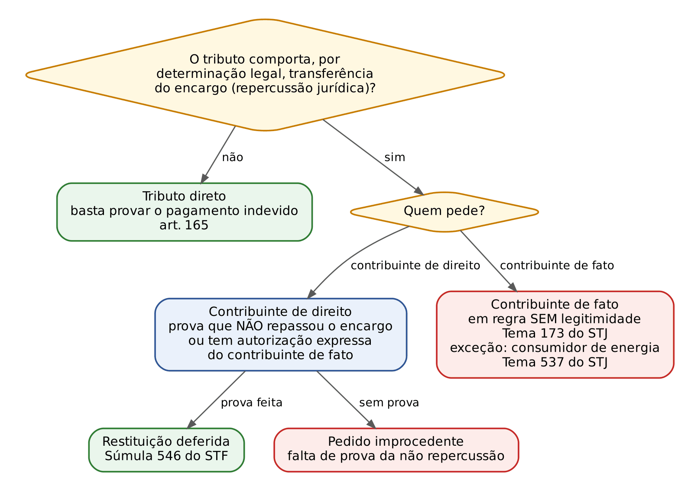
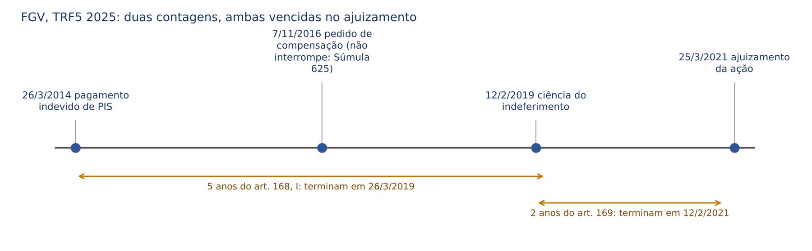
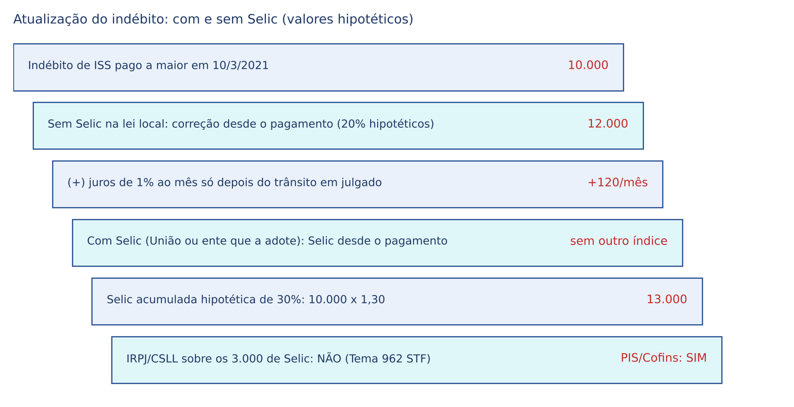
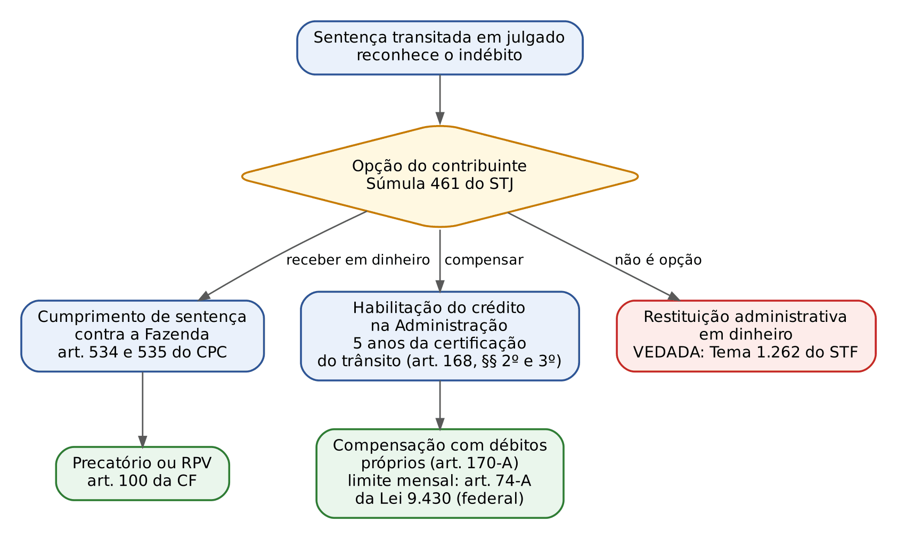

# CAPÍTULO 16 — REPETIÇÃO DO INDÉBITO, RESTITUIÇÃO E COMPENSAÇÃO: PAGAMENTO INDEVIDO, ART. 166 DO CTN, PRAZOS, JUROS E SELIC, PRECATÓRIO E RESTITUIÇÃO ADMINISTRATIVA

:::INCIDENCIA
TRF5 p. 14; TJRS p. 6, 8; TJSC p. 13, 18. Nível A. Lote: 10 questões (FGV 8, FCC 2), além de correlatas de ICMS-ST, imunidade e compensação.
O que mais cai: termo inicial e contagem dos prazos dos arts. 168 e 169 (inclusive em caso com datas, TRF5 2025 e TJSC 2025), legitimidade e prova da não repercussão (art. 166), juros e Selic na repetição, e a forma de receber o indébito judicial (precatório ou compensação; Tema 1.262 do STF).
:::

| Subtema | FGV | FCC | Padrão de cobrança |
|---|---|---|---|
| Prazo de 5 anos (art. 168) e termo inicial | 2 | 2 | "conta-se da extinção do crédito", não do fato gerador nem da notificação |
| Prazo de 2 anos (art. 169) e pedido administrativo (Súmula 625) | 1 | 1 | caso com datas; anulatória da decisão denegatória |
| Legitimidade e art. 166 | 2 | 0 | quem suportou o encargo; adquirente de imóvel; tributo direto x indireto |
| Juros, correção e Selic | 2 | 0 | Selic estadual por isonomia; ressarcimento só corrige após 360 dias |
| Compensação (interação) | 1 | 0 | lei estadual e regulamento; imputação proporcional |
| Revisão do lançamento (art. 146) | 1 | 0 | classificada aqui, mas é tema do Cap. 12 |

## 16.1 O direito à restituição: fundamento e hipóteses

### 16.1.1 Por que o Fisco devolve, e por que a lógica não é a do Código Civil

A obrigação tributária nasce da lei (*ex lege*), e não da vontade. Se o tributo só é devido quando ocorre, no mundo dos fatos, a situação descrita em lei (o fato gerador; ver Cap. 9), tudo o que o Estado recebe além disso é recebimento sem causa jurídica, que precisa ser devolvido. A devolução, chamada repetição do indébito (de *repetere*, pedir de volta; "indébito" é o que não era devido), decorre da própria legalidade tributária: o Fisco não pode reter o que a lei não lhe atribui.

O civilista deve desligar dois reflexos. Primeiro, no Código Civil quem paga voluntariamente o indevido precisa provar que o fez por erro (art. 877 do CC). No direito tributário, NÃO: o art. 165 do CTN garante a restituição "independentemente de prévio protesto" e alcança inclusive o pagamento espontâneo. Como o tributo é compulsório, a vontade do contribuinte é irrelevante tanto para criar a dívida quanto para justificá-la; basta demonstrar que o pagamento não correspondia ao que a lei exigia. Segundo, no direito civil não se repete o que se pagou para solver dívida prescrita (art. 882 do CC), porque a prescrição só encobre a pretensão e a obrigação natural subsiste. No direito tributário, a prescrição e a decadência EXTINGUEM o próprio crédito (art. 156, V, do CTN; ver Cap. 15): quem paga crédito prescrito ou caduco paga tributo inexistente e tem direito à restituição.

:::PEGADINHA
"O pagamento espontâneo de tributo indevido não gera direito à restituição, salvo prova de erro" está ERRADO. A espontaneidade é irrelevante (art. 165, I, fala expressamente em "pagamento espontâneo"). E "não cabe repetição de tributo prescrito pago voluntariamente" também está ERRADO: transposição indevida do art. 882 do CC para o direito tributário.
:::

:::LEI CTN, art. 165
Art. 165. O sujeito passivo tem direito, independentemente de prévio protesto, à restituição total ou parcial do tributo, seja qual fôr a modalidade do seu pagamento, ressalvado o disposto no § 4º do art. 162, nos seguintes casos:
I - cobrança ou pagamento espontâneo de tributo indevido ou maior que o devido em face da legislação tributária aplicável, ou da natureza ou circunstâncias materiais do fato gerador efetivamente ocorrido;
II - êrro na edificação do sujeito passivo, na determinação da alíquota aplicável, no cálculo do montante do débito ou na elaboração ou conferência de qualquer documento relativo ao pagamento;
III - reforma, anulação, revogação ou rescisão de decisão condenatória.
:::

### 16.1.2 As três hipóteses do art. 165

O inciso I cobre o erro de direito e o erro de fato sobre o fato gerador: o contribuinte pagou tributo que a lei não previa (lei inconstitucional, isenção desconsiderada, imunidade) ou pagou mais do que a lei previa, seja porque o Fisco cobrou assim (lançamento de ofício equivocado), seja porque ele próprio calculou mal (lançamento por homologação). O inciso II cobre os erros materiais: "edificação" é grafia antiga de identificação (pagou-se em nome de outro sujeito passivo), erro de alíquota, de cálculo ou no preenchimento da guia. O inciso III trata do tributo pago em razão de decisão condenatória (administrativa ou judicial) depois reformada, anulada, revogada ou rescindida: o pagamento era devido enquanto a decisão valia, e se tornou indevido com a sua desconstituição; por isso o termo inicial do prazo é outro (16.4.1).

Duas ressalvas. A primeira é a do art. 162, § 4º: a perda ou destruição da estampilha (selo que comprovava o pagamento de certos tributos) e o erro no pagamento por essa modalidade não dão direito a restituição, salvo previsão legal ou erro imputável à autoridade. A segunda é que o art. 165 trata de indébito TRIBUTÁRIO. Quando o STF afasta a natureza tributária de uma cobrança (por exemplo, contribuição para custeio de serviço de saúde de servidores, tida como não compulsória), o STJ deixa de aplicar automaticamente os arts. 165 a 168 e examina a relação como contratual (Tema 588 do STJ, sobre a contribuição de saúde do IPSEMG).

:::EXEMPLO Uma situação de cada inciso
A Padaria Beta pagou ISS sobre a venda de pães (que é operação de circulação de mercadoria, não serviço): inciso I, tributo indevido por erro de enquadramento. Joana pagou IPTU com alíquota de 2% quando a lei fixava 1% para imóveis residenciais: inciso II, erro na alíquota (é o caso da Q3265484, abaixo). A Transportadora Gama perdeu na esfera administrativa, pagou a multa e o tributo, e depois obteve a anulação da decisão no Judiciário: inciso III.
:::

:::QUESTAO FGV 2025 — Prefeitura de Canaã dos Carajás — Procurador Municipal (Q3265484)
Caso: João pagou IPTU a maior por erro do Município no cálculo da alíquota e quer saber se pode pedir a devolução e em que prazo.
Gabarito: D. Pode pleitear a restituição em até 5 anos contados da extinção do crédito tributário (arts. 165, II, e 168, I).
Armadilhas: (A) espontaneidade não impede a restituição; (B) 2 anos é o prazo da anulatória da decisão administrativa que denega a restituição (art. 169), não o do pedido; (C) a restituição do tributo arrasta, proporcionalmente, juros e multas (art. 167); (E) a exigência de prova do encargo financeiro é do art. 166, que não se aplica ao IPTU, tributo direto.
No mesmo sentido, quanto ao termo inicial: FCC 2026, SEFAZ-SP, Auditor Fiscal (Q3956700), em que o contribuinte pagou ITCMD a maior: gabarito B, "da data em que tiver sido extinto o crédito", e não do fato gerador nem do primeiro dia do exercício seguinte (que são marcos de decadência; ver Cap. 15).
:::

### 16.1.3 O que se devolve: tributo, juros e multas (art. 167, caput)

A restituição do tributo "dá lugar à restituição, na mesma proporção, dos juros de mora e das penalidades pecuniárias". A lógica é a do acessório que segue o principal: se o tributo era indevido, também o eram os juros pelo atraso e a multa por não o ter pago. A exceção são as multas por "infrações de caráter formal não prejudicadas pela causa da restituição": a multa por não entregar uma declaração no prazo (descumprimento de obrigação acessória) continua devida mesmo que o tributo seja depois reconhecido indevido, porque a infração formal existiu de qualquer modo.

:::EXEMPLO Restituição proporcional
A Comercial Delta pagou em atraso 100.000 (cem mil) reais de imposto, acrescidos de 20.000 (vinte mil) reais de multa de mora e 10.000 (dez mil) reais de juros, e ainda 1.000 (mil) reais de multa por entrega tardia da declaração. Depois se apurou que só 60.000 (sessenta mil) reais eram devidos. Indevidos 40% do tributo, restituem-se 40.000 (quarenta mil) reais de tributo, 8.000 (oito mil) reais de multa de mora e 4.000 (quatro mil) reais de juros. A multa formal de 1.000 (mil) reais não é restituída: o atraso na declaração não foi "prejudicado" pela causa da restituição.
:::

:::QUESTAO FCC 2024 — Prefeitura de Jaboatão dos Guararapes — Procurador (Q3542141)
Cobrou-se a literalidade dos arts. 160 a 169 do CTN.
Gabarito: E. Extingue-se em 5 anos, contados da data do pagamento espontâneo indevido, o direito de pleitear a restituição (o pagamento é a extinção do crédito; art. 168, I, com o art. 3º da LC 118/2005).
Armadilhas: (A) "sempre" é falso, por causa da ressalva das infrações formais (art. 167); (B) a anulatória da decisão denegatória prescreve em 2 anos, não em 5 (art. 169); (C) o vencimento supletivo é de 30 dias da notificação (art. 160), não de 15 dias úteis (ver Cap. 14); (D) a consignação não serve para discutir a incidência; é cabível nas hipóteses do art. 164 (ver Cap. 14).
:::

### 16.1.4 Restituição, ressarcimento e compensação: três institutos que a banca mistura

Restituição (ou repetição) é a devolução de tributo pago indevidamente. Compensação é o encontro de contas entre o crédito do contribuinte contra a Fazenda e o débito tributário dele, que extingue ambos até onde se equivalerem (art. 156, II, e art. 170; regime material no Cap. 14); é uma das formas de "receber" o indébito. Ressarcimento é coisa distinta: devolução em dinheiro de créditos escriturais legítimos que o contribuinte não consegue usar, típica dos tributos não cumulativos (créditos de PIS e Cofins de exportador, por exemplo). No ressarcimento NÃO houve pagamento indevido: o tributo das etapas anteriores era devido, e a lei apenas permite converter em dinheiro o crédito acumulado. Por isso o regime de correção é diferente (16.5.5) e o art. 166 não é o filtro aplicável.

## 16.2 Legitimidade: quem pede e contra quem

### 16.2.1 Legitimidade ativa: quem pagou, em regra

A regra é que tem direito à restituição o sujeito passivo que efetuou o pagamento (art. 165: "o sujeito passivo tem direito"), seja ele contribuinte, seja responsável. Nos tributos diretos, aqueles cujo ônus a lei não manda transferir a terceiro (IR, IPTU, IPVA, ITCMD, ITR), basta isso; nos indiretos, entra o filtro do art. 166 (16.3).

Dois desdobramentos práticos. Primeiro, na retenção na fonte, quem suporta o desconto é o contribuinte (o empregado, o prestador); a fonte pagadora é mera responsável que repassou ao Fisco valor alheio. O legitimado é o contribuinte que sofreu a retenção. Segundo, o direito à restituição é crédito pessoal de quem pagou: não acompanha o bem. Quem compra um imóvel não adquire, tacitamente, o direito de repetir o IPTU que o vendedor pagou a maior em anos anteriores; a responsabilidade do adquirente pelos tributos do imóvel (art. 130 do CTN; ver Cap. 10) é regra de sujeição passiva, que não se converte em titularidade de crédito contra o Fisco. Nada impede, porém, a cessão expressa do crédito entre as partes, assunto de direito privado.

:::QUESTAO FGV 2024 — prova não identificada no banco (Q3157903)
Caso: José comprou em 2024 imóvel cujo antigo dono, Carlos, pagara IPTU a maior de 2020 a 2023, e ajuizou repetição de indébito em nome próprio.
Gabarito: E. José não é parte legítima, porque não suportou o ônus financeiro do pagamento.
Armadilhas: (A) e (D) a compra e venda não transfere tacitamente o crédito; (B) a responsabilidade do sucessor (art. 130) é regra de cobrança, não de restituição; (C) o caráter *propter rem* do IPTU vincula o débito ao bem, não o crédito decorrente de pagamento feito por outrem.
:::

### 16.2.2 Legitimidade passiva: quem recebeu (Súmula 447 do STJ)

Responde pela restituição a pessoa jurídica de direito público que recebeu o tributo e é sua titular. O caso clássico é o imposto de renda retido na fonte pelos Estados, Distrito Federal e Municípios sobre os rendimentos que pagam: a Constituição atribui a esses entes o produto dessa arrecadação (arts. 157, I, e 158, I, da CF; ver Cap. 7). Por isso, embora o IR seja tributo da União, a ação de restituição do servidor estadual é proposta contra o próprio Estado.

:::JURIS STJ, Súmula 447
"Os Estados e o Distrito Federal são partes legítimas na ação de restituição de imposto retido na fonte proposta por seus servidores." A União não integra o polo passivo: não há litisconsórcio necessário. Cobrado no ENAM 2024.2 (Q3058620, gabarito E: só o Estado permanece no polo passivo, por ser o destinatário integral do IR retido de seus servidores).
:::

## 16.3 Tributos indiretos e o art. 166 do CTN

### 16.3.1 Repercussão econômica e repercussão jurídica

Em linguagem econômica, todo tributo pode ser "repassado": a empresa embute no preço até o IPTU da loja. Se o art. 166 fosse lido assim, nenhum tributo pago por empresa seria restituível sem prova impossível. Por isso a jurisprudência do STJ e a doutrina majoritária leem a expressão "tributos que comportem, por sua natureza, transferência do respectivo encargo financeiro" como repercussão JURÍDICA: o tributo é indireto quando a própria lei estrutura a incidência para que o ônus seja transferido a terceiro, que o suporta embutido no preço. É o caso do ICMS e do IPI, calculados "por dentro" ou destacados na nota fiscal e cobrados do adquirente da mercadoria. Nesses tributos aparecem duas figuras:

| Figura | Quem é | Exemplo no ICMS |
|---|---|---|
| Contribuinte de direito (*de jure*) | quem a lei põe no polo passivo e recolhe | a loja que vende a geladeira |
| Contribuinte de fato (*de facto*) | quem suporta economicamente o tributo, embutido no preço | o consumidor que compra a geladeira |

O ISS pode ser direto ou indireto conforme a modalidade: o ISS fixo das sociedades de profissionais (valor por profissional, sem relação com o preço) é direto; o ISS calculado sobre o preço do serviço pode ser repassado e o STJ tem exigido, nesses casos, o exame do art. 166. Na dúvida, a prova costuma tratar ICMS e IPI como indiretos, e IR, IPTU, IPVA, ITR e ITCMD como diretos.

:::LEI CTN, art. 166
Art. 166. A restituição de tributos que comportem, por sua natureza, transferência do respectivo encargo financeiro sòmente será feita a quem prove haver assumido o referido encargo, ou, no caso de tê-lo transferido a terceiro, estar por êste expressamente autorizado a recebê-la.
:::

### 16.3.2 A regra: o contribuinte de direito só recebe se provar que ficou com o ônus

A razão do art. 166 é evitar o enriquecimento sem causa do contribuinte de direito. Se a loja cobrou o ICMS indevido do consumidor e o repassou ao Estado, devolvê-lo à loja seria premiá-la com dinheiro que saiu do bolso de outra pessoa. Por isso ela só recebe se provar uma de duas coisas: (a) que assumiu o encargo, isto é, não o repassou (vendeu pelo mesmo preço que venderia sem o tributo, não destacou o imposto, absorveu o custo); ou (b) que o repassou, mas está expressamente autorizada pelo contribuinte de fato a receber a restituição.

:::JURIS STF, Súmula 546
"Cabe a restituição do tributo pago indevidamente, quando reconhecido por decisão, que o contribuinte 'de jure' não recuperou do contribuinte 'de facto' o 'quantum' respectivo." É a versão jurisprudencial do art. 166, anterior ao CTN, e convive com ele: a prova da não repercussão é condição da restituição ao contribuinte de direito.
:::

:::DOUTRINA A crítica ao art. 166
Parte relevante da doutrina critica o dispositivo: a prova negativa do não repasse é quase impossível em mercados em que os preços se formam livremente, e a autorização de milhares de consumidores anônimos é inviável; o resultado prático é que o Estado, que cobrou o indevido, fica com o dinheiro, o que reproduz o enriquecimento sem causa que a norma pretendia evitar, só que em favor do Fisco. O argumento não prevalece na jurisprudência, que aplica o art. 166 nos tributos indiretos; mas explica por que os tribunais o interpretam restritivamente (repercussão jurídica, inaplicação no ICMS-ST, ver 16.3.4).
:::

:::EXEMPLO Como se prova a não repercussão
A Distribuidora Ômega vendia um produto a preço tabelado pelo poder público em 1.000 (mil) reais, tributado indevidamente pelo ICMS a 18%. Como o preço era fixo e não podia aumentar com o imposto, a empresa demonstra, com a tabela oficial e as notas, que o ICMS de 180 (cento e oitenta) reais por unidade saiu da sua margem: assumiu o encargo e tem direito à restituição. Já a Loja Sigma, que destacou o ICMS indevido na nota e o somou ao preço cobrado do cliente, só recebe se apresentar autorização expressa dos adquirentes; sem ela, o pedido é improcedente, e o ônus da prova é dela (art. 373, I, do CPC).
:::

:::PEGADINHA
A exigência de prova da não transferência do encargo NÃO se aplica a tributo direto. A FGV (Q3841703, alternativa A) afirmou que na repetição de tributo direto "resta necessária" a prova de que não houve repasse ao consumidor: errado. No IPTU da Q3265484 (alternativa E), mesma armadilha.
:::

### 16.3.3 O contribuinte de fato, em regra, não tem legitimidade

Se o consumidor é quem suporta o ônus, por que não é ele quem pede de volta? Porque não integra a relação jurídico-tributária: quem deve ao Estado é o vendedor; o consumidor apenas paga um preço ao vendedor. A relação entre consumidor e vendedor é de direito privado, e o tributo é, para o consumidor, componente do preço.

:::JURIS STJ, Tema 173 (REsp 903.394/AL, Primeira Seção, j. 24/3/2010)
O contribuinte de fato (no caso, distribuidora de bebidas que adquiria do fabricante) não tem legitimidade ativa para pleitear a restituição do IPI incidente sobre descontos incondicionais, recolhido pelo fabricante, porque não integra a relação jurídica tributária. Legitimado é o contribuinte de direito, observado o art. 166.
:::

A exceção relevante é a da energia elétrica. Nas concessões de serviço público, o consumidor está numa relação peculiar: a concessionária repassa o tributo por força da regulação tarifária e não tem interesse em litigar contra o Estado concedente (pode até ser beneficiada pela manutenção da tarifa). Se o consumidor não pudesse agir, ninguém agiria.

:::JURIS STJ, Tema 537 (REsp 1.299.303/SC, Primeira Seção, j. 8/8/2012)
Diante da legislação das concessões de serviço público e da peculiar relação entre Estado concedente, concessionária e consumidor, este tem legitimidade para propor ação declaratória cumulada com repetição de indébito para afastar o ICMS sobre a demanda de energia elétrica contratada e não utilizada.
Alcance: a exceção nasce da lógica das concessões e não se estende a outros contribuintes de fato. Não confundir com a discussão de mérito sobre a base de cálculo do ICMS na energia (TUST e TUSD, Tema 986 do STJ; ver Cap. 27).
:::

O mesmo raciocínio explica uma tese que a FGV cobra no capítulo de imunidades: a entidade imune que compra mercadoria é mera contribuinte de fato do ICMS e do IPI embutidos no preço, e a imunidade subjetiva não a alcança nessa posição (Tema 342 do STF; ver Cap. 6). Logo, não tem direito à restituição desses impostos (FGV, TJ-PA 2026, Q3951784, gabarito E; FGV, MPU 2025, Q3339791, gabarito A).

### 16.3.4 Substituição tributária para frente: o art. 166 não se aplica

Na substituição tributária progressiva ("para frente"; ver Caps. 10 e 27), o fabricante (substituto) recolhe antecipadamente o ICMS que seria devido nas vendas futuras do varejista (substituído), sobre uma base de cálculo presumida. Se o fato gerador presumido não ocorre, ou ocorre por valor menor que o presumido, há restituição (art. 150, § 7º, da CF; quanto à diferença de base, Tema 201 do STF; ver Cap. 27). O que interessa aqui é quem pede e o que precisa provar.

O legitimado é o substituído, que suportou o imposto no preço pago ao substituto e realizou a operação final. E ele NÃO precisa da prova do art. 166, porque a restituição não decorre de tributo indevido repassado a terceiro, mas do ajuste entre a base presumida e a base real: o "excesso" nunca chegou a ser transferido ao consumidor, que pagou o preço real, menor.

:::JURIS STJ, Tema 1.191 (REsp 2.034.975/MG, REsp 2.034.977/MG e REsp 2.035.550/MG, Primeira Seção, j. 14/8/2024)
"Na sistemática da substituição tributária para frente, em que o contribuinte substituído revende a mercadoria por preço menor do que a base de cálculo presumida para o recolhimento do tributo, é inaplicável a condição prevista no art. 166 do CTN."
Cobrado em FGV, SEFAZ-RS 2025 (Q3154683, gabarito A: só o item que afasta o art. 166 está correto); FGV, PGE-AC 2026 (Q4079421, gabarito B: é ressarcimento da diferença, sem prova de repasse); FGV, TJ-BA 2026 (Q4083784, gabarito D) e FGV, DATAPREV 2026 (Q4389184, gabarito B), ambas sobre o direito à restituição da diferença.
:::

A lógica foi estendida pelo STF ao PIS e à Cofins recolhidos por substituição (Tema 228 do STF: é devida a restituição da diferença quando a base efetiva for inferior à presumida; FGV, TRF2 2026, Q3996877, gabarito C). Há um limite recente: no varejo de cigarros, a base do PIS e da Cofins é o preço de tabela multiplicado por coeficiente legal, por opção extrafiscal do legislador, e não presunção do valor da operação; por isso o STJ negou a restituição da diferença ao varejista (Tema 1.455 do STJ, REsps 2.215.075/SC e 2.177.940/RS, j. 9/9/2026).

:::DICA Como separar os casos de ICMS-ST na prova
Pergunte: o pedido é de quem fez a operação final e se baseia na diferença entre base presumida e base real? Então o substituído é legitimado e o art. 166 não se aplica (Tema 1.191). O pedido é do consumidor final (contribuinte de fato)? Sem legitimidade (Tema 173). A base foi fixada por lei como pauta extrafiscal, e não como presunção (cigarros)? Não há restituição (Tema 1.455).
:::

:::SENTENCA Art. 166 na sentença de repetição
Onde entra: preliminar de ilegitimidade ativa (contribuinte de fato) e, no mérito, como fato constitutivo do direito do contribuinte de direito (prova da não repercussão ou autorização). Não é condição da ação a ser examinada em abstrato: é matéria de prova, decidida no mérito.
Redação-modelo: "Tratando-se de ICMS, tributo que comporta, por sua natureza jurídica, a transferência do encargo financeiro, a restituição ao contribuinte de direito pressupõe a prova de que assumiu o encargo ou de que está autorizado pelo contribuinte de fato a recebê-la (art. 166 do CTN; Súmula 546 do STF), ônus do qual a autora não se desincumbiu, pois as notas fiscais juntadas destacam o imposto e o acrescem ao preço."
Erro comum que a banca pune: aplicar o art. 166 a tributo direto (IPTU, IR) ou ao substituído do ICMS-ST que pede a diferença entre base presumida e real (Tema 1.191); e, no outro extremo, reconhecer legitimidade ao consumidor final fora da hipótese da energia elétrica (Tema 537).
:::

## 16.4 Prazos para pleitear a restituição

### 16.4.1 A regra do art. 168: cinco anos, contados da extinção do crédito

O direito de pleitear a restituição, administrativa ou judicialmente, extingue-se em 5 anos. O termo inicial depende da hipótese do art. 165:

| Hipótese | Termo inicial (art. 168) | Exemplo |
|---|---|---|
| Pagamento indevido ou a maior e erro (art. 165, I e II) | data da extinção do crédito tributário (inciso I), que, na prática, é a data do pagamento | IPTU pago em 10/2/2022: prazo até 10/2/2027 |
| Reforma, anulação, revogação ou rescisão de decisão condenatória (art. 165, III) | data em que se tornar definitiva a decisão administrativa ou passar em julgado a decisão judicial que desconstituiu a condenação (inciso II) | decisão rescisória transitada em 5/5/2025: prazo até 5/5/2030 |

Quanto à natureza do prazo, há divergência doutrinária: parte da doutrina vê no art. 168 um prazo decadencial (extingue o "direito de pleitear"), especialmente para o pedido administrativo, e no art. 169 um prazo prescricional. O STJ trata o prazo da ação de repetição como prescricional (é a linguagem da Súmula 625 e dos repetitivos), e é assim que a banca o chama. O que importa para a prova é o marco e a contagem, que não mudam com o rótulo.

:::PEGADINHA Marcos que NÃO são termo inicial da repetição
Não confunda com os marcos da decadência do lançamento (Cap. 15). O prazo da repetição NÃO corre do fato gerador, NÃO corre do primeiro dia do exercício seguinte, NÃO corre da notificação de que o Fisco reconheceu o pagamento indevido e NÃO corre da declaração de inconstitucionalidade da lei pelo STF. A FGV cobrou a última hipótese na Q3841703 (alternativa C, errada): a pretensão de repetir nasce com o pagamento indevido, e a decisão do STF em controle concentrado não reabre prazo já consumado.
:::

### 16.4.2 Lançamento por homologação: a "tese dos 5 + 5" e a LC 118/2005

Nos tributos lançados por homologação (ver Cap. 12), o contribuinte paga antes de qualquer ato do Fisco, e o crédito só se considera definitivamente extinto com a homologação (art. 150, § 1º e § 4º, do CTN). Durante anos o STJ entendeu que, como a homologação tácita ocorre 5 anos depois do fato gerador, o prazo de 5 anos do art. 168, I, só começava a correr dali: na prática, até 10 anos depois do fato gerador (a "tese dos 5 + 5").

A LC 118/2005 reagiu com uma norma dita interpretativa: o art. 3º dispôs que, "para efeito de interpretação do inciso I do art. 168", a extinção do crédito ocorre, nos tributos lançados por homologação, no momento do pagamento antecipado. E o art. 4º mandou aplicar o art. 3º retroativamente, invocando o art. 106, I, do CTN (lei expressamente interpretativa aplica-se a atos pretéritos; ver Cap. 8).

:::LEI LC 118/2005, arts. 3º e 4º
Art. 3º Para efeito de interpretação do inciso I do art. 168 da Lei nº 5.172, de 25 de outubro de 1966 – Código Tributário Nacional, a extinção do crédito tributário ocorre, no caso de tributo sujeito a lançamento por homologação, no momento do pagamento antecipado de que trata o § 1º do art. 150 da referida Lei.
Art. 4º Esta Lei entra em vigor 120 (cento e vinte) dias após sua publicação, observado, quanto ao art. 3º, o disposto no art. 106, inciso I, da Lei nº 5.172, de 25 de outubro de 1966 – Código Tributário Nacional.
:::

O STF entendeu que o art. 3º não era mera interpretação, mas norma NOVA (reduziu um prazo que a jurisprudência consolidada lia como de 10 anos), e que aplicá-la retroativamente ofenderia a segurança jurídica. Como a lei foi publicada em 9/2/2005 com *vacatio legis* de 120 dias, o novo prazo vale para as ações ajuizadas a partir de 9/6/2005. O critério é a data do AJUIZAMENTO da ação, e não a data do pagamento.

:::JURIS STF, Tema 4 (RE 566.621, j. 4/8/2011)
"É inconstitucional o art. 4º, segunda parte, da Lei Complementar 118/2005, de modo que, para os tributos sujeitos a homologação, o novo prazo de 5 anos para a repetição ou compensação de indébito aplica-se tão somente às ações ajuizadas após o decurso da vacatio legis de 120 dias, ou seja, a partir de 9 de junho de 2005." O STJ realinhou sua jurisprudência a essa tese nos Temas 137 e 138 (REsp 1.269.570/MG, j. 23/5/2012).
:::

:::EXEMPLO Duas ações sobre o mesmo pagamento
A Indústria Kappa pagou indevidamente IPI em 10/3/2000. (a) Se ajuizou a repetição em 1º/6/2005 (antes de 9/6/2005), aplica-se a tese dos 5 + 5: homologação tácita em 10/3/2005 e mais 5 anos, até 10/3/2010; a ação é tempestiva. (b) Se ajuizou em 1º/7/2005, aplica-se a regra nova: 5 anos do pagamento, encerrados em 10/3/2005; a ação está prescrita. Hoje, passados mais de 20 anos, o tema é histórico na prática forense, mas segue cobrado como exemplo de lei "interpretativa" que inova (Cap. 8) e de modulação pelo critério do ajuizamento.
:::

### 16.4.3 Termos iniciais em situações específicas

- Tributo lançado de ofício (IPTU, IPVA): o crédito se extingue com o pagamento; o prazo corre da data de cada pagamento indevido.
- Imposto de renda da pessoa física retido na fonte: o STJ entende que o prazo corre da entrega da declaração de ajuste anual, e não da data de cada retenção, porque é no ajuste que se apura o imposto efetivamente devido no ano (REsp 2.176.108/RS, adiante).
- Tributo declarado inconstitucional: o prazo continua a correr do pagamento; a declaração de inconstitucionalidade não é termo inicial (16.4.1).
- Pagamento por força de decisão condenatória depois desconstituída: art. 168, II.
- Habilitação administrativa de indébito reconhecido judicialmente (para compensar): prazo próprio de 5 anos contado da certificação do trânsito em julgado (art. 168, §§ 2º e 3º, incluídos pela LC 236/2026; ver 16.6.4).

### 16.4.4 O pedido administrativo não interrompe o prazo (Súmula 625 do STJ)

O contribuinte pode pedir a restituição ou a compensação primeiro na via administrativa, sem que isso seja requisito para a ação judicial (não há exigência de esgotamento; por exemplo, o STF afirmou que a ação para reconhecer isenção de IR por doença grave e repetir o indébito não exige prévio requerimento administrativo, Tema 1.373 do STF, RE 1.525.407/CE). Mas o pedido administrativo NÃO interrompe a prescrição da ação judicial. A intuição civilista (art. 202, VI, do CC: ato inequívoco de reconhecimento do direito pelo devedor interrompe a prescrição) leva ao erro: o pedido é ato do credor (contribuinte), não reconhecimento do devedor (Fisco).

:::JURIS STJ, Súmula 625 (Primeira Seção, aprovada em 12/12/2018)
"O pedido administrativo de compensação ou de restituição não interrompe o prazo prescricional para a ação de repetição de indébito tributário de que trata o art. 168 do CTN nem o da execução de título judicial contra a Fazenda Pública."
Desdobramento recente: a impugnação administrativa ao lançamento também não interrompe o prazo da repetição, e a posterior anulação do lançamento ou da CDA não reabre o prazo já consumado; o pedido ou a impugnação podem, quando cabível, apenas suspender o prazo enquanto pendente a decisão administrativa (STJ, Segunda Turma, REsp 2.176.108/RS, j. 7/4/2026).
:::

:::EXEMPLO O caso do REsp 2.176.108/RS, em números
Regina teve IR retido na fonte em 2010 e entregou a declaração de ajuste em 24/5/2011: o prazo da repetição corria até 24/5/2016. Em 2013 a Receita lançou diferença; em 20/8/2015 ela impugnou o lançamento; a decisão administrativa de 13/11/2015 o manteve. Só em 15/12/2019 Regina ajuizou anulatória cumulada com repetição. Resultado: repetição prescrita, porque nem a impugnação nem a decisão administrativa interromperam o prazo, que se esgotou em 2016.
:::

### 16.4.5 O prazo de dois anos do art. 169

Se o contribuinte pediu a restituição na via administrativa e o pedido foi negado, a lei abre uma via específica: a ação anulatória da decisão administrativa denegatória, que prescreve em 2 anos. O prazo conta-se da ciência da decisão definitiva, é interrompido pelo início da ação judicial e, depois, recomeça a correr "por metade" (1 ano) a partir da intimação válida do representante judicial da Fazenda.

:::LEI CTN, art. 169
Art. 169. Prescreve em dois anos a ação anulatória da decisão administrativa que denegar a restituição.
Parágrafo único. O prazo de prescrição é interrompido pelo início da ação judicial, recomeçando o seu curso, por metade, a partir da data da intimação validamente feita ao representante judicial da Fazenda Pública interessada.
:::

Três observações cobráveis:

- Os dois prazos convivem. O biênio do art. 169 é para anular a decisão denegatória; o quinquênio do art. 168 continua correndo do pagamento, e o pedido administrativo não o interrompe (Súmula 625). Se ainda houver prazo do art. 168, o contribuinte pode ignorar a decisão administrativa e ajuizar diretamente a repetição. Esgotado o quinquênio, sobra apenas a anulatória, enquanto não vencido o biênio.
- A recontagem "por metade" após a citação é regra peculiar (lembra a do Decreto 20.910/1932 para as ações contra a Fazenda); a FGV usa números para testá-la (Q3373904, alternativa D, que aplica a regra ao prazo errado).
- Lei estadual que reproduz o biênio do art. 169 é válida: apenas repete a norma geral do CTN (FGV, TJ-SC 2025, Juiz Substituto, Q3324298, gabarito A). O que a lei local NÃO pode é alterar prazos prescricionais tributários, matéria reservada a lei complementar nacional (art. 146, III, b, da CF; Súmula Vinculante 8; ver Cap. 15).

:::QUESTAO FGV 2025 — TRF5 — Juiz Substituto (Q3373904)
Caso: PIS pago indevidamente em 26/3/2014; pedido administrativo de compensação em 7/11/2016; indeferimento em 24/10/2018, com ciência em 12/2/2019; ação para desconstituir a decisão ajuizada em 25/3/2021, com despacho citatório em 18/8/2021 e citação da Procuradoria em 29/3/2022.
Gabarito: C. Prescrição pelo decurso do prazo bienal da anulatória da decisão denegatória, sendo inaplicável o quinquênio da repetição.
:::

:::PASSO Como resolver a Q3373904
1. Identifique o pedido: a ação visa desconstituir a decisão administrativa que negou a compensação. É a ação do art. 169: prazo de 2 anos da ciência da decisão (12/2/2019), encerrado em 12/2/2021. Ajuizada em 25/3/2021, está prescrita.
2. Teste a saída pela repetição direta: o quinquênio do art. 168, I, contado do pagamento (26/3/2014), terminou em 26/3/2019; o pedido de 2016 não o interrompeu (Súmula 625). Também não há salvação por esse caminho.
3. Elimine as sedutoras: (A) invoca o quinquênio, mas a ação proposta é a anulatória, cujo prazo próprio é o bienal; (B) atribui ao pedido administrativo efeito interruptivo, contra a Súmula 625; (D) aplica a recontagem por metade, que só opera se a ação tiver sido ajuizada dentro do biênio, e inventa uma "prescrição intercorrente" de julgamento; (E) afirma que o pedido interrompeu o prazo da repetição, erro de premissa, ainda que conclua pela prescrição.
:::

:::PROCESSO Quadro dos prazos da restituição
| Situação | Prazo | Termo inicial | Interrupção |
|---|---|---|---|
| Pedido administrativo ou ação de repetição (art. 165, I e II) | 5 anos | extinção do crédito (pagamento; LC 118/2005, art. 3º) | pedido administrativo NÃO interrompe (Súmula 625) |
| Idem, com base em decisão condenatória desconstituída (art. 165, III) | 5 anos | decisão definitiva ou trânsito em julgado da decisão que a desconstituiu | idem |
| Anulatória da decisão administrativa que denega a restituição | 2 anos (art. 169) | ciência da decisão denegatória definitiva | interrompe com o início da ação; recomeça por metade (1 ano) da intimação da Fazenda |
| Habilitação administrativa do indébito judicial (para compensar) | 5 anos (art. 168, § 2º) | certificação do trânsito em julgado (§ 3º) | (sem regra específica no CTN) |
| Execução do título judicial contra a Fazenda | 5 anos (prescrição da pretensão executiva) | trânsito em julgado | pedido administrativo de compensação NÃO interrompe (Súmula 625, parte final) |
Aspectos processuais da ação de repetição (competência, valor da causa, rito, honorários e cumprimento): ver Cap. 23.
:::

:::SENTENCA Prescrição na repetição de indébito
Onde entra: prejudicial de mérito, que o juiz examina de ofício (art. 487, II, do CPC). Fixe a data do ajuizamento, o tipo de lançamento e o termo inicial, e declare prescritas apenas as parcelas pagas há mais de 5 anos do ajuizamento: nas relações de trato sucessivo (PIS, Cofins, ICMS mensais), a prescrição é parcial, alcançando só os recolhimentos anteriores ao quinquênio.
Redação-modelo: "Tratando-se de tributo sujeito a lançamento por homologação e de ação ajuizada após 9/6/2005, o prazo de cinco anos do art. 168, I, do CTN conta-se de cada pagamento antecipado (art. 3º da LC 118/2005; Tema 4 do STF), de modo que estão prescritas as parcelas recolhidas antes de [data do ajuizamento menos cinco anos], sem que o pedido administrativo formulado em [data] tenha interrompido o prazo (Súmula 625 do STJ)."
Erro comum que a banca pune: extinguir todo o pedido por prescrição quando só as parcelas antigas estão atingidas; contar do fato gerador ou da declaração de inconstitucionalidade; aplicar a interrupção por reconhecimento (art. 202, VI, do CC) ao pedido administrativo do contribuinte.
:::

## 16.5 Juros, correção monetária e Selic

### 16.5.1 A regra do CTN: correção desde o pagamento, juros desde o trânsito

O art. 167, parágrafo único, estabelece que a restituição "vence juros não capitalizáveis, a partir do trânsito em julgado da decisão definitiva que a determinar". A correção monetária, que não é acréscimo, mas recomposição do valor da moeda, corre desde o pagamento indevido. As duas súmulas do STJ consolidaram essa separação:

:::JURIS STJ, Súmulas 162 e 188
Súmula 162: "Na repetição de indébito tributário, a correção monetária incide a partir do pagamento indevido."
Súmula 188: "Os juros moratórios, na repetição do indébito tributário, são devidos a partir do trânsito em julgado da sentença."
Taxa dos juros, na falta de lei específica: 1% ao mês (art. 161, § 1º, do CTN; ver Cap. 11).
:::

Atenção ao contraste com o processo civil: nas condenações civis, os juros de mora correm, em regra, da citação (art. 405 do CC). Na repetição tributária, pelo CTN, só correm do trânsito em julgado. A explicação histórica é que a Fazenda não está em mora antes de haver decisão definitiva que a condene a devolver; a consequência prática é que esse regime só vale onde o ente não adota a Selic.

### 16.5.2 Tributos federais: Selic desde o pagamento, sem cumulação

Desde 1º/1/1996, a restituição e a compensação de tributos federais são acrescidas de juros equivalentes à taxa Selic, acumulada mensalmente, calculados desde o pagamento indevido (art. 39, § 4º, da Lei 9.250/1995). A Selic é uma taxa que já embute inflação esperada e remuneração do capital; por isso, onde ela incide, NÃO se soma a nenhum outro índice de correção nem a juros de 1%, e as Súmulas 162 e 188 deixam de operar em separado: a Selic corre, sozinha, desde cada pagamento.

:::LEI Lei 9.250/1995, art. 39, § 4º
§ 4º A partir de 1º de janeiro de 1996, a compensação ou restituição será acrescida de juros equivalentes à taxa referencial do Sistema Especial de Liquidação e de Custódia - SELIC para títulos federais, acumulada mensalmente, calculados a partir da data do pagamento indevido ou a maior até o mês anterior ao da compensação ou restituição e de 1% relativamente ao mês em que estiver sendo efetuada.
:::

:::JURIS STJ, Tema 145 (Jurisprudência em Teses, ed. 70, tese 1)
Aplica-se a taxa Selic, a partir de 1º/1/1996, na atualização monetária do indébito tributário, não podendo ser cumulada com qualquer outro índice, seja de juros ou de atualização monetária. Na mesma linha, os depósitos judiciais e extrajudiciais de tributos federais feitos a partir da Lei 9.703/1998 são atualizados pela Selic (tese 2 da mesma edição).
:::

### 16.5.3 Tributos estaduais e municipais: simetria com a cobrança (art. 165-A do CTN)

Estados e Municípios não estão sujeitos à Lei 9.250/1995. O STJ resolveu a questão pela isonomia: a taxa de juros da repetição de tributo estadual deve ser a mesma usada para cobrar o tributo pago em atraso, legitimando a Selic quando prevista na lei local (Súmula 523 do STJ; desenvolvida no Cap. 11). Em 2026, a regra virou norma geral do CTN.

:::LEI CTN, art. 165-A (incluído pela LC 236/2026)
Art. 165-A. Os indébitos tributários serão atualizados pelos mesmos índices de atualização dos créditos tributários da União, dos Estados, do Distrito Federal e dos Municípios, conforme o caso.
:::

A LC 236, de 4/9/2026, entrou em vigor na data da publicação. O sentido do art. 165-A é o da simetria: o ente que cobra seus créditos pela Selic devolve pela Selic; o que corrige seus créditos por outro índice usa esse mesmo índice na devolução. No plano constitucional, aponta na mesma direção o art. 3º, § 2º, da EC 113/2021, na redação da EC 136/2025: "nos processos de natureza tributária serão aplicados os mesmos critérios de atualização e remuneração da mora pelos quais a Fazenda Pública remunera seu crédito tributário".

:::QUESTAO FGV 2025 — TJ-ES — Atividade Notarial e de Registro, Remoção (Q3520322)
Caso: José venceu repetição de tributo estadual; a lei estadual previa Selic para os créditos pagos em atraso, mas nada dizia sobre os juros da restituição.
Gabarito: E. A lei estadual que adota a Selic na cobrança pode ser usada, por analogia e isonomia, na repetição.
Armadilhas: (A) e (B) a Selic não é exclusividade federal; (C) não há reserva de lei complementar nacional para fixar os juros da restituição estadual; (D) o 1% ao mês do CTN é supletivo e cede à regra de simetria.
Atualização: hoje a solução está positivada no art. 165-A do CTN (LC 236/2026), que torna a simetria obrigatória mesmo sem lei local específica sobre a restituição.
:::

:::DICA Uma pergunta resolve o cálculo
O ente atualiza seus créditos pela Selic? Se sim, Selic desde cada pagamento indevido, sozinha, até a restituição ou compensação. Se não, correção pelo índice local desde o pagamento (Súmula 162) e juros de 1% ao mês (ou a taxa da lei local) desde o trânsito em julgado (art. 167, parágrafo único; Súmula 188). Depois de expedido o precatório, durante o prazo constitucional para pagamento (art. 100, § 5º, da CF), não incidem juros de mora (art. 3º, § 3º, da EC 113/2021, incluído pela EC 136/2025).
:::

### 16.5.4 A Selic recebida é tributável? IRPJ e CSLL não; PIS e Cofins sim

A Selic que o contribuinte recebe na repetição recompõe o patrimônio que o Fisco reteve indevidamente: não é acréscimo patrimonial novo, e sim indenização pela mora estatal. Por isso o STF afastou o IRPJ e a CSLL sobre ela.

:::JURIS STF, Tema 962 (RE 1.063.187/SC, Plenário, j. 24/9/2021)
"É inconstitucional a incidência do IRPJ e da CSLL sobre os valores atinentes à taxa Selic recebidos em razão de repetição de indébito tributário."
Modulação (ED julgados em 2/5/2022): efeitos a partir de 30/9/2021 (publicação da ata do mérito), ressalvadas as ações ajuizadas até 17/9/2021 e os fatos geradores anteriores a 30/9/2021 em relação aos quais não tenha havido o pagamento do IRPJ ou da CSLL.
O STJ readequou o Tema 505: os juros Selic da repetição ficam fora da base do IR e da CSLL, observada a modulação do Tema 962 (REsp 1.138.695/SC, j. 26/4/2023).
:::

O raciocínio NÃO se estende às contribuições sobre receita: para o STJ, os juros Selic recebidos na repetição de indébito integram a receita bruta e, portanto, a base do PIS e da Cofins, cumulativos e não cumulativos (Tema 1.237 do STJ, j. 20/6/2024). A banca explora o contraste: renda (acréscimo patrimonial) x receita (ingresso que se incorpora ao patrimônio).

### 16.5.5 Ressarcimento de créditos escriturais: correção só depois de 360 dias

No ressarcimento de créditos legítimos de tributo não cumulativo (16.1.4), não há indébito nem mora do Fisco desde a origem. A Lei 11.457/2007 (art. 24) dá à Administração 360 dias para decidir o pedido. Só depois desse prazo a demora se torna resistência ilegítima e passa a correr correção.

:::JURIS STJ, Tema 1.003 (REsp 1.767.945/PR, Primeira Seção, j. 12/2/2020)
"O termo inicial da correção monetária de ressarcimento de crédito escritural excedente de tributo sujeito ao regime não cumulativo ocorre somente após escoado o prazo de 360 dias para a análise do pedido administrativo pelo Fisco (art. 24 da Lei nº 11.457/2007)."
:::

:::QUESTAO FGV 2025 — TRF6 — Juiz Federal Substituto (Q3742408)
Caso: empresa protocolou em 2023 pedido de ressarcimento de créditos presumidos de PIS e Cofins; após 10 meses sem resposta, pediu em juízo correção desde o protocolo.
Gabarito: A. A Fazenda dispõe de 360 dias para apreciar o pedido, e somente depois disso incide correção (Tema 1.003).
Armadilhas: (B) 10 meses de espera ainda não configuram resistência ilegítima; (C) o marco não é a decisão final do processo administrativo; (D) o critério "desde o pagamento" é do indébito (Súmula 162), não do ressarcimento; (E) a correção é devida após o prazo legal, por força da jurisprudência, ainda que a lei não a preveja.
:::

## 16.6 Como o indébito é recebido: restituição administrativa, compensação e precatório

### 16.6.1 As vias de cobrança do indébito

O contribuinte tem três caminhos, que podem ser combinados com cautela por causa dos prazos (16.4):

- Via administrativa: pedido de restituição ou declaração de compensação perante o próprio Fisco, nos termos da lei do ente (na esfera federal, o art. 74 da Lei 9.430/1996). O Código de Defesa do Contribuinte (LC 225/2026; ver Cap. 19) prevê, no âmbito federal, interlocução prévia à decisão sobre pedidos de compensação, ressarcimento, restituição e reembolso, e prioridade na análise desses pedidos para contribuintes bem classificados nos programas de conformidade.
- Ação de repetição de indébito (procedimento comum), com pedido condenatório; não exige prévio requerimento administrativo (16.4.4). Aspectos processuais: Cap. 23.
- Mandado de segurança, adequado para DECLARAR o direito à compensação (Súmula 213 do STJ), mas não para convalidar compensação já feita pelo contribuinte (Súmula 460 do STJ) nem para obter efeitos patrimoniais pretéritos (Súmula 271 do STF); quanto à prova pré-constituída dos recolhimentos no MS, Tema 118 do STJ (ver Caps. 14 e 23).

:::QUESTAO FGV 2025 — Prefeitura de Abreu e Lima — Procurador Jurídico Municipal (Q3841703)
Cobrou-se um apanhado da repetição de indébito.
Gabarito: D. É desnecessária, para o reconhecimento do direito à repetição, a juntada de todos os comprovantes de recolhimento, que pode ser feita na liquidação do título judicial. Na fase de conhecimento, basta provar a condição de contribuinte que suportou a exação questionada; a quantificação vem depois.
Armadilhas: (A) o art. 166 não se aplica a tributo direto; (B) a lei local PODE prever a Selic (Súmula 523 e, hoje, art. 165-A do CTN); (C) a declaração de inconstitucionalidade não é termo inicial; (E) a anulatória da decisão denegatória prescreve em 2 anos, não em 5.
:::

### 16.6.2 Compensação do indébito: a interação com o Cap. 14

O regime material da compensação está no Cap. 14 (art. 170: depende de lei autorizativa de cada ente; art. 170-A: não se compensa tributo em discussão judicial antes do trânsito em julgado, ainda que o indébito decorra de inconstitucionalidade, Tema 346 do STJ). Aqui importam os pontos em que a compensação funciona como forma de receber o indébito:

- A compensação segue a lei do ente e pode ser regulamentada pela Administração, desde que nos limites da lei; a regra de imputação do Código Civil (art. 354: primeiro os juros, depois o capital) não se aplica à compensação tributária (Súmula 464 do STJ).
- Na esfera federal, a compensação de crédito decorrente de decisão judicial transitada em julgado observa limite mensal fixado pelo Ministro da Fazenda, graduado conforme o valor total do crédito, não inferior a 1/60 desse total e inaplicável a créditos inferiores a 10.000.000 (dez milhões) de reais (art. 74-A da Lei 9.430/1996, na redação da Lei 14.873/2024), limite que o STF declarou constitucional (ADIs 7.587 e 7.609; v. Cap. 14). Na prática, o piso de 1/60 permite compensar o crédito judicial de grande valor em até 60 meses, horizonte que coincide com o quinquênio do art. 168.

:::QUESTAO FGV 2024 — AL-SC — Analista Legislativo (Q2486010)
Caso: lei estadual autorizou a compensação de pagamentos indevidos com recolhimentos de períodos seguintes; resolução da Secretaria da Fazenda, regulamentando a lei, adotou a imputação proporcional do crédito, de forma única e indivisível, abrangendo principal e juros.
Gabarito: D. A resolução é válida formal e materialmente: a lei autorizou a regulamentação, e o ato não exorbitou do poder regulamentar (art. 170 do CTN: a lei pode atribuir à autoridade administrativa a estipulação das condições).
Armadilhas: (A) o Código Civil não se aplica à imputação na compensação tributária (Súmula 464 do STJ); (B) o prazo não é de 10 anos (art. 168); (C) a lei geral da compensação é o CTN, e cada ente a autoriza por lei ordinária própria; (E) a irretroatividade nada tem a ver com a metodologia de imputação.
:::

### 16.6.3 Indébito reconhecido em juízo: precatório ou compensação, à escolha do contribuinte

A sentença que reconhece o indébito (condenatória ou mesmo declaratória do direito à restituição; a decisão que reconhece a exigibilidade de obrigação de pagar é título executivo, art. 515, I, do CPC) abre ao contribuinte duas portas: executar a Fazenda e receber por precatório ou requisição de pequeno valor (art. 100 da CF; arts. 534 e 535 do CPC), ou usar o crédito em compensação administrativa.

:::JURIS STJ, Súmula 461 e Tema 228 do STJ (REsp 1.114.404/MG)
"O contribuinte pode optar por receber, por meio de precatório ou por compensação, o indébito tributário certificado por sentença declaratória transitada em julgado."
:::

### 16.6.4 Tema 1.262 do STF: a terceira porta está fechada

Alguns contribuintes passaram a pedir uma terceira via: com a sentença transitada em julgado, requerer à Receita a "restituição administrativa" em dinheiro, sem precatório. O STF vedou: pagar em dinheiro, fora da fila, um crédito reconhecido judicialmente contra a Fazenda contorna o regime constitucional de precatórios, que existe para garantir ordem cronológica, isonomia entre credores e previsão orçamentária. A compensação continua admitida, porque não é pagamento com recursos do orçamento, mas extinção recíproca de créditos autorizada pelo art. 170 do CTN.

:::JURIS STF, Tema 1.262 (RE 1.420.691/SP, Plenário, j. 21/8/2023)
Tese: "Não se mostra admissível a restituição administrativa do indébito reconhecido na via judicial, sendo indispensável a observância do regime constitucional de precatórios, nos termos do art. 100 da Constituição Federal."
:::

A LC 236/2026 acrescentou ao art. 168 um prazo para a escolha da compensação: a habilitação do indébito perante a administração tributária submete-se ao quinquênio do caput, contado da certificação do trânsito em julgado (§§ 2º e 3º). O projeto previa ainda um § 1º que afastava esse prazo da "efetiva compensação administrativa do indébito reconhecido em favor do contribuinte em decisão judicial", mas ele foi vetado, ao argumento de que a regra afastaria a prescrição aplicável à compensação de créditos judiciais e remeteria a matéria prescricional à lei ordinária, contra o art. 146, III, b, da CF.

:::LEI CTN, art. 168, §§ 1º a 3º (incluídos pela LC 236/2026)
§ 1º (VETADO).
§ 2º O disposto no caput deste artigo aplica-se à habilitação do indébito perante a administração tributária.
§ 3º O prazo para habilitação prevista no § 2º deste artigo contar-se-á da certificação do trânsito em julgado.
:::

:::ATENCAO Três prazos que correm do trânsito em julgado
Da certificação do trânsito em julgado da sentença de repetição correm, ao mesmo tempo: 5 anos para habilitar o crédito e compensar (art. 168, §§ 2º e 3º); 5 anos para promover o cumprimento de sentença contra a Fazenda e receber por precatório ou RPV; e, em ambos os casos, o pedido administrativo de compensação NÃO interrompe a prescrição da execução judicial (Súmula 625, parte final). O contribuinte que aposta só na compensação e deixa vencer a execução fica sem a porta do precatório se a compensação for indeferida.
:::

:::SENTENCA Dispositivo da sentença de procedência na repetição de indébito
Onde entra: no dispositivo e nos consectários, que a banca corrige item a item.
Redação-modelo: "Julgo procedente o pedido para declarar a inexigibilidade do tributo e condenar o réu a restituir os valores recolhidos a esse título a partir de [data: cinco anos antes do ajuizamento], atualizados exclusivamente pelos mesmos índices que o ente aplica a seus créditos tributários, no caso a taxa Selic, desde cada recolhimento indevido, vedada a cumulação com juros ou outro índice (arts. 165-A e 167 do CTN), o que se apurará em liquidação. Após o trânsito em julgado, faculta-se à autora optar pela compensação administrativa, na forma da lei do ente (arts. 170 e 170-A do CTN; Súmula 461 do STJ), sendo a restituição em dinheiro feita por precatório ou requisição de pequeno valor (art. 100 da CF; Tema 1.262 do STF)."
Erro comum que a banca pune: autorizar compensação antes do trânsito (art. 170-A) ou "restituição administrativa" em dinheiro (Tema 1.262); fixar juros desde a citação, como no direito civil; somar Selic e juros de 1%; esquecer a limitação temporal pela prescrição; e, no MS, condenar ao pagamento de valores pretéritos (Súmula 271 do STF; ver Cap. 23).
:::

### 16.6.5 Ficha de consulta rápida: repetição de indébito (direito material)

| Aspecto | Regra | Fundamento |
|---|---|---|
| Cabimento | tributo indevido ou a maior, erro, decisão condenatória desconstituída; independe de protesto, de erro e de requerimento administrativo prévio | art. 165 do CTN; Tema 1.373 do STF |
| Legitimidade ativa | quem pagou (contribuinte ou responsável); no tributo indireto, só com prova da não repercussão ou autorização; contribuinte de fato, em regra, não; substituído no ICMS-ST, sim, sem art. 166 | art. 166; Súmula 546 do STF; Temas 173, 537 e 1.191 do STJ |
| Legitimidade passiva | o ente titular da receita; IR retido por Estado: o Estado | Súmula 447 do STJ |
| Prazo | 5 anos da extinção do crédito (pagamento); 2 anos para anular decisão denegatória | arts. 168 e 169; LC 118/2005, art. 3º; Tema 4 do STF |
| Interrupção | pedido ou impugnação administrativa não interrompem | Súmula 625 do STJ; REsp 2.176.108/RS |
| Consectários | mesmos índices dos créditos do ente (Selic, sem cumulação); sem Selic: correção do pagamento e juros do trânsito | art. 165-A; art. 167, p. ú.; Súmulas 162 e 188 do STJ; Lei 9.250/1995, art. 39, § 4º |
| Tributação da Selic recebida | não incidem IRPJ e CSLL; incidem PIS e Cofins | Tema 962 do STF; Temas 505 e 1.237 do STJ |
| Recebimento | precatório/RPV ou compensação, à escolha; restituição administrativa em dinheiro vedada; habilitação em 5 anos do trânsito | Súmula 461 do STJ; Tema 1.262 do STF; art. 168, §§ 2º e 3º |

:::QUESTAO FGV 2024 — Prefeitura de São José dos Campos — Técnico Tributário (Q2375639)
Classificada neste capítulo, mas o tema é a revisão do lançamento por mudança de critério jurídico (art. 146 do CTN; ver Cap. 12): o IPTU foi lançado com alíquota acima da legal por critério jurídico equivocado e corrigido após impugnação.
Gabarito: D. A modificação do critério jurídico só se aplica, em relação ao mesmo contribuinte, quanto a fato gerador ocorrido após a sua introdução.
Ponte com este capítulo: o valor pago a maior no lançamento revisto é indébito restituível (art. 165, I), no prazo do art. 168.
:::

## 16.7 Resumo para revisão pré-prova

| Instituto | Regra | Exceções e detalhes | Fundamento |
|---|---|---|---|
| Direito à restituição | todo pagamento indevido ou a maior, mesmo espontâneo, sem protesto e sem prova de erro | estampilha (art. 162, § 4º); relação não tributária segue outro regime | art. 165; Tema 588 do STJ |
| Crédito prescrito ou decaído pago | restituível (o crédito estava extinto) | ao contrário do art. 882 do CC | art. 156, V |
| Acessórios | juros e multas restituídos na mesma proporção | não as multas por infração formal não prejudicadas | art. 167, caput |
| Ressarcimento x restituição | ressarcimento é devolução de crédito escritural legítimo | correção só após 360 dias do pedido | Tema 1.003 do STJ |
| Legitimidade ativa | quem pagou; fonte pagadora não, o retido sim | adquirente de imóvel não repete IPTU pago pelo vendedor | art. 165 |
| Legitimidade passiva | ente titular da receita | IR retido pelo Estado: Estado | Súmula 447 do STJ |
| Tributo indireto | contribuinte de direito prova que assumiu o encargo ou tem autorização | repercussão jurídica (ICMS, IPI; ISS conforme o caso) | art. 166; Súmula 546 do STF |
| Contribuinte de fato | sem legitimidade | consumidor de energia (demanda contratada) tem | Temas 173 e 537 do STJ |
| Imune como contribuinte de fato | sem imunidade e sem restituição | | Tema 342 do STF (Cap. 6) |
| ICMS-ST e PIS/Cofins-ST | restitui a diferença base presumida x real ao substituído | sem a condição do art. 166; não no varejo de cigarros | Tema 201 (Cap. 27) e 228 do STF; Temas 1.191 e 1.455 do STJ |
| Prazo geral | 5 anos da extinção do crédito | decisão condenatória desconstituída: da decisão definitiva | art. 168 |
| Lançamento por homologação | extinção no pagamento antecipado | ações ajuizadas antes de 9/6/2005: 5 + 5 | LC 118/2005, art. 3º; Tema 4 do STF |
| IRPF retido | prazo da entrega da declaração de ajuste | | REsp 2.176.108/RS |
| Pedido administrativo | não interrompe a prescrição da repetição nem da execução | pode suspender enquanto pendente | Súmula 625 do STJ |
| Anulatória da decisão denegatória | 2 anos da ciência | interrompe com a ação; recomeça por metade da intimação da Fazenda; lei local pode reproduzir | art. 169; SV 8 |
| Juros e correção (CTN) | correção desde o pagamento; juros não capitalizáveis desde o trânsito | 1% ao mês na falta de lei | art. 167, p. ú.; Súmulas 162 e 188 |
| Selic | federal desde 1º/1/1996, do pagamento, sem cumulação; estados e municípios: mesmos índices dos seus créditos | | Lei 9.250/1995, art. 39, § 4º; art. 165-A (LC 236/2026); Súmula 523 (Cap. 11) |
| Selic recebida | fora da base do IRPJ e da CSLL; dentro da do PIS e da Cofins | modulação: ações até 17/9/2021 | Tema 962 do STF; Temas 505 e 1.237 do STJ |
| Indébito judicial | precatório/RPV ou compensação, à escolha | restituição administrativa em dinheiro vedada | Súmula 461 do STJ; Tema 1.262 do STF |
| Habilitação para compensar | 5 anos da certificação do trânsito | § 1º vetado | art. 168, §§ 2º e 3º |
| Compensação de crédito judicial (federal) | limite mensal acima de 10 milhões, piso de 1/60 | constitucional | art. 74-A da Lei 9.430/1996; ADIs 7.587 e 7.609 |
| Compensação e trânsito | só após o trânsito, inclusive se inconstitucional o tributo | ver Cap. 14 | art. 170-A; Tema 346 do STJ |

## 16.8 Artigos de lei incidentes

- Constituição Federal: arts. 100 (precatórios e RPV), 146, III, b (prescrição por lei complementar), 150, § 7º (restituição na substituição tributária), 157, I, e 158, I (IR retido por Estados e Municípios).
- EC 113/2021: art. 3º, na redação da EC 136/2025 (§ 2º: critérios de atualização nos processos tributários; § 3º: juros no prazo constitucional do precatório).
- CTN: arts. 106, I; 150, §§ 1º e 4º; 156, II e V; 160; 161, § 1º; 162, § 4º; 165; 165-A; 166; 167; 168, caput, I e II, e §§ 1º a 3º; 169; 170; 170-A.
- LC 118/2005: arts. 3º e 4º.
- LC 236/2026: art. 1º (inclusão dos arts. 165-A e 168, §§ 1º a 3º, no CTN) e Mensagem de Veto 743/2026.
- LC 225/2026 (Código de Defesa do Contribuinte): interlocução prévia e prioridade na análise de pedidos de restituição, ressarcimento e compensação.
- Lei 9.250/1995: art. 39, § 4º (Selic na restituição e compensação federais).
- Lei 9.430/1996: arts. 74 e 74-A (este na redação da Lei 14.873/2024).
- Lei 11.457/2007: art. 24 (prazo de 360 dias para decidir pedidos administrativos).
- Código Civil: arts. 202, VI, 354, 405, 877 e 882 (para contraste).
- CPC: arts. 373, I; 487, II; 515, I; 534 e 535.

## 16.9 Julgados, temas e súmulas do capítulo

- Súmula 546 do STF: restituição de tributo indireto ao contribuinte de direito que não recuperou o valor do contribuinte de fato.
- Súmula 162 do STJ: correção monetária desde o pagamento indevido.
- Súmula 188 do STJ: juros moratórios desde o trânsito em julgado.
- Súmula 447 do STJ: Estados e DF são legitimados passivos na restituição do IR retido de seus servidores.
- Súmula 461 do STJ (e Tema 228 do STJ): opção entre precatório e compensação do indébito declarado por sentença.
- Súmula 625 do STJ: pedido administrativo não interrompe a prescrição da repetição nem da execução contra a Fazenda.
- STF, Tema 4 (RE 566.621): prazo de 5 anos da LC 118/2005 só para ações ajuizadas a partir de 9/6/2005.
- STF, Tema 228 (RE 596.832/RJ): restituição da diferença de PIS/Cofins-ST quando a base efetiva é menor que a presumida.
- STF, Tema 962 (RE 1.063.187/SC): não incidem IRPJ e CSLL sobre a Selic da repetição; modulação.
- STF, Tema 1.262 (RE 1.420.691/SP): vedada a restituição administrativa do indébito judicial; precatório obrigatório.
- STF, Tema 1.373 (RE 1.525.407/CE): repetição do IR de portador de doença grave sem prévio requerimento administrativo.
- STJ, Temas 137 e 138 (REsp 1.269.570/MG): alinhamento ao Tema 4 do STF.
- STJ, Tema 145: Selic desde 1º/1/1996 na repetição federal, sem cumulação.
- STJ, Tema 173 (REsp 903.394/AL): contribuinte de fato sem legitimidade para repetir IPI.
- STJ, Tema 505 (REsp 1.138.695/SC, readequado): Selic da repetição fora da base do IR e da CSLL.
- STJ, Tema 537 (REsp 1.299.303/SC): consumidor de energia legitimado contra o ICMS da demanda contratada.
- STJ, Tema 588: cobrança declarada não tributária afasta a aplicação automática dos arts. 165 a 168.
- STJ, Tema 1.003 (REsp 1.767.945/PR): correção do ressarcimento só após 360 dias do pedido.
- STJ, Tema 1.191: art. 166 inaplicável à restituição da diferença do ICMS-ST ao substituído.
- STJ, Tema 1.237: Selic recebida na repetição integra a base do PIS e da Cofins.
- STJ, Tema 1.455 (REsps 2.215.075/SC e 2.177.940/RS): sem restituição ao varejista de cigarros da diferença do PIS/Cofins antecipados.
- STJ, REsp 2.176.108/RS: impugnação ao lançamento não interrompe o prazo da repetição; IRPF conta da declaração de ajuste.

- Remissões a outros capítulos: Súmula 523 do STJ (Cap. 11); Súmula Vinculante 8 (Cap. 15); Tema 342 do STF (Cap. 6); Tema 1.130 do STF (Cap. 7); Súmulas 213, 460 e 464 do STJ, art. 170-A, Tema 346 do STJ, ADIs 7.587 e 7.609 e REsp 2.167.208 (Cap. 14); Tema 118 do STJ, Súmula 271 do STF e aspectos processuais da repetição (Cap. 23); Tema 201 do STF e Tema 986 do STJ (Cap. 27); LC 225/2026 (Cap. 19).

:::NOTA Notas de verificação
Conferido no Planalto (22/10/2026): CTN, arts. 150 (os §§ 5º e 6º incluídos pela LC 236/2026 não afetam o texto), 156, 161 (§ 3º incluído pela LC 236; o § 1º segue igual), 165 a 170-A, na redação vigente, inclusive o art. 165-A e o art. 168, §§ 1º (vetado) a 3º, incluídos pela LC 236, de 4/9/2026 (vigência na publicação), e a Mensagem de Veto 743/2026 (razões do veto ao § 1º do art. 168); LC 118/2005, arts. 3º e 4º; Lei 9.250/1995, art. 39, § 4º; Lei 9.430/1996, art. 74-A (redação da Lei 14.873/2024); EC 113/2021, art. 3º, na redação da EC 136/2025; LC 225/2026 (dispositivos sobre restituição e ressarcimento).
Conferido em fonte: Súmulas 546 do STF e 162, 188, 447, 461, 523 e 625 do STJ; Temas 4, 228, 962 (inclusive modulação), 1.262 e 1.373 do STF; Temas 145, 173, 228, 505, 537, 588, 1.003, 1.191, 1.237 e 1.455 do STJ; REsp 2.176.108/RS (Radar do briefing, Dizer o Direito, Sinopse TJSC 2026, Jurisprudência em Teses e páginas de consulta de temas).
Incertos ou não confirmados: o relator e a data exata do REsp paradigma dos Temas 137 e 138 vieram só do Radar; a afirmação de que o STJ examina o ISS como tributo indireto conforme a modalidade foi feita sem número de julgado; não localizei em fonte desta tarefa o número do precedente do STJ sobre a juntada de comprovantes na liquidação (Q3841703), por isso a tese foi descrita sem número; o alcance do veto ao § 1º do art. 168 sobre compensações iniciadas dentro do quinquênio e continuadas depois dele ainda não tem jurisprudência localizada. A Q3157903 não traz a prova de origem no banco.
Deduplicação (limpeza de 22/10/2026): Tema 346 do STJ, ADIs 7.587 e 7.609 e REsp 2.167.208 reduzidos a remissão ao Cap. 14 (titular), mantido aqui só o limite do art. 74-A como forma de receber o indébito judicial.
Gabarito a atualizar: Q3520322 (Selic estadual por analogia) continua correto, mas hoje o fundamento é o art. 165-A do CTN, e não só a isonomia da Súmula 523.
:::
