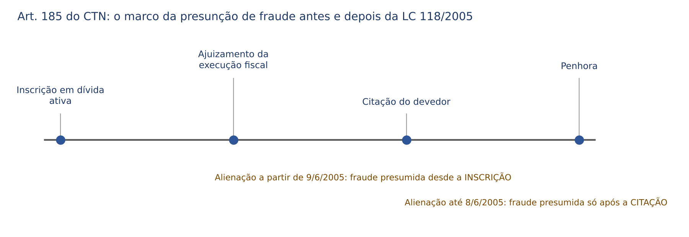
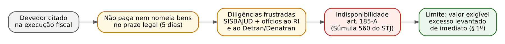
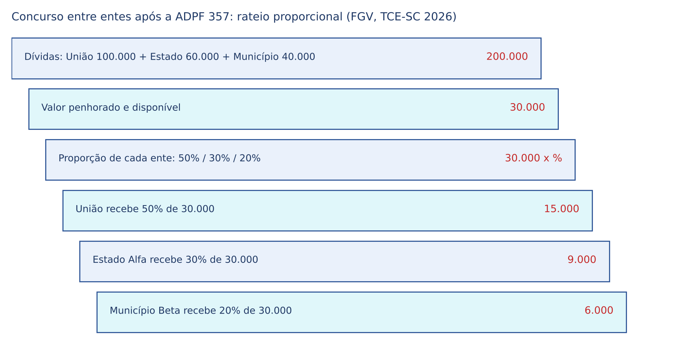
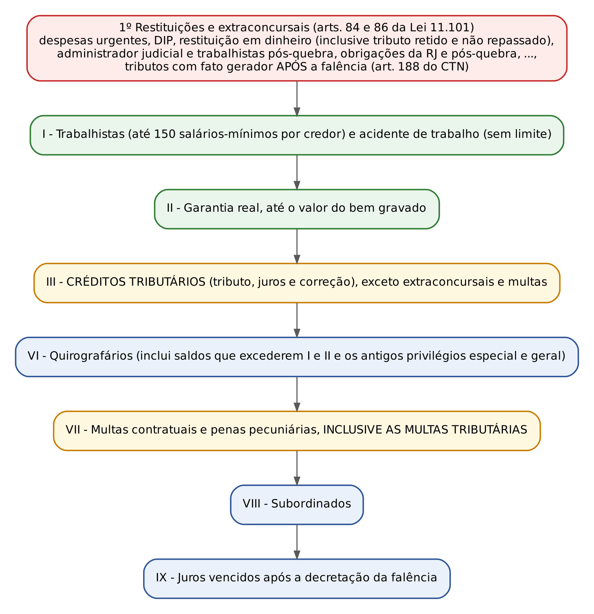
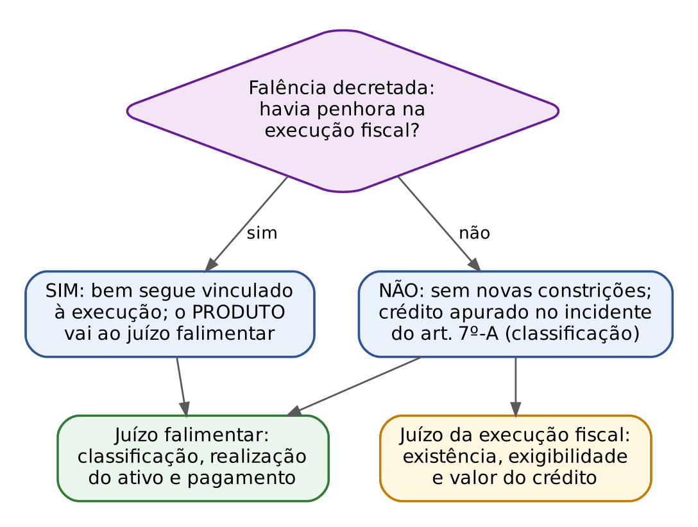

# CAPÍTULO 18 — GARANTIAS E PRIVILÉGIOS DO CRÉDITO TRIBUTÁRIO: RESPONSABILIDADE PATRIMONIAL, PRESUNÇÃO DE FRAUDE (ART. 185), INDISPONIBILIDADE (ART. 185-A), PREFERÊNCIAS E CONCURSO (ARTS. 186 A 192), CRÉDITO TRIBUTÁRIO NA FALÊNCIA E NA RECUPERAÇÃO JUDICIAL, PROVA DE QUITAÇÃO

:::INCIDENCIA
TRF5 p. 14; TJRS p. 6; TJSC p. 16. Nível A. Lote: 21 questões (FGV 14, FCC 7).
O que mais cai: presunção de fraude após a inscrição (Tema 290), ordem de pagamento na falência e multas, ADPF 357 (fim da hierarquia entre entes) e honorários advocatícios x crédito tributário (Tema 1.220 do STF).
:::

| Subtema | FGV | FCC | Padrão de cobrança |
|---|---|---|---|
| Fraude do art. 185 (inscrição, presunção absoluta, Súmula 375) | 4 | 0 | caso com datas e adquirente "de boa-fé" |
| Indisponibilidade do art. 185-A | 2 | 0 | requisitos cumulativos; distinção da penhora on-line |
| Preferência geral (art. 186), honorários, privilégios civis | 5 | 1 | "o que prefere a quê" fora da falência |
| Concurso entre entes (ADPF 357) | 2 | 3 | literalidade revogada do art. 187, parágrafo único, como alternativa errada; rateio |
| Falência: ordem, extraconcursais, multas | 1 | 5 | literalidade do art. 186, parágrafo único, e do art. 83 da Lei 11.101 |
| Execução fiscal x juízo falimentar; arrolamento | 3 | 0 | caso de juiz federal e promotor |

## 18.1 Garantias e privilégios: o que são e por que existem

O crédito tributário financia o Estado. Por isso o CTN, nos arts. 183 a 193, cerca-o de vantagens que nenhum credor privado tem. A doutrina (Ricardo Alexandre, por exemplo) separa duas famílias:

- garantias: regras que facilitam a entrada do Fisco no patrimônio do devedor (o patrimônio inteiro responde, art. 184; alienações são presumidas fraudulentas, art. 185; bens podem ser tornados indisponíveis, art. 185-A; atos da vida civil exigem prova de quitação, arts. 191 a 193, que funcionam como garantias indiretas);
- privilégios (preferências): regras que colocam o crédito tributário à frente dos outros quando vários credores disputam o mesmo patrimônio (arts. 186 a 190).

Ao civilista, a comparação ajuda. No Código Civil, o credor quirografário só conta com a garantia genérica do patrimônio (art. 391 do CC) e com a ação pauliana, em que precisa provar o *consilium fraudis*. O Fisco dispensa tudo isso: o patrimônio responde até contra cláusulas de impenhorabilidade, a fraude é presumida de forma absoluta e o crédito passa à frente da hipoteca fora da falência.

Duas regras gerais do art. 183 caem na literalidade:

- o rol do CTN NÃO é exaustivo: a lei de cada ente pode criar outras garantias "em função da natureza ou das características do tributo" (exemplos: termo de responsabilidade e fiança nos regimes aduaneiros especiais; arrolamento de bens da Lei 9.532/1997, ver 18.4.4);
- a natureza da garantia não altera a natureza do crédito nem da obrigação (parágrafo único). Se o contribuinte dá hipoteca para obter parcelamento, o crédito NÃO vira crédito hipotecário: continua tributário, com a classificação de tributário na falência.

:::QUESTAO FGV 2024 — Câmara dos Deputados — Consultor Legislativo (Q2510948)
Três afirmativas V ou F. Gabarito D (F, V, F). (1) Falsa: a garantia não altera a natureza do crédito (art. 183, parágrafo único). (2) Verdadeira: a indisponibilidade universal do art. 185-A não se confunde com a penhora de dinheiro por sistema eletrônico (ver 18.4.2). (3) Falsa: na falência o crédito tributário NÃO prefere aos extraconcursais nem às restituições (art. 186, parágrafo único, I). Armadilha: trocar "não prefere" por "prefere".
:::

## 18.2 Responsabilidade patrimonial (art. 184)

### 18.2.1 Todo o patrimônio responde, inclusive o "blindado" por vontade

:::LEI CTN, art. 184
Sem prejuízo dos privilégios especiais sobre determinados bens, que sejam previstos em lei, responde pelo pagamento do crédito tributário a totalidade dos bens e das rendas, de qualquer origem ou natureza, do sujeito passivo, seu espólio ou sua massa falida, inclusive os gravados por ônus real ou cláusula de inalienabilidade ou impenhorabilidade, seja qual for a data da constituição do ônus ou da cláusula, excetuados unicamente os bens e rendas que a lei declare absolutamente impenhoráveis.
:::

Três ideias:

- a responsabilidade é PESSOAL, não real. Se dez anos de ITR não pago superam o valor da fazenda, o devedor não se libera entregando o imóvel: todo o seu patrimônio continua respondendo;
- bens gravados por ônus real (hipoteca, penhor, anticrese) respondem pelo tributo, "seja qual for a data" do gravame. É o que permite ao Fisco, FORA da falência, passar à frente do credor hipotecário (ver 18.5.1). Na falência a regra cede (art. 186, parágrafo único, I; ver 18.7);
- cláusulas VOLUNTÁRIAS de inalienabilidade ou impenhorabilidade (a do doador ou do testador, por exemplo, e o bem que o art. 833, I, do CPC declara impenhorável por ato voluntário) NÃO são oponíveis ao Fisco. Só escapam os bens que a LEI declara absolutamente impenhoráveis.

:::EXEMPLO Doação com cláusula de impenhorabilidade
Ana doou a Bruno um apartamento com cláusulas de inalienabilidade e impenhorabilidade. Bruno deixa de pagar IRPF de 2023, inscrito em dívida ativa. Um banco credor de Bruno não pode penhorar o imóvel (art. 833, I, do CPC). A União pode: a cláusula é voluntária e o art. 184 do CTN, norma específica com força de lei complementar, a torna ineficaz perante o Fisco. A LEF (art. 30) repete a regra e a estende a toda a dívida ativa, tributária ou não.
:::

### 18.2.2 O que fica a salvo: impenhorabilidades legais e o bem de família

O CPC de 2015 suprimiu o advérbio "absolutamente" do rol do art. 833. A leitura literal (nada mais seria "absolutamente impenhorável", e o Fisco poderia penhorar salário) é rejeitada: a ressalva do art. 184 alcança os bens do art. 833 do CPC, salvo o inciso I (impenhorabilidade voluntária), com as exceções dos parágrafos do próprio art. 833. O STJ já reconheceu, por exemplo, que a restituição de IR retido sobre salário mantém a natureza salarial e é impenhorável (REsp 1.163.151, citado por Ricardo Alexandre).

O bem de família da Lei 8.009/1990 é o ponto mais cobrado. A impenhorabilidade é oponível "em qualquer processo de execução civil, fiscal, previdenciária, trabalhista ou de outra natureza", salvo nas hipóteses do art. 3º. Para o Direito Tributário, interessa o inciso IV:

:::LEI Lei 8.009/1990, art. 3º, IV
[A impenhorabilidade não é oponível em execução movida] para cobrança de impostos, predial ou territorial, taxas e contribuições devidas em função do imóvel familiar.
:::

:::PEGADINHA Só os tributos DO PRÓPRIO imóvel
A exceção alcança IPTU, ITR, taxas e contribuições (de melhoria, por exemplo) devidos EM FUNÇÃO do imóvel. Uma execução de IR, ICMS ou ISS NÃO penhora o bem de família, ainda que o imóvel seja amplo ou luxuoso: a Lei 8.009 não tem limite de valor. Alternativa que diga "a impenhorabilidade do único bem familiar não é oponível à Fazenda Pública, tratando-se de bem luxuoso" está errada (FGV, TJ-SC 2024, Q2387026).
:::

Os privilégios especiais "sobre determinados bens, que sejam previstos em lei" (início do art. 184) também ficam ressalvados: a lei pode afetar bens a certos créditos. Exemplo do próprio CTN: na falência, a garantia real prevalece até o valor do bem (art. 186, parágrafo único, I).

## 18.3 Presunção de fraude (art. 185)

### 18.3.1 Três "fraudes" que o civilista precisa separar

| Figura | Onde | Marco | Prova exigida | Consequência |
|---|---|---|---|---|
| Fraude contra credores | CC, arts. 158 a 165 | antes de qualquer ação | *eventus damni* + *consilium fraudis* (na onerosa) | anulabilidade, por ação pauliana |
| Fraude à execução comum | CPC, art. 792; Súmula 375 do STJ | ação capaz de levar à insolvência | registro da penhora ou prova da má-fé do adquirente | ineficácia perante o exequente |
| Fraude à execução fiscal | CTN, art. 185 | INSCRIÇÃO em dívida ativa (desde 9/6/2005) | nenhuma: presunção absoluta, salvo reserva de bens | ineficácia perante a Fazenda |

:::LEI CTN, art. 185 (redação da LC 118/2005)
Presume-se fraudulenta a alienação ou oneração de bens ou rendas, ou seu começo, por sujeito passivo em débito para com a Fazenda Pública, por crédito tributário regularmente inscrito como dívida ativa.
Parágrafo único. O disposto neste artigo não se aplica na hipótese de terem sido reservados, pelo devedor, bens ou rendas suficientes ao total pagamento da dívida inscrita.
:::

### 18.3.2 O marco temporal: antes e depois da LC 118/2005

Na redação original, a presunção exigia crédito inscrito "em fase de execução", e o STJ fixou que a fase de execução começava com a CITAÇÃO do devedor. A LC 118/2005, em vigor desde 9/6/2005, suprimiu a expressão e antecipou o marco para a INSCRIÇÃO em dívida ativa. Aplica-se a lei vigente na data do negócio (*tempus regit actum*).

:::JURIS STJ, Tema 290 (REsp 1.141.990/PR, 1ª Seção, j. 10/11/2010)
Se o ato translativo foi praticado a partir de 9/6/2005, basta a inscrição em dívida ativa para configurar a fraude; antes disso, exigia-se que o negócio fosse posterior à citação válida. A presunção é absoluta (*jure et de jure*): dispensa o *concilium fraudis*, não se investiga a intenção das partes nem a ciência do adquirente, e só é afastada se o devedor reservou bens ou rendas suficientes ao pagamento total (art. 185, parágrafo único). A Súmula 375 do STJ NÃO se aplica à execução fiscal, porque o art. 185 é regra especial que não condiciona a fraude a registro.
:::

Desdobramentos que a FGV cobra:

- alienações sucessivas: a presunção atinge também o subadquirente; o STJ afirma que a fraude se caracteriza objetivamente e não é afastada por alienações em cadeia (AgInt no REsp 2.075.094/SP, DJe 16/11/2023, citado na Sinopse TJSC). A alternativa "presunção relativa nas alienações sucessivas, afastável pela boa-fé do terceiro" está errada (FGV, TCE-RR 2025, Q3174728);
- reserva de bens: é a ÚNICA defesa material. Quem tem dívida inscrita de 100.000 (cem mil) reais e mantém essa quantia aplicada pode vender os demais bens livremente;
- "oneração" e "seu começo": dar o bem em hipoteca, ou firmar compromisso de compra e venda, também entra na presunção. Por isso a hipoteca constituída depois da inscrição não prevalece sobre o Fisco nem mesmo na falência (o gravame é ineficaz perante a Fazenda);
- bem de família: se o imóvel alienado era impenhorável, não há fraude, porque a ineficácia do negócio devolveria ao devedor um bem que a Fazenda continuaria sem poder penhorar (STJ, 1ª Turma, AgInt no AREsp 2.174.427/RJ, j. 18/9/2023, Info 791). Foi o gabarito da FGV no TJ-SC 2024 (Q2387026, letra E: a transferência do bem de família aos filhos não caracteriza fraude);
- não confundir com a responsabilidade do adquirente pelos tributos DO PRÓPRIO bem (arts. 130 e 131, I, do CTN; ver Cap. 10). No art. 185 o adquirente perde o bem por qualquer dívida inscrita do alienante, mesmo sem relação com o bem.

:::DOUTRINA Ciência da inscrição
Ricardo Alexandre sustenta que a presunção pressupõe ao menos a comunicação formal da inscrição ao devedor (o que pode ocorrer por divulgação oficial, admitida pelo art. 198, § 3º, II, do CTN), pois não seria razoável presumir fraude de quem não sabe da inscrição. A tese do Tema 290 não faz essa exigência: na prova objetiva, prevalece a literalidade (basta a inscrição).
:::

:::DICA Como o adquirente se protege
Como a presunção dispensa registro, o comprador diligente deve exigir certidão de débitos inscritos em dívida ativa de TODOS os entes em nome do vendedor, para móveis e imóveis. Para o juiz cível isso inverte a lógica da Súmula 375: nos embargos de terceiro contra penhora fiscal, a boa-fé do adquirente é irrelevante.
:::

### 18.3.3 Consequência: ineficácia, reconhecida na própria execução

A fraude à execução não anula o negócio: torna-o INEFICAZ perante o exequente (art. 792, § 1º, do CPC). O bem continua formalmente do adquirente, mas é penhorado na execução fiscal como se não tivesse saído do patrimônio do devedor. Não é preciso ação autônoma nem nova execução, nem incidente de desconsideração da personalidade jurídica (que serve a outra coisa: atingir o patrimônio do sócio ou de outra sociedade).

:::PROCESSO Fraude à execução fiscal: como se processa
- Quem alega: a Fazenda, por simples petição na execução fiscal, com a prova da data da inscrição e da alienação.
- Contraditório do adquirente: o art. 792, § 4º, do CPC manda o juiz INTIMAR o terceiro adquirente antes de declarar a fraude, para, querendo, opor embargos de terceiro em 15 dias. A norma é aplicada subsidiariamente à LEF (art. 1º da LEF); não há "citação" do adquirente.
- Defesa do adquirente: embargos de terceiro. Matérias úteis: alienação anterior à inscrição (ou anterior à citação, se o negócio é de até 8/6/2005), reserva de bens suficientes, impenhorabilidade (bem de família), crédito extinto. Boa-fé e ausência de registro NÃO são defesas.
- Ônus: a reserva de bens é fato impeditivo, a cargo de quem a alega.
- Detalhes dos embargos de terceiro e da penhora: ver Caps. 21 e 22.
:::

:::SENTENCA Embargos de terceiro contra penhora fiscal de bem adquirido do executado
Onde entra: mérito. Fixe a data do negócio e a da inscrição; se o negócio é posterior a 9/6/2005 e à inscrição, aplique o art. 185 e o Tema 290; examine se havia reserva de bens.
Redação-modelo: "A alienação foi celebrada em 3/5/2022, após a inscrição do crédito em dívida ativa (12/1/2022), sem reserva de bens suficientes. Nos termos do art. 185 do CTN e da tese do Tema 290 do STJ, a presunção de fraude é absoluta e dispensa prova de má-fé do adquirente, sendo inaplicável a Súmula 375 do STJ. Julgo improcedentes os embargos."
Erro que a banca pune: aplicar a Súmula 375 e acolher os embargos pela boa-fé do comprador ou pela falta de registro da penhora; ou declarar "nulo" o negócio em vez de ineficaz perante a Fazenda.
:::

:::QUESTAO FGV 2024 — TJ-PE — Juiz Substituto (Q3117525)
Caso: na execução fiscal, a executada vendeu bens a outra sociedade do mesmo grupo, esvaziando o patrimônio. Gabarito C: a transferência é presumida fraudulenta, independentemente de registro da penhora ou de má-fé da adquirente. Erros sedutores: (A) "citar" a adquirente para embargos (o CPC fala em intimação, e a assertiva condiciona a fraude a esse ato); (B) penhorar desde logo ativos financeiros da adquirente (a fraude atinge o bem alienado, não todo o patrimônio do terceiro); (D) "anulação" com retorno ao *status quo ante* (o efeito é ineficácia); (E) IDPJ de ofício (instituto impróprio e que depende de requerimento).
No mesmo sentido: Q3157912 (FGV 2024, venda do imóvel após a inscrição: presunção salvo reserva de bens, letra B) e Q3038860 (FGV 2024, Nova Iguaçu — alegação de fraude na própria execução fiscal, letra C; erradas as alternativas de nova execução ou de multa).
:::

:::QUESTAO FGV 2026 — AL-RO — Consultor Legislativo (Q3882059)
Caso: venda do único imóvel após a inscrição; depois, citação sem pagamento nem nomeação de bens e certidão negativa do oficial. Gabarito E: há presunção de fraude (alienação posterior à inscrição) E cabe a indisponibilidade do art. 185-A, limitada ao valor do débito. Armadilhas: (A) exigir averbação no registro; (B) exigir citação prévia (critério anterior a 2005); (C) negar a indisponibilidade "por falta de previsão" (está no próprio CTN); (D) exigir dolo específico.
:::

## 18.4 Indisponibilidade de bens (art. 185-A) e figuras vizinhas

### 18.4.1 Requisitos cumulativos

O art. 185-A (LC 118/2005) autoriza uma "medida de força" para a execução que não anda: o juiz decreta a indisponibilidade de TODOS os bens e direitos do executado e comunica a ordem, preferencialmente por meio eletrônico, aos órgãos de registro (imóveis, Detran, CVM, Banco Central), que devem devolver ao juízo a relação do que bloquearam.

:::LEI CTN, art. 185-A, caput e § 1º
Na hipótese de o devedor tributário, devidamente citado, não pagar nem apresentar bens à penhora no prazo legal e não forem encontrados bens penhoráveis, o juiz determinará a indisponibilidade de seus bens e direitos [...].
§ 1º A indisponibilidade de que trata o caput deste artigo limitar-se-á ao valor total exigível, devendo o juiz determinar o imediato levantamento da indisponibilidade dos bens ou valores que excederem esse limite.
:::

:::JURIS STJ, Súmula 560
A decretação da indisponibilidade de bens e direitos, na forma do art. 185-A do CTN, pressupõe o exaurimento das diligências na busca por bens penhoráveis, o qual fica caracterizado quando infrutíferos o pedido de constrição sobre ativos financeiros e a expedição de ofícios aos registros públicos do domicílio do executado, ao Denatran ou Detran.
:::

Requisitos, todos cumulativos: (1) citação válida; (2) não pagamento no prazo de 5 dias da LEF; (3) não nomeação de bens; (4) não localização de bens penhoráveis, demonstrada pelo exaurimento da Súmula 560 (tentativa de bloqueio de dinheiro + ofícios ao registro de imóveis do domicílio + Detran ou Denatran). A FGV considerou errada a afirmação de que a indisponibilidade dispensa a prévia tentativa de constrição de ativos financeiros, "bastando a inexistência de pagamento voluntário" (PGE-AC 2026, Q4079417, correlata).

Outros pontos:

- limite: o valor total exigível; o excesso é liberado de imediato (§ 1º). Não é bloqueio por tempo indeterminado de tudo;
- alcance: só dívida ativa TRIBUTÁRIA. O STJ negou a aplicação do art. 185-A a crédito não tributário (REsp 1.073.094/PR, citado por Ricardo Alexandre), por se tratar de norma do CTN;
- natureza: medida cautelar e acessória à penhora; a indisponibilidade não transfere a propriedade nem satisfaz o crédito. Os bens localizados devem depois ser penhorados;
- crédito com exigibilidade suspensa (parcelamento, depósito): não se decreta nova constrição; o bloqueio anterior ao parcelamento se mantém, e o posterior deve ser levantado (orientação repetitiva do STJ no REsp 1.696.270/MG; ver Caps. 13 e 21).

### 18.4.2 Indisponibilidade universal x penhora on-line de dinheiro

| Ponto | Indisponibilidade do art. 185-A | Penhora on-line de dinheiro (SISBAJUD) |
|---|---|---|
| Base | CTN, art. 185-A | LEF, art. 11 (dinheiro em 1º lugar) c/c CPC, art. 854 |
| Objeto | universalidade de bens e direitos | ativos financeiros |
| Pressuposto | exaurimento de diligências (Súmula 560) | requerimento do exequente após a citação; NÃO exige exaurimento |
| Função | bloquear para depois penhorar | já é ato de constrição sobre dinheiro |

A distinção foi o item 2 da Q2510948 (verdadeiro). O raciocínio: a tentativa de bloqueio de dinheiro é justamente uma das diligências que a Súmula 560 exige ANTES da indisponibilidade universal; seria contraditório exigir exaurimento para a própria penhora de dinheiro, que é o primeiro bem da ordem legal. Execução fiscal, penhora e SISBAJUD em detalhe: Cap. 21.

:::SENTENCA Decisão que defere a indisponibilidade
Onde entra: decisão interlocutória na execução fiscal (agravável). Fundamente cada requisito com a folha dos autos.
Redação-modelo: "O executado foi citado, não pagou nem indicou bens; restaram infrutíferos o bloqueio via SISBAJUD e as pesquisas no registro imobiliário e no Detran. Presentes os requisitos do art. 185-A do CTN e da Súmula 560 do STJ, decreto a indisponibilidade dos bens e direitos do executado, limitada ao valor total exigível, com comunicação eletrônica aos órgãos de registro."
Erro que a banca pune: decretar a indisponibilidade logo após a citação, sem diligências; não limitar ao valor do débito; aplicá-la a multa administrativa (dívida não tributária).
:::

### 18.4.3 Indisponibilidade administrativa (averbação pré-executória)

A indisponibilidade decretada pela própria Fazenda Nacional, sem juiz, a partir da averbação da CDA nos registros de bens, foi examinada pelo STF nas ADIs sobre a Lei 13.606/2018. O tema é de dívida ativa e administração tributária: ver Cap. 19 (cobrado pela FGV no TRF5 2025, Q3373906, correlata).

### 18.4.4 Arrolamento de bens e medida cautelar fiscal (questão do lote)

O arrolamento da Lei 9.532/1997 (art. 64) é uma garantia administrativa "fora do CTN" (exemplo do art. 183): quando os créditos de responsabilidade do sujeito passivo superam 30% de seu patrimônio conhecido (e a soma supera o piso legal, art. 64, § 7º), a Receita relaciona bens e registra o termo. O arrolamento NÃO torna o bem indisponível: o proprietário pode aliená-lo, mas deve COMUNICAR o fato ao órgão fazendário (§ 3º); a alienação sem essa comunicação autoriza a medida cautelar fiscal (§ 4º). O regime do arrolamento é desenvolvido no Cap. 20 e a cautelar fiscal (Lei 8.397/1992) no Cap. 22.

:::QUESTAO FGV 2025 — TRF5 — Juiz Substituto (Q3373905)
Caso: após a notificação do arrolamento, a sociedade transferiu imóvel arrolado; a Fazenda ajuizou cautelar fiscal. Gabarito D: a cautelar só é autorizada se a transferência ocorreu SEM a comunicação ao órgão fazendário; se a comunicação vier depois do ato de disposição, a cautelar não deve subsistir. Fundamento: o § 3º do art. 64 exige comunicação, não autorização prévia nem aquiescência do Fisco (erradas A e C). Armadilha: confundir arrolamento (mero inventário com dever de informar) com indisponibilidade.
:::

## 18.5 Preferências: a regra geral do art. 186

### 18.5.1 O crédito tributário fora da falência

:::LEI CTN, art. 186, caput (redação da LC 118/2005)
O crédito tributário prefere a qualquer outro, seja qual for sua natureza ou o tempo de sua constituição, ressalvados os créditos decorrentes da legislação do trabalho ou do acidente de trabalho.
:::

Fora da falência (execução singular com pluralidade de penhoras, insolvência civil, inventário), a fila é curta:

1. créditos trabalhistas e de acidente de trabalho (sem limite de valor: o teto de 150 salários-mínimos é SÓ da falência);
2. créditos equiparados aos trabalhistas por lei, como os honorários advocatícios (18.5.2);
3. crédito tributário;
4. todos os demais: hipotecários e pignoratícios, condominiais (*propter rem*), créditos com privilégio especial ou geral da lei civil, quirografários.

Esse é o ponto em que a intuição civilista mais erra. No processo civil, o credor hipotecário tem direito real e prefere aos quirografários; mas o Fisco passa à frente dele, porque o art. 186 diz "seja qual for sua natureza ou o tempo de sua constituição" e o art. 184 sujeita ao tributo os bens gravados por ônus real. A ressalva da garantia real existe apenas na falência.

:::ESQUEMA Quem passa à frente do crédito tributário
| Situação | Trabalhista e acidente | Honorários | Garantia real | Condomínio e privilégios civis |
|---|---|---|---|---|
| Fora da falência | prefere ao tributo (sem limite) | prefere (art. 85, § 14, do CPC; Tema 1.220) | NÃO prefere | NÃO prefere |
| Na falência | prefere até 150 salários-mínimos; acidente sem limite | prefere, na classe trabalhista (com o limite) | prefere até o valor do bem | privilégios viram quirografários (abaixo do tributo) |
:::

A preferência do crédito tributário não depende de penhora própria. A Corte Especial do STJ (EREsp 1.603.324/SC, j. 21/9/2022, referido no Parecer PGFN SEI 16.489/2022) afirmou que a Fazenda pode exercer a preferência habilitando-se no produto da alienação feita em execução alheia, ainda que não tenha penhorado o bem; se ainda não ajuizou a execução fiscal, tem direito à reserva do valor, cujo levantamento depende da demonstração da certeza, liquidez e exigibilidade do crédito. É a lógica do art. 908 do CPC: os créditos que recaem sobre o bem, inclusive os *propter rem*, sub-rogam-se no preço, "observada a ordem de preferência" (§ 1º); a anterioridade da penhora só decide entre credores SEM título legal de preferência (§ 2º).

:::QUESTAO FGV 2024 — Prefeitura de São José dos Campos — Procurador (Q3888055)
Caso: em execução do condomínio, arrematado o imóvel, o Município se habilitou para receber 90% do preço, sem ter penhorado o bem. Gabarito E: o crédito tributário prefere a qualquer outro, ressalvados os trabalhistas. Erradas: a prevalência do crédito *propter rem* (A e B), a vedação de a Fazenda participar do concurso (C) e a ordem pela anterioridade da penhora (D), que só vale entre credores sem preferência legal.
:::

:::QUESTAO FGV 2024 — Prefeitura de São José dos Campos — Técnico Tributário (Q2375640)
Pergunta-se em relação a quais créditos o tributário tem preferência. Gabarito E: "sobre os produtos do abate, o credor por animais", privilégio especial do art. 964, IX, do CC (incluído pela Lei 13.176/2015). Acidente de trabalho (A) e honorários (C) preferem ao tributo; a alternativa B inventa um limite de 5 salários-mínimos. Atenção: a alternativa D (garantia hipotecária) também descreve crédito ao qual o tributário prefere FORA da falência; a banca manteve E, provavelmente pensando no regime falimentar. Ver nota de verificação.
:::

### 18.5.2 Honorários advocatícios: preferem ao crédito tributário

O CPC de 2015 deu aos honorários "natureza alimentar, com os mesmos privilégios dos créditos oriundos da legislação do trabalho" (art. 85, § 14). Como o art. 186 do CTN ressalva justamente os créditos "decorrentes da legislação do trabalho", os honorários passam à frente do tributo. Discutia-se se lei ordinária (o CPC) podia mexer na preferência tributária, matéria de lei complementar (art. 146, III, b, da CF).

:::JURIS STF, Tema 1.220 (RE 1.326.559/SC, Rel. Min. Dias Toffoli, Plenário, sessão virtual de março de 2025; embargos de declaração rejeitados em 30/6/2025)
É formalmente constitucional o § 14 do art. 85 do CPC na parte em que confere aos honorários advocatícios, INCLUSIVE CONTRATUAIS, preferência em relação ao crédito tributário, considerado o art. 186 do CTN. Fundamento: o legislador ordinário não criou nova preferência; apenas qualificou os honorários dentro de uma categoria (créditos equiparados aos trabalhistas) que o próprio CTN já ressalva.
:::

No STJ, a equiparação dos honorários (contratuais e sucumbenciais) aos créditos trabalhistas na falência foi afirmada em recurso repetitivo (REsp 1.152.218/RS), e o Tribunal aplicou a mesma lógica à execução fiscal (REsp 1.812.770/RS, DJe 14/10/2019). Na falência, os honorários entram na classe I do art. 83 e, portanto, sujeitam-se ao limite de 150 salários-mínimos por credor.

:::QUESTAO FGV 2026 — TJ-PA — Juiz Substituto (Q3951785)
Caso: concurso, sobre o preço de bem alienado em execução trabalhista, entre honorários (sucumbenciais e contratuais), contribuição previdenciária inscrita e crédito trabalhista. Gabarito E: os honorários, inclusive os contratuais, preferem ao crédito tributário, pela natureza alimentar e pela equiparação aos créditos da legislação do trabalho. Armadilhas: distinguir sucumbenciais de contratuais (B e C) ou pôr os honorários atrás do tributo (A e D).
No mesmo sentido: Q4079414 (FGV 2026, PGE-AC, letra D) e Q3898966 (FGV 2026, TJ-PR, letra C, que combina honorários com a ADPF 357; ver 18.6.2).
:::

## 18.6 Autonomia da execução fiscal e concurso entre entes (art. 187)

### 18.6.1 A cobrança do crédito tributário não se sujeita a concurso

:::LEI CTN, art. 187, caput (redação da LC 118/2005)
A cobrança judicial do crédito tributário não é sujeita a concurso de credores ou habilitação em falência, recuperação judicial, concordata, inventário ou arrolamento.
:::

O dispositivo cria a autonomia da execução fiscal: a Fazenda não precisa se habilitar no juízo universal; pode ajuizar e prosseguir a execução fiscal no seu juízo (a LEF repete a regra no art. 29, caput, para toda a dívida ativa). "Não se sujeitar ao concurso" quer dizer não depender de habilitação, e NÃO que o Fisco receba antes de quem a lei põe à sua frente. Na falência, o produto da execução fiscal é remetido ao juízo universal para respeitar a ordem do art. 83 (ver 18.7.4).

A autonomia é prerrogativa, não dever. A Fazenda pode preferir a habilitação, desde que não haja dupla garantia:

:::JURIS STJ, Tema 1.092 (REsp 1.872.759/SP, 1ª Seção, Rel. Min. Gurgel de Faria, j. 18/11/2021)
É possível a Fazenda Pública habilitar em processo de falência crédito tributário objeto de execução fiscal em curso, mesmo antes da vigência da Lei 14.112/2020, e desde que não haja pedido de constrição de bens no feito executivo.
:::

Na FGV, o filtro é a parte final da tese: a afirmação de que, sobrevindo a falência, a Fazenda "pode lá habilitar o seu crédito, sem prejuízo de impulsionar medidas constritivas na execução fiscal" é FALSA (ENAM 2025, Q3692401, correlata). E a afirmação de que a cobrança "depende de habilitação [...] sob pena de perda da preferência" também é falsa (FCC 2026, PGM Manaus, Q4338778, letra D).

### 18.6.2 O fim da hierarquia União, Estados, Municípios (ADPF 357)

O parágrafo único do art. 187 do CTN (e o parágrafo único do art. 29 da LEF, que acrescentava as autarquias) estabelecia um "concurso de preferência" entre pessoas jurídicas de direito público: primeiro a União; depois Estados, DF e Territórios, *pro rata*; por último os Municípios, *pro rata*. O STF validara a regra sob a Constituição anterior (Súmula 563).

:::JURIS STF, ADPF 357/DF (Rel. Min. Cármen Lúcia, Plenário, j. 24/6/2021, DJe 7/10/2021)
Não foram recepcionados pela Constituição de 1988 o parágrafo único do art. 187 do CTN e o parágrafo único do art. 29 da LEF. A hierarquia na cobrança dos créditos da União, dos Estados e dos Municípios descumpre o princípio federativo e contraria o art. 19, III, da CF, que veda aos entes "criar distinções entre brasileiros ou preferências entre si". A Súmula 563 do STF foi cancelada. Na sequência, o STJ cancelou a Súmula 497 (preferência das autarquias federais sobre a Fazenda estadual).
:::

:::PEGADINHA O texto continua no Planalto
O parágrafo único do art. 187 ainda aparece no texto compilado (com a anotação "Vide ADPF 357"). Questões que pedem "de acordo com o CTN e a jurisprudência vinculante do STF" tratam a ordem União, Estados, Municípios como ERRADA. A não recepção atingiu só a hierarquia ENTRE entes; o caput do art. 187 (autonomia da execução fiscal) continua em vigor.
:::

:::QUESTAO FCC 2024 — PGE-GO — Procurador do Estado Substituto (Q2654895)
Pergunta qual foi a conclusão do STF, em 2021, sobre o parágrafo único do art. 187. Gabarito E: não recepção, por incompatibilidade com o art. 19, III, da CF e com a isonomia entre os entes. Erradas: interpretação conforme por "estoque de precatórios" (A), preferência dos Municípios (B), recepção plena (C) e recepção parcial só em favor da União (D).
No mesmo sentido: Q3745777 (FCC 2025, PGE-MT, alternativa B errada), Q3538779 (FCC 2025, TRF4, alternativa E errada) e Q3745565 (FCC 2025, PGE-TO, correlata: correta a afirmação de que não há preferência entre entes).
:::

### 18.6.3 E agora, como dividir? Rateio proporcional ou anterioridade da penhora

A ADPF disse o que NÃO vale (hierarquia), mas não disse como dividir quando o patrimônio não basta para todos os entes. Há duas soluções, e as bancas já usaram ambas:

- rateio proporcional: os créditos tributários de entes distintos têm o mesmo título legal de preferência (art. 186); aplicam-se o art. 962 do CC ("haverá entre eles rateio proporcional ao valor dos respectivos créditos") e a lógica do *pro rata* que o próprio art. 187 usava dentro de cada classe. É a orientação da PGFN (Parecer SEI 16.489/2022) e o gabarito da FGV;
- anterioridade da penhora: para quem entende que, sem hierarquia, nenhum ente tem "título legal à preferência" sobre o outro, aplica-se o art. 908, § 2º, do CPC (recebe primeiro quem penhorou primeiro). Foi o gabarito da FCC em 2024.

:::QUESTAO FGV 2026 — TCE-SC — Auditor Fiscal de Controle Externo (Q4088890)
Caso: dívidas de 100.000 (cem mil) reais com a União, 60.000 (sessenta mil) reais com o Estado e 40.000 (quarenta mil) reais com o Município; penhorados 30.000 (trinta mil) reais. Gabarito B: rateio proporcional, 15.000 (quinze mil) reais para a União, 9.000 (nove mil) reais para o Estado e 6.000 (seis mil) reais para o Município (escada acima). Erradas: divisão igualitária (A), metade para a União e o resto em partes iguais (C), tudo para a União (D) e tudo para o Município (E).
:::

:::QUESTAO FCC 2024 — Prefeitura de Jaboatão dos Guararapes — Procurador (Q3542133)
Caso: credor quirografário (Rufino) penhorou e levou a leilão imóvel de Francisco; antes do levantamento, o Estado, depois o Município e por fim a União obtiveram penhora no rosto dos autos, todos com créditos inscritos. Gabarito E: pagam-se, nessa ordem, Estado, Município e União (anterioridade das penhoras, pois não há hierarquia entre entes), e só depois Rufino. Lições: (1) o crédito quirografário, ainda que mais antigo e com penhora anterior, fica atrás de todos os tributários (erradas C e D); (2) a ordem União, Estado, Município (A) está superada pela ADPF 357. O critério de desempate entre entes diverge do adotado pela FGV (Q4088890): ver nota de verificação.
:::

:::DICA Estratégia de prova
Se a alternativa traz a conta proporcional, ela é a resposta (FGV). Se não há alternativa proporcional e uma delas segue a ordem das penhoras, é a resposta (FCC). Em qualquer caso, elimine primeiro as que mantêm a hierarquia União, Estados, Municípios ou que põem o credor privado à frente.
:::

## 18.7 O crédito tributário na falência

### 18.7.1 Por que a falência é diferente

Na falência todos os credores disputam um patrimônio insuficiente, e a lei precisa equilibrar interesses. A LC 118/2005, junto com a Lei 11.101/2005, rebaixou o Fisco em três pontos para baratear o crédito privado e proteger os trabalhadores. Na sequência, a Lei 14.112/2020 reescreveu a ordem do art. 83 e o rol do art. 84 da Lei 11.101.

:::LEI CTN, art. 186, parágrafo único (LC 118/2005)
Na falência:
I – o crédito tributário não prefere aos créditos extraconcursais ou às importâncias passíveis de restituição, nos termos da lei falimentar, nem aos créditos com garantia real, no limite do valor do bem gravado;
II – a lei poderá estabelecer limites e condições para a preferência dos créditos decorrentes da legislação do trabalho; e
III – a multa tributária prefere apenas aos créditos subordinados.
:::

Leitura inciso a inciso:

- inciso I: três categorias passam à frente do Fisco: (a) os extraconcursais (dívidas da própria massa e do período da recuperação judicial, art. 84 da Lei 11.101); (b) as restituições (bens de terceiros que estavam com o falido, art. 85, e restituições em dinheiro, art. 86); (c) a garantia real, até o valor do bem, considerado como tal o valor efetivamente arrecadado na venda ou, na venda em bloco, o de avaliação individual (art. 83, § 1º);
- inciso II: autorizou o teto da classe trabalhista: 150 salários-mínimos por credor (art. 83, I). O excedente vira quirografário (art. 83, VI, c). O crédito de acidente de trabalho NÃO tem teto;
- inciso III: a multa tributária sai da classe dos tributos e desce para depois dos quirografários (art. 83, VII). Antes da LC 118/2005, a jurisprudência do STF chegava a excluir a multa fiscal da habilitação na falência; hoje ela é habilitada, mas na classe das penas pecuniárias.

### 18.7.2 A ordem completa após a Lei 14.112/2020

| Ordem | Créditos | Fundamento | Observações para a prova |
|---|---|---|---|
| Antes de tudo | despesas urgentes (art. 150) e saldo salarial de 3 meses até 5 salários-mínimos (art. 151) | art. 84, I-A | pagos com o caixa disponível |
| Restituições | bens de terceiros; restituição em dinheiro, inclusive à Fazenda, de tributos retidos na fonte, descontados de terceiros ou recebidos por agentes arrecadadores e não recolhidos | arts. 85, 86, IV, e 84, I-C | o tributo retido não integra o patrimônio do falido; por isso é restituído, não "classificado" |
| Extraconcursais (ordem do art. 84) | I-B financiamento DIP; I-C restituição em dinheiro; I-D administrador judicial e trabalhistas por serviços pós-quebra; I-E obrigações de atos válidos na recuperação judicial ou após a quebra; II quantias fornecidas à massa; III despesas do processo; IV custas em que a massa foi vencida; V tributos com fato gerador após a quebra | art. 84 | tributo pós-quebra é extraconcursal (art. 188 do CTN), mas é o último inciso do art. 84 |
| Classe I | trabalhistas até 150 salários-mínimos por credor; acidente de trabalho sem limite; honorários advocatícios (equiparados) | art. 83, I | o excedente trabalhista vai para a classe VI |
| Classe II | garantia real até o valor do bem gravado | art. 83, II e § 1º | o saldo não coberto vai para a classe VI |
| Classe III | créditos tributários (principal, juros, correção), qualquer que seja a natureza e o tempo, exceto extraconcursais e multas | art. 83, III | sem hierarquia entre entes (ADPF 357) |
| Classes IV e V | revogadas (antigos privilégios especial e geral) | art. 83, § 6º | quem tinha privilégio na lei civil agora é quirografário |
| Classe VI | quirografários e saldos das classes I e II | art. 83, VI | créditos cedidos mantêm a classe (art. 83, § 5º) |
| Classe VII | multas contratuais e penas pecuniárias, inclusive multas tributárias | art. 83, VII | CTN, art. 186, parágrafo único, III |
| Classe VIII | subordinados (previstos em lei ou contrato; sócios e administradores sem vínculo, em condições não comutativas) | art. 83, VIII | |
| Classe IX | juros vencidos após a decretação da falência | art. 83, IX, c/c art. 124 | só se sobrar algo depois dos subordinados |

:::EXEMPLO Escada de pagamento na falência de Delta Ltda.
Arrecadados 1.000.000 (um milhão de) reais. Créditos: extraconcursais 100.000 (cem mil) reais (inclui ICMS de vendas feitas pelo administrador após a quebra); trabalhistas de 3 empregados, um deles com 400 salários-mínimos; banco com hipoteca sobre galpão vendido por 300.000 (trezentos mil) reais, crédito de 500.000 (quinhentos mil) reais; União (IRPJ) 200.000 (duzentos mil) reais de tributo + 80.000 (oitenta mil) reais de multa; Estado (ICMS anterior à quebra) 150.000 (cento e cinquenta mil) reais.
1º) Extraconcursais: 100.000 (cem mil) reais, sobram 900.000 (novecentos mil) reais. 2º) Trabalhistas até 150 salários-mínimos cada; o excesso do terceiro empregado (250 salários-mínimos) vai para os quirografários. 3º) Banco: 300.000 (trezentos mil) reais, o valor obtido com o galpão; o saldo de 200.000 (duzentos mil) reais é quirografário. 4º) Tributos: IRPJ e ICMS concorrem na mesma classe, sem hierarquia; se faltar dinheiro, rateio. A multa de 80.000 (oitenta mil) reais SÓ será paga depois de todos os quirografários (classe VII).
:::

:::QUESTAO FCC 2026 — SEFAZ-MT — Fiscal de Tributos Estaduais (Q3947170)
Caso: falência decretada em novembro de 2024; antes, dívidas de ICMS, IPI, aluguéis, trabalhistas e acidentárias; depois, novos aluguéis e IPTU de terreno da falida. Gabarito C: os aluguéis vencidos após a quebra (obrigações de atos válidos praticados após a decretação, art. 84, I-E, da Lei 11.101) são extraconcursais e se pagam antes do IPI concursal. Erros: (A) e (B) hierarquia federal (ADPF 357); (D) o ICMS é anterior à quebra, logo concursal, e não extraconcursal; (E) os aluguéis anteriores à quebra são quirografários (o privilégio do locador foi absorvido pelo art. 83, § 6º) e ficam atrás do ICMS.
:::

:::QUESTAO FCC 2026 — SEFAZ-GO — Auditor Fiscal (Q4066829)
Pergunta-se como são tratados os tributos com fato gerador posterior à decretação da falência. Gabarito B: são créditos extraconcursais (art. 188 do CTN; art. 84, V, da Lei 11.101). Armadilha: "não serão devidos" (E). A massa falida continua contribuinte: se vende estoque, há ICMS; se é proprietária de imóvel, há IPTU.
No mesmo sentido: Q3745777 (FCC 2025, PGE-MT, letra D: o crédito tributário não prefere aos extraconcursais, e são extraconcursais os tributos de fatos geradores ocorridos no curso da falência; errada a letra A, multa com a mesma preferência do tributo).
:::

:::QUESTAO FCC 2026 — PGM Manaus — Procurador (Q4338778)
Gabarito C: o crédito tributário prefere, em regra, a qualquer outro, ressalvados os trabalhistas e de acidente de trabalho. Erradas: (A) multas com a mesma preferência do tributo; (B) tributo à frente dos extraconcursais; (D) habilitação obrigatória "sob pena de perda da preferência"; (E) garantia real que impediria a preferência "em qualquer hipótese" e além do valor do bem.
No mesmo sentido: Q3538779 (FCC 2025, TRF4, letra A: o crédito tributário não prefere aos extraconcursais nem às restituições; errada a B, porque a multa prefere aos subordinados; errada a C, que inverte a regra da garantia real).
:::

### 18.7.3 Tributo contestado na falência e encargos da massa (art. 188)

O art. 188 do CTN (LC 118/2005) qualifica como extraconcursais os créditos tributários de fatos geradores ocorridos "no curso do processo de falência". Seu § 1º disciplina a contestação: se a massa discute o crédito, o juiz da falência NÃO julga a questão tributária; remete as partes ao processo competente (execução fiscal, embargos, anulatória) e manda reservar bens suficientes à extinção total do crédito, se a massa não puder garantir a instância de outro modo, ouvida a Fazenda sobre a natureza e o valor dos bens reservados. A mesma técnica vale para o inventário (art. 189, parágrafo único). O § 2º manda aplicar a regra às concordatas remanescentes.

### 18.7.4 Execução fiscal e juízo falimentar

Aqui convivem três camadas, e as provas recentes cobram cada uma.

Primeira camada: a autonomia. O art. 187 do CTN e o art. 76 da Lei 11.101 excluem as causas fiscais da indivisibilidade do juízo falimentar; e o parágrafo único do art. 76 manda que todas as ações, inclusive as fiscais, prossigam com o administrador judicial, "que deverá ser intimado para representar a massa falida, sob pena de nulidade do processo".

Segunda camada: a jurisprudência clássica do STJ. Se a penhora na execução fiscal é ANTERIOR à quebra, a execução prossegue até a alienação, mas o produto é remetido ao juízo falimentar para pagamento na ordem legal (REsp 399.724/RS, 2ª Turma, j. 4/11/2003); a Fazenda não pode adjudicar o bem, porque isso burlaria a ordem de preferência (REsp 695.167/MS). Se a quebra é anterior, a penhora faz-se no rosto dos autos da falência.

Terceira camada: a Lei 14.112/2020 criou o incidente de classificação de crédito público (art. 7º-A da Lei 11.101). Decretada a falência, o juiz instaura de ofício um incidente para cada Fazenda credora, que tem 30 dias para apresentar a relação de seus créditos inscritos. O § 4º reparte competências:

- juízo falimentar: cálculos e classificação dos créditos para os fins da lei falimentar, arrecadação, realização do ativo e pagamento (inciso I);
- juízo da execução fiscal: existência, exigibilidade e valor do crédito, e prosseguimento contra corresponsáveis (inciso II);
- o administrador judicial e o juízo falimentar respeitam a presunção de certeza e liquidez da CDA (inciso IV);
- "as execuções fiscais permanecerão suspensas até o encerramento da falência, sem prejuízo da possibilidade de prosseguimento contra os corresponsáveis" (inciso V).

:::QUESTAO FGV 2026 — MPE-RJ — Promotor de Justiça Substituto (Q4088314)
Caso: penhora na execução fiscal e, depois, decretação da falência. Gabarito D: a execução fiscal pode prosseguir até os atos de constrição, mas a alienação e a expropriação devem ser submetidas ao juízo universal. Erradas: competência exclusiva do juízo universal com habilitação obrigatória (A); prosseguimento com expropriação pelo juízo fiscal por "autonomia absoluta" (B); suspensão automática de tudo após a penhora (C); sujeição ao concurso só diante dos trabalhistas (E). A ideia central: a autonomia da execução fiscal não autoriza o Fisco a furar a fila do art. 83.
:::

:::QUESTAO FGV 2025 — TRF5 — Juiz Substituto (Q3373895)
Caso: execução fiscal federal com penhora anterior à falência decretada pela Justiça estadual. Gabarito oficial C: a execução fiscal não é suspensa (exceção à indivisibilidade do juízo falimentar), e o administrador judicial deve ser intimado para representar a massa, sob pena de nulidade (literalidade do art. 76 e parágrafo único). Ressalva: o art. 7º-A, § 4º, V, da Lei 11.101 manda que as execuções fiscais permaneçam suspensas até o encerramento da falência; a banca preferiu o binômio art. 187 do CTN e art. 76 da Lei 11.101, coerente com a jurisprudência que preserva a execução com penhora anterior à quebra. Na prova, se a alternativa reproduzir o art. 76 e as demais forem claramente erradas (suspensão por 180 dias, que é regra da recuperação judicial; "natureza extraconcursal" do crédito anterior à quebra), marque-a. Ver nota de verificação.
:::

:::PROCESSO Falência e execução fiscal: onde decidir cada coisa
- Existe o crédito? Quanto vale? Está prescrito? Juízo da execução fiscal (embargos ou exceção da massa), ou ação própria; o juízo falimentar reserva bens (art. 188, § 1º, do CTN; art. 7º-A, § 3º, III, da Lei 11.101).
- Em que classe entra e quando recebe? Juízo falimentar (incidente do art. 7º-A).
- Sócio ou administrador corresponsável: a execução fiscal pode prosseguir contra ele (art. 7º-A, § 4º, V, parte final). A falência, por si, não é dissolução irregular: redirecionamento no Cap. 22.
- No incidente do art. 7º-A não há honorários de sucumbência (§ 8º).
- Recuperação judicial e execução fiscal (não suspensão, substituição de constrições sobre bens de capital essenciais, art. 6º, § 7º-B): Cap. 22.
:::

## 18.8 O crédito tributário na recuperação judicial

O crédito tributário NÃO se sujeita ao plano de recuperação: os credores reunidos em assembleia não podem conceder deságio ou prazo sobre tributo, porque a Fazenda não participa da assembleia e o crédito é indisponível. Disso decorrem três regras:

- a execução fiscal não é suspensa pelo deferimento do processamento (art. 6º, § 7º-B, da Lei 11.101; detalhes no Cap. 22);
- o equacionamento do passivo fiscal se faz por instrumentos próprios do Direito Tributário: parcelamento especial para empresas em recuperação (art. 155-A, §§ 3º e 4º, do CTN; art. 68 da Lei 11.101, com prazos 20% maiores para ME e EPP; na esfera federal, art. 10-A da Lei 10.522/2002; ver Cap. 13) e transação (Lei 13.988/2020; ver Cap. 14);
- para obter a concessão, o devedor deve provar a regularidade fiscal.

:::LEI CTN, art. 191-A, e Lei 11.101, art. 57
CTN, art. 191-A: A concessão de recuperação judicial depende da apresentação da prova de quitação de todos os tributos, observado o disposto nos arts. 151, 205 e 206 desta Lei.
Lei 11.101, art. 57: Após a juntada aos autos do plano aprovado pela assembléia-geral de credores ou decorrido o prazo previsto no art. 55 desta Lei sem objeção de credores, o devedor apresentará certidões negativas de débitos tributários nos termos dos arts. 151, 205, 206 da Lei nº 5.172, de 25 de outubro de 1966 - Código Tributário Nacional.
:::

A remissão aos arts. 151, 205 e 206 significa que "quitação" abrange a certidão positiva com efeito de negativa: basta que os débitos estejam com exigibilidade suspensa (parcelados, por exemplo) ou garantidos. Certidões: Cap. 19.

A jurisprudência mudou de rumo:

- antes: o STJ dispensava as certidões, porque a exigência inviabilizaria a recuperação e não havia parcelamento específico para empresas em crise;
- depois do art. 10-A da Lei 10.522/2002 (Lei 13.043/2014) e, sobretudo, da Lei 14.112/2020, que ampliou o parcelamento e a transação para empresas em recuperação, a 3ª Turma do STJ passou a EXIGIR as certidões (REsp 2.053.240/SP, Rel. Min. Marco Aurélio Bellizze, 2023; no mesmo sentido, REsp 2.082.781, Rel. Min. Ricardo Villas Bôas Cueva, noticiado em janeiro de 2024). A falta das certidões não leva à falência (não há previsão legal para convolação por esse motivo): o processo de recuperação fica suspenso, com retomada das execuções individuais, e o juiz pode examinar a falta de ofício;
- processos anteriores à Lei 14.112/2020: a 4ª Turma manteve a dispensa, pelo *tempus regit actum* (REsp 1.955.325, Rel. Min. Antonio Carlos Ferreira, noticiado em junho de 2024).

:::SENTENCA Decisão de concessão da recuperação judicial (art. 58 da Lei 11.101)
Onde entra: requisito para a concessão, após a aprovação do plano. Examine as certidões de todos os entes.
Redação-modelo: "Aprovado o plano, a recuperanda apresentou certidões positivas com efeitos de negativa perante a União, o Estado e o Município (arts. 205 e 206 do CTN), o que satisfaz o art. 57 da Lei 11.101/2005 e o art. 191-A do CTN, à luz do regime instituído pela Lei 14.112/2020. Concedo a recuperação judicial."
Erro que a banca pune: dispensar as certidões com base apenas no princípio da preservação da empresa em processo regido pela Lei 14.112/2020; ou, no extremo oposto, convolar em falência pela simples falta delas.
:::

## 18.9 Inventário, liquidação e as garantias indiretas (arts. 189 a 193)

### 18.9.1 Inventário, arrolamento e liquidação

- Inventário e arrolamento (art. 189): os créditos tributários vencidos ou vincendos, a cargo do *de cujus* ou do espólio, exigíveis no curso do processo, são pagos preferencialmente a quaisquer créditos habilitados e aos demais encargos do monte. Contestado o crédito, segue-se o art. 188, § 1º (remessa à via própria e reserva de bens). O juiz do inventário não decide se o IPTU é devido.
- Liquidação judicial ou voluntária de pessoa jurídica de direito privado (art. 190): os créditos tributários exigíveis no curso da liquidação preferem a quaisquer outros. A lei não ressalva sequer os trabalhistas, porque na liquidação se presume solvência. Se a sociedade se dissolve sem liquidar regularmente, o problema passa a ser de responsabilidade dos administradores (Cap. 10) e de redirecionamento (Cap. 22).

### 18.9.2 Prova de quitação: as garantias indiretas

| Dispositivo | Ato que exige prova de quitação | Alcance |
|---|---|---|
| Art. 191 | extinção das obrigações do falido | TODOS os tributos (desde a LC 118/2005; antes, só os da atividade mercantil) |
| Art. 191-A | concessão da recuperação judicial | todos os tributos, admitida a certidão positiva com efeito de negativa (18.8) |
| Art. 192 | sentença de partilha ou adjudicação | tributos relativos aos bens do espólio ou às suas rendas |
| Art. 193 | contrato com a Administração ou proposta em licitação | tributos devidos à Fazenda interessada, relativos à atividade em que contrata, salvo lei em contrário |

Duas observações:

- art. 192 e arrolamento sumário: o CPC (art. 659, § 2º) manda lavrar o formal de partilha e expedir alvarás logo após o trânsito da homologação, intimando-se o Fisco depois para lançar o ITCMD. O STJ harmonizou as regras em recurso repetitivo: dispensa-se o prévio recolhimento do imposto de transmissão, mas exige-se a quitação dos tributos sobre os bens do espólio e suas rendas, como IPTU, ITR e IR (Tema 1.074 do STJ; ver Cap. 30). Por isso é errada a alternativa que afirma ser inconstitucional o artigo do CPC (FCC 2025, PGE-MT, Q3745777, letra E);
- art. 193: hoje é suplantado pela legislação de licitações, que, como regra, exige regularidade fiscal perante todos os entes na habilitação. Empresa em recuperação judicial pode licitar, desde que demonstre viabilidade econômica, e a exigência de certidões e cadastros é tema do Cap. 19 (FGV, TJ-SC 2024, Q3049406, correlata).

## 18.10 Resumo para revisão pré-prova

| Instituto | Regra | Exceções e detalhes | Fundamento |
|---|---|---|---|
| Rol de garantias | exemplificativo | a garantia não muda a natureza do crédito | CTN, art. 183 |
| Responsabilidade patrimonial | todos os bens e rendas, inclusive com ônus real e cláusulas voluntárias | só escapam os bens que a LEI declara impenhoráveis (CPC, art. 833, salvo inciso I) | CTN, art. 184; LEF, art. 30 |
| Bem de família | impenhorável também na execução fiscal | só cede a impostos predial ou territorial, taxas e contribuições DO imóvel | Lei 8.009, art. 3º, IV |
| Fraude à execução fiscal | presunção absoluta a partir da inscrição (negócios desde 9/6/2005); antes, a partir da citação | só a reserva de bens afasta; Súmula 375 inaplicável; atinge subadquirentes; não há fraude na alienação do bem de família | CTN, art. 185; Tema 290 |
| Efeito da fraude | ineficácia perante a Fazenda, declarada na própria execução | intimação do adquirente; defesa por embargos de terceiro | CPC, art. 792, §§ 1º e 4º |
| Indisponibilidade | citação + não pagamento + não nomeação + bens não encontrados | exaurimento (SISBAJUD + registros + Detran); limite ao valor exigível; só dívida tributária | CTN, art. 185-A; Súmula 560 |
| Penhora on-line de dinheiro | não exige exaurimento | é penhora, não indisponibilidade universal | LEF, art. 11; CPC, art. 854 |
| Arrolamento | não impede alienação; impõe comunicação | alienação sem comunicação autoriza cautelar fiscal | Lei 9.532, art. 64, §§ 3º e 4º |
| Preferência geral | tributo prefere a qualquer crédito | ressalvados trabalhistas, acidente e equiparados (honorários, inclusive contratuais); fora da falência prefere à hipoteca e ao condomínio; não depende de penhora própria | CTN, art. 186; CPC, art. 85, § 14; Tema 1.220 do STF; EREsp 1.603.324 |
| Autonomia da execução fiscal | sem habilitação obrigatória | Fazenda pode habilitar na falência se não houver pedido de constrição na execução | CTN, art. 187; LEF, art. 29; Tema 1.092 |
| Concurso entre entes | não há hierarquia União, Estados, Municípios | divisão: rateio proporcional (FGV) ou anterioridade da penhora (FCC) | ADPF 357; CF, art. 19, III; CC, art. 962; CPC, art. 908 |
| Falência: quem passa à frente do tributo | extraconcursais, restituições, trabalhistas até 150 salários-mínimos, acidente, garantia real até o valor do bem | tributo retido e não repassado é restituído | CTN, art. 186, parágrafo único; Lei 11.101, arts. 83, 84 e 86 |
| Multa tributária na falência | classe VII, depois dos quirografários | prefere só aos subordinados (e aos juros pós-quebra) | CTN, art. 186, parágrafo único, III; Lei 11.101, art. 83, VII |
| Tributo pós-quebra | extraconcursal | último inciso do art. 84 | CTN, art. 188; Lei 11.101, art. 84, V |
| Crédito contestado | juízo universal não julga; reserva bens | inventário: mesma regra | CTN, arts. 188, § 1º, e 189, parágrafo único |
| Execução fiscal x falência | produto da alienação vai ao juízo falimentar; incidente de classificação do art. 7º-A | juízo fiscal decide existência e valor; execuções suspensas até o encerramento, salvo contra corresponsáveis | Lei 11.101, arts. 7º-A e 76 |
| Recuperação judicial | crédito tributário fora do plano; execução fiscal não se suspende | concessão exige CND ou CPEN (exigência retomada pelo STJ após a Lei 14.112); falta gera suspensão, não falência | CTN, arts. 155-A, §§ 3º e 4º, e 191-A; Lei 11.101, arts. 6º, § 7º-B, 57 e 68 |
| Inventário e liquidação | tributo do espólio e da liquidanda pago antes dos demais | liquidação: preferência sem ressalva | CTN, arts. 189 e 190 |
| Prova de quitação | extinção das obrigações do falido; partilha e adjudicação; contratos públicos | partilha: tributos dos bens e rendas, não o ITCMD prévio no arrolamento sumário | CTN, arts. 191 a 193; CPC, art. 659, § 2º |

## 18.11 Artigos de lei incidentes

- CF: art. 19, III; art. 146, III, b.
- CTN: arts. 183 a 193; art. 155-A, §§ 3º e 4º; arts. 205 e 206 (remissão).
- Lei 11.101/2005 (redação da Lei 14.112/2020): arts. 6º, § 7º-B; 7º-A; 57; 68; 76; 83; 84; 85; 86, IV; 124.
- LEF (Lei 6.830/1980): arts. 11, 29 e 30.
- CPC: arts. 659, § 2º; 792, §§ 1º e 4º; 833; 854; 908.
- CC: arts. 962 e 964, IX.
- Lei 8.009/1990: art. 3º, IV.
- Lei 9.532/1997: art. 64.
- Lei 10.522/2002: art. 10-A (remissão).

## 18.12 Julgados, temas e súmulas do capítulo

- STJ, Tema 290 (REsp 1.141.990/PR): fraude presumida desde a inscrição para negócios a partir de 9/6/2005; Súmula 375 inaplicável.
- STJ, AgInt no REsp 2.075.094/SP (2023): presunção objetiva também nas alienações sucessivas.
- STJ, AgInt no AREsp 2.174.427/RJ (Info 791): alienação de bem de família não é fraude à execução fiscal.
- STJ, Súmula 560: indisponibilidade do art. 185-A exige exaurimento de diligências.
- STJ, REsp 1.073.094/PR: art. 185-A não se aplica a dívida não tributária.
- STJ, EREsp 1.603.324/SC (Corte Especial, 2022): preferência fazendária independe de penhora; reserva de valor.
- STF, Tema 1.220 (RE 1.326.559/SC): honorários, inclusive contratuais, preferem ao crédito tributário.
- STJ, REsp 1.152.218/RS (repetitivo): honorários equiparados a créditos trabalhistas na falência.
- STJ, Tema 1.092 (REsp 1.872.759/SP): habilitação na falência de crédito em execução fiscal, sem pedido de constrição.
- STF, ADPF 357: não recepção da hierarquia entre entes (art. 187, parágrafo único, do CTN; art. 29, parágrafo único, da LEF); Súmula 563 do STF cancelada; Súmula 497 do STJ cancelada.
- STJ, REsp 399.724/RS e REsp 695.167/MS: produto da execução fiscal remetido ao juízo falimentar; vedada a adjudicação pela Fazenda.
- STJ, REsp 2.053.240/SP e REsp 2.082.781 (3ª Turma): exigência de certidões na recuperação judicial após a Lei 14.112; REsp 1.955.325 (4ª Turma): dispensa em processo anterior.

Remissões a outros capítulos: arts. 130 e 131 do CTN e responsabilidade de sucessores (Cap. 10); parcelamento e REsp 1.696.270 (Caps. 13 e 21); transação (Cap. 14); averbação pré-executória e certidões (Cap. 19); arrolamento de bens (Cap. 20); penhora, SISBAJUD e embargos de terceiro (Cap. 21); medida cautelar fiscal, execução fiscal na recuperação judicial e redirecionamento (Cap. 22); Tema 1.074 do STJ (Cap. 30).

:::NOTA Notas de verificação
- Conferidos no Planalto (Chrome, 22/10/2026): CTN, arts. 183 a 193 (sem alteração pela LC 225/2026 ou LC 227/2026; a LC 227 alterou arts. 35, 38, 41 e incluiu o art. 82-A); Lei 11.101, arts. 6º, 7º-A, 57, 68, 76, 83, 84, 85, 86 e 124; Lei 8.009, art. 3º; CPC, arts. 85, § 14, e 908; CC, arts. 962 e 964; Lei 9.532, art. 64. Conferidos no Planalto em 22/10/2026 (limpeza): LEF, arts. 11, 29 (parágrafo único com a anotação "Vide ADPF 357") e 30; CPC, arts. 659, § 2º, 792, §§ 1º e 4º, e 833, I; CTN, art. 155-A, §§ 3º e 4º (redação da LC 118/2005, sem alteração posterior); CTN, arts. 151 (§ 1º, antigo parágrafo único, na redação da LC 236/2026) e 205 (§§ 1º e 2º vetados na LC 236/2026), referidos no art. 191-A, sem reflexo no texto do capítulo.
- Tema 290, Súmula 560, ADPF 357, Súmula 563, REsp 1.073.094, REsp 399.724, REsp 695.167, REsp 1.163.151 e cancelamento da Súmula 497: Ricardo Alexandre (2026), resumo do Drive, Dizer o Direito e Sinopse TJSC. Tema 1.220: notícias do STF e da OAB e Sinopse TJSC; a data do mérito diverge (sessão virtual encerrada em 28/3/2025 segundo a notícia; "31/3/2025" segundo a Sinopse), por isso o texto diz "março de 2025". Tema 1.092: página de informativo (Info 718). EREsp 1.603.324 e rateio proporcional: Parecer PGFN SEI 16.489/2022 (não li o acórdão). REsp 2.053.240, REsp 2.082.781 e REsp 1.955.325: só notícias (Migalhas, Capital Aberto); datas exatas de julgamento não confirmadas. REsp 1.812.770: notícia do IBET, sem órgão julgador identificado. Não localizei recurso repetitivo nem tema do STJ sobre as certidões na recuperação judicial até esta data.
- Tema 1.074 do STJ (REsp 1.896.526/DF): desenvolvido no Cap. 30 (titular); aqui só remissão.
- Gabaritos discutíveis: (1) Q2375640: a alternativa D (garantia hipotecária) também é crédito ao qual o tributário prefere fora da falência; (2) Q3373895: o gabarito C (não suspensão da execução fiscal) conflita com o art. 7º-A, § 4º, V, da Lei 11.101; (3) Q4088890 (FGV, rateio proporcional) e Q3542133 (FCC, anterioridade da penhora) adotam critérios diferentes para dividir o produto entre entes após a ADPF 357; o STF não fixou o critério.
- As súmulas antigas do STF sobre exclusão da multa fiscal na falência foram mencionadas sem número, por não terem sido vistas em fonte nesta tarefa. O piso do arrolamento (art. 64, § 7º, da Lei 9.532) é alterável por decreto; não indiquei valor.
:::
