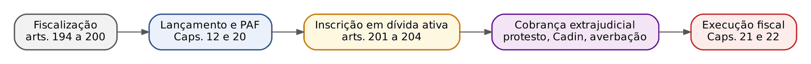
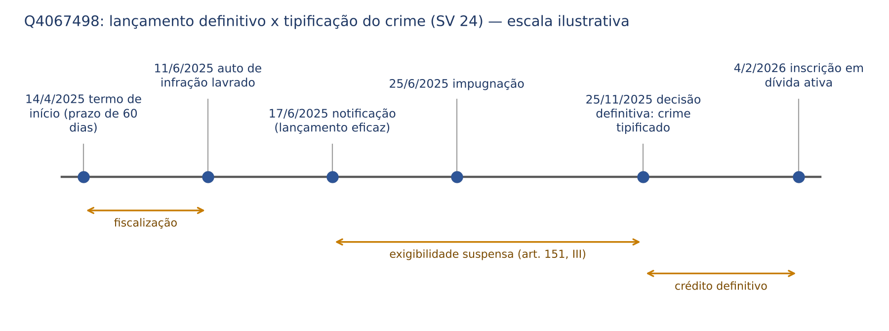
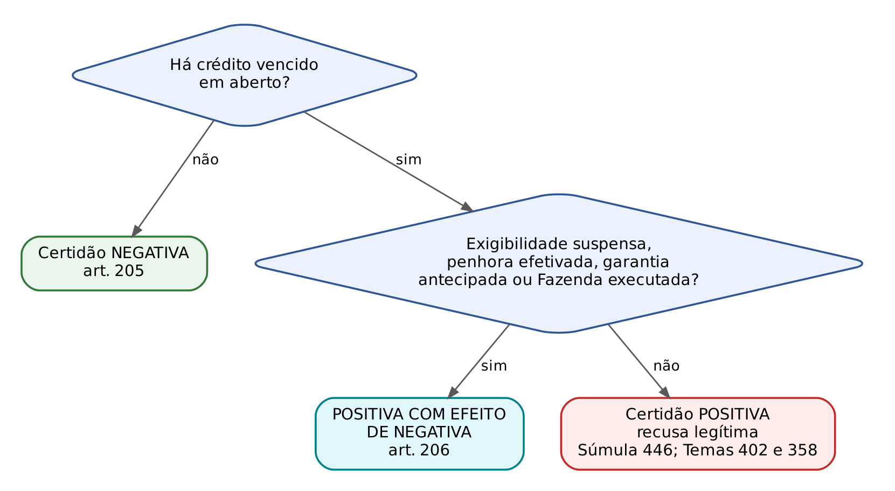
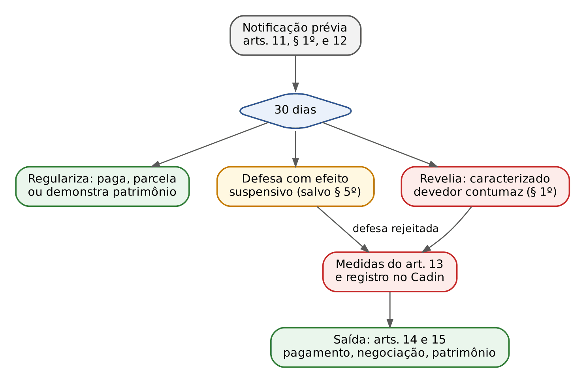

# CAPÍTULO 19 — ADMINISTRAÇÃO TRIBUTÁRIA: FISCALIZAÇÃO E SEUS LIMITES, SIGILO FISCAL E BANCÁRIO E COMPARTILHAMENTO DE INFORMAÇÕES (LC 105/2001), DÍVIDA ATIVA E INSCRIÇÃO, PROTESTO DE CDA, CERTIDÕES NEGATIVAS E POSITIVAS COM EFEITO DE NEGATIVA, CADASTROS E CÓDIGO DE DEFESA DO CONTRIBUINTE (LC 225/2026)

:::INCIDENCIA
TRF5 p. 5 e 15; TJRS p. 7; TJSC p. 17. Nível A. Lote: 36 questões (FGV 29, FCC 7).
O que mais cai: literalidade do art. 198 do CTN (o que pode e o que não pode ser divulgado), deveres de informação de terceiros (art. 197), força pública (art. 200), acesso direto da Receita a dados bancários (LC 105/2001, Tema 225), natureza da dívida ativa e presunção RELATIVA de certeza e liquidez, protesto de CDA (ADI 5.135), averbação pré-executória (ADIs 5.881 e outras) e as hipóteses de certidão positiva com efeito de negativa (Súmula 446 do STJ).
:::

| Subtema | FGV | FCC | Padrão de cobrança |
|---|---|---|---|
| Fiscalização (arts. 194 a 197 e 200) | 11 | 3 | literalidade; terceiros obrigados; força pública "ainda que não haja crime" |
| Sigilo fiscal (art. 198) e permuta (art. 199) | 9 | 0 | rol do § 3º (pode divulgar) x situação econômica do contribuinte (não pode) |
| Sigilo bancário (LC 105/2001) | 3 | 1 | acesso direto pela Receita sem juiz = transferência de sigilo |
| Dívida ativa (conceito, natureza, inscrição, presunção) | 5 | 3 | tributária x não tributária; presunção relativa; juros não excluem liquidez |
| Protesto de CDA, Cadin e averbação | 3 | 0 | protesto válido; averbação válida; indisponibilidade administrativa inválida |
| Certidões (arts. 205 e 206) | 5 | 0 | Súmula 446; CPEN da Fazenda executada; impugnação suspende |

## 19.1 Administração tributária: onde ela está e para que serve

O civilista está acostumado a um credor que precisa de título ou de ação de conhecimento para cobrar. A Fazenda fabrica o próprio título: fiscaliza, lança, julga a defesa no processo administrativo, inscreve em dívida ativa e extrai a CDA, título executivo extrajudicial (art. 784, IX, do CPC; art. 3º da LEF). O Título IV do Livro II do CTN cuida dos três momentos visíveis dessa autotutela: FISCALIZAÇÃO (arts. 194 a 200, com o sigilo nos arts. 198 e 199), DÍVIDA ATIVA (arts. 201 a 204) e CERTIDÕES (arts. 205 a 208). A LC 236/2026 acrescentou um Capítulo IV sobre processo administrativo fiscal (arts. 208-A a 208-J; Cap. 20).

Na Constituição: precedência da administração fazendária (art. 37, XVIII); atividade essencial, exercida por carreiras específicas, com recursos prioritários e atuação integrada dos entes, inclusive com compartilhamento de cadastros e informações, na forma da lei ou convênio (art. 37, XXII); faculdade de identificar patrimônio, rendimentos e atividades do contribuinte (art. 145, § 1º; base do acesso a dados bancários, 19.4); exceção à vedação de vinculação de impostos (art. 167, IV).

:::QUESTAO FGV 2024 — Prefeitura de São José dos Campos-SP — Técnico Tributário (Q2375634)
Afirmativa correta sobre as administrações tributárias. Gabarito: C (carreiras específicas; art. 37, XXII, da CF). Armadilhas: A (sanções políticas; Cap. 5); B (intercâmbio sigiloso exige processo instaurado; art. 198, § 2º); E (a União permuta com Estados estrangeiros; art. 199, parágrafo único). Gabarito discutível: D reproduz quase literalmente a parte final do art. 37, XXII (compartilhamento de cadastros e informações "na forma da lei ou convênio").
:::

Na esfera federal, a Receita Federal fiscaliza e lança, e a PGFN controla a legalidade, inscreve em dívida ativa e cobra (art. 39, § 5º, da Lei 4.320/1964; art. 2º, § 4º, da LEF).

## 19.2 Fiscalização

### 19.2.1 A legislação de fiscalização e quem a ela se submete (art. 194)

A competência e os poderes das autoridades fiscais são definidos pela "legislação tributária" do ente (art. 194, caput), que abrange decretos e normas complementares (art. 96); só obrigação principal e penalidade exigem lei (art. 97).

O alcance subjetivo é amplo: a legislação de fiscalização aplica-se às pessoas naturais ou jurídicas, contribuintes ou não, INCLUSIVE às que gozem de imunidade ou de isenção de caráter pessoal (art. 194, § 1º, redação da LC 236/2026): imunidade e isenção dispensam o pagamento, não o controle (arts. 14 e 175, parágrafo único).

A LC 236/2026 acrescentou dois parágrafos de inspiração cooperativa: a administração DEVE priorizar e disponibilizar métodos preventivos para que o sujeito passivo se autorregularize antes da lavratura do auto de infração (§ 2º), e estabelecerá programas de conformidade e outras medidas de prevenção de conflitos (§ 3º), com os mesmos sete princípios que a LC 225/2026 fixou para o Confia (voluntariedade, boa-fé, diálogo, transparência, conformidade, prevenção de litígios, proporcionalidade; art. 20; 19.9.5).

:::QUESTAO FGV 2024 — Prefeitura de São José dos Campos-SP — Técnico Tributário (Q2375632)
Quatro afirmativas sobre o poder de fiscalização. Gabarito: A (I e III). I está correta (art. 194, parágrafo único, hoje § 1º: alcança imunes e isentos). III está correta (livros e comprovantes conservados até a PRESCRIÇÃO dos créditos; art. 195, parágrafo único). II está errada: as disposições limitativas do exame de livros não têm aplicação para ninguém (art. 195), e não "aplicação limitada aos imunes". IV está errada: a divulgação da situação econômica do contribuinte é exatamente o que o art. 198 VEDA.
:::

### 19.2.2 Exame de livros, mercadorias e documentos (art. 195)

O art. 195 afasta, "para os efeitos da legislação tributária", quaisquer disposições legais excludentes ou limitativas do direito de examinar mercadorias, livros, arquivos, documentos, papéis e efeitos comerciais ou fiscais dos comerciantes, industriais ou produtores, ou da obrigação destes de exibi-los. O sigilo comercial NÃO é oponível ao Fisco (no mesmo sentido, art. 1.193 do CC).

O limite está na Súmula 439 do STF: "Estão sujeitos à fiscalização tributária ou previdenciária quaisquer livros comerciais, limitado o exame aos pontos objeto da investigação." O Fisco pode ver tudo o que interessa à apuração, mas não devassar o que é estranho a ela.

:::PEGADINHA Examinar não é apreender, e o estabelecimento é domicílio
O CTN autoriza o EXAME e a exigência de EXIBIÇÃO; não autoriza a apreensão ou o "confisco" de livros e documentos pela autoridade, como afirmou a alternativa A da Q3039638 (FGV 2024, Nova Iguaçu), errada. A recusa em exibir gera multa e arbitramento (art. 148), não ingresso forçado. Para o STF, o estabelecimento, na parte não aberta ao público, é domicílio (art. 5º, XI, da CF): sem consentimento, o ingresso para apreender documentos exige ordem judicial, sob pena de prova ilícita. Apreender MERCADORIA sem documentação como medida de fiscalização é válido (Q4221433); retê-la para cobrar tributo, não (Súmula 323 do STF; Cap. 5).
:::

Conservação: os livros obrigatórios e os comprovantes dos lançamentos devem ser conservados até que ocorra a PRESCRIÇÃO dos créditos tributários decorrentes das operações a que se refiram (art. 195, parágrafo único). A FGV aceitou a formulação "enquanto não extinto o crédito" (Q2565251, TCE-PA 2024, I, correta).

:::QUESTAO FGV 2025 — SEFAZ-PR — Auditor Fiscal (Q3363402)
Auditor estadual solicitou documentos protegidos por sigilo comercial. Gabarito: D (pode requisitá-los, porque o sigilo comercial não é oponível à autoridade fiscal no exercício regular da fiscalização; art. 195). Armadilhas: exigir autorização judicial (A), termo de confidencialidade (B), concordância do contribuinte (C) ou denúncia de crime (E). O dever de sigilo passa para o Fisco (art. 198): é a mesma lógica da "transferência de sigilo" bancário (19.4).
No mesmo sentido: Q3039638 (FGV 2024, Nova Iguaçu, alternativa A errada por falar em apreensão).
:::

Questões de legislação estadual de concursos fiscais, de baixo rendimento para a magistratura: Q3955910 (FCC 2026, SEFAZ-SP, gabarito E) e Q3947184 (FCC 2026, SEFAZ-MT, gabarito E).

### 19.2.3 Início, documentação e prazo da fiscalização (art. 196)

A autoridade que proceder ou presidir diligências de fiscalização lavrará os termos necessários para documentar o procedimento (art. 196, caput, com redação da LC 236/2026). Os termos são lavrados, sempre que possível, em um dos livros fiscais exibidos; lavrados em separado, entrega-se cópia autenticada ao fiscalizado (§ 1º).

:::LEI CTN, art. 196, §§ 2º a 4º (incluídos pela LC 236/2026)
§ 2º O procedimento de fiscalização será precedido de emissão de documento que preveja o início da fiscalização, o qual deverá conter as seguintes informações:
I – a identificação da autoridade responsável por sua emissão, das autoridades encarregadas pela fiscalização, do contribuinte e de seus estabelecimentos objeto da fiscalização;
II – os trabalhos a serem desenvolvidos pela autoridade fazendária, com a identificação do objeto da fiscalização, o período a ser examinado e o rol de documentos fiscais do contribuinte que serão necessários;
III – a forma de confirmação de sua autenticidade pelo contribuinte; e
IV – o prazo de duração do procedimento.
§ 3º A realização de procedimento de fiscalização em estabelecimento ou domicílio do contribuinte deverá ser feita mediante a entrega de uma das vias do documento a que se refere o § 2º deste artigo ao contribuinte, seu representante legal ou preposto.
§ 4º Na hipótese de que trata o § 3º deste artigo, o acompanhamento de força policial será condicionado ao justo receio de resistência ao ato fiscalizatório, que deverá ser reduzido a termo e constará do documento a ser entregue ao contribuinte fiscalizado.
:::

O documento de início importa porque: (1) exclui a espontaneidade quanto às infrações do seu objeto e período (art. 138, parágrafo único; Cap. 10); (2) antecipa a decadência quando notificado como medida preparatória (art. 173, parágrafo único; Cap. 15); (3) delimita a duração (inciso IV; antes, o caput mandava fixar "prazo máximo para a conclusão"). Na esfera federal, os atos de início valem por 90 dias, prorrogáveis por qualquer ato escrito de prosseguimento; sem ele, o contribuinte readquire a espontaneidade (Decreto 70.235/1972, art. 7º, § 2º, na redação da LC 227/2026; antes, 60 dias; Cap. 20). A força policial preventiva (§ 4º) não se confunde com a requisição por embaraço já ocorrido (art. 200).

:::EXEMPLO Q4067498 (FCC 2026, SEFAZ-GO): quando o crime material contra a ordem tributária se tipifica
Termo de início em 14/4/2025; auto em 11/6/2025; notificação em 17/6/2025; impugnação em 25/6/2025; decisão administrativa definitiva em 25/11/2025; inscrição em 4/2/2026. Em que data se tipificou o crime material (Lei 8.137/1990, art. 1º)?
A regra: o crime material não se tipifica antes do lançamento DEFINITIVO do tributo (Súmula Vinculante 24; desenvolvimento no Cap. 11).
A aplicação: lavrar o auto (11/6) não basta; notificar (17/6) torna o lançamento eficaz, mas a impugnação tempestiva suspende a exigibilidade e mantém o lançamento sujeito a revisão (art. 145, I, e art. 151, III). O lançamento torna-se definitivo com a decisão final irrecorrível no processo administrativo: 25/11/2025. Gabarito: D. A inscrição (E) é irrelevante para o tipo penal; a menção à LC 105/2001, art. 1º, § 4º, VII, é distração.
:::

### 19.2.4 Dever de informação de terceiros (art. 197) e requisição de dados cadastrais (art. 198, § 4º)

O Fisco também pode obrigar TERCEIROS, que nada devem, a informar sobre bens, negócios ou atividades do contribuinte. É a lógica do dever de colaboração com a Justiça (art. 380 do CPC), transportada para a administração tributária.

:::LEI CTN, art. 197
Mediante intimação escrita, são obrigados a prestar à autoridade administrativa tôdas as informações de que disponham com relação aos bens, negócios ou atividades de terceiros:
I - os tabeliães, escrivães e demais serventuários de ofício;
II - os bancos, casas bancárias, Caixas Econômicas e demais instituições financeiras;
III - as emprêsas de administração de bens;
IV - os corretores, leiloeiros e despachantes oficiais;
V - os inventariantes;
VI - os síndicos, comissários e liquidatários;
VII - quaisquer outras entidades ou pessoas que a lei designe, em razão de seu cargo, ofício, função, ministério, atividade ou profissão.
Parágrafo único. A obrigação prevista neste artigo não abrange a prestação de informações quanto a fatos sôbre os quais o informante esteja legalmente obrigado a observar segrêdo em razão de cargo, ofício, função, ministério, atividade ou profissão.
:::

Três observações cobradas:

- Forma: basta INTIMAÇÃO ESCRITA da autoridade administrativa; não há reserva de jurisdição.
- Limite: o sigilo PROFISSIONAL legalmente imposto (advogado, médico, psicólogo, sacerdote, auditor independente quanto ao que lhe é confiado). O advogado não pode ser compelido a revelar o que soube no exercício da profissão; a empresa administradora de bens, que não tem dever legal de segredo, pode.
- Bancos (inciso II): o dever existe, mas é disciplinado pela LC 105/2001, que exige processo administrativo instaurado ou procedimento fiscal em curso e indispensabilidade do exame (art. 6º; 19.4). Por isso não é exato dizer que o banco "não é obrigado" a informar (Q2565251, II, falsa).

A LC 208/2024 reforçou o poder de requisição: sem prejuízo do art. 197, a administração tributária pode requisitar informações CADASTRAIS e PATRIMONIAIS do sujeito passivo a órgãos ou entidades, públicos ou privados, que operem cadastros e registros ou controlem operações de bens e direitos, e os órgãos públicos de qualquer Poder colaborarão compartilhando bases cadastrais e patrimoniais (art. 198, §§ 4º e 5º). Juntas comerciais, cartórios de imóveis, Detran, bolsas e corretoras estão alcançados.

:::QUESTAO FGV 2026 — AL-RO — Analista Legislativo (Q3882282)
Em procedimento fiscal regular, a Sefaz intimou corretora de investimentos (ativos financeiros), Junta Comercial (contratos sociais) e cartório de imóveis (titularidade de bens). Gabarito: A (a autoridade pode requisitar diretamente informações cadastrais, patrimoniais e financeiras, sem autorização judicial). Fundamentos: art. 197, I, II e VII; art. 198, § 4º; LC 105/2001, art. 6º, para a corretora, que é instituição financeira (art. 1º, § 1º, III). Armadilhas: exigir ordem judicial para dados bancários (C) ou para tudo (B e E), ou consentimento do contribuinte (D).
:::

:::QUESTAO FGV 2025 — TCE-PE — Analista de Controle Externo (Q3593254)
Administradora de bens e inventariante resistiram à intimação, alegando sigilo profissional e falta de autorização judicial no inventário. Gabarito: C (a requisição a terceiros é legítima, salvo se sobre os fatos recair dever legal de sigilo por motivo de profissão ou função). Ambos estão no rol (incisos III e V) e nenhum tem dever legal de segredo. Armadilhas: B (autorização judicial "em todos os casos"); D (o art. 197 não autoriza "quebra de sigilo de qualquer natureza"; ressalva o sigilo profissional); E (o dever alcança terceiros estranhos à obrigação).
No mesmo sentido: Q2348963 (FGV 2024, São José dos Campos, Auditor: administradora de imóveis intimada pela Receita deve informar imóveis E valores dos aluguéis; gabarito E).
:::

### 19.2.5 Auxílio da força pública (art. 200)

:::LEI CTN, art. 200
As autoridades administrativas federais poderão requisitar o auxílio da fôrça pública federal, estadual ou municipal, e recìprocamente, quando vítimas de embaraço ou desacato no exercício de suas funções, ou quando necessário à efetivação de medida prevista na legislação tributária, ainda que não se configure fato definido em lei como crime ou contravenção.
:::

O "reciprocamente" significa que autoridades estaduais e municipais também podem requisitar a força pública federal, estadual ou municipal. São três hipóteses alternativas: (a) embaraço, (b) desacato, (c) necessidade para efetivar medida prevista na legislação tributária; e a requisição independe de o fato configurar crime ou contravenção. Leia junto com o art. 196, § 4º (19.2.3): a presença policial PREVENTIVA na diligência exige justo receio de resistência reduzido a termo.

:::QUESTAO FCC 2026 — SEFAZ-CE — Auditor Fiscal (Q4221433)
Autoridade estadual foi embaraçada ao tentar apreender mercadorias, sem que o embaraço configurasse crime ou contravenção. Gabarito: D (pode requisitar auxílio da força policial federal, estadual ou municipal, independentemente de crime ou contravenção). Armadilhas: limitar à Guarda Municipal (A) ou à polícia estadual (B e E) ou condicionar a crime (B e C).
No mesmo sentido: Q3044208 (FGV 2024, Vitória-ES: servidor municipal desacatado pode requisitar força municipal, estadual e federal; gabarito E); Q2362729, I (FGV 2024, São José dos Campos, verdadeira); Q3039638, E (FGV 2024, Nova Iguaçu, falsa ao negar a requisição entre entes diferentes).
:::

### 19.2.6 Assistência entre Fazendas, permuta internacional e compartilhamento de atividades (arts. 199 e 199-A)

- Entes internos: assistência mútua e permuta de informações por lei ou convênio (art. 199, caput), com o intercâmbio sigiloso formalizado (art. 198, § 2º).
- Estados estrangeiros: SOMENTE a UNIÃO, por tratados, acordos ou convênios (art. 199, parágrafo único).
- Novidade da LC 236/2026: convênio para compartilhar fiscalização, lançamento, cobrança e estrutura do processo administrativo (art. 199-A). Não é delegação de COMPETÊNCIA (art. 7º; Cap. 4), mas de funções.

:::QUESTAO FGV 2024 — CGM de Belo Horizonte — Auditor Interno (Q2387535)
Estado estrangeiro pediu diretamente ao Município, por carta ao Prefeito, informações de ITBI sobre empresa suspeita de sonegação. Gabarito: A (por ausência de previsão legal, o Município não pode prestar as informações diretamente). A permuta internacional é privativa da União, por tratado, acordo ou convênio (art. 199, parágrafo único). Armadilhas: B (convênio entre o Município e o Estado estrangeiro) e D (autorização da Assembleia Legislativa).
:::

## 19.3 Sigilo fiscal (art. 198)

### 19.3.1 A regra e suas exceções

O sigilo fiscal é a contrapartida da devassa autorizada: o que a Fazenda conhece em razão do ofício não pode ser divulgado (fundamento: art. 5º, X e XII, da CF).

:::LEI CTN, art. 198, caput e §§ 1º a 3º (redação da LC 104/2001 e da LC 187/2021)
Art. 198. Sem prejuízo do disposto na legislação criminal, é vedada a divulgação, por parte da Fazenda Pública ou de seus servidores, de informação obtida em razão do ofício sobre a situação econômica ou financeira do sujeito passivo ou de terceiros e sobre a natureza e o estado de seus negócios ou atividades.
§ 1º Excetuam-se do disposto neste artigo, além dos casos previstos no art. 199, os seguintes:
I – requisição de autoridade judiciária no interesse da justiça;
II – solicitações de autoridade administrativa no interesse da Administração Pública, desde que seja comprovada a instauração regular de processo administrativo, no órgão ou na entidade respectiva, com o objetivo de investigar o sujeito passivo a que se refere a informação, por prática de infração administrativa.
§ 2º O intercâmbio de informação sigilosa, no âmbito da Administração Pública, será realizado mediante processo regularmente instaurado, e a entrega será feita pessoalmente à autoridade solicitante, mediante recibo, que formalize a transferência e assegure a preservação do sigilo.
§ 3º Não é vedada a divulgação de informações relativas a:
I – representações fiscais para fins penais;
II – inscrições na Dívida Ativa da Fazenda Pública;
III - parcelamento ou moratória; e
IV - incentivo, renúncia, benefício ou imunidade de natureza tributária cujo beneficiário seja pessoa jurídica.
:::

:::DICA Por que o § 3º pode ser divulgado
Cada inciso tem razão de interesse público: a representação penal antecede ação pública; a dívida ativa produz efeitos perante terceiros (art. 185, protesto, Cadin); parcelamento, moratória e benefícios envolvem renúncia ou diferimento de receita. No inciso IV, só o beneficiário PESSOA JURÍDICA (lógica repetida pela LC 224/2025 no art. 1º, § 3º, VIII, da LC 105/2001).
:::

:::QUESTAO FGV 2025 — TCE-RR — Auditor de Controle Externo (Q3186481)
Pediu-se o que está resguardado pelo sigilo fiscal. Gabarito: B (situação econômica ou financeira do contribuinte; caput). As demais alternativas (dívida ativa, parcelamento ou moratória, benefício de pessoa jurídica, representação fiscal para fins penais) são exatamente o rol do § 3º.
No mesmo sentido, pela literalidade do art. 198: Q2564268 (FGV 2024, TCE-PA, gabarito C: viola o sigilo divulgar a situação financeira; Cadin e translado do sigilo bancário não violam); Q3882000 (FGV 2026, AL-RO, gabarito B: servidor que comenta em rede social a situação da fiscalizada); Q3039638 (FGV 2024, Nova Iguaçu, gabarito D: representação fiscal para fins penais é divulgável); Q2565251, III, e Q2512333, C (dívida ativa é divulgável).
:::

:::QUESTAO FGV 2024 — AL-PR — Analista Legislativo (Q2449776)
Segundo o CTN, é vedada a divulgação de informações relativas a... Gabarito: B, solicitações de autoridade administrativa "previamente à instauração de processo administrativo". A pegadinha está no advérbio: o § 1º, II, exige processo administrativo REGULARMENTE INSTAURADO; antes dele, a transferência é vedada. Alternativa A (requisição judicial) é exceção expressa; C, D e E são o rol do § 3º.
:::

:::QUESTAO FGV 2024 — AL-TO — Analista Legislativo (Q2457702)
Pediu-se a hipótese que viola o sigilo fiscal ou bancário. Gabarito: D (quebra de sigilo por CPI sem justificativa adequada). A CPI (art. 58, § 3º, da CF) pode quebrar sigilos, mas por decisão MOTIVADA. Armadilhas: A, C e E (rol do § 3º, divulgáveis); B (a penhora on-line de dinheiro em execução fiscal não depende do exaurimento de diligências e não é "quebra de sigilo", mas ato de constrição judicial; ver Cap. 21).
:::

### 19.3.2 Compartilhamento com o Ministério Público e órgãos de persecução penal

Duas vias de saída da informação fiscal para a esfera penal devem ser distinguidas:

- Representação fiscal para fins penais: a Receita encaminha ao MP a representação relativa aos crimes contra a ordem tributária DEPOIS da decisão final na esfera administrativa (art. 83 da Lei 9.430/1996; Cap. 11). Sua divulgação não é vedada (art. 198, § 3º, I).
- Compartilhamento espontâneo, sem ordem judicial, da íntegra do procedimento fiscal e dos relatórios da UIF com os órgãos de persecução penal: constitucional (Tema 990, abaixo).

:::JURIS STF, Tema 990, RE 1.055.941/SP, Plenário, tese fixada em 4/12/2019
1. É constitucional o compartilhamento dos relatórios de inteligência financeira da UIF e da íntegra do procedimento fiscalizatório da Receita Federal do Brasil, que define o lançamento do tributo, com os órgãos de persecução penal para fins criminais, sem a obrigatoriedade de prévia autorização judicial, devendo ser resguardado o sigilo das informações em procedimentos formalmente instaurados e sujeitos a posterior controle jurisdicional. 2. O compartilhamento pela UIF e pela RFB, referente ao item anterior, deve ser feito unicamente por meio de comunicações formais, com garantia de sigilo, certificação do destinatário e estabelecimento de instrumentos efetivos de apuração e correção de eventuais desvios.
:::

O Tema 990 cuida do fluxo espontâneo (do órgão de controle para o MP). A requisição DIRETA de relatórios pelo MP ou pela polícia é objeto do Tema 1.404 do STF (RE 1.537.165/SP), com liminar do relator fixando requisitos provisórios e mérito ainda pendente na última notícia consultada. O desenvolvimento penal (RIF, pesca probatória, requisitos) está na Apostila de Processo Penal, Cap. 5.

## 19.4 Sigilo bancário e a LC 105/2001

### 19.4.1 A estrutura da lei

A LC 105/2001 impõe sigilo às instituições financeiras (art. 1º, com rol amplo: bancos, corretoras, administradoras de cartão, cooperativas, factoring), mas ressalva hipóteses que NÃO o violam, como a comunicação de ilícitos e o consentimento do interessado (§ 3º). A QUEBRA para apurar ilícitos é judicial, em qualquer fase do inquérito ou processo, especialmente em crimes contra a ordem tributária (§ 4º, VII; art. 3º). Para o Fisco há duas vias sem juiz: a informação periódica de montantes globais mensais à Receita, sem identificar origem ou natureza dos gastos, com aprofundamento se houver indícios (art. 5º), e o exame direto do art. 6º. A quebra fora das hipóteses legais é crime, e o servidor que usa indevidamente a informação responde pessoalmente (arts. 10 e 11).

:::LEI LC 105/2001, art. 6º
Art. 6º As autoridades e os agentes fiscais tributários da União, dos Estados, do Distrito Federal e dos Municípios somente poderão examinar documentos, livros e registros de instituições financeiras, inclusive os referentes a contas de depósitos e aplicações financeiras, quando houver processo administrativo instaurado ou procedimento fiscal em curso e tais exames sejam considerados indispensáveis pela autoridade administrativa competente.
Parágrafo único. O resultado dos exames, as informações e os documentos a que se refere este artigo serão conservados em sigilo, observada a legislação tributária.
:::

Requisitos cumulativos: processo administrativo instaurado OU procedimento fiscal em curso; indispensabilidade, avaliada pela autoridade competente; conservação em sigilo. Na União, a regulamentação é o Decreto 3.724/2001, modelo das garantias exigidas pelo STF (19.4.2).

### 19.4.2 O STF: transferência de sigilo, não quebra

Contra a alegação de reserva de jurisdição, o STF, em 24/2/2016, julgou conjuntamente as ADIs 2.390, 2.386, 2.397 e 2.859 e o RE 601.314 (repercussão geral) e validou a lei. O raciocínio central: não há QUEBRA de sigilo, porque a informação sai do banco e entra na Receita, que fica igualmente obrigada a guardá-la (sigilo fiscal, art. 198, e LC 105, art. 6º, parágrafo único). Há TRANSFERÊNCIA (ou translado) do dever de sigilo da esfera bancária para a fiscal. Somam-se o art. 145, § 1º, da CF e os compromissos internacionais de transparência fiscal.

:::JURIS STF, Tema 225, RE 601.314/SP, Plenário, j. 24/2/2016
I - O art. 6º da Lei Complementar 105/01 não ofende o direito ao sigilo bancário, pois realiza a igualdade em relação aos cidadãos, por meio do princípio da capacidade contributiva, bem como estabelece requisitos objetivos e o translado do dever de sigilo da esfera bancária para a fiscal; II - A Lei 10.174/01 não atrai a aplicação do princípio da irretroatividade das leis tributárias, tendo em vista o caráter instrumental da norma, nos termos do artigo 144, § 1º, do CTN.
:::

O item II diz respeito ao uso dos dados da antiga CPMF para lançar outros tributos de fatos geradores anteriores à lei: norma que amplia poderes de investigação aplica-se ao lançamento de fatos pretéritos (art. 144, § 1º; desenvolvimento no Cap. 12).

Nas ADIs, o STF condicionou o uso do art. 6º por ESTADOS, DF e MUNICÍPIOS à edição de regulamentação própria, nos moldes do Decreto 3.724/2001, com garantias mínimas: pertinência temática entre a informação bancária e o tributo cobrado; prévia notificação do contribuinte quanto à instauração do processo e a todos os demais atos; sujeição do pedido a superior hierárquico; sistemas eletrônicos de segurança certificados e com registro de acesso; instrumentos efetivos de apuração e correção de desvios.

:::JURIS STF, ADI 7.276/DF, Rel. Min. Cármen Lúcia, Plenário, j. 9/9/2024 (Info 1149)
São constitucionais as normas do Confaz que obrigam instituições financeiras e de pagamento a fornecer aos Estados informações sobre transferências e pagamentos de clientes em operações eletrônicas com recolhimento de ICMS (Pix, cartões de débito e crédito). Não há quebra de sigilo, mas transferência do sigilo à administração tributária estadual ou distrital, que deve preservá-lo e usá-lo só para fins fiscais. Nem há ofensa à reserva legal.
:::

| Quem obtém dados bancários | Precisa de ordem judicial? | Base |
|---|---|---|
| Receita Federal e fiscos de Estados, DF e Municípios (estes com regulamento próprio) | NÃO | LC 105, arts. 5º e 6º; Tema 225; ADIs 2.390 e outras |
| Estados, por convênio do Confaz, quanto a Pix e cartões ligados ao ICMS | NÃO | ADI 7.276 |
| CPI | NÃO, mas por decisão fundamentada | art. 58, § 3º, da CF |
| Persecução penal (quebra) | SIM, como regra | LC 105, art. 1º, § 4º, e art. 3º; compartilhamento espontâneo de RIF e procedimento fiscal: Tema 990 |
| Comissão de inquérito administrativo disciplinar | SIM | LC 105, art. 3º, § 1º |
| Juiz da execução fiscal (penhora on-line) | é o próprio juiz que determina | Cap. 21 |

:::QUESTAO FGV 2026 — TCE-PE — Auditor (Q4288561)
A Receita requisitou diretamente de instituições financeiras, em procedimento fiscal regular, dados de movimentação de contribuinte, usados só para apurar o crédito e mantidos sob sigilo fiscal. Gabarito: E (válido; os dados podem ser acessados em procedimento fiscal e passam a ser protegidos por sigilo fiscal). Armadilhas: A (autorização judicial prévia), B (sigilo bancário absoluto), C (divulgação prévia ao contribuinte e a órgãos de controle) e D, a mais sedutora: limitar a validade a fatos geradores posteriores à lei. A norma é procedimental e alcança fatos pretéritos (art. 144, § 1º; Tema 225, item II).
No mesmo sentido: Q2565251, II, e Q2564268, A (FGV 2024, TCE-PA).
:::

:::SENTENCA Mandado de segurança ou anulatória contra auto de infração baseado em dados bancários
Onde entra: preliminar de prova ilícita alegada pelo contribuinte. O que fundamentar: (1) a LC 105/2001, art. 6º, é constitucional (Tema 225); (2) verificar se havia procedimento fiscal em curso e motivação da indispensabilidade; (3) se o Fisco é estadual ou municipal, verificar a existência de regulamento local com as garantias fixadas nas ADIs (pertinência temática, notificação prévia, controle hierárquico, segurança); (4) a ausência de regulamento local torna ilícita a prova obtida diretamente dos bancos.
Redação-modelo: "O acesso direto da autoridade fiscal a dados bancários, em procedimento fiscal regularmente instaurado, não configura quebra, mas transferência do sigilo à administração tributária (LC 105/2001, art. 6º; STF, Tema 225), razão pela qual rejeito a alegação de ilicitude da prova."
Erro comum: aplicar a tese a ente sem a regulamentação exigida pelo STF.
:::

Obtidos os extratos, a lei federal presume omissão de receita nos depósitos de origem não comprovada (art. 42 da Lei 9.430/1996; Cap. 24).

## 19.5 Dívida ativa

### 19.5.1 Conceito e espécies: tributária e não tributária

Não confunda: DÍVIDA PÚBLICA (interna, externa, operações de crédito) é o que o Estado DEVE, tema de Direito Financeiro, fora desta apostila; DÍVIDA ATIVA é o que ele tem a RECEBER.

Dívida ativa tributária, para o CTN, é a proveniente de crédito tributário, regularmente inscrita na repartição administrativa competente, DEPOIS de esgotado o prazo fixado para pagamento pela lei ou por decisão final em processo regular (art. 201). A Lei 4.320/1964 dá o conceito amplo: os créditos da Fazenda, tributários ou não, exigíveis pelo transcurso do prazo de pagamento, serão inscritos como dívida ativa após apurada sua liquidez e certeza (art. 39, § 1º), e o § 2º separa as duas espécies:

| Espécie | Abrange (art. 39, § 2º, da Lei 4.320/1964) | Regime |
|---|---|---|
| Dívida ativa TRIBUTÁRIA | tributos, adicionais e MULTAS TRIBUTÁRIAS | CTN (prescrição, garantias, preferências, art. 185) e LEF |
| Dívida ativa NÃO TRIBUTÁRIA | demais créditos: multas de qualquer natureza, exceto as tributárias (administrativas, contratuais, ambientais, de trânsito), foros, laudêmios, aluguéis ou taxas de ocupação, custas processuais, preços de serviços, indenizações, reposições, restituições, alcances de responsáveis julgados, sub-rogação de garantias, contratos em geral | LEF para a cobrança (art. 2º); prescrição pelo Decreto 20.910/1932 ou lei específica, não pelo CTN (Cap. 15) |

As duas são cobradas pela mesma via: a Lei 6.830/1980 define como dívida ativa da Fazenda Pública "aquela definida como tributária ou não tributária na Lei nº 4.320" (art. 2º, caput), e a CDA de qualquer delas é título executivo extrajudicial (art. 784, IX, do CPC).

:::QUESTAO FGV 2026 — PGE-AC — Procurador do Estado (Q4079429)
Natureza de três créditos inscritos: (1) taxa de ocupação de imóvel estadual; (2) empréstimo compulsório; (3) anuidade de conselho profissional. Gabarito: D (não tributária; tributária; tributária).
Passo 1: a "taxa de ocupação" de bem público é contraprestação pelo uso de bem dominical, receita patrimonial, e está no rol da dívida não tributária do art. 39, § 2º; o nome "taxa" não faz tributo (art. 4º, I, do CTN).
Passo 2 (a PEGADINHA): o art. 39, § 2º, da Lei 4.320, redigido em 1979, põe empréstimos compulsórios e contribuições na dívida NÃO tributária, mas pela CF/1988 são tributos (arts. 148 e 149); prevalece a Constituição.
Passo 3: a anuidade de conselho profissional é contribuição de interesse de categoria profissional, tributo (art. 149; Cap. 3), com a ressalva da OAB, cuja anuidade não é tributária.
:::

:::QUESTAO FCC 2026 — MPE-AL — Analista (Q4152258)
Estado inscreveu em dívida ativa multa contratual aplicada a empresa após processo sancionatório. Gabarito: A (legítimo; inscrevem-se créditos tributários e não tributários, o que autoriza a execução fiscal). Armadilhas: C (a multa contratual NÃO é crédito tributário: tributo não é sanção de ato ilícito, art. 3º do CTN); D (só tributos seriam inscritíveis); E (a CDA é título executivo); B (protesto não é pressuposto da inscrição).
No mesmo sentido: Q3977879 (FCC 2026, AL-MS: multa em contrato de concessão, apurada com ampla defesa, pode ser inscrita, com CDA e execução fiscal, desde que o crédito seja certo, líquido e exigível; gabarito C).
:::

### 19.5.2 Inscrição: pressupostos, controle de legalidade e prazos

A inscrição é o ato administrativo que transforma o crédito exigível em título executivo. A LEF a qualifica como "ato de controle administrativo da legalidade", feito pelo órgão competente para apurar a liquidez e certeza do crédito (art. 2º, § 3º). Pressupostos:

- crédito DEFINITIVAMENTE constituído: lançamento notificado e não impugnado, ou impugnação definitivamente julgada; ou declaração do contribuinte, que dispensa o lançamento (Súmula 436 do STJ; Cap. 12). Pendente impugnação ou recurso, não há inscrição (art. 151, III; Cap. 13);
- vencimento sem pagamento: "depois de esgotado o prazo fixado, para pagamento, pela lei ou por decisão final" (art. 201). Inscrever antes do vencimento é nulo;
- órgão competente: na União, a PGFN; nos demais entes, o que a lei indicar; atividade típica, não terceirizável integralmente (Q3881689, A, errada).

A LC 236/2026 incluiu dois parágrafos no art. 201 que mudam a forma de ver a inscrição:

- § 2º: o controle de legalidade da inscrição consiste na análise, pela Fazenda, dos requisitos de certeza, liquidez e exigibilidade essenciais à formação do título, e é DIREITO do contribuinte e DEVER da Fazenda credora, que poderá realizá-lo a qualquer tempo, de ofício ou a requerimento. Dá ao contribuinte base para pedir o cancelamento de inscrição indevida (crédito pago ou prescrito) sem esperar a execução.
- § 3º: o órgão que constituiu o crédito deve encaminhar as informações para inscrição e cobrança, administrativa ou judicial no prazo máximo de 90 dias úteis a partir da exigibilidade, ampliável para até 120 dias úteis para contribuintes de maior conformidade e reduzido para 60 dias úteis para os de histórico de baixo recolhimento espontâneo, salvo lei em contrário.

Também o § 1º foi renumerado (era parágrafo único): "A fluência de juros de mora não exclui, para os efeitos deste artigo, a liquidez do crédito." Liquidez é valor determinável por simples cálculo.

:::QUESTAO FCC 2026 — DPE-MT — Defensor Público (Q3954675)
Segundo o CTN, a dívida ativa tributária... Gabarito: B (não exclui a liquidez do crédito quanto à fluência de juros de mora; art. 201, § 1º). Armadilhas: A ("ainda que não esgotado o prazo" para pagamento; o art. 201 exige o esgotamento); C (o termo deve indicar a natureza do crédito; art. 202, III); D (há presunção relativa; art. 204); E (a nulidade pode ser sanada pela substituição da certidão; art. 203).
No mesmo sentido: Q2512333 (FGV 2024, Câmara dos Deputados: gabarito B, presunção de fraude do art. 185 após a inscrição; erradas A, inscrição a partir da mera notificação; D, juros excluem a liquidez; E, presunção absoluta).
:::

A inscrição também SUSPENDE a prescrição por 180 dias ou até a distribuição da execução (art. 2º, § 3º, da LEF), mas, segundo o STJ, essa regra de lei ordinária só se aplica à dívida ativa NÃO tributária; para a tributária, prevalece o art. 174 do CTN (Cap. 15).

### 19.5.3 Termo de inscrição e certidão: requisitos e nulidade (arts. 202 e 203)

:::LEI CTN, art. 202 (redação da LC 236/2026 no inciso I e no § 1º)
Art. 202. O termo de inscrição da dívida ativa, autenticado pela autoridade competente, indicará obrigatoriamente:
I – o nome do devedor e dos corresponsáveis, bem como, sempre que possível, o domicílio ou a residência daquele e destes;
II - a quantia devida e a maneira de calcular os juros de mora acrescidos;
III - a origem e natureza do crédito, mencionada especificamente a disposição da lei em que seja fundado;
IV - a data em que foi inscrita;
V - sendo caso, o número do processo administrativo de que se originar o crédito.
§ 1º A certidão conterá, além dos requisitos deste artigo, a indicação do livro e da folha da inscrição.
§ 2º (VETADO).
:::

A LEF repete e amplia esses requisitos (art. 2º, §§ 5º e 6º: valor originário, termo inicial e forma de calcular juros e encargos, atualização monetária, número do processo ou do auto). O desdobramento processual (CDA como requisito da inicial, nome do corresponsável e ônus da prova no redirecionamento) está nos Caps. 21 e 22.

Consequência da falta ou do erro em qualquer requisito: NULIDADE da inscrição e do processo de cobrança, sanável ATÉ A DECISÃO DE PRIMEIRA INSTÂNCIA mediante substituição da certidão, devolvido ao sujeito passivo o prazo para defesa, que só poderá versar sobre a parte modificada (art. 203; LEF, art. 2º, § 8º). A substituição corrige erro material ou formal; não serve para trocar o sujeito passivo nem para alterar o próprio lançamento (Súmula 392 do STJ; ver Cap. 21).

### 19.5.4 Presunção de certeza e liquidez (art. 204)

:::LEI CTN, art. 204
Art. 204. A dívida regularmente inscrita goza da presunção de certeza e liquidez e tem o efeito de prova pré-constituída.
Parágrafo único. A presunção a que se refere este artigo é relativa e pode ser ilidida por prova inequívoca, a cargo do sujeito passivo ou do terceiro a que aproveite.
:::

Ponte com o processo civil: a CDA é título executivo como qualquer outro (art. 783 do CPC), mas com um plus probatório. Quem deve provar o vício é o executado, ou o terceiro a quem aproveite (o sócio redirecionado, o adquirente do bem), em embargos ou exceção de pré-executividade (Caps. 21 e 22). A presunção é RELATIVA (*juris tantum*), nunca absoluta.

A declaração de inconstitucionalidade de parte da base do lançamento não afasta automaticamente a presunção nem autoriza extinguir de ofício a execução; o excesso apurável por cálculo é decotado e a execução prossegue pelo saldo (Tema 690 do STJ; v. Cap. 21).

:::QUESTAO FGV 2026 — ALERJ — Especialista Legislativo (Q3881689)
Afirmativa correta sobre inscrição e cobrança da dívida ativa. Gabarito: D (extinção da execução de baixo valor por falta de interesse de agir e prévia conciliação ou protesto; Tema 1.184 do STF, Cap. 22). Erradas: A (terceirização integral da inscrição); B (multas tributárias e juros integram a dívida TRIBUTÁRIA; art. 39, §§ 2º e 4º, da Lei 4.320); C (presunção absoluta); E (matéria contábil).
No mesmo sentido, sobre a presunção relativa: Q2362729, II (FGV 2024, São José dos Campos: é falso que a presunção "não possa ser ilidida").
:::

### 19.5.5 Efeitos da inscrição

Da inscrição decorrem: presunção absoluta de fraude das alienações posteriores sem reserva de bens (art. 185; Tema 290 do STJ; Cap. 18; correlatas Q3174728, FGV 2025, TCE-RR, gabarito D, e Q2512333, B); publicidade (art. 198, § 3º, II); protesto, Cadin, negativação e averbação (19.6 e 19.7); óbice à CND (19.8).

### 19.5.6 Cessão onerosa de créditos inscritos (art. 39-A da Lei 4.320/1964)

A LC 208/2024 incluiu na Lei 4.320 o art. 39-A: por lei específica, o ente pode ceder onerosamente a pessoas jurídicas privadas ou fundos regulados pela CVM direitos originados de créditos tributários e não tributários, inclusive inscritos (securitização; cobrada no TRF5 2025, questão fora do lote). Vende-se o direito ao PRODUTO da arrecadação, não a titularidade do crédito: preservam-se natureza, garantias e privilégios, e a Fazenda continua cobrando (§ 1º, I a III); a cessão é definitiva, só alcança créditos reconhecidos pelo devedor e deve ocorrer até 90 dias antes do fim do mandato (§ 1º, IV, V e VII); não é operação de crédito para a LRF (§ 4º) nem esbarra no art. 167, IV, da CF (§ 5º).

## 19.6 Protesto da CDA

### 19.6.1 Base legal e constitucionalidade

O protesto é o ato formal e solene pelo qual se prova a inadimplência de obrigação originada em títulos e outros documentos de dívida (art. 1º da Lei 9.492/1997). Desde a Lei 12.767/2012 a lei é expressa:

:::LEI Lei 9.492/1997, art. 1º, parágrafo único (incluído pela Lei 12.767/2012)
Parágrafo único. Incluem-se entre os títulos sujeitos a protesto as certidões de dívida ativa da União, dos Estados, do Distrito Federal, dos Municípios e das respectivas autarquias e fundações públicas.
:::

Os contribuintes alegavam sanção política (Súmulas 70, 323 e 547 do STF; Cap. 5). O STF rejeitou a tese: o protesto não impede o exercício de atividade, é menos gravoso que a execução e dá ao devedor oportunidade de pagar sem custos de processo.

:::JURIS STF, ADI 5.135/DF, Rel. Min. Luís Roberto Barroso, Plenário, 2016
Tese: "O protesto das Certidões de Dívida Ativa constitui mecanismo constitucional e legítimo, por não restringir de forma desproporcional quaisquer direitos fundamentais garantidos aos contribuintes e, assim, não constituir sanção política."
:::

O STJ, no mesmo sentido, afirmou em repetitivo que a Fazenda tem interesse e pode protestar a CDA na forma do art. 1º, parágrafo único, da Lei 9.492/1997 (Tema 777, REsp 1.686.659/SP, Rel. Min. Herman Benjamin, 1ª Seção, j. 28/11/2018, Info 643) e, depois, que o protesto já era possível desde a entrada em vigor da Lei 9.492/1997, mesmo antes da Lei 12.767/2012, porque a CDA sempre foi "documento de dívida" (EREsp 1.109.579/PR, Rel. Min. Mauro Campbell Marques, 1ª Seção, j. 27/10/2021, Info 716).

### 19.6.2 Regime prático

- Pressuposto: só se protesta a CDA, isto é, crédito INSCRITO. Protestar débito de IPTU não inscrito, sem certidão, é ilegal (Q2348958, abaixo).
- Facultatividade e eficiência: o protesto não é condição legal para a execução fiscal, mas o STF passou a exigi-lo, em regra, como providência prévia ao ajuizamento de novas execuções de baixo valor, ao lado da tentativa de conciliação, salvo justificativa de eficiência (Tema 1.184 do STF; desenvolvimento no Cap. 22). A cobrança de questões FCC e FGV sobre esse tema é intensa (Q3881689, Q4083730, Q3044223, Q3542138, Q2654897, todas do Cap. 22).
- Prescrição: desde a LC 208/2024, e na redação atual dada pela LC 236/2026, o protesto extrajudicial da CDA INTERROMPE a prescrição (art. 174, § 1º, II; Cap. 15).
- Com exigibilidade suspensa ou crédito extinto, o protesto é indevido (vias no quadro abaixo).

:::QUESTAO FGV 2026 — TCE-PE — Analista (Q4283115)
Município protestou a CDA antes de ajuizar a execução; a empresa alegou sanção política. Gabarito: E (o protesto é meio legítimo de cobrança extrajudicial da dívida ativa e não configura sanção política). Armadilhas: só a execução seria possível (A); publicidade como sanção política (B); protesto apenas após execução frustrada (C); só para dívida não tributária (D).
:::

:::QUESTAO FGV 2024 — Prefeitura de São José dos Campos-SP — Auditor (Q2348958)
Dívida de IPTU ainda não inscrita foi protestada, com negativação da contribuinte. Gabarito: B (não é possível protestar sem a respectiva CDA). Armadilhas: A (protesto sem CDA); D (nega o protesto de dívida municipal); E (permite o protesto mas não a negativação: a comunicação do protesto aos cadastros de proteção ao crédito é efeito normal do ato).
:::

:::PROCESSO Protesto, Cadin e negativação indevidos: qual a via
| Situação | Via | Pedido |
|---|---|---|
| Crédito com exigibilidade suspensa, pago ou prescrito, protestado | ação anulatória ou declaratória com tutela de urgência; MS se a prova é documental | sustação ou cancelamento do protesto; declaração de inexigibilidade (Cap. 23) |
| Registro no Cadin com exigibilidade suspensa ou com ação garantida | requerimento administrativo; MS | suspensão do registro (art. 7º da Lei 10.522) |
| Inscrição feita sem os pressupostos | pedido de controle de legalidade (art. 201, § 2º); anulatória | cancelamento da inscrição |
:::

## 19.7 Cadastros de inadimplentes e averbação pré-executória

### 19.7.1 O Cadin federal (Lei 10.522/2002)

O Cadin reúne devedores de obrigações vencidas perante a Administração federal, CPF cancelado ou CNPJ inapto e, desde a Lei 14.973/2024, inscritos na dívida de outros entes (por convênio) e de conselhos profissionais e irregulares com o FGTS (art. 2º, I a V). A LC 225/2026 acrescentou o inciso VI: os enquadrados como devedores contumazes, cabendo a Estados, DF e Municípios informar ao Ministério da Fazenda a inclusão e a exclusão (art. 2º, §§ 10 e 11).

Regras-chave: inclusão em até 30 dias após a comunicação do débito ao devedor, valendo a notificação do lançamento ou da inscrição (art. 2º, §§ 2º e 4º); baixa em 5 dias úteis após a regularização (§ 5º); consulta prévia obrigatória antes de operações de crédito, incentivos e convênios federais, sendo o registro fator IMPEDITIVO desses atos (arts. 6º e 6º-A, Lei 14.973/2024); suspensão do registro se houver ação com garantia idônea e suficiente ou exigibilidade suspensa (art. 7º).

O Cadin não viola o sigilo fiscal (é exatamente a divulgação de dívida, permitida pelo art. 198, § 3º, II; Q2564268, B) nem é sanção política, porque não impede o exercício de atividade econômica, apenas condiciona o acesso a recursos e benefícios públicos.

### 19.7.2 Notificação pós-inscrição, negativação e averbação pré-executória (art. 20-B da Lei 10.522)

A Lei 13.606/2018 deu à PGFN instrumentos de cobrança anteriores à execução:

:::LEI Lei 10.522/2002, art. 20-B, caput e § 3º (incluído pela Lei 13.606/2018)
Art. 20-B. Inscrito o crédito em dívida ativa da União, o devedor será notificado para, em até cinco dias, efetuar o pagamento do valor atualizado monetariamente, acrescido de juros, multa e demais encargos nela indicados.
§ 3º Não pago o débito no prazo fixado no caput deste artigo, a Fazenda Pública poderá:
I - comunicar a inscrição em dívida ativa aos órgãos que operam bancos de dados e cadastros relativos a consumidores e aos serviços de proteção ao crédito e congêneres; e
II - averbar, inclusive por meio eletrônico, a certidão de dívida ativa nos órgãos de registro de bens e direitos sujeitos a arresto ou penhora, tornando-os indisponíveis.
:::

Seis ADIs (5.881, 5.886, 5.890, 5.925, 5.931 e 5.932) impugnaram o dispositivo. O STF, em 9/12/2020, julgou-as parcialmente procedentes: declarou inconstitucional APENAS a expressão "tornando-os indisponíveis" do inciso II, e constitucional o art. 20-E (atos complementares da PGFN). Resultado:

| Medida | Validade | Razão |
|---|---|---|
| Notificação para pagar em 5 dias (caput) | válida | |
| Comunicação a Serasa, SPC e congêneres (§ 3º, I) | válida | publicidade de dívida inscrita; meio menos gravoso |
| AVERBAÇÃO da CDA no registro de bens (§ 3º, II, primeira parte) | válida | dá publicidade, protege terceiros de boa-fé e facilita a prova da fraude do art. 185 |
| INDISPONIBILIDADE administrativa decorrente da averbação | INCONSTITUCIONAL | reserva de jurisdição, contraditório e ampla defesa; há meios menos gravosos (cautelar fiscal, art. 185-A) |

:::QUESTAO FGV 2025 — TRF5 — Juiz Federal Substituto (Q3373906)
União notificou o devedor, comunicou a inscrição ao Serasa e averbou a CDA no registro de imóveis, tornando os bens indisponíveis. Gabarito: A (averbação legítima; indisponibilidade administrativa inconstitucional). Armadilhas: B (averbação também inválida); C (negativação e averbação como sanções políticas); D (vício formal por falta de lei complementar: o fundamento do STF foi material e só quanto à indisponibilidade); E (indisponibilidade válida).
:::

:::DICA Três indisponibilidades que não se confundem
(1) JUDICIAL, do art. 185-A, pelo juiz da execução (Cap. 18): válida. (2) ADMINISTRATIVA, do art. 20-B, § 3º, II: inconstitucional. (3) Arrolamento (art. 64 da Lei 9.532/1997): mero acompanhamento, não impede alienar (Cap. 20).
:::

Fora da via administrativa, também o juiz da execução fiscal pode determinar a inclusão do nome do executado em cadastros de inadimplentes, a requerimento do exequente, com base no art. 782, § 3º, do CPC, aplicado à execução fiscal pelo STJ (Tema 1.026; v. Cap. 21).

## 19.8 Certidões negativas e positivas com efeito de negativa

### 19.8.1 Para que servem e quais existem

A certidão é a "prova de quitação" exigida para licitar e contratar com o Poder Público (art. 193 do CTN; art. 195, § 3º, da CF), receber incentivos, obter a recuperação judicial (art. 191-A; art. 57 da Lei 11.101/2005) e lavrar escrituras e partilhas (arts. 130 e 192; Caps. 10 e 18). Por isso sua recusa é litígio frequente e urgente.

O CTN conhece três situações:

| Certidão | Quando | Fundamento |
|---|---|---|
| NEGATIVA (CND) | não há débito vencido em aberto | art. 205 |
| POSITIVA COM EFEITO DE NEGATIVA (CPEN) | há débito, mas (a) não vencido, (b) em execução com penhora efetivada ou (c) com exigibilidade suspensa | art. 206 |
| POSITIVA | há débito vencido, exigível e sem garantia | recusa legítima da CND e da CPEN |

:::LEI CTN, arts. 205 e 206
Art. 205. A lei poderá exigir que a prova da quitação de determinado tributo, quando exigível, seja feita por certidão negativa, expedida à vista de requerimento do interessado, que contenha todas as informações necessárias à identificação de sua pessoa, domicílio fiscal e ramo de negócio ou atividade e indique o período a que se refere o pedido.
Parágrafo único. A certidão negativa será sempre expedida nos termos em que tenha sido requerida e será fornecida dentro de 10 (dez) dias da data da entrada do requerimento na repartição.
Art. 206. Tem os mesmos efeitos previstos no artigo anterior a certidão de que conste a existência de créditos não vencidos, em curso de cobrança executiva em que tenha sido efetivada a penhora, ou cuja exigibilidade esteja suspensa.
:::

Observações literais: o prazo é de 10 DIAS da entrada do requerimento; a certidão é expedida "nos termos em que tenha sido requerida" (período, tributo); a LC 236/2026 pretendeu acrescentar §§ 1º e 2º ao art. 205, ambos VETADOS, e o parágrafo único permanece. A certidão para defesa de direitos e esclarecimento de situações de interesse pessoal é gratuita (art. 5º, XXXIV, b, da CF; Cap. 6). E a LC 225/2026 proíbe exigir prova de quitação de obrigações tributárias como condição para o exercício dos direitos do contribuinte nela previstos, salvo previsão legal (art. 4º, § 2º).

### 19.8.2 Quando a recusa é legítima e quando não é: o quadro do STJ

O STJ decidiu em recursos repetitivos praticamente todo o tema. A lógica: só há direito à CND se não houver crédito exigível; só há direito à CPEN se o crédito exigível estiver garantido ou suspenso; e o Fisco não pode recusar a certidão com base em débito que ainda não constituiu.

| Situação | Certidão? | Fundamento |
|---|---|---|
| Débito DECLARADO pelo contribuinte (DCTF, GIA, GFIP) e não pago | recusa LEGÍTIMA de CND e de CPEN | Súmula 446 do STJ; Tema 256 do STJ |
| Pagamento a menor revelado por divergência entre o declarado em GFIP e o recolhido em guia | recusa LEGÍTIMA | Tema 402 do STJ |
| Descumprimento da obrigação acessória de informar mensalmente ao INSS os dados dos fatos geradores (GFIP) | recusa LEGÍTIMA (condição impeditiva prevista em lei) | Tema 358 do STJ |
| Tributo sujeito a homologação NÃO declarado e ainda não lançado de ofício | recusa ILEGÍTIMA: sem declaração nem lançamento, não há crédito constituído | jurisprudência do STJ que precedeu a Súmula 446 |
| Impugnação ou recurso administrativo pendente | direito à CPEN (exigibilidade suspensa) | art. 151, III, e art. 206 |
| Garantia antecipada (caução, fiança, seguro) oferecida antes da execução | direito à CPEN | Tema 237 do STJ |
| Fazenda Pública devedora, em execução embargada ou em ação anulatória | direito à CPEN independentemente de penhora (bens impenhoráveis) | Tema 273 do STJ |
| Município cuja CÂMARA tem débito com a União | direito à CPEN (intranscendência subjetiva das sanções) | Tema 743 do STF (RE 770.149) |
| Nova CND no desembaraço de importação sob drawback, já comprovada a quitação na concessão | exigência ILEGÍTIMA | Súmula 569 do STJ; Tema 165 do STJ |
| Empresa em recuperação judicial, sem débito exigível | recusa ILEGÍTIMA: a recuperação, por si, não é débito | Q3049406 |

:::JURIS STJ, Tema 237 (recurso repetitivo, acórdão publicado em 1º/2/2010)
É possível ao contribuinte, após o vencimento da sua obrigação e antes da execução, garantir o juízo de forma antecipada, para o fim de obter certidão positiva com efeito de negativa.
:::

A garantia antecipada (tutela cautelar antecedente, art. 305 do CPC) funciona como "penhora antecipada": não suspende a exigibilidade (art. 151 taxativo; Cap. 13), mas equipara-se à "cobrança executiva em que tenha sido efetivada a penhora" do art. 206; o Fisco pode ajuizar a execução, para a qual a garantia é transferida (Q3049944, FGV 2024, Macaé, gabarito D, Cap. 13).

:::JURIS STJ, Tema 273 (recurso repetitivo, acórdão publicado em 1º/2/2010)
A Fazenda Pública, quer em ação anulatória, quer em execução embargada, faz jus à expedição da certidão positiva de débito com efeitos negativos, independentemente de penhora, posto inexpropriáveis os seus bens.
:::

:::QUESTAO FGV 2025 — TJ-ES — Cartórios (Q3520321)
Município cobra do Estado taxa de coleta de lixo de imóveis estaduais; o Estado opôs embargos sem garantia e pediu certidão. Gabarito: C (positiva com efeitos de negativa, pois inexpropriáveis os bens estaduais; Tema 273). Armadilhas: A e D (exigir garantia de quem tem bens impenhoráveis e paga por precatório); B (o regime de precatório não torna a certidão positiva); E (a imunidade recíproca alcança só IMPOSTOS, não taxas; art. 150, VI, a, da CF; Cap. 6).
:::

:::QUESTAO FGV 2024 — TCE-PA — Auditor de Controle Externo (Q2611664)
É ILEGAL a recusa de CND ou CPEN quando se verifica... Gabarito: A (tributo sujeito a lançamento por homologação, enquanto este não se efetivar). As alternativas B, C e E reproduzem os Temas 402, 256 e 358, de recusa LEGÍTIMA. A alternativa D (recurso administrativo pendente contra indeferimento de pedido de compensação) é discutível: se o recurso tiver efeito suspensivo, a exigibilidade fica suspensa (art. 151, III) e a recusa também seria ilegal; a banca considerou só a A (ver nota).
:::

:::QUESTAO FGV 2024 — TJ-SC — Juiz Substituto (Q3049406)
Empresa vencedora de licitação estadual teve recusada a certidão. É ILEGÍTIMA a recusa na hipótese D, gabarito (empresa em recuperação judicial): a recuperação não é débito, e há direito à certidão se não houver crédito exigível sem garantia ou suspensão (participação em licitação: Cap. 18). Legítimas as demais: pendência da matriz (A: a filial não é pessoa jurídica distinta; ponto discutível, ver nota); débito declarado e não pago (B, Súmula 446); recolhimento inferior ao declarado (C); obrigação acessória erigida em condição legal para a certidão (E).
:::

:::QUESTAO FGV 2024 — Prefeitura de São José dos Campos-SP — Analista (Q2362723)
Empresa impugnou tempestivamente auto de infração de IPI; a impugnação está pendente e o Fisco negou a certidão. Gabarito: C (a exigibilidade está suspensa e a empresa tem direito à CPEN; arts. 151, III, e 206). Armadilhas: a impugnação não EXTINGUE (D) nem EXCLUI (E) o crédito; suspende.
No mesmo sentido: Q2362729, III (FGV 2024, São José dos Campos: é verdadeiro que, declarado e não pago, a recusa é legítima; Súmula 446); Q3186485 e Q2510942, correlatas dos Caps. 13 e 12.
:::

Por que a Súmula 446 faz sentido: a declaração constitui o crédito (Súmula 436; Cap. 12); vencido sem pagamento, ele é exigível; não havendo garantia nem suspensão, não cabe nenhuma das hipóteses do art. 206. O erro da intuição civilista é pensar que, sem "lançamento" formal, não haveria dívida a apontar.

### 19.8.3 Dispensa da prova de quitação e responsabilidade pela certidão falsa (arts. 207 e 208)

- Art. 207: independentemente de lei, dispensa-se a prova de quitação quando se tratar de ato indispensável para evitar a CADUCIDADE de direito (por exemplo, lavrar escritura ou registrar ato no último dia de um prazo decadencial). Todos os participantes respondem pelo tributo, juros e penalidades, salvo as infrações de responsabilidade pessoal do infrator.
- Art. 208: a certidão negativa expedida com DOLO ou FRAUDE, que contenha erro contra a Fazenda, responsabiliza PESSOALMENTE o servidor que a expedir pelo crédito tributário e juros de mora, sem prejuízo da responsabilidade criminal e funcional. Não alcança o erro culposo, e o servidor responde pelo crédito e pelos juros, não pela multa. É hipótese de responsabilidade tributária de terceiro fora dos arts. 134 e 135 (Cap. 10). E a certidão não impede a cobrança do contribuinte: certidão não extingue crédito.

### 19.8.4 Certidões e a LC 225/2026

Para os aderentes ao Confia, a renovação da CND e da CPEN federais é COLABORATIVA (art. 22, II): 30 dias antes do vencimento, a Receita emite relatório das pendências; em 10 dias, a empresa requer a renovação com os documentos de regularização; a análise RESTRINGE-SE às pendências do relatório, e o indeferimento deve ser motivado (art. 22, §§ 1º a 3º). Os selos Confia e Sintonia dão informação prévia para a renovação (art. 42, II).

:::SENTENCA Mandado de segurança para obter certidão
Onde entra: MS contra o ato do agente que recusou a CND ou a CPEN; é das ações tributárias mais comuns e cabe bem em prova prática.
Roteiro: (1) autoridade coatora com poder de expedir a certidão (na certidão federal conjunta, Receita e PGFN); (2) prova pré-constituída das pendências e da causa suspensiva ou garantia; (3) mérito: há crédito exigível? Está no art. 206 ou na jurisprudência (garantia antecipada, Fazenda executada)? Débito declarado e não pago afasta o direito (Súmula 446); (4) urgência evidente quando há licitação ou contrato.
Redação-modelo: "Comprovada a pendência de impugnação administrativa tempestiva, a exigibilidade do crédito está suspensa (art. 151, III, do CTN), o que assegura à impetrante a certidão positiva com efeitos de negativa (art. 206 do CTN). Concedo a segurança para determinar a expedição da certidão, se o único óbice for o crédito discutido no processo administrativo n. ..."
Erro comum: conceder CND quando o caso é de CPEN (o débito existe, só não é exigível ou está garantido), ou ordenar certidão "independentemente de outros débitos" não discutidos nos autos.
:::

## 19.9 Código de Defesa do Contribuinte (LC 225/2026)

### 19.9.1 Natureza, alcance e vigência

A LC 225, de 8/1/2026 (DOU de 9/1/2026), é lei complementar de normas gerais (art. 146, III, da CF): fixa direitos, garantias, deveres e procedimentos da relação entre o sujeito passivo e a administração tributária, de observância obrigatória em todo o território nacional (art. 1º), e alcança os órgãos do Executivo de todos os entes que cobram, fiscalizam, julgam, interpretam, normatizam ou representam o ente em matéria tributária (art. 2º). Vigência (art. 58): na publicação, como regra; 90 dias depois quanto aos programas Confia e Sintonia e aos selos (arts. 19 a 32 e 40 a 47). Os entes têm 1 ano para adaptar suas leis (art. 57).

### 19.9.2 Deveres da administração, direitos e deveres do contribuinte

Dos deveres da administração (art. 3º), os mais cobráveis: segurança jurídica e boa-fé (I); meios alternativos de solução de litígios (II); uso PROGRESSIVO dos instrumentos de indução à conformidade (VI e § 3º); PRESUNÇÃO DE BOA-FÉ do contribuinte (VII); motivação dos atos restritivos (VIII); autorregularização antes do auto de infração (XX); responsabilidade por abuso ou excesso (§ 8º). Entre os direitos (art. 4º): vista dos autos (IV); impugnar e recorrer ao menos uma vez (VI e VII); não entregar documento que o Fisco já tenha (IX); advogado inclusive na fiscalização (X e § 5º); identificação dos agentes (XII); liquidação de fiança ou seguro só após o trânsito em julgado de decisão de mérito desfavorável (XVII; Cap. 21). É vedado condicionar esses direitos a custas, garantia ou prova de quitação, salvo lei (§ 2º). Os deveres do contribuinte (art. 5º) espelham a cooperação: boa-fé, informar, declarar, guardar documentos, pagar em dia.

### 19.9.3 Devedor contumaz: conceito (art. 11)

O devedor contumaz faz da inadimplência um modelo de negócio: vende mais barato porque não recolhe tributo. O fundamento das medidas é a livre concorrência e a isonomia (art. 146-A da CF), não a cobrança; a fronteira com a sanção política está nos Caps. 5 e 11.

:::LEI LC 225/2026, art. 11, caput e § 2º
Art. 11. Para os fins desta Lei Complementar, considera-se devedor contumaz o sujeito passivo cujo comportamento fiscal se caracteriza pela inadimplência substancial, reiterada e injustificada de tributos.
§ 2º Para os fins do disposto no caput deste artigo, considera-se inadimplência:
I - substancial:
a) em âmbito federal, a existência de créditos tributários em situação irregular, inscritos em dívida ativa ou constituídos e não adimplidos, em âmbito administrativo ou judicial, de valor igual ou superior a R$ 15.000.000,00 (quinze milhões de reais) e equivalente a mais de 100% (cem por cento) do seu patrimônio conhecido, que corresponde ao total do ativo informado no último balanço patrimonial registrado na contabilidade, constante da Escrituração Contábil Fiscal (ECF) ou da Escrituração Contábil Digital (ECD);
b) em âmbito estadual, distrital e municipal, a existência de créditos tributários em situação irregular, inscritos em dívida ativa ou constituídos e não adimplidos conforme previsto em legislação própria, a qual poderá prever valores distintos dos previstos na alínea "a" deste inciso;
II - reiterada: a manutenção de créditos tributários em situação irregular em, pelo menos, 4 (quatro) períodos de apuração consecutivos, ou em 6 (seis) períodos de apuração alternados, no prazo de 12 (doze) meses;
III - injustificada: a ausência de motivos objetivos que afastem a configuração da contumácia.
:::

Os três requisitos são CUMULATIVOS. Detalhes cobráveis: Estados, DF e Municípios fixam valores por lei própria e, sem ela, findo o prazo do art. 57, aplicam-se os critérios federais (§ 4º); deduzem-se do total federal os créditos parcelados ou transacionados em dia, suspensos, garantidos ou em controvérsia jurídica relevante (§ 9º); afastam a contumácia, entre outros motivos, calamidade pública e prejuízo no exercício corrente e no anterior, salvo fraude (§ 5º); é também contumaz a parte relacionada de pessoa jurídica baixada ou inapta nos últimos 5 anos com créditos irregulares de 15.000.000 (quinze milhões de) reais ou mais (§ 7º).

### 19.9.4 Devedor contumaz: processo, medidas e saída (arts. 12 a 17)

Não há enquadramento automático: notificação PRÉVIA (art. 11, § 1º), indicação dos créditos, decisão fundamentada e 30 dias para regularizar ou defender-se com EFEITO SUSPENSIVO (art. 12); sem uma coisa nem outra, há caracterização (§ 1º). A defesa NÃO tem efeito suspensivo nas fraudes qualificadas do § 5º (empresa de fachada, notas frias, interposição de pessoas, inexistência de fato, ocultação de bens), em que cabe também a baixa da inscrição (§§ 6º e 7º).

Medidas, isoladas ou cumulativas (art. 13): impedimento de fruir benefícios fiscais (inclusive remissão e anistia) e de usar prejuízo fiscal e base negativa de CSLL, de licitar, de formalizar vínculos com a administração e de propor ou prosseguir em recuperação judicial, com convolação em falência a pedido da Fazenda; inaptidão cadastral; e, na esfera federal, o rito do art. 23, parágrafo único, da Lei 13.988/2020. Saída: o pagamento integral encerra o procedimento e a negociação com parcelas em dia o suspende (art. 14); deixa de ser contumaz quem não tem novos créditos irregulares e regularizou os anteriores (art. 15). Há cadastro nacional, com registro no Cadin (art. 16; Lei 10.522, art. 2º, VI). Reflexo penal (Cap. 11): ao devedor contumaz assim declarado em decisão definitiva não se aplicam a suspensão da pretensão punitiva pelo parcelamento nem a extinção da punibilidade pelo pagamento (arts. 49, 51, 53 e 54).

:::SENTENCA Mandado de segurança contra a qualificação como devedor contumaz
O que verificar: (1) notificação prévia e prazo de 30 dias; (2) motivação com indicação dos créditos; (3) os três requisitos do art. 11, com as deduções do § 9º; (4) no Estado ou Município, lei própria ou aplicação supletiva dos critérios federais (§ 4º); (5) supressão do efeito suspensivo só nas hipóteses do § 5º; (6) proporcionalidade da medida escolhida.
Redação-modelo: "A caracterização do devedor contumaz exige inadimplência substancial, reiterada e injustificada, cumulativamente (LC 225/2026, art. 11), apurada em processo com notificação prévia e defesa com efeito suspensivo (art. 12). Ausente a notificação, é nulo o ato que aplicou as medidas do art. 13."
Erro comum: tratar o regime como sanção política inválida em abstrato, ou validar o enquadramento de mero inadimplente.
:::

### 19.9.5 Programas de conformidade e autorregularização (arts. 18 a 47)

| Programa | O que é | Benefícios centrais |
|---|---|---|
| Confia (arts. 19 a 29) | conformidade COOPERATIVA voluntária, para pessoas jurídicas com governança tributária | renovação colaborativa de certidões (art. 22, II; 19.8.4); confissão em 60 dias da adesão sem multas (art. 24, § 2º); divergência revelada voluntariamente lançada sem multa de ofício (art. 26, § 2º); não pode ser qualificado devedor contumaz enquanto admitido (art. 26, § 5º) |
| Sintonia (arts. 30 a 32) | classificação por regularidade cadastral, de pagamento e de obrigações acessórias | prioridades; autorregularização de débitos declarados e não pagos (art. 32) |
| OEA (arts. 33 a 39) | operador econômico autorizado, na aduana; vedado ao devedor contumaz | despacho mais célere e pagamento diferido (arts. 37 e 38) |

Os selos Confia e Sintonia (arts. 40 a 42) dão bônus de adimplência na CSLL, vedação de arrolamento salvo preparação de cautelar fiscal, informação prévia para renovação de certidões e aviso prévio de indícios de infração com 60 dias para regularizar sem multa de mora. Não confunda as fontes da autorregularização: o CTN, que manda priorizá-la antes do auto de infração (art. 194, § 2º; 19.2.1); a LC 225 (programas acima); e a Lei 14.740/2023, que instituiu por prazo determinado a autorregularização incentivada de tributos federais não constituídos, sem multas (art. 2º). Avisos de indício de irregularidade não iniciam procedimento fiscal nem afastam a espontaneidade quando a lei assim prevê (LC 225, art. 39, § 3º; LC 123/2006, art. 34, § 3º, Q3596254, Cap. 31).

## 19.10 Resumo para revisão pré-prova

| Instituto | Regra | Exceções e detalhes | Fundamento |
|---|---|---|---|
| Legislação de fiscalização | competência e poderes definidos pela legislação tributária do ente | alcança imunes e isentos; autorregularização preventiva e programas de conformidade (LC 236) | art. 194, §§ 1º a 3º |
| Exame de livros | sigilo comercial inoponível ao Fisco | exame limitado aos pontos investigados; sem apreensão; estabelecimento protegido pela inviolabilidade do domicílio | art. 195; Súmula 439 do STF; CC, art. 1.193 |
| Início da fiscalização | documento de início com autoridades, objeto, período, documentos e prazo | força policial só com justo receio reduzido a termo; termo afasta a espontaneidade | art. 196 (LC 236); art. 138 |
| Terceiros | obrigados a informar mediante intimação escrita | ressalvado o sigilo legal profissional; requisição de cadastros e registros públicos e privados | art. 197; art. 198, §§ 4º e 5º (LC 208/2024) |
| Força pública | federal, estadual ou municipal, reciprocamente | embaraço, desacato ou efetivação de medida, ainda que sem crime | art. 200 |
| Sigilo fiscal | vedada a divulgação da situação econômica e dos negócios | exceções: juiz; autoridade administrativa com processo instaurado; permuta (art. 199, exterior só a União); divulgáveis RFFP, dívida ativa, parcelamento e moratória, benefícios de PJ; compartilhamento penal (Tema 990) | arts. 198 e 199 |
| Sigilo bancário | Fisco acessa dados sem juiz em procedimento fiscal, se indispensável | transferência de sigilo; Estados e Municípios precisam de regulamento com garantias; aplica-se a fatos pretéritos | LC 105, arts. 5º e 6º; Tema 225; ADIs 2.390 e outras; ADI 7.276 |
| Dívida ativa | crédito inscrito após esgotado o prazo de pagamento | tributária (tributos e multas tributárias) x não tributária (demais); empréstimo compulsório e anuidade de conselho são tributários | art. 201; Lei 4.320, art. 39 |
| Inscrição | ato de controle de legalidade | direito do contribuinte ao controle; envio em 90 dias úteis (60 a 120); juros não excluem liquidez | art. 201, §§ 1º a 3º (LC 236); LEF, art. 2º, § 3º |
| CDA e presunção | requisitos do termo; certeza e liquidez | nulidade sanável até a decisão de primeira instância; presunção RELATIVA; sem extinção de ofício por parcela inconstitucional | arts. 202 a 204; Tema 690 do STJ (Cap. 21) |
| Cessão de créditos | venda onerosa do direito ao produto, por lei do ente | natureza e garantias preservadas; Fazenda segue cobrando; 90 dias antes do fim do mandato | Lei 4.320, art. 39-A (LC 208/2024) |
| Protesto de CDA | constitucional, não é sanção política | exige CDA; interrompe a prescrição; prévio à execução de baixo valor | Lei 9.492, art. 1º, p. ú.; ADI 5.135; Tema 777; Tema 1.184 do STF |
| Cadin | registro após comunicação; impede crédito, incentivos e convênios federais | suspenso com garantia em juízo ou exigibilidade suspensa; inclui devedor contumaz | Lei 10.522, arts. 2º, 6º-A e 7º |
| Averbação pré-executória | averbação e negativação válidas | indisponibilidade administrativa inconstitucional | Lei 10.522, art. 20-B; ADIs 5.881 e outras |
| CND | sem débito exigível; 10 dias; nos termos requeridos | servidor responde pela certidão dolosa; dispensa para evitar caducidade | arts. 205, 207 e 208 |
| CPEN | crédito não vencido, em execução com penhora, ou suspenso | garantia antecipada (Tema 237); Fazenda executada (Tema 273); Município x Câmara (Tema 743 do STF) | art. 206 |
| Recusa legítima | declarado e não pago; divergência GFIP; falta de GFIP | ilegítima sem declaração nem lançamento e pela só recuperação judicial | Súmula 446; Temas 256, 402 e 358 |
| LC 225: alcance | normas gerais nacionais; vigência imediata, salvo programas e selos (90 dias); 1 ano para adaptação | direitos (art. 4º), deveres (art. 5º), deveres da administração (art. 3º) | arts. 1º a 7º, 57 e 58 |
| Devedor contumaz | inadimplência substancial, reiterada e injustificada, cumulativas; notificação prévia e 30 dias para regularizar ou defender com efeito suspensivo | federal: 15 milhões e mais de 100% do patrimônio; 4 consecutivos ou 6 alternados em 12 meses; medidas do art. 13 | arts. 11 a 16 |
| Conformidade | Confia, Sintonia, OEA e selos | bônus de adimplência na CSLL; renovação colaborativa de certidões; Lei 14.740/2023 | arts. 18 a 47 |

## 19.11 Artigos de lei incidentes

- Constituição Federal: art. 5º, X, XI, XII e XXXIV, b; art. 37, XVIII e XXII; art. 58, § 3º; art. 145, § 1º; art. 146, III; art. 146-A; art. 148; art. 149; art. 167, IV.
- CTN: arts. 96, 97, 138, 144, § 1º, 145, 151, 173, parágrafo único, 174, § 1º, II, 185, 185-A, 193, 194 (§§ 1º a 3º), 195, 196 (§§ 1º a 4º), 197, 198 (§§ 1º a 5º), 199, 199-A, 200, 201 (§§ 1º a 3º), 202, 203, 204, 205, 206, 207, 208.
- LC 105/2001: arts. 1º (§§ 1º a 4º), 3º, 5º, 6º, 10 e 11.
- LC 225/2026: arts. 1º a 58, em especial 3º, 4º, 5º, 11 a 16, 18 a 32, 40 a 42, 48, 57 e 58.
- LC 236/2026 (arts. 194, 196, 199-A, 201, 202 do CTN); LC 208/2024 (art. 198, §§ 4º e 5º, do CTN; art. 39-A da Lei 4.320).
- Lei 4.320/1964: arts. 39 e 39-A.
- Lei 6.830/1980: arts. 2º e 3º.
- Lei 9.492/1997: art. 1º, parágrafo único.
- Lei 10.522/2002: arts. 2º, 6º, 6º-A, 7º, 20-B a 20-E.
- Lei 9.430/1996: arts. 42, 81-A e 83.
- Lei 14.740/2023: arts. 1º e 2º.
- Código Civil: art. 1.193. CPC: arts. 380, 782, § 3º, 783 e 784, IX.

## 19.12 Julgados, temas e súmulas do capítulo

- Súmula 439 do STF: livros sujeitos à fiscalização, exame limitado aos pontos investigados.
- STF, Tema 225 (RE 601.314) e ADIs 2.390, 2.386, 2.397 e 2.859 (24/2/2016): acesso direto do Fisco a dados bancários é transferência de sigilo; Estados e Municípios dependem de regulamento.
- STF, ADI 7.276 (9/9/2024): convênio do Confaz que obriga instituições a informar Pix e cartões aos Estados é constitucional.
- STF, Tema 990 (RE 1.055.941, 4/12/2019): compartilhamento de RIF e procedimento fiscal com órgãos de persecução sem ordem judicial.
- STF, Tema 1.404 (RE 1.537.165): requisição direta de RIF; mérito pendente.
- STF, ADI 5.135 (2016): protesto de CDA é constitucional e não é sanção política.
- STJ, Tema 777 (REsp 1.686.659, 28/11/2018): a Fazenda pode protestar a CDA.
- STJ, EREsp 1.109.579 (27/10/2021, Info 716): protesto de CDA possível desde a Lei 9.492/1997.
- STF, ADIs 5.881, 5.886, 5.890, 5.925, 5.931 e 5.932 (9/12/2020): averbação pré-executória válida; indisponibilidade administrativa inconstitucional.
- STJ, Súmula 446 e Tema 256: declarado e não pago, legítima a recusa de certidão.
- STJ, Tema 402: divergência GFIP x guia legitima a recusa.
- STJ, Tema 358: falta de GFIP impede a certidão.
- STJ, Tema 237: garantia antecipada dá direito à CPEN.
- STJ, Tema 273: Fazenda Pública executada tem direito à CPEN sem penhora.
- STF, Tema 743 (RE 770.149): Município obtém CPEN apesar de débito da Câmara (intranscendência).
- STJ, Súmula 569 e Tema 165: indevida nova CND no desembaraço sob drawback.
- Remissões: Tema 690 do STJ (presunção da CDA e inconstitucionalidade de parcela; Cap. 21); Tema 1.026 do STJ (art. 782, § 3º, do CPC; Cap. 21); Súmulas 70, 323 e 547 do STF e sanções políticas (Cap. 5); art. 146-A da CF e ADIs 4.854 e 7.513 (Caps. 5 e 11); Súmula Vinculante 24 e art. 83 da Lei 9.430 (Cap. 11); art. 138 e denúncia espontânea (Cap. 10); Súmula 436 do STJ e art. 144, § 1º (Cap. 12); art. 151 e Súmula 112 do STJ (Cap. 13); art. 174 e prescrição (Cap. 15); art. 185, Tema 290 do STJ e art. 185-A (Cap. 18); arrolamento de bens e PAF (Cap. 20); Súmula 392 do STJ e requisitos da CDA na execução (Cap. 21); Tema 1.184 do STF (Cap. 22); RIF e Tema 1.404 (Apostila de Processo Penal, Cap. 5).

:::NOTA Notas de verificação
- Conferido no Planalto (22/10/2026): CTN, arts. 194 a 208 (LC 236/2026: arts. 194, §§ 1º a 3º, 196, 199-A, 201, §§ 1º a 3º, 202, I e § 1º; vetados arts. 202, § 2º, e 205, §§ 1º e 2º; LC 208/2024: art. 198, §§ 4º e 5º); LC 105/2001, arts. 1º, 3º, 5º, 6º, 10 e 11; Lei 9.492/1997, art. 1º; Lei 10.522/2002, arts. 2º, 6º a 7º-A e 20-B a 20-E; Lei 4.320/1964, arts. 39 e 39-A; LC 225/2026 (data e art. 11; texto integral lido no PDF do Drive); Lei 14.740/2023, arts. 1º e 2º. A LC 227/2026 não alterou os arts. 194 a 208. Reconferidos em 22/10/2026 (limpeza): CTN, arts. 138, parágrafo único, 151, 173, parágrafo único, 174, § 1º, II, 185, 185-A, 187, 191-A e 193 (redações vigentes, compatíveis com o texto); Decreto 70.235/1972, art. 7º, § 2º: ERRO CORRIGIDO, o prazo é de 90 dias desde a LC 227/2026 (antes, 60), conferido no Planalto em 22/10/2026.
- Julgados: Tema 225 e ADIs (Dizer o Direito; Damásio); Tema 990 (notícia do STF, tese conferida por trechos); Tema 1.404 (Estratégia; Apostila de Processo Penal); ADI 5.135 (Empório do Direito; data exata não confirmada, provavelmente 9/11/2016); ADIs 5.881 e outras (Senado, acórdão de 9/12/2020; relator não conferido); ADI 7.276 (caderno do Drive); Temas 165, 237, 256, 273, 358 e 402 do STJ e 743 do STF (enciclopédia de precedentes do TJMG; REsps paradigmas dos Temas 237, 273, 358 e 402 não citados); Tema 777, EREsp 1.109.579, Tema 690 e Súmula 439 (Radar).
- Citados sem número, não conferidos: inviolabilidade do estabelecimento (STF); certidão da filial x débito da matriz; CPI e motivação. O art. 782, § 3º, do CPC na execução fiscal passou a ser referido como Tema 1.026 do STJ, número tomado do Cap. 21 (titular).
- Deduplicação (22/10/2026): Tema 690 do STJ reduzido a remissão (titular: Cap. 21, 21.5.2).
- Gabaritos discutíveis: Q2375634 (D reproduz o art. 37, XXII, da CF); Q2611664 (D também levaria à CPEN se o recurso tiver efeito suspensivo); Q3049406 (A depende de jurisprudência não uniforme); Q2510964 (regimento interno de órgãos federais; retirada do texto por baixo rendimento, base não conferida).
- A questão do TRF5 2025 sobre o art. 39-A da Lei 4.320 consta do mapeamento FGV do Drive, não do banco local. Ricardo Alexandre 2026 retornou só o sumário; Sinopse TJSC e compilado TRF6 não lidos por tamanho.
:::

