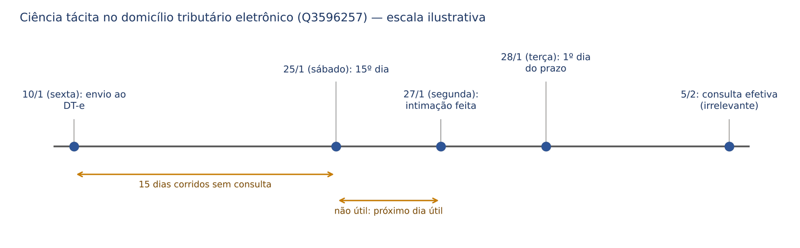
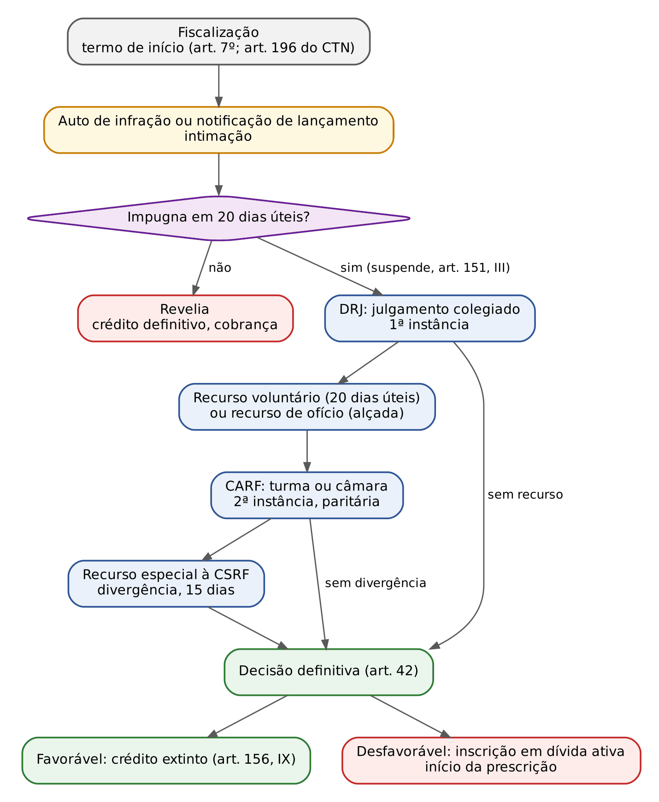
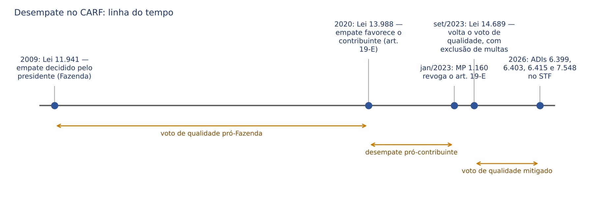
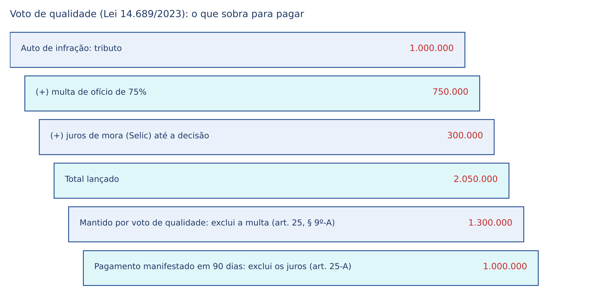
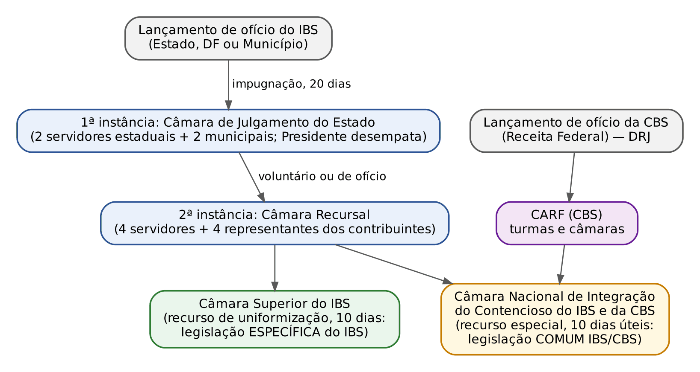

# CAPÍTULO 20 — PROCESSO ADMINISTRATIVO TRIBUTÁRIO: PRINCÍPIOS, CONSULTA, PROCEDIMENTO FISCAL E AUTO DE INFRAÇÃO, IMPUGNAÇÃO E RECURSOS, PROVA, DECISÃO E EFEITOS; PAF FEDERAL (DECRETO 70.235/1972, CARF E VOTO DE QUALIDADE), PAF DO RIO GRANDE DO SUL (LEI 6.537/1973) E DE SANTA CATARINA (LC 465/2009 E TRIBUNAL ADMINISTRATIVO TRIBUTÁRIO); CONTENCIOSO DO IBS E DA CBS

:::INCIDENCIA
TRF5 p. 15; TJRS p. 7, 8; TJSC p. 17, 24. Nível A. Lote: 16 questões (FGV 8, FCC 8), mais a Q3049409 (FGV 2024, TJSC, sobre o TAT).
Mais cobrado: efeitos da consulta, prazos e formas de intimação, efeito suspensivo da impugnação, recursos e órgãos (DRJ, CARF, CSRF, TAT/SC), prova e nulidades. NOVIDADES que ainda não aparecem no lote: LC 227/2026 (prazos federais em dias úteis e contencioso do IBS e da CBS) e LC 236/2026 (normas gerais de PAF no CTN, arts. 208-A a 208-J).
:::

| Subtema | FGV | FCC | Padrão de cobrança |
|---|---|---|---|
| Recursos e órgãos julgadores | 4 | 1 | quem julga o quê; recurso especial por divergência; recurso de ofício e alçada |
| Prazos e intimação | 0 | 4 | contar a data em que a intimação se considera feita (edital, DT-e, prazo em horas) |
| Prova, nulidade e custo da defesa | 2 | 0 | erro sanável no auto; gratuidade das diligências |
| Impugnação, efeito suspensivo e depósito prévio | 1 | 1 | impugnação suspende; depósito prévio é inconstitucional (SV 21) |
| Consulta | 1 | 1 | consulta tempestiva afasta multa e juros; cabe sobre classificação fiscal |
| Pagamento com redução de multa no curso do PAF | 0 | 1 | desconto condicionado à renúncia ao contencioso |

## 20.1 Para que serve o processo administrativo tributário

### 20.1.1 Procedimento x processo

O civilista está acostumado a ver o "processo" só no Judiciário. No direito tributário, a própria Administração apura e julga a legalidade de seus atos antes de qualquer ação judicial, em duas etapas que a doutrina separa com cuidado (James Marins, Hugo de Brito Machado Segundo):

| | Procedimento de fiscalização (fase oficiosa) | Processo administrativo tributário (fase litigiosa) |
|---|---|---|
| Natureza | inquisitório: o Fisco investiga | contencioso: há lide, partes e julgador |
| Começa com | termo de início, apreensão ou despacho aduaneiro | impugnação tempestiva do sujeito passivo |
| Contraditório | não há litígio; há deveres de colaboração e direito de ser informado do objeto | pleno (art. 5º, LV, da CF) |
| Produto | lançamento (auto de infração ou notificação) | decisão que mantém, reduz ou cancela o lançamento |
| Efeito sobre o crédito | constitui o crédito (Cap. 12) | suspende a exigibilidade enquanto pendente (art. 151, III; Cap. 13) |

A Constituição só garante contraditório e ampla defesa onde há "litigantes" (art. 5º, LV). Por isso o STF e o STJ sempre admitiram que a fiscalização seja inquisitória: o contribuinte não tem direito de "contraditar" cada intimação; terá, depois, a impugnação. O Decreto 70.235/1972 usa a mesma lógica: "A impugnação da exigência instaura a fase litigiosa do procedimento" (art. 14).

Também há processo administrativo sem auto de infração: consulta (20.3), restituição e manifestação de inconformidade contra a não homologação de compensação (Caps. 14 e 16).

### 20.1.2 Quem legisla: normas gerais no CTN e leis de cada ente

Não há uma "lei nacional do PAF". Cada ente regula o processo dos seus tributos: a União, pelo Decreto 70.235/1972 (decreto editado com força de lei e recepcionado como lei ordinária); o Rio Grande do Sul, pela Lei 6.537/1973; Santa Catarina, pela LC 465/2009; os Municípios, por suas leis. O fundamento é a competência concorrente em direito tributário (art. 24, I, da CF), com normas gerais por lei complementar (art. 146, III). PEGADINHA frequente: dizer que o PAF é "direito processual" de competência privativa da União (art. 22, I). Não é: é autocontrole da legalidade do lançamento pelo próprio ente; por isso o TAT/SC não está obrigado a seguir o regime recursal do CARF (Q3049409, alternativa E, errada).

A grande mudança veio com a LC 236/2026 (DOU de 4/9/2026), que pela primeira vez inseriu no CTN um capítulo de normas gerais de processo administrativo fiscal (arts. 208-A a 208-J). O desenho:

- objetivo declarado: assegurar devido processo legal, contraditório, ampla defesa e duplo grau (art. 208-A);
- duplo grau OBRIGATÓRIO para entes com mais de 100.000 (cem mil) habitantes, pelo último censo do IBGE (art. 208-A, §§ 1º e 2º): Município pequeno pode manter instância única;
- prazo de 2 anos para os entes adaptarem suas leis aos "critérios mínimos" dos arts. 208-A a 208-J; não o fazendo, esses artigos aplicam-se diretamente até que sobrevenha a lei local (art. 211-B e parágrafo único).

:::DICA Como ler as leis locais depois da LC 236/2026
Até 4/9/2028, a lei do ente continua regendo o seu PAF, mas já sob a orientação das normas gerais (que valem como "mínimo"). Regra mais protetiva da lei local (prazo de impugnação de 30 dias, por exemplo, maior que os 20 dias úteis do art. 208-D) tende a ser compatível com a norma geral; regra menos protetiva (recurso em 15 dias corridos) é a que precisa de adaptação. Essa leitura é interpretação desta apostila: ainda não há jurisprudência sobre o art. 211-B.
:::

A mesma LC 236/2026 também deu novo conteúdo ao art. 196 do CTN (documento prévio de início da fiscalização, 20.4.1) e positivou a vedação de garantia para recorrer (art. 151, § 2º; Cap. 13). Já a LC 227/2026 (13/1/2026) alterou o Decreto 70.235/1972 em prazos e contagem (20.8) e criou o contencioso do IBS (20.11).

### 20.1.3 O que muda para quem vem do processo civil

| Tema | No CPC | No PAF |
|---|---|---|
| Iniciativa e impulso | inércia; impulso oficial limitado | oficialidade: o julgador pode determinar diligências de ofício (art. 18 do Decreto 70.235; art. 69 da LC 227) |
| Verdade | prevalece a verdade dos autos, com ônus da prova | verdade material: busca-se o fato real, inclusive contra o Fisco |
| *Reformatio in pejus* | vedada no recurso exclusivo | não há vedação absoluta: agravamento exige lançamento complementar e reabertura de prazo (art. 18, § 3º; Cap. 12) |
| Controle de constitucionalidade | qualquer juiz, no caso concreto | vedado ao julgador administrativo, salvo exceções (art. 26-A; 20.2.3) |
| Custas e honorários | há | gratuidade; não há honorários (LC 465/2009, art. 49, parágrafo único) |
| Preclusão probatória | regra geral do art. 434 do CPC | prova documental com a impugnação, com exceções (20.5.3) |

## 20.2 Princípios

### 20.2.1 Contraditório, ampla defesa e duplo grau

Garantidos pelo art. 5º, LV, da CF e pelos arts. 208-A do CTN e 55 da LC 227/2026: intimação de cada documento juntado (art. 67, § 4º, e 71 da LC 227), nulidade por preterição do direito de defesa (art. 59, II, do Decreto 70.235) e dever de fundamentar (art. 208-F do CTN). O duplo grau passou a ser exigência legal acima de 100.000 habitantes, e a garantia como condição para recorrer é vedada (SV 21; art. 151, § 2º; Cap. 13).

### 20.2.2 Oficialidade, verdade material, formalismo moderado e gratuidade

A Administração tem o dever de rever o lançamento ilegal, ainda que o contribuinte não o peça (art. 208-H, *caput*: "deverá anular seus próprios atos"). Daí três desdobramentos:

- Oficialidade: o processo anda por impulso da Administração, e o julgador "não ficará adstrito às razões de fato ou de direito invocadas" (art. 69 da LC 227).
- Verdade material: autoriza diligências de ofício e prova posterior nas hipóteses legais, mas NÃO apaga a preclusão probatória (20.5.3).
- Formalismo moderado (ou informalismo a favor do administrado): atos valem se cumprirem a finalidade (art. 56 da LC 227); a "errônea denominação" da defesa ou do recurso não prejudica (art. 61); irregularidades que não causam prejuízo não geram nulidade (art. 60 do Decreto 70.235). Foi o fundamento da Q3363396 (abaixo).
- Gratuidade: a defesa administrativa não pode ser condicionada a pagamento. O STF consolidou a vedação de depósito ou arrolamento prévio para recorrer (SV 21; Cap. 13). Ponto sensível: a LC 465/2009 (SC) põe o custo da diligência ou perícia, "se houver", a cargo de quem a solicitar (art. 32, § 3º); condicionar a defesa ao pagamento de diligência feita pelos próprios servidores do Fisco é o que encontra resistência (Q2535772).

:::QUESTAO FGV 2025 — SEFAZ-PR — Auditor Fiscal (Q3363396)
Caso: auto de infração com erro na indicação da legislação aplicável, mas com elementos suficientes para determinar o crédito; processo já em julgamento de primeira instância. Gabarito D: a autoridade julgadora pode corrigir o erro de ofício, sem nulidade do auto. Fundamento: formalismo moderado; nulidade só por incompetência ou cerceamento de defesa (no plano federal, arts. 59 e 60 do Decreto 70.235; no CTN, art. 208-H, § 1º); se o autuado se defendeu dos FATOS descritos, o erro de capitulação não o prejudicou. Armadilhas: A (nulidade automática) e C (correção pela unidade lançadora "a qualquer tempo", o que ignoraria o contraditório e o art. 146 do CTN).
:::

:::QUESTAO FGV 2024 — MF — Auditor Federal de Finanças e Controle (Q2535772)
Caso: o Fisco condicionou a realização de perícia e diligências requeridas pelo contribuinte ao pagamento dos custos, embora executadas pelos próprios servidores. Gabarito oficial B, conferido no QConcursos em 22/10/2026 (a cobrança teria natureza de taxa, a ser fixada considerando o débito e o custo da atividade). GABARITO DISCUTÍVEL: a alternativa mais coerente com a gratuidade do contencioso e com a vedação de obstáculos financeiros à defesa (SV 21) é a E (o exercício do direito de defesa no processo sancionador não pode ser obstado pela exigência de pagamento pelas medidas de descoberta da verdade); além disso, taxa não pode ter como base o valor do débito (art. 145, § 2º, da CF; Cap. 2). Na prova, a banca pode repetir o raciocínio da taxa; em discursiva, sustente a E.
:::

### 20.2.3 Legalidade e o limite do julgador administrativo: vedação de declarar inconstitucionalidade

O julgador administrativo é órgão do Executivo e está vinculado à lei. Na União, é "vedado aos órgãos de julgamento afastar a aplicação ou deixar de observar tratado, acordo internacional, lei ou decreto, sob fundamento de inconstitucionalidade" (art. 26-A do Decreto 70.235), salvo lei já declarada inconstitucional por decisão definitiva plenária do STF ou objeto de dispensa da PGFN, súmula da AGU ou parecer do AGU aprovado pelo Presidente (§ 6º). Em Santa Catarina, a regra é parecida, com uma abertura maior: as câmaras do TAT podem apreciar inconstitucionalidade ou ilegalidade "reconhecida por entendimento manso e pacífico" do STF ou do STJ (art. 4º, parágrafo único, da LC 465/2009). No IBS, a vedação vem acompanhada do dever de seguir os provimentos vinculantes (art. 74, parágrafo único, da LC 227).

O CARF também consolidou essa limitação em súmula própria. Questões que dizem que o julgador "afasta a lei quando a inconstitucionalidade for alegada pelas partes" estão erradas (Q2510960, alternativa A).

### 20.2.4 Vinculação aos precedentes judiciais (art. 208-G)

Antes da LC 236/2026, a vinculação do julgador administrativo aos precedentes do STF e do STJ dependia de lei de cada ente (no CARF, do regimento interno). Agora é norma geral:

:::LEI CTN, art. 208-G (incluído pela LC 236/2026)
Art. 208-G. No âmbito do processo administrativo fiscal, têm efeito vinculante:
I – pronunciamentos do Supremo Tribunal Federal e do Superior Tribunal de Justiça com efeito vinculante no âmbito judicial, inclusive: a) súmulas vinculantes [...]; b) decisões transitadas em julgado proferidas pelo Supremo Tribunal Federal ou pelo Superior Tribunal de Justiça sob a sistemática da repercussão geral ou dos recursos repetitivos; c) decisões transitadas em julgado proferidas pelo Supremo Tribunal Federal em sede de controle concentrado de constitucionalidade [...];
II – resolução do Senado Federal que suspender a execução de lei [...];
III – decisões reiteradas e uniformes dos tribunais administrativos no âmbito dos entes federativos, consubstanciadas em súmulas.
§ 1º Não será lavrado auto de infração ou notificação de lançamento, negada impugnação, pedido de restituição ou recurso, nem serão inscritos em dívida ativa os créditos cuja constituição esteja fundada em matéria decidida de modo favorável ao sujeito passivo nos termos deste artigo.
:::

Três observações. Primeira: repetitivo e repercussão geral só vinculam depois do TRÂNSITO EM JULGADO (alínea b). Segunda: o inciso III dá força de lei nacional às súmulas dos tribunais administrativos, o que já ocorria no CARF (art. 25, § 13, do Decreto 70.235, incluído pela Lei 14.689/2023) e ocorre nas súmulas do TAT/SC (art. 27 da LC 465). Terceira: havendo suspensão nacional determinada pelo STF ou pelo STJ, o PAF sobre a mesma questão fica sobrestado automaticamente (art. 208-J).

:::SENTENCA Precedente vinculante ignorado no PAF
Onde entra: anulatória ou mandado de segurança contra lançamento lavrado ou mantido em contrariedade a tese favorável ao contribuinte fixada em repercussão geral ou repetitivo transitado em julgado. Fundamentar: além do mérito (a tese), o vício de legalidade do próprio ato, que violou o art. 208-G, § 1º, do CTN. Redação-modelo: "O lançamento foi mantido em contrariedade a tese firmada pelo Supremo Tribunal Federal em repercussão geral, já transitada em julgado, à qual a Administração estava vinculada por força do art. 208-G, I, b, e § 1º, do CTN; impõe-se sua anulação." Erro comum: tratar o PAF como instância que "podia" divergir do STF; depois da LC 236/2026, não podia.
:::

## 20.3 Consulta fiscal

### 20.3.1 Conceito e finalidade

Consulta é o pedido formal de interpretação da legislação tributária aplicável a FATO DETERMINADO, feito pelo sujeito passivo (ou por órgão público e entidade representativa de categoria econômica ou profissional, art. 46, parágrafo único, do Decreto 70.235). Não é processo contencioso: não há lançamento a impugnar. Serve à segurança jurídica: quem age conforme a resposta oficial não pode ser punido. Pode versar sobre qualquer dúvida de aplicação, inclusive classificação fiscal de mercadorias (art. 50 da Lei 9.430/1996), ponto cobrado na Q3154677. A disciplina geral da interpretação oficial (art. 107, §§ 1º a 3º, do CTN, incluídos pela LC 236/2026: solução de consulta vincula o órgão emissor e produz efeitos só para o consulente) está no Cap. 8.

### 20.3.2 Efeitos: o que a consulta faz e o que ela NÃO faz

| Efeito | Regra | Fonte |
|---|---|---|
| Afasta juros de mora e multa | só se formulada DENTRO DO PRAZO LEGAL de pagamento, enquanto pendente | CTN, art. 161, § 2º |
| Impede procedimento fiscal sobre a matéria | desde a apresentação até 30 dias após a ciência da decisão | Decreto 70.235, art. 48; LC 214, art. 323-C, I (IBS/CBS: até a ciência da resposta) |
| NÃO suspende o prazo de pagamento nem de declarações | o tributo retido ou autolançado deve ser recolhido no prazo | Decreto 70.235, art. 49; LC 214, art. 323-D |
| NÃO suspende a exigibilidade | consulta não está no art. 151 | Cap. 13 |
| Vincula a Administração | o tributo não é lançado contra quem age conforme a resposta, enquanto não revogada | Lei 9.430, art. 48, § 12; LC 214, art. 323-E |
| Mudança de entendimento | só alcança fatos geradores posteriores à ciência ou publicação da nova orientação | Lei 9.430, art. 48, § 12 |
| Recurso | não cabe recurso nem reconsideração; cabe recurso especial, sem efeito suspensivo, se houver soluções divergentes sobre a mesma matéria (30 dias) | Lei 9.430, art. 48, §§ 3º, 5º e 6º; LC 214, art. 323-F |

A combinação entre as duas primeiras linhas é o ponto de prova. A consulta afasta a MORA (juros e multa), mas não o dever de pagar: se a resposta for desfavorável, o tributo será pago sem penalidade se o recolhimento ocorrer no prazo fixado (no IBS e na CBS, 15 dias da ciência, art. 323-C, parágrafo único, da LC 214).

### 20.3.3 Consulta ineficaz

Não produz efeitos a consulta formulada (art. 52 do Decreto 70.235; LC 214, art. 323-D, parágrafo único): por quem já foi intimado a cumprir a obrigação ou está sob procedimento fiscal sobre a matéria; sobre fato já disciplinado em ato normativo publicado antes ou definido em disposição literal de lei; sobre fato definido como crime; sem descrição completa e exata do fato; e, no IBS e na CBS, a consulta protelatória e a que verse sobre inconstitucionalidade. Lógica: a consulta protege a dúvida razoável e anterior à fiscalização, não a estratégia para ganhar tempo.

### 20.3.4 Procedimento federal

Na Receita Federal, a consulta é solucionada em INSTÂNCIA ÚNICA (art. 48 da Lei 9.430/1996); os arts. 54 a 58 do Decreto 70.235 (duas instâncias) não se aplicam (art. 49 da Lei 9.430). No IBS e na CBS, a solução é emitida pelo CGIBS ou pela RFB, com minuta compartilhada para o outro órgão em 30 dias (aceitação tácita se houver silêncio) e, havendo divergência, deliberação do Comitê de Harmonização (art. 323-B da LC 214).

:::QUESTAO FGV 2025 — SEFAZ-RS — Auditor do Estado (Q3154677)
Caso: empresa com dúvida sobre a classificação de equipamento importado na NCM. Gabarito D (I e III corretas): cabe consulta à Receita Federal sobre classificação de mercadorias (art. 50 da Lei 9.430); a consulta eficaz impede multa e juros se protocolizada antes do prazo de recolhimento (art. 161, § 2º, do CTN). Armadilha: o item II, que negava a consulta sobre classificação por "ausência de previsão legal".
No mesmo sentido, sobre o art. 161, § 2º: Q3956688 (FCC 2026, SEFAZ-SP; gabarito B: não incidem juros nem penalidade, nem medida de garantia, se a consulta foi formulada dentro do prazo legal de pagamento; as alternativas erradas trocavam o marco temporal para "antes do auto de infração" ou "antes do fato gerador" e incluíam a atualização monetária). Correlatas: Q2510950 e Q4338775 (Cap. 14).
:::

## 20.4 Procedimento fiscal, auto de infração e intimação

### 20.4.1 Início da fiscalização

O procedimento fiscal federal começa (art. 7º do Decreto 70.235/1972):

- com o primeiro ato de ofício, escrito, praticado por servidor competente, cientificado o sujeito passivo ou seu preposto;
- com a apreensão de mercadorias, documentos ou livros;
- com o começo do despacho aduaneiro de mercadoria importada (Q2510959, item II, verdadeiro).

O início exclui a espontaneidade do sujeito passivo quanto aos atos anteriores e a dos demais envolvidos (§ 1º; art. 138, parágrafo único, do CTN; Cap. 10), por 90 dias prorrogáveis por qualquer ato escrito de prosseguimento (§ 2º, na redação da LC 227/2026; antes, 60 dias); sem prorrogação, o contribuinte readquire a espontaneidade.

A LC 236/2026 transformou em norma geral o que a Receita Federal já fazia com o Termo de Distribuição do Procedimento Fiscal (TDPF): todo procedimento de fiscalização será precedido de documento de início com objeto, período e prazo de duração (art. 196, §§ 2º a 4º, do CTN; texto e efeitos em 19.2.3). No plano federal, irregularidade na emissão ou prorrogação do TDPF não anula o lançamento (Súmula CARF 171); se o novo art. 196, § 2º, muda essa leitura é questão em aberto. Os limites materiais da fiscalização (sigilo, exame de livros, LC 105/2001) estão no Cap. 19.

### 20.4.2 Auto de infração e notificação de lançamento

No plano federal, a exigência do crédito e a penalidade isolada formalizam-se em auto de infração ou em notificação de lançamento, distintos para cada tributo, instruídos com "todos os termos, depoimentos, laudos e demais elementos de prova indispensáveis à comprovação do ilícito" (art. 9º do Decreto 70.235). A diferença:

| | Auto de infração (art. 10) | Notificação de lançamento (art. 11) |
|---|---|---|
| Quem lavra | servidor competente, no local da verificação da falta | órgão que administra o tributo (lançamentos internos, de massa) |
| Pressupõe | infração apurada em fiscalização | lançamento de ofício sem diligência externa (ex.: malha do IRPF) |
| Conteúdo | qualificação, local, data e hora, descrição do fato, dispositivo infringido e penalidade, exigência e intimação para pagar ou impugnar em 20 dias úteis, assinatura e matrícula | qualificação, valor e prazo, dispositivo infringido se for o caso, assinatura (dispensada se eletrônica) |

Os requisitos mínimos valem agora para todos os entes (art. 208-B do CTN; Cap. 12, 12.7.3). A representação fiscal para fins penais, que acompanha autos de infração com indício de crime, só é encaminhada ao Ministério Público depois da decisão administrativa final (Lei 9.430/1996, art. 83; Cap. 11); em Santa Catarina, após o trânsito em julgado administrativo (LC 465/2009, art. 48).

### 20.4.3 Intimação: como e quando se considera feita

A intimação do lançamento é condição de eficácia do lançamento (Cap. 12) e marco inicial do prazo de impugnação. No Decreto 70.235 (art. 23), os meios ordinários são o pessoal, o postal (com prova de recebimento no domicílio tributário eleito) e o eletrônico (domicílio tributário eletrônico, que depende de consentimento do sujeito passivo, § 5º), e "não estão sujeitos a ordem de preferência" (§ 3º). O edital é SUBSIDIÁRIO: cabe quando um dos meios ordinários resultar improfícuo ou quando a inscrição do sujeito passivo estiver declarada inapta (§ 1º; Súmula CARF 173). A Súmula CARF 110 afasta a intimação dirigida ao endereço do advogado, e a intimação postal recebida por preposto no domicílio fiscal é válida.

:::PROCESSO Quando a intimação se considera feita
| Meio | Decreto 70.235 (art. 23, § 2º) | LC 465/2009 (SC) | LC 227/2026 (IBS) |
|---|---|---|---|
| Pessoal | data da ciência ou da declaração de quem intimou | data da assinatura ou da cientificação eletrônica | — |
| Postal | data do recebimento; se omitida, 15 dias após a expedição | data indicada no AR | — |
| Eletrônico | 15 dias após o registro de entrega no domicílio eletrônico, ou antes, na data da consulta | data da consulta; se não houver, ao fim de 10 dias corridos do envio | 10 dias após o registro de entrega no DTE, se não houver consulta antes |
| Edital | 15 dias após a publicação | 15 dias após a publicação no DOE | — |
| Vício | comparecimento supre (CTN, art. 208-H, § 2º) | comparecimento supre e o prazo passa a fluir (art. 5º, § 1º) | comparecimento supre (art. 66, § 2º) |
:::

Contagem do prazo, depois de feita a intimação: exclui-se o dia do começo e inclui-se o do vencimento; os prazos só começam ou vencem em dia de expediente normal (art. 5º do Decreto 70.235; art. 208-D, §§ 3º e 4º, do CTN). Há agora uma suspensão anual dos prazos de 20/12 a 20/1, inclusive (art. 208-D, § 5º, do CTN; art. 5º-A do Decreto 70.235; art. 62, § 2º, da LC 227), que NÃO existe no TAT/SC, cujo recesso de janeiro "não suspende os prazos" (art. 14, parágrafo único, da LC 465/2009), regra que terá de ser revista à luz da norma geral.

:::QUESTAO FCC 2025 — SEFAZ-PI — Auditor Fiscal da Receita Estadual (Q3596257, Q3596255 e Q3596261)
Três casos da lei piauiense (não conferida), com a lógica do art. 23 do Decreto 70.235.
Q3596257: intimação enviada ao DT-e em 10/1/2025 (sexta) e consultada só em 5/2. Gabarito A, 28/1. Passos: 15 dias contados do envio levam a 25/1 (sábado); a intimação considera-se feita no primeiro dia útil, 27/1 (segunda); o prazo começa no dia útil seguinte, 28/1. A consulta tardia é irrelevante (ver figura). Armadilhas: 13/1 (primeiro dia útil após o envio) e 5/2 (data da consulta).
Q3596255: auto lavrado em 23/12/2024, às vésperas da decadência, com intimação pessoal; o contribuinte queria DT-e ou edital. Gabarito C (I e II): os meios NÃO têm ordem de preferência e a via pessoal para evitar a decadência é legítima; o item III errava o prazo de defesa.
Q3596261: intimação pessoal às 14h de uma segunda para apresentar documentos em 72 horas, com terça feriado. Gabarito C: o prazo fixado em horas começa de imediato e termina às 14h de quinta, contado minuto a minuto; não se exclui o feriado. Armadilha: aplicar a lógica dos prazos em dias (começar no dia útil seguinte).
:::

:::QUESTAO FCC 2026 — SEFAZ-SP — Auditor Fiscal da Receita Estadual (Q3956736)
Intimação de AIIM por edital no DOE de quarta, 16/4/2025, com feriados em 18 (sexta) e 21/4 (segunda). Gabarito D: intimação considerada feita em 25/4/2025 e prazo de defesa de 30 dias corridos. Os dias úteis seguintes à publicação são 17, 22, 23, 24 e 25/4: a data do gabarito corresponde ao quinto dia útil (regra da Lei paulista 13.457/2009 não conferida). Lição transponível: em edital, a intimação nunca se considera feita na data da publicação (no Decreto 70.235, 15 dias depois).
:::

## 20.5 Impugnação e prova

### 20.5.1 Prazo, forma e conteúdo

A impugnação é a "petição inicial" do contribuinte. Prazos, contados da intimação do lançamento: 20 dias em dias úteis na norma geral (art. 208-D, I e § 3º, do CTN), na União (art. 15 do Decreto 70.235, na redação da LC 227/2026, com efeitos desde a publicação, art. 182, III; antes, 30 dias) e no IBS (arts. 62 e 67, § 1º, da LC 227); 30 dias em Santa Catarina ("reclamação", art. 20, § 1º, da LC 465/2009) e no Rio Grande do Sul (art. 28 da Lei 6.537/1973).

A impugnação federal deve indicar a autoridade julgadora, a qualificação do impugnante, os motivos de fato e de direito e as provas, as diligências ou perícias pretendidas (com motivos, quesitos e, na perícia, o perito do impugnante, sob pena de o pedido ser tido como não formulado, art. 16, § 1º) e se a matéria foi levada ao Judiciário (art. 16; art. 208-E do CTN). Quem alega direito municipal, estadual ou estrangeiro deve provar-lhe o teor e a vigência, se o julgador o determinar (art. 16, § 3º), regra idêntica à do art. 376 do CPC.

Três consequências que caem em prova:

- Matéria não impugnada: considera-se não impugnada a matéria não contestada expressamente (art. 17); a parte não litigiosa é cobrada em autos apartados (art. 21, § 1º). No IBS, o montante reconhecido vai à cobrança administrativa (art. 67, § 5º, da LC 227). Para o crédito, a parte não impugnada torna-se definitiva e começa a correr a prescrição (Cap. 15).
- Revelia: não paga nem impugnada a exigência, declara-se a revelia; após 30 dias de cobrança amigável, o sujeito passivo é declarado devedor remisso e o processo segue para cobrança executiva (art. 21 do Decreto 70.235). No IBS, art. 73 da LC 227.
- Legitimidade: o sujeito passivo autuado não pode discutir, em nome de terceiro, o vínculo de responsabilidade atribuído a este; cabe ao próprio terceiro notificado impugnar tanto o crédito quanto o vínculo (Súmula CARF 172).

### 20.5.2 Efeito suspensivo, intempestividade e depósito prévio

A impugnação tempestiva instaura o contencioso e suspende a exigibilidade "imediatamente" (art. 208-C, I, do CTN; art. 151, III; desenvolvido no Cap. 13). Duas notas que ficam aqui:

- Intempestiva, não suspende nem mantém a suspensão (art. 68, § 2º, da LC 227). Se o contribuinte alega a tempestividade como preliminar, a peça sobe ao órgão julgador, que decide a questão (art. 68, § 3º, da LC 227; art. 35 do Decreto 70.235 para o recurso perempto). Em Santa Catarina, a perempção da reclamação não impede a inscrição em dívida ativa, mas o julgador pode apreciá-la nas hipóteses de cancelamento de ofício (art. 20, § 2º, da LC 465).
- Só suspende a impugnação que discute o LANÇAMENTO. A reclamação contra a exclusão de parcelamento não se enquadra no art. 151, III (STJ, REsp 1.372.368/PR, Rel. Min. Humberto Martins, 2ª Turma, j. 5/5/2015, Info 561).

No mesmo sentido do efeito suspensivo: Q2565249 (FGV 2024, TCE-PA; gabarito C), comentada no Cap. 13.

:::QUESTAO FCC 2026 — SEFAZ-SP — Auditor Fiscal da Receita Estadual (Q3917693)
Depósito prévio como requisito do recurso administrativo previsto em lei estadual. Gabarito A: inadmissível, e a exigência desafia RECLAMAÇÃO ao STF por contrariedade a súmula vinculante, após o esgotamento das vias administrativas (SV 21; art. 7º, § 1º, da Lei 11.417/2006). Armadilhas: D e E (admissível se prevista em lei estadual ou federal) e C (exigir declaração de inconstitucionalidade em controle abstrato: a súmula vinculante já obriga a Administração, art. 103-A da CF). A tese da SV 21 está no Cap. 13; o precedente do arrolamento como requisito de recurso está em 20.8.4.
:::

### 20.5.3 Prova: preclusão, exceções e diligências

A regra é a concentração: provas documentais vêm com a impugnação, sob pena de preclusão.

:::LEI CTN, art. 208-D, §§ 7º a 9º (incluídos pela LC 236/2026)
§ 7º O contribuinte deverá mencionar os motivos de fato e de direito que amparam seu pedido na primeira oportunidade de manifestação processual perante a Fazenda Pública.
§ 8º As provas documentais deverão ser apresentadas no momento indicado no § 7º deste artigo.
§ 9º A apresentação de novas provas ou de razões de direito poderá ocorrer posteriormente ao momento processual indicado no § 7º deste artigo, desde que: I – fique demonstrada a impossibilidade de sua apresentação oportuna, por motivo de força maior; II – refiram-se a fato ou a direito superveniente; ou III – destinem-se a contrapor fatos ou razões posteriormente trazidos aos autos.
:::

As mesmas três exceções estão no art. 16, § 4º, do Decreto 70.235, no art. 20, § 4º, da LC 465/2009 (SC) e no art. 67, § 2º, da LC 227 (IBS, que acrescenta "justa causa"). Na União, a juntada posterior é requerida por petição fundamentada (§ 5º) e, se a decisão de primeira instância já saiu, os documentos ficam nos autos para a segunda instância (§ 6º). Em Santa Catarina, o contribuinte pode apresentar razões complementares e documentos até a inclusão do recurso em pauta (art. 29, § 4º).

PEGADINHA: a verdade material é usada pelos tribunais administrativos para flexibilizar a preclusão (aceitar documento que prova o pagamento, por exemplo), mas a regra legal continua sendo a preclusão. Em questão objetiva, marque a literalidade das exceções.

Diligências e perícias: a autoridade julgadora as determina de ofício ou a requerimento, "indeferindo as que considerar prescindíveis ou impraticáveis" (art. 18 do Decreto 70.235; Q2510959, item III, verdadeiro), em decisão fundamentada, apreciada junto com o mérito (art. 28). O indeferimento motivado não configura cerceamento de defesa (Súmula CARF 163). A LC 465 lista as hipóteses de indeferimento: elementos suficientes nos autos, fatos ligados à escrita ou a documentos em poder do requerente, prova que não depende de conhecimento técnico, verificação prescindível ou impraticável (art. 34), e o indeferimento é reexaminado como preliminar no recurso.

Ônus da prova: no lançamento de ofício, cabe ao Fisco provar o fato gerador e a infração (o auto deve vir "instruído" com as provas, art. 9º). A inversão só ocorre quando a lei cria presunção legal relativa (exemplo clássico: depósitos bancários de origem não comprovada caracterizam omissão de receita, art. 42 da Lei 9.430/1996), hipótese em que o contribuinte deve provar a origem. Prova emprestada é admitida pela doutrina desde que submetida ao contraditório no PAF.

:::SENTENCA Preclusão administrativa e prova em juízo
Onde entra: ação anulatória ou embargos à execução fiscal em que o contribuinte traz documento que não apresentou (ou apresentou fora de prazo) no PAF. Fundamentar: a preclusão é administrativa e não vincula o Judiciário; o controle judicial é amplo (art. 5º, XXXV, da CF), e o juiz aprecia toda a prova produzida sob contraditório no processo judicial. Redação-modelo: "A preclusão probatória ocorrida no processo administrativo não impede a produção de prova em juízo, onde se exerce controle pleno da legalidade do lançamento." Erro comum: julgar improcedente a anulatória apenas porque o documento "deveria ter sido juntado na impugnação". Outro erro: tratar o revel administrativo como impedido de ir a juízo; a revelia só torna o crédito definitivo na esfera administrativa.
:::

### 20.5.4 Desistência, concomitância e pagamento com desconto

Opera-se a desistência do litígio administrativo expressamente ou tacitamente: pelo pagamento, parcelamento ou compensação do crédito em litígio, pela propositura de ação judicial sobre a mesma matéria e, no IBS, pela não apresentação tempestiva do recurso (art. 72 da LC 227; em Santa Catarina, art. 7º da LC 465, com arquivamento de ofício). A regra da concomitância (ação judicial com o mesmo objeto importa renúncia ao recurso administrativo; art. 208-E, parágrafo único, do CTN) está no Cap. 13; aqui, o detalhe: matéria DISTINTA da levada a juízo continua sendo julgada (art. 72, § 2º, da LC 227), e foi o que decidiu a Q3956737 (FCC 2026, SEFAZ-SP, correlata: mandado de segurança só sobre a exigência do comprovante no desembaraço não impede discutir a isenção no processo do AIIM).

Muitas leis estimulam o fim do litígio com redução da multa para quem paga cedo e renuncia ao contencioso. As reduções em normas gerais trazidas pela LC 236/2026 (art. 142, §§ 5º a 10, do CTN) estão no Cap. 11.

:::QUESTAO FCC 2026 — SEFAZ-SP — Auditor Fiscal da Receita Estadual (Q3956724)
AIIM de 20 milhões de reais por erro de alíquota, sem dolo. Gabarito B: a empresa pode pagar no prazo de 30 dias da notificação com desconto de 70% da multa de 35%, se confessar o débito de forma irretratável e renunciar ao contencioso (Lei paulista 6.374/1989, não conferida). Armadilhas: A (órgão julgador relevar multa por "equidade" sem previsão legal), C (depósito não extingue multa e juros), D (denúncia espontânea depois do AIIM: a espontaneidade já foi excluída, 20.4.1).
:::

## 20.6 Recursos

### 20.6.1 O mapa dos recursos

:::PROCESSO Qual recurso cabe
| Recurso | Contra o quê | Quem interpõe | Prazo | Efeito | Fonte |
|---|---|---|---|---|---|
| Recurso voluntário | decisão de 1ª instância desfavorável, total ou parcial | sujeito passivo | União: 20 dias úteis; norma geral: 20 dias úteis; SC: 15 dias; RS: 15 dias; IBS: 20 dias úteis | suspensivo | Decreto 70.235, art. 33; CTN, art. 208-D, II; LC 465, art. 29; Lei RS 6.537, art. 45; LC 227, arts. 75 e 78 |
| Recurso de ofício (remessa necessária) | decisão de 1ª instância favorável ao contribuinte acima da alçada | o próprio julgador, na decisão; se omitido, considera-se interposto | não há prazo para a parte | suspensivo (a decisão não é definitiva) | Decreto 70.235, art. 34; LC 465, art. 29, II e §§ 2º e 3º; LC 227, art. 77 |
| Recurso especial (divergência) | acórdão de 2ª instância que interpreta a lei de modo divergente de outro colegiado | contribuinte ou Fazenda | CSRF: 15 dias; CTN: 20 dias úteis; SC: 15 dias; CBS: 10 dias úteis | suspensivo | Decreto 70.235, art. 37, §§ 2º e 5º; CTN, arts. 208-C, IV, e 208-D, III; LC 465, art. 30 |
| Embargos de declaração (pedido de esclarecimento ou de retificação) | obscuridade, omissão, contradição ou erro material | qualquer parte | 5 dias | INTERROMPE o prazo dos demais recursos | CTN, arts. 208-C, § 1º, e 208-D, IV; LC 465, art. 31; LC 227, art. 80 |
| Recurso hierárquico ao Secretário ou Ministro | decisão definitiva FAVORÁVEL ao contribuinte | — | — | NÃO cabe | CTN, art. 208-C, § 2º |
| Pedido de reconsideração | decisão de 1ª instância | — | — | NÃO cabe (no PAF federal) | Decreto 70.235, art. 36 |
:::

### 20.6.2 Recurso voluntário

Cabe "total ou parcial, com efeito suspensivo", em 20 dias úteis da ciência da decisão (art. 33 do Decreto 70.235, na redação da LC 227/2026; antes, 30 dias). O que não for objeto do recurso torna-se definitivo (art. 42, parágrafo único). O recurso intempestivo (perempto) é, ainda assim, encaminhado à segunda instância, que julgará a perempção (art. 35): a primeira instância não tem juízo de admissibilidade que tranque o recurso. No IBS, o recurso parcial implica reconhecimento da parte não recorrida (art. 78, § 2º, da LC 227) e o recurso admitido devolve toda a matéria nele versada (§ 1º), como na apelação.

Os §§ 2º a 4º do art. 33 já exigiram arrolamento de bens (antes, depósito de 30%) para o recurso voluntário; o STF declarou essa exigência inconstitucional (20.8.4). O Planalto ainda exibe os §§ 3º e 4º com a nota "Vide ADIN 1.976-7": são letra morta.

### 20.6.3 Recurso de ofício

É a remessa necessária do PAF: a autoridade de primeira instância recorre de ofício sempre que a decisão exonerar o sujeito passivo de tributo e multa acima de valor fixado em ato do Ministro da Fazenda, ou deixar de aplicar pena de perdimento (art. 34). O recurso é interposto "mediante declaração na própria decisão"; se o julgador se omitir, o servidor que perceber o fato representa para que a formalidade seja cumprida (§§ 1º e 2º). Abaixo da alçada, NÃO há recurso de ofício (Q2510959, item I, falso porque dizia que não cabe "independentemente do montante").

Como na remessa necessária do art. 496 do CPC, há alçada e dispensa por precedente. No IBS, o recurso de ofício é a regra contra qualquer decisão contrária à Fazenda, considerado interposto *ex lege*, mas não cabe abaixo do limite nacional fixado pelo CGIBS, quando houver prova do recolhimento integral, na remissão, na retroatividade benigna da penalidade, em decisão unânime que seguiu provimento vinculante e no rito sumário (art. 77, § 3º). Em Santa Catarina, a alçada é de 10.000 (dez mil) reais cancelados, o julgador pode recorrer abaixo dela se a matéria for relevante, e o TAT tem o recurso "por havido" se o julgador não o interpôs (art. 29, II e §§ 2º e 3º, da LC 465).

### 20.6.4 Recurso especial e uniformização

A segunda instância julga fatos e direito; acima dela pode existir uma instância de uniformização, que só conhece divergência de interpretação. No CARF, é a Câmara Superior de Recursos Fiscais (CSRF), por recurso especial em 15 dias contra decisão que der à lei tributária interpretação divergente da de outra câmara, turma ou da própria CSRF (art. 37, § 2º, II, do Decreto 70.235). O recorrente deve indicar o acórdão paradigma e demonstrar a divergência analiticamente; recurso sem essa demonstração não é conhecido. O CTN passou a prever o recurso especial como norma geral "quando houver instância superior" (art. 208-C, IV), com prazo de 20 dias úteis (art. 208-D, III). Os 15 dias do art. 37, § 2º, não foram alterados pela LC 227: descompasso a ser resolvido na adaptação (art. 211-B).

No contencioso da CBS no CARF, o recurso especial à CSRF só cabe quanto à legislação ESPECÍFICA da contribuição, em 10 dias úteis (art. 37, § 5º, incluído pela LC 227); divergência sobre a legislação COMUM do IBS e da CBS vai à Câmara Nacional de Integração (20.11.4).

### 20.6.5 Embargos e vedação do recurso hierárquico

Até a LC 236/2026, os embargos de declaração no CARF tinham base apenas regimental; agora o CTN os garante em todos os entes, em 5 dias, com efeito interruptivo (arts. 208-C, § 1º, e 208-D, IV). Nos Estados, o nome muda: "pedido de esclarecimento" em Santa Catarina (art. 31 da LC 465, que interrompe o prazo do recurso especial) e no Rio Grande do Sul; "pedido de retificação" no IBS (art. 80 da LC 227, também com efeito interruptivo) e em São Paulo.

A outra novidade é o fim do "recurso hierárquico" contra a decisão do tribunal administrativo favorável ao contribuinte (art. 208-C, § 2º). A "instância especial" do Ministro da Fazenda (art. 26 do Decreto 70.235), herança dos Conselhos de Contribuintes, perde espaço contra decisão favorável ao sujeito passivo (20.7.2).

:::QUESTAO FGV 2024 — Câmara dos Deputados — Consultor Legislativo (Q2510960 e Q2510959)
Q2510960 (instâncias do Decreto 70.235): gabarito D, compete à CSRF julgar recursos especiais por divergência interpretativa entre os órgãos do CARF. Erradas: A (julgador afasta lei inconstitucional quando alegado: vedado pelo art. 26-A); B (DRJ paritária: só o CARF é paritário; a DRJ é órgão colegiado interno da Receita, art. 25, I); C (não cabem embargos: cabem, hoje por norma geral do CTN); E (ordem cronológica "irrelevantes o valor ou as circunstâncias": o art. 27 dá prioridade aos processos com indício de crime contra a ordem tributária ou de elevado valor).
Q2510959 (V ou F): gabarito C (F, V, V). O recurso de ofício depende de alçada; o procedimento pode começar com a apreensão de mercadorias ou o despacho aduaneiro (art. 7º); as diligências pedidas podem ser indeferidas se prescindíveis (art. 18).
:::

:::QUESTAO FGV 2024 — Prefeitura de Cuiabá — Auditor Fiscal (Q3158025 e Q3113982)
Duas questões sobre o processo municipal de Cuiabá (lei local não conferida), úteis pela lógica geral.
Q3158025: recurso especial ao Pleno do conselho municipal (CART) após duas decisões desfavoráveis. Gabarito D: o recurso deve indicar a decisão paradigma e demonstrar a divergência, sendo inadmissível sem demonstração precisa. Armadilhas: recurso ao Prefeito ou ao Procurador-Geral, ou "em qualquer fase" sem juízo de admissibilidade.
Q3113982: decisão de 1ª instância mantém a notificação. Gabarito A: cabe recurso ao conselho de recursos, com qualquer meio de prova admitido em direito, exceto a testemunhal. A lição: o PAF é essencialmente documental; a prova oral é exceção (ou vedada) nas leis locais.
:::

:::QUESTAO FCC 2026 — SEFAZ-SP — Auditor Fiscal da Receita Estadual (Q3955884)
Pedido de retificação contra decisão de Câmara do TIT por erro de fato (Lei paulista 13.457/2009, não conferida). Gabarito B (I e IV): o pedido é apresentado em 30 dias da intimação e é apreciado pelo próprio órgão que proferiu a decisão. Itens errados: II (suspensão ou interrupção dos demais prazos recursais, que a lei paulista não prevê, ao contrário do CTN e da LC 465) e III (admissibilidade pelo Delegado Tributário de Julgamento em decisões do Tribunal). Cuidado: na norma geral do CTN e nas leis de SC e do IBS, os embargos ou pedidos equivalentes têm 5 dias e INTERROMPEM o prazo; a pegadinha da FCC dependia da lei paulista.
:::

## 20.7 Decisão, nulidades e efeitos

### 20.7.1 Quando a decisão se torna definitiva

São definitivas as decisões (art. 42 do Decreto 70.235; art. 35 da LC 465/2009): de primeira instância, esgotado o prazo sem recurso voluntário (e não sujeitas a recurso de ofício); de segunda instância, quando não caiba recurso ou decorrido o prazo sem interposição; e de instância especial. Também é definitiva a parte da decisão de primeira instância não recorrida e não sujeita a recurso de ofício.

As decisões devem indicar "com clareza os pressupostos de fato e de direito" e ser publicadas (art. 208-F do CTN); na LC 227, a decisão não fundamentada é nula (art. 66, III).

### 20.7.2 Efeitos da decisão definitiva

| Resultado | Efeito no crédito | Efeito prático | Onde se aprofunda |
|---|---|---|---|
| Favorável ao contribuinte | extingue o crédito (art. 156, IX, do CTN) | a autoridade o exonera de ofício dos gravames do litígio (art. 45 do Decreto 70.235); a Fazenda não pode ir a juízo contra a própria decisão, salvo hipóteses excepcionais | Cap. 14 (REsp 1.608.161) |
| Desfavorável | crédito definitivamente constituído | prazo para pagar (SC: 15 dias, art. 36 da LC 465); inscrição em dívida ativa; começa a prescrição; nos crimes materiais, o lançamento definitivo permite a denúncia (SV 24) | Caps. 15, 19 e 11 |

A expressão "coisa julgada administrativa" significa irretratabilidade PARA A ADMINISTRAÇÃO: decidido definitivamente a favor do contribuinte, o Fisco não reabre a discussão (nem por recurso hierárquico, art. 208-C, § 2º, nem por revisão de ofício fora do art. 149 do CTN; Cap. 12). Para o contribuinte, ao contrário, nada é definitivo: a decisão desfavorável pode ser levada ao Judiciário (art. 5º, XXXV, da CF), que não está vinculado a ela.

Durante o PAF não corre decadência (obstada pelo lançamento notificado) nem prescrição, que começa com a constituição definitiva (Cap. 15).

### 20.7.3 Nulidades

| | Decreto 70.235 (arts. 59 a 61) | CTN (art. 208-H, LC 236/2026) | LC 227 (IBS, art. 66) |
|---|---|---|---|
| Nulos | atos lavrados por pessoa incompetente; despachos e decisões de autoridade incompetente ou com preterição do direito de defesa | atos de autoridade ou servidor incompetente; lançamentos sem fundamentação legal (dois incisos vetados) | atos de autoridade incompetente ou IMPEDIDA; preterição de defesa; decisões não fundamentadas; erro na identificação do sujeito passivo; intimações irregulares |
| Princípio do prejuízo | demais irregularidades não geram nulidade e são sanadas se prejudicarem o sujeito passivo (art. 60) | a nulidade só atinge atos dependentes (§ 3º) | irregularidades sem prejuízo não anulam (§ 12); nulidade arguida na primeira oportunidade, sob pena de preclusão (§ 8º) |
| Prioridade do mérito | se puder decidir o mérito a favor de quem aproveitaria a nulidade, não a pronuncia (art. 59, § 3º) | idem (§ 5º) | idem (§ 7º) |
| Quem declara | autoridade competente para praticar o ato ou julgar sua legitimidade (art. 61) | indica os atos atingidos (§ 4º) | idem (§ 5º); a parte não pode arguir nulidade a que deu causa (§ 6º) |

A LC 227 inovou ao listar impedimentos do julgador do IBS (autuante, quem participou de diligência ou respondeu consulta do contribuinte, quem tem vínculo com o sujeito passivo ou com o escritório do procurador; art. 66, § 9º) e ao salvar o lançamento com vários autuados quando um deles está corretamente identificado (§ 13).

Reflexo na decadência: anulado o lançamento por VÍCIO FORMAL, reabre-se o prazo de 5 anos para novo lançamento (art. 173, II, do CTN; Cap. 15). O vício material (erro na identificação do fato gerador, da base ou do sujeito passivo) não reabre prazo: o Fisco só relança se ainda estiver dentro do prazo original. Exemplo cobrado em jurisprudência: o lançamento com base de cálculo inconstitucional não pode ser "corrigido" pela troca do critério; anulado, o Fisco deve fazer novo lançamento, se ainda não decaído, e o contribuinte que pagou tem direito à restituição (STJ, AgInt no REsp 2.001.298/PR, Rel. Min. Benedito Gonçalves, 1ª Turma, j. 29/8/2022, Informativo Edição Especial 8).

### 20.7.4 Duração do processo e prescrição intercorrente

A razoável duração do processo vale também na via administrativa (art. 5º, LXXVIII, da CF), mas a sua violação não extingue o crédito tributário. O STJ nega prescrição intercorrente no PAF tributário por falta de previsão legal: o recurso suspende a exigibilidade durante todo o contencioso, e só da notificação da decisão final corre a prescrição (AgInt no REsp 2.109.509/RS, Rel. Min. Sérgio Kukina, 1ª Turma, j. 5/8/2025, Info 860). A Lei 9.873/1999, que prevê prescrição do procedimento paralisado por mais de três anos (art. 1º, § 1º), exclui expressamente os processos de natureza tributária (art. 5º).

PEGADINHA: a exclusão vale para crédito TRIBUTÁRIO. Multa aduaneira de natureza administrativa (não ligada à arrecadação do tributo), ainda que apurada em processo regido pelo Decreto 70.235, sujeita-se à prescrição intercorrente trienal da Lei 9.873/1999 (STJ, REsp 1.999.532/RJ, Rel. Min. Regina Helena Costa, 1ª Turma, j. 9/5/2023; REsp 2.120.479/SP, Rel. Min. Francisco Falcão, 2ª Turma, j. 27/8/2024, Info 827).

Em Santa Catarina, a demora no julgamento suspende juros e correção (20.10); no plano federal, o prazo de 360 dias da Lei 11.457/2007 (art. 24) repercute no ressarcimento (Cap. 16).

:::SENTENCA Anulatória ajuizada depois do PAF
Onde entra: ação anulatória (ou mandado de segurança dentro de 120 dias da ciência da decisão definitiva) contra crédito mantido pelo CARF ou pelo TAT. Fundamentar: (1) o juiz não atua como "instância recursal" do tribunal administrativo, mas controla a legalidade do lançamento com cognição plena, inclusive de prova nova; (2) a prescrição só começou com a decisão final (Cap. 15), o que afasta a alegação de prescrição pela demora do PAF; (3) eventual nulidade do PAF (cerceamento de defesa) só leva à anulação se houve prejuízo. Redação-modelo: "Inexiste prescrição intercorrente no processo administrativo fiscal (STJ, AgInt no REsp 2.109.509/RS); o prazo do art. 174 do CTN fluiu apenas da ciência da decisão administrativa definitiva." Erro comum: reconhecer prescrição "do lançamento" sem considerar o efeito suspensivo da impugnação.
:::

## 20.8 PAF federal: Decreto 70.235/1972, CARF, voto de qualidade e arrolamento

### 20.8.1 Estrutura de julgamento

| Instância | Órgão | Composição e características | Fonte |
|---|---|---|---|
| 1ª | Delegacias da Receita Federal de Julgamento (DRJ) | órgãos colegiados internos da Receita, só com auditores; NÃO paritárias | Decreto 70.235, art. 25, I |
| Pequeno valor | colegiado da DRJ julga em ÚLTIMA instância | lançamento ou controvérsia de até 60 salários mínimos; vinculação aos entendimentos do CARF | Lei 13.988/2020, art. 23 e parágrafo único |
| 2ª | Conselho Administrativo de Recursos Fiscais (CARF) | colegiado PARITÁRIO do Ministério da Fazenda: seções especializadas por matéria, câmaras e turmas; presidentes representantes da Fazenda, vice-presidentes dos contribuintes | art. 25, II e §§ 1º a 9º |
| Uniformização | Câmara Superior de Recursos Fiscais (CSRF) | turmas formadas pelo Presidente e Vice do CARF e pelos Presidentes e Vices das câmaras, respeitada a paridade | art. 25, §§ 3º, 7º e 8º |

Duas regras incluídas pela Lei 14.689/2023 que caem em prova: é assegurada ao procurador do sujeito passivo sustentação oral nos julgamentos colegiados da DRJ e do CARF (art. 25, § 12), e DRJ e CARF observam as súmulas do CARF (§ 13). Os conselheiros têm mandato, com reconduções limitadas pelo regimento, e podem perdê-lo por falta grave (§§ 10 e 11).

Prazos federais depois da LC 227/2026: ver 20.5.1 e 20.6.1; prazos sem previsão expressa, 10 dias úteis (art. 5º-B); demais prazos em dias corridos, salvo disposição em contrário (art. 5º, I).

### 20.8.2 Voto de qualidade: a evolução

O problema é aritmético: colegiados paritários empatam. Quem desempata? O § 9º do art. 25 do Decreto 70.235 (desde a Lei 11.941/2009) dá o voto de qualidade aos presidentes de turmas e câmaras, que são representantes da Fazenda.

- Lei 13.988/2020, art. 28: incluiu o art. 19-E na Lei 10.522/2002: em caso de empate no processo de determinação e exigência do crédito, NÃO se aplica o voto de qualidade, "resolvendo-se favoravelmente ao contribuinte". A inclusão ocorreu na conversão de medida provisória sobre transação, por emenda parlamentar, e foi atacada nas ADIs 6.399, 6.403 e 6.415 (alegação de "contrabando legislativo").
- MP 1.160/2023: revogou o art. 19-E (perdeu a vigência).
- Lei 14.689/2023: revogou definitivamente o art. 19-E e restabeleceu o voto de qualidade, com contrapartidas ao contribuinte.

:::LEI Decreto 70.235/1972, art. 25, § 9º-A, e art. 25-A, caput e §§ 1º e 8º (Lei 14.689/2023)
§ 9º-A. Ficam excluídas as multas e cancelada a representação fiscal para os fins penais de que trata o art. 83 da Lei nº 9.430, de 27 de dezembro de 1996, na hipótese de julgamento de processo administrativo fiscal resolvido favoravelmente à Fazenda Pública pelo voto de qualidade previsto no § 9º deste artigo.
Art. 25-A. Na hipótese de julgamento de processo administrativo fiscal resolvido definitivamente a favor da Fazenda Pública pelo voto de qualidade previsto no § 9º do art. 25 deste Decreto, e desde que haja a efetiva manifestação do contribuinte para pagamento no prazo de 90 (noventa) dias, serão excluídos, até a data do acordo para pagamento, os juros de mora de que trata o art. 13 da Lei nº 9.065, de 20 de junho de 1995.
§ 1º O pagamento referido no caput deste artigo poderá ser realizado em até 12 (doze) parcelas, mensais e sucessivas, corrigidas nos termos do art. 13 da Lei nº 9.065, de 20 de junho de 1995, e abrangerá o montante principal do crédito tributário.
§ 8º Se não houver opção pelo pagamento na forma deste artigo, os créditos definitivamente constituídos serão encaminhados para inscrição em dívida ativa da União em até 90 (noventa) dias e: I – não incidirá o encargo de que trata o art. 1º do Decreto-Lei nº 1.025, de 21 de outubro de 1969; e II – será aplicado o disposto no § 9º-A do art. 25 deste Decreto.
:::

Outras regras do art. 25-A: uso de prejuízo fiscal e base negativa de CSLL próprios ou do grupo (§ 3º) e de precatórios (§ 10); certidão de regularidade durante os 90 dias (§ 9º); benefício só para a parcela decidida pelo voto de qualidade (§ 7º).

:::EXEMPLO Quanto paga a empresa vencida pelo voto de qualidade
A Alfa Ltda. foi autuada em 1.000.000 (um milhão de) reais de IRPJ, com multa de ofício de 75% e juros. O CARF manteve tudo por empate, decidido pelo voto de qualidade.

Passos: (1) a multa cai por força de lei (750.000 reais) e a representação penal é cancelada; (2) se a Alfa manifestar o pagamento em 90 dias, caem também os juros até o acordo, e ela paga 1.000.000 de reais, em até 12 parcelas corrigidas pela Selic, podendo usar prejuízo fiscal; (3) se não optar, o crédito (tributo e juros, sem multa) é inscrito em dívida ativa em até 90 dias, SEM o encargo de 20% do Decreto-Lei 1.025/1969. Os números de juros são ilustrativos.
:::

Situação no STF (verificada em 22/10/2026 só em fontes secundárias): as ADIs 6.399, 6.403 e 6.415, contra o art. 19-E, tinham placar parcial noticiado de 5 votos a 1 pela validade da norma e retorno à pauta previsto para 26/8/2026; não localizei o resultado. A ADI 7.548, contra os arts. 1º e 17, II, da Lei 14.689/2023 (restabelecimento do voto de qualidade), relator o Min. Edson Fachin, também está pendente. Para a prova: a regra VIGENTE é o voto de qualidade do § 9º, mitigado pelo § 9º-A e pelo art. 25-A.

:::PEGADINHA
"Em caso de empate no CARF, o processo resolve-se em favor do contribuinte": era a regra do art. 19-E da Lei 10.522 (2020 a 2023), hoje REVOGADO. E "o voto de qualidade mantém integralmente multa e juros": errado, a multa é sempre excluída, e os juros, se houver opção de pagamento em 90 dias.
:::

### 20.8.3 Sustentação, súmulas e o controle judicial das decisões do CARF

Decisões do CARF favoráveis ao contribuinte não se anulam judicialmente por mera divergência interpretativa (Cap. 14). E decisões reiteradas do CARF NÃO são "práticas reiteradamente observadas" (art. 100, III, do CTN) que afastem multa e juros, pois o próprio Fisco autuava em sentido contrário (STJ, AREsp 2.554.882/SP, Rel. Min. Francisco Falcão, 2ª Turma, j. 21/5/2024, Info 814).

### 20.8.4 Arrolamento de bens (Lei 9.532/1997, arts. 64 e 64-A)

O arrolamento é um inventário de bens feito pela Receita para MONITORAR o patrimônio de grandes devedores, ainda durante o PAF. Não é penhora, não é garantia real e não torna o bem indisponível.

| Ponto | Regra | Fonte |
|---|---|---|
| Pressupostos | créditos de responsabilidade do sujeito passivo superiores a 30% do patrimônio conhecido e soma acima do piso legal (500.000 reais na lei, alterável pelo Executivo) | art. 64, caput e §§ 7º e 10 |
| Objeto | bens e direitos sujeitos a registro público, com prioridade aos imóveis, até o valor do crédito | art. 64-A |
| Publicidade | termo registrado sem custas no registro de imóveis, órgãos de registro de bens ou títulos e documentos; certidões de regularidade mencionam o arrolamento | §§ 5º e 6º |
| Alienação | PERMITIDA, mas o proprietário deve COMUNICAR a transferência, alienação ou oneração à unidade fazendária | § 3º |
| Sanção | alienar sem comunicar autoriza medida cautelar fiscal | § 4º; Lei 8.397/1992 (Cap. 22) |
| Fim | liquidado o crédito (ou garantido na execução), comunica-se o cancelamento aos registros | §§ 8º, 9º e 11 |

O arrolamento não é afetado pela suspensão da exigibilidade (Cap. 13) e não se confunde com requisito de recurso:

:::JURIS STF, ADI 1.976, j. 28/3/2007 (Informativo 461)
O STF declarou inconstitucional o art. 32 da MP 1.699-41/1998, convertida na Lei 10.522/2002, que deu nova redação ao art. 33, § 2º, do Decreto 70.235 para exigir, como condição do recurso voluntário, depósito de 30% e, depois, arrolamento de bens. A troca do depósito pelo arrolamento não mudou a substância: ambos criam obstáculo econômico ao direito de recorrer. O entendimento foi consolidado na SV 21 (Cap. 13).
:::

No mesmo sentido, aplicando o regime do art. 64 (cautelar fiscal só se a alienação ocorreu sem comunicação): Q3373905 (FGV 2025, TRF5, Juiz Substituto), comentada no Cap. 18. Lição dupla: arrolamento como requisito de recurso é inconstitucional (ADI 1.976; Q3049409, alternativa A); arrolamento como monitoramento patrimonial é válido.

## 20.9 PAF do Rio Grande do Sul (Lei 6.537/1973)

ATENÇÃO: o texto consolidado da Lei 6.537/1973 não pôde ser conferido em fonte oficial (nova tentativa no sistema Legis da Assembleia em 22/10/2026, sem acesso ao texto); os dados abaixo vêm de compilação privada (com alterações até a Lei 16.109/2024) e de Leandro Paulsen. Confira os números antes da prova do TJRS.

| Ponto | Regra | Fonte |
|---|---|---|
| 1ª instância | julgamento pelo Subsecretário da Receita Estadual ou por Auditores Fiscais designados (a lei ainda fala em Agentes Fiscais do Tesouro) | art. 36 |
| Instância única por valor | impugnações de autos de lançamento de até 3.850 UPF-RS são julgadas em primeira e única instância | art. 39-A |
| 2ª instância | Tribunal Administrativo de Recursos Fiscais (TARF), órgão colegiado paritário (Fazenda e contribuintes), com Câmaras e Tribunal Pleno; origem no antigo Conselho Estadual de Contribuintes (Lei RS 973/1950), renomeado pela Lei RS 3.694/1959 | arts. 49 a 55; Paulsen |
| Impugnação | 30 dias da notificação ou intimação | art. 28 |
| Recurso voluntário | 15 dias da intimação, com efeito suspensivo; intempestivo é recebido sem efeito suspensivo | arts. 44 a 46 |
| Recurso de ofício | da decisão de 1ª instância contrária à Fazenda, com exceções legais | art. 41 |
| Pedido de esclarecimento | 5 dias, contra decisão omissa, contraditória ou obscura | art. 58 |
| Pedido de reconsideração | 10 dias, contra decisão de Câmara que der provimento a recurso de ofício | art. 60, § 1º |
| Recurso extraordinário | contra decisão de Câmara tomada por voto de desempate do Presidente ou divergente de outra Câmara ou do Pleno | art. 63 |

Paralelo útil: no RS e em SC, a decisão por voto de desempate abre recurso ao órgão de cúpula.

## 20.10 PAF de Santa Catarina: LC 465/2009 e Tribunal Administrativo Tributário

A estrutura, os prazos e os recursos do TAT/SC estão desenvolvidos no Cap. 34 (34.3). Para a teoria comparada, guarde o que o distingue do modelo federal: a primeira instância é SINGULAR (Julgador de Processos Fiscais), e não colegiada como a DRJ; a segunda instância são Câmaras paritárias, com uma Câmara Especial de Recursos para uniformizar e editar súmulas; o tribunal é vinculado à Secretaria da Fazenda, mas pode apreciar inconstitucionalidade reconhecida por entendimento "manso e pacífico" do STF ou do STJ (art. 4º, parágrafo único), abertura que o art. 26-A do Decreto 70.235 não dá ao CARF; e a demora no julgamento, além de 24 meses no recurso ordinário e de 18 meses nas demais etapas, suspende juros e atualização monetária pelo excesso (art. 47), consequência que o PAF federal não conhece.

| | União (Decreto 70.235) | Santa Catarina (LC 465/2009) |
|---|---|---|
| Defesa inicial | impugnação, 20 dias úteis | reclamação, 30 dias, efeito suspensivo (art. 20) |
| 1ª instância | DRJ, colegiada | julgador singular |
| Recurso | voluntário, 20 dias úteis | ordinário, 15 dias; de ofício acima de 10.000 (dez mil) reais cancelados |
| Uniformização | CSRF, 15 dias | Câmara Especial, 15 dias, também contra decisão por voto de desempate |

:::QUESTAO FGV 2024 — TJ-SC — Juiz Substituto (Q3049409)
Afirmação correta sobre o contencioso perante o TAT/SC. Gabarito D: a fase contenciosa inicia-se com a reclamação contra a notificação fiscal, que suspende a exigibilidade (art. 20, caput e § 1º). As armadilhas (arrolamento prévio, ação judicial indiferente, vedação de súmulas, simetria obrigatória com o CARF) estão comentadas em 34.3.3; a da alternativa E remete a 20.1.2.
:::

## 20.11 Contencioso administrativo do IBS e da CBS

### 20.11.1 Base constitucional e divisão com o Cap. 33

A EC 132/2023 atribuiu ao CGIBS "decidir o contencioso administrativo" do IBS (art. 156-B, III, da CF) e permitiu a integração do contencioso do IBS e da CBS por lei complementar (art. 156-B, § 8º). A LC 227/2026 regulou o processo do IBS (arts. 54 a 102) e incluiu na LC 214/2025 a integração (arts. 323-G a 323-M). A estrutura do CGIBS está no Cap. 33.

### 20.11.2 Regras processuais do IBS (LC 227/2026)

- Objeto: lançamento de ofício, penalidades por obrigações acessórias, indeferimento de restituição e ressarcimento (art. 54).
- Dezesseis princípios expressos (art. 55) e processo integralmente eletrônico, em sistema do CGIBS (art. 57; Q4221444, FCC 2026, correlata, Cap. 33).
- Prazos em dias ÚTEIS, excluído o dia do começo; suspensão de 20/12 a 20/1; prazo residual de 10 dias; instabilidade do sistema por mais de 60 minutos entre 6h e 23h torna o dia não útil (art. 62).
- Intimação pelo DTE, com ciência tácita após 10 dias (art. 64).
- Impugnação em 20 dias, com todas as provas, sob pena de preclusão (art. 67).
- Recursos em 20 dias, com contrarrazões no mesmo prazo, e prazo EM DOBRO quando a vencida é a administração tributária (art. 75, §§ 1º e 2º): privilégio que o CTN geral não prevê.
- Rito sumário para créditos até o valor de alçada (no máximo 1.000 UPFs) ou de menor complexidade (restituição, exclusão de parcelamento, exclusão do Simples), em que a decisão de primeira instância é definitiva, ressalvados retificação, uniformização e recurso especial (art. 76).
- Provimentos vinculantes (art. 74): súmulas vinculantes, controle concentrado, resolução do Senado, repercussão geral e repetitivos transitados em julgado, súmulas do CGIBS e decisões da Câmara Nacional de Integração, "desde que ausentes fundamentos relevantes para distinção".

### 20.11.3 Órgãos de julgamento do IBS

| Instância | Composição | Competência | LC 227 |
|---|---|---|---|
| 1ª: 27 Câmaras de Julgamento virtuais (uma por Estado e DF) | 2 servidores do Estado e 2 dos Municípios daquele Estado (DF: 4), mais o Presidente, que só desempata; presidência alternada entre Estado e Municípios a cada exercício; SEM representantes dos contribuintes | impugnação e pedido de retificação | arts. 91 e 92 |
| 2ª: 27 Câmaras Recursais virtuais | 2 servidores estaduais, 2 municipais e 4 representantes dos contribuintes, mais o Presidente (servidor) que desempata | recurso voluntário e de ofício | arts. 93 e 94 |
| Uniformização: Câmara Superior do IBS | 4 servidores dos Estados e DF, 4 dos Municípios e DF, 8 representantes dos contribuintes, Presidente que desempata | recurso de uniformização (10 dias), incidente de uniformização, súmulas vinculantes | arts. 79, 81, 95 e 96 |

Julgadores: servidores de carreira com competência para lançar ou julgar; representantes dos contribuintes com experiência mínima e seleção pública; paridade entre os blocos estadual e municipal, ao menos 30% de mulheres e mandato de 2 anos, com recondução (arts. 89, 90 e 94, § 4º). A Fazenda é representada por procuradores ou auditores, conforme a lei de cada ente (art. 97).

### 20.11.4 CBS e a Câmara Nacional de Integração

A CBS, tributo federal, segue o Decreto 70.235 (DRJ e CARF), com recurso especial à CSRF limitado à legislação específica da CBS, em 10 dias úteis (art. 37, § 5º). O ponto de encontro dos dois tributos é a legislação COMUM (a LC 214/2025 rege IBS e CBS com as mesmas regras de incidência):

:::LEI LC 214/2025, art. 323-G, caput e § 4º (incluídos pela LC 227/2026)
Art. 323-G. Cabe recurso especial, no prazo de 10 (dez) dias úteis, contra decisão do CGIBS proferida por Câmara Recursal de Julgamento ou por Câmara de Julgamento de primeira instância no rito sumário, ou contra decisão de Câmara, turma de Câmara, turma extraordinária ou turma especial do Conselho Administrativo de Recursos Fiscais (Carf), que conferir à legislação comum do IBS e da CBS interpretação do direito divergente da que lhe tenha dado outra decisão desses órgãos de julgamento, com vistas a uniformizar a jurisprudência administrativa em matéria comum aos dois tributos.
§ 4º O recurso especial suspende a exigibilidade do crédito tributário.
:::

A Câmara Nacional de Integração do Contencioso Administrativo do IBS e da CBS tem 4 conselheiros fazendários da CSRF, 4 membros da Câmara Superior do CGIBS (2 estaduais e 2 municipais), 4 representantes dos contribuintes (2 do CARF e 2 do CGIBS) e um Presidente, alternado entre Fazenda Nacional e CGIBS, que só desempata (art. 323-G, §§ 1º e 8º). Suas decisões examinam só direito, não afastam lei por inconstitucionalidade e, publicadas no DOU, VINCULAM os órgãos julgadores da União e do CGIBS; não cabe recurso da inadmissão do recurso especial (§§ 5º e 6º).

Incidentes de uniformização (arts. 323-H a 323-L; no IBS específico, arts. 81 a 87 da LC 227):

| Incidente | Requisito | Quem suscita | Suspende a exigibilidade? |
|---|---|---|---|
| Matérias repetitivas | 5 decisões definitivas de câmaras (ou 3 da instância de uniformização), por maioria, em sessões distintas | Fazenda e presidentes de câmaras (NÃO o contribuinte) | NÃO |
| Decisão que deixou de aplicar provimento vinculante | indicação do provimento descumprido | Fazenda ou sujeito passivo | SIM |

O julgamento do incidente repetitivo fixa tese e gera SÚMULA com efeito vinculante, inclusive sobre impugnações e recursos pendentes ou futuros (art. 323-H, §§ 1º e 2º).

:::PEGADINHA Recurso de uniformização x recurso especial
Divergência sobre a legislação ESPECÍFICA do IBS: recurso de uniformização à Câmara Superior do IBS, em 10 dias (art. 79 da LC 227). Divergência sobre a legislação COMUM do IBS e da CBS: recurso especial à Câmara Nacional de Integração, em 10 dias úteis (art. 323-G da LC 214); o recurso de uniformização NÃO cabe nesse caso (art. 79, § 6º). Conflitos entre entes federativos, ou entre eles e o CGIBS, NÃO são contencioso administrativo: vão ao STJ (art. 105, I, da CF, na redação da EC 132/2023; Q3158447, Cap. 33).
:::

## 20.12 Resumo para revisão pré-prova

| Instituto | Regra | Exceções e detalhes | Fundamento |
|---|---|---|---|
| Normas gerais de PAF | arts. 208-A a 208-J do CTN (LC 236/2026) | entes têm 2 anos para adaptar; depois, aplicação direta; duplo grau obrigatório acima de 100.000 habitantes | CTN, arts. 208-A e 211-B |
| Vinculação a precedentes | SV, repercussão geral e repetitivos transitados, controle concentrado, resolução do Senado, súmulas administrativas | sobrestamento automático do PAF com suspensão nacional | CTN, arts. 208-G e 208-J |
| Inconstitucionalidade | julgador administrativo não afasta lei | exceção: declaração plenária definitiva do STF e atos da PGFN e AGU; em SC, entendimento manso e pacífico do STF ou STJ | Decreto 70.235, art. 26-A; LC 465, art. 4º |
| Consulta | tempestiva afasta juros e multa; impede fiscalização sobre a matéria; vincula a Administração | não suspende prazo de pagamento nem exigibilidade; ineficaz após início da fiscalização; sem recurso, salvo divergência | CTN, art. 161, § 2º; Decreto 70.235, arts. 48 a 52; Lei 9.430, art. 48 |
| Intimação | pessoal, postal ou eletrônica, sem ordem de preferência; edital subsidiário | eletrônica: 15 dias (União) ou 10 dias (IBS, SC) sem consulta; edital: 15 dias | Decreto 70.235, art. 23 |
| Prazos | dias úteis na norma geral, na União (impugnação e recurso) e no IBS | suspensão de 20/12 a 20/1; prazo em horas conta-se minuto a minuto | CTN, art. 208-D; Decreto 70.235, arts. 5º a 5º-B |
| Impugnação | 20 dias úteis (CTN, União, IBS); 30 dias (SC e RS); suspende a exigibilidade | intempestiva não suspende; matéria não impugnada é definitiva | CTN, arts. 151, III, e 208-C, I |
| Prova | documental com a impugnação | força maior, fato ou direito superveniente, contraposição | CTN, art. 208-D, §§ 7º a 9º; Decreto 70.235, art. 16, § 4º |
| Recurso voluntário | 20 dias úteis (União), efeito suspensivo; perempto sobe | SC e RS: 15 dias | Decreto 70.235, arts. 33 e 35 |
| Recurso de ofício | decisão exoneratória acima da alçada | IBS: regra contra qualquer decisão contrária à Fazenda, com exceções; SC: acima de 10.000 reais | Decreto 70.235, art. 34; LC 227, art. 77 |
| Recurso especial | divergência entre colegiados; CSRF em 15 dias | CBS: 10 dias úteis; SC: também por voto de desempate | Decreto 70.235, art. 37; LC 465, art. 30 |
| Decisão definitiva | sem recurso cabível ou esgotado o prazo | favorável: extingue o crédito; desfavorável: constituição definitiva | Decreto 70.235, arts. 42 e 45; CTN, art. 156, IX |
| Nulidades | incompetência, cerceamento de defesa, falta de fundamentação legal | prejuízo; prioridade do mérito; vício formal reabre decadência | Decreto 70.235, arts. 59 e 60; CTN, art. 208-H; art. 173, II |
| Prescrição intercorrente | não há no PAF tributário | multa aduaneira não tributária: 3 anos (Lei 9.873) | AgInt no REsp 2.109.509; REsp 2.120.479 |
| Voto de qualidade | presidente (Fazenda) desempata no CARF | exclui multas e representação penal; juros excluídos se houver pagamento em 90 dias; sem encargo do DL 1.025 | Decreto 70.235, arts. 25, §§ 9º e 9º-A, e 25-A |
| Arrolamento | créditos acima de 30% do patrimônio conhecido e do piso legal | não impede alienar; exige comunicação; sem ela, cautelar fiscal; não pode ser requisito de recurso | Lei 9.532, arts. 64 e 64-A; ADI 1.976 |
| TAT/SC | 1ª instância singular; Câmaras paritárias; Câmara Especial | reclamação 30 dias; recursos 15 dias; demora suspende juros e correção; detalhe no Cap. 34 | LC 465/2009 |
| TARF/RS | 1ª instância do Subsecretário ou designados; TARF paritário | instância única até 3.850 UPF-RS; recurso extraordinário | Lei 6.537/1973 (conferência secundária) |
| IBS | 1ª instância por Câmaras estaduais de servidores; 2ª paritária com contribuintes; Câmara Superior | prazos em dias úteis; prazo em dobro para a Fazenda; rito sumário | LC 227/2026, arts. 54 a 102 |
| Integração IBS/CBS | Câmara Nacional de Integração: legislação comum | recurso especial em 10 dias úteis, suspende a exigibilidade; decisões vinculantes | LC 214, arts. 323-G a 323-M |

## 20.13 Artigos de lei incidentes

- CF: arts. 5º, XXXIV, a, XXXV, LV e LXXVIII; 24, I; 103-A; 146, III; 156-B, III e § 8º.
- CTN: arts. 107, §§ 1º a 3º (Cap. 8); 138, parágrafo único; 145; 146; 149; 151, III e § 2º; 156, IX; 161, § 2º; 173, II; 174; 196 (redação da LC 236/2026); 208-A a 208-J; 211-B.
- Decreto 70.235/1972: arts. 5º, 5º-A, 5º-B (LC 227/2026); 7º; 9º a 11; 14 a 18; 21; 23; 25, §§ 9º, 9º-A, 12 e 13; 25-A; 26; 26-A; 27; 28; 33 a 37; 42; 45; 46 a 58; 59 a 62.
- Lei 9.430/1996: arts. 42, 48 a 50 e 83.
- Lei 9.532/1997: arts. 64 e 64-A.
- Lei 10.522/2002: art. 19-E (revogado).
- Lei 13.988/2020: arts. 23 e 28.
- Lei 14.689/2023: inclusão dos §§ 9º-A, 12 e 13 do art. 25 e do art. 25-A do Decreto 70.235.
- Lei 9.873/1999: arts. 1º, § 1º, e 5º.
- LC 214/2025: arts. 323-A a 323-M (incluídos pela LC 227/2026).
- LC 227/2026: arts. 54 a 102.
- LC 465/2009 (SC): arts. 4º, 5º, 7º, 14, 20, 29 a 32, 34, 35, 47, 48 e 49 (demais no Cap. 34).
- Lei 6.537/1973 (RS): arts. 28, 36, 39-A, 41, 44 a 46, 49 a 55, 58, 60 e 63.
- Lei 11.417/2006: art. 7º, § 1º.

## 20.14 Julgados, temas e súmulas do capítulo

- STF, ADI 1.976 (j. 28/3/2007, Info 461): arrolamento de bens como requisito de recurso voluntário é inconstitucional.
- STF, ADIs 6.399, 6.403 e 6.415: art. 19-E da Lei 10.522 (desempate pró-contribuinte); julgamento pendente na última notícia vista.
- STF, ADI 7.548: restabelecimento do voto de qualidade pela Lei 14.689/2023; pendente.
- STJ, REsp 1.372.368/PR (Info 561): reclamação contra exclusão de parcelamento não suspende a exigibilidade.
- STJ, AgInt no REsp 2.109.509/RS (Info 860): não há prescrição intercorrente no PAF tributário.
- STJ, REsp 1.999.532/RJ e REsp 2.120.479/SP (Info 827): multa aduaneira não tributária sujeita-se à prescrição intercorrente da Lei 9.873/1999.
- STJ, AgInt no REsp 2.001.298/PR (Info Edição Especial 8): lançamento com base inconstitucional exige novo lançamento, não correção.
- STJ, AREsp 2.554.882/SP (Info 814): decisões do CARF não são "práticas reiteradas" do art. 100, III, do CTN.
- Súmulas CARF 110, 163, 171, 172 e 173: intimação no endereço do advogado; indeferimento de perícia; TDPF; legitimidade para impugnar responsabilidade de terceiro; validade do edital.

- Remissões: SV 21 e Súmula 373 do STJ, efeito suspensivo e concomitância (Cap. 13); REsp 1.608.161 e decisão administrativa como causa de extinção (Cap. 14); Jurisprudência em Teses do STJ, ed. 70, tese 7, e art. 173, II (Cap. 15); art. 107 do CTN (Cap. 8); requisitos do auto de infração e revisão do lançamento (Cap. 12); representação fiscal para fins penais e SV 24 (Cap. 11 e Apostila de Direito Penal); Lei 11.457/2007, art. 24 (Cap. 16); cautelar fiscal e Q3373905 (Caps. 18 e 22); sigilo e dívida ativa (Cap. 19); CGIBS e conflitos federativos (Cap. 33); Lei 3.938/1966 e estrutura, prazos e recursos do TAT/SC (Cap. 34, 34.3).

:::NOTA Notas de verificação
- Conferido no Planalto em 22/10/2026: CTN, arts. 138, parágrafo único, 151, III e § 2º, 161, § 2º, 173, II, 174, § 1º (redações vigentes após a LC 236/2026, sem efeito sobre as explicações do capítulo), 196 e 208-A a 208-J e 211-B (LC 236/2026); Decreto 70.235/1972 (arts. citados, inclusive as alterações da LC 227/2026 e da Lei 14.689/2023); Lei 9.430/1996, arts. 48 a 50; Lei 9.532/1997, arts. 64 e 64-A; Lei 10.522/2002, art. 19-E (revogado pela Lei 14.689/2023); Lei 13.988/2020, art. 23; LC 227/2026, arts. 54 a 102; LC 214/2025, arts. 323-A a 323-M; CF, art. 156-B. LC 465/2009 conferida no sítio da SEF/SC (compilação com alterações até a LC 773/2021).
- Lei 6.537/1973 (RS): NÃO conferida em fonte oficial (o sistema Legis da Assembleia não devolveu o texto em 22/10/2026); dados de compilação privada (legisweb, via leitura automatizada) e de Paulsen.
- LC 227/2026: os novos prazos do Decreto 70.235 (arts. 7º, § 2º, 15 e 33, introduzidos pelo art. 173 da LC 227) produzem efeitos desde a publicação (art. 182, III, que só difere os arts. 52, §§ 4º e 5º, 76, II, c, e 169), conferido no Planalto em 22/10/2026. Tensão entre o art. 37, § 2º, do Decreto (15 dias) e o art. 208-D, III, do CTN (20 dias úteis) registrada sem solução jurisprudencial. A leitura do art. 211-B (lei local mais protetiva compatível) é interpretação da apostila.
- Voto de qualidade: resultado das ADIs 6.399, 6.403 e 6.415 (pauta de 26/8/2026) e da ADI 7.548 não localizado; informações só em notícias (soubrasilia.com, coad.com.br).
- Piso do arrolamento: a lei fixa 500.000 reais, alterável por decreto (Decreto 7.573/2011); valor atualizado não conferido.
- Gabarito discutível: Q2535772 (gabarito oficial B, reconferido no QConcursos em 22/10/2026; a alternativa juridicamente mais defensável é E). Questões de leis locais (SP: Q3956736, Q3956724, Q3955884; PI: Q3596255, Q3596257, Q3596261; Cuiabá: Q3158025, Q3113982; PR: Q3363396) explicadas pela lógica do gabarito, sem conferência das leis estaduais e municipais.
- Súmulas CARF citadas pelo resumo de PAF do Drive (até 23/1/2026), sem conferência no CARF.
- Fontes do Drive lidas: resumo "Processo administrativo fiscal", mapeamento FGV, revisão da LC 227 (sem trecho de contencioso). Não lidos (tamanho): Sinopse TJSC 2026, caderno Dizer o Direito, compilado TRF6 e Ricardo Alexandre.
:::
