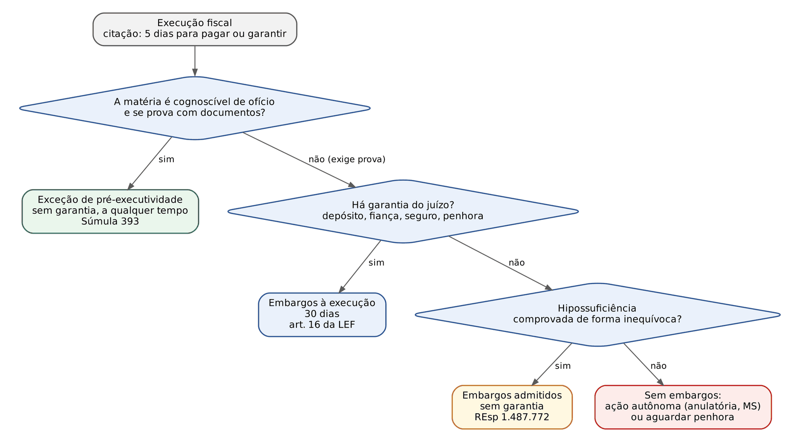
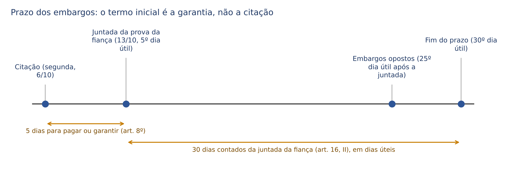
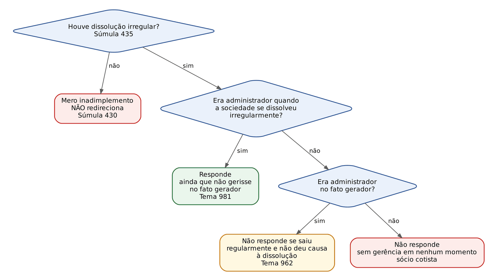
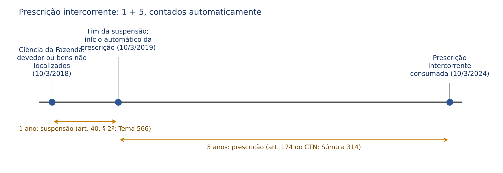
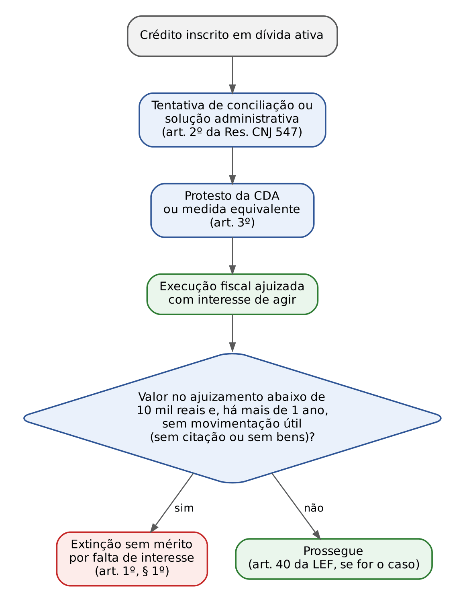
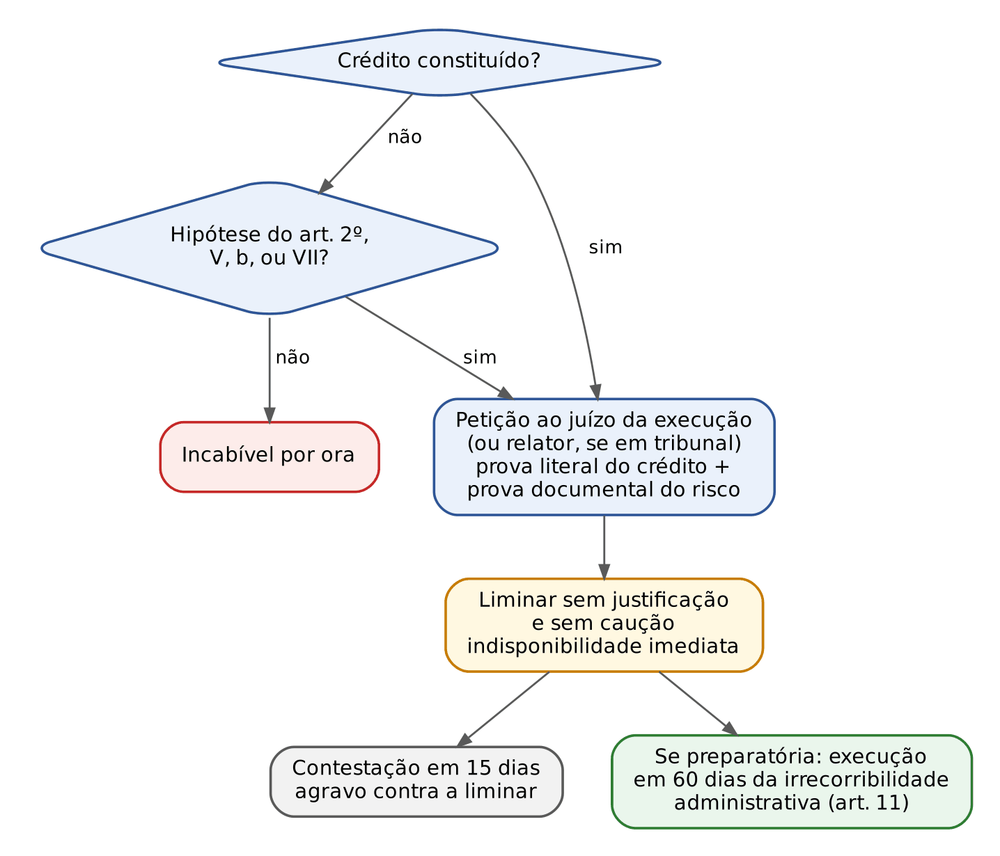

# CAPÍTULO 22 — EXECUÇÃO FISCAL II: DEFESAS (EMBARGOS E EXCEÇÃO DE PRÉ-EXECUTIVIDADE), REDIRECIONAMENTO, PRESCRIÇÃO INTERCORRENTE, SUSPENSÃO E EXTINÇÃO, EXECUÇÕES DE BAIXO VALOR, MEDIDAS EXTRAJUDICIAIS DE COBRANÇA, EXECUÇÃO FISCAL NA RECUPERAÇÃO JUDICIAL E MEDIDA CAUTELAR FISCAL

:::INCIDENCIA
TRF5 p. 16; TJRS p. 8; TJSC p. 18. Nível A+. Lote: 33 questões (FGV 28, FCC 5).
O que mais cai: redirecionamento por dissolução irregular (Súmula 435 e Temas 962 e 981 do STJ), prazo e garantia dos embargos, exceção de pré-executividade (Súmula 393), prescrição intercorrente automática (Tema 566 do STJ e Tema 390 do STF), Tema 1.184 do STF e a literalidade da Lei 8.397/1992.
:::

| Subtema | FGV | FCC | Padrão de cobrança |
|---|---|---|---|
| Redirecionamento (dissolução irregular, Temas 962 e 981) | 11 | 0 | caso com datas de entrada e saída de sócios e do fato gerador |
| Embargos: prazo, garantia, reconvenção, alçada | 5 | 0 | termo inicial (penhora, depósito, juntada da fiança); hipossuficiente |
| Exceção de pré-executividade e honorários | 4 | 0 | sócio na CDA; prescrição demonstrável de plano; homonímia |
| Prescrição intercorrente (art. 40) | 2 | 1 | início automático; peticionamento não interrompe |
| Baixo valor (Tema 1.184 do STF) | 3 | 1 | protesto e conciliação prévios; extinção de ofício |
| Recuperação judicial e falência | 1 | 0 | não suspensão; prescrição; constrições |
| Medida cautelar fiscal | 2 | 3 | art. 1º, parágrafo único; prazos de 15 e 60 dias; competência do relator |

## 22.1 Panorama: como o executado se defende

O Cap. 21 mostrou a execução fiscal do ponto de vista da Fazenda: a certidão de dívida ativa (CDA) como título, a citação para pagar ou garantir em cinco dias (art. 8º da LEF), a penhora e a expropriação. Este capítulo olha do outro lado da mesa: o que o executado pode fazer, quando a execução pode alcançar quem não está na CDA (o redirecionamento), como ela termina (prescrição intercorrente, extinção por baixo valor, pagamento, cancelamento da inscrição) e duas situações especiais (recuperação judicial e falência; medida cautelar fiscal).

Para o civilista, a diferença central: no CPC o executado embarga sem garantir o juízo (art. 914); na LEF, os embargos continuam condicionados à garantia (art. 16, § 1º). Daí a exceção de pré-executividade, para não obrigar a garantir execução manifestamente indevida, e a admissão de embargos sem garantia para quem não tem patrimônio. O mapa abaixo é o roteiro.

## 22.2 Embargos à execução fiscal

### 22.2.1 Natureza: ação, não contestação

Os embargos são ação de conhecimento incidental, autuada em apenso, em que o executado (embargante) pede a desconstituição total ou parcial do título ou da execução. A Fazenda é a embargada e é intimada para impugnar (art. 17). Tudo o que o juiz cível sabe sobre embargos do devedor vale aqui, com quatro adaptações da LEF: garantia como requisito, prazo de 30 dias contado da garantia, vedação de reconvenção e de compensação e efeitos próprios das prerrogativas fazendárias (intimação pessoal, art. 25; isenção de custas, art. 39).

:::LEI Lei 6.830/1980, art. 16
Art. 16 - O executado oferecerá embargos, no prazo de 30 (trinta) dias, contados:
I - do depósito;
II - da juntada da prova da fiança bancária ou do seguro garantia;
III - da intimação da penhora.
§ 1º - Não são admissíveis embargos do executado antes de garantida a execução.
§ 2º - No prazo dos embargos, o executado deverá alegar toda matéria útil à defesa, requerer provas e juntar aos autos os documentos e rol de testemunhas, até três, ou, a critério do juiz, até o dobro desse limite.
§ 3º - Não será admitida reconvenção, nem compensação, e as exceções, salvo as de suspeição, incompetência e impedimentos, serão argüidas como matéria preliminar e serão processadas e julgadas com os embargos.
:::

### 22.2.2 A garantia do juízo como condição de procedibilidade

A garantia pode ser depósito em dinheiro, fiança bancária, seguro garantia ou penhora de bens do executado ou de terceiro (art. 9º da LEF; modalidades e ordem no Cap. 21). Sem ela, os embargos são rejeitados liminarmente. Quando a Lei 11.382/2006 aboliu a garantia nos embargos do CPC/1973, discutiu-se se a mudança alcançaria a execução fiscal. O STJ respondeu que não, pelo princípio da especialidade.

:::JURIS STJ, Tema 526 (REsp 1.272.827/PE, Primeira Seção, Rel. Min. Mauro Campbell Marques, DJe 31/5/2013)
A nova redação do art. 736 do CPC/1973, que dispensou a garantia como condicionante dos embargos, não se aplica às execuções fiscais, diante do dispositivo específico do art. 16, § 1º, da LEF, que exige expressamente a garantia. No mesmo acórdão: o art. 739-A do CPC/1973 (hoje art. 919 do CPC/2015) aplica-se à execução fiscal, de modo que o efeito suspensivo dos embargos depende de garantia, relevância da fundamentação e perigo de dano grave (ver 22.2.6).
:::

A regra comporta três temperamentos, todos cobrados:

- Hipossuficiência comprovada. A Primeira Turma do STJ admitiu embargos sem garantia quando comprovado, de forma INEQUÍVOCA, que o devedor não tem patrimônio para garantir o crédito, sob pena de negar-lhe acesso à jurisdição; a Fazenda pode continuar buscando bens no curso do processo (REsp 1.487.772/SE, Rel. Min. Gurgel de Faria, DJe 12/6/2019).
- Gratuidade não basta. Ser beneficiário da justiça gratuita, por si só, não dispensa a garantia: a gratuidade isenta de despesas processuais, não de garantir a execução (REsp 1.437.078/RS; Jurisprudência em Teses, ed. 150, tese 8). O que dispensa é a prova da ausência de patrimônio, não o deferimento da gratuidade.
- Curador especial. O curador especial do executado citado por edital ou por hora certa (Súmula 196 do STJ) embarga sem garantir, porque seria um contrassenso exigir que garantisse, por iniciativa própria, em nome do revel (REsp 1.110.548/PB).

Garantia insuficiente: a insuficiência corrige-se por reforço no curso do processo, mas o reforço NÃO pode ser determinado de ofício (Tema 260 do STJ, REsp 1.127.815/SP: "O reforço da penhora não pode ser deferido ex officio"). Atenção ao número: o Tema 260 trata do REFORÇO DA PENHORA, não da exigência de garantia para embargar (que é o Tema 526).

:::QUESTAO FGV 2024 — TRF1 — Analista Judiciário (Q3028433)
Sócio-administrador executado por débitos federais de cerca de 4 milhões de reais opõe embargos e pede dispensa da garantia por não ter recursos. Gabarito: C (o juiz pode deferir o pedido, diante do alto valor da dívida, comprovada a impossibilidade econômica de oferecer garantia).
Por que não as outras: A trata a garantia como requisito "que não poderá ser dispensado" (ignora a mitigação); B exige gratuidade de justiça (a gratuidade não é o critério; é a prova da falta de patrimônio); D aplica o regime do CPC (garantia só para efeito suspensivo); E restringe a dispensa a fiança ou seguro.
No mesmo sentido: FGV 2025 — ENAM 2025.2 (Q3692401), primeiro item verdadeiro (ver 22.2.5).
:::

### 22.2.3 Prazo: 30 dias contados da garantia

O prazo é de 30 dias e o termo inicial é a GARANTIA, não a citação. Os três incisos do art. 16 correspondem às três formas de garantir:

| Garantia | Termo inicial | Detalhe jurisprudencial |
|---|---|---|
| Depósito em dinheiro | o depósito (I) | conta-se da intimação do depósito, após sua formalização e redução a termo (Jurisprudência em Teses, ed. 156, tese 9) |
| Fiança bancária ou seguro garantia | juntada da prova da garantia (II) | conta-se da intimação do executado acerca da aceitação do seguro garantia pelo juiz (REsp 2.185.262/RJ, j. 17/12/2024, Info 838) |
| Penhora | intimação da penhora (III) | data da efetiva intimação, não da juntada do mandado (Tema 131 do STJ); a primeira penhora abre o prazo, ainda que insuficiente ou excessiva (Tema 288 do STJ); recaindo sobre imóvel de executado casado, conta-se da intimação do cônjuge (Jurisprudência em Teses, ed. 156, tese 5) |

Dias úteis: o art. 219 do CPC aplica-se à contagem do prazo dos embargos (Enunciado 20 da I Jornada de Direito Processual Civil do CJF; o Enunciado 116 da II Jornada estende a regra a todos os prazos processuais da LEF). A intimação da penhora deve ser pessoal e advertir do prazo; o comparecimento espontâneo após a penhora não a substitui (Informativo 519 do STJ, citado no resumo de execução fiscal do Drive).

:::QUESTAO FGV 2026 — TJ-MS — Outorga de Delegações (Q3914505)
Citação numa segunda-feira, 6/10; no quinto dia útil (13/10), o executado junta a prova da fiança bancária; 25 dias úteis depois da juntada, opõe embargos. Gabarito: D (tempestivos e devem ser conhecidos, garantido o juízo pela fiança).
Passos: (1) o prazo de garantia é de 5 dias da citação (art. 8º): cumprido; (2) o prazo dos embargos corre da juntada da prova da fiança (art. 16, II), não da citação; (3) 25 dias úteis estão dentro dos 30. Armadilhas: contar o prazo da citação (A e B) e afirmar desnecessidade de garantia (E).
:::

:::QUESTAO FGV 2025 — Pref. Abreu e Lima — Procurador (Q3841702)
Prazo dos embargos segundo a LEF. Gabarito: C (30 dias, contados da intimação da penhora). No mesmo sentido: FGV 2024 — Pref. Cuiabá (Q3113978), gabarito C. Armadilhas: 15 dias (prazo do CPC, art. 915) e "contados da citação".
:::

### 22.2.4 Matérias de defesa, reconvenção e compensação

No prazo, o embargante deve alegar "toda matéria útil à defesa" (art. 16, § 2º): é a regra da eventualidade, como na contestação. Cabem matérias processuais (ilegitimidade, nulidade da CDA, incompetência, litispendência com anulatória), prejudiciais (decadência, prescrição) e de mérito (inexistência da relação jurídico-tributária, imunidade, isenção, pagamento, excesso de execução, inconstitucionalidade da lei). As exceções de suspeição, impedimento e incompetência seguem rito próprio; as demais "exceções" são arguidas como preliminar dos embargos (§ 3º). Os embargos são o veículo natural para o que exige PROVA: perícia contábil sobre a base de cálculo, testemunhas, exibição do processo administrativo (a CDA goza de presunção relativa de certeza e liquidez, art. 3º da LEF, e é do executado o ônus de trazer as peças do processo administrativo capazes de afastá-la; Jurisprudência em Teses, ed. 158, tese 1).

Não cabe nos embargos pedir que o juiz conceda remissão, transação ou parcelamento (o juiz não pode pronunciar de ofício a remissão da Lei 11.941/2008 sem ouvir a Fazenda: Tema 457 do STJ). Duas vedações expressas:

- Reconvenção. É vedada, sem ressalva (art. 16, § 3º). O executado que quer condenação da Fazenda (repetição, indenização) ajuíza ação própria. A FGV considerou FALSO o item do ENAM que admitia reconvenção "de modo estrito, para reparar dano causado pela cobrança" (Q3692401).
- Compensação. O embargante não pode pedir que o juiz compense, nos embargos, o crédito executado com crédito que ele tenha contra a Fazenda; pode, porém, alegar compensação JÁ realizada antes da execução, com os requisitos legais, para afastar a liquidez e a certeza da CDA (Tema 294 do STJ; v. Cap. 14).

### 22.2.5 Procedimento e recursos

Recebidos os embargos, a Fazenda é intimada para impugná-los em 30 dias (art. 17). Não há audiência se a matéria for de direito ou se a prova for só documental, e o juiz sentencia em 30 dias (art. 17, parágrafo único). Na execução por carta, os embargos são oferecidos no juízo deprecado, que os remete ao deprecante para julgamento, salvo se versarem sobre vícios dos atos do próprio deprecado (art. 20).

Recursos: da sentença, apelação, salvo nas execuções de valor igual ou inferior a 50 ORTN, em que só cabem embargos infringentes (para o próprio juízo, em 10 dias) e de declaração (art. 34). Os embargos infringentes de alçada SOBREVIVEM no sistema da LEF, mesmo depois de o CPC/2015 ter extinto os embargos infringentes de acórdão: foi o terceiro item, verdadeiro, da Q3692401. Constitucionalidade (Tema 408 do STF), valor de alçada e forma de cálculo (Temas 395 e 1.248 do STJ) e descabimento de MS (IAC no RMS 54.712/SP): v. Cap. 21.

:::QUESTAO FGV 2025 — ENAM 2025.2 (Q3692401)
Quatro afirmativas V/F. Gabarito: D (V – F – V – F).
(1) V: a lei condiciona os embargos à garantia, mas a jurisprudência os admite quando o executado não tem como garantir. (2) F: a reconvenção é vedada, sem exceção (art. 16, § 3º). (3) V: persistem os embargos infringentes de alçada (art. 34). (4) F: a Fazenda pode habilitar o crédito na falência, mas não CUMULAR a habilitação com constrições na execução fiscal (Tema 1.092 do STJ; v. Cap. 18).
:::

### 22.2.6 Efeito suspensivo, sentença e honorários

Os embargos à execução fiscal NÃO suspendem automaticamente a execução. O juiz pode atribuir efeito suspensivo, a requerimento do embargante, se presentes os requisitos do art. 919, § 1º, do CPC: garantia suficiente e requisitos da tutela provisória (relevância dos fundamentos e risco de dano). É a orientação do Tema 526 (22.2.2), mantida sob o CPC/2015. Dois pontos que o civilista costuma esquecer:

- mesmo sem efeito suspensivo, a conversão do depósito em renda e o levantamento da garantia só ocorrem após o trânsito em julgado (art. 32, § 2º, da LEF; Jurisprudência em Teses, ed. 159, tese 8). Na prática, o depósito fica parado até o fim;
- a apelação contra a sentença que rejeita os embargos tem efeito só devolutivo (art. 1.012, § 1º, III, do CPC), e a execução prossegue.

Honorários e encargos:

- Na execução da Dívida Ativa da União, o encargo legal do Decreto-Lei 1.025/1969 substitui os honorários, e a desistência dos embargos para aderir a parcelamento não gera nova condenação (Tema 400 do STJ; v. Cap. 21). O Tema 1.317 do STJ generalizou a solução: a extinção dos embargos por desistência ou renúncia para adesão a programa de recuperação fiscal em que a verba honorária já foi incluída "não enseja nova condenação em honorários" (REsps 2.158.358/MG e 2.158.602/MG; acórdão publicado, com recurso extraordinário pendente segundo o Radar). Na mesma linha, extinta a execução fiscal após adesão a parcelamento que já previa honorários administrativos, nova fixação é *bis in idem* (AREsp 2.523.152/CE, j. 21/5/2024, Info 813).
- Cancelada a CDA depois dos embargos, a Fazenda paga honorários (Súmula 153 do STJ; ver 22.7.3).

:::SENTENCA Embargos à execução fiscal: o esqueleto
Onde entra: é uma das peças típicas da prova prática (Cap. 35). Relatório: execução, garantia e data da intimação; teses do embargante; impugnação.
O que fundamentar, na ordem: (1) admissibilidade: tempestividade contada da garantia (art. 16) e existência da garantia ou dispensa fundamentada; (2) preliminares (nulidade da CDA, ilegitimidade); (3) prejudiciais (decadência e prescrição, Cap. 15); (4) mérito; (5) consectários: honorários contra a Fazenda (art. 85, §§ 3º e 5º, do CPC) ou, se vencido o embargante, observância do encargo legal na dívida da União; remessa necessária nos limites do art. 496 do CPC.
Redação-modelo: "Os embargos são tempestivos, pois opostos no 25º dia útil após a juntada da prova da fiança bancária (art. 16, II, da Lei 6.830/1980, c/c art. 219 do CPC), estando garantido o juízo (art. 16, § 1º). [...] Julgo procedentes os embargos para declarar extinto o crédito inscrito na CDA n. X, pela prescrição (art. 156, V, do CTN), e extinta a execução fiscal em apenso."
Erro que a banca pune: contar o prazo da citação; rejeitar os embargos do executado comprovadamente sem patrimônio apenas pela falta de garantia; apreciar pedido de compensação a ser feita em juízo; deferir de ofício reforço de penhora; condenar em honorários o contribuinte da União que desistiu para parcelar.
:::

## 22.3 Exceção de pré-executividade

### 22.3.1 Origem e requisitos

A exceção (ou objeção) de pré-executividade é criação doutrinária e jurisprudencial, sem previsão na LEF: simples petição nos autos da execução, sem garantia e sem prazo preclusivo, para levar ao juiz matéria que ele deveria conhecer de ofício. A lógica é a do processo civil: se o juiz pode extinguir de ofício uma execução sem título, sem legitimidade ou com crédito prescrito, não faz sentido obrigar o executado a garantir o juízo para lhe mostrar isso.

:::JURIS STJ, Súmula 393 (e Tema 104, REsp 1.104.900/ES)
A exceção de pré-executividade é admissível na execução fiscal relativamente às matérias conhecíveis de ofício que não demandem dilação probatória.
:::

Dois requisitos CUMULATIVOS:

1. Requisito material: matéria de ordem pública, cognoscível de ofício (condições da ação, pressupostos processuais, nulidade formal do título, decadência, prescrição, pagamento comprovado documentalmente segundo parte da jurisprudência, imunidade aferível de plano).
2. Requisito formal: prova pré-constituída, sem necessidade de dilação probatória. Se o juiz precisar de perícia ou testemunhas, a via é a dos embargos.

Matérias típicas: prescrição e decadência demonstradas por datas constantes dos autos; ilegitimidade passiva evidente (homonímia, executado que nunca foi sócio, imóvel já alienado antes do fato gerador com escritura registrada); nulidade da CDA por falta de requisito legal; crédito com exigibilidade suspensa antes do ajuizamento (depósito em anulatória, liminar: a execução proposta deve ser extinta; Tema 271 do STJ, Jurisprudência em Teses, ed. 156, tese 11); inconstitucionalidade já declarada pelo STF.

:::QUESTAO FGV 2026 — TJ-PE — Juiz Substituto (Q4349538)
Execução de IPTU contra a sociedade e seu administrador, cujo nome consta da CDA como corresponsável. O administrador apresenta exceção alegando falta de certeza e liquidez e prescrição, com documentos. Gabarito: B (a exceção deve ser acolhida se a prescrição puder ser verificada de plano, sem dilação probatória, por ser matéria cognoscível de ofício).
Armadilhas: A (o nome na CDA não afasta a presunção de liquidez; ao contrário, reforça a do corresponsável); C (o corresponsável na CDA não está impedido de usar a exceção para matéria de ordem pública demonstrável de plano; o que ele não pode é discutir por exceção a SUA responsabilidade quando isso exigir prova, Tema 108); D (prescrição pode ser reconhecida de ofício; Súmula 409 do STJ, Cap. 15); E (prescrição não exige "necessariamente" prova).
Correlata: FGV 2024 — SES-MT (Q2482651), item que negava a prescrição em exceção: falso (Cap. 15).
:::

### 22.3.2 O sócio que consta da CDA

Aqui está o ponto mais cobrado, e ele liga a exceção ao redirecionamento (22.5). A CDA goza de presunção de certeza e liquidez, que alcança também a indicação dos corresponsáveis: por isso, constando da CDA o nome do sócio, é dele o ônus de provar que não ocorreu nenhuma das hipóteses do art. 135 do CTN (Tema 103 do STJ; v. Cap. 21). A consequência processual é a deste capítulo:

:::JURIS STJ, Tema 108 (REsps 1.110.925/SP e 1.120.388/SP)
Não cabe exceção de pré-executividade em execução fiscal promovida contra sócio que figura como responsável na CDA.
:::

Leia o Tema 108 com o Tema 104 e a Súmula 393: o que não cabe por exceção é discutir a responsabilidade do sócio quando isso depender de prova (ele terá de provar que não agiu com excesso de poderes ou infração de lei, o que é dilação probatória). Se o sócio da CDA alega matéria de ordem pública demonstrável de plano, como a prescrição (Q4349538) ou a ilegitimidade documentalmente evidente (nunca integrou a sociedade), a exceção cabe.

| Situação do sócio | Quem prova o art. 135 | Via de defesa |
|---|---|---|
| Nome na CDA (corresponsável inscrito) | o SÓCIO (presunção da CDA; Tema 103) | embargos, com garantia; exceção só para matéria de ordem pública sem prova (Tema 108) |
| Nome fora da CDA, redirecionamento pedido no curso | a FAZENDA demonstra a hipótese do art. 135 (dissolução irregular, ato ilícito) | exceção, se a defesa for documental; embargos, se exigir prova |

:::QUESTAO FGV 2026 — AL-RO — Analista Legislativo (Q3883104)
Execução federal contra a sociedade e contra João, administrador à época dos fatos geradores e indicado na CDA; João apresenta exceção de pré-executividade e pede perícia. Gabarito: E (como o nome consta da CDA, presume-se a responsabilidade, e cabe a ele demonstrar, em embargos, que não agiu com excesso de poderes ou infração de lei, contrato ou estatuto).
Armadilhas: A (responsabilidade do sócio "exclusivamente de direito"); B (exigência de incidente prévio para incluir o corresponsável da CDA: ver 22.5.4); C (negar presunção à CDA); D (exclusão de ofício por falta de descrição individualizada da conduta).
:::

:::QUESTAO FGV 2026 — TJ-BA — Juiz Substituto (Q4083733)
Execução de ISS fundada em CDA que indicava, por engano, a legislação do IPTU; o executado alega a nulidade por exceção de pré-executividade; o juiz manda o Município sanar o erro e mantém a execução. Gabarito: E (agiu mal: a alteração do fundamento legal afeta elemento essencial do crédito e extrapola a correção de vícios formais autorizada pela LEF).
Dois pontos: (1) a via é adequada, porque a nulidade da CDA, aferível pelo próprio título, é matéria de ordem pública sem dilação probatória (afasta B); (2) o STJ fixou que não é possível à Fazenda, ainda que antes da sentença dos embargos, substituir ou emendar a CDA para incluir, complementar ou modificar o fundamento legal do crédito (Tema 1.350 do STJ, REsps 2.194.708/SC, 2.194.734/SC e 2.194.706/SC, j. 8/10/2025, Info 866): o erro está no lançamento, não na mera transcrição. Substituição da CDA e Súmula 392 do STJ: Cap. 21. Correlata: FGV 2026 — PGE-AC (Q4079409), gabarito C.
:::

### 22.3.3 Honorários na exceção

A exceção acolhida é decisão que põe fim, total ou parcialmente, à execução contra o excipiente; por causalidade, cabem honorários. O STJ fixou, em repetitivos, um sistema completo:

| Resultado da exceção | Honorários? | Base |
|---|---|---|
| Acolhida, extinguindo a execução | sim, contra a Fazenda | Tema 421 (REsp 1.185.036/PE): "É possível a condenação da Fazenda Pública ao pagamento de honorários advocatícios em decorrência da extinção da Execução Fiscal pelo acolhimento de Exceção de Pré-Executividade" |
| Acolhida só para excluir o excipiente do polo passivo (a execução prossegue) | sim (Tema 961), fixados por EQUIDADE (art. 85, § 8º, do CPC), porque não se estima o proveito econômico | Tema 961 (REsp 1.358.837/SP e outros, 2021); Tema 1.265 (REsps 2.097.166/PR e 2.109.815/MG, j. 14/5/2025, Info 850) |
| Acolhida por PRESCRIÇÃO INTERCORRENTE | NÃO, pela causalidade: a execução era devida quando proposta; quem deu causa à extinção foi o devedor sem bens | Tema 1.229 (REsps 2.076.321/SP, 2.046.269/PR e 2.050.597/RO, acórdão publicado em 15/10/2024) |
| Rejeitada | não há honorários (incidente sem sucumbência própria) | orientação corrente, citada no resumo do Drive |

:::QUESTAO FGV 2025 — TRF5 — Juiz Substituto (Q3373894)
Vladimir Filho é executado por imposto de renda devido por Vladimir Pai, por erro de homonímia parcial. Gabarito: D (pode alegar ilegitimidade passiva por embargos ou por exceção de pré-executividade; acolhida a defesa para extinguir a execução, a União paga honorários).
Por quê: a ilegitimidade é matéria de ordem pública e, no caso, demonstrável por documentos; a via é dupla. Armadilhas: "ilegitimidade ativa do executado" (A e B: o executado é sujeito passivo); exceção sem honorários (B e C, contra o Tema 421); garantia exigida "em todo e qualquer caso" (E).
:::

:::SENTENCA Decisão que acolhe exceção de pré-executividade
Onde entra: decisão nos autos da execução. Se extingue a execução, é sentença (apelação, art. 34 à parte); se só exclui um executado, é interlocutória (agravo de instrumento, art. 1.015, parágrafo único, do CPC).
Redação-modelo: "A prescrição é matéria cognoscível de ofício e está demonstrada pelas datas constantes da própria CDA e do despacho citatório, dispensada dilação probatória (Súmula 393 do STJ). Acolho a exceção e julgo extinta a execução (art. 924, V, do CPC; art. 156, V, do CTN). Condeno a exequente em honorários (Tema 421 do STJ), nos percentuais do art. 85, § 3º, do CPC."
Erro comum: rejeitar a exceção por "exigir garantia"; acolher exceção do sócio inscrito na CDA sobre ausência de ato ilícito que depende de prova (Tema 108); fixar honorários por percentual do valor da execução quando apenas se exclui o excipiente (Tema 1.265: equidade).
:::

## 22.4 Ações autônomas e embargos de terceiro

Apesar da literalidade do art. 38 da LEF, o depósito não é condição da anulatória, mas faculdade para suspender a exigibilidade (Tema 241 do STJ); proposta a ação autônoma antes da execução, sem suspensão da exigibilidade, a execução pode ser ajuizada e as demandas se conectam; com depósito integral ou liminar anterior, a execução deve ser extinta (Tema 271). Ações do contribuinte: Cap. 23. Embargos de terceiro: Caps. 18 e 21.

## 22.5 Redirecionamento da execução fiscal

### 22.5.1 O que é redirecionar

Redirecionar é incluir no polo passivo de execução fiscal já proposta contra a pessoa jurídica um terceiro que responde pelo crédito, tipicamente o sócio-gerente ou administrador (art. 135, III, do CTN), mas também o sucessor (arts. 132 e 133) ou outra pessoa com responsabilidade legal. Não se emite nova CDA nem se lança de novo: a execução prossegue contra o responsável, que é citado e passa a ser executado. A responsabilidade de direito material (quem responde, por quê, em que medida) é do Cap. 10, que fixou duas premissas que aqui só se aplicam:

- a responsabilidade do administrador pelo art. 135 é PESSOAL e decorre de ato com excesso de poderes ou infração de lei, contrato ou estatuto;
- o mero inadimplemento não basta (Súmula 430 do STJ; ver Cap. 10).

A pergunta deste capítulo é processual e prática: em que situações concretas o juiz defere o redirecionamento, contra quem, por qual procedimento e como o redirecionado se defende.

### 22.5.2 Dissolução irregular: a principal hipótese

A sociedade que encerra as atividades sem liquidação regular (sem apurar o ativo, pagar o passivo na ordem legal e dar baixa nos registros) frustra os credores, a Fazenda entre eles. O STJ vê nisso infração de lei imputável a quem a administrava, e criou uma presunção para facilitar a prova:

:::JURIS STJ, Súmula 435
Presume-se dissolvida irregularmente a empresa que deixar de funcionar no seu domicílio fiscal, sem comunicação aos órgãos competentes, legitimando o redirecionamento da execução fiscal para o sócio-gerente.
:::

Como funciona na prática:

- O fato-indício é a certidão do oficial de justiça de que a empresa não funciona mais no endereço cadastrado, sem comunicação de mudança à Junta Comercial e ao Fisco. A certidão deve ser circunstanciada (diligência no local, informação de vizinhos, imóvel desocupado ou ocupado por outra empresa); carta de citação devolvida, isoladamente, é indício mais frágil.
- A presunção é RELATIVA: o sócio pode demonstrar que a sociedade mudou de endereço comunicando os órgãos, que encerrou regularmente, que está em recuperação judicial ou falência (a falência é forma legal de dissolução e não autoriza, por si, o redirecionamento; Cap. 18).
- A dissolução irregular autoriza o redirecionamento também na execução de dívida ativa NÃO tributária (multa administrativa, por exemplo), por infração ao dever legal de liquidar regularmente a sociedade (Tema 630 do STJ, REsp 1.371.128/RS: "Em execução fiscal de dívida ativa tributária ou não-tributária, dissolvida irregularmente a empresa, está legitimado o redirecionamento ao sócio-gerente").

:::QUESTAO FGV 2024 — Pref. São José dos Campos — Técnico Tributário (Q2375620)
Concessionária dissolvida em 2019 sem formalidades; execução ajuizada dois anos depois; a empresa não é localizada no endereço informado à Junta Comercial. Gabarito: C (presume-se dissolvida irregularmente a empresa que deixou de funcionar no domicílio fiscal sem comunicação, o que legitima o redirecionamento ao sócio-gerente: Súmula 435).
Armadilhas: A (exigir que Caio fosse gerente no fato gerador: contraria o Tema 981, 22.5.3); B (responsabilidade a partir do mero inadimplemento: Súmula 430); D (negar a presunção); E (transferir ao Fisco o dever de atualizar os registros da empresa).
No mesmo sentido: FGV 2024 — TCE-PA (Q2564266), gabarito D (João, sócio e administrador, responde porque presumida a dissolução irregular); FGV 2024 — Câmara de Fortaleza (Q2450558), gabarito A (redirecionamento correto, com o detalhe de que a inclusão do sócio NÃO depende de seu nome constar da CDA: alternativa B errada).
:::

### 22.5.3 Contra quem: Temas 962 e 981 do STJ

A dissolução irregular é um ato que acontece em determinado momento. Quem responde por ela? Durante anos as Turmas do STJ divergiram: uma exigia que o sócio fosse gerente tanto no fato gerador quanto na dissolução; outra bastava a gerência na dissolução. A Primeira Seção resolveu a questão em dois repetitivos, que se completam:

:::JURIS STJ, Tema 962 (REsp 1.377.019/SP, Primeira Seção, j. 24/11/2021)
O redirecionamento da execução fiscal, quando fundado na dissolução irregular da pessoa jurídica executada ou na presunção de sua ocorrência, não pode ser autorizado contra o sócio ou o terceiro não sócio que, embora exercesse poderes de gerência ao tempo do fato gerador, sem incorrer em prática de atos com excesso de poderes ou infração à lei, ao contrato social ou aos estatutos, dela regularmente se retirou e não deu causa à sua posterior dissolução irregular, conforme art. 135, III, do CTN.
:::

:::JURIS STJ, Tema 981 (REsp 1.645.333/SP, Primeira Seção, j. 25/5/2022)
O redirecionamento da execução fiscal, quando fundado na dissolução irregular da pessoa jurídica executada ou na presunção de sua ocorrência, pode ser autorizado contra o sócio ou o terceiro não sócio, com poderes de administração na data em que configurada ou presumida a dissolução irregular, ainda que não tenha exercido poderes de gerência quando ocorrido o fato gerador do tributo não adimplido, conforme art. 135, III, do CTN.
:::

A lógica é coerente com a natureza da responsabilidade: o ilícito que justifica o redirecionamento é a DISSOLUÇÃO IRREGULAR, não o fato gerador nem o inadimplemento. Logo, responde quem administrava no momento do ilícito. Quem saiu antes, regularmente (com alteração contratual registrada), não praticou o ilícito. Quem entrou depois do fato gerador, mas estava na administração quando a empresa sumiu, praticou-o.

Três observações de precisão:

- "Sócio ou terceiro não sócio": o critério é a gerência, não a qualidade de sócio. O administrador não sócio responde; o sócio cotista sem poderes de gestão, não.
- O Tema 962 ressalva quem tenha praticado, ao tempo do fato gerador, ato com excesso de poderes ou infração de lei (por exemplo, sonegação com fraude): esse responde pelo ATO PRÓPRIO, com fundamento autônomo no art. 135, independentemente da dissolução.
- A retirada tem de ser REGULAR. Saída "de fachada", com a gestão de fato mantida, não aproveita ao ex-sócio; a prova de que continuou administrando é da Fazenda.

:::EXEMPLO Padaria Trigo Bom Ltda.
ICMS de 2020 não pago. Administradores: Ana (de 2018 a 2021, quando cedeu suas quotas por alteração contratual registrada), Bruno (de 2018 até hoje) e Carla (desde 2022). Em 2024, o oficial certifica que a padaria não funciona mais no endereço, sem comunicação à Junta. Davi, irmão de Bruno, é sócio quotista desde a fundação, sem poderes de gerência.
Resolução: presume-se a dissolução irregular em 2024 (Súmula 435). Respondem Bruno (gerente no fato gerador e na dissolução) e Carla (gerente na dissolução, ainda que não no fato gerador: Tema 981). Não responde Ana (saiu regularmente antes da dissolução e não lhe é imputado ato ilícito ao tempo do fato gerador: Tema 962). Não responde Davi (sócio sem gerência em momento algum).
:::

:::QUESTAO FGV 2025 — TRF3 — Juiz Federal Substituto (Q3179563)
Pediu-se a alternativa correta sobre redirecionamento por dissolução irregular. Gabarito: E (pode ser redirecionado contra o sócio com poderes de administração na data da dissolução irregular ou de sua presunção, tenha ou não exercido gerência no fato gerador).
Armadilhas: A (redirecionamento com base nas garantias do art. 183 contra quem se retirou regularmente: contraria o Tema 962); B (exigir gerência "concomitante" no fato gerador e na dissolução: era a tese vencida); C (é parcialmente correta, mas o advérbio "somente" a torna incompleta diante de E, que descreve as duas situações cobertas); D (nega que a dissolução irregular autorize o redirecionamento).
:::

:::QUESTAO FGV 2026 — PGE-AC — Procurador do Estado (Q4079417)
Empresa não localizada no endereço cadastral; ativos financeiros e registros sem bens; João, gerente à época do fato gerador, comprova retirada regular antes da tentativa frustrada de citação; pedido de parcelamento indeferido; a Fazenda pede redirecionamento a João e indisponibilidade. Gabarito: D (a não localização autoriza a presunção de dissolução irregular, mas não o redirecionamento ao ex-sócio que se retirou regularmente antes dela).
Armadilhas: A (gerência no fato gerador basta: Tema 962 diz que não); B (pedido de parcelamento, ainda que indeferido, interrompe a prescrição: Súmula 653 do STJ, Caps. 13 e 15); C (indisponibilidade sem prévia tentativa de constrição: Súmula 560, Cap. 18); E (qualquer ex-sócio).
No mesmo sentido: FGV 2026 — TJ-MS (Q3914320), gabarito E (Tício, gerente no fato gerador que saiu regularmente antes da dissolução, só responde se provado ato próprio com excesso de poderes ou infração; o inadimplemento não basta); FGV 2024 — SES-MT (Q2482652), gabarito B (reprodução da tese do Tema 962).
:::

:::QUESTAO FGV 2025 — TCE-PE — Procurador (Q3592179)
O sócio administrador incluído após a dissolução irregular alega, em exceção, que os débitos são anteriores ao seu ingresso. Gabarito: D (redirecionamento cabível contra o sócio com gerência na dissolução irregular, ainda que não participasse da gestão no fato gerador). No mesmo sentido: FGV 2024 — Pref. Macaé (Q3049941), gabarito B (João, administrador não sócio na data da dissolução presumida, responde; o argumento de que não administrava no fato gerador não o socorre). Correlatas: FGV 2025 — SEFAZ-PR (Q3363400), item II verdadeiro; FGV 2024 — AL-TO (Q2457296), resolvida no Cap. 15 (alternativa B errada pelo Tema 981).
:::

### 22.5.4 Procedimento do redirecionamento

O roteiro tem cinco passos, e cada um gera uma pergunta de prova.

1. Requerimento da Fazenda. O juiz não redireciona de ofício. A Fazenda indica o fundamento (dissolução irregular certificada, ato ilícito específico, sucessão) e o período de gestão do responsável (ficha da Junta Comercial).
2. Decisão. O juiz examina se há indício suficiente da hipótese de responsabilidade (para a dissolução irregular, a certidão do oficial e a ficha cadastral bastam como início de prova; para outros ilícitos, a Fazenda precisa de elementos concretos). A decisão é interlocutória, agravável (art. 1.015, parágrafo único, do CPC). A pessoa jurídica NÃO tem legitimidade para recorrer no interesse do sócio (Tema 649 do STJ, REsp 1.347.627/SP).
3. Citação do redirecionado, para pagar ou garantir em cinco dias (art. 8º da LEF). A partir daí, ele é executado como qualquer outro.
4. Defesa: embargos com garantia (prova ampla) ou exceção de pré-executividade, se a defesa for documental (retirada regular comprovada pela alteração contratual registrada, por exemplo). Se o nome dele já constava da CDA, vale o regime dos Temas 103 e 108 (22.3.2).
5. Prescrição para o redirecionamento: o prazo de cinco anos e seu termo inicial (citação da empresa ou ato inequívoco posterior de esvaziamento) são do Tema 444 do STJ, desenvolvido no Cap. 15 (15.4). Aqui basta lembrar que a decretação exige inércia da Fazenda.

:::ATENCAO Incidente de desconsideração (IDPJ): o redirecionamento do art. 135 dispensa
A Segunda Turma do STJ decidiu que, evidenciadas as hipóteses dos arts. 124, 133 e 135 do CTN, NÃO é impositiva a instauração do incidente dos arts. 133 a 137 do CPC, porque não se desconsidera a personalidade jurídica, mas se imputa responsabilidade tributária pessoal prevista em lei, e porque o rito do CPC (defesa sem garantia, suspensão automática) é incompatível com a LEF (REsp 1.786.311/PR, Rel. Min. Francisco Falcão, j. 9/5/2019). Quando o fundamento é o abuso da personalidade (art. 50 do CC), sobretudo contra empresa do grupo econômico, há julgados exigindo o incidente; a questão está afetada como Tema 1.209 do STJ, PENDENTE (v. Cap. 10).
:::

A LC 236/2026 também passou por aqui: o Congresso aprovara a exigência de apuração prévia da responsabilidade de terceiros em processo administrativo ou judicial com contraditório, mas os dispositivos foram vetados; a CDA apenas passou a indicar expressamente "o devedor e os corresponsáveis" (art. 202, I, do CTN). A inclusão do corresponsável na CDA, portanto, continua possível sem procedimento prévio específico previsto no CTN (Cap. 10, box ATENCAO).

Outros redirecionamentos frequentes:

- Sucessão empresarial não comunicada: a execução pode ser redirecionada à incorporadora, sem alterar a CDA, quando a incorporação não foi informada oportunamente ao Fisco, mesmo para fato gerador posterior à incorporação lançado em nome da incorporada (Tema 1.049 do STJ, REsp 1.848.993/SP; desenvolvido no Cap. 10). Correlatas: FGV 2026 — TJ-BA (Q4083787) e FGV 2025 — TRF6 (Q3742410), gabarito A em ambas.
- Fraude depois do redirecionamento: a ciência inequívoca do redirecionamento por outros meios permite reconhecer fraude na alienação anterior à citação do sócio (REsp 2.117.867/RS; v. Cap. 21). Regime geral da fraude (art. 185 do CTN): Cap. 18.

:::QUESTAO FGV 2024 — TJ-SC — Juiz Substituto (Q2387026)
Sócio incluído no polo passivo por dissolução irregular doa, após a citação, seu único imóvel residencial (amplo apartamento) aos três filhos. Gabarito: E (a transferência não se sujeita aos efeitos da execução; não há fraude à execução).
Por quê: o bem de família é impenhorável (Lei 8.009/1990), e o luxo não afasta a proteção. Se a doação fosse declarada ineficaz, o imóvel voltaria ao patrimônio do devedor ainda como bem de família, sem proveito para a Fazenda (STJ, AgInt no AREsp 2.174.427/RJ, Info 791; desenvolvido no Cap. 18). Armadilhas: C (bem luxuoso seria penhorável) e A (fraude independentemente da citação).
:::

:::SENTENCA Decisão sobre o pedido de redirecionamento
Onde entra: decisão interlocutória na execução; depois, mérito dos embargos ou da exceção do redirecionado.
Redação-modelo: "Certificado pelo oficial de justiça, em 10/3/2024, que a executada não funciona no domicílio fiscal, sem comunicação aos órgãos competentes, presume-se sua dissolução irregular (Súmula 435 do STJ). A ficha da Junta Comercial demonstra que C. exercia a administração na data da constatação, o que basta para o redirecionamento, ainda que não fosse gerente ao tempo dos fatos geradores (Tema 981 do STJ). Indefiro quanto a A., que se retirou regularmente da sociedade em 2021, sem imputação de ato ilícito próprio (Tema 962 do STJ)."
Erro que a banca pune: deferir contra todos os sócios do contrato social; exigir gerência no fato gerador; exigir incidente de desconsideração para o art. 135; redirecionar com base só no inadimplemento.
:::

## 22.6 Prescrição intercorrente (art. 40 da LEF)

### 22.6.1 O problema e a solução da LEF

Ajuizada a execução e interrompida a prescrição pelo despacho citatório (art. 174, § 1º, I, do CTN; Cap. 15), o prazo recomeça. Se o devedor não é encontrado ou não tem bens, a execução fica parada. Sem regra específica, ela poderia durar para sempre, porque o processo "pendente" seria uma interrupção permanente. A LEF resolveu o impasse com uma sequência em três tempos: suspensão, arquivamento e prescrição. É a chamada prescrição INTERCORRENTE, porque corre dentro do processo.

:::LEI Lei 6.830/1980, art. 40
Art. 40 - O Juiz suspenderá o curso da execução, enquanto não for localizado o devedor ou encontrados bens sobre os quais possa recair a penhora, e, nesses casos, não correrá o prazo de prescrição.
§ 1º - Suspenso o curso da execução, será aberta vista dos autos ao representante judicial da Fazenda Pública.
§ 2º - Decorrido o prazo máximo de 1 (um) ano, sem que seja localizado o devedor ou encontrados bens penhoráveis, o Juiz ordenará o arquivamento dos autos.
§ 3º - Encontrados que sejam, a qualquer tempo, o devedor ou os bens, serão desarquivados os autos para prosseguimento da execução.
§ 4º Se da decisão que ordenar o arquivamento tiver decorrido o prazo prescricional, o juiz, depois de ouvida a Fazenda Pública, poderá, de ofício, reconhecer a prescrição intercorrente e decretá-la de imediato.
§ 5º A manifestação prévia da Fazenda Pública prevista no § 4º deste artigo será dispensada no caso de cobranças judiciais cujo valor seja inferior ao mínimo fixado por ato do Ministro de Estado da Fazenda.
:::

:::JURIS STJ, Súmula 314
Em execução fiscal, não localizados bens penhoráveis, suspende-se o processo por um ano, findo o qual se inicia o prazo da prescrição qüinqüenal intercorrente.
:::

### 22.6.2 Constitucionalidade: Tema 390 do STF

O art. 40 é lei ordinária, e a Constituição reserva à lei complementar as normas gerais sobre prescrição tributária (art. 146, III, b; Súmula Vinculante 8, Cap. 15). O argumento de inconstitucionalidade era forte: o caput diz que, suspensa a execução, "não correrá o prazo de prescrição", isto é, cria uma causa de suspensão da prescrição tributária fora do CTN.

:::JURIS STF, Tema 390 (RE 636.562/SC, julgamento finalizado em 17/2/2023)
É constitucional o art. 40 da Lei nº 6.830/1980 (Lei de Execuções Fiscais – LEF), tendo natureza processual o prazo de um ano de suspensão da execução fiscal. Após o decurso desse prazo, inicia-se automaticamente a contagem do prazo prescricional tributário de cinco anos.
:::

A chave é a qualificação: o ano de suspensão é prazo PROCESSUAL (tempo para a Fazenda diligenciar), e o prazo prescricional propriamente dito continua sendo o de cinco anos do art. 174 do CTN. Nada de norma geral de prescrição em lei ordinária, portanto.

### 22.6.3 Como se conta: Tema 566 do STJ

O STJ, no REsp 1.340.553/RS (Primeira Seção, acórdão publicado em 16/10/2018), fixou um conjunto de teses que formam o "manual" da prescrição intercorrente. Por serem a base de quase todas as questões, vão em sequência:

:::JURIS STJ, Temas 566 a 571 (REsp 1.340.553/RS)
- Tema 566 (início): o prazo de 1 ano de suspensão do processo e do respectivo prazo prescricional (art. 40, §§ 1º e 2º) tem início AUTOMATICAMENTE na data da ciência da Fazenda Pública a respeito da não localização do devedor ou da inexistência de bens penhoráveis no endereço fornecido, havendo, sem prejuízo dessa contagem automática, o dever de o magistrado declarar ter ocorrido a suspensão da execução.
- Temas 567 e 569 (transição automática): havendo ou não petição da Fazenda e havendo ou não pronunciamento judicial, findo o prazo de 1 ano de suspensão inicia-se automaticamente o prazo prescricional aplicável.
- Tema 568 (interrupção): a efetiva constrição patrimonial e a efetiva citação (ainda que por edital) são aptas a interromper o curso da prescrição intercorrente, não bastando o mero peticionamento em juízo requerendo, por exemplo, a penhora sobre ativos financeiros ou outros bens.
- Temas 570 e 571 (nulidades): a Fazenda, na primeira oportunidade de falar nos autos (art. 278 do CPC), ao alegar nulidade pela falta de qualquer intimação no procedimento do art. 40, deve demonstrar o prejuízo sofrido (por exemplo, a ocorrência de causa interruptiva ou suspensiva), exceto quanto à falta da intimação que constitui o termo inicial, em que o prejuízo é presumido.
:::

Complementos que as bancas extraem do mesmo julgado e de precedentes posteriores:

- Requerimento que dá fruto retroage. A diligência útil requerida dentro do prazo, cumprida depois, interrompe a prescrição retroativamente à data do protocolo do pedido (Sinopse TJSC 2026, ao resumir o REsp 1.340.553). A Segunda Turma aplicou a ideia ao SISBAJUD e à CNIB: a efetiva constrição, inclusive bloqueio de ativos ou indisponibilidade de bens pela CNIB, interrompe a prescrição intercorrente, retroagindo à data do pedido da medida, qualquer que seja a modalidade de constrição (REsp 2.174.870/MG, j. 4/2/2025, Info 839; o mesmo acórdão, quanto à citação postal, no Cap. 21). O que não interrompe é o pedido que NÃO produz resultado.
- Não há intimação específica do arquivamento. O arquivamento do § 2º é mera consequência administrativa: o prazo corre de qualquer modo.
- O prazo "aplicável". Para crédito tributário, cinco anos (art. 174). Para dívida ativa não tributária, o prazo da respectiva lei (por exemplo, cinco anos para multa administrativa).
- Arquivamento por baixo valor não suspende. O arquivamento sem baixa das execuções de pequeno valor da União (art. 20 da Lei 10.522/2002, 22.8.3) não é causa de suspensão: paralisado o processo por mais de cinco anos desde a decisão de arquivamento, reconhece-se a prescrição intercorrente (Tema 100 do STJ, REsp 1.102.554/MG).

:::EXEMPLO Execução contra Ferragens Ômega Ltda.
Ajuizada em 2016; despacho citatório em 2016; citação positiva por AR em 2017; mandado de penhora devolvido negativo. Em 10/3/2018 a Fazenda é intimada (vista pessoal, art. 25) da certidão negativa. Peticiona, em 2019, 2020 e 2022, pedindo "novas diligências" e "consulta a sistemas", sem resultado.
Contagem: (1) 10/3/2018: início automático da suspensão (Tema 566), ainda que o juiz só tenha "suspendido" o processo em 2019; (2) 10/3/2019: fim do ano de suspensão e início automático dos cinco anos (Temas 567 e 569); (3) os pedidos infrutíferos não interrompem (Tema 568); (4) 10/3/2024: prescrição consumada. Antes de decretar, o juiz ouve a Fazenda (art. 40, § 4º; art. 10 do CPC), que pode demonstrar, por exemplo, parcelamento pedido no período (interrupção, art. 174, § 1º, IV) ou bloqueio frutífero. Se a Fazenda tivesse pedido o SISBAJUD em 5/3/2024 e o bloqueio fosse positivo em 20/4/2024, a interrupção retroagiria a 5/3/2024, e a prescrição não teria ocorrido.
:::

:::QUESTAO FGV 2026 — TJ-GO — Juiz Substituto (Q3966705)
Frustradas as tentativas de localizar devedor e bens, a Fazenda é cientificada; o juiz não suspende formalmente o feito; a Fazenda faz pedidos sucessivos de diligências genéricas; passados mais de seis anos da ciência, sem citação válida nem constrição, o juiz reconhece a prescrição intercorrente. Gabarito: D (o ano de suspensão começa automaticamente com a ciência da Fazenda e, após um ano, passa a correr o prazo da prescrição intercorrente).
Armadilhas: A (exigir intimação específica do arquivamento); B (contar do ajuizamento); C (os pedidos de diligência reiniciariam o prazo: Tema 568 diz que não); E (contar os cinco anos da própria ciência, sem o ano de suspensão).
:::

:::QUESTAO FGV 2025 — TRF3 — Juiz Federal Substituto (Q3179567)
Alternativa correta: A (é constitucional o art. 40 da LEF, à luz do art. 146, III, b, da CF, por ter natureza processual o ano de suspensão; depois dele, inicia-se automaticamente a prescrição de cinco anos: Tema 390 do STF).
Demais alternativas: B (art. 13 da Lei 8.620/1993, inconstitucional; Cap. 10); C (inverte a posição do STF sobre medidas atípicas do art. 139, IV, do CPC); D (Sebrae é CIDE; Cap. 3); E (Súmula 375 inaplicável à execução fiscal; Cap. 18).
:::

Correlatas de outros capítulos: FGV 2024 — TJ-SC (Q3049408), alternativas D (termo inicial no "arquivamento") e E (peticionamento basta para interromper), ambas erradas pelos Temas 566 e 568; FCC 2025 — PGE-TO (Q3745565), alternativa D INCORRETA por atribuir ao "despacho do juiz que ordena a suspensão" o início do ano (o início é a ciência da Fazenda); FGV 2024 — Câmara dos Deputados (Q2510965), item sobre a constitucionalidade do art. 40, verdadeiro.

### 22.6.4 A novidade da LC 236/2026: sentença de extinção como causa interruptiva

A LC 236/2026 incluiu no CTN uma causa de interrupção que só se entende à luz deste capítulo: a prescrição se interrompe "pela sentença de extinção da execução fiscal nos casos de não localização do executado ou de bens passíveis de constrição, desde que a prescrição intercorrente ainda não se tenha iniciado" (art. 174, § 1º, VII). A regra dialoga com a extinção de execuções de baixo valor sem movimentação útil (Resolução CNJ 547/2024, 22.8.2): se a execução é extinta por falta de interesse ANTES de o prazo intercorrente começar, a Fazenda recebe um prazo novo e integral para cobrar por outros meios ou reajuizar quando encontrar bens. A própria Resolução 547 já previa algo semelhante para a nova propositura (art. 1º, §§ 3º e 4º: prazo contado de um ano após a ciência da Fazenda sobre a não localização no primeiro ajuizamento). Quando os dois regimes divergirem, prevalece a lei complementar; a compatibilização ainda não foi enfrentada pela jurisprudência (ver nota de verificação).

### 22.6.5 Reconhecimento, honorários e a ponte com o CPC

- De ofício, depois de ouvir a Fazenda (§ 4º), salvo nas cobranças abaixo do piso ministerial (§ 5º). A oitiva serve para que a Fazenda aponte causa suspensiva ou interruptiva (parcelamento, por exemplo); se não apontar, decreta-se.
- Extinção com resolução de mérito (art. 487, II, do CPC), extinguindo o próprio crédito (art. 156, V, do CTN). Por isso, prescrito o crédito, ficam vedadas outras formas de cobrança, como protesto e cadastros de inadimplentes; a Resolução CNJ 547 passou a dizê-lo expressamente (art. 1º-B, § 4º, incluído pela Resolução 689/2026).
- Honorários: não cabem contra a Fazenda quando a execução é extinta pela intercorrente (Tema 1.229, 22.3.3).
- Inércia x abandono: a intimação regular da Fazenda para dar andamento, seguida de inércia, autoriza a extinção de ofício por abandono, sem requerimento do executado, afastada a Súmula 240 do STJ (Tema 314 do STJ, REsp 1.120.097/SP). São institutos diferentes: o abandono extingue sem mérito; a intercorrente extingue o crédito.

:::SENTENCA Sentença que reconhece a prescrição intercorrente
Onde entra: sentença na execução fiscal (ou decisão na exceção de pré-executividade).
Roteiro: (1) data da ciência da Fazenda sobre a não localização (termo inicial automático); (2) fim do ano de suspensão; (3) ausência de efetiva citação ou constrição no quinquênio, apontando os pedidos infrutíferos; (4) oitiva da Fazenda (art. 40, § 4º) e exame do que ela alegou; (5) dispositivo.
Redação-modelo: "Cientificada a exequente da inexistência de bens penhoráveis em 10/3/2018, iniciou-se automaticamente a suspensão de um ano e, em 10/3/2019, o prazo quinquenal (Temas 566 e 567 do STJ; Tema 390 do STF). Os requerimentos posteriores não resultaram em constrição, sendo inaptos a interromper o prazo (Tema 568 do STJ). Ouvida, a Fazenda não indicou causa suspensiva ou interruptiva. Reconheço a prescrição intercorrente e extingo a execução e o crédito (art. 40, § 4º, da Lei 6.830/1980; art. 156, V, do CTN; art. 487, II, do CPC). Sem honorários (Tema 1.229 do STJ)."
Erro que a banca pune: contar o prazo do "despacho de arquivamento"; considerar interruptivo o simples pedido de penhora; exigir intimação específica do arquivamento; condenar a Fazenda em honorários.
:::

## 22.7 Suspensão e extinção da execução fiscal

### 22.7.1 Causas de suspensão

| Causa | Fundamento | Efeito prático |
|---|---|---|
| Não localização do devedor ou de bens | art. 40 da LEF | 1 ano e, depois, prescrição intercorrente (22.6) |
| Suspensão superveniente da exigibilidade (parcelamento, depósito integral, liminar) | art. 151 do CTN; art. 922 do CPC | a execução fica suspensa; penhora anterior ao parcelamento se mantém, posterior não se faz (Tema 1.012 do STJ, REsp 1.696.270/MG; Caps. 13 e 21) |
| Embargos com efeito suspensivo | art. 919, § 1º, do CPC (Tema 526) | depende de garantia e requisitos de tutela |
| Pedido da Fazenda para adotar medidas extrajudiciais | Tema 1.184 do STF, item 3 | suspensão pelo prazo comunicado ao juiz (22.8) |
| Falência do executado | art. 7º-A, § 4º, V, da Lei 11.101 | suspensão até o encerramento da falência, salvo contra corresponsáveis (Cap. 18) |
| Recuperação judicial | art. 6º, § 7º-B, da Lei 11.101 | NÃO suspende (22.10) |

### 22.7.2 Causas de extinção

| Causa | Fundamento | Observações |
|---|---|---|
| Pagamento | art. 924, II, do CPC; art. 156, I, do CTN | sem transferência da penhora para outra execução (REsp 2.128.507/TO; v. Cap. 21) |
| Prescrição (originária ou intercorrente) | art. 156, V, do CTN; art. 40, § 4º, da LEF | originária: Súmula 409 do STJ (Cap. 15); intercorrente: 22.6 |
| Cancelamento da inscrição | art. 26 da LEF | sem ônus, se antes da decisão de primeira instância e sem embargos (22.7.3) |
| Remissão, transação, compensação, decisão em ação autônoma | art. 156 do CTN | Cap. 14 |
| Falta de interesse (baixo valor) | Tema 1.184 do STF; Res. CNJ 547 | 22.8 |
| Abandono pela Fazenda | Tema 314 do STJ | extinção de ofício após intimação pessoal |
| Acolhimento de embargos ou de exceção | arts. 924 e 925 do CPC | honorários conforme 22.2.6 e 22.3.3 |

O depósito integral em garantia faz cessar juros e correção a cargo do executado, afastada na execução fiscal a solução do Tema 677 (REsp 2.213.669/PR; v. Cap. 13).

### 22.7.3 Cancelamento da CDA e honorários

O art. 26 da LEF diz que, cancelada a inscrição antes da decisão de primeira instância, a execução é extinta "sem qualquer ônus para as partes". A jurisprudência temperou a regra pela causalidade:

- Se o executado já opôs EMBARGOS, a desistência não exime a Fazenda da sucumbência: "A desistência da execução fiscal, após o oferecimento dos embargos, não exime o exequente dos encargos da sucumbência" (Súmula 153 do STJ).
- Fora disso, decide a causalidade (Tema 143 do STJ), e o cancelamento voluntário depois de o executado se defender gera honorários por equidade (AREsp 3.090.386/RJ): v. Cap. 21.

:::PEGADINHA "Sem qualquer ônus"
A literalidade do art. 26 aparece em alternativas para negar honorários em qualquer cancelamento. Está certa só no cenário de cancelamento antes de qualquer defesa e sem culpa do executado. Com embargos opostos, Súmula 153; com defesa e causalidade da Fazenda, honorários (por equidade, segundo o precedente de 2026).
:::

## 22.8 Execuções de baixo valor e racionalização da cobrança

### 22.8.1 O problema: a execução que custa mais do que rende

As execuções fiscais respondem por cerca de um terço do acervo pendente do Judiciário e por sua maior taxa de congestionamento (dados do Justiça em Números citados nas próprias questões do lote: Q3542138 e Q2654897). Os considerandos da Resolução CNJ 547/2024 registram, com base em notas técnicas do STF, que o custo mínimo de uma execução fiscal, só em mão de obra, é de 9.277 (nove mil, duzentos e setenta e sete) reais, e que mais da metade das execuções tem valor de ajuizamento inferior a 10.000 (dez mil) reais. Ou seja: em boa parte dos casos, o Estado gasta mais para cobrar do que poderia receber, e o protesto da CDA costuma ser mais eficaz que a execução.

:::QUESTAO FGV 2026 — TRF2 — Juiz Federal Substituto (Q3996904)
Qual categoria da Análise Econômica do Direito melhor explica a tese do Tema 1.184 do STF? Gabarito: A (demanda de valor esperado negativo, *negative expected value suits*).
Por quê: demanda de valor esperado negativo é aquela em que o custo esperado de litigar supera o benefício esperado (valor do crédito multiplicado pela probabilidade de recuperá-lo). É exatamente o raciocínio dos considerandos da Resolução 547: cobrar judicialmente 3.000 (três mil) reais com custo mínimo de 9.277 reais e baixa chance de achar bens é litigar com valor esperado negativo. Armadilhas: "demanda frívola" (pretensão sem fundamento jurídico; aqui o crédito é legítimo), *sham litigation* (abuso do direito de ação para fim anticoncorrencial), litigância de má-fé.
:::

### 22.8.2 Tema 1.184 do STF e a Resolução CNJ 547/2024

:::JURIS STF, Tema 1.184 (RE 1.355.208/SC, Rel. Min. Cármen Lúcia, Plenário, j. 19/12/2023)
1. É legítima a extinção de execução fiscal de baixo valor pela ausência de interesse de agir tendo em vista o princípio constitucional da eficiência administrativa, respeitada a competência constitucional de cada ente federado. 2. O ajuizamento da execução fiscal dependerá da prévia adoção das seguintes providências: a) tentativa de conciliação ou adoção de solução administrativa; e b) protesto do título, salvo por motivo de eficiência administrativa, comprovando-se a inadequação da medida. 3. O trâmite de ações de execução fiscal não impede os entes federados de pedirem a suspensão do processo para a adoção das medidas previstas no item 2, devendo, nesse caso, o juiz ser comunicado do prazo para as providências cabíveis.
:::

Leitura processual, para o civilista: o STF não criou "valor mínimo" para executar. Deslocou a questão para o INTERESSE DE AGIR, na vertente necessidade-adequação. Se há meios extrajudiciais mais baratos e eficazes (conciliação, protesto) e o ente não os tentou, a execução de baixo valor não é necessária, e falta interesse. Três consequências:

- A extinção é sem resolução de mérito (art. 485, VI, do CPC) e não extingue o crédito: a Fazenda pode protestar, negociar e, encontrados bens, reajuizar (respeitada a prescrição).
- "Respeitada a competência de cada ente": quem define o que é "baixo valor" para fins de política de cobrança é o ente, por lei ou ato próprio; o juiz aplica a tese ao caso, à luz da eficiência. Não é necessária lei autorizando o juiz a extinguir (FGV considerou ERRADA a alternativa que exigia "lei estadual autorizativa", Q3044223).
- A extinção pode ser decretada de ofício, porque interesse de agir é condição da ação (art. 485, § 3º, do CPC), ouvida a Fazenda (art. 10 do CPC).

Para dar operacionalidade ao Tema 1.184, o CNJ editou a Resolução 547, de 22/2/2024, alterada pelas Resoluções 617, de 12/3/2025, e 689, de 8/7/2026. O texto compilado (conferido no portal de atos do CNJ) tem estes comandos centrais:

| Dispositivo | Conteúdo |
|---|---|
| Art. 1º, § 1º | devem ser extintas as execuções de valor inferior a 10.000 (dez mil) reais QUANDO DO AJUIZAMENTO, sem movimentação útil há mais de um ano sem citação ou, ainda que citado o executado, sem localização de bens penhoráveis |
| Art. 1º, § 1º-A (Res. 689/2026) | movimentação útil é a do art. 921, § 4º-A, do CPC: efetiva citação, intimação do devedor ou constrição de bens |
| Art. 1º, §§ 2º a 5º | somam-se as execuções apensadas contra o mesmo executado; nova propositura possível se encontrados bens, sem prescrição consumada, com prazo contado de um ano após a ciência da Fazenda sobre a não localização no primeiro ajuizamento; a Fazenda pode pedir até 90 dias para localizar bens |
| Art. 1º-A (Res. 617/2025) | extinção das execuções sem indicação do CPF ou CNPJ do executado, em qualquer fase, inclusive na análise da inicial |
| Art. 1º-B (Res. 689/2026) | intimação da Fazenda nas execuções pendentes há mais de 15 anos ou suspensas há mais de 6 anos, para indicar bens ou causas suspensivas ou interruptivas, sob pena de exame da prescrição intercorrente; reconhecida a prescrição, ficam vedados protesto, cadastros e cobrança indireta do mesmo crédito |
| Art. 2º | ajuizamento depende de prévia tentativa de conciliação ou solução administrativa (lei geral de parcelamento, transação disponível ou notificação para pagar bastam; presume-se cumprida se prevista em ato normativo do ente) |
| Art. 3º | ajuizamento depende de prévio protesto, salvo ineficiência comprovada; dispensa possível se houve negativação em cadastros de crédito, averbação da CDA em registros de bens, indicação de bens penhoráveis na inicial ou inclusão no Cadin |
| Art. 4º e 4º-A | cartórios comunicam às prefeituras as mudanças de titularidade de imóveis; créditos de IPTU e tributos correlatos do mesmo sujeito passivo e da mesma relação de trato sucessivo podem ser incluídos na execução já ajuizada, com contraditório |

:::JURIS STF, Tema 1.428 (ARE 1.553.607/RS, Rel. Min. Luís Roberto Barroso, j. 20/9/2025)
1. As providências da Resolução CNJ nº 547/2024 não usurpam nem interferem na competência tributária dos entes federativos e devem ser observadas para o processamento e a extinção de execuções fiscais com base no princípio constitucional da eficiência; 2. É infraconstitucional e fática a controvérsia sobre o atendimento das exigências da Resolução CNJ nº 547/2024 para extinção da execução fiscal por falta de interesse de agir.
:::

Segundo o resumo de execução fiscal do Drive (com base no Dizer o Direito), a orientação vale ainda que exista lei local com critérios diversos para o ajuizamento.

:::QUESTAO FGV 2026 — TJ-BA — Juiz Substituto (Q4083730)
O Estado executou IPTU [sic, na redação da questão] de três anos, somando dois salários mínimos, sem protesto nem tentativa extrajudicial; o juiz extinguiu por falta de interesse de agir. Gabarito: C (sentença correta: a ausência de tentativa extrajudicial de satisfação do crédito de pequeno valor demonstra falta de interesse de agir).
Armadilhas: A e D (medidas extrajudiciais e ajuizamento seriam "faculdade" do ente; extinção não poderia ser de ofício); B (CDA regular bastaria); E (o baixo valor, POR SI SÓ, demonstraria falta de interesse: errado, porque o que falta é a adoção das providências prévias).
:::

:::QUESTAO FGV 2024 — Pref. Vitória — Procurador (Q3044223)
Execução municipal de 500 (quinhentos) reais sem medida extrajudicial prévia, extinta pelo juiz. Gabarito: B (reprodução dos itens 1 e 2 do Tema 1.184).
Armadilhas: A (acesso à justiça); C (exigência de lei estadual autorizativa); D (o trâmite da execução impediria pedir suspensão para conciliar: o item 3 diz o contrário); E (nega as providências prévias).
:::

:::QUESTAO FCC 2024 — Pref. Jaboatão dos Guararapes — Procurador (Q3542138)
Alternativa correta sobre a jurisprudência vinculante do STF: D (o ajuizamento de novas execuções dependerá, como regra, de prévio protesto da CDA, salvo comprovação de que a medida é inadequada).
Erradas: A (art. 34 constitucional: Tema 408); B (o foro do art. 46, § 5º, do CPC é afastado quando implicar ajuizamento em outro Estado, com repercussão geral: Tema 1.204 do STF; Cap. 21); C (inverte o Tema 1.184); E (Tema 390).
:::

:::QUESTAO FCC 2024 — PGE-GO — Procurador do Estado (Q2654897)
Pediu-se a afirmação que NÃO corresponde a tese vinculante. Gabarito: B (a afirmação de que é ilegítima a extinção judicial de execução de baixo valor por falta de interesse inverte o Tema 1.184).
As demais reproduzem teses vigentes: A e D (Temas 566 e 567 do STJ), C (item 2 do Tema 1.184), E (Súmula 393 e Tema 104 do STJ).
Correlatas: FGV 2026 — ALERJ (Q3881689), gabarito D; FCC 2025 — PGE-TO (Q3745565), alternativa B verdadeira.
:::

:::SENTENCA Extinção de execução fiscal de baixo valor
Onde entra: sentença na execução fiscal, de ofício ou a requerimento, após intimação da Fazenda (art. 10 do CPC), que pode demonstrar protesto, conciliação ou motivo de eficiência que dispense o protesto.
Redação-modelo: "A execução, de valor inferior a 10.000 reais no ajuizamento, foi proposta sem prévio protesto da CDA ou tentativa de solução administrativa, e a exequente, intimada, não demonstrou a inadequação dessas medidas. Ausente o interesse de agir (Tema 1.184 do STF; arts. 2º e 3º da Resolução CNJ 547/2024, cuja observância foi afirmada no Tema 1.428 do STF), extingo o processo sem resolução de mérito (art. 485, VI, do CPC), sem prejuízo da cobrança extrajudicial e de nova propositura, observada a prescrição."
Erro que a banca pune: extinguir com resolução de mérito ou declarar o crédito extinto; fundamentar só no baixo valor, sem examinar as providências prévias; negar a extinção por ausência de lei local.
:::

### 22.8.3 A racionalização feita pela própria Fazenda: Lei 10.522/2002

Antes do Tema 1.184, a racionalização era obra da lei do ente credor. Na esfera federal:

- Art. 20 da Lei 10.522/2002: são arquivados, sem baixa na distribuição, a requerimento do Procurador da Fazenda Nacional, os autos das execuções de débitos inscritos na Dívida Ativa da União de valor consolidado igual ou inferior ao estabelecido em ato do Procurador-Geral da Fazenda Nacional (redação da Lei 13.874/2019; antes, o valor de 10.000 reais estava na própria lei, e é o que consta do Tema 125 do STJ). Os autos são reativados quando os débitos ultrapassarem o limite (§ 1º); somam-se as execuções reunidas (§ 4º).
- O art. 20 é exclusivo da Dívida Ativa da União cobrada pela PGFN (Tema 612 do STJ) e não se aplica às autarquias federais cobradas pela Procuradoria-Geral Federal (Tema 636).
- Arquivamento não é causa suspensiva da prescrição intercorrente (Tema 100; 22.6.3).
- Art. 20-C: a PGFN pode condicionar o ajuizamento à verificação de indícios de bens, direitos ou atividade econômica do devedor ou corresponsáveis, conforme critérios do Procurador-Geral.
- Conselhos de fiscalização profissional têm piso legal próprio (art. 8º da Lei 12.514/2011; Tema 1.193 do STJ, v. Cap. 21).

## 22.9 Medidas extrajudiciais de cobrança

As medidas extrajudiciais são o "outro lado" do Tema 1.184: o ente cobra sem ir ao Judiciário e, quando vai, precisa demonstrar que as tentou. A disciplina é de administração tributária e dívida ativa (Cap. 19); aqui o essencial é o reflexo na execução.

| Medida | Base | Reflexo na execução fiscal | Onde se desenvolve |
|---|---|---|---|
| Notificação pré-executória para pagar em 5 dias | art. 20-B, caput, da Lei 10.522 (União) | configura "solução administrativa" (art. 2º, § 2º, da Res. CNJ 547) | Cap. 19 |
| Protesto da CDA | Lei 9.492/1997 (ADI 5.135) | providência prévia exigida pelo Tema 1.184; interrompe a prescrição (art. 174, § 1º, II, do CTN, redação da LC 236/2026) | Caps. 15 e 19 |
| Comunicação a cadastros de crédito; Cadin | art. 20-B, § 3º, I, da Lei 10.522; Lei 10.522 (Cadin) | dispensa o protesto (art. 3º, parágrafo único, I e IV, da Res. 547) | Cap. 19 |
| Averbação pré-executória da CDA em registros de bens | art. 20-B, § 3º, II, da Lei 10.522 | dispensa o protesto; o STF admitiu a averbação, mas não a indisponibilidade administrativa (correlata: FGV 2025 — TRF5, Q3373906) | Caps. 18 e 19 |
| Transação, parcelamento e conciliação | Lei 13.988/2020; leis dos entes | "tentativa de conciliação" (art. 2º, § 1º, da Res. 547) | Caps. 13 e 14 |
| Inclusão do executado em cadastro por ordem judicial (SERASAJUD) | art. 782, § 3º, do CPC | medida judicial no curso da execução, deferível sem esgotamento de outras medidas (Tema 1.026 do STJ) | Cap. 21 |

A LC 236/2026 previu ainda a "execução fiscal extrajudicial", cujo ato inicial interromperá a prescrição (art. 174, § 1º, IX, do CTN), mas dependente de lei específica ainda não editada até a data de conferência (Cap. 15).

## 22.10 Execução fiscal, recuperação judicial e falência

### 22.10.1 A regra: a recuperação judicial não suspende a execução fiscal

O deferimento do processamento da recuperação judicial suspende, por 180 dias, as execuções contra o devedor e proíbe constrições (o *stay period* do art. 6º, I a III, e § 4º, da Lei 11.101/2005). O crédito tributário fica fora disso, porque não se sujeita ao plano nem à assembleia (Cap. 18).

:::LEI Lei 11.101/2005, art. 6º, § 7º-B (incluído pela Lei 14.112/2020)
§ 7º-B. O disposto nos incisos I, II e III do caput deste artigo não se aplica às execuções fiscais, admitida, todavia, a competência do juízo da recuperação judicial para determinar a substituição dos atos de constrição que recaiam sobre bens de capital essenciais à manutenção da atividade empresarial até o encerramento da recuperação judicial, a qual será implementada mediante a cooperação jurisdicional, na forma do art. 69 da Lei nº 13.105, de 16 de março de 2015 (Código de Processo Civil), observado o disposto no art. 805 do referido Código.
:::

Desdobramentos:

- A execução fiscal prossegue, inclusive com novas constrições, no juízo da execução. A competência para os atos constritivos continua com ele.
- O juízo da recuperação NÃO pode impedir a constrição nem exigir que todos os atos lhe sejam submetidos; pode apenas determinar a SUBSTITUIÇÃO da constrição que recaia sobre BENS DE CAPITAL ESSENCIAIS (máquinas, equipamentos indispensáveis à atividade), até o encerramento da recuperação, por cooperação jurisdicional (art. 69 do CPC) e observada a menor onerosidade (art. 805 do CPC).
- O § 11 do mesmo artigo estende a regra às execuções fiscais e de ofício da Justiça do Trabalho (art. 114, VII e VIII, da CF), vedando a expedição de certidão de crédito e o arquivamento para habilitação.
- Como o crédito tributário não se sujeita à recuperação, a decisão de processamento não suspende a prescrição dos créditos tributários (a suspensão do art. 6º, caput, alcança as obrigações sujeitas ao regime da lei).

Antes da Lei 14.112/2020, o STJ havia afetado como repetitivo a possibilidade de atos constritivos contra empresa em recuperação em execução fiscal (Tema 987). A Primeira Seção CANCELOU a afetação, porque a nova lei resolveu a questão (REsp 1.694.261/SP, Rel. Min. Mauro Campbell Marques, j. 23/6/2021, segundo o artigo da ConJur de 11/5/2026; o cancelamento consta também do Radar). Em 2026, a Segunda Turma reafirmou que o deferimento da recuperação não suspende a execução fiscal (REsp 2.178.676/SP, Rel. Min. Maria Thereza de Assis Moura, noticiado na mesma fonte).

:::QUESTAO FGV 2025 — SEFAZ-PR — Auditor Fiscal (Q3363374)
Sobre os efeitos do processamento da recuperação nas execuções fiscais: I. ficam suspensas por 180 dias, mas novas podem ser ajuizadas; II. a decisão não suspende o curso da prescrição das obrigações tributárias; III. proibidas novas constrições, ressalvadas as já realizadas. Gabarito: A (só II).
Por quê: I é falso (o *stay period* não se aplica às execuções fiscais, art. 6º, § 7º-B); II é verdadeiro (o crédito tributário não se sujeita à recuperação); III é falso (as constrições prosseguem; o juízo da recuperação só pode substituir as que recaiam sobre bens de capital essenciais).
:::

:::PEGADINHA Substituir não é suspender
O juízo da recuperação não "suspende" a constrição fiscal nem "submete" os atos da execução ao seu crivo. Ele pode determinar a SUBSTITUIÇÃO da constrição sobre bem de capital essencial por outro bem, em cooperação com o juízo fiscal. Alternativa que fale em suspensão dos atos de constrição está descrevendo o § 7º-A (créditos garantidos por alienação fiduciária e similares, durante o *stay period*), não o § 7º-B.
:::

Parcelamento especial, transação e certidões exigidas para a concessão da recuperação (art. 57 da Lei 11.101; art. 191-A do CTN): Caps. 13, 14 e 18.

### 22.10.2 Falência: execução fiscal e habilitação

A falência tem regime distinto: decretada a quebra, instaura-se o incidente de classificação do crédito público (art. 7º-A da Lei 11.101), e as execuções fiscais ficam suspensas até o encerramento da falência, sem prejuízo do prosseguimento contra corresponsáveis (§ 4º, V). A disciplina completa, inclusive o destino do produto da penhora anterior à quebra e a habilitação do crédito em execução (possível desde que não haja pedido de constrição no juízo executivo: Tema 1.092 do STJ), está no Cap. 18 (18.7.4). Foi o quarto item, falso, da Q3692401 (22.2.5).

## 22.11 Medida cautelar fiscal (Lei 8.397/1992)

### 22.11.1 O que é e para que serve

A medida cautelar fiscal é a ação cautelar típica da Fazenda Pública para tornar INDISPONÍVEIS os bens do devedor quando o comportamento dele revela risco de esvaziamento patrimonial, antes ou durante a execução fiscal. Não é execução nem lançamento: é instrumento para que a execução, quando vier, encontre bens. O civilista deve pensar no arresto cautelar do CPC/1973, com três diferenças decisivas: as hipóteses de risco estão tipificadas na lei (art. 2º), a liminar é concedida sem justificação prévia e sem caução (art. 7º) e a sentença, em regra, não faz coisa julgada quanto à execução (art. 16). A lei é curta (20 artigos) e cobrada quase literalmente.

Pontos de abrangência:

- protege crédito TRIBUTÁRIO OU NÃO TRIBUTÁRIO (art. 2º, caput) e expressamente as contribuições sociais do art. 195 da CF (art. 18). Alternativa que a restrinja ao crédito tributário está errada;
- aplica-se a União, Estados, Distrito Federal, Municípios e respectivas autarquias (art. 1º);
- é ação da FAZENDA. O contribuinte que quer suspender a exigibilidade oferecendo fiança não usa "cautelar fiscal", mas tutela provisória em ação própria ou garantia antecipada (correlata: FGV 2024 — Pref. Macaé, Q3049944; Caps. 13 e 23).

### 22.11.2 Quando pode ser proposta: a regra e a exceção

:::LEI Lei 8.397/1992, arts. 1º e 2º (redação da Lei 9.532/1997)
Art. 1º O procedimento cautelar fiscal poderá ser instaurado após a constituição do crédito, inclusive no curso da execução judicial da Dívida Ativa da União, dos Estados, do Distrito Federal, dos Municípios e respectivas autarquias.
Parágrafo único. O requerimento da medida cautelar, na hipótese dos incisos V, alínea "b", e VII, do art. 2º, independe da prévia constituição do crédito tributário.
Art. 2º A medida cautelar fiscal poderá ser requerida contra o sujeito passivo de crédito tributário ou não tributário, quando o devedor:
I - sem domicílio certo, intenta ausentar-se ou alienar bens que possui ou deixa de pagar a obrigação no prazo fixado;
II - tendo domicílio certo, ausenta-se ou tenta se ausentar, visando a elidir o adimplemento da obrigação;
III - caindo em insolvência, aliena ou tenta alienar bens;
IV - contrai ou tenta contrair dívidas que comprometam a liquidez do seu patrimônio;
V - notificado pela Fazenda Pública para que proceda ao recolhimento do crédito fiscal: a) deixa de pagá-lo no prazo legal, salvo se suspensa sua exigibilidade; b) põe ou tenta por seus bens em nome de terceiros;
VI - possui débitos, inscritos ou não em Dívida Ativa, que somados ultrapassem trinta por cento do seu patrimônio conhecido;
VII - aliena bens ou direitos sem proceder à devida comunicação ao órgão da Fazenda Pública competente, quando exigível em virtude de lei;
VIII - tem sua inscrição no cadastro de contribuintes declarada inapta, pelo órgão fazendário;
IX - pratica outros atos que dificultem ou impeçam a satisfação do crédito.
:::

Regra: crédito CONSTITUÍDO (lançamento notificado, ainda que pendente de recurso administrativo; não se exige inscrição em dívida ativa nem execução ajuizada). Pode ser preparatória (antes da execução) ou incidental (no curso dela).

Exceção (parágrafo único): independe de constituição prévia do crédito em DUAS hipóteses apenas:

1. art. 2º, V, b: notificado para recolher, o devedor põe ou tenta pôr seus bens em nome de terceiros;
2. art. 2º, VII: aliena bens ou direitos sem a comunicação exigida em lei (a hipótese típica é a alienação de bem ARROLADO sem comunicar a Receita, art. 64, §§ 3º e 4º, da Lei 9.532/1997; Caps. 18 e 20).

Por que só essas? Porque são as condutas em que o risco é mais evidente e imediato: o devedor já está ciente da cobrança e age para frustrá-la. Nos demais casos, a lei quer o crédito ao menos constituído, para não autorizar indisponibilidade com base em mera expectativa fiscal.

:::QUESTAO FGV 2026 — TJ-PA — Juiz Substituto (Q3951783)
No curso de procedimento fiscal, antes da constituição do crédito, a empresa notificada transfere bens a pessoa ligada sem contraprestação e tenta alterar o domicílio fiscal; a Fazenda ajuíza cautelar fiscal. Gabarito: D (na hipótese de transferência de bens a pessoa ligada sem contraprestação, o requerimento independe da prévia constituição do crédito).
Passos: (1) transferir bens a pessoa ligada sem contraprestação é pôr bens em nome de terceiros (art. 2º, V, b); (2) essa hipótese está no parágrafo único do art. 1º; (3) a mudança de domicílio pode caracterizar o inciso II, que NÃO está na exceção (afasta A). Também erradas: B (exigir inscrição e execução: a cautelar pode ser preparatória); C (exigir insolvência atual); E (confundir com arrolamento: o efeito da cautelar é a indisponibilidade).
:::

:::QUESTAO FCC 2026 — PGM Manaus — Procurador (Q4338786)
Gabarito: C (a cautelar pode ser instaurada após a constituição do crédito, inclusive no curso da execução, admitida excepcionalmente a dispensa da constituição quando houver ocultação patrimonial ou alienação de bens sem a comunicação exigida).
Erradas: A (só crédito tributário); B (nunca antes da constituição); D ("qualquer risco" dispensaria a constituição); E (a execução ajuizada impediria a cautelar: o art. 1º prevê a incidental).
No mesmo sentido: FCC 2024 — Pref. Jaboatão dos Guararapes (Q3542136), gabarito A (a cautelar antecedente poderá ser proposta, excepcionalmente, antes da constituição do crédito).
:::

:::QUESTAO FGV 2024 — Pref. Caraguatatuba — Procurador (Q2346686)
Executado sem domicílio certo, citado, não se defende nem garante e tenta alienar bem. Para obter indisponibilidade imediata dos bens até o limite do crédito, o Município pode: A (ajuizar medida cautelar fiscal), incidental, com base no art. 2º, I (devedor sem domicílio certo que intenta alienar bens).
:::

### 22.11.3 Requisitos e efeitos

Requisitos (art. 3º), cumulativos: I - prova LITERAL da constituição do crédito fiscal (o *fumus boni iuris* documentado, dispensado nas duas hipóteses do art. 1º, parágrafo único); II - prova DOCUMENTAL de alguma das hipóteses do art. 2º (o *periculum in mora* tipificado). Não basta alegação genérica de dilapidação.

Efeito (art. 4º): a decretação produz, DE IMEDIATO, a indisponibilidade dos bens do requerido, até o limite da satisfação da obrigação. Regras específicas:

- Pessoa jurídica: a indisponibilidade recai SOMENTE sobre os bens do ATIVO PERMANENTE (§ 1º). O material de lei anotada do Drive registra leitura jurisprudencial do STJ que admite, excepcionalmente, alcançar outros bens quando não houver, no patrimônio do devedor, bens capazes de garantir a execução (número do precedente não conferido).
- Extensão: pode alcançar os bens do acionista controlador e dos que, pelo contrato ou estatuto, tenham poderes para fazer a empresa cumprir suas obrigações fiscais, ao tempo do fato gerador (lançamento de ofício) ou do inadimplemento (demais casos) (§ 1º, a e b); e os bens adquiridos a qualquer título do requerido ou de quem esteja ou tenha estado na administração, se a aquisição puder frustrar a pretensão da Fazenda (§ 2º).
- Para atingir o patrimônio do responsável (administrador), é preciso demonstrar, na cautelar, os mesmos requisitos que a Fazenda teria de provar na execução para responsabilizá-lo (art. 135 do CTN: excesso de poderes ou infração de lei; dissolução irregular). Foi o gabarito da Q2654943, abaixo.
- Comunicação imediata ao registro de imóveis, ao Banco Central, à CVM e às repartições que registram transferências (§ 3º).

Não confunda a cautelar com o arrolamento administrativo (mero inventário, com dever de comunicar a alienação) nem com a indisponibilidade do art. 185-A do CTN (incidente da execução, que exige exaurimento de diligências, Súmula 560): ver Caps. 18 e 20.

Correlata: FGV 2025 — TRF5 (Q3373905), resolvida no Cap. 18: a alienação de bem arrolado SEM comunicação autoriza a cautelar (art. 2º, VII); se a comunicação foi feita, ainda que depois da alienação, a cautelar não deve subsistir, porque o arrolamento exige comunicar, não pedir autorização.

### 22.11.4 Procedimento

| Ato | Regra | Artigo |
|---|---|---|
| Competência | juiz competente para a execução fiscal; se a execução estiver em tribunal, o RELATOR do recurso | art. 5º |
| Petição | juiz, qualificação do requerido, provas, requerimento de citação | art. 6º |
| Liminar | concedida sem justificação prévia e sem caução; cabe agravo de instrumento | art. 7º |
| Contestação | 15 dias, contados da juntada do mandado de citação cumprido ou do mandado de execução da medida, quando concedida liminarmente | art. 8º |
| Revelia | presumem-se verdadeiros os fatos; o juiz decide em 10 dias; contestado, audiência se houver prova a produzir | art. 9º |
| Substituição | a qualquer tempo, por garantia na forma do art. 9º da LEF; a Fazenda é ouvida em 5 dias, presumindo-se aquiescência do silêncio | art. 10 |
| Ação principal | se preparatória, execução em 60 dias contados da data em que a exigência se tornar IRRECORRÍVEL na esfera administrativa | art. 11 |
| Eficácia | conserva-se no prazo do art. 11 e na pendência da execução; pode ser revogada ou modificada; salvo decisão em contrário, conserva-se durante a SUSPENSÃO da exigibilidade | art. 12 e parágrafo único |
| Cessação | não proposta a execução em 60 dias; não executada a medida em 30 dias; extinta a execução; quitado o débito. Cessada, é vedado repetir o pedido pelo mesmo fundamento | art. 13 |
| Autos | apensados aos da execução | art. 14 |
| Coisa julgada | o indeferimento não obsta a execução nem influi nela, SALVO se o juiz acolher pagamento, compensação, transação, remissão, prescrição ou decadência, conversão do depósito em renda ou outra causa extintiva | arts. 15 e 16 |
| Recurso da sentença que decreta | apelação sem efeito suspensivo, salvo se oferecida garantia na forma do art. 10 | art. 17 |

:::DICA A escada de prazos: 5, 10, 15, 30, 60
5 dias: a Fazenda se manifesta sobre a substituição por garantia (art. 10, parágrafo único). 10 dias: o juiz decide na revelia (art. 9º). 15 dias: o requerido contesta (art. 8º). 30 dias: a medida deve ser executada, sob pena de cessar (art. 13, II). 60 dias: a Fazenda propõe a execução, se a cautelar foi preparatória, contados da irrecorribilidade administrativa (art. 11).
:::

:::PEGADINHA O termo inicial dos 60 dias
NÃO é a data da concessão da liminar, da efetivação da medida nem do ajuizamento da cautelar: é a data em que a exigência se tornar IRRECORRÍVEL na esfera administrativa (art. 11). A lógica: enquanto pende recurso administrativo, o crédito não é exigível e não pode ser executado; a cautelar preparatória pode durar todo o processo administrativo.
:::

:::QUESTAO FCC 2024 — Pref. Jaboatão dos Guararapes — Procurador (Q3542136)
Gabarito: A (a cautelar antecedente pode ser proposta, excepcionalmente, antes da constituição do crédito).
Erros das demais: B (60 dias contados do ajuizamento da cautelar: o termo é a irrecorribilidade administrativa); C (o indeferimento não faz coisa julgada "por qualquer fundamento": se acolher prescrição, pagamento ou outra causa extintiva, influi na execução, art. 15); D (estando a execução em tribunal, o competente é o relator, art. 5º, parágrafo único); E (a liminar é impugnável por agravo de instrumento, art. 7º, parágrafo único; e o prazo de 15 dias conta-se da juntada do mandado, não do "que ocorrer primeiro").
:::

:::QUESTAO FCC 2024 — PGE-GO — Procurador do Estado (Q2654943)
Gabarito: C (para que a indisponibilidade alcance bens do responsável patrimonial secundário, exigem-se os mesmos requisitos que o Fisco deve demonstrar na execução fiscal).
Erradas: A (contestação em 5 dias: são 15, art. 8º); D (a cautelar sempre depende de crédito constituído: art. 1º, parágrafo único); E (a suspensão da exigibilidade faz cessar a eficácia: o art. 12, parágrafo único, diz o contrário, salvo decisão em contrário). Quanto a B (penhora de outros bens suficientes na execução "não afeta" a eficácia da cautelar), a banca a considerou errada: garantido o juízo por bens suficientes, a indisponibilidade cautelar perde a razão de ser, à luz do limite do art. 4º e da substituição por garantia do art. 10 (fundamento inferido; ver nota).
:::

:::SENTENCA Decisão liminar em medida cautelar fiscal
Onde entra: decisão inicial na cautelar (preparatória ou incidental); depois, sentença.
O que fundamentar: (1) competência (juízo da execução ou relator); (2) prova literal da constituição do crédito ou enquadramento no art. 1º, parágrafo único; (3) prova documental da hipótese do art. 2º, com indicação do inciso; (4) limites: valor do crédito, ativo permanente da pessoa jurídica, extensão a administradores só com os requisitos da responsabilidade; (5) comunicações do art. 4º, § 3º; (6) advertência do prazo do art. 11.
Redação-modelo: "A requerente comprovou a constituição do crédito, por auto de infração notificado em 2/2/2026, e, por certidão do registro imobiliário, a alienação de imóvel arrolado sem a comunicação exigida pelo art. 64, § 3º, da Lei 9.532/1997 (art. 2º, VII, da Lei 8.397/1992). Defiro liminarmente, sem justificação prévia e sem caução (art. 7º), a indisponibilidade dos bens do ativo permanente da requerida, até o limite de 1.500.000 (um milhão e quinhentos mil) reais, com comunicação ao registro de imóveis, ao Banco Central e à CVM (art. 4º, § 3º). Proposta a cautelar antes da execução, a requerente deverá ajuizá-la em 60 dias da irrecorribilidade administrativa (art. 11)."
Erro que a banca pune: exigir caução; estender a indisponibilidade a todos os bens da pessoa jurídica ou a sócios sem gerência; conceder antes da constituição do crédito fora das hipóteses do art. 2º, V, b, e VII; contar os 60 dias da liminar.
:::

## 22.12 Resumo para revisão pré-prova

| Instituto | Regra | Exceções e detalhes | Fundamento |
|---|---|---|---|
| Embargos: garantia | requisito de admissibilidade | dispensa se comprovada inequivocamente a falta de patrimônio; gratuidade não basta; curador especial dispensado | art. 16, § 1º, da LEF; Tema 526; REsp 1.487.772/SE |
| Embargos: prazo | 30 dias, em dias úteis | do depósito (intimação), da juntada da fiança ou seguro (intimação do aceite), da intimação da penhora (efetiva; primeira penhora; cônjuge se imóvel) | art. 16; Temas 131 e 288; REsp 2.185.262/RJ; Enunciado 20 CJF |
| Embargos: matérias | toda matéria útil, com provas | vedadas reconvenção e compensação a fazer em juízo; compensação já realizada pode ser alegada (Cap. 14) | art. 16, §§ 2º e 3º |
| Embargos: efeito suspensivo | não automático | garantia + relevância + risco de dano; levantamento ou conversão só após trânsito | art. 919, § 1º, do CPC; Tema 526; art. 32, § 2º, da LEF |
| Recursos de alçada | até 50 ORTN: embargos infringentes (10 dias, mesmo juízo) e de declaração | detalhes no Cap. 21 | art. 34 da LEF |
| Exceção de pré-executividade | matéria de ordem pública sem dilação probatória, sem garantia | sócio na CDA não discute por exceção a responsabilidade que exige prova | Súmula 393; Temas 104 e 108 |
| Honorários na exceção | cabem se extingue a execução | exclusão do excipiente: equidade; prescrição intercorrente: não cabem | Temas 421, 961, 1.265 e 1.229 |
| Dissolução irregular | presumida pelo abandono do domicílio fiscal sem comunicação | presunção relativa; vale para dívida não tributária; falência não é dissolução irregular | Súmula 435; Tema 630 |
| Quem responde | administrador na data da dissolução irregular | quem saiu regularmente antes não responde (salvo ato ilícito próprio); gerência no fato gerador é irrelevante | Temas 981 e 962 |
| Procedimento do redirecionamento | requerimento da Fazenda; decisão agravável; citação | IDPJ dispensado para o art. 135 (2ª Turma; Tema 1.209 pendente, Cap. 10); PJ não recorre pelo sócio; prescrição: Tema 444 (Cap. 15) | REsp 1.786.311/PR; Tema 649 |
| Prescrição intercorrente | 1 ano de suspensão + 5 anos, automáticos desde a ciência da Fazenda | só efetiva citação ou constrição interrompem, retroagindo ao pedido frutífero; nulidade exige prejuízo; ouvir a Fazenda antes | art. 40; Súmula 314; Temas 566 a 571; Tema 390 (STF); REsp 2.174.870/MG |
| LC 236/2026 | sentença de extinção por não localização interrompe a prescrição, se a intercorrente não começou | dialoga com a Res. CNJ 547 | art. 174, § 1º, VII, do CTN |
| Cancelamento da CDA | extinção sem ônus | após embargos, Fazenda paga (Súmula 153); demais casos: causalidade (Cap. 21) | art. 26 da LEF |
| Baixo valor | falta interesse sem conciliação prévia e protesto | protesto dispensável por ineficiência ou medida equivalente; pendentes abaixo de 10 mil reais sem movimentação útil há mais de 1 ano: extinção | Tema 1.184 e Tema 1.428 (STF); Res. CNJ 547 (Res. 617/2025 e 689/2026) |
| Racionalização federal | arquivamento sem baixa abaixo do valor fixado pelo PGFN | só PGFN (Tema 612), não PGF (Tema 636); não suspende a prescrição (Tema 100) | art. 20 e 20-C da Lei 10.522 |
| Recuperação judicial | não suspende a execução fiscal | juízo da recuperação só substitui constrição sobre bens de capital essenciais, por cooperação; Tema 987 cancelado | art. 6º, § 7º-B, da Lei 11.101 |
| Falência | suspensão até o encerramento, salvo contra corresponsáveis | habilitação sem constrição simultânea (Cap. 18) | art. 7º-A, § 4º, V, da Lei 11.101 |
| Cautelar fiscal: momento | após a constituição do crédito, inclusive no curso da execução | independe de constituição nas hipóteses do art. 2º, V, b, e VII | art. 1º e parágrafo único |
| Cautelar fiscal: requisitos e efeitos | prova literal do crédito + prova documental do risco; indisponibilidade imediata até o limite | PJ: ativo permanente; extensão a controlador e administradores | arts. 3º e 4º |
| Cautelar fiscal: prazos | 15 contestar; 60 para executar (da irrecorribilidade); 30 para efetivar | competência do relator se em tribunal; eficácia mantida na suspensão da exigibilidade; coisa julgada só nas causas extintivas | arts. 5º, 8º, 11, 12, 13, 15 e 16 |

## 22.13 Artigos de lei incidentes

- Lei 6.830/1980: arts. 1º, 2º, 3º, 8º, 9º, 16, 17, 20, 25, 26, 32, § 2º, 34, 38, 39 e 40.
- CTN: arts. 135, 151, 156, I e V, 170, 174, § 1º, I, II, IV, VII e IX, e § 3º (redação da LC 236/2026), 185-A e 202, I.
- Lei 8.397/1992: arts. 1º a 18.
- Lei 11.101/2005: art. 6º, I a III, §§ 4º, 7º-A, 7º-B e 11; art. 7º-A, § 4º, V.
- Lei 10.522/2002: arts. 20, 20-B e 20-C.
- Lei 12.514/2011: art. 8º.
- Lei 9.532/1997: art. 64, §§ 3º e 4º.
- CPC: arts. 10, 69, 133 a 137, 219, 278, 485, VI, 487, II, 782, § 3º, 805, 914, 919, § 1º, 921, 922, 924 e 1.012, § 1º, III.
- Resolução CNJ 547/2024 (com as Resoluções 617/2025 e 689/2026): arts. 1º a 4º-A.

## 22.14 Julgados, temas e súmulas do capítulo

- STJ, Tema 526 (REsp 1.272.827/PE): garantia para embargar; efeito suspensivo pelo art. 919 do CPC.
- STJ, REsp 1.487.772/SE e REsp 1.437.078/RS: dispensa da garantia só com prova da falta de patrimônio; gratuidade não basta.
- STJ, Tema 260: reforço de penhora não se defere de ofício.
- STJ, Temas 131 e 288; REsp 2.185.262/RJ (Info 838): termo inicial dos embargos.
- STJ, Tema 1.317; AREsp 2.523.152/CE: honorários já incluídos no parcelamento.
- STJ, Súmula 393 e Temas 104 e 108: exceção de pré-executividade e sócio na CDA.
- STJ, Temas 421, 961, 1.265 e 1.229: honorários na exceção.
- STJ, Tema 271: depósito ou liminar anterior impede a execução.
- STJ, Súmula 435 e Temas 630, 962 e 981: dissolução irregular e alcance do redirecionamento.
- STJ, Tema 649; REsp 1.786.311/PR: procedimento do redirecionamento; IDPJ dispensado no art. 135.
- STJ, Súmula 314 e Temas 566 a 571; STF, Tema 390; STJ, REsp 2.174.870/MG (Info 839, só quanto à interrupção retroativa): prescrição intercorrente.
- STJ, Temas 100 e 314: arquivamento do art. 20 não suspende; extinção por abandono.
- STJ, Súmula 153: honorários no cancelamento da CDA após embargos.
- STF, Temas 1.184 e 1.428: execução de baixo valor e Resolução CNJ 547.
- STJ, Temas 125, 612 e 636: arquivamento por pequeno valor.
- STJ, Tema 987 (cancelado) e REsp 2.178.676/SP: recuperação judicial não suspende a execução fiscal.

- Remissões: Súmula 430 do STJ, Tema 1.049, Tema 1.209 (pendente) e grupo econômico (Cap. 10); REsp 2.213.669/PR (Cap. 13); Tema 294 do STJ (Cap. 14); Tema 1.092 do STJ (Cap. 18); Temas 103, 143, 400, 395, 1.193 e 1.248 do STJ, Tema 408 do STF, IAC no RMS 54.712/SP, REsps 2.128.507/TO e 2.117.867/RS e AREsp 3.090.386/RJ (Cap. 21); Tema 444 do STJ e Súmula 409 do STJ (Cap. 15); Súmula 653 do STJ e Tema 1.012 do STJ (Caps. 13 e 15); Tema 457 do STJ (Cap. 14); Tema 290, Súmula 560, AgInt no AREsp 2.174.427/RJ, art. 7º-A da Lei 11.101 e arrolamento (Cap. 18; arrolamento também no Cap. 20); ADI 5.135, averbação pré-executória e Cadin (Cap. 19); Súmula 392 e Tema 1.350 do STJ, Temas 1.026 e 1.203 do STJ, Tema 1.204 do STF, penhora e competência (Cap. 21); ações autônomas, Tema 241 (Cap. 23); preclusão da exceção após embargos (Cap. 8).

:::NOTA Notas de verificação
- Conferidos no Planalto (Chrome, 22/10/2026): LEF, arts. 16, 17, 26, 34 e 40 (sem alterações de 2024 a 2026 nesses artigos); CTN, arts. 135, 174 (redação da LC 236/2026) e 185-A; Lei 11.101, art. 6º, §§ 7º-A, 7º-B e 11; Lei 10.522, arts. 20, 20-B, 20-C e 20-E. Resolução CNJ 547/2024: texto compilado conferido no portal de atos do CNJ, com as Resoluções 617/2025 e 689/2026. Lei 8.397/1992 (arts. 1º, 2º, 4º, 8º, 10 e 11), CPC, arts. 919, § 1º, e 921, § 4º-A, e CTN, arts. 151, 156, 170 e 202, I (redação da LC 236/2026): conferidos no Planalto em 22/10/2026, sem divergência com o texto. REsp 2.174.870/MG: o mesmo acórdão (Info 839) trata da prescrição intercorrente (aqui) e da citação postal (Cap. 21), conferido em boletim da PGE-BA.
- Correções do briefing: o Tema 260 do STJ trata do reforço de penhora de ofício; a exigência de garantia para embargar e o efeito suspensivo são do Tema 526 (REsp 1.272.827/PE); a prescrição para o redirecionamento é o Tema 444 (REsp 1.201.993/SP), só remetida ao Cap. 15.
- Tema 1.209 do STJ: pendente segundo o cadastro consultado (atualizado em 5/2/2026); não localizei notícia de julgamento até 22/10/2026.
- Fontes secundárias (sem acórdão lido): REsp 1.487.772/SE (ementa via IBET), REsp 1.110.548/PB, REsp 1.437.078/RS, Informativo 519 e Tema 288 (resumo do Drive); Tema 408 do STF e Temas 131, 294, 961, 1.229 e 1.265 (LEF anotada e resumo do Drive); Tema 987 cancelado e REsp 2.178.676/SP (ConJur, 11/5/2026); REsp 1.786.311/PR (LEF esquematizada do Drive).
- A afirmação de que o STJ admite indisponibilidade além do ativo permanente quando não houver outros bens vem do comentário da lei anotada do Drive a questão do TRF4 2016; precedente não identificado.
- Afirmação sem número: validação, pelo STF, das medidas atípicas do art. 139, IV, do CPC (Q3179567, alternativa C); a ADI correspondente não foi vista em fonte nesta tarefa. Inconstitucionalidade do art. 13 da Lei 8.620/1993: tratada no Cap. 10.
- Ponto em aberto: o art. 1º-A da Resolução CNJ 547 (extinção de execuções sem CPF ou CNPJ, incluído pela Resolução 617/2025) convive com o Tema 876 e a Súmula 558 do STJ, segundo os quais a falta de CPF ou CNPJ não autoriza indeferir a inicial; a compatibilização proposta pela apostila (intimar a Fazenda para indicar o CPF ou CNPJ antes de extinguir) está em 21.7.1, sem julgado sobre o ponto. Também não há jurisprudência sobre a relação entre o art. 174, § 1º, VII, do CTN (LC 236/2026) e o art. 1º, § 4º, da Resolução 547.
- Gabaritos discutíveis: Q2654943, alternativa B (o fundamento para considerá-la errada foi inferido; a Lei 8.397 não prevê expressamente a perda de eficácia pela penhora suficiente); Q3179563, alternativa C, tecnicamente compatível com o Tema 981, mas incompleta diante de E; Q4083730 fala em execução de IPTU pelo "Estado X" (impropriedade da questão, irrelevante para o gabarito).
:::
