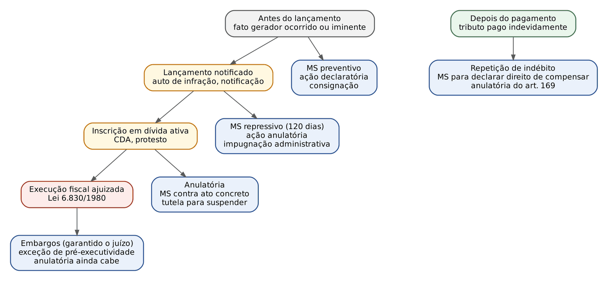
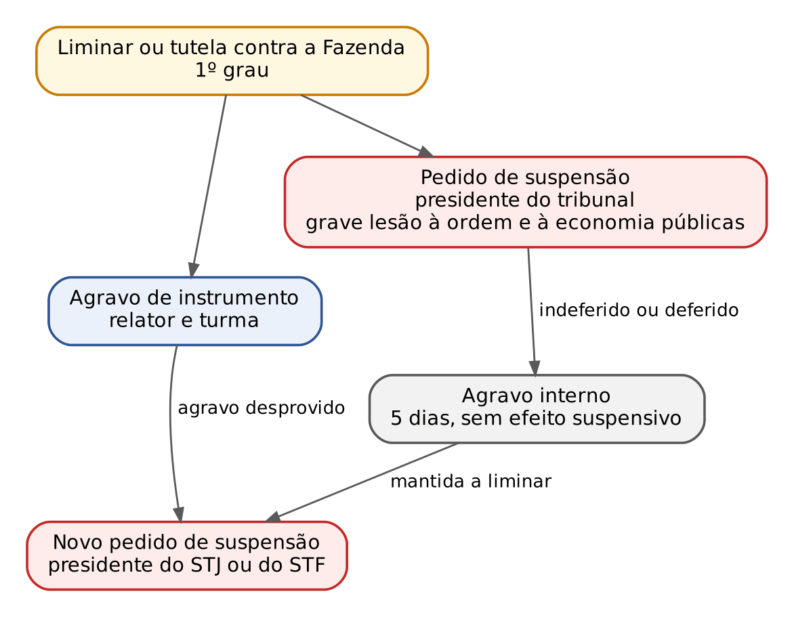
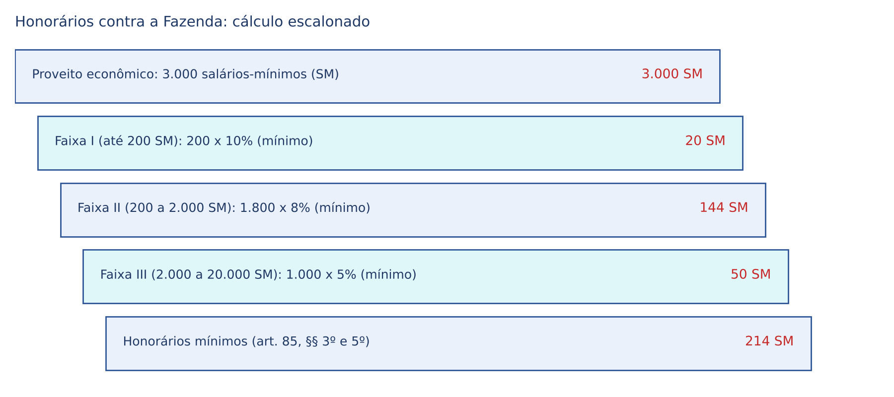
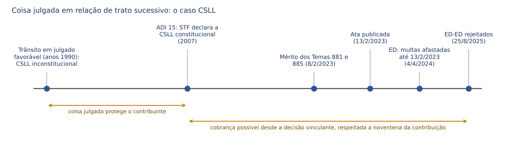

# CAPÍTULO 23 — PROCESSO JUDICIAL TRIBUTÁRIO: AÇÕES DO CONTRIBUINTE E DA FAZENDA, MANDADO DE SEGURANÇA, ANULATÓRIA, DECLARATÓRIA, CONSIGNAÇÃO, REPETIÇÃO, TUTELAS CONTRA A FAZENDA, COMPETÊNCIA, COISA JULGADA E MODULAÇÃO

:::INCIDENCIA
TRF5 p. 16; TJRS p. 8; TJSC p. 18. Nível A. Lote: 7 questões (FGV 5, FCC 2), mais correlatas de outros capítulos.
O que mais cai: escolha da ação cabível (consignação x anulatória x declaratória x MS), limites do MS (Súmulas 266, 269, 271 e 460), depósito prévio (SV 28), rescisória e coisa julgada em trato sucessivo (Temas 881 e 885, Tema 136) e, na sentença, honorários e remessa necessária contra a Fazenda.
:::

## 23.1 O mapa das ações tributárias

### 23.1.1 Quem age, quando e por quê

O processo judicial tributário não tem código próprio: combina a LEF (cobrança), a Lei 12.016/2009 (MS), a Lei 8.397/1992 (cautelar fiscal), regras do CTN com reflexo processual (arts. 151, 164, 169 e 170-A) e, no mais, o CPC. Para o juiz cível, a técnica é conhecida; o que muda são as regras que protegem o crédito público (presunção da CDA, limites às liminares, remessa necessária, precatório) e as que protegem o contribuinte (vedação de depósito prévio, MS sem honorários, coisa julgada que cede às decisões vinculantes do STF).

Há duas famílias de ações:

- Ações da Fazenda: a execução fiscal (Caps. 21 e 22) e a medida cautelar fiscal (Lei 8.397/1992; Cap. 22). A Fazenda quase nunca precisa de ação de conhecimento, porque constitui o próprio título (lançamento e inscrição em dívida ativa; Caps. 12 e 19). É a diferença essencial para o credor civil, que precisa de sentença ou de título extrajudicial negociado.
- Ações do contribuinte (ditas "antiexacionais"): mandado de segurança, ação declaratória, ação anulatória, consignação em pagamento, repetição de indébito e, dentro da execução, embargos e exceção de pré-executividade (Cap. 22). São estas que o capítulo desenvolve.

A escolha entre elas depende de UMA pergunta: em que momento da vida do crédito o contribuinte está? Antes do lançamento ainda não há o que anular; depois do pagamento já não há o que suspender, só o que devolver.

### 23.1.2 Quadro "qual ação usar quando"

| Momento | O contribuinte quer | Ação típica | Observações |
|---|---|---|---|
| Antes do lançamento (fato gerador ocorrido ou iminente) | não pagar ou não ser autuado | MS preventivo; ação declaratória de inexistência de relação jurídico-tributária | MS preventivo não tem prazo de 120 dias; declaratória cabe mesmo antes de qualquer lançamento (Q3777958, alternativa B, falsa) |
| Antes do lançamento | pagar, mas o Fisco recusa ou dois entes cobram | consignação em pagamento (art. 164 do CTN) | não serve para discutir o valor em abstrato nem obter parcelamento (Cap. 14) |
| Lançamento notificado | desconstituir o crédito | ação anulatória; MS repressivo; ou impugnação administrativa | a via judicial implica renúncia à administrativa sobre a mesma matéria (23.3.9) |
| Crédito inscrito em dívida ativa | desconstituir, suspender a cobrança, evitar protesto | anulatória ou MS, com depósito ou tutela para suspender a exigibilidade | sem depósito ou tutela, a execução pode ser ajuizada (art. 784, § 1º, do CPC) |
| Execução fiscal ajuizada | defender-se | embargos (com garantia) ou exceção de pré-executividade (Cap. 22) | a anulatória continua cabível; o problema é a relação com a execução (23.4.4) |
| Depois do pagamento indevido | receber de volta ou compensar | repetição de indébito; MS para declarar o direito de compensar (Súmula 213 do STJ) | MS não substitui ação de cobrança (Súmula 269 do STF); prazos no Cap. 16 |
| Pedido de restituição negado na via administrativa | desfazer a decisão | anulatória da decisão denegatória (art. 169 do CTN), 2 anos | ver Cap. 16 (16.4.5) |

:::QUESTAO FGV 2025 — AL-AM — Procurador (Q3777958)
Pergunta-se qual afirmação é correta sobre os instrumentos processuais do contribuinte. Gabarito: C (o depósito do montante integral suspende a exigibilidade, art. 151, II, do CTN; não extingue). Por que as outras caem: A (MS preventivo "não pode" atacar tributo ainda não constituído) inverte a função do MS preventivo, que existe justamente para o justo receio antes do lançamento (23.3.2); B (declaratória "só após o lançamento") ignora que a declaratória cabe antes, inclusive para prevenir o lançamento (23.5); D (parcelamento não permite certidão positiva com efeito de negativa) contraria o art. 206 do CTN (Cap. 13); E (entidade de classe não pode impetrar MS coletivo tributário) contraria o art. 21 da Lei 12.016/2009 (23.3.8).
:::

### 23.1.3 O art. 38 da LEF e o fim do depósito prévio

A LEF partiu de uma ideia restritiva: a dívida ativa só se discutiria dentro da execução, com exceções contadas nos dedos.

:::LEI Lei 6.830/1980, art. 38
Art. 38 - A discussão judicial da Dívida Ativa da Fazenda Pública só é admissível em execução, na forma desta Lei, salvo as hipóteses de mandado de segurança, ação de repetição do indébito ou ação anulatória do ato declarativo da dívida, esta precedida do depósito preparatório do valor do débito, monetariamente corrigido e acrescido dos juros e multa de mora e demais encargos.
Parágrafo Único - A propositura, pelo contribuinte, da ação prevista neste artigo importa em renúncia ao poder de recorrer na esfera administrativa e desistência do recurso acaso interposto.
:::

Duas leituras corrigem o texto literal. Primeiro, o rol não é taxativo: a declaratória e a consignatória também cabem, porque o acesso à jurisdição (art. 5º, XXXV, da CF) não pode ser limitado por lei ordinária. Segundo, a exigência de depósito "preparatório" para a anulatória caiu.

:::JURIS STF, Súmula Vinculante 28
"É inconstitucional a exigência de depósito prévio como requisito de admissibilidade de ação judicial na qual se pretenda discutir a exigibilidade de crédito tributário."
:::

O depósito, portanto, é FACULDADE do contribuinte, que o faz quando quer suspender a exigibilidade (art. 151, II; Súmula 112 do STJ; Cap. 13), e nunca condição para ajuizar. A vedação paralela no processo administrativo (Súmula Vinculante 21) está no Cap. 13.

:::PEGADINHA Três confusões sobre o depósito
(1) "A anulatória exige depósito prévio, nos termos do art. 38 da LEF": FALSO desde a SV 28. (2) "Sem depósito o juiz deve extinguir a anulatória": FALSO; sem depósito ou tutela, a ação segue, só não suspende a exigibilidade. (3) "O depósito feito na anulatória extingue o crédito": FALSO; suspende, e só a conversão em renda extingue (art. 156, VI; Cap. 14). A FGV cobrou o item (3) na Q3777958, gabarito C.
:::

## 23.2 Competência, legitimidade e Juizados

### 23.2.1 Justiça Federal ou Estadual

A competência segue o ente que figura no polo passivo, não o tributo em abstrato:

- Tributos da União (IR, IPI, PIS, Cofins, CSLL, contribuições previdenciárias, II, IE, IOF, ITR): Justiça Federal, porque a União é ré (art. 109, I, da CF). O mesmo vale para as anuidades dos conselhos de fiscalização profissional, autarquias federais (Cap. 3); a execução delas é tratada no Cap. 21.
- Tributos estaduais e municipais (ICMS, IPVA, ITCMD, ISS, IPTU, ITBI, taxas locais): Justiça Estadual, em geral em vara da Fazenda Pública, conforme a lei de organização judiciária.
- Contribuições destinadas a terceiros (Sistema S, salário-educação, INCRA): a legitimidade passiva é de quem detém a capacidade tributária ativa, não do mero destinatário da receita (Súmula 666 do STJ; ver Cap. 3). Se só a União é ré, a causa é federal.
- IR retido na fonte por Estados e Municípios sobre a remuneração dos seus servidores: o produto pertence ao ente retentor (Tema 1.130 do STF; ver Cap. 7), e a repetição corre contra ele, na Justiça Estadual.

:::DICA Quem decide se a União deve estar no processo
Se o juiz estadual tem dúvida sobre o interesse da União (por exemplo, ação contra Município em que se pede a citação da Receita Federal), não é ele quem decide: "Compete à Justiça Federal decidir sobre a existência de interesse jurídico que justifique a presença, no processo, da União, suas autarquias ou empresas públicas" (Súmula 150 do STJ). O juiz estadual remete; se o federal excluir a União, restitui os autos ao juízo estadual, sem suscitar conflito (Súmula 224 do STJ).
:::

### 23.2.2 Foro

Nas ações contra a União, o autor pode escolher entre a seção judiciária do seu domicílio, a do lugar do ato ou fato, a da situação da coisa ou o Distrito Federal (art. 109, § 2º, da CF). Nas ações contra Estado ou Distrito Federal, o CPC permite o foro do domicílio do autor, o da ocorrência do fato ou o da situação da coisa, ou a capital do ente (art. 52, parágrafo único).

No MS, a competência é fixada pela sede e pela categoria da autoridade coatora; contra autoridade federal, o STJ passou a admitir a impetração no domicílio do impetrante (art. 109, § 2º, da CF). Se a autoridade tem foro por prerrogativa (por exemplo, Secretário de Estado da Fazenda, conforme a Constituição estadual), o MS é de competência originária do Tribunal de Justiça, dado que decide a encampação (23.3.4).

### 23.2.3 Juizados Especiais Federais e da Fazenda Pública

A maior parte das repetições de indébito e anulatórias de pequeno valor de pessoas físicas e microempresas corre nos Juizados. Os dois microssistemas são parecidos, mas têm uma diferença de redação que a banca explora.

| Ponto | JEF (Lei 10.259/2001) | JEFP (Lei 12.153/2009) |
|---|---|---|
| Réus | União, autarquias, fundações e empresas públicas federais | Estados, DF, Municípios, suas autarquias e fundações |
| Valor | até 60 salários-mínimos (art. 3º) | até 60 salários-mínimos (art. 2º) |
| Autores | pessoas físicas, microempresas e empresas de pequeno porte | idem |
| Excluídos | MS, execuções fiscais, ações coletivas; anulação de ato administrativo federal, SALVO o previdenciário e o de lançamento fiscal (art. 3º, § 1º, III) | MS, execuções fiscais, ações sobre bens imóveis do ente, ações coletivas (art. 2º, § 1º) |
| Natureza | absoluta onde instalado (art. 3º, § 3º) | absoluta onde instalado (art. 2º, § 4º) |
| Pagamento | RPV até 60 salários-mínimos, sem precatório | RPV conforme a lei do ente (art. 100, §§ 3º e 4º, da CF) |

:::PEGADINHA Anulatória de lançamento fiscal no JEF
A Lei 10.259/2001 exclui do JEF as ações de anulação de ato administrativo federal, mas abre exceção expressa para o ato "de lançamento fiscal". Logo, a anulatória de lançamento federal de até 60 salários-mínimos proposta por pessoa física ou microempresa É de competência do JEF. Já o mandado de segurança e a execução fiscal estão fora dos dois Juizados.
:::

### 23.2.4 Legitimidade

Ativa: o sujeito passivo (contribuinte ou responsável) que suporta a exigência. Na repetição de tributos indiretos, o contribuinte de direito só repete se provar que assumiu o encargo ou estiver autorizado por quem o assumiu (art. 166 do CTN), e o contribuinte de fato, em regra, não tem legitimidade, com as exceções do Cap. 16 (16.3).

Passiva: nas ações de conhecimento, o ente tributante com capacidade tributária ativa (Cap. 4). No MS, a autoridade coatora, com ciência à pessoa jurídica a que ela pertence (art. 7º, II, da Lei 12.016/2009); quem suporta os efeitos da sentença é a pessoa jurídica.

Coletiva: o MS coletivo é admitido (23.3.8), mas a ação civil pública NÃO serve para veicular pretensões que envolvam tributos (art. 1º, parágrafo único, da Lei 7.347/1985, incluído pela MP 2.180-35/2001). A vedação mira a ação que substituiria milhares de repetições individuais. O STF admite, porém, a ação civil pública do Ministério Público em defesa do patrimônio público contra acordo ou benefício fiscal lesivo, porque aí o objeto não é o interesse do contribuinte, mas o erário (nota de verificação quanto ao número do precedente). A FGV usa a ação civil pública como distrator (Q3009029, alternativa E).

## 23.3 Mandado de segurança em matéria tributária

### 23.3.1 Por que o MS domina o contencioso tributário

O mandado de segurança é a ação mais usada pelo contribuinte, por razões práticas: rito rápido, sem fase de provas, sem condenação em honorários (23.3.7), com liminar que suspende a exigibilidade (art. 151, IV, do CTN; Cap. 13) e com a sentença concessiva executável provisoriamente (art. 14, § 3º, da Lei 12.016/2009). Em contrapartida, só serve quando o fato está provado documentalmente desde a inicial e o pedido não tem natureza de cobrança. A maior parte das teses tributárias (inconstitucionalidade de tributo, ilegalidade de base de cálculo, direito a crédito, imunidade com requisitos documentados) é questão de direito sobre fatos incontroversos, e por isso cabe no MS: "Controvérsia sobre matéria de direito não impede concessão de mandado de segurança" (Súmula 625 do STF).

Na definição do art. 1º da Lei 12.016/2009, o "justo receio" de violação é a porta do MS preventivo; a violação consumada, a do repressivo.

### 23.3.2 Preventivo, repressivo e a Súmula 266 do STF

- MS repressivo: ataca ato já praticado (auto de infração, indeferimento de restituição, exclusão do Simples, apreensão de mercadoria, recusa de certidão). Sujeita-se ao prazo de 120 dias (23.3.3).
- MS preventivo: ataca ameaça concreta. Em matéria tributária, a ameaça é presumida quando a lei já está em vigor, o contribuinte pratica o fato gerador e a autoridade tem o dever de lançar (art. 142, § 1º, do CTN, na redação da LC 236/2026: atividade vinculada e obrigatória). Não é preciso esperar o auto de infração.

O limite é a "lei em tese": "Não cabe mandado de segurança contra lei em tese" (Súmula 266 do STF). A distinção cobrada é sutil. É lei em tese a impetração que pede, em abstrato, que se declare inconstitucional a lei, sem demonstrar que o impetrante está sujeito a ela. NÃO é lei em tese o MS preventivo de quem demonstra que realiza o fato gerador e que a autoridade vai exigir o tributo; o pedido é para que a autoridade se abstenha de cobrar DELE, e a inconstitucionalidade é só a causa de pedir (controle incidental). Também não é lei em tese a lei de efeitos concretos.

:::EXEMPLO MS preventivo x lei em tese
A Lei estadual X, publicada em 10/1/2026, cria taxa sobre a fiscalização de torres de telecomunicação, devida a partir de 1/7/2026. (1) A Torres Sul Ltda., que tem 40 torres no Estado, impetra MS em 2/3/2026 contra o Diretor de Arrecadação, pedindo que se abstenha de lançar e cobrar dela a taxa, por violação do art. 145, II, da CF. Cabe: há fato gerador futuro certo e autoridade vinculada a lançar; é MS preventivo, sem prazo decadencial. (2) A Associação Amigos da Constituição, que não tem torre nem associados que tenham, impetra MS para "declarar a inconstitucionalidade da Lei X". Não cabe: é lei em tese (Súmula 266); o meio seria o controle concentrado, pelos legitimados.
:::

### 23.3.3 O prazo de 120 dias

:::LEI Lei 12.016/2009, art. 23
Art. 23. O direito de requerer mandado de segurança extinguir-se-á decorridos 120 (cento e vinte) dias, contados da ciência, pelo interessado, do ato impugnado.
:::

O prazo é decadencial, não se suspende nem se interrompe, e sua fixação por lei é constitucional (Súmula 632 do STF; o STF reafirmou a validade do art. 23 na ADI 4.296). Pontos tributários:

- Termo inicial é a CIÊNCIA do ato concreto (notificação do lançamento, intimação da decisão administrativa). Pedido de reconsideração não interrompe (Súmula 430 do STF).
- Se o contribuinte impugnou o lançamento na via administrativa, o recurso tem efeito suspensivo (art. 151, III, do CTN), e o art. 5º, I, da Lei 12.016/2009 impede o MS "de ato do qual caiba recurso administrativo com efeito suspensivo, independentemente de caução". Na prática, o prazo conta da ciência da decisão administrativa final. A Súmula 429 do STF ressalva o MS contra OMISSÃO da autoridade (por exemplo, demora irrazoável em julgar o pedido de restituição), que cabe mesmo pendente recurso com efeito suspensivo.
- MS preventivo: não há ato a partir do qual contar; não há prazo enquanto a ameaça persistir.
- Relações de trato sucessivo (tributo mensal exigido com base na mesma lei): pela orientação dominante, o prazo se renova a cada nova exigência; perde-se a via mandamental só quanto aos atos consumados há mais de 120 dias.

:::PEGADINHA Decadência do MS não é decadência do direito
Passados os 120 dias, perde-se só a VIA do mandado de segurança. O direito material continua discutível por ação anulatória ou repetição, dentro dos prazos próprios (Caps. 15 e 16). A sentença que reconhece a decadência extingue o processo sem tocar no direito (o art. 19 da Lei 12.016/2009 ressalva a via própria quando a sentença não decide o mérito). E "MS administrativo no prazo de 120 dias" não existe: a FGV usou a expressão como distrator na Q2565249 (TCE-PA 2024, alternativa E; a resposta era a impugnação administrativa, que suspende a exigibilidade).
:::

### 23.3.4 Autoridade coatora e teoria da encampação

Autoridade coatora é quem tem competência para praticar ou desfazer o ato: o Delegado da Receita Federal do domicílio fiscal (tributos internos federais), o Inspetor da Alfândega (desembaraço), o chefe da fiscalização estadual ou municipal competente. Quem apenas edita o ato normativo geral (Ministro, Secretário, Presidente) não é coator.

O erro na indicação é frequente, e a jurisprudência criou um remédio, a encampação: se a autoridade indicada errada, superior hierárquica da correta, defende o mérito do ato nas informações, ela "encampa" o ato e o processo prossegue.

:::JURIS STJ, Súmula 628
"A teoria da encampação é aplicada no mandado de segurança quando presentes, cumulativamente, os seguintes requisitos: a) existência de vínculo hierárquico entre a autoridade que prestou informações e a que ordenou a prática do ato impugnado; b) manifestação a respeito do mérito nas informações prestadas; e c) ausência de modificação de competência estabelecida na Constituição Federal."
:::

O terceiro requisito é o que mais cai. Se o impetrante aponta como coator o Secretário de Estado da Fazenda (MS de competência originária do TJ) quando o ato é do Gerente Regional (MS em primeiro grau), não há encampação, ainda que o Secretário defenda o mérito: aceitar a encampação mudaria a competência fixada na Constituição estadual. E o STJ entende que, nesse caso, também não se pode mandar emendar a inicial para corrigir a autoridade se a correção alterar a competência (STJ, 2ª Turma, REsp 1.954.451/RJ, j. 14/2/2023, caso de IPVA impetrado contra Secretário de Estado). Fora dessa situação, o CPC (arts. 338 e 339) permite a correção do polo passivo, e a prática é intimar o impetrante a emendar, em vez de extinguir.

### 23.3.5 Prova pré-constituída

Direito líquido e certo é o que se prova com documentos juntados com a inicial; não há perícia nem testemunhas. Teses de direito exigem só a prova de que o impetrante é contribuinte do tributo; para declarar o direito de compensar, basta a prova da condição de credor (Tema 118 do STJ; Cap. 14). Imunidade ou denúncia espontânea só cabem no MS com os requisitos documentados (Caps. 6 e 10); se a solução depender de prova, denega-se a segurança sem resolução do mérito, ressalvada a via ordinária (art. 19 da Lei 12.016/2009).

### 23.3.6 Liminar, vedações legais e ADI 4.296

A liminar segue o art. 7º, III, da Lei 12.016/2009: fundamento relevante e risco de ineficácia da medida, sendo FACULTADO ao juiz exigir caução, fiança ou depósito. Concedida, suspende a exigibilidade do crédito (art. 151, IV, do CTN), com os efeitos estudados no Cap. 13 (13.7): não impede o lançamento, impede a cobrança, a inscrição e a recusa de certidão positiva com efeito de negativa. Contra a decisão que concede ou nega a liminar cabe agravo de instrumento (art. 7º, § 1º).

O texto da lei ainda traz, no art. 7º, § 2º, a proibição de liminar para "compensação de créditos tributários" e para "entrega de mercadorias e bens provenientes do exterior". Esse parágrafo foi declarado inconstitucional pelo STF na ADI 4.296 (j. 9/6/2021), junto com o art. 22, § 2º (oitiva prévia da pessoa jurídica no MS coletivo). Na mesma ação, o STF manteve o art. 1º, § 2º (atos de gestão comercial), o art. 7º, III (caução facultativa), o art. 23 (120 dias) e o art. 25 (sem honorários). Em seguida, a 1ª Seção do STJ cancelou a Súmula 212 (2022).

:::ATENCAO O que sobra das vedações depois da ADI 4.296
(1) Liminar para liberar mercadoria importada retida por falta de pagamento de tributo: não há mais proibição legal abstrata; o juiz examina os requisitos do art. 7º, III, no caso concreto (a retenção como meio coercitivo de cobrança é tema de sanção política, Cap. 5). (2) Liminar para compensar: a proibição da Lei do MS caiu, mas o art. 170-A do CTN (lei complementar, não atingida pela ADI) continua a vedar a compensação, antes do trânsito em julgado, do tributo contestado na própria ação (Cap. 14). (3) Para a Lei 8.437/1992 e o art. 1.059 do CPC, ver 23.8.1.
:::

### 23.3.7 Sentença, efeitos patrimoniais e honorários

A sentença concessiva é mandamental: ordena à autoridade que se abstenha de cobrar, que expeça certidão, que libere a mercadoria, que receba a declaração. Três limites de conteúdo:

:::JURIS STF, Súmulas 269 e 271
Súmula 269: "O mandado de segurança não é substitutivo de ação de cobrança." Súmula 271: "Concessão de mandado de segurança não produz efeitos patrimoniais em relação a período pretérito, os quais devem ser reclamados administrativamente ou pela via judicial própria."
:::

- O MS não condena a Fazenda a devolver o que foi pago antes da impetração. Para isso, o contribuinte usa a repetição de indébito, ou usa o MS para DECLARAR o direito de compensar (Súmula 213 do STJ; Cap. 14), porque a compensação não é cobrança contra o erário.
- O que se tornou devido entre a impetração e o cumprimento da ordem pode ser objeto do MS, mas o pagamento observa o regime de precatórios: "O pagamento dos valores devidos pela Fazenda Pública entre a data da impetração do mandado de segurança e a efetiva implementação da ordem concessiva deve observar o regime de precatórios previsto no artigo 100 da Constituição Federal" (Tema 831 do STF, RE 889.173). 
- O indébito reconhecido no MS não pode ser "restituído administrativamente" em dinheiro, fora do precatório (Tema 1.262 do STF; ver Cap. 16); as vias são a compensação administrativa ou a execução por precatório ou requisição de pequeno valor.

Honorários: "Não cabe condenação em honorários de advogado na ação de mandado de segurança" (Súmula 512 do STF); "Na ação de mandado de segurança não se admite condenação em honorários advocatícios" (Súmula 105 do STJ). A regra foi positivada no art. 25 da Lei 12.016/2009, cuja constitucionalidade o STF confirmou na ADI 4.296, e vale para os dois polos: nem a autoridade vencida nem o impetrante que tem a segurança denegada pagam honorários (o art. 25 ressalva as sanções por litigância de má-fé). As custas seguem a regra geral, e a Fazenda é isenta nas hipóteses legais.

Reexame: concedida a segurança, a sentença está sujeita ao duplo grau obrigatório (art. 14, § 1º), e pode ser executada provisoriamente (art. 14, § 3º). Sobre a aplicação ao MS dos limites de valor e das exceções do art. 496, §§ 3º e 4º, do CPC, ver 23.9.2.

### 23.3.8 Mandado de segurança coletivo

O art. 21 da Lei 12.016/2009 legitima partido político com representação no Congresso, organização sindical, entidade de classe ou associação legalmente constituída e em funcionamento há pelo menos 1 ano, em defesa de direitos líquidos e certos da totalidade ou de parte dos membros, pertinentes às suas finalidades, "dispensada, para tanto, autorização especial". Tutelam-se direitos coletivos e individuais homogêneos (art. 21, parágrafo único, II), categoria em que se encaixam quase todas as pretensões tributárias de associados. Súmulas de apoio: a impetração por entidade de classe independe de autorização dos associados (Súmula 629 do STF) e é admitida ainda que a pretensão interesse só a parte da categoria (Súmula 630 do STF).

A sentença faz coisa julgada limitadamente aos membros substituídos (art. 22); o MS coletivo não induz litispendência para os individuais, mas o impetrante individual só se beneficia do coletivo se desistir do seu em 30 dias da ciência da impetração coletiva (art. 22, § 1º).

:::PEGADINHA MS coletivo x ação civil pública em matéria tributária
A ação civil pública não pode veicular pretensão tributária (art. 1º, parágrafo único, da Lei 7.347/1985; 23.2.4); o MS coletivo PODE, porque tem fundamento constitucional próprio (art. 5º, LXX, da CF). Por isso é falsa a afirmação de que entidades de classe não podem impetrar MS coletivo para proteger interesses tributários dos associados por se tratar de direitos individuais homogêneos (Q3777958, alternativa E).
:::

### 23.3.9 MS e processo administrativo: a renúncia pela via judicial

Quem leva ao Judiciário a mesma matéria do processo administrativo renuncia ao recurso administrativo (art. 38, parágrafo único, da LEF; art. 208-E, parágrafo único, do CTN, na redação da LC 236/2026; ver Caps. 13 e 20). O ponto decisivo é a IDENTIDADE de matéria: o que não foi levado a juízo continua discutível na via administrativa. A FCC cobrou exatamente isso à luz da lei paulista do processo administrativo.

:::QUESTAO FCC 2026 — SEFAZ-SP — Auditor Fiscal da Receita Estadual (Q3956737)
Caso: importador discorda da Fazenda paulista sobre a isenção do ICMS-importação e impetra MS apenas para que a autoridade federal não exija o comprovante de pagamento do ICMS no desembaraço; obtém a ordem condicionada ao depósito administrativo integral, que é feito. O que se afirma corretamente? Gabarito: A (ao ir a juízo apenas para não exibir a guia no desembaraço, o contribuinte NÃO desistiu de discutir, no processo administrativo do auto de infração a ser lavrado, matéria distinta da levada a juízo). Passos: (1) o objeto do MS é procedimental (exibição da guia), não a isenção; (2) a renúncia à via administrativa só alcança a matéria idêntica; (3) o auto deve ser lavrado para prevenir a decadência (o depósito e a liminar suspendem a exigibilidade, não a constituição; Cap. 13), e o contribuinte poderá discutir a isenção na impugnação. Erros: B e C (nem a Procuradoria assume o lançamento, privativo da autoridade administrativa, nem o MS impede a lavratura); D (o lançamento não depende da suficiência do depósito); E (a isenção não foi judicializada, logo pode ser discutida na impugnação).
:::

### 23.3.10 Ficha de consulta rápida: mandado de segurança tributário

| Item | Regra | Fundamento |
|---|---|---|
| Cabimento | direito líquido e certo, prova pré-constituída; preventivo (justo receio) ou repressivo | art. 1º da Lei 12.016/2009; Súmula 625 do STF |
| Não cabe | lei em tese; ato com recurso administrativo com efeito suspensivo sem caução; como ação de cobrança; para convalidar compensação | Súmula 266 e 269 do STF; art. 5º, I; Súmula 460 do STJ |
| Prazo | 120 dias da ciência do ato; preventivo sem prazo; reconsideração não interrompe | art. 23; Súmulas 632 e 430 do STF |
| Polo passivo | autoridade com poder de desfazer o ato; ciência à pessoa jurídica; encampação com 3 requisitos | art. 7º, I e II; Súmula 628 do STJ |
| Liminar | relevância + risco; caução facultativa; vedação do art. 7º, § 2º, inconstitucional; art. 170-A em vigor | ADI 4.296; art. 151, IV, do CTN |
| Sentença | mandamental; sem efeitos patrimoniais pretéritos; valores pós-impetração por precatório | Súmula 271 do STF; Tema 831 do STF |
| Compensação | declara o direito, não convalida | Súmulas 213 e 460 do STJ (Cap. 14) |
| Honorários | não há | Súmula 512 do STF; Súmula 105 do STJ; art. 25 |
| Reexame | concessão sujeita a duplo grau; execução provisória possível | art. 14, §§ 1º e 3º |
| Coletivo | partido, sindicato, entidade de classe, associação com 1 ano; sem autorização | art. 21; Súmulas 629 e 630 do STF |

:::SENTENCA Mandado de segurança tributário: preliminares e dispositivo
Onde entra: o MS é a peça mais provável na prova prática tributária (roteiro completo no Cap. 35). Antes do mérito, enfrente nesta ordem: (1) adequação da via (prova pré-constituída; não é lei em tese, porque o impetrante demonstra que pratica o fato gerador); (2) legitimidade passiva da autoridade e, se for o caso, encampação (Súmula 628); (3) decadência do art. 23 (MS preventivo ou ato de trato sucessivo: afaste); (4) interesse, se a autoridade alegar que não há ato. No dispositivo, conceda ou denegue a segurança (não "julgue procedente"), diga o que a autoridade deve fazer ou deixar de fazer e afaste honorários.
Redação-modelo: "Rejeito a preliminar de impetração contra lei em tese, pois a impetrante comprovou realizar operações sujeitas à exação, de modo que o ato coator é a exigência iminente e vinculada da autoridade (art. 142, § 1º, do CTN), e não a lei em abstrato. [...] Concedo a segurança para determinar à autoridade impetrada que se abstenha de exigir da impetrante [tributo] sobre [base], assegurando-lhe a compensação dos valores recolhidos nos cinco anos anteriores à impetração, após o trânsito em julgado (art. 170-A do CTN). Sem honorários (art. 25 da Lei 12.016/2009; Súmula 512 do STF). Sentença sujeita ao reexame necessário (art. 14, § 1º)."
Erros que a banca pune: restituição em dinheiro de valores anteriores à impetração (Súmula 271); honorários; decadência em MS preventivo; conceder pedido de convalidação de compensação (Súmula 460).
:::

## 23.4 Ação anulatória

### 23.4.1 Objeto e cabimento

A ação anulatória (chamada também de anulatória de débito fiscal ou de lançamento) é a ação de conhecimento, pelo procedimento comum, em que o sujeito passivo pede a DESCONSTITUIÇÃO de um ato administrativo tributário já praticado: o lançamento (auto de infração, notificação de lançamento), a decisão administrativa que o manteve ou a inscrição em dívida ativa. É o equivalente, no processo civil, à ação constitutiva negativa contra um título que o credor criou unilateralmente. Pode ser cumulada com pedido declaratório (para o futuro) e com repetição (se houve pagamento).

Cabe em qualquer momento depois do lançamento, inclusive depois da inscrição e do ajuizamento da execução fiscal (23.4.4). Não depende de esgotamento da via administrativa, nem de depósito prévio (SV 28; 23.1.3). Se o autor quiser impedir a cobrança enquanto discute, precisa de uma causa de suspensão: depósito integral em dinheiro (art. 151, II) ou tutela provisória (art. 151, V), que independe de depósito (Cap. 13; Q3186485, alternativa B, falsa).

:::DICA Anulatória x MS repressivo: quando escolher cada um
Use o MS quando a questão for de direito e a prova documental bastar, e quando o contribuinte estiver dentro dos 120 dias. Use a anulatória quando (1) for preciso produzir prova (perícia contábil para demonstrar erro na base de cálculo arbitrada, prova testemunhal sobre a efetiva saída de mercadoria); (2) já tiverem passado os 120 dias; (3) houver pedido condenatório cumulado (repetição de parcelas pagas antes do ajuizamento). O preço da anulatória é a sucumbência: honorários do art. 85, § 3º, do CPC em caso de derrota (23.9).
:::

### 23.4.2 Prazo

O CTN não fixa prazo geral para a anulatória do lançamento. A orientação dominante aplica a prescrição quinquenal das pretensões contra a Fazenda (Decreto 20.910/1932, art. 1º), contada da notificação do lançamento definitivo (ou da decisão administrativa final que o mantém). Na prática, o prazo raramente decide a causa: enquanto o crédito não estiver prescrito, o contribuinte ainda poderá defender-se na execução.

Regra especial é a do art. 169 do CTN: 2 anos para anular a decisão administrativa que DENEGA a restituição, com a recontagem por metade (Cap. 16, 16.4.5). A FGV, no TJSC 2025, perguntou se lei estadual ordinária poderia prever esse biênio para os tributos estaduais: pode, porque apenas reproduz a norma geral do CTN (Q3324298, gabarito A; desenvolvida no Cap. 16, com a fronteira da reserva de lei complementar no Cap. 15).

### 23.4.3 Petição inicial e prova

A inicial identifica o ato (número do auto, do processo administrativo, da CDA), aponta o vício e pede sua anulação total ou parcial. Dois cuidados que repercutem na sentença:

- Vício formal x vício material. Se o lançamento for anulado por vício FORMAL (falta de motivação, cerceamento de defesa, autoridade incompetente), o Fisco tem novo prazo decadencial de 5 anos, contado da decisão definitiva (art. 173, II, do CTN; Cap. 15). Se o vício for MATERIAL (fato gerador inexistente, base de cálculo errada, sujeito passivo ilegítimo), não há reabertura. A sentença deve dizer qual é o vício.
- Presunção de legitimidade. O lançamento e a CDA gozam de presunção relativa de certeza e liquidez (art. 204 do CTN; art. 3º da LEF), e o ônus de afastá-la é do autor. Daí a importância da perícia na anulatória.

### 23.4.4 Anulatória e execução fiscal

Este é o ponto processual mais rico, porque o executado pode estar ao mesmo tempo como autor da anulatória e réu da execução.

- A anulatória não impede a execução: "A propositura de qualquer ação relativa a débito constante de título executivo não inibe o credor de promover-lhe a execução" (art. 784, § 1º, do CPC). Só a suspensão da exigibilidade (depósito integral ou tutela) impede o ajuizamento.
- Conexão. O CPC manda reunir a execução e a ação de conhecimento relativa ao mesmo ato jurídico (art. 55, § 2º, I), para evitar decisões conflitantes. Em matéria fiscal, a reunião esbarra frequentemente na competência absoluta das varas especializadas de execução fiscal; quando a reunião é inviável, a orientação jurisprudencial é manter os processos separados, admitindo a suspensão da execução por prejudicialidade (art. 313, V, a, do CPC) quando o juízo estiver garantido ou a exigibilidade suspensa. Há também decisões que deslocam a anulatória para a vara da execução quando esta foi ajuizada antes (nota de verificação).
- Anulatória x embargos. Se o executado já opôs embargos com a mesma causa de pedir e o mesmo pedido, a anulatória posterior é litispendente. Se perdeu o prazo dos embargos, ainda pode ajuizar a anulatória, mas ela, sozinha, não suspende a execução: para isso precisa de garantia ou tutela.

:::EXEMPLO Anulatória depois da execução
Em 3/2/2025 o Município de Porto Alto ajuizou execução fiscal de ISS (CDA de 80.000 (oitenta mil) reais) contra a Gráfica Beta Ltda., que foi citada e não embargou no prazo. Em 10/9/2025 a Gráfica ajuizou anulatória, sustentando que a atividade é industrialização por encomenda sujeita ao ICMS (conflito ISS x ICMS; Cap. 28). Pergunta-se se a execução para. Resposta: não automaticamente. A anulatória é cabível (o prazo dos embargos é preclusivo só para a defesa dentro da execução), mas a execução prossegue (art. 784, § 1º, do CPC), salvo se a Gráfica depositar o valor integral (art. 151, II) ou obtiver tutela de urgência (art. 151, V) ou se o juízo estiver garantido e o juiz suspender a execução por prejudicialidade. Se a anulatória for procedente, a execução é extinta, e os atos de constrição são desfeitos.
:::

:::SENTENCA Ação anulatória de lançamento
Onde entra: sentença de procedimento comum contra o ente tributante. Fundamentar: (1) cabimento sem depósito (SV 28); (2) prescrição quinquenal, se alegada; (3) mérito do vício; (4) natureza do vício (formal ou material), por causa do art. 173, II; (5) destino do depósito, se houver (levantamento após o trânsito, ou conversão em renda se improcedente; Cap. 14); (6) honorários pelo art. 85, § 3º, e reexame.
Redação-modelo: "Julgo procedente o pedido para anular o Auto de Infração n. [x] e o crédito tributário dele decorrente, inscrito na CDA n. [y], por inexistência do fato gerador (vício material), o que afasta a reabertura do prazo do art. 173, II, do CTN. Condeno o réu ao pagamento de honorários advocatícios nos percentuais mínimos do art. 85, § 3º, I e II, do CPC, observada a regra do § 5º, sobre o proveito econômico (valor atualizado do crédito anulado). Sentença sujeita ao reexame necessário, salvo se o proveito econômico for inferior ao limite do art. 496, § 3º, do CPC."
Erros comuns: extinguir por falta de depósito prévio; fixar honorários por equidade em causa de grande valor (Tema 1.076 do STJ; 23.9.1); anular sem dizer se o vício é formal ou material.
:::

## 23.5 Ação declaratória

### 23.5.1 Objeto e momento

A ação declaratória tributária pede a certeza sobre a existência, a inexistência ou o modo de ser de uma relação jurídica (art. 19, I, do CPC): que o autor não é contribuinte de certo tributo, que goza de imunidade, que a base de cálculo é esta e não aquela, que tem direito a crédito ou a compensar. O art. 20 do CPC admite a declaratória ainda que já tenha ocorrido a violação do direito, de modo que ela pode vir antes ou depois do lançamento. Sua vocação natural, porém, é preventiva: quem ainda não foi autuado não tem o que anular, e a declaratória (ou o MS preventivo) é o instrumento adequado. Por isso é falsa a afirmação de que a declaratória "é cabível apenas após a constituição do crédito" (Q3777958, alternativa B).

A declaratória pura não prescreve (a certeza jurídica não se esgota no tempo), mas o pedido condenatório que a acompanhe (repetição) respeita o prazo do art. 168 do CTN (Cap. 16). Ela também não suspende a exigibilidade por si; só o depósito ou a tutela suspendem.

### 23.5.2 Declaratória x MS preventivo

| Ponto | Ação declaratória | MS preventivo |
|---|---|---|
| Prova | ampla (perícia, testemunhas) | só documental pré-constituída |
| Polo passivo | ente tributante | autoridade coatora (e ciência à pessoa jurídica) |
| Prazo | não há (declaratória pura) | não há enquanto a ameaça persistir |
| Honorários | sim (art. 85, § 3º) | não (Súmula 512 do STF) |
| Efeitos patrimoniais pretéritos | pode cumular repetição | não (Súmula 271 do STF) |
| Suspensão da exigibilidade | depósito ou tutela (art. 151, II e V) | depósito ou liminar (art. 151, II e IV) |

### 23.5.3 Declaratória e o mérito: a banca mistura os planos

A FGV, no TJTO 2025 (Q3453292), descreveu ação declaratória de inexistência de relação jurídica proposta por contribuinte que mudou de Estado e foi cobrado de IPVA pelo novo domicílio. A ação é cabível, mas improcede, porque o IPVA cabe ao Estado do domicílio do proprietário (gabarito B; mérito no Cap. 30). O distrator A dizia que a consignação seria "mais adequada": não seria, porque não há dúvida a quem pagar quando só um ente é competente; a consignação do art. 164, III, pressupõe exigência de MAIS de um ente sobre o mesmo fato, e o contribuinte que discorda do mérito usa declaratória, anulatória ou MS (23.6).

Os efeitos da declaratória sobre exercícios futuros, nas relações de trato sucessivo, e a Súmula 239 do STF estão em 23.10.

## 23.6 Consignação em pagamento: aspectos processuais

As hipóteses do art. 164 do CTN, o objeto do depósito (o que o contribuinte se propõe a pagar) e os efeitos da procedência e da improcedência foram estudados no Cap. 14 (14.4). Aqui, só o que é processual:

- Procedimento: o do CPC (arts. 539 a 549), com depósito judicial da quantia. A consignação extrajudicial bancária do art. 539, § 1º, foi pensada para credores privados e não se ajusta ao crédito tributário, que só se extingue nas formas do CTN.
- Polo passivo: na hipótese do inciso III (dois entes exigindo tributo idêntico sobre o mesmo fato), ambos são réus, em litisconsórcio passivo necessário, e a sentença declara qual deles é o credor, convertendo em renda em favor dele o valor depositado (art. 164, § 2º).
- Competência: se um dos réus for ente federal, Justiça Federal (art. 109, I, da CF); se forem dois Estados ou dois Municípios, Justiça Estadual.
- Efeito sobre a exigibilidade: a consignação não está no art. 151 do CTN; por si, não suspende (Cap. 14). O depósito do montante INTEGRAL exigido, este sim, suspende.

:::QUESTAO FCC 2026 — SEFAZ-SP (Q3956707); FGV 2024 (Q3113981 e Q3009029)
Q3956707: dois Estados cobram a mesma taxa; o contribuinte consigna; a ação é julgada totalmente improcedente. Gabarito: A (cobra-se o crédito acrescido de juros de mora e das penalidades cabíveis; art. 164, § 2º). A armadilha é o "apenas" das alternativas que listam só juros, só correção ou só penalidades. Q3113981 (gabarito B) e Q3009029 (gabarito C) estão comentadas no Cap. 14 (14.4): a consignatória serve para pagar a quem é devido, não para discutir o débito nem obter parcelamento.
:::

## 23.7 Repetição de indébito: aspectos processuais

O direito material (hipóteses do art. 165, art. 166, prazos, Selic, precatório ou compensação, Tema 1.262) está no Cap. 16. Do ponto de vista processual:

- Procedimento: comum (ou JEF/JEFP, até 60 salários-mínimos; 23.2.3). Ação condenatória, frequentemente cumulada com declaratória da inexigibilidade para o futuro. Não exige prévio requerimento administrativo (Cap. 16).
- Valor da causa: o valor que se pretende repetir, corrigido (art. 292, I, do CPC); se o pedido também abrange parcelas futuras ou ainda não quantificadas, estima-se. O valor da causa repercute na competência dos Juizados, nos honorários (base subsidiária, art. 85, § 4º, III) e na remessa necessária.
- Prova: na fase de conhecimento basta a prova de que o autor recolheu o tributo questionado; a juntada de todos os comprovantes pode ficar para a liquidação (Q3841703, gabarito D; Cap. 16).
- Sentença ilíquida: a liquidação apura os valores; os percentuais de honorários contra a Fazenda só são definidos na liquidação (art. 85, § 4º, II).
- Cumprimento: contra a Fazenda, pelo rito dos arts. 534 e 535 do CPC (impugnação em 30 dias), com pagamento por precatório ou requisição de pequeno valor (art. 100 da CF; RPV federal até 60 salários-mínimos, art. 17, § 1º, da Lei 10.259/2001; nos demais entes, conforme a lei local, respeitado o piso constitucional). Não há honorários no cumprimento não impugnado que enseje precatório (art. 85, § 7º).
- Alternativa da compensação: o contribuinte vencedor pode optar entre precatório e compensação (Súmula 461 do STJ; Cap. 16), mas não pode receber em dinheiro pela via administrativa (Tema 1.262 do STF).
- Tutela provisória para devolver dinheiro antes do trânsito: inviável, porque o pagamento de condenação da Fazenda segue o precatório, que pressupõe sentença transitada em julgado (art. 100, § 5º, da CF), e o art. 170-A impede a compensação antecipada. O que a tutela pode fazer é suspender a exigibilidade das parcelas vincendas.
- Roteiro da sentença de repetição (prescrição parcial, Selic, opção pela compensação, honorários): Cap. 16 (box SENTENCA) e Cap. 35.

## 23.8 Tutelas provisórias contra a Fazenda em matéria tributária

### 23.8.1 O regime: CPC mais as leis restritivas

Nas ações ordinárias (anulatória, declaratória, repetição), a tutela provisória segue o CPC: urgência (art. 300: probabilidade do direito e perigo de dano ou risco ao resultado útil) ou evidência (art. 311). Concedida, suspende a exigibilidade (art. 151, V, do CTN, na redação da LC 236/2026, que passou a falar em "tutela provisória"; Cap. 13). Sobre esse regime geral incidem as restrições próprias das ações contra o Poder Público, que o CPC manteve expressamente:

:::LEI CPC, art. 1.059
Art. 1.059. À tutela provisória requerida contra a Fazenda Pública aplica-se o disposto nos arts. 1º a 4º da Lei nº 8.437, de 30 de junho de 1992, e no art. 7º, § 2º, da Lei nº 12.016, de 7 de agosto de 2009.
:::

Da Lei 8.437/1992, interessam ao tributário:

| Dispositivo | Regra | Leitura atual |
|---|---|---|
| Art. 1º, caput | não cabe liminar contra o Poder Público quando providência semelhante não puder ser concedida em MS, por vedação legal | depende das vedações do MS, esvaziadas pela ADI 4.296 quanto ao art. 7º, § 2º |
| Art. 1º, § 1º | não cabe cautelar inominada em 1º grau contra ato de autoridade cujo MS seria de competência originária de tribunal | vigente |
| Art. 1º, § 3º | não cabe liminar que esgote, no todo ou em parte, o objeto da ação | interpretado com temperamento: tutela reversível é admitida |
| Art. 1º, § 5º | não cabe liminar que defira compensação de créditos tributários ou previdenciários | texto vigente; na prova, combine com o art. 170-A do CTN, que tem o mesmo efeito e não foi atingido pela ADI 4.296 |
| Art. 2º | no MS coletivo e na ação civil pública, liminar só após ouvir a pessoa jurídica em 72 horas | quanto ao MS coletivo, a regra equivalente da Lei 12.016 (art. 22, § 2º) foi declarada inconstitucional na ADI 4.296 |
| Art. 4º | suspensão de liminar pelo presidente do tribunal | vigente (23.8.3) |

A Lei 9.494/1997 (art. 1º) estendeu essas restrições à antecipação de tutela, e o STF declarou essa extensão constitucional (ADC 4).

### 23.8.2 Tutela de evidência e precedentes tributários

O art. 311, II, do CPC permite tutela de evidência, inclusive liminar (parágrafo único), quando as alegações de fato puderem ser comprovadas apenas documentalmente e houver tese firmada em casos repetitivos ou em súmula vinculante. É ferramenta natural do contencioso tributário de massa: a empresa que pede a exclusão do ICMS da base do PIS e da Cofins (Tema 69 do STF; Cap. 26) prova documentalmente que é contribuinte e invoca a tese vinculante; não precisa demonstrar urgência. Limites: (1) a tese precisa ser de repetitivo ou de súmula vinculante (tese de repercussão geral é tratada como equivalente pela doutrina, por força do art. 927, III, do CPC); (2) a modulação de efeitos da tese deve ser respeitada (23.11); (3) não serve para compensar antes do trânsito (art. 170-A) nem para pagar em dinheiro (precatório).

### 23.8.3 Suspensão de liminar e de segurança

O ente público tem um meio próprio, de natureza política, para sustar decisões que lhe sejam desfavoráveis: o pedido de suspensão dirigido ao presidente do tribunal competente para o recurso, para evitar grave lesão à ordem, à saúde, à segurança e à economia públicas (art. 4º da Lei 8.437/1992; art. 15 da Lei 12.016/2009). Não se examina o acerto jurídico da decisão, mas o risco de lesão ao interesse público (em matéria tributária, o "efeito multiplicador" de liminares que afetam a arrecadação é o argumento típico).

Regras cobradas: agravo interno em 5 dias, sem efeito suspensivo; mantida a liminar, novo pedido ao presidente do STJ ou do STF; o agravo de instrumento não prejudica o pedido de suspensão; liminares idênticas podem ser suspensas numa só decisão; a suspensão vigora até o trânsito da decisão de mérito (art. 4º, § 9º, da Lei 8.437/1992).

:::SENTENCA Decisão de tutela em ação tributária
Onde entra: decisão interlocutória inicial, frequentemente cobrada como questão discursiva. Fundamentar: (1) requisitos do art. 300 ou do art. 311, II; (2) ausência de óbice do art. 1.059 do CPC (a medida não defere compensação, não esgota o objeto, é reversível); (3) efeito do art. 151, V, do CTN; (4) alcance: suspende a exigibilidade, não impede o lançamento para prevenir a decadência.
Redação-modelo: "Presentes a prova documental das operações e a tese firmada pelo STF em repercussão geral, defiro a tutela da evidência (art. 311, II e parágrafo único, do CPC) para suspender a exigibilidade do crédito relativo a [tributo e período] (art. 151, V, do CTN), sem prejuízo do lançamento para prevenir a decadência. Indefiro o pedido de compensação imediata, vedada antes do trânsito em julgado (art. 170-A do CTN)."
Erro comum: exigir depósito integral como condição da tutela (o depósito é causa autônoma de suspensão; Cap. 13).
:::

## 23.9 Honorários contra a Fazenda e remessa necessária

### 23.9.1 Honorários: percentuais escalonados e Tema 1.076 do STJ

Nas causas em que a Fazenda for parte, vencida ou vencedora, os honorários seguem faixas decrescentes sobre o valor da condenação ou do proveito econômico (art. 85, § 3º, do CPC): 10% a 20% até 200 salários-mínimos; 8% a 10% de 200 a 2.000; 5% a 8% de 2.000 a 20.000; 3% a 5% de 20.000 a 100.000; 1% a 3% acima de 100.000. Três regras de aplicação:

- Escalonamento (§ 5º): o percentual não se aplica sobre o total; aplica-se a faixa inicial até seu teto e, no que exceder, a faixa seguinte, e assim por diante, como no imposto de renda progressivo.
- Base subsidiária (§ 4º, III): sem condenação e sem proveito mensurável, o valor atualizado da causa.
- Momento (§ 4º, I e II): sentença líquida, percentual desde logo; ilíquida, só na liquidação. O salário-mínimo considerado é o da sentença líquida ou o da decisão de liquidação (§ 4º, IV).

:::EXEMPLO Escada de honorários
A anulatória da Metalúrgica Delta anulou crédito de 3.000 salários-mínimos (proveito econômico). Fixados os percentuais mínimos: faixa I, 200 x 10% = 20; faixa II, 1.800 x 8% = 144; faixa III, 1.000 x 5% = 50. Total: 214 salários-mínimos, e não 3.000 x 5% = 150 (erro de aplicar o percentual da faixa final sobre o todo) nem 3.000 x 10% (erro de ignorar o § 3º). Com 1 salário-mínimo hipotético de 1.500 (mil e quinhentos) reais, os honorários seriam de 321.000 (trezentos e vinte e um mil) reais.
:::

O que a Fazenda tentava, e muitos juízes faziam, era fixar honorários por equidade em causas de grande valor, alegando desproporção. O CPC só admite equidade quando o proveito for inestimável ou irrisório ou o valor da causa muito baixo (§ 8º), e a Lei 14.365/2022 reforçou a proibição (§ 6º-A).

:::JURIS STJ, Tema 1.076 (Corte Especial, j. 16/3/2022)
Tese: (i) "A fixação dos honorários por apreciação equitativa não é permitida quando os valores da condenação, da causa ou o proveito econômico da demanda forem elevados. É obrigatória nesses casos a observância dos percentuais previstos nos §§ 2º ou 3º do artigo 85 do CPC", conforme haja ou não Fazenda Pública na lide, calculados sobre a condenação, o proveito econômico ou o valor atualizado da causa. (ii) "Apenas se admite arbitramento de honorários por equidade quando, havendo ou não condenação: (a) o proveito econômico obtido pelo vencedor for inestimável ou irrisório; ou (b) o valor da causa for muito baixo."
:::

A matéria chegou ao STF no Tema 1.255 (RE 1.412.069, repercussão geral reconhecida em 2023), que discute a possibilidade de equidade em causas de grande valor contra a Fazenda. Em questão de ordem julgada em 12/3/2025, o STF restringiu o tema às causas que envolvem a Fazenda Pública. O mérito estava PENDENTE na última notícia localizada (julho de 2026). Até lá, vale o Tema 1.076.

Lembretes: no MS não há honorários (23.3.7); no cumprimento de sentença contra a Fazenda que gera precatório, só há honorários se houver impugnação (art. 85, § 7º); honorários na exceção de pré-executividade e o encargo legal na execução fiscal federal estão no Cap. 22.

### 23.9.2 Remessa necessária

:::LEI CPC, art. 496, caput, I e II, e §§ 3º e 4º
Art. 496. Está sujeita ao duplo grau de jurisdição, não produzindo efeito senão depois de confirmada pelo tribunal, a sentença: I - proferida contra a União, os Estados, o Distrito Federal, os Municípios e suas respectivas autarquias e fundações de direito público; II - que julgar procedentes, no todo ou em parte, os embargos à execução fiscal.
§ 3º Não se aplica o disposto neste artigo quando a condenação ou o proveito econômico obtido na causa for de valor certo e líquido inferior a: I - 1.000 (mil) salários-mínimos para a União e as respectivas autarquias e fundações de direito público; II - 500 (quinhentos) salários-mínimos para os Estados, o Distrito Federal, as respectivas autarquias e fundações de direito público e os Municípios que constituam capitais dos Estados; III - 100 (cem) salários-mínimos para todos os demais Municípios e respectivas autarquias e fundações de direito público.
§ 4º Também não se aplica o disposto neste artigo quando a sentença estiver fundada em: I - súmula de tribunal superior; II - acórdão proferido pelo Supremo Tribunal Federal ou pelo Superior Tribunal de Justiça em julgamento de recursos repetitivos; III - entendimento firmado em incidente de resolução de demandas repetitivas ou de assunção de competência; IV - entendimento coincidente com orientação vinculante firmada no âmbito administrativo do próprio ente público, consolidada em manifestação, parecer ou súmula administrativa.
:::

Pontos tributários:

- O inciso II é próprio da execução fiscal: os embargos julgados procedentes, ainda que em parte, sujeitam-se ao reexame (Cap. 22). A sentença que julga IMPROCEDENTES os embargos não, porque é favorável à Fazenda.
- O limite do § 3º exige valor CERTO e LÍQUIDO. Sentença ilíquida (repetição a liquidar) sujeita-se ao reexame, salvo se for evidente que o proveito fica abaixo do limite.
- Os limites variam com o ente: anulação de ISS de 300 salários-mínimos cobrado por Município do interior vai a reexame (limite de 100); contra a capital, não (limite de 500).
- Tese de repercussão geral do STF julgada pelo Plenário é tratada como equivalente ao inciso II do § 4º pela jurisprudência (art. 927, III, do CPC). A orientação administrativa vinculante (inciso IV) é frequente no tributário: as listas de dispensa de contestar e recorrer da PGFN.
- Mandado de segurança: o reexame decorre da lei especial (art. 14, § 1º, da Lei 12.016/2009). Se as dispensas do art. 496, §§ 3º e 4º, alcançam o MS é CONTROVERTIDO: parte da doutrina as aplica (salvo sentença ilíquida) e há julgados do STJ nos dois sentidos. Posição adotada nesta apostila (a mesma do Cap. 35): submeter a sentença concessiva ao reexame com base no art. 14, § 1º; quem invocar alguma dispensa deve fundamentar expressamente a divergência.

## 23.10 Coisa julgada em matéria tributária

### 23.10.1 Relações de trato sucessivo e a Súmula 239 do STF

A relação tributária de tributos periódicos (IR anual, ICMS, PIS e Cofins mensais, IPTU anual) é de trato sucessivo: a cada período nasce uma nova obrigação, do mesmo tipo, regida pela mesma lei. A pergunta é até onde vai a coisa julgada que declara o tributo indevido.

:::JURIS STF, Súmula 239
"Decisão que declara indevida a cobrança do imposto em determinado exercício não faz coisa julgada em relação aos posteriores."
:::

A súmula é antiga e, lida literalmente, assusta o contribuinte. Sua leitura atual é restrita: ela se aplica quando a decisão julgou a cobrança de um exercício específico (por exemplo, anulou o lançamento do IPTU de 2024 por erro na base de cálculo daquele ano). Quando a decisão declara a INEXISTÊNCIA DA RELAÇÃO JURÍDICA por um fundamento que se repete (a lei é inconstitucional, a atividade é imune), a coisa julgada projeta-se para os exercícios futuros enquanto permanecerem as mesmas circunstâncias de fato e de direito. É a lógica do art. 505, I, do CPC: nas relações jurídicas de trato continuado, sobrevindo modificação no estado de fato ou de direito, a parte pode pedir a revisão do que foi estatuído na sentença.

:::EXEMPLO Duas sentenças, dois alcances
(1) A sentença anulou o lançamento do IPTU de 2024 da Sra. A.B. porque o Município aplicou a planta de valores errada naquele exercício. Em 2025 o Município pode lançar normalmente: a decisão disse respeito só àquele lançamento (Súmula 239). (2) A sentença transitada em julgado declarou que a Associação Educacional C. não está sujeita ao IPTU por ser imune (art. 150, VI, c, da CF). A decisão vale para 2025, 2026 e seguintes, enquanto a entidade mantiver os requisitos; se ela passar a distribuir lucros (mudança no estado de fato), o Município pode voltar a cobrar, porque a relação mudou.
:::

### 23.10.2 Temas 881 e 885 do STF: a "quebra" automática da coisa julgada

O problema surgiu com a CSLL. Nos anos 1990, várias empresas obtiveram sentenças transitadas em julgado declarando inconstitucional a Lei 7.689/1988 e, portanto, a inexistência de relação jurídica que as obrigasse a pagar a contribuição. Em 2007, o STF declarou a lei constitucional no controle concentrado (ADI 15). Pergunta: as empresas com coisa julgada continuariam dispensadas para sempre, enquanto todas as concorrentes pagavam? O STF respondeu que não.

:::JURIS STF, Temas 881 (RE 949.297) e 885 (RE 955.227), Plenário, j. 8/2/2023
Tese: "1. As decisões do STF em controle incidental de constitucionalidade, anteriores à instituição do regime de repercussão geral, não impactam automaticamente a coisa julgada que se tenha formado, mesmo nas relações jurídicas tributárias de trato sucessivo. 2. Já as decisões proferidas em ação direta ou em sede de repercussão geral interrompem automaticamente os efeitos temporais das decisões transitadas em julgado nas referidas relações, respeitadas a irretroatividade, a anterioridade anual e a noventena ou a anterioridade nonagesimal, conforme a natureza do tributo."
:::

Como ler a tese, em quatro passos:

- Que decisões do STF quebram a coisa julgada: só as de controle CONCENTRADO (ADI, ADC, ADPF) e as de REPERCUSSÃO GERAL. Decisões em controle difuso anteriores à repercussão geral (instituída pela EC 45/2004 e aplicada a partir de 2007) não têm esse efeito, porque não eram vinculantes.
- Que coisa julgada é atingida: a das relações de TRATO SUCESSIVO. A coisa julgada sobre fatos geradores já ocorridos (o indébito de 2018 repetido por sentença) não é atingida.
- Como opera: "automaticamente", isto é, sem ação rescisória nem ação revisional. A decisão do STF é a modificação no estado de direito (art. 505, I, do CPC) que faz cessar, para o futuro, a eficácia da sentença anterior. A Fazenda pode voltar a lançar quanto aos fatos geradores posteriores.
- A partir de quando: como a retomada da cobrança equivale, para o contribuinte, a uma nova exigência, o STF aplicou as garantias da anterioridade: tributo sujeito à anterioridade anual e à noventena (art. 150, III, b e c, da CF) só pode ser cobrado a partir do exercício seguinte e após 90 dias da decisão; contribuição para a seguridade, só após 90 dias (art. 195, § 6º). Nada retroage.

No caso concreto (CSLL), a decisão vinculante foi a ADI 15, de 2007; a cobrança era possível desde então, respeitada a noventena. O STF NÃO modulou os efeitos quanto ao tributo. Nos embargos de declaração, julgados em 4/4/2024, afastou apenas as MULTAS tributárias de qualquer natureza relativas a fatos geradores ocorridos até 13/2/2023 (data da publicação da ata do julgamento de mérito), para os contribuintes com coisa julgada favorável sobre a CSLL, mantidos juros de mora e correção monetária e vedada a restituição de multas já pagas. Novos embargos foram rejeitados em 25/8/2025.

:::EXEMPLO Cálculo do termo inicial da cobrança
A Empresa Ômega tem sentença transitada em julgado em 2015 declarando inexistente a relação jurídica quanto a uma contribuição social X. Em 20/5/2026 o STF, em repercussão geral, declara a contribuição constitucional, com ata publicada em 25/5/2026. Passo 1: decisão em repercussão geral, relação de trato sucessivo: a coisa julgada cessa automaticamente. Passo 2: contribuição para a seguridade, só noventena (art. 195, § 6º). Passo 3: a cobrança alcança os fatos geradores ocorridos a partir de 90 dias da decisão. Se, em vez de contribuição, fosse imposto sujeito às duas anterioridades, os fatos geradores alcançados seriam os ocorridos a partir de 1/1/2027, observados os 90 dias. Os fatos geradores anteriores ficam protegidos pela coisa julgada.
:::

:::PEGADINHA O que os Temas 881 e 885 NÃO dizem
(1) Não autorizam cobrar o passado: a cessação é para o futuro, com anterioridade. (2) Não exigem ação rescisória nem revisional: "automaticamente". (3) Não alcançam decisões do STF em controle difuso anteriores à repercussão geral. (4) Não houve modulação quanto ao tributo; só quanto às multas, no caso da CSLL.
:::

### 23.10.3 Ação rescisória em matéria tributária

A rescisória tem os pressupostos do CPC (art. 966) e o prazo decadencial de 2 anos do trânsito em julgado da última decisão do processo (art. 975). Em matéria tributária, o inciso V (violação manifesta de norma jurídica) e a relação com as decisões do STF dominam.

- Súmula 343 do STF: não cabe rescisória por violação de lei quando a decisão rescindenda se baseou em texto de interpretação controvertida nos tribunais. Por muito tempo se disse que ela não se aplicava à matéria constitucional. O STF fixou o limite no Tema 136 (RE 590.809, 2014): "Não cabe ação rescisória quando o julgado estiver em harmonia com o entendimento firmado pelo Plenário do Supremo à época da formalização do acórdão rescindendo, ainda que ocorra posterior superação do precedente."
- Decisão do STF não rescinde nada automaticamente: no RE 730.462 (2015), o STF afirmou que a decisão que declara a constitucionalidade ou inconstitucionalidade de norma não produz a automática reforma ou rescisão das decisões anteriores; é indispensável recurso próprio ou ação rescisória, no prazo. Conviva isso com os Temas 881 e 885: a rescisória desfaz o passado; a cessação automática opera só para o futuro das relações de trato sucessivo.
- Rescisória fundada em decisão posterior do STF (arts. 525, § 15, e 535, § 8º, do CPC): o CPC abriu a rescisória quando o STF declara inconstitucional a norma em que se fundou o título, com prazo contado do trânsito da decisão do STF. No julgamento da AR 2.876 QO (Plenário, 23/4/2025), o STF deu interpretação conforme a esses dispositivos: cabe ao próprio STF, caso a caso, definir os efeitos temporais dos seus precedentes vinculantes sobre a coisa julgada, podendo até excluir a rescisória; no silêncio, a rescisória deve ser proposta em 2 anos do trânsito da decisão do STF e a retroação fica limitada aos 5 anos anteriores ao ajuizamento da rescisória; e a inexigibilidade do título fundado em norma declarada inconstitucional pode ser arguida na impugnação ao cumprimento, seja a decisão do STF anterior ou posterior ao trânsito, salvo preclusão.
- Rescisória e modulação: o STJ admitiu rescisória (art. 535, § 8º) para adequar julgados anteriores a 13/5/2021 à modulação do Tema 69 do STF (Tema 1.245 do STJ, acórdão publicado, recurso extraordinário pendente na última consulta). Exemplo: sentença transitada que garantiu a exclusão do ICMS da base do PIS e da Cofins para período anterior a 15/3/2017 a contribuinte que só ajuizou ação depois dessa data pode ser rescindida para ajustar-se à modulação.

:::QUESTAO FGV 2024 — Ação rescisória em matéria tributária (Q3113979)
Afirmações: I. o direito à rescisão se extingue em 5 anos do trânsito; II. cabe rescisória quando a decisão rescindenda estava em harmonia com o Plenário do STF à época, desde que haja posterior superação do precedente; III. a decisão do STF sobre constitucionalidade não produz rescisão automática das decisões anteriores, sendo indispensável a rescisória própria. Gabarito: A (só III). Passo a passo: I é falsa, o prazo é de 2 anos (art. 975 do CPC), e o examinador trocou pelo quinquênio tributário; II inverte o Tema 136, que diz exatamente que NÃO cabe rescisória nessa situação, "ainda que" haja superação; III reproduz a orientação do RE 730.462. Armadilha: o candidato que pensa "Temas 881 e 885: efeito automático" marca III como falsa; mas lá o efeito automático é só a cessação para o futuro em relações de trato sucessivo, não a rescisão do julgado.
:::

:::SENTENCA Coisa julgada anterior alegada em ação ou embargos tributários
Onde entra: em embargos à execução fiscal ou em anulatória em que o contribuinte alega que a cobrança viola coisa julgada que o dispensou do tributo. Fundamentar: (1) natureza da relação (trato sucessivo?); (2) alcance da sentença anterior (exercício específico, Súmula 239, ou inexistência da relação); (3) superveniência de decisão do STF em controle concentrado ou repercussão geral (Temas 881 e 885); (4) termo inicial da cobrança, com a anterioridade aplicável; (5) multas, se o caso for CSLL.
Redação-modelo: "A coisa julgada formada em [ano] declarou a inexistência de relação jurídica quanto à contribuição, com eficácia para os períodos futuros. Sobrevindo, porém, decisão do Supremo Tribunal Federal em [ADI/repercussão geral] reconhecendo a constitucionalidade da exação, cessaram automaticamente os efeitos temporais daquela decisão (Temas 881 e 885 do STF), respeitada a anterioridade nonagesimal (art. 195, § 6º, da CF). Assim, é legítima a cobrança relativa aos fatos geradores ocorridos a partir de [data], e indevida quanto aos anteriores."
Erros que a banca pune: exigir rescisória para cessar os efeitos futuros; permitir a cobrança de períodos anteriores à decisão do STF; ignorar a anterioridade.
:::

## 23.11 Modulação de efeitos em matéria tributária

### 23.11.1 Fundamento e lógica

A regra é que a declaração de inconstitucionalidade tem efeito retroativo (nulidade da lei). O STF pode, por maioria de 2/3 e por razões de segurança jurídica ou de excepcional interesse social, restringir os efeitos ou fixar outro momento para que comecem (art. 27 da Lei 9.868/1999; art. 11 da Lei 9.882/1999). O CPC estendeu a possibilidade às alterações de jurisprudência dominante do STF, dos tribunais superiores e de casos repetitivos (art. 927, § 3º), o que alcança também o STJ.

Em matéria tributária, o desenho mais comum é a modulação a favor do Fisco: o tributo inconstitucional continua devido até certa data, RESSALVADOS os contribuintes que já tinham ação ajuizada até um marco. Efeito prático: a data de ajuizamento vira questão de mérito, e quem não ajuizou não repete o passado.

### 23.11.2 Exemplos que caem

| Tema | Tese (capítulo dono) | Modulação | Efeito na sentença |
|---|---|---|---|
| Tema 69 do STF (ICMS fora da base do PIS e da Cofins; Cap. 26) | favorável ao contribuinte | efeitos a partir de 15/3/2017, ressalvadas as ações judiciais e os procedimentos administrativos em curso nessa data | quem ajuizou depois de 15/3/2017 só repete os pagamentos posteriores a essa data |
| Tema 745 do STF (seletividade do ICMS sobre energia e telecomunicações; Cap. 27) | favorável ao contribuinte | efeitos a partir do exercício de 2024, ressalvadas as ações ajuizadas até 5/2/2021 (início do julgamento do mérito) | sem ação até 5/2/2021, não há repetição do passado |
| Tema 1.266 do STF (DIFAL e LC 190/2022; Cap. 27) | favorável ao Fisco (só noventena) | só para o exercício de 2022, em favor de quem ajuizou ação até 29/11/2023 e deixou de pagar | a cobrança de 2022 é vedada para esses contribuintes |
| Temas 881 e 885 do STF (23.10.2) | favorável ao Fisco | sem modulação quanto ao tributo; multas afastadas até 13/2/2023 (caso CSLL) | cobrança do tributo, sem multa no período |

O Tema 1.093 do STF (DIFAL antes da LC 190/2022) também foi modulado, com ressalva das ações em curso; a tese e o corte temporal estão no Cap. 27.

:::PASSO Como aplicar uma modulação na sentença
1. Identifique a tese vinculante e se houve modulação (leia o acórdão dos embargos de declaração, onde a modulação costuma ser decidida).
2. Verifique o marco temporal (data a partir da qual a tese produz efeitos) e a ressalva (ações ajuizadas até determinada data, procedimentos administrativos em curso).
3. Compare com a data de AJUIZAMENTO da ação (ou do pedido administrativo, se a ressalva o incluir) e com o período dos pagamentos que se quer repetir.
4. Combine com a prescrição quinquenal (Cap. 16): o período repetível é a interseção entre os 5 anos anteriores ao ajuizamento e o período alcançado pela modulação.

:::

:::EXEMPLO Modulação e prescrição combinadas (Tema 69)
A Comercial Zeta ajuizou, em 10/8/2019, ação pedindo a exclusão do ICMS da base do PIS e da Cofins e a repetição dos últimos cinco anos. Passo 1: prescrição: são repetíveis os pagamentos a partir de 10/8/2014. Passo 2: modulação: a Zeta não tinha ação em curso em 15/3/2017; a tese só a beneficia a partir de 15/3/2017. Passo 3: interseção: repetição dos pagamentos de 15/3/2017 em diante (e não desde 10/8/2014). Se a ação tivesse sido ajuizada em 10/3/2017, a Zeta estaria na ressalva e repetiria desde 10/3/2012.
:::

## 23.12 Resumo para revisão pré-prova

| Instituto | Regra | Exceções e detalhes | Fundamento |
|---|---|---|---|
| Escolha da ação | depende do momento do crédito: antes do lançamento (MS preventivo, declaratória, consignação); lançado (anulatória, MS repressivo); executado (embargos, exceção, anulatória); pago (repetição) | MS não cobra (Súmula 269); consignação não discute o débito | 23.1 |
| Depósito prévio | não é requisito de ação judicial | depósito integral em dinheiro é faculdade e suspende | SV 28; art. 38 da LEF; art. 151, II |
| Competência | ente réu: União na Justiça Federal; Estados e Municípios na Estadual | Súmulas 150 e 224 do STJ; JEF admite anulatória de lançamento fiscal | art. 109, I, da CF; Lei 10.259/2001, art. 3º, § 1º, III |
| Ação civil pública | não veicula pretensão tributária | MS coletivo pode | art. 1º, parágrafo único, da Lei 7.347/1985 |
| Mandado de segurança | direito líquido e certo; preventivo (sem prazo) ou repressivo (120 dias); sem honorários; concessão com reexame | não cabe contra lei em tese nem como cobrança; encampação com 3 requisitos; liminar sem vedação do art. 7º, § 2º (ADI 4.296), mas com art. 170-A; valores pós-impetração por precatório; coletivo sem autorização | ficha 23.3.10; Súmulas 266, 269, 271 e 512 do STF; Súmula 628 do STJ; Tema 831 |
| Renúncia administrativa | ação judicial sobre a mesma matéria renuncia ao recurso administrativo | só a matéria idêntica | art. 38, parágrafo único, da LEF; art. 208-E do CTN |
| Anulatória | desconstitui lançamento ou inscrição; 5 anos (orientação) | 2 anos para decisão que nega restituição; vício formal reabre decadência | art. 169 e art. 173, II, do CTN |
| Anulatória e execução | não inibe a execução | conexão; prejudicialidade com garantia | art. 784, § 1º, e art. 55, § 2º, I, do CPC |
| Declaratória | cabe antes ou depois do lançamento | não suspende por si; cumulada com repetição observa o art. 168 | arts. 19 e 20 do CPC |
| Consignação | rito do CPC; no art. 164, III, os dois entes são réus | improcedente: juros e penalidades | art. 164 do CTN (Cap. 14) |
| Repetição | procedimento comum ou Juizados; precatório ou RPV | opção pela compensação; sem restituição administrativa | Súmula 461 do STJ; Tema 1.262 (Cap. 16) |
| Tutela contra a Fazenda | CPC + Lei 8.437/1992 | não pode compensar nem pagar antes do trânsito; evidência com tese vinculante | art. 1.059 e art. 311, II, do CPC |
| Suspensão de liminar | presidente do tribunal; grave lesão à ordem e à economia | agravo interno em 5 dias; novo pedido ao STJ/STF | art. 4º da Lei 8.437/1992; art. 15 da Lei 12.016/2009 |
| Honorários contra a Fazenda | faixas do art. 85, § 3º, escalonadas | equidade só se inestimável, irrisório ou valor muito baixo; Tema 1.255 do STF pendente | Tema 1.076 do STJ |
| Remessa necessária | sentença contra a Fazenda e embargos à execução fiscal procedentes | limites de 1.000, 500 e 100 salários-mínimos; precedentes vinculantes | art. 496 do CPC |
| Coisa julgada em trato sucessivo | decisão de exercício específico não vincula os seguintes | declaração de inexistência da relação vale para o futuro, enquanto mantidos fato e direito | Súmula 239 do STF; art. 505, I, do CPC |
| Temas 881 e 885 | decisão do STF em controle concentrado ou repercussão geral cessa automaticamente a coisa julgada de trato sucessivo, para o futuro | respeitadas irretroatividade e anterioridades; difuso pré-repercussão geral não; multas da CSLL afastadas até 13/2/2023 | RE 949.297 e RE 955.227 |
| Rescisória | 2 anos do trânsito | não cabe se o julgado seguia o Plenário do STF à época; decisão do STF não rescinde sozinha; AR 2.876 QO: prazo e limite de 5 anos | art. 975 do CPC; Tema 136; RE 730.462 |
| Modulação | restringe efeitos por segurança jurídica | ressalva de ações ajuizadas até um marco; combina com a prescrição | art. 27 da Lei 9.868/1999; art. 927, § 3º, do CPC |

## 23.13 Artigos de lei incidentes

- Constituição Federal: art. 5º, XXXV e LXX; art. 100; art. 102, I, f; art. 109, I e § 2º; art. 150, III, b e c; art. 195, § 6º.
- CTN: arts. 142, § 1º; 151, II, IV e V; 156, VI, VIII e X; 164; 166; 168; 169; 170-A; 173, II; 204; 206; 208-E, parágrafo único.
- Lei 6.830/1980 (LEF): arts. 3º e 38.
- Lei 12.016/2009: arts. 1º, 5º, 7º, 14, 15, 19, 21, 22, 23 e 25.
- Lei 8.437/1992: arts. 1º, 2º e 4º.
- Lei 9.494/1997: art. 1º.
- Lei 7.347/1985: art. 1º, parágrafo único.
- Lei 9.868/1999: art. 27. Lei 9.882/1999: art. 11.
- Lei 10.259/2001: arts. 3º e 17. Lei 12.153/2009: arts. 2º e 5º.
- CPC: arts. 19, 20, 52, 55, § 2º, I; 85, §§ 3º a 8º-A; 292; 300; 311; 313, V, a; 338; 339; 496; 505, I; 525, §§ 12 a 15; 534; 535, §§ 5º a 8º; 539 a 549; 784, § 1º; 927, § 3º; 966, V; 975; 1.059.
- Decreto 20.910/1932: art. 1º.

## 23.14 Julgados, temas e súmulas do capítulo

- Súmula Vinculante 28: depósito prévio não é requisito de ação judicial tributária.
- Súmula 239 do STF: decisão sobre um exercício não faz coisa julgada quanto aos seguintes.
- Súmulas 266, 269, 271, 429, 430, 512, 625, 629, 630 e 632 do STF e Súmula 105 do STJ: regime do MS (lei em tese, cobrança, efeitos pretéritos, omissão, reconsideração, honorários, matéria de direito, MS coletivo, prazo).
- Súmula 343 do STF: rescisória e interpretação controvertida.
- Súmula 628 do STJ: três requisitos da encampação.
- Súmulas 150 e 224 do STJ: Justiça Federal decide sobre interesse da União; exclusão do ente federal devolve os autos.
- STJ, REsp 1.954.451/RJ (2023): sem emenda para corrigir autoridade se mudar a competência.
- ADI 4.296 (2021): inconstitucionais os arts. 7º, § 2º, e 22, § 2º, da Lei 12.016/2009; válidos os arts. 7º, III, 23 e 25.
- Tema 831 do STF: valores entre a impetração e o cumprimento, por precatório.
- Temas 881 e 885 do STF: cessação automática da coisa julgada de trato sucessivo.
- Tema 136 do STF: não cabe rescisória se o julgado seguia o Plenário do STF à época.
- RE 730.462 (STF, 2015): decisão do STF não rescinde automaticamente julgados anteriores.
- AR 2.876 QO (STF, 2025): rescisória dos arts. 525, § 15, e 535, § 8º; 2 anos e limite de 5 anos.
- Tema 1.245 do STJ: rescisória para adequar julgados à modulação do Tema 69.
- Tema 1.076 do STJ: equidade proibida em causas de grande valor.
- Tema 1.255 do STF: honorários por equidade contra a Fazenda (pendente).
- ADC 4: constitucionalidade das restrições à tutela antecipada contra a Fazenda.

Remissões a outros capítulos: Súmulas 112 e 373 do STJ, SV 21 e efeitos da liminar (Cap. 13); Súmulas 212, 213 e 460 do STJ, Tema 118 do STJ, art. 170-A e consignação (Cap. 14); SV 8 (Cap. 15); Súmula 461 do STJ, Tema 1.262 do STF e art. 169 (Cap. 16); Súmula 666 do STJ (Cap. 3); Tema 1.130 do STF (Cap. 7); concomitância e PAF (Cap. 20); embargos, exceção de pré-executividade e cautelar fiscal (Caps. 21 e 22); Temas 69 do STF (Cap. 26); Temas 745, 1.093 e 1.266 do STF (Cap. 27); roteiros de sentença (Cap. 35).

:::NOTA Notas de verificação
Conferido no Planalto (22/10/2026): Leis 12.016/2009, 8.437/1992, 10.259/2001 e 12.153/2009, CPC e LEF (artigos transcritos ou citados). Na limpeza (22/10/2026): CPC, art. 496, § 4º, transcrito literalmente (antes em paráfrase); CTN, arts. 142, 151, 156, 164, 169, 170-A, 204, 206 e 208-E conferidos no compilado, com a correção de que o antigo parágrafo único do art. 142 é hoje o § 1º (LC 236/2026). Teses e súmulas conferidas em portais jurídicos e de súmulas (sem acesso aos portais do STF e do STJ): Temas 881 e 885 (e embargos de 4/4/2024 e 25/8/2025), Tema 136, RE 730.462, Tema 831, Tema 1.076 do STJ, AR 2.876 QO (tese parafraseada), súmulas de MS do STF e do STJ, Súmulas 150, 224 e 628 do STJ, ADI 4.296 e cancelamento da Súmula 212, Tema 1.255 (mérito pendente em julho de 2026), modulações dos Temas 69, 745 e 1.266; SV 28, Súmula 239 e Tema 1.245 do STJ pelo Radar.
Não confirmados em fonte primária, descritos sem número ou com ressalva: ADI 15 (data de 2007 no caso CSLL, conhecida mas não conferida no portal do STF); ADC 4 (citada de memória; alta segurança); orientação do STJ sobre o MS contra autoridade federal no domicílio do impetrante; prazo do MS em relações de trato sucessivo; prazo quinquenal da anulatória (Decreto 20.910/1932); conexão anulatória x execução fiscal em vara especializada (localizado só precedente do TRF1, CC 1013966-76.2022.4.01.0000, 2023, que reuniu na vara da execução quando esta foi anterior); legitimidade do MP para ação civil pública contra benefício fiscal lesivo (número do precedente não conferido); aplicação dos limites do art. 496, §§ 3º e 4º, ao MS (harmonizado com o Cap. 35: reexame pelo art. 14, § 1º, com registro da controvérsia); inexistência de conflito federativo na consignatória contra dois Estados; marco temporal da modulação do Tema 1.093.
O "Tema 1.042" mencionado no briefing quanto à conexão anulatória/execução não foi localizado e não foi citado. O briefing perguntava se a ADI 4.296 vedou liminar para compensação: ao contrário, declarou INCONSTITUCIONAL a vedação do art. 7º, § 2º; o art. 1º, § 5º, da Lei 8.437/1992 continua no texto do Planalto, sem anotação de declaração de inconstitucionalidade.
Gabaritos: todos os do lote conferem com a legislação e a jurisprudência atuais.
:::
