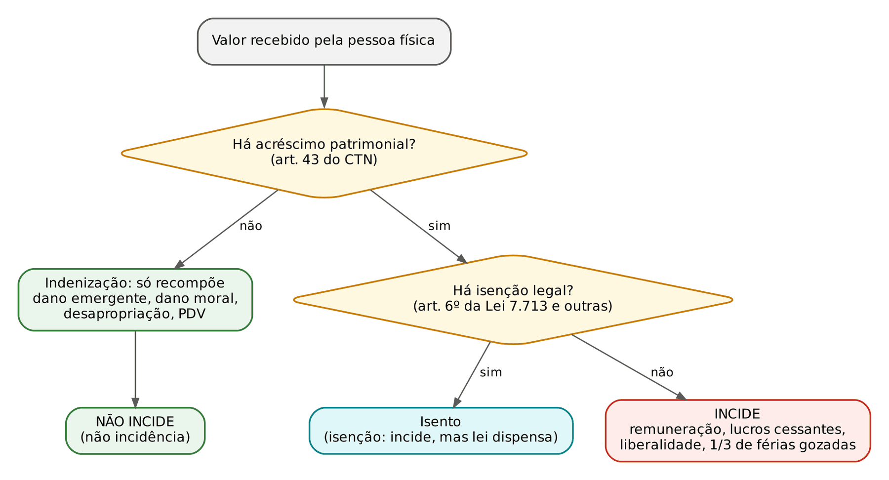
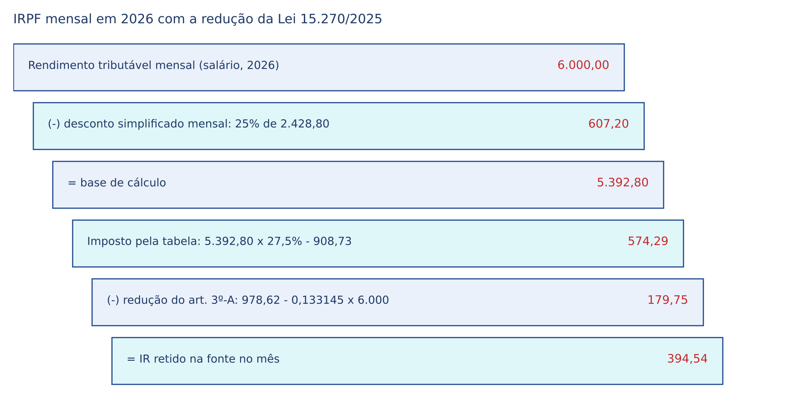
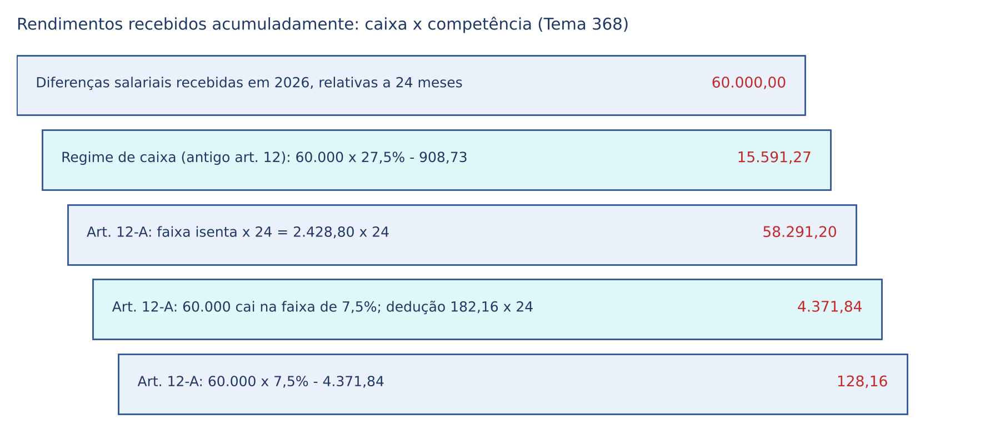
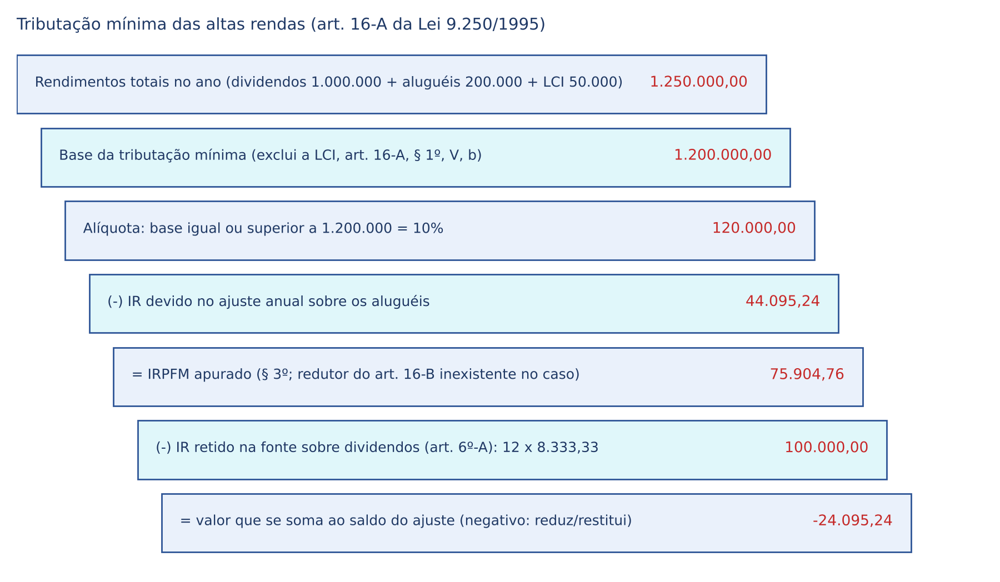
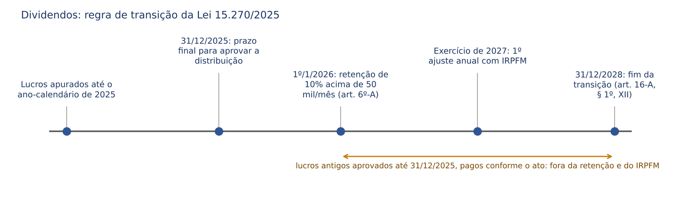

# CAPÍTULO 24 — IMPOSTOS FEDERAIS I: IMPOSTO DE RENDA DAS PESSOAS FÍSICAS E JURÍDICAS — DISPONIBILIDADE, VERBAS INDENIZATÓRIAS, ISENÇÕES, RETENÇÃO NA FONTE, GANHO DE CAPITAL, LUCROS E DIVIDENDOS, RENDIMENTOS NO EXTERIOR E TRIBUTAÇÃO MÍNIMA DAS ALTAS RENDAS

:::INCIDENCIA
TRF5 p. 11; TJSC p. 19. Nível A. Lote: 15 questões (FGV 11, FCC 4), além de correlatas de repartição (IR retido por Estados e Municípios), decadência do IRPF e *pecunia non olet*.
O que mais cai: natureza indenizatória x remuneratória das verbas (desapropriação, dano moral, férias, juros de mora), isenção por moléstia grave, previdência privada, ganho de capital, retenção na fonte pela Administração, renda mundial e lucros no exterior; novidade obrigatória: Lei 15.270/2025 (redução até 5 mil reais, retenção sobre dividendos e IRPFM).
:::

| Subtema | FGV | FCC | Padrão de cobrança |
|---|---|---|---|
| Conceito de renda e verbas indenizatórias | 2 | 0 | desapropriação, dano moral ou material, Selic na repetição, técnicos da ONU |
| Presunção de omissão de rendimentos (art. 42 da Lei 9.430) | 1 | 0 | ônus do contribuinte de provar a origem dos depósitos |
| Previdência complementar fechada | 1 | 0 | IRRF e CSLL devidos pelas entidades não imunes |
| Ganho de capital e criptoativos | 2 | 0 | integralização de capital a valor de mercado; isenção de pequeno valor |
| Renda mundial e lucros no exterior | 2 | 0 | residente estrangeira tributada no Brasil; controladas x coligadas |
| IRPJ (lucro presumido, lucro da exploração) | 2 | 0 | conceitos legais; SUDENE |
| Retenção na fonte (Administração, não residentes, IN 1.234) | 1 | 4 | quem retém, quem está dispensado, alíquota de 25% para não residente |
| Livro-caixa do delegatário de serventia | 1 | 0 | o que é dedutível (Lei 8.134/1990) |

## 24.1 O imposto de renda na Constituição e no CTN

### 24.1.1 Competência, lei complementar e critérios constitucionais

O imposto sobre "renda e proventos de qualquer natureza" é de competência privativa da União (art. 153, III, da CF). Como todo imposto discriminado na Constituição, seu fato gerador, sua base de cálculo e seus contribuintes devem ser definidos em lei complementar (art. 146, III, a): esse papel é cumprido pelos arts. 43 a 45 do CTN, recepcionado com força de lei complementar (ver Cap. 1). A instituição concreta (alíquotas, deduções, prazos) é feita por lei ordinária federal; o regulamento consolidado é o Decreto 9.580/2018 (RIR/2018), que apenas compila as leis.

O art. 153, § 2º, I, manda que o imposto seja "informado pelos critérios da generalidade, da universalidade e da progressividade, na forma da lei". A banca cobra a distinção entre os dois primeiros, que o leitor tende a confundir:

| Critério | Olha para | Significado | Exemplo de violação |
|---|---|---|---|
| Generalidade | as PESSOAS | todos os que auferem renda se submetem ao imposto, sem privilégios pessoais | isenção para uma categoria profissional pelo só fato da profissão (a Súmula 93 do STF já negava isenção ao arquiteto) |
| Universalidade | as RENDAS | toda a renda do contribuinte, de qualquer espécie e origem, compõe a base | tributar só o salário e ignorar aluguéis ou rendimentos no exterior |
| Progressividade | as ALÍQUOTAS | a alíquota cresce conforme cresce a base | alíquota única para todos os níveis de renda |

A progressividade do IR é obrigatória por força da Constituição (é a hipótese clássica de progressividade fiscal, ligada à capacidade contributiva do art. 145, § 1º; ver Cap. 5). Por isso o STF declarou inconstitucional a alíquota fixa de 25% sobre aposentadorias e pensões pagas a residentes no exterior, que desconsiderava progressividade, isonomia e capacidade contributiva (24.5.4).

:::PEGADINHA
Q2510958 (FGV 2024, Câmara dos Deputados, consultor legislativo): a alternativa que atribuía ao "princípio da generalidade" a possibilidade de tributar rendimentos de estrangeiros no Brasil estava ERRADA. O que alcança o estrangeiro residente é o critério da residência (e a universalidade, que leva a renda mundial à base), não a generalidade. A nacionalidade é irrelevante: o elemento de conexão do IRPF é a residência, não a cidadania nem a naturalização.
:::

Quanto às limitações temporais, o IR é exceção à noventena, mas não à anterioridade anual (art. 150, § 1º, da CF): lei publicada em dezembro majora o imposto já em 1º de janeiro. O detalhamento, inclusive o cancelamento da Súmula 584 do STF e a irretroatividade nos fatos geradores complexivos, está no Cap. 5 (05.3 e 05.4).

### 24.1.2 O fato gerador: disponibilidade econômica ou jurídica de acréscimo patrimonial

:::LEI CTN, art. 43
Art. 43. O impôsto, de competência da União, sôbre a renda e proventos de qualquer natureza tem como fato gerador a aquisição da disponibilidade econômica ou jurídica:
I - de renda, assim entendido o produto do capital, do trabalho ou da combinação de ambos;
II - de proventos de qualquer natureza, assim entendidos os acréscimos patrimoniais não compreendidos no inciso anterior.
§ 1º A incidência do imposto independe da denominação da receita ou do rendimento, da localização, condição jurídica ou nacionalidade da fonte, da origem e da forma de percepção.
§ 2º Na hipótese de receita ou de rendimento oriundos do exterior, a lei estabelecerá as condições e o momento em que se dará sua disponibilidade, para fins de incidência do imposto referido neste artigo.
:::

O CTN adota a teoria do acréscimo patrimonial: renda (produto do capital, do trabalho ou de ambos) e proventos (qualquer outro acréscimo, como prêmios e ganhos) só são tributáveis se aumentarem o patrimônio do contribuinte num período. A consequência prática decisiva é que o legislador ordinário NÃO pode chamar de renda o que não é acréscimo: entrada que apenas recompõe um patrimônio desfalcado (indenização por dano emergente, dano moral, desapropriação) fica fora do campo de incidência. Não se trata de isenção, mas de não incidência constitucional: o conceito de renda é extraído da Constituição e balizado pelo art. 43, e a lei não o pode deformar (art. 110 do CTN; ver Cap. 8).

A segunda chave é a disponibilidade. Disponibilidade econômica é ter o dinheiro (ou valor equivalente) efetivamente à mão, o regime de caixa; disponibilidade jurídica é ter adquirido o direito ao rendimento, exigível, ainda que não recebido, o regime de competência. O civilista entende sem esforço: a disponibilidade jurídica é o crédito já incorporado ao patrimônio. As pessoas físicas são tributadas, em regra, pelo regime de caixa (o rendimento entra quando recebido); as pessoas jurídicas do lucro real, pela competência contábil. A mera expectativa de direito, porém, não é disponibilidade: por isso o STJ afasta o IR no momento da aquisição de ações em plano de opção de compra (*stock option*), em que não há acréscimo, e o admite só na revenda com ganho (24.8.4).

O § 1º (incluído pela LC 104/2001) consagra a irrelevância da denominação e da origem: chamar a parcela de "ajuda", "bônus" ou "verba indenizatória" não muda sua natureza, e rendimentos de atividade ilícita são tributáveis (*pecunia non olet*; desenvolvido no Cap. 9, 09.3.7). O § 2º remete à lei o momento da disponibilidade da renda do exterior (24.9).

### 24.1.3 Base de cálculo, contribuinte e presunções legais

A base é o montante "real, arbitrado ou presumido, da renda ou dos proventos tributáveis" (art. 44): real quando apurada pela contabilidade ou pela declaração; presumida quando a lei manda aplicar um percentual sobre a receita bruta (lucro presumido, 24.10.2); arbitrada quando o Fisco a fixa por falta ou imprestabilidade da escrituração. Contribuinte é o titular da disponibilidade (art. 45); a fonte pagadora pode ser eleita responsável pela retenção (art. 45, parágrafo único; 24.7).

A lei também pode criar presunções relativas de renda, desde que deixe ao contribuinte a prova em contrário. O exemplo cobrado é o art. 42 da Lei 9.430/1996: caracterizam omissão de receita ou de rendimento os valores creditados em conta bancária cuja origem o titular, regularmente intimado, não comprove com documentação hábil e idônea. O STF declarou o dispositivo constitucional (Tema 842).

:::JURIS STF, Tema 842 (RE 855.649/RS, j. 30/4/2021, Info 1015)
É constitucional a tributação de valores depositados em conta bancária cuja origem não for comprovada pelo titular, pessoa física ou jurídica, desde que intimado para tanto.
:::

:::QUESTAO FGV 2025 — TRF 6ª Região — Juiz Federal Substituto (Q3742413)
Caso: a Receita encontra depósitos sem origem comprovada na conta de uma empresa de tecnologia e, após intimá-la sem resposta satisfatória, lança IR por omissão de receita. Gabarito: E, o lançamento se baseia em omissão de receita presumida, cabendo ao contribuinte intimado demonstrar documentalmente a origem dos valores. Armadilhas: ofensa à legalidade (A, C), inversão do ônus (B), "simples movimentação" (D).
:::

:::SENTENCA Depósitos bancários sem origem (art. 42 da Lei 9.430)
Onde entra: anulatória ou embargos contra lançamento por depósitos não justificados. Verifique a intimação prévia do titular e a prova, depósito a depósito (transferências entre contas próprias, valores de terceiros e empréstimos documentados afastam a presunção). Redação-modelo: "Constitucional a presunção do art. 42 da Lei 9.430/1996 (Tema 842 do STF), cabia ao autor, intimado na fase fiscal, demonstrar a origem de cada crédito; não o fez quanto aos depósitos listados." Erro punido: exigir do Fisco a prova do acréscimo patrimonial.
:::

## 24.2 Indenização x remuneração: onde incide o imposto

### 24.2.1 O critério

A pergunta é sempre a mesma: o valor recompõe patrimônio desfalcado (indenização em sentido próprio) ou acrescenta algo (remuneração, lucro cessante, liberalidade)? Só o segundo é renda, e o rótulo não decide (art. 43, § 1º): a "indenização" de horas extras remunera trabalho e é tributável.

Havendo acréscimo, verifica-se se há isenção legal (principalmente o art. 6º da Lei 7.713/1988), que se interpreta literalmente (art. 111 do CTN) e pode ser revogada; a não incidência decorre do próprio conceito de renda (Cap. 17).

### 24.2.2 Quadro das verbas: súmulas e teses

| Verba | Incide IR? | Fundamento |
|---|---|---|
| Férias não gozadas por necessidade do serviço | NÃO | Súmula 125 do STJ |
| Licença-prêmio não gozada por necessidade do serviço | NÃO | Súmula 136 do STJ |
| Férias proporcionais e respectivo adicional (na rescisão) | NÃO | Súmula 386 do STJ |
| Adicional de 1/3 sobre férias GOZADAS | SIM (remuneratório) | Tema 881 do STJ |
| Indenização por adesão a programa de demissão voluntária (PDV) | NÃO | Súmula 215 do STJ |
| Verbas pagas por mera liberalidade do empregador na rescisão | SIM | Tema 139 do STJ (Jurisprudência em Teses, ed. 28) |
| Indenização por rompimento do contrato na estabilidade provisória | NÃO | Jurisprudência em Teses do STJ, ed. 28, tese 11 |
| Indenização e aviso prévio na despedida, até o limite legal; FGTS | NÃO (isenção) | art. 6º, V, da Lei 7.713 |
| Horas extras, ainda que "indenizadas" por acordo coletivo | SIM | Súmula 463 do STJ |
| Indenização por dano moral | NÃO | Súmula 498 do STJ |
| Dano material emergente | NÃO | recompõe o patrimônio |
| Lucros cessantes | SIM | substituem renda que seria tributada |
| Indenização por desapropriação (qualquer modalidade) | NÃO | REsp 1.116.460/SP, repetitivo |
| Abono de permanência | SIM | Tema 424 do STJ; EREsp 1.596.978/RJ (sem modulação) |
| Pensão alimentícia recebida | NÃO | ADI 5.422 (24.3) |
| Juros de mora | regra SIM, com exceções | Tema 878 do STJ; Tema 808 do STF (24.2.3) |
| Selic na repetição de indébito (pessoa jurídica) | NÃO incidem IRPJ e CSLL | Tema 962 do STF (ver Cap. 16) |

A lógica das Súmulas 125 e 136 é que o pagamento substitui o descanso suprimido por imposição do empregador; já o terço de férias gozadas acompanha a remuneração e é acréscimo. Na desapropriação, embora o art. 3º, § 3º, da Lei 7.713/1988 a inclua entre as alienações do ganho de capital, o STJ, em repetitivo, afirmou que a indenização apenas substitui o bem (REsp 1.116.460/SP, Rel. Min. Luiz Fux, j. 9/12/2009).

:::QUESTAO FGV 2026 — TJ-PE — Juiz Substituto (Q4349536)
Caso: João recebe indenização judicial pela desapropriação de seu imóvel; pergunta-se sobre o IR. Gabarito: D, não incide, porque a verba é indenizatória e não representa acréscimo patrimonial. Armadilhas: (B) limita a não incidência ao que superar o custo histórico de aquisição, raciocínio de ganho de capital que o STJ afastou; (C) distingue interesse social de necessidade ou utilidade pública, distinção irrelevante; (E) generaliza que "toda transferência patrimonial" é fato gerador.
:::

:::QUESTAO FGV 2024 — Câmara dos Deputados — Consultor Legislativo (Q2510935)
Itens (V ou F): (1) é constitucional cobrar IRPJ sobre a Selic recebida na repetição do indébito; (2) segundo o STJ, não incide IR sobre indenização paga a terceiro, como no dano moral ou material; (3) os rendimentos de técnicos das Nações Unidas contratados no Brasil são isentos, conforme o STJ. Gabarito oficial: B (F, V, V). O item 1 é falso pelo Tema 962 do STF (Cap. 16). O item 2 foi dado como verdadeiro, mas exige ressalva: lucros cessantes são tributáveis (o art. 16-A, § 1º, da Lei 9.250 os ressalva). O item 3 reflete o entendimento do STJ, em repetitivo, de que os técnicos a serviço da ONU contratados no Brasil (PNUD) gozam da isenção prevista nos atos internacionais (REsp 1.306.393/DF).
:::

### 24.2.3 Juros de mora

A regra do STJ é a incidência, porque os juros de mora têm natureza de lucros cessantes. As exceções foram fixadas no Tema 878 (REsp 1.470.443/PR, j. 25/8/2021, Info 706): verbas alimentares pagas em atraso a pessoa física (dano emergente) e verba principal isenta ou fora do campo de incidência (o acessório segue o principal); também não incide sobre os juros recebidos na rescisão por perda do emprego (Jurisprudência em Teses, ed. 28, tese 4). O STF, em repercussão geral, afastou o IR sobre os juros de mora devidos pelo atraso no pagamento de remuneração por exercício de emprego, cargo ou função (Tema 808, RE 855.091/RS, j. 13/3/2021, Info 1009).

:::ESQUEMA Juros de mora e IR
| Situação | IR |
|---|---|
| Juros sobre remuneração de emprego, cargo ou função paga com atraso | NÃO (Tema 808 do STF) |
| Juros sobre verba alimentar paga em atraso a pessoa física | NÃO (Tema 878 do STJ) |
| Juros sobre verba principal isenta ou não tributável (ex.: dano moral) | NÃO (acessório segue o principal) |
| Juros sobre verbas previdenciárias pagas a destempo | SIM, salvo se o principal for isento (Jurisprudência em Teses, ed. 28, tese 10) |
| Juros sobre crédito empresarial ou contratual comum | SIM (lucros cessantes) |
| Selic recebida por pessoa jurídica na repetição de indébito | NÃO incidem IRPJ e CSLL (Tema 962 do STF; Cap. 16) |
:::

:::SENTENCA Ação contra a Fazenda que paga verbas atrasadas (servidor ou trabalhador)
Onde entra: dispositivo da condenação do ente público ou impugnação ao cumprimento em que se discute a retenção. Redação-modelo: "Sobre os juros de mora incidentes nas parcelas remuneratórias pagas em atraso não incide imposto de renda (STF, Tema 808); quanto ao principal, a retenção observará o art. 12-A da Lei 7.713/1988." Erro punido: mandar reter IR sobre o total (principal e juros) pela tabela do mês do pagamento.
:::

## 24.3 Pensão alimentícia (ADI 5.422)

Até 2022, o alimentando incluía a pensão entre seus rendimentos tributáveis, e o alimentante a deduzia (arts. 4º, II, e 8º, II, f, da Lei 9.250/1995); o art. 3º, § 1º, da Lei 7.713/1988 ainda lista os alimentos no rendimento bruto, com a anotação "Vide ADIN 5422".

Na ADI 5.422 (Rel. Min. Dias Toffoli, mérito concluído em 3/6/2022), o STF afastou o IR sobre alimentos e pensões alimentícias do direito de família: não são acréscimo patrimonial do alimentando, mas parcela da renda do alimentante, já tributada; cobrar de novo seria *bis in idem* contra a parte vulnerável. A dedução do alimentante foi preservada, e os embargos da União, inclusive o pedido de modulação, foram rejeitados em 2022.

:::PEGADINHA
"Após a ADI 5.422, o alimentante perdeu o direito de deduzir a pensão paga" está ERRADO (arts. 4º, II, e 8º, II, f, da Lei 9.250/1995: decisão judicial, acordo homologado ou escritura pública). E "a pensão é isenta" é imprecisão: o STF tratou a hipótese como não incidência (falta de acréscimo patrimonial), não como isenção legal.
:::

:::PROCESSO Repetição do IR pago sobre pensão alimentícia
Ação: repetição de indébito contra a União (o IR sobre a pensão é pago pelo próprio alimentando no ajuste, ou via carnê-leão). Prazo: cinco anos contados da extinção do crédito, que no IRPF corre da entrega da declaração de ajuste (Cap. 16, 16.4.3). Não há modulação a limitar a restituição. Juros e correção: Selic (Cap. 16). Competência: Justiça Federal (juizado especial federal, se o valor permitir). A mãe que recebe a pensão em nome da criança não é a titular do direito: legitimado é o alimentando, representado ou assistido conforme a idade.
:::

## 24.4 Isenções que mais caem: moléstia grave e previdência complementar

### 24.4.1 Moléstia grave (art. 6º, XIV e XXI, da Lei 7.713/1988)

:::LEI Lei 7.713/1988, art. 6º, XIV e XXI
Art. 6º Ficam isentos do imposto de renda os seguinte rendimentos percebidos por pessoas físicas:
XIV – os proventos de aposentadoria ou reforma motivada por acidente em serviço e os percebidos pelos portadores de moléstia profissional, tuberculose ativa, alienação mental, esclerose múltipla, neoplasia maligna, cegueira, hanseníase, paralisia irreversível e incapacitante, cardiopatia grave, doença de Parkinson, espondiloartrose anquilosante, nefropatia grave, hepatopatia grave, estados avançados da doença de Paget (osteíte deformante), contaminação por radiação, síndrome da imunodeficiência adquirida, com base em conclusão da medicina especializada, mesmo que a doença tenha sido contraída depois da aposentadoria ou reforma;
XXI - os valores recebidos a título de pensão quando o beneficiário desse rendimento for portador das doenças relacionadas no inciso XIV deste artigo, exceto as decorrentes de moléstia profissional, com base em conclusão da medicina especializada, mesmo que a doença tenha sido contraída após a concessão da pensão.
:::

A isenção tem dois requisitos cumulativos: (i) o rendimento deve ser provento de aposentadoria, reforma ou pensão; (ii) o beneficiário deve ser portador de uma das doenças da lista. A ordem dos fatos não importa (a doença pode surgir depois da aposentadoria). A finalidade é aliviar quem, já fora do mercado de trabalho, suporta os custos de tratamento.

Cinco teses resolvem quase todas as questões e sentenças:

| Ponto | Orientação | Fonte |
|---|---|---|
| Trabalhador na ativa portador de doença grave | NÃO tem a isenção; o Judiciário não pode estendê-la, sob pena de atuar como legislador positivo | ADI 6.025 (STF, j. 20/4/2020); Tema 1.037 do STJ (REsp 1.814.919/DF, j. 24/6/2020) |
| Rol de doenças | taxativo; interpretação literal (art. 111 do CTN) | Jurisprudência em Teses, ed. 28, tese 16 |
| Laudo médico oficial | dispensável em juízo, se o juiz se convencer por outros meios de prova | Súmula 598 do STJ |
| Sintomas atuais e recidiva | não se exige contemporaneidade dos sintomas nem recidiva para conceder ou manter a isenção | Súmula 627 do STJ |
| Termo inicial | data do diagnóstico comprovado, e não a da emissão do laudo oficial | Jurisprudência em Teses, ed. 28, tese 15 |

A Súmula 627 resolve o caso do aposentado operado de câncer anos atrás, hoje sem sinais da doença, de quem o órgão pagador quer retirar a isenção: o benefício se mantém, porque a neoplasia exige controle permanente e o objetivo da norma é aliviar os encargos financeiros com o acompanhamento. O art. 30 da Lei 9.250/1995 exige laudo pericial oficial para o reconhecimento administrativo; a Súmula 598 vale para o reconhecimento judicial.

:::PEGADINHA
Além das teses da tabela, a armadilha comum é estender a isenção a todos os rendimentos do aposentado doente (aluguéis, por exemplo): ela alcança só os proventos de aposentadoria, reforma ou pensão, inclusive a complementação paga por entidade de previdência privada.
:::

:::SENTENCA Ação declaratória de isenção por moléstia grave cumulada com repetição
Onde entra: ação do aposentado contra a União ou contra o ente que reteve (Súmula 447 do STJ; Tema 1.130 do STF; Caps. 7 e 16), sem prévio requerimento administrativo (Tema 1.373 do STF). Mérito: inatividade + doença do rol + prova. Dispositivo: isenção desde o diagnóstico e restituição do retido nos cinco anos, com Selic. Redação-modelo: "Comprovado por laudos de médico especialista o diagnóstico de neoplasia maligna em 10/3/2021, sendo a autora aposentada, faz jus à isenção do art. 6º, XIV, da Lei 7.713/1988 desde aquela data, independentemente de laudo oficial (Súmula 598 do STJ) e da contemporaneidade dos sintomas (Súmula 627 do STJ)." Erro punido: fixar o termo inicial no laudo oficial ou na citação; estender a isenção a rendimentos de atividade.
:::

### 24.4.2 Previdência complementar

Três frentes são cobradas.

A primeira é histórica: entre 1º/1/1989 e 31/12/1995 as contribuições do participante não eram dedutíveis e o benefício era isento; a Lei 9.250/1995 inverteu o regime. Para evitar dupla tributação, é indevido o IR sobre a complementação e o resgate na proporção das contribuições daquele período (Súmula 556 do STJ), bastando ao autor provar o recolhimento delas (Jurisprudência em Teses, ed. 28, tese 6). Na liquidação da entidade, é tributável o que couber ao participante, por rateio, acima das contribuições atualizadas (Súmula 590 do STJ).

A segunda é a dedução das contribuições pelo participante, limitada a 12% dos rendimentos tributáveis (arts. 4º, V, e 8º, II, e, da Lei 9.250; art. 11 da Lei 9.532/1997). O STJ estendeu o limite às contribuições extraordinárias destinadas a cobrir déficit do plano, porque a lei não distingue espécies de contribuição (Tema 1.224 do STJ, REsps 2.043.775/RS e outros, j. 12/11/2025, Info 871).

A terceira é a tributação das próprias entidades. O STF afirmou constitucional a cobrança de IRRF e CSLL das entidades fechadas de previdência complementar não imunes (Tema 699, RE 612.686/SC, j. 28/10/2022, Info 1074): a ausência de finalidade lucrativa não impede que elas aufiram rendimentos e resultados positivos, e elas não se confundem com instituições de assistência social imunes (a imunidade da Súmula 730 do STF exige ausência de contribuição dos beneficiários; ver Cap. 6).

:::QUESTAO FGV 2025 — TRF 1ª Região — Juiz Federal Substituto (Q3425331)
Entidade fechada de previdência (contribuições de participantes e patrocinador) autuada por IRRF e COFINS sobre aplicações e CSLL sobre resultados. Gabarito: E (improcedência da anulatória: ausência de lucro não é ausência de renda; Tema 699 do STF). Armadilha: (B) invoca a Súmula 730 do STF, que só imuniza a entidade SEM contribuição dos beneficiários. A parte da COFINS é do Cap. 26.
:::

## 24.5 IRPF: estrutura de apuração

### 24.5.1 Antecipações mensais e ajuste anual

O IRPF tem fato gerador complexivo e anual, apurado na declaração de ajuste anual (DAA) entregue no ano seguinte. Durante o ano, o imposto é antecipado pela retenção na fonte pela pessoa jurídica pagadora (art. 7º da Lei 7.713) ou pelo carnê-leão, recolhimento mensal do próprio contribuinte quando o rendimento vem de pessoa física ou do exterior. No ajuste, aplica-se a tabela anual sobre os rendimentos tributáveis menos as deduções e compensa-se o antecipado (art. 13 da Lei 9.250, na redação da Lei 15.270/2025).

Não entram no ajuste os rendimentos de tributação exclusiva ou definitiva, em que o imposto retido ou pago é o final: 13º salário, juros sobre capital próprio recebidos por pessoa física, aplicações financeiras, prêmios de loterias, ganhos de capital e, por opção, os rendimentos recebidos acumuladamente (24.6). Lançamento por homologação e decadência do IRPF: Cap. 15.

### 24.5.2 Tabela, deduções e desconto simplificado

A tabela progressiva mensal vigente desde maio de 2025 (art. 1º, XII, da Lei 11.482/2007, na redação da Lei 15.191/2025) tem cinco faixas: até 2.428,80 (dois mil, quatrocentos e vinte e oito reais e oitenta centavos), alíquota zero; depois 7,5%, 15%, 22,5% e, acima de 4.664,68 (quatro mil, seiscentos e sessenta e quatro reais e sessenta e oito centavos), 27,5%, com parcela a deduzir de 908,73 na última faixa. A tabela anual é a soma das mensais (parágrafo único do mesmo artigo).

Deduções mensais (art. 4º da Lei 9.250): dependentes (189,59 por mês), pensão alimentícia judicial ou por escritura, contribuições à previdência oficial e à complementar, parcela isenta de aposentadoria a partir dos 65 anos e despesas de livro-caixa. Alternativamente, o contribuinte pode usar o desconto simplificado mensal de 25% do limite da faixa isenta (art. 4º, § 2º), isto é, 607,20 (seiscentos e sete reais e vinte centavos). No ajuste anual somam-se a essas deduções as despesas médicas (sem limite, com comprovação) e de instrução (com limite anual por pessoa), ou se opta pelo desconto simplificado anual de 20% dos rendimentos tributáveis, limitado a 17.640 (dezessete mil, seiscentos e quarenta) reais a partir do ano-calendário de 2026 (art. 10, X, da Lei 9.250, na redação da Lei 15.270/2025).

O livro-caixa é a escrituração do autônomo pessoa física, inclusive do titular de cartório (tributado como pessoa física). O art. 6º da Lei 8.134/1990 permite deduzir da receita da atividade: (I) a remuneração paga a terceiros com vínculo empregatício e os encargos trabalhistas e previdenciários; (II) os emolumentos pagos a terceiros; (III) as despesas de custeio necessárias à percepção da receita e à manutenção da fonte produtora. O § 1º EXCLUI as quotas de depreciação de instalações, máquinas e equipamentos (e despesas de arrendamento) e as despesas de locomoção e transporte (salvo representante comercial autônomo). A Lei 15.270/2025 ainda determinou que, para o titular de cartório, os repasses obrigatórios previstos em lei incidentes sobre os emolumentos sejam excluídos da base do IRPFM (art. 16-A, § 7º).

:::QUESTAO FGV 2025 — ENAC — Exame Nacional dos Cartórios (Q3328192)
Itens sobre o que o registrador Mateus pode deduzir: (I) encargos previdenciários da remuneração de empregados; (II) quotas de depreciação de instalações; (III) despesas de locomoção e transporte. Gabarito: A (só I). Fundamento: art. 6º, I, e § 1º, a e b, da Lei 8.134/1990. A armadilha é tratar depreciação e transporte como "despesas de custeio" do inciso III: a lei as exclui expressamente.
:::

### 24.5.3 A redução de 2026: a "isenção até 5 mil reais" (Lei 15.270/2025)

A Lei 15.270, de 26/11/2025 (vigência na publicação e efeitos a partir de 1º/1/2026), NÃO alterou a tabela progressiva. Ela criou uma REDUÇÃO do imposto calculado pela tabela, que zera o imposto para quem tem rendimentos tributáveis mensais de até 5.000 (cinco mil) reais e diminui linearmente até desaparecer em 7.350 (sete mil, trezentos e cinquenta) reais (art. 3º-A da Lei 9.250). No ajuste anual, a redução equivalente zera o imposto para rendimentos tributáveis de até 60.000 (sessenta mil) reais e se extingue em 88.200 (oitenta e oito mil e duzentos) reais (art. 11-A, a partir do exercício de 2027). A redução se aplica também ao 13º salário (art. 3º-A, § 3º) e fica limitada ao imposto calculado pela tabela (§ 1º).

:::LEI Lei 9.250/1995, art. 3º-A (incluído pela Lei 15.270/2025)
Art. 3º-A. A partir do mês de janeiro do ano-calendário de 2026, será concedida redução do imposto sobre os rendimentos tributáveis sujeitos à incidência mensal do Imposto sobre a Renda das Pessoas Físicas, de acordo com a seguinte tabela: [até R$ 5.000,00: redução de até R$ 312,89 (de modo que o imposto devido seja zero); de R$ 5.000,01 até R$ 7.350,00: R$ 978,62 - (0,133145 x rendimentos tributáveis sujeitos à incidência mensal) (de modo que a redução do imposto seja decrescente linearmente até zerar para rendimentos a partir de R$ 7.350,00)]
§ 2º Os contribuintes que tiverem rendimentos tributáveis sujeitos à incidência mensal superior a R$ 7.350,00 (sete mil, trezentos e cinquenta reais) não terão redução no imposto devido.
:::

Por que 312,89? Porque é exatamente o imposto de quem ganha 5.000 reais e usa o desconto simplificado: base de 5.000 − 607,20 = 4.392,80; pela tabela, 4.392,80 × 22,5% − 675,49 = 312,89. A redução "devolve" esse valor e o imposto zera. Tecnicamente, portanto, não se trata de nova faixa de isenção nem de alteração da faixa de alíquota zero, mas de dedução do imposto devido; a prova pode explorar a expressão popular "isenção até 5 mil" para testar se o candidato sabe que a tabela permaneceu a mesma.

:::EXEMPLO Dois salários em 2026
Ana ganha 5.000 reais: imposto pela tabela de 312,89, redução de 312,89, imposto zero. Bruno ganha 6.000 reais: imposto pela tabela de 574,29 (escada acima), redução de 179,75 (978,62 − 0,133145 × 6.000), imposto de 394,54. Carla ganha 8.000 reais: acima de 7.350, sem redução; paga o imposto da tabela. Note que a redução usa o RENDIMENTO tributável (6.000), e não a base já deduzida (5.392,80).
:::

A perda dos fundos de participação (art. 159, I, da CF; Cap. 7) é compensada pela União, se a receita nova não bastar (art. 4º da Lei 15.270).

### 24.5.4 Não residentes

Quem não reside no Brasil é tributado apenas pela renda de fonte brasileira, em regra por retenção exclusiva na fonte (o não residente não faz ajuste). As alíquotas variam conforme a natureza do rendimento; para rendimentos do trabalho, com ou sem vínculo, e para serviços em geral, a alíquota geral é de 25%, ao passo que juros, royalties e serviços técnicos costumam ter alíquotas de 15% (as Súmulas 586 e 587 do STF afirmam a incidência sobre juros de mútuo remetidos ao exterior e sobre serviços técnicos contratados no exterior e prestados no Brasil).

O STF, porém, declarou inconstitucional a sujeição à alíquota fixa de 25% (art. 7º da Lei 9.779/1999, na redação da Lei 13.315/2016) dos rendimentos de aposentadoria e pensão pagos a residentes no exterior, por violar isonomia, proporcionalidade, capacidade contributiva, não confisco e progressividade: o aposentado que se muda para o exterior pagaria muito mais do que o residente com o mesmo provento (Tema 1.174, ARE 1.327.491/SC, j. 21/10/2024, Info 1155).

:::QUESTAO FCC 2025 — TRT 15ª Região — Analista (Contabilidade) (Q3288595)
Caso: empresa brasileira contrata pessoa residente no exterior, sem vínculo empregatício, para confeccionar e fornecer um produto que não é serviço técnico nem assistência técnica ou administrativa. Gabarito: E, IR na fonte à alíquota de 25%, por se tratar de rendimento do trabalho, ainda que sem vínculo. Armadilhas: (B) tabela progressiva (só para residentes); (C) não incidência por residir no exterior (a fonte é brasileira); (D) 15% (alíquota de serviços técnicos e de outros rendimentos específicos). Observação: o Tema 1.174 do STF afastou os 25% apenas para aposentadorias e pensões; não alcança a remuneração do trabalho.
:::

## 24.6 Rendimentos recebidos acumuladamente (RRA)

Quando o contribuinte recebe de uma só vez, normalmente por força de sentença, rendimentos que deveriam ter sido pagos mês a mês em anos anteriores (diferenças salariais, benefício previdenciário atrasado), o regime de caixa puro do antigo art. 12 da Lei 7.713 jogava todo o montante na faixa de 27,5% do mês do pagamento. O contribuinte era duplamente penalizado: não recebeu na época e, ao receber, pagou alíquota maior do que pagaria se o devedor tivesse cumprido a obrigação.

O STF declarou inconstitucional essa aplicação: a alíquota deve ser a correspondente ao rendimento mês a mês (regime de competência), e não a que incidiria sobre o total pago de uma só vez (Tema 368, RE 614.406/RS, Red. p/ acórdão Min. Marco Aurélio, j. 23/10/2014, Info 764). Os fundamentos são a isonomia e a capacidade contributiva.

O legislador já havia incorporado essa lógica no art. 12-A da Lei 7.713 (Leis 12.350/2010 e 13.149/2015): os RRA de anos-calendário anteriores são tributados exclusivamente na fonte, em separado, por uma tabela obtida multiplicando os valores da tabela mensal do mês do recebimento pelo número de meses a que se referem os rendimentos; podem ser excluídas as despesas com a ação judicial, inclusive honorários pagos pelo contribuinte sem indenização, e deduzidas pensão alimentícia e contribuição previdenciária; o contribuinte pode optar, de forma irretratável, por levar tudo ao ajuste anual (§ 5º). Se os RRA são do próprio ano-calendário em curso, aplica-se o art. 12-B (tributação no mês do recebimento, deduzidas as despesas judiciais).

:::EXEMPLO Diferenças salariais de 24 meses
Pedro recebe em 2026, por sentença, 60.000 (sessenta mil) reais de diferenças relativas a 24 meses de 2023 e 2024 (2.500 por mês). Pelo regime de caixa, pagaria 15.591,27. Pelo art. 12-A, a faixa isenta vira 2.428,80 × 24 = 58.291,20 e a faixa de 7,5% vai até 2.826,65 × 24 = 67.839,60; os 60.000 caem nesta faixa: 60.000 × 7,5% − (182,16 × 24) = 4.500,00 − 4.371,84 = 128,16. A diferença mostra por que o tema é relevante na execução contra a Fazenda e na liquidação de sentença trabalhista ou previdenciária.
:::

:::SENTENCA Retenção do IR sobre valores atrasados
Onde entra: cumprimento de sentença contra a Fazenda (RPV ou precatório), sentença previdenciária, ação de repetição do IR retido a maior sobre atrasados. Redação-modelo: "Os valores recebidos acumuladamente sujeitam-se ao imposto de renda pelo regime de competência, com observância das tabelas e alíquotas vigentes nas datas em que deveriam ter sido pagos (STF, Tema 368), na forma do art. 12-A da Lei 7.713/1988, excluídas da base as despesas com a ação e os juros de mora sobre parcelas remuneratórias (STF, Tema 808)." Erro punido: aplicar a tabela do mês do pagamento sobre o total.
:::

## 24.7 Retenção na fonte e responsabilidade da fonte pagadora

### 24.7.1 Natureza da retenção

A fonte pagadora que deve reter é responsável tributária por substituição (art. 45, parágrafo único, e art. 128 do CTN; teoria no Cap. 10): a lei a coloca no polo passivo para facilitar a arrecadação, já que ela controla o pagamento. Duas situações devem ser distinguidas:

- Retenção como antecipação (salários, serviços): se a fonte não retém, o titular da renda continua obrigado a oferecê-la no ajuste; pela orientação administrativa da Receita, até o prazo do ajuste o imposto é exigido da fonte e, depois dele, do beneficiário, respondendo a fonte pelas penalidades.
- Retenção exclusiva ou definitiva (13º salário, JCP a pessoa física, não residentes): o imposto retido é o final, e a responsabilidade da fonte é mais intensa, porque não há ajuste daquele rendimento.

Se a fonte retém e não recola, o contribuinte que comprova a retenção não pode ser cobrado: o imposto foi descontado de seu patrimônio, e a apropriação indébita do valor retido é problema entre o Fisco e a fonte (com reflexos penais: art. 2º, II, da Lei 8.137/1990, ver Apostila de Direito Penal).

### 24.7.2 Retenção pela Administração Pública

Na esfera federal, os órgãos, autarquias e fundações da Administração federal (e, por extensão legal, as empresas públicas e sociedades de economia mista federais) retêm na fonte IR, CSLL, COFINS e PIS sobre pagamentos a pessoas jurídicas por bens e serviços (art. 64 da Lei 9.430/1996 e art. 34 da Lei 10.833/2003), segundo a IN RFB 1.234/2012, que traz uma lista de beneficiários dispensados da retenção (entre eles Itaipu Binacional, entidades com imunidade ou isenção específica, conselhos de fiscalização profissional, serviços sociais autônomos e pessoas jurídicas optantes pelo Simples Nacional, além de certas operações, como a distribuição de jornais e revistas).

Estados, DF e Municípios retêm o IR na fonte sobre os rendimentos que pagam e, por força dos arts. 157, I, e 158, I, da CF, o produto dessa retenção lhes pertence, inclusive quando o pagamento remunera pessoas jurídicas contratadas para fornecer bens ou prestar serviços (Tema 1.130 do STF; desenvolvido no Cap. 7, 7.2.1). A ação de restituição do servidor é proposta contra o ente que reteve (Súmula 447 do STJ; Cap. 16).

:::QUESTAO FGV 2024 — CVM — Analista (Contabilidade Pública) (Q2517527)
Pergunta-se qual pessoa jurídica, recebendo pagamento da Administração federal, SOFRE a retenção dos tributos federais segundo a IN RFB 1.234/2012. Gabarito: C, o sindicato de empregadores. As demais (Itaipu Binacional, conselho de fiscalização profissional, distribuidora exclusiva de jornais e revistas, serviço social autônomo) estão entre as hipóteses de dispensa. Armadilha: só o sindicato de TRABALHADORES é imune (art. 150, VI, c, da CF; Cap. 6).
:::

:::QUESTAO FCC 2026 — TJ-CE — Analista Judiciário (Ciências Contábeis) (Q4245619)
Autarquia municipal contrata pessoa jurídica de limpeza. Gabarito: D (a autarquia retém o IR, observadas as hipóteses e alíquotas legais; o valor lhe pertence, Tema 1.130). Erradas: retenção só em construção civil (A), retenção da optante do Simples (B), dispensa da autarquia (C), mera informação (E). No mesmo sentido: FCC 2025 — TRT 15ª Região (Q3288592), gabarito D (retenção de 1,5% sobre pagamentos a cooperativas de trabalho e retenção individualizada por consorciada; o item III é do Cap. 26). Correlata: FCC 2025 — MPE-PI (Q3819254), retenção por estatais.
:::

:::PROCESSO Quem é o réu na discussão do IR retido
| Situação | Réu | Justiça |
|---|---|---|
| IR retido por empregador privado ou pelo INSS | União | Federal |
| IR retido pelo Estado ou DF sobre servidores ou contratados | Estado ou DF (Súmula 447 do STJ; Tema 1.130 do STF) | Estadual |
| IR retido pelo Município | Município | Estadual |
| Fonte privada que reteve indevidamente e não repassou | discussão com a União (titular); a fonte só responde em ação própria, de natureza civil | Federal (contra a União) |
A fonte pagadora privada não tem legitimidade passiva na repetição do indébito: ela apenas cumpre o dever legal de reter; quem recebeu o tributo é a União. Prazos e juros: Cap. 16.
:::

## 24.8 Ganho de capital e investimentos

### 24.8.1 Conceito e apuração

Ganho de capital é a diferença positiva entre o valor de alienação de um bem ou direito e seu custo de aquisição (art. 3º, § 2º, da Lei 7.713/1988). "Alienação" é tomada em sentido amplo: compra e venda, permuta, dação em pagamento, doação, cessão de direitos, promessa de compra e venda e contratos afins (art. 3º, § 3º). A pessoa física apura o ganho em separado, mês a mês, e o imposto é definitivo (não entra no ajuste). Desde 2017, as alíquotas são progressivas por faixa do ganho (art. 21 da Lei 8.981/1995, na redação da Lei 13.259/2016): 15% até 5 (cinco) milhões de reais; 17,5% de 5 a 10 milhões; 20% de 10 a 30 milhões; 22,5% acima de 30 milhões.

As isenções mais cobradas estão na Lei 9.250/1995: alienação de bens de pequeno valor, cujo preço unitário no mês seja de até 35.000 (trinta e cinco mil) reais (art. 22, II, na redação da Lei 11.196/2005), considerado o conjunto dos bens da mesma natureza alienados no mês; e alienação do único imóvel do titular por até 440.000 (quatrocentos e quarenta mil) reais, se não houve outra alienação de imóvel nos cinco anos anteriores (art. 23). A lei prevê ainda fatores de redução do ganho conforme a data de aquisição do imóvel e isenção para o produto da venda de imóvel residencial aplicado na compra de outro imóvel residencial em 180 dias (arts. 39 e 40 da Lei 11.196/2005).

### 24.8.2 Integralização de capital com bens

A pessoa física pode transferir bens a uma pessoa jurídica, para integralizar capital, pelo valor constante de sua declaração de bens ou pelo valor de mercado (art. 23 da Lei 9.249/1995). Se usar o valor da declaração, não há ganho; se usar valor superior, "a diferença a maior será tributável como ganho de capital" (§ 2º). A escolha é do sócio; a tributação é consequência dela. O ITBI na integralização é outro problema (imunidade do art. 156, § 2º, I, da CF; ver Cap. 29).

:::QUESTAO FGV 2026 — TJ-MS — Delegações de Notas e de Registro (Q3914519)
Caso: Carlos integraliza capital com imóvel comprado em 2000 por 400.000 reais, avaliado em 1.200.000 reais. Gabarito: B, é legítima a incidência do IR sobre o ganho de capital correspondente à diferença entre o valor de aquisição e o de incorporação. Armadilhas: integralização "não é alienação" (A; é, pois transfere a propriedade em troca de quotas); reinvestimento em 180 dias (C; só venda de residencial aplicada em outro residencial); limite de 1 milhão (D); fatores de redução integrais (E). Pelo valor declarado, não haveria ganho.
:::

### 24.8.3 Criptoativos

A alienação de criptoativos com lucro gera ganho de capital, e a isenção de pequeno valor (35.000 reais de alienações no mês) se aplica, porque a lei não a exclui para esses ativos. As corretoras (*exchanges*) domiciliadas no Brasil prestam informações à Receita sobre as operações, e o próprio investidor informa operações feitas no exterior ou fora de corretoras, conforme normas da Receita. Criptoativos mantidos no exterior passaram a ser tratados como aplicações financeiras no exterior pela Lei 14.754/2023 (art. 3º, § 1º, I, "ativos virtuais"), com o regime anual de 15% (24.9.2).

:::QUESTAO FGV 2024 — Câmara dos Deputados — Consultor Legislativo (Q2510970)
Itens: (I) não haveria limite de isenção para alienação de criptoativos, ao contrário das ações; (II) a exchange brasileira deve prestar informações à Receita; (III) a venda com lucro gera ganho de capital. Gabarito: D (II e III). O item I é falso porque a isenção de pequeno valor alcança os criptoativos.
:::

### 24.8.4 Aplicações financeiras, bolsa e *stock options*

Rendimentos de aplicações financeiras de renda fixa no Brasil sofrem retenção exclusiva na fonte, com alíquotas regressivas conforme o prazo da aplicação; ganhos em bolsa são apurados mensalmente pelo ganho líquido, com regras próprias. Certos títulos ligados a setores incentivados (LCI, LCA, CRI, CRA, debêntures de infraestrutura) e a poupança são isentos para pessoa física; a Lei 15.270/2025 os excluiu também da base do IRPFM (24.11.3).

No plano de opção de compra de ações (*Stock Option Plan*, art. 168, § 3º, da Lei 6.404/1976), o STJ entendeu que a relação tem natureza mercantil: não incide IRPF quando o empregado adquire as ações da companhia, por falta de acréscimo patrimonial, mas incide sobre o ganho de capital quando ele as revender (Tema 1.226 do STJ, REsps 2.069.644/SP e 2.074.564/SP, j. 11/9/2024, Info 825). O Fisco pretendia tratar a diferença entre o valor de mercado e o preço de exercício como remuneração, tributável pela tabela progressiva no momento da compra.

Para as pessoas jurídicas, o IR e a CSLL incidem sobre a correção monetária das aplicações financeiras, que integra a receita financeira (Tema 1.160 do STJ, REsp 1.986.304/RS, j. 8/3/2023); e o STF julgou constitucional o IR sobre o resultado positivo da liquidação de contratos de *swap* para fins de *hedge* (Tema 185, RE 1.224.696/SP, j. 7/6/2021).

## 24.9 Rendimentos e ativos no exterior

### 24.9.1 Residência e renda mundial

Pela universalidade, a pessoa física residente no Brasil é tributada por toda a renda que aufere no mundo (*worldwide income*), qualquer que seja sua nacionalidade; o não residente, só pela renda de fonte brasileira (24.5.4). O imposto pago no exterior pode ser compensado com o brasileiro se houver tratado para evitar a dupla tributação ou reciprocidade de tratamento (art. 4º da Lei 14.754/2023, para aplicações financeiras; o mecanismo dos tratados é explicado no Cap. 8, 08.9.2).

:::QUESTAO FGV 2024 — Câmara dos Deputados — Consultor Legislativo (Q2510958)
Caso: Francesca, italiana que vive e trabalha no Ceará há dois anos, recebe em banco de Roma o aluguel de seu apartamento na Itália. Gabarito: A, os aluguéis devem ser oferecidos à tributação no Brasil, porque ela é residente. Armadilhas: (B) renda mantida no exterior não seria alcançável (é, pela universalidade); (C) o Brasil não teria tratado com a Itália (tem convenção para evitar a dupla tributação, o que permite compensar o imposto italiano nos termos dela); (D) o fundamento seria a generalidade (é a residência); (E) exigiria naturalização.
:::

### 24.9.2 Lei 14.754/2023: aplicações financeiras, controladas (*offshores*) e *trusts*

A Lei 14.754/2023 reorganizou a tributação da renda de pessoas físicas residentes obtida por meio de aplicações, empresas e *trusts* no exterior, a partir de 1º/1/2024. Os rendimentos são declarados em ficha própria da DAA, separados dos demais, e tributados à alíquota de 15% sobre a parcela anual, sem deduções (art. 2º).

| Instituto | Regra da Lei 14.754/2023 |
|---|---|
| Aplicações financeiras no exterior (depósitos remunerados, fundos, títulos, ativos virtuais, participações não controladas) | 15% no ajuste anual, quando efetivamente percebidos (resgate, alienação, vencimento, recebimento de juros); compensação de perdas com ganhos da mesma ficha (art. 9º) |
| Variação cambial | não tributada sobre depósitos não remunerados em conta no exterior; moeda em espécie isenta até alienações de 5.000 dólares no ano (art. 2º, §§ 3º e 4º) |
| Entidade controlada (*offshore*) em paraíso fiscal ou com renda ativa própria inferior a 60% da renda total | lucros tributados em 31/12 de cada ano, independentemente de distribuição, na proporção da participação (art. 5º) |
| Controlada que não se enquadra nessas hipóteses | tributação só na efetiva disponibilização (pagamento, crédito, remessa ou empréstimo ao sócio) (art. 6º); opção pelo regime do art. 5º (art. 6º-A) |
| Opção pela "transparência" | declarar os bens da controlada como se fossem da pessoa física, irretratavelmente (art. 8º) |
| *Trust* | bens permanecem do instituidor; passam ao beneficiário na distribuição ou na morte do instituidor, o que ocorrer primeiro; essa transmissão é doação ou herança (art. 10) |

Ao qualificar a passagem dos bens ao beneficiário como doação ou herança, a lei aproxima o *trust* do ITCMD estadual (Cap. 30).

### 24.9.3 Pessoas jurídicas: lucros de controladas e coligadas no exterior

O art. 43, § 2º, do CTN autorizou a lei a fixar o momento da disponibilidade da renda do exterior. O art. 74 da MP 2.158-35/2001 considerou disponibilizados, na data do balanço (31 de dezembro), os lucros de controladas e coligadas no exterior, ainda que não distribuídos. O STF, na ADI 2.588 e no RE 541.090/SC (desenvolvidos no Cap. 8, 08.9.3) e no RE 611.586/PR (Tema 537, j. 10/4/2013), fixou: a regra vale para empresas nacionais CONTROLADORAS de pessoas jurídicas sediadas em países de tributação favorecida ou sem controles adequados (paraísos fiscais); NÃO vale para coligadas sediadas em países sem tributação favorecida (mera apuração contábil não é disponibilidade); e não pode retroagir aos lucros apurados até 31/12/2001. Hoje a matéria é regida pela Lei 12.973/2014, que tributa os lucros das controladas no exterior ao fim de cada ano e os das coligadas, em regra, quando disponibilizados.

:::QUESTAO FGV 2026 — TJ-GO — Juiz Substituto (Q3966706)
Caso: empresa brasileira tem lucros de controlada e de coligada, ambas sediadas em países sem tributação favorecida; o Fisco tributa tudo em 31/12, sem distribuição. Gabarito: B, a exigência só é compatível com a Constituição quanto aos lucros de CONTROLADA, ressalvada a vedação de retroatividade. Para coligada em país sem tributação favorecida o STF afastou a regra; para controlada fora de paraíso a ADI 2.588 não formou maioria com eficácia geral, e a banca seguiu a tese da disponibilidade jurídica da controladora (ver nota). Erradas: (A) basta a apuração em balanço; (C) participação relevante sem controle; (D) coligada; (E) qualquer investida.
:::

## 24.10 IRPJ: regimes de apuração e pontos jurisprudenciais

### 24.10.1 Alíquotas e regimes

O IRPJ tem alíquota de 15% sobre o lucro, mais adicional de 10% sobre a parcela que exceder 20.000 (vinte mil) reais multiplicados pelo número de meses do período de apuração (art. 3º da Lei 9.249/1995). O adicional é instrumento de progressividade (Q3085993, FGV 2024, DATAPREV, cobrou-o como consequência da progressividade; ver Cap. 5). A empresa apura o lucro por um destes regimes:

| Regime | Base | Para quem | Observação |
|---|---|---|---|
| Lucro real | lucro contábil ajustado por adições, exclusões e compensações previstas em lei | obrigatório para grandes empresas (receita acima do limite legal), instituições financeiras, quem tem lucros do exterior e outros; opcional para os demais | permite deduzir despesas necessárias e compensar prejuízos fiscais, limitada a compensação a 30% do lucro de cada período |
| Lucro presumido | percentual legal aplicado sobre a receita bruta (8% em regra; 32% para serviços em geral; 1,6% para revenda de combustíveis; 16% para transporte de passageiros) | opcional para quem não está obrigado ao lucro real | desde 2026, acréscimo de 10% nos percentuais sobre a receita bruta anual que exceder 5 milhões de reais (LC 224/2025, art. 4º, § 4º, VII, e § 5º; para a CSLL, noventena, art. 14, I, a) |
| Lucro arbitrado | percentual sobre a receita conhecida, majorado, ou outros critérios legais | quando a escrituração falta, é imprestável ou não se cumprem obrigações | forma de lançamento de ofício; o próprio contribuinte pode arbitrar se conhecida a receita |
| Simples Nacional | percentual único sobre a receita, abrangendo vários tributos | ME e EPP optantes | ver Cap. 31 |

:::QUESTAO FGV 2024 — DATAPREV — Analista (Contabilidade) (Q3085989)
Pergunta-se o nome do regime em que a pessoa jurídica é tributada por percentual predefinido de lucratividade sobre a receita bruta. Gabarito: D, lucro presumido (art. 44 do CTN: base "presumida"). Distratores: lucro real, lucro da exploração, Imposto Seletivo e ICMS.
:::

No lucro real, despesas operacionais são dedutíveis quando necessárias, usuais ou normais (Lei 4.506/1964; RIR/2018). Pontos firmados pelos tribunais:

- Compensação de prejuízos: é constitucional a "trava" de 30% do lucro de cada período, no IRPJ e na CSLL, porque o abatimento é benefício que a lei pode conformar (STF, RE 591.340/SP, j. 27/6/2019).
- CSLL: não pode ser deduzida da base do próprio IRPJ (STF, Tema 75, RE 582.525/SP, j. 9/5/2013); a lei pode vedar a dedução de despesa que não é custo da atividade.
- Benefícios fiscais de ICMS: não se excluem da base do IRPJ e da CSLL, salvo atendidos os requisitos legais (Tema 1.182 do STJ, REsp 1.945.110/RS, j. 26/4/2023); o crédito presumido de ICMS não integra a base (Jurisprudência em Teses do STJ, ed. 121). A matéria foi reformulada pela Lei 14.789/2023 (subvenções para investimento; ver Cap. 17, 17.7).
- Selic na repetição de indébito: fora da base do IRPJ e da CSLL (Tema 962 do STF; ver Cap. 16).

### 24.10.2 Lucro presumido: o que integra a receita bruta

Como o lucro presumido parte da receita bruta, o STJ, em sequência de repetitivos, recusou exclusões não previstas em lei, rejeitando a analogia com a exclusão do ICMS da base do PIS e da COFINS (Tema 69 do STF, construído sobre o conceito constitucional de faturamento, art. 195, I, b): o ICMS (Tema 1.008, REsp 1.767.631/SC, j. 10/5/2023), o ISS (Tema 1.240, REsps 2.089.298/RN e 2.089.356/RN, j. 11/9/2024) e o próprio PIS e COFINS (Tema 1.312, REsps 2.151.903/RS e outros, j. 11/3/2026, Info 881) compõem a base do IRPJ e da CSLL no lucro presumido. Razão comum: quem opta pela simplificação abre mão de deduções; quem quer deduzir tributos e custos deve optar pelo lucro real.

:::PEGADINHA
"Por analogia ao Tema 69 do STF, o ICMS deve ser excluído da base do IRPJ apurado pelo lucro presumido" está ERRADO (Temas 1.008, 1.240 e 1.312 do STJ). A tese do "ICMS não é receita" vale para o PIS e a COFINS, pela leitura do art. 195, I, b, da CF (Cap. 26), e não se transporta ao lucro presumido, que é regime optativo.
:::

### 24.10.3 Juros sobre capital próprio (JCP)

O JCP é forma de remunerar sócios e acionistas pelo capital investido, calculada sobre contas do patrimônio líquido e limitada à variação da TJLP (art. 9º da Lei 9.249/1995). Para a pessoa jurídica que paga, é despesa dedutível no lucro real (o que o diferencia do dividendo); para quem recebe, sofre retenção na fonte de 17,5% (alíquota elevada de 15% para 17,5% pela LC 224/2025, art. 8º, com efeitos a partir de 1º/1/2026, nos termos do art. 14, III, da LC; o IR não se sujeita à noventena). A retenção é definitiva para a pessoa física e antecipação para a pessoa jurídica do lucro real. A Lei 14.789/2023 restringiu as contas do patrimônio líquido que compõem a base do JCP, a partir de 1º/1/2024 (art. 9º, §§ 8º a 8º-C).

O STJ admitiu a dedução, no IRPJ e na CSLL, de JCP relativos a exercícios anteriores ao da deliberação assemblear que autoriza o pagamento (Tema 1.319, REsps 2.162.629/PR e outros, j. 12/11/2025, Info 871): a lei não exige que a dedução se faça no próprio exercício de apuração.

### 24.10.4 Lucro da exploração

Lucro da exploração é a base sobre a qual se calculam incentivos regionais de redução do IRPJ (SUDENE e SUDAM) para empreendimentos industriais ou agrícolas aprovados e instalados na área de atuação dessas superintendências. Parte-se do lucro líquido do período, ajustado por exclusões de resultados não operacionais e de receitas financeiras, e o benefício reduz o imposto proporcionalmente.

:::QUESTAO FGV 2024 — Câmara dos Deputados — Consultor Legislativo (Q2510955)
Itens: (I) o lucro da exploração parte do lucro líquido antes de deduzida a CSLL; (II) os benefícios se aplicam a empreendimentos industriais ou agrícolas aprovados e instalados na área da SUDENE; (III) as subvenções para investimento não podem ser excluídas do lucro líquido nessa apuração. Gabarito oficial: A (só II). Os itens I e III foram dados como falsos pela legislação específica do lucro da exploração (art. 19 do Decreto-Lei 1.598/1977); questão contábil-fiscal, rara em prova de magistratura.
:::

## 24.11 Lucros e dividendos e tributação mínima das altas rendas (Lei 15.270/2025)

### 24.11.1 O ponto de partida: a isenção de 1996

Desde 1996, os lucros e dividendos não sofrem retenção nem integram a base do IR do beneficiário (art. 10 da Lei 9.249/1995): o lucro seria tributado uma só vez, na pessoa jurídica (IRPJ de 15% + adicional de 10% + CSLL de 9% = 34% nominais). Na prática, sócios de empresas do lucro presumido e de setores incentivados recebiam lucros com carga efetiva baixa. A Lei 15.270/2025 manteve a regra geral de isenção, mas a submeteu a duas exceções: a retenção mensal sobre dividendos elevados (art. 6º-A) e a tributação mínima anual (art. 16-A), ambas inseridas na Lei 9.250/1995.

:::LEI Lei 9.249/1995, art. 10, caput e § 4º (redação da Lei 15.270/2025)
Art. 10. Os lucros ou dividendos calculados com base nos resultados apurados a partir do mês de janeiro de 1996, pagos ou creditados pelas pessoas jurídicas tributadas com base no lucro real, presumido ou arbitrado, não ficarão sujeitos à incidência do imposto de renda na fonte, nem integrarão a base de cálculo do imposto de renda do beneficiário, pessoa física ou jurídica, domiciliado no País, observado o disposto nos arts. 6º-A e 16-A da Lei nº 9.250, de 26 de dezembro de 1995.
§ 4º Os lucros ou dividendos pagos, creditados, entregues, empregados ou remetidos ao exterior ficarão sujeitos à incidência do imposto de renda na fonte à alíquota de 10% (dez por cento).
:::

### 24.11.2 Retenção mensal sobre dividendos (art. 6º-A da Lei 9.250)

A partir de janeiro de 2026, o pagamento de lucros e dividendos por UMA MESMA pessoa jurídica a UMA MESMA pessoa física residente em montante superior a 50.000 (cinquenta mil) reais num mesmo mês sujeita-se à retenção de 10% sobre o TOTAL pago (e não só sobre o excedente), sem deduções; havendo vários pagamentos no mês, recalcula-se sobre a soma. Não se sujeitam à retenção os lucros relativos a resultados apurados até 2025, cuja distribuição tenha sido aprovada até 31/12/2025 e que sejam pagos nos termos originalmente previstos no ato de aprovação (§ 3º). A retenção é ANTECIPAÇÃO: será deduzida do IRPFM apurado no ajuste (art. 16-A, § 5º).

Para beneficiários no exterior, a retenção é de 10% sobre todo dividendo remetido (art. 10, § 4º, da Lei 9.249), com exceções para governos estrangeiros com reciprocidade, fundos soberanos e entidades previdenciárias no exterior (§ 5º, II), e com crédito opcional ao beneficiário quando a soma da alíquota efetiva da empresa com os 10% superar a soma das alíquotas nominais do IRPJ e da CSLL (art. 10-A).

:::PEGADINHA
Três detalhes que a banca vai testar: (1) o limite de 50 mil reais é por fonte pagadora e por beneficiário, mensal; quem recebe 40 mil de cada uma de três empresas no mesmo mês não sofre retenção (mas pode ser alcançado pelo IRPFM no ano); (2) superado o limite, os 10% incidem sobre o total, e não sobre o que excede 50 mil; (3) a isenção do art. 10 da Lei 9.249 NÃO foi revogada: continua sendo a regra, ressalvados os arts. 6º-A e 16-A.
:::

### 24.11.3 Tributação mínima anual: o IRPFM (art. 16-A da Lei 9.250)

O imposto mínimo não é um imposto novo: é uma camada do próprio IRPF, apurada na declaração de ajuste a partir do exercício de 2027 (ano-calendário de 2026), que garante que a pessoa física de renda alta pague ao menos uma alíquota efetiva mínima sobre o conjunto de seus rendimentos, inclusive os isentos e os de tributação exclusiva.

:::LEI Lei 9.250/1995, art. 16-A, caput, § 2º e § 3º (incluídos pela Lei 15.270/2025)
Art. 16-A. A partir do exercício de 2027, ano-calendário de 2026, a pessoa física cuja soma de todos os rendimentos recebidos no ano-calendário seja superior a R$ 600.000,00 (seiscentos mil reais) fica sujeita à tributação mínima do Imposto sobre a Renda das Pessoas Físicas, nos termos deste artigo.
§ 2º A alíquota da tributação mínima do Imposto sobre a Renda das Pessoas Físicas será fixada com base nos rendimentos apurados nos termos do § 1º deste artigo, observado o seguinte:
I - para rendimentos iguais ou superiores a R$ 1.200.000,00 (um milhão e duzentos mil reais), a alíquota será de 10% (dez por cento); e
II - para rendimentos superiores a R$ 600.000,00 (seiscentos mil reais) e inferiores a R$ 1.200.000,00 (um milhão e duzentos mil reais), a alíquota crescerá linearmente de 0 (zero) a 10% (dez por cento), conforme a seguinte fórmula: Alíquota % = (REND/60.000) - 10 [...]
§ 3º O valor devido da tributação mínima do Imposto sobre a Renda das Pessoas Físicas será apurado a partir da multiplicação da alíquota pela base de cálculo, com a dedução:
I - do Imposto sobre a Renda das Pessoas Físicas devido na declaração de ajuste anual, calculado nos termos do art. 12 desta Lei;
II - do Imposto sobre a Renda das Pessoas Físicas retido exclusivamente na fonte incidente sobre os rendimentos incluídos na base de cálculo da tributação mínima do imposto;
III - do Imposto sobre a Renda das Pessoas Físicas apurado com fundamento nos arts. 1º a 13 da Lei nº 14.754, de 12 de dezembro de 2023;
IV - do Imposto sobre a Renda das Pessoas Físicas pago definitivamente referente aos rendimentos computados na base de cálculo da tributação mínima do imposto e não considerado nos incisos I, II e III deste parágrafo; e
V - do redutor apurado nos termos do art. 16-B desta Lei.
:::

Alíquota e deduções estão no box; o restante do roteiro:

| Elemento | Regra | Dispositivo |
|---|---|---|
| Base: o que entra | todos os rendimentos recebidos, inclusive os de tributação exclusiva ou definitiva, os isentos e os sujeitos a alíquota zero ou reduzida, e o resultado da atividade rural | § 1º |
| Base: o que sai (rol exaustivo, "exclusivamente") | ganhos de capital (salvo os de bolsa tributados pelo ganho líquido); RRA tributados exclusivamente na fonte; doações em adiantamento da legítima e heranças; poupança; LH, LCI, CRI, LIG, LCD, debêntures e fundos de infraestrutura, FII e Fiagro negociados em bolsa com ao menos 100 cotistas; CDA, WA, CDCA, LCA, CRA e CPR; parcela isenta da atividade rural; indenizações por acidente de trabalho e por danos materiais, corporais ou morais, RESSALVADOS os lucros cessantes; rendimentos isentos por moléstia grave (art. 6º, XIV e XXI, da Lei 7.713); títulos isentos ou de alíquota zero, exceto ações e participações societárias; lucros e dividendos da transição | § 1º, I a XII |
| Resultado negativo | IRPFM igual a zero | § 4º |
| Retenção do art. 6º-A | deduzida do valor apurado | § 5º |
| Relação com o ajuste | o resultado soma-se ao saldo a pagar ou a restituir do ajuste anual | § 6º |
| Cartórios | excluem-se da base os repasses obrigatórios incidentes sobre emolumentos | § 7º |

Dois exemplos de alíquota linear: quem tem base de 900.000 (novecentos mil) reais aplica 900.000 / 60.000 − 10 = 15 − 10 = 5%; quem tem 660.000 aplica 11 − 10 = 1%. Observe que a alíquota é aplicada sobre toda a base, e não só sobre o que excede 600 mil.

O redutor do art. 16-B concede o excesso quando a alíquota efetiva do IRPJ e da CSLL da empresa pagadora, somada à do IRPFM sobre os dividendos, superar 34% (40% para seguradoras, capitalização e certas instituições financeiras; 45% para bancos); fora do lucro real, admite-se cálculo simplificado (§ 6º). O IRPFM atinge, assim, sobretudo dividendos de empresas com carga efetiva baixa.

:::EXEMPLO A sócia que vivia de dividendos
Helena recebe em 2026 dividendos de 1.000.000 (um milhão) de reais da Alfa Ltda., em 12 parcelas mensais de 83.333,33; aluguéis de 200.000 (duzentos mil) reais; e 50.000 (cinquenta mil) reais de rendimentos de LCI. Passo 1, sujeição: soma de todos os rendimentos = 1.250.000, acima de 600 mil. Passo 2, base: exclui-se a LCI (§ 1º, V, b) = 1.200.000. Passo 3, alíquota: base igual a 1,2 milhão, 10% = 120.000. Passo 4, deduções: IR do ajuste sobre os aluguéis, sem deduções, 200.000 × 27,5% − 10.904,76 = 44.095,24; suponha que a Alfa tenha alíquota efetiva de 20% sobre o lucro contábil, de modo que 20% + 10% < 34% e não há redutor. IRPFM = 75.904,76. Passo 5, retenções mensais: cada parcela superou 50 mil, logo houve retenção de 10% sobre o total, 8.333,33 por mês, 100.000 no ano. Passo 6: 75.904,76 − 100.000 = −24.095,24, que se soma ao saldo do ajuste (art. 16-A, §§ 5º e 6º): Helena tem esse valor a restituir ou a abater do saldo a pagar. A retenção mensal funcionou como antecipação de um imposto anual menor.
:::

### 24.11.4 Transição e linha do tempo

Lucros e dividendos relativos a resultados apurados até o ano-calendário de 2025, cuja distribuição tenha sido aprovada até 31/12/2025 pelo órgão societário competente, ficam fora da retenção mensal se pagos nos termos originalmente aprovados (art. 6º-A, § 3º) e fora da base do IRPFM se pagos nos anos-calendário de 2026, 2027 e 2028, observados os termos do ato de aprovação (art. 16-A, § 1º, XII). A regra provocou, no fim de 2025, a aprovação em massa de distribuições de lucros acumulados. A Lei 15.270 foi publicada em 27/11/2025, com efeitos a partir de 1º/1/2026 (art. 8º), respeitando a anterioridade anual exigida para o IR (o IR não se sujeita à noventena).

:::PROCESSO Contencioso previsível do IRPFM
Ação típica: MS ou declaratória contra a União, na Justiça Federal, para afastar a retenção do art. 6º-A (dividendos da transição) ou discutir a base do IRPFM. Mérito provável: enquadramento na transição (datas de apuração e aprovação, fidelidade do pagamento ao ato) e redutor (prova das demonstrações financeiras, art. 16-B, § 4º). A retenção indevida se recupera no ajuste ou por repetição (Cap. 16).
:::

## 24.12 Ficha de consulta rápida: imposto de renda

| Item | IRPF | IRPJ |
|---|---|---|
| Competência e fundamento | União; art. 153, III e § 2º, I, da CF; arts. 43 a 45 do CTN | idem |
| Fato gerador | aquisição de disponibilidade econômica ou jurídica de renda ou proventos (acréscimo patrimonial); fato gerador complexivo anual, em 31/12 | idem; períodos trimestrais ou anual |
| Base de cálculo | rendimentos tributáveis menos deduções legais; ganhos de capital e rendimentos exclusivos em separado | lucro real, presumido ou arbitrado |
| Alíquotas | tabela progressiva de 0 a 27,5%, com redução da Lei 15.270 para rendimentos de até 7.350 mensais; IRPFM de até 10% acima de 600 mil anuais | 15% + adicional de 10% sobre o que exceder 20 mil mensais |
| Contribuinte e responsável | titular da renda; fonte pagadora como responsável pela retenção | pessoa jurídica; fonte pagadora retém em certas receitas |
| Lançamento | homologação (ajuste anual; carnê-leão) | homologação |
| Anterioridade | anual sim; noventena NÃO (art. 150, § 1º) | idem (a CSLL, contribuição, observa a noventena) |
| Receita de outros entes | IR retido por Estados, DF e Municípios pertence a eles (arts. 157, I, e 158, I; Tema 1.130) | idem quanto ao IR retido em contratos com esses entes |

## 24.13 Resumo para revisão pré-prova

| Instituto | Regra | Exceções/detalhes | Fundamento |
|---|---|---|---|
| Critérios constitucionais | generalidade (pessoas), universalidade (rendas), progressividade (alíquotas) | progressividade obrigatória; alíquota fixa de 25% sobre aposentadoria de não residente inconstitucional | art. 153, § 2º, I, da CF; Tema 1.174 |
| Fato gerador | disponibilidade econômica ou jurídica de acréscimo patrimonial | denominação e origem irrelevantes; renda do exterior: lei fixa o momento | art. 43 do CTN |
| Presunção de omissão | depósitos sem origem comprovada após intimação | ônus do contribuinte | art. 42 da Lei 9.430; Tema 842 |
| Verbas indenizatórias | não incide IR sobre o que só recompõe patrimônio | férias e licença-prêmio não gozadas por necessidade do serviço, férias proporcionais, PDV, dano moral, desapropriação | Súmulas 125, 136, 386, 215 e 498 do STJ; REsp 1.116.460 |
| Verbas remuneratórias | incide | horas extras indenizadas, terço de férias gozadas, liberalidades, abono de permanência, lucros cessantes | Súmula 463 do STJ; Temas 881, 139 e 424 do STJ |
| Juros de mora | regra: incide | não incide sobre atraso de remuneração (STF) nem sobre verba alimentar ou principal isento (STJ) | Tema 808 do STF; Tema 878 do STJ |
| Pensão alimentícia | não incide para quem recebe | alimentante continua deduzindo; sem modulação | ADI 5.422 |
| Moléstia grave | isenção dos proventos de aposentadoria, reforma e pensão | não para quem está na ativa; rol taxativo; laudo oficial dispensável em juízo; sem contemporaneidade de sintomas; termo inicial no diagnóstico | art. 6º, XIV e XXI, da Lei 7.713; ADI 6.025; Tema 1.037; Súmulas 598 e 627 |
| Previdência complementar | benefício tributável; contribuição dedutível até 12% | contribuições de 1989 a 1995 (Súmula 556); extraordinárias também dedutíveis; entidade fechada não imune paga IRRF e CSLL | Súmulas 556 e 590 do STJ; Tema 1.224 do STJ; Tema 699 do STF |
| Redução de 2026 | imposto zerado até 5 mil mensais (60 mil anuais); decrescente até 7.350 (88.200) | tabela inalterada; aplica-se ao 13º | arts. 3º-A e 11-A da Lei 9.250 |
| RRA | regime de competência | tributação exclusiva com tabela multiplicada pelos meses; opção pelo ajuste | Tema 368; art. 12-A da Lei 7.713 |
| Retenção na fonte | fonte é responsável; retenção é antecipação ou tributação definitiva | IR retido por Estados e Municípios lhes pertence | art. 45, parágrafo único, do CTN; Tema 1.130 |
| Ganho de capital | 15% a 22,5% conforme o ganho | isenções: pequeno valor (35 mil), único imóvel até 440 mil, reinvestimento residencial; integralização a valor de mercado gera ganho | Lei 8.981, art. 21; Lei 9.250, arts. 22 e 23; Lei 9.249, art. 23 |
| *Stock options* | não incide na aquisição | incide na revenda com ganho | Tema 1.226 do STJ |
| Exterior (pessoa física) | renda mundial do residente; 15% anual em ficha separada | *offshores* em paraíso ou com renda passiva: lucros em 31/12; *trusts* transparentes | Lei 14.754/2023 |
| Exterior (pessoa jurídica) | lucros de controladas em paraíso: tributáveis no balanço | não para coligadas em país sem tributação favorecida; sem retroação | ADI 2.588; Tema 537 |
| IRPJ | 15% + 10% de adicional | lucro presumido sem exclusões não previstas (ICMS, ISS, PIS e COFINS na base); trava de 30%; CSLL indedutível | Temas 1.008, 1.240 e 1.312 do STJ; RE 591.340; Tema 75 |
| JCP | dedutível no lucro real; fonte de 17,5% desde 2026 | dedutível mesmo se relativo a exercícios anteriores | art. 9º da Lei 9.249; LC 224/2025; Tema 1.319 |
| Dividendos | isentos em regra | retenção de 10% sobre o total acima de 50 mil/mês da mesma fonte; 10% na remessa ao exterior; transição para lucros até 2025 aprovados até 31/12/2025 | arts. 6º-A da Lei 9.250 e 10 da Lei 9.249 |
| IRPFM | acima de 600 mil/ano; alíquota linear até 10% em 1,2 milhão | base inclui isentos; exclui ganho de capital, poupança, LCI/LCA, herança, indenizações, moléstia grave; deduz IR já pago e redutor de 34/40/45% | arts. 16-A e 16-B da Lei 9.250 |

## 24.14 Artigos de lei incidentes

- Constituição Federal: arts. 145, § 1º; 146, III, a; 150, III, e § 1º; 153, III, e § 2º, I; 157, I; 158, I; 159, I.
- CTN: arts. 43, 44, 45, 110, 111, 128.
- Lei 7.713/1988: arts. 3º (rendimento bruto e ganho de capital), 6º (isenções, especialmente V, XIV, XV e XXI), 7º (retenção), 12-A e 12-B (RRA).
- Lei 8.134/1990: art. 6º (livro-caixa).
- Lei 8.981/1995: art. 21 (alíquotas do ganho de capital).
- Lei 9.249/1995: arts. 3º (alíquota e adicional do IRPJ), 9º (JCP), 10 e 10-A (dividendos), 15 (percentuais do lucro presumido), 23 (integralização de capital).
- Lei 9.250/1995: arts. 3º-A, 4º, 6º-A, 8º, 10, 11-A, 12, 13, 16-A, 16-B, 22, 23 e 30.
- Lei 9.430/1996: arts. 42 (depósitos sem origem) e 64 (retenção por órgãos federais).
- Lei 11.482/2007: art. 1º, XII (tabela progressiva mensal).
- Lei 11.196/2005: arts. 39 e 40 (reinvestimento e fatores de redução).
- Lei 14.754/2023: arts. 2º a 13 (aplicações, controladas e *trusts* no exterior).
- Lei 15.270/2025: arts. 2º a 8º (redução, dividendos, IRPFM, compensação aos entes, vigência).
- LC 224/2025: arts. 4º, §§ 4º e 5º (lucro presumido), 8º (JCP) e 14 (efeitos).
- Lei 10.833/2003: art. 34; IN RFB 1.234/2012 (retenções pela Administração federal).

## 24.15 Julgados, temas e súmulas do capítulo

- Súmula 93 do STF: não é isenta do IR a atividade do arquiteto (generalidade).
- Súmulas 586 e 587 do STF: IR sobre juros de mútuo remetidos e sobre serviços técnicos contratados no exterior.
- Súmula 125 do STJ: férias não gozadas por necessidade do serviço.
- Súmula 136 do STJ: licença-prêmio não gozada por necessidade do serviço.
- Súmula 215 do STJ: indenização de PDV.
- Súmula 386 do STJ: férias proporcionais e adicional.
- Súmula 463 do STJ: horas extras indenizadas por acordo coletivo são tributáveis.
- Súmula 498 do STJ: dano moral.
- Súmula 556 do STJ: previdência privada, contribuições de 1989 a 1995.
- Súmula 590 do STJ: rateio na liquidação de entidade de previdência.
- Súmula 598 do STJ: laudo oficial dispensável em juízo.
- Súmula 627 do STJ: sem contemporaneidade de sintomas nem recidiva.
- STF, Tema 368 (RE 614.406/RS): RRA pelo regime de competência.
- STF, Tema 808 (RE 855.091/RS): juros de mora sobre remuneração atrasada.
- STF, Tema 842 (RE 855.649/RS): art. 42 da Lei 9.430 constitucional.
- STF, Tema 1.174 (ARE 1.327.491/SC): 25% sobre aposentadoria de não residente inconstitucional.
- STF, Tema 699 (RE 612.686/SC): IRRF e CSLL de entidades fechadas não imunes.
- STF, Tema 537 (RE 611.586/PR): lucros de controladas em paraísos fiscais.
- STF, Tema 75 (RE 582.525/SP): CSLL indedutível do IRPJ.
- STF, Tema 185 (RE 1.224.696/SP): IR sobre *swap* de *hedge*.
- STF, RE 591.340/SP: trava de 30% na compensação de prejuízos.
- STF, ADI 5.422: não incide IR sobre pensão alimentícia.
- STF, ADI 6.025: isenção por moléstia grave não se estende à ativa.
- STJ, Tema 1.037 (REsp 1.814.919/DF): idem, em repetitivo.
- STJ, Tema 878 (REsp 1.470.443/PR): juros de mora, regra e exceções.
- STJ, Tema 881 (REsp 1.459.779/MA): terço de férias gozadas tributável.
- STJ, Tema 139: verbas por liberalidade na rescisão tributáveis.
- STJ, Tema 424 e EREsp 1.596.978/RJ: abono de permanência tributável, sem modulação.
- STJ, REsp 1.116.460/SP (repetitivo): desapropriação não sofre IR.
- STJ, REsp 1.306.393/DF (repetitivo): técnicos da ONU contratados no Brasil.
- STJ, Tema 1.224: dedução de contribuições extraordinárias à previdência fechada.
- STJ, Tema 1.226: *stock options*.
- STJ, Tema 1.160: correção monetária de aplicações na base do IRPJ e da CSLL.
- STJ, Tema 1.182: benefícios de ICMS na base do IRPJ e da CSLL.
- STJ, Temas 1.008, 1.240 e 1.312: ICMS, ISS e PIS/COFINS na base do lucro presumido.
- STJ, Tema 1.319: dedução de JCP de exercícios anteriores.

Remissões a outros capítulos: Tema 1.130 do STF e Tema 364 do STF (Cap. 7); Súmula 447 do STJ, Tema 962 do STF, Tema 505 do STJ e Tema 1.373 do STF (Cap. 16); ADI 2.588 e RE 541.090 (Cap. 8); Súmula 584 do STF cancelada e anterioridade do IR (Cap. 5); *pecunia non olet* e HC 77.530 (Cap. 9); Súmula 730 do STF (Cap. 6); decadência do IRPF (Cap. 15); subvenções e Lei 14.789/2023 (Cap. 17); Tema 69 do STF (Cap. 26); ITCMD sobre *trusts* (Cap. 30); Simples Nacional (Cap. 31).

:::NOTA Notas de verificação
Conferido no Planalto: CF, art. 153; CTN, arts. 43 a 45 (sem alteração pelas LCs 227 e 236/2026; reconferidos em 22/10/2026); Lei 7.713/1988, arts. 3º, 6º, 7º, 12-A e 12-B (art. 3º com a anotação "Vide ADIN 5422"); Lei 9.250/1995, arts. 4º, 8º, 10, 22 e 23 (limite de 35 mil mantido após a MP 1.303/2025) e, em 22/10/2026, art. 30 (laudo oficial na via administrativa); Lei 15.270/2025; Lei 11.482/2007, art. 1º; Lei 9.249/1995, arts. 3º, 9º, 15 e 23; LC 224/2025; Lei 8.981/1995, art. 21; Lei 8.134/1990, art. 6º; Lei 14.754/2023, arts. 1º a 13. Conferidos no Planalto em 22/10/2026: Lei 11.196/2005, arts. 39 (180 dias contados da celebração do contrato) e 40; Lei 9.430/1996, arts. 42 e 64; Lei 10.833/2003, art. 34; Lei 9.779/1999, art. 7º (25% sobre rendimentos do trabalho, aposentadoria, pensão e serviços pagos a residentes no exterior).
Julgados e súmulas: conferidos no Radar, no Dizer o Direito e na Sinopse TJSC 2026 (lista da seção 24.15). Fonte secundária: ADI 5.422 (data do mérito e rejeição dos embargos, notícias de 2022); REsps 1.116.460/SP e 1.306.393/DF (sites de compilação).
Não conferido: lista de dispensas da IN RFB 1.234/2012 (descrita pelas alternativas da Q2517527); orientação da Receita sobre a fonte que não retém (sem número); alíquota de 15% para juros, *royalties* e serviços técnicos de não residentes (descrita genericamente); critério da Lei 4.506/1964; art. 19 do Decreto-Lei 1.598/1977.
Gabaritos discutíveis: Q2510935 (item 2 sem ressalvar lucros cessantes); Q2510955 (itens I e III não verificados); Q3966706 (controlada fora de paraíso: ADI 2.588 sem maioria com eficácia geral; ver Cap. 8); Q3425331 (parte da COFINS no Cap. 26). Valores das escadas de cálculo (tabela, deduções, exemplos) ficaram só em algarismos, por legibilidade.
Não localizei julgado sobre a constitucionalidade da Lei 15.270/2025; acompanhar eventual controle concentrado.
:::
