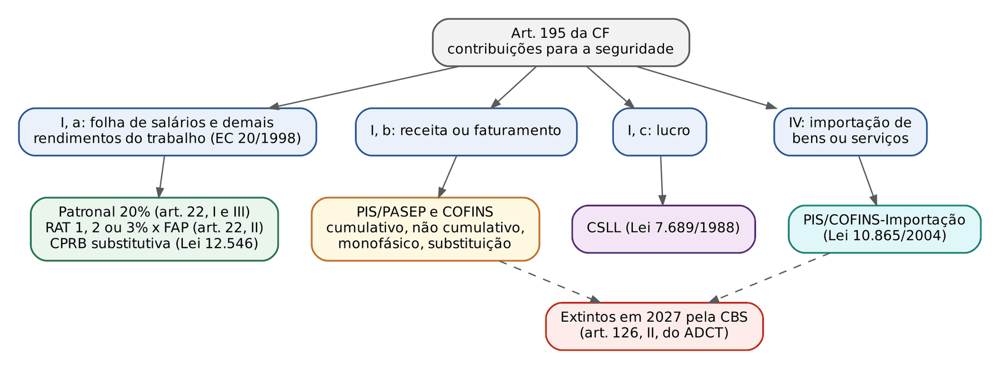
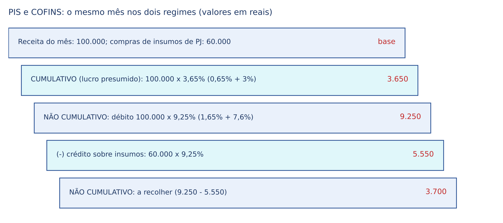
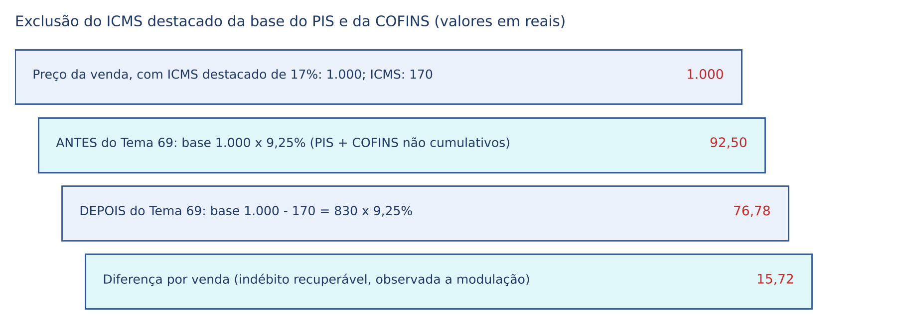
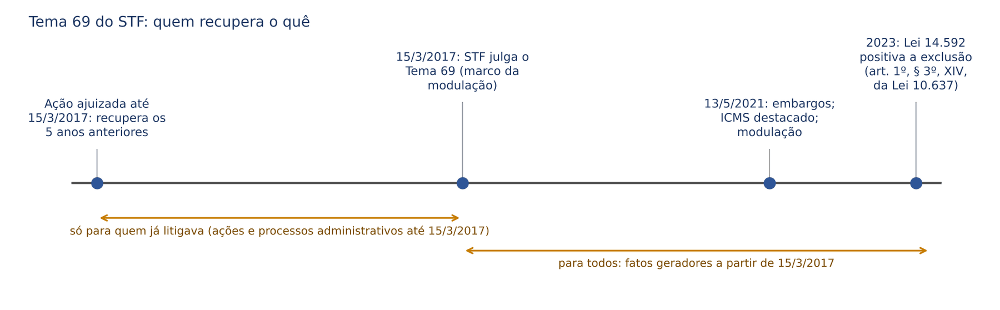
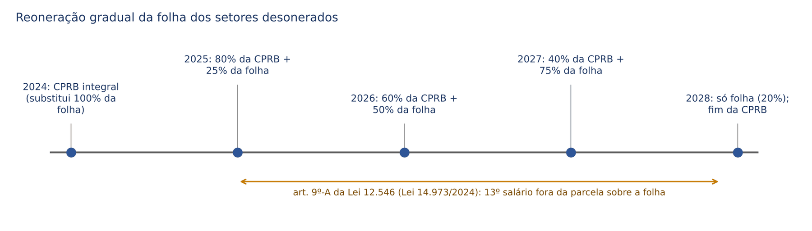

# CAPÍTULO 26 — CONTRIBUIÇÕES FEDERAIS EM ESPÉCIE: PIS/PASEP E COFINS (BASE DE CÁLCULO, EXCLUSÃO DO ICMS, NÃO CUMULATIVIDADE E INSUMOS, MONOFÁSICO), CSLL E CONTRIBUIÇÕES PREVIDENCIÁRIAS DO EMPREGADOR (BASE DE CÁLCULO E VERBAS)

:::INCIDENCIA
TRF5 p. 11; TJSC p. 19. Nível A. Lote: 10 questões (FGV 9, FCC 1), além de correlatas de ICMS-ST, repetição de indébito, imunidades e reforma.
O que mais cai: o que entra e o que sai da base do PIS e da COFINS (Tema 69 e "teses filhotes": ICMS-ST, ISS, CPRB, crédito presumido), vendas inadimplidas, substituição tributária e restituição, base da CPRB, verbas que integram ou não a base da contribuição patronal e destinação das contribuições de seguridade.
:::

| Subtema | FGV | FCC | Padrão de cobrança |
|---|---|---|---|
| Base do PIS e da COFINS (inadimplência, ICMS-ST, regimes) | 2 | 1 | caso concreto com autuação; tese repetitiva ou de repercussão geral |
| Substituição tributária de PIS/COFINS e restituição | 1 | 0 | base efetiva menor que a presumida (Tema 228) |
| CPRB e tributos na base | 1 | 0 | ISS e ICMS integram a receita bruta da CPRB |
| CSLL (destinação e jurisprudência do STF) | 2 | 0 | Selic na repetição, exportação, dedução, alíquotas diferenciadas |
| Contribuições previdenciárias (destinação, aposentado que trabalha) | 2 | 0 | art. 167, XI; art. 195, II |
| Retenção na fonte de IR, CSLL, PIS e COFINS por órgão público | 1 | 0 | literalidade da IN RFB 1.234/2012 |

## 26.1 O mapa: três bases do art. 195, I, e uma pergunta para cada

O Cap. 3 (03.2.2) apresentou as fontes de custeio da seguridade social e o regime comum das contribuições (lei ordinária para as fontes nominadas, noventena do art. 195, § 6º, vinculação). Aqui se estudam as contribuições federais EM ESPÉCIE, aquelas que geram o grosso do contencioso na Justiça Federal: PIS/PASEP e COFINS (receita), CSLL (lucro) e contribuição previdenciária do empregador (folha). O raciocínio que resolve quase todas as questões é sempre o mesmo, e é bom fixá-lo antes de qualquer detalhe: a Constituição escolheu uma MATERIALIDADE (folha, receita, lucro, importação); a lei pode tributar essa materialidade, mas não pode alargá-la por definição própria. Toda a jurisprudência do capítulo responde, no fundo, a uma pergunta de base de cálculo:

- na COFINS e no PIS: "este valor é RECEITA PRÓPRIA da empresa, ou apenas transita pelo caixa dela?";
- na contribuição patronal: "este pagamento RETRIBUI O TRABALHO (é habitual e remuneratório), ou indeniza, ressarce ou é benefício previdenciário?";
- na CSLL: "este valor é ACRÉSCIMO PATRIMONIAL (lucro), ou recomposição de perda?".

Para o juiz cível, a intuição útil é a do direito obrigacional: o tributo incide sobre o que pertence ao contribuinte. O ICMS que a empresa cobra no preço é, para o STF, como o dinheiro que o mandatário recebe por conta do mandante: passa pela conta, mas não é dele (Tema 69). Já o terço de férias é contraprestação ligada ao contrato de trabalho e ao período de descanso remunerado, e por isso integra a "folha" (Tema 985). A analogia ajuda a acertar a maioria das questões; onde ela engana (a CPRB, por exemplo, inclui o ICMS na base), o texto avisa.

:::ESQUEMA Ficha de consulta rápida das contribuições do capítulo
| Contribuição | Base constitucional | Lei principal | Base de cálculo | Alíquotas gerais | Lançamento | Pontos-chave |
|---|---|---|---|---|---|---|
| PIS/PASEP cumulativo | art. 195, I, b, e art. 239 | Lei 9.718/1998; Lei 9.715/1998 | receita bruta (art. 12 do DL 1.598/1977) | 0,65% | homologação | sem créditos; lucro presumido |
| COFINS cumulativa | art. 195, I, b | LC 70/1991; Lei 9.718/1998 | receita bruta | 3% | homologação | idem |
| PIS não cumulativo | art. 195, I, b, e § 12 | Lei 10.637/2002 | total das receitas | 1,65% | homologação | créditos (art. 3º); insumo pelo Tema 779 |
| COFINS não cumulativa | art. 195, I, b, e § 12 | Lei 10.833/2003 | total das receitas | 7,6% | homologação | idem |
| PIS/COFINS-Importação | art. 195, IV | Lei 10.865/2004 | valor aduaneiro | específicas | homologação | Tema 1 do STF |
| CSLL | art. 195, I, c | Lei 7.689/1988 | resultado ajustado (lucro real, presumido ou arbitrado) | 9% em regra; maiores para o setor financeiro | homologação | não alcançada pela imunidade de exportação |
| Patronal sobre a folha | art. 195, I, a | Lei 8.212/1991, art. 22 | remunerações destinadas a retribuir o trabalho | 20% + RAT (1, 2 ou 3%) ajustado pelo FAP | homologação | verbas: Temas 20, 72 e 985 do STF; Temas 478, 737, 738 e 740 do STJ |
| CPRB | art. 195, I, b, e § 13 (revogado) e § 9º | Lei 12.546/2011 | receita bruta | por setor | homologação | substitutiva; ICMS e ISS na base; extinta em 2028 |
| Sujeito ativo e foro de todas | União (Receita Federal; PGFN na cobrança) | Lei 11.457/2007 | — | — | — | Justiça Federal; Cap. 23 |
:::

## 26.2 PIS/PASEP e COFINS: a materialidade "receita ou faturamento"

### 26.2.1 Duas contribuições, uma lógica

O PIS (Programa de Integração Social, LC 7/1970) e o PASEP (programa equivalente do servidor público, LC 8/1970) foram recepcionados pelo art. 239 da CF, que destinou sua arrecadação ao seguro-desemprego e ao abono salarial; hoje são uma só contribuição, "PIS/PASEP". A COFINS (Contribuição para o Financiamento da Seguridade Social, LC 70/1991) nasceu do art. 195, I. Embora tenham destinações distintas, a legislação as trata em par: mesma base, mesmo regime de apuração, alíquotas diferentes. Por isso as questões e os julgados se referem quase sempre às duas juntas, e assim se fará aqui.

Contribuinte: a pessoa jurídica de direito privado e a ela equiparada pela legislação do IR. Fato gerador: auferir receita (ou faturamento, no regime cumulativo). Apuração mensal; tributos sujeitos a lançamento por homologação (Cap. 12).

### 26.2.2 Faturamento e receita: a história que explica a jurisprudência

Na redação original, o art. 195, I, falava apenas em "faturamento". O STF entendia faturamento como a receita bruta das vendas de mercadorias e serviços, isto é, das atividades empresariais típicas. Em 1998, a Lei 9.718 (art. 3º, § 1º) ampliou a base para "a totalidade das receitas auferidas", incluindo receitas financeiras e outras atípicas. A EC 20/1998 veio logo depois e acrescentou "a receita" ao texto constitucional, mas o STF declarou inconstitucional o § 1º do art. 3º, porque a lei nasceu sem base constitucional e a emenda posterior não a convalida (constitucionalidade superveniente não existe; o tema histórico está no Cap. 8, 08.7.3, a propósito do art. 110 do CTN). O § 1º foi revogado em 2009, e o art. 3º da Lei 9.718 hoje remete a base ao conceito de receita bruta do art. 12 do DL 1.598/1977.

Consequência prática atual: há dois conceitos de base, conforme o regime.

| Regime | Base legal | Conteúdo |
|---|---|---|
| Cumulativo (Lei 9.718/1998) | faturamento = receita bruta (art. 3º, que remete ao art. 12 do DL 1.598/1977) | produto da venda de bens, preço dos serviços, resultado nas operações de conta alheia e receitas da atividade ou objeto principal |
| Não cumulativo (Leis 10.637/2002 e 10.833/2003, posteriores à EC 20) | "total das receitas auferidas no mês, independentemente de sua denominação ou classificação contábil" (art. 1º) | receita bruta e todas as demais receitas (financeiras, aluguéis eventuais etc.), menos as exclusões do § 3º |

O STF ainda trabalha com a ideia de que, quando a base é o faturamento, ela abrange a receita bruta operacional decorrente das atividades empresariais TÍPICAS do contribuinte. Daí uma série de casos sobre o que é "típico":

:::JURIS STF, Temas 630 e 684 (RE 599.658/SP, j. 12/4/2024)
"É constitucional a incidência da contribuição para o PIS e da COFINS sobre as receitas auferidas com a locação de bens móveis ou imóveis, quando constituir atividade empresarial do contribuinte, considerando que o resultado econômico dessa operação coincide com o conceito de faturamento ou receita bruta, tomados como a soma das receitas oriundas do exercício das atividades empresariais, pressuposto desde a redação original do art. 195, I, da Constituição Federal."
No mesmo sentido, para bens móveis, a Súmula 423 do STJ. O STJ vai além e entende que a locação de imóveis próprios integra o faturamento ainda que não seja o objeto social da empresa (Jurisprudência em Teses, ed. 58, tese 2).
:::

:::JURIS STF, Tema 1.309 (RE 1.479.774/RJ, j. 2/9/2026)
"I - A contribuição ao PIS e a COFINS, quando tenham por base de cálculo o faturamento, devem incidir sobre a receita bruta operacional decorrente das atividades empresariais típicas do sujeito passivo tributário, sem prejuízo das exclusões e deduções legais; II - As receitas de aplicações financeiras das reservas técnicas das seguradoras não devem integrar a base de cálculo da contribuição ao PIS e da COFINS incidentes sobre o faturamento, nos moldes da Lei nº 9.718/1998."
É o julgado mais recente sobre o conceito e vale como síntese: o rendimento das reservas técnicas é exigência regulatória de solvência, não atividade típica da seguradora.
:::

Outros casos de "o que integra a receita" que caem em prova:

- Valores retidos pelas administradoras de cartão: integram a base do lojista (Tema 1.024 do STF). O lojista vende por 100 e recebe 97; a receita é 100, e os 3 são despesa dele.
- Receitas de interconexão e *roaming* que a operadora de telefonia arrecada para repassar a outras operadoras: NÃO integram, porque não ingressam no patrimônio da arrecadadora (STJ, EREsp 1.599.065/DF, j. 11/9/2024). Contraste com o Tema 313 do STJ: os valores que, computados como receita, a empresa transfere a outra pessoa jurídica integram a base, porque a exclusão do art. 3º, § 2º, III, da Lei 9.718 nunca teve eficácia (dependia de regulamento e foi revogada).
- Cooperativas: atos cooperativos típicos (entre a cooperativa e seus cooperados) não sofrem PIS e COFINS (STJ, REsps 1.141.667/RS e 1.164.716/MG, Info 582); os negócios com terceiros, sim (Tema 323 do STF).
- Juros (Selic ou outros) recebidos na repetição de indébito, na devolução de depósitos judiciais ou em obrigações contratuais em atraso: integram a base, cumulativa e não cumulativa (Tema 1.237 do STJ, Selic na base do PIS e da COFINS; v. Cap. 16, 16.5.4, com o contraste do IRPJ e da CSLL).
- Súmula 659 do STF: legítima a cobrança de COFINS, PIS e FINSOCIAL sobre energia elétrica, telecomunicações, derivados de petróleo, combustíveis e minerais (a imunidade do art. 155, § 3º, alcançava só IMPOSTOS).
- Sociedades civis de profissão regulamentada: a isenção de COFINS da LC 70/1991 foi revogada pela Lei 9.430/1996 (Súmula 508 do STJ; a LC 70 é materialmente ordinária nesse ponto).

### 26.2.3 Vendas inadimplidas: a receita nasce com a venda

:::QUESTAO FGV 2026 — TRF2 — Juiz Federal Substituto (Q3996882)
Caso: empresa do regime cumulativo vende e entrega mercadorias, com nota fiscal; o comprador não paga parte significativa, sem cancelamento nem devolução. A empresa quer excluir as vendas inadimplidas da base.
1. O que se pergunta: o inadimplemento posterior desfaz o fato gerador?
2. Regra: o fato gerador ocorre com o aperfeiçoamento da venda (regime de competência); a lei exclui da receita bruta as vendas CANCELADAS e os descontos incondicionais (art. 3º, § 2º, I, da Lei 9.718/1998), não as vendas inadimplidas.
3. Aplicação: a venda existiu e gerou crédito; o inadimplemento é evento posterior, que se resolve no plano da cobrança (e, quando definitivo, como perda dedutível no IRPJ, não como exclusão do PIS e da COFINS).
Gabarito oficial: B. Armadilhas: (A) PIS e COFINS não incidem sobre lucro, e a regra não é o caixa; (C) e (E) "frustração definitiva" e "capacidade contributiva" não criam exclusão sem lei; (D) a equiparação a venda cancelada não existe em nenhum regime.
Fundamento jurisprudencial: o STJ afirma que vendas inadimplidas não se equiparam a vendas canceladas (Jurisprudência em Teses, ed. 58, tese 18), e o STF tem orientação no mesmo sentido em repercussão geral (ver nota). O STF aplicou a mesma lógica ao ICMS-comunicação: a inadimplência do usuário não afasta a incidência (Tema 705, RE 1.003.758/RO, j. 14/5/2021).
:::

## 26.3 Regimes de apuração: cumulativo e não cumulativo

### 26.3.1 A ideia da não cumulatividade, sem jargão

Um tributo é CUMULATIVO quando incide sobre o valor bruto de cada etapa da cadeia sem abater o que foi pago nas anteriores: o imposto pago na compra da matéria-prima vira custo, entra no preço e é tributado de novo na venda (efeito "cascata"). É NÃO CUMULATIVO quando cada etapa abate, como CRÉDITO, o tributo que incidiu na etapa anterior, de modo que, ao fim, a carga corresponde à alíquota sobre o valor final (no ICMS e no IPI, pelo método "imposto contra imposto": Cap. 27).

A não cumulatividade de PIS e COFINS é DIFERENTE da do ICMS em dois pontos que a banca explora:

- não está na Constituição como garantia ampla: o art. 195, § 12, diz apenas que "a lei definirá os setores de atividade econômica" para os quais as contribuições sobre receita e importação "serão não-cumulativas". O legislador ordinário tem autonomia para disciplinar o regime, respeitados a matriz constitucional e os princípios da razoabilidade, isonomia, livre concorrência e proteção da confiança (Tema 756 do STF, RE 841.979/PE, j. 25/11/2022). Por isso o STF validou a COFINS não cumulativa criada por medida provisória convertida em lei ordinária (Tema 34, RE 570.122/RS, j. 2/9/2020) e a vedação de créditos sobre operações com pessoas jurídicas domiciliadas no exterior (Tema 707, RE 698.531/SP, art. 3º, § 3º, I e II, da Lei 10.637);
- o método é "base contra base" (de forma simplificada): a lei lista DESPESAS que geram crédito (art. 3º das Leis 10.637 e 10.833), e o crédito se calcula aplicando a alíquota sobre o valor dessas despesas, haja ou não pagamento de PIS e COFINS pelo fornecedor (salvo exceções legais, como a aquisição de bens não sujeitos ao pagamento: art. 3º, § 2º, II).

Mesmo com essa autonomia, o legislador não pode tudo: o STF declarou inconstitucionais o art. 31, caput, da Lei 10.865/2004, que vedou créditos sobre o ativo imobilizado adquirido até 30/4/2004 (Tema 244, por ofensa à não cumulatividade e à isonomia), e os arts. 47 e 48 da Lei 11.196/2005, que vedavam créditos na aquisição de insumos recicláveis (Tema 304, por razões ambientais e de isonomia).

### 26.3.2 Quem está em cada regime

| Regime | Quem | Alíquotas (PIS + COFINS) | Créditos |
|---|---|---|---|
| Cumulativo | pessoas jurídicas tributadas pelo lucro presumido ou arbitrado, e certas atividades e receitas listadas em lei mesmo no lucro real (por exemplo, instituições financeiras, cooperativas de crédito, certas receitas de serviços) | 0,65% + 3% = 3,65% | não há |
| Não cumulativo | pessoas jurídicas tributadas pelo lucro real, salvo as exceções legais | 1,65% + 7,6% = 9,25% | sim, nas hipóteses do art. 3º |
| Monofásico (26.6) | fabricantes e importadores de combustíveis, medicamentos, cosméticos, veículos, autopeças, bebidas frias e outros | alíquotas concentradas e maiores | revenda com alíquota zero; sem crédito na revenda |
| Simples Nacional | optantes | incluídos no DAS (Cap. 31) | não |

:::QUESTAO FCC 2025 — TRT2 — Analista Judiciário, Contabilidade (Q3596225)
Pede a afirmação INCORRETA sobre o regime de PIS e COFINS. Gabarito oficial: B. As cooperativas de crédito NÃO estão no regime não cumulativo; a lei as mantém no cumulativo, como as demais instituições do setor financeiro (art. 10 da Lei 10.833/2003, por remissão à Lei 9.718).
Os demais itens estão corretos: vendas canceladas não compõem a base (A); em regra, não geram crédito bens e serviços não sujeitos ao pagamento das contribuições (C, art. 3º, § 2º, II); na importação de serviço de residente no exterior, o contribuinte é o contratante ou beneficiário domiciliado no país (D, Lei 10.865/2004); a CIDE-combustíveis pode financiar projetos ambientais da indústria do petróleo (E, art. 177, § 4º, II, b, da CF; Cap. 3).
:::

O exemplo mostra por que o regime não cumulativo, com alíquota nominal maior, pode resultar em carga parecida ou menor: tudo depende do volume de despesas creditáveis. Uma prestadora de serviços intelectuais, cujo principal custo é a folha (que NÃO gera crédito: art. 3º, § 2º, I, mão de obra paga a pessoa física), costuma pagar mais no não cumulativo; uma indústria com muita matéria-prima, menos.

### 26.3.3 Créditos e o conceito de insumo (Tema 779 do STJ)

O art. 3º, II, das Leis 10.637 e 10.833 dá crédito sobre "bens e serviços, utilizados como insumo na prestação de serviços e na produção ou fabricação de bens ou produtos destinados à venda, inclusive combustíveis e lubrificantes". A Receita Federal, nas Instruções Normativas 247/2002 e 404/2004, importou o conceito restrito de insumo do IPI: só daria crédito o que se desgasta em contato direto com o produto (matéria-prima, produto intermediário, material de embalagem). Os contribuintes defendiam o conceito amplo do IRPJ (toda despesa necessária). O STJ ficou no meio.

:::JURIS STJ, Tema 779 (REsp 1.221.170/PR, Primeira Seção, j. 22/2/2018)
"É ilegal a disciplina de creditamento prevista nas Instruções Normativas da SRF ns. 247/2002 e 404/2004, porquanto compromete a eficácia do sistema de não-cumulatividade da contribuição ao PIS e da COFINS, tal como definido nas Leis ns. 10.637/2002 e 10.833/2003 e o conceito de insumo deve ser aferido à luz dos critérios de essencialidade ou relevância, ou seja, considerando-se a imprescindibilidade ou a importância de determinado item - bem ou serviço - para o desenvolvimento da atividade econômica desempenhada pelo Contribuinte."
O STF, no Tema 756, declarou infraconstitucional a discussão sobre o conceito de insumo: a palavra final é do STJ.
:::

Os dois critérios, em linguagem de prova:

- ESSENCIALIDADE: o item é o núcleo da atividade, sem ele o produto ou serviço não existe ou perde qualidade (a farinha para a padaria; o etanol anidro misturado à gasolina C, que o STJ reconheceu como insumo indispensável da distribuidora: REsp 1.971.879/SE, j. 13/5/2025).
- RELEVÂNCIA: o item integra o processo produtivo por singularidade da cadeia ou por imposição legal, ainda que não indispensável à elaboração em si (o equipamento de proteção individual exigido pela legislação trabalhista; a análise laboratorial obrigatória em alimentos).

Ficam de fora, em regra, despesas administrativas e comerciais gerais (contabilidade, publicidade, vigilância da sede), por não se ligarem à produção ou prestação. A análise é casuística e exige prova (perícia contábil é comum), o que tem reflexo direto no tipo de ação (ver o box PROCESSO abaixo).

:::EXEMPLO Padaria Trigo de Ouro Ltda. (lucro real)
Despesas do mês e direito a crédito:
- farinha, fermento, embalagens: crédito (insumo essencial; art. 3º, II);
- energia elétrica dos fornos: crédito (inciso IX, hipótese autônoma);
- aluguel do prédio pago a pessoa jurídica: crédito (inciso IV);
- uniformes e touca exigidos pela vigilância sanitária: crédito pelo critério da relevância (exigência legal);
- salários dos padeiros: SEM crédito (mão de obra paga a pessoa física, § 2º, I);
- frete para levar pães entre duas filiais: SEM crédito na leitura do STJ (o frete gera crédito quando suportado pelo vendedor na venda ou revenda, não no transporte interno entre estabelecimentos da mesma empresa: Jurisprudência em Teses, ed. 58, tese 16);
- publicidade em rádio: SEM crédito (despesa comercial, não insumo).
:::

Pontos repetitivos recentes sobre créditos:

- ICMS-ST pago pelo substituto na compra para revenda: NÃO gera crédito de PIS e COFINS ao substituído (Tema 1.231 do STJ, j. 20/6/2024). Os tributos recolhidos por substituição não integram o custo de aquisição do art. 13 do DL 1.598/1977.
- IPI não recuperável na compra de mercadoria para revenda: não integra a base dos créditos a partir das operações posteriores à IN RFB 2.121/2022, em vigor em 20/12/2022 (Tema 1.373 do STJ, j. 11/3/2026).
- ICMS da aquisição: desde a Lei 14.592/2023, o crédito não se calcula sobre o ICMS que incidiu na compra (art. 3º, § 2º, III, da Lei 10.637). É o espelho do Tema 69 (26.4): se o ICMS sai da base do débito, sai também da base do crédito.
- Frete na revenda de veículos novos (monofásico): não gera crédito, nem pode ser excluído da base (STJ, EREsp 1.691.475/RJ, j. 28/2/2024).
- Os créditos escriturais de PIS e COFINS integram a base do IRPJ e da CSLL (Jurisprudência em Teses, ed. 58, tese 11).
- Ressarcimento de créditos acumulados: só há correção monetária depois de 360 dias do pedido administrativo (Tema 1.003 do STJ; desenvolvido no Cap. 16, 16.5.5, com a Q3742408 do TRF6).

:::PROCESSO Discussão sobre créditos e insumos em juízo
Ação típica: mandado de segurança declaratório do direito de creditar determinados itens e de compensar os créditos não aproveitados nos últimos cinco anos (Súmula 213 do STJ; o MS não produz efeitos patrimoniais pretéritos em espécie, Súmula 271 do STF; ver Cap. 23). Limite: se o reconhecimento da essencialidade ou relevância depender de prova técnica (laudo sobre o processo produtivo), o MS é inadequado por exigir dilação probatória; o caminho é a ação pelo procedimento comum, com perícia. Competência: Justiça Federal; legitimado passivo no MS, o Delegado da Receita Federal do domicílio fiscal; na ação comum, a União (PGFN).
:::

## 26.4 A exclusão do ICMS da base e as "teses filhotes"

### 26.4.1 O Tema 69 do STF: o raciocínio

A empresa que vende uma mercadoria por 1.000 (mil) reais, com ICMS de 17% embutido e destacado na nota, registra em sua contabilidade receita bruta de 1.000 (mil) reais, e o art. 12, § 5º, do DL 1.598/1977 manda incluir na receita bruta "os tributos sobre ela incidentes". A Fazenda sempre exigiu PIS e COFINS sobre os 1.000. Os contribuintes sustentavam que os 170 (cento e setenta) reais de ICMS não são receita deles, mas do Estado: a empresa é mera arrecadadora, recebe o valor do comprador e o repassa ao Fisco estadual. O STF acolheu a tese.

:::JURIS STF, Tema 69 (RE 574.706/PR, Plenário, j. 15/3/2017; embargos de declaração julgados em 13/5/2021)
Tese: "O ICMS não compõe a base de cálculo para a incidência do PIS e da COFINS."
Fundamento: receita é o ingresso que se incorpora ao patrimônio do contribuinte, sem reservas ou condições, como elemento novo e positivo; o ICMS apenas transita pela contabilidade, destinado ao Estado. Incluí-lo violaria o art. 195, I, b.
Embargos (13/5/2021): (1) o ICMS a excluir é o DESTACADO na nota fiscal, e não o ICMS efetivamente recolhido (débito menos créditos), como pretendia a União; (2) modulação: a exclusão produz efeitos para os fatos geradores a partir de 15/3/2017, ressalvadas as ações judiciais e os procedimentos administrativos protocolados até essa data.
:::

A modulação foi detalhada pelo próprio STF no Tema 1.279 (RE 1.452.421/PE, j. 22/9/2023): os efeitos prospectivos alcançam os fatos geradores posteriores a 15/3/2017; quem já tinha ação ou processo administrativo protocolado até essa data recupera também os cinco anos anteriores ao ajuizamento. O STJ admitiu ação rescisória da União, com base no art. 535, § 8º, do CPC, para adequar à modulação o julgado transitado antes de 13/5/2021 que reconhecera a exclusão para período anterior a 15/3/2017 (Tema 1.245 do STJ, REsps 2.054.759/RS e 2.066.696/RS, j. 11/9/2024; detalhes processuais no Cap. 23).

A Lei 14.592/2023 positivou a tese: no regime não cumulativo, não integram a base as receitas "relativas ao valor do ICMS que tenha incidido sobre a operação" (art. 1º, § 3º, XIV, da Lei 10.637/2002; regra equivalente na Lei 10.833/2003), e, em contrapartida, o ICMS da aquisição deixou de compor a base dos créditos (26.3.3).

:::SENTENCA Tema 69 no mandado de segurança
Onde entra: mandado de segurança (ou ação declaratória com pedido de repetição ou compensação) contra o Delegado da Receita Federal, pedindo exclusão do ICMS da base do PIS e da COFINS e compensação.
O que fundamentar: (1) cabimento e prazo (MS preventivo contra exigência que se renova mensalmente: não há decadência dos 120 dias para o pedido de não recolher, e a compensação pode ser declarada pela Súmula 213 do STJ; Cap. 23); (2) mérito pelo Tema 69 e pela Lei 14.592/2023; (3) ICMS DESTACADO; (4) modulação: data da impetração em confronto com 15/3/2017; (5) compensação somente após o trânsito em julgado (art. 170-A do CTN; Cap. 14), com Selic (Cap. 16).
Redação-modelo: "Concedo a segurança para declarar o direito da impetrante de excluir da base de cálculo do PIS e da COFINS o ICMS destacado nas notas fiscais de saída, nos termos do Tema 69 do STF, bem como de compensar, após o trânsito em julgado (art. 170-A do CTN), os valores recolhidos a esse título relativos a fatos geradores ocorridos a partir de 15/3/2017, observada a modulação fixada pelo STF, corrigidos pela Selic."
Erros que a banca pune: mandar excluir o ICMS "recolhido" ou "a recolher"; esquecer a modulação (a impetração de 2018 não recupera 2013 a 2016); autorizar compensação antes do trânsito; estender automaticamente a tese a outro tributo (ver 26.4.2).
:::

### 26.4.2 As "teses filhotes": o que o Tema 69 alcança e o que não alcança

Depois do Tema 69, contribuintes tentaram excluir das bases de receita todos os tributos embutidos no preço. O resultado é irregular, e a banca adora esse quadro. A pergunta que separa os casos é dupla: (a) a base em discussão é a do PIS e da COFINS (art. 195, I, b), ou é outra base de receita? (b) o valor é tributo que a empresa apenas repassa, ou é receita própria (benefício fiscal, preço)?

| Tese | Resultado | Fonte | Situação |
|---|---|---|---|
| ICMS próprio na base do PIS/COFINS | sai (destacado) | Tema 69 do STF | julgado; modulado |
| ICMS-ST na base do PIS/COFINS do substituído | sai | Tema 1.125 do STJ | julgado (13/12/2023) |
| ICMS-DIFAL na base do PIS/COFINS | sai | Tema 1.372 do STJ | julgado (20/8/2026), com modulação a 15/3/2017 |
| ISS na base do PIS/COFINS | o STJ manda incluir (Tema 634) | Tema 118 do STF | PENDENTE no STF (última notícia: retirado de pauta em 20/2/2026) |
| PIS e COFINS na própria base ("cálculo por dentro") | — | Tema 1.067 do STF | PENDENTE |
| Crédito presumido de ICMS na base do PIS/COFINS | o STJ manda excluir (não é receita) | Tema 843 do STF | PENDENTE no STF |
| Crédito presumido de IPI (Lei 9.363/1996) na base do PIS/COFINS cumulativos | sai | Tema 504 do STF | julgado (19/12/2023) |
| CPRB na base do PIS/COFINS | FICA | Tema 1.276 do STJ | julgado (9/9/2026) |
| PIS/COFINS na base da CPRB | FICA | Tema 1.186 do STF | julgado (2/6/2025) |
| ICMS e ISS na base da CPRB | FICAM | Temas 1.048 e 1.135 do STF; Tema 994 do STJ | julgados |
| ICMS na base do IRPJ e da CSLL do lucro presumido | FICA | Tema 1.008 do STJ | julgado (10/5/2023) |
| PIS/COFINS na base do IRPJ e da CSLL do lucro presumido | FICAM | Tema 1.312 do STJ | julgado (11/3/2026) |
| PIS/COFINS na base do ICMS (operação própria) | FICAM | Tema 1.223 do STJ | julgado (11/12/2024); Cap. 27 |
| ICMS, PIS e COFINS na base do IPI | FICAM | Tema 1.304 do STJ (Cap. 25) | julgado (10/12/2025) |

:::JURIS STJ, Tema 1.125 (REsps 1.896.678/RS e 1.958.265/SP, Primeira Seção, j. 13/12/2023)
"O ICMS-ST não compõe a base de cálculo da Contribuição ao PIS e da COFINS, devidas pelo contribuinte substituído no regime de substituição tributária progressiva."
Por quê: o substituído (o varejista) paga ao substituto (o fabricante) o preço mais o ICMS-ST que o fabricante antecipou em nome da cadeia. Esse ICMS, para o varejista, tem a mesma natureza do ICMS próprio do Tema 69: valor que não é receita dele. Não importa que ele não destaque o imposto na venda; isonomia com quem paga ICMS pelo regime normal.
:::

:::QUESTAO FGV 2025 — TRF6 — Juiz Federal Substituto (Q3742409)
Caso: atacadista de bebidas compra com ICMS-ST recolhido pelo fabricante; a Receita autua para incluir o ICMS-ST na base do PIS e da COFINS do atacadista.
Gabarito oficial: A (o ICMS-ST não integra a base, pois não é receita própria nem ingressa no patrimônio do substituído; Tema 1.125).
Armadilhas: (B) "o substituído se beneficia economicamente" é o argumento derrotado; (C) inventa condição ligada ao repasse ao consumidor; (D) e (E) tratam como renúncia de receita dependente de lei o que é delimitação constitucional da base.
:::

:::PEGADINHA Não confunda o Tema 1.125 com o Tema 1.231
Tema 1.125: o ICMS-ST SAI da base do DÉBITO de PIS e COFINS do substituído (vitória do contribuinte). Tema 1.231: o ICMS-ST pago na compra NÃO gera CRÉDITO de PIS e COFINS para o substituído (vitória da Fazenda). As duas teses são coerentes: o valor não é receita na saída e não é custo na entrada.
:::

:::JURIS STJ, Tema 1.372 (REsp 2.174.178/SC, j. 20/8/2026)
"O ICMS-DIFAL (Diferencial de Alíquotas do Imposto sobre a Circulação de Mercadorias e Serviços) não compõe a base de cálculo da Contribuição ao PIS e da COFINS. Modulação de efeitos: os efeitos da decisão ocorrem a partir de 15/3/2017, data do julgamento do precedente vinculante do STF, ressalvadas as ações judiciais e os procedimentos administrativos em curso naquela data."
:::

Sobre o ISS, a situação exige cuidado. O STJ, em repetitivo anterior ao Tema 69, fixou que "o valor suportado pelo beneficiário do serviço, nele incluindo a quantia referente ao ISSQN, compõe o conceito de receita ou faturamento" (Tema 634, REsp 1.330.737/SP, j. 10/6/2015). No STF, o Tema 118 (RE 592.616) teve julgamento iniciado e retomado em agosto de 2024 com votos em sentidos opostos, e, até a última notícia localizada (agosto de 2026), não estava concluído. Na prova, a resposta segura é: no STF, ainda pendente; a lógica do Tema 69 favorece a exclusão, mas não há tese vinculante; prevalece, por ora, o repetitivo do STJ. Se a questão for de 2027 em diante, confira o desfecho.

Do mesmo modo, estão pendentes no STF o Tema 1.067 (inclusão do PIS e da COFINS em suas próprias bases) e o Tema 843 (crédito presumido de ICMS na base do PIS e da COFINS). Neste último, o STJ já entende que o crédito presumido de ICMS, benefício fiscal estadual, não é receita nem faturamento e não integra a base (Jurisprudência em Teses, ed. 58, tese 12, e ed. 121, tese 2), raciocínio reforçado pela necessidade de não esvaziar o incentivo concedido pelo Estado (pacto federativo).

:::DICA A regra de bolso para as teses filhotes
1. O Tema 69 é uma interpretação do art. 195, I, b, para PIS e COFINS: só vale para eles e para as contribuições que adotam o mesmo conceito constitucional de receita própria. NÃO se estende ao IRPJ e à CSLL do lucro presumido (cuja base é presunção legal de lucro), ao IPI (valor da operação) nem à CPRB (cuja base é a receita bruta fixada em lei como substitutiva e facultativa).
2. Tributo sobre tributo é, em regra, constitucional ("cálculo por dentro"); o Tema 69 é EXCEÇÃO.
3. Benefício fiscal estadual (crédito presumido de ICMS) não é receita; mas a CPRB, que é um tributo, não é benefício e fica na base do PIS e da COFINS (Tema 1.276).
:::

:::JURIS STJ, Tema 1.276 (REsps 2.123.906/SP, 2.123.904/SP e 2.123.902/SP, j. 9/9/2026)
"A contribuição previdenciária substitutiva incidente sobre a receita bruta (CPRB) compõe as bases de cálculo da contribuição ao PIS/Pasep e da Cofins, não podendo delas ser excluída."
Contraste: o STF, no Tema 1.186, já afirmara o inverso complementar, que o PIS e a COFINS integram a base da CPRB. O contribuinte perde nas duas direções.
:::

## 26.5 Setores e operações especiais: instituições financeiras, importação, alíquotas por decreto

### 26.5.1 Instituições financeiras e seguradoras

Bancos, seguradoras e entidades equiparadas (as do art. 22, § 1º, da Lei 8.212/1991) ficam no regime CUMULATIVO e têm deduções próprias da base (art. 3º, §§ 5º a 9º, da Lei 9.718/1998: despesas de intermediação financeira, perdas com títulos, sinistros pagos etc.). Três teses formam o núcleo:

:::JURIS STF, Tema 372 (RE 609.096/RS e outros, j. 13/6/2023)
"As receitas financeiras das instituições financeiras integram base de cálculo do PIS/COFINS." Para o banco, emprestar dinheiro e cobrar juros (spread) é a atividade típica; as receitas de intermediação são o seu faturamento. Cobrado na Câmara dos Deputados 2024 (Q2510944, FGV, item III verdadeiro: exigibilidade sobre as receitas brutas operacionais da atividade típica; gabarito C).
:::

- Alíquotas maiores: é constitucional a majoração diferenciada das contribuições sobre receita de instituições financeiras e equiparadas (Tema 515 do STF, RE 656.089/MG), com base no art. 195, § 9º (atividade econômica). O STJ decidiu que o aumento da COFINS de 3% para 4% (art. 18 da Lei 10.684/2003) não alcança as sociedades corretoras de SEGUROS, que não estão no rol do art. 22, § 1º, da Lei 8.212/1991 e não se confundem com as corretoras de valores mobiliários nem com os agentes autônomos de seguros privados (Temas 728 e 729 do STJ, REsps 1.400.287/RS e 1.391.092/SC, j. 22/4/2015).
- Correspondentes bancários: os valores pagos pelos bancos a seus correspondentes não são dedutíveis como despesa de intermediação financeira (STJ, AREsp 2.001.082/SP, j. 18/6/2024).
- Seguradoras: as receitas de aplicações das reservas técnicas não integram a base sobre o faturamento (Tema 1.309, acima).
- Entidades fechadas de previdência complementar: incide PIS e COFINS sobre os rendimentos de suas aplicações financeiras, excluídas as receitas de contribuições de participantes e patrocinadores (Tema 1.280 do STF, RE 722.528/RJ, j. 16/12/2024). É o fundamento da parte da Q3425331 (FGV, TRF1 2025, do Cap. 24) relativa à COFINS: gabarito E, improcedência da anulatória.
- Empresas estatais: válida a contribuição para o PASEP das estatais exploradoras de atividade econômica em regime diverso do das empresas privadas (Tema 64 do STF).

### 26.5.2 PIS/COFINS-Importação (art. 195, IV; Lei 10.865/2004)

A EC 42/2003 criou a materialidade "importação de bens ou serviços do exterior" (art. 195, IV) e autorizou a não cumulatividade também para ela (§ 12). A Lei 10.865/2004 instituiu o PIS/PASEP-Importação e a COFINS-Importação. Contribuintes: o importador de bens; na importação de serviços, a pessoa física ou jurídica contratante e o beneficiário do serviço, quando o prestador reside no exterior. Base: o valor aduaneiro (bens) ou o valor pago ao exterior (serviços). As contribuições pagas na importação geram crédito para quem está no regime não cumulativo; mas o importador por conta e ordem de terceiros não tem legitimidade para aproveitar esses créditos, porque não arca com o custo da operação (STJ, REsp 1.552.605/SC, j. 11/6/2024).

:::JURIS STF, Tema 1 (RE 559.937/RS, j. 20/3/2013)
"É inconstitucional a parte do art. 7º, I, da Lei 10.865/2004 que acresce à base de cálculo da denominada PIS/COFINS-Importação o valor do ICMS incidente no desembaraço aduaneiro e o valor das próprias contribuições."
Fundamento: o art. 149, § 2º, III, a, da CF fixa como base, na importação, o "valor aduaneiro", conceito técnico do direito aduaneiro (Acordo de Valoração Aduaneira do GATT); a lei não pode ampliá-lo por definição própria. Note a coerência com o Tema 69: a Constituição desenha a base, e o legislador não a alarga.
:::

Outros pontos de importação que caem: é constitucional a alíquota maior para importadoras de autopeças que não fabricam máquinas e veículos (Tema 744 do STF); o adicional de um ponto percentual da COFINS-Importação é devido mesmo quando a alíquota ordinária está reduzida a zero para certos produtos químicos, farmacêuticos e hospitalares (Tema 1.380 do STJ, j. 7/5/2026).

### 26.5.3 Alíquotas fixadas por decreto e anterioridade

O art. 27, § 2º, da Lei 10.865/2004 autoriza o Executivo a reduzir e restabelecer, até os tetos legais, as alíquotas de PIS e COFINS sobre RECEITAS FINANCEIRAS do regime não cumulativo. O STF validou essa "flexibilização da legalidade" por sua função extrafiscal (Tema 939, RE 1.043.313/RS; cobrado na FGV, TCE-PA 2024, Q2564264, em que a afirmação de que a flexibilização violaria a legalidade era falsa). A questão temporal (quando o decreto que aumenta a alíquota ou reduz benefício precisa esperar 90 dias) foi desenvolvida no Cap. 5, 05.3.4: Tema 1.247 (coeficientes de combustíveis, noventena), Tema 1.337 e ADC 84 (restabelecimento das alíquotas sobre receitas financeiras em 2023, sem noventena) e Tema 1.108 (REINTEGRA, noventena; ver também Cap. 17). Basta lembrar que, sendo contribuições de seguridade, PIS e COFINS só se sujeitam à NOVENTENA (art. 195, § 6º), nunca à anterioridade de exercício.

### 26.5.4 Benefícios setoriais que geram contencioso

- Zona Franca de Manaus: não incidem PIS e COFINS sobre receitas de prestação de serviços e de venda de mercadorias nacionais e nacionalizadas, a pessoas físicas e jurídicas, no âmbito da ZFM (Tema 1.239 do STJ, j. 11/6/2025), por equiparação à exportação.
- Simples Nacional: o optante não tem direito à alíquota zero do monofásico de produtos farmacêuticos e de higiene (Tema 1.050 do STF; v. Cap. 31).

## 26.6 Incidência monofásica e substituição tributária de PIS e COFINS

### 26.6.1 Monofásico: tributar uma vez, no começo da cadeia

Em setores com poucos fabricantes e muitos revendedores (combustíveis, medicamentos e cosméticos, veículos e autopeças, pneus, bebidas frias), a lei concentra a tributação no fabricante ou importador, com alíquotas majoradas, e reduz a ZERO a alíquota nas revendas (art. 2º, § 1º, das Leis 10.637 e 10.833, que remetem às leis setoriais). Fiscalizar uma refinaria é mais simples que fiscalizar milhares de postos. É técnica de arrecadação, não benefício: o preço do produto já embute a contribuição de toda a cadeia.

Não se confunde com a substituição tributária "para frente" (26.6.2): no monofásico, o fabricante paga a SUA contribuição, maior, e a revenda simplesmente não é tributada; na substituição, o fabricante paga, além da sua, a contribuição que SERIA devida pelo revendedor, calculada sobre base presumida.

A consequência que a banca explora é o direito a crédito do revendedor. A tese dos varejistas era que o art. 17 da Lei 11.033/2004 ("as vendas efetuadas com suspensão, isenção, alíquota 0 (zero) ou não incidência ... não impedem a manutenção ... dos créditos vinculados a essas operações") lhes daria crédito sobre as mercadorias monofásicas adquiridas. O STJ rejeitou.

:::JURIS STJ, Tema 1.093 (REsp 1.895.255/RS, Primeira Seção, j. 27/4/2022)
A técnica de creditamento, em regra, não se coaduna com o regime monofásico do PIS e da COFINS, só sendo excepcionada quando expressamente prevista pelo legislador; o art. 17 da Lei 11.033/2004, embora não restrito ao REPORTO, não cria crédito onde a lei do regime monofásico o veda (art. 3º, I, b, das Leis 10.637 e 10.833: não há crédito sobre bens adquiridos para revenda sujeitos ao monofásico).
Lógica: se o revendedor não paga nada na saída (alíquota zero), não há cumulação a evitar; dar-lhe crédito seria criar benefício sem lei.
:::

Desdobramentos: o varejista de combustíveis não tem direito a obter nem a manter créditos mesmo após a LC 192/2022, a LC 194/2022 e a MP 1.118/2022, e por isso a supressão de créditos não foi majoração indireta para ele (Tema 1.339 do STJ, desenvolvido no Cap. 5, 05.3.4).

### 26.6.2 Substituição tributária de PIS e COFINS e restituição da diferença

A substituição para frente de PIS e COFINS existiu, por exemplo, para cigarros, veículos e, em certos períodos, combustíveis: o fabricante (substituto) recolhia antecipadamente a contribuição devida pelo varejista (substituído), sobre preço de venda presumido. O STF estendeu a PIS e COFINS a mesma conclusão a que chegara para o ICMS no Tema 201 (Cap. 27): se a venda real ocorrer por preço inferior ao presumido, a diferença deve ser restituída.

:::QUESTAO FGV 2026 — TRF2 — Juiz Federal Substituto (Q3996877)
Caso: rede varejista de combustíveis, substituída do PIS e da COFINS recolhidos pela refinaria sobre valor presumido, vendeu por preço inferior e pediu a restituição da diferença, provando ter assumido o encargo.
Gabarito oficial: C (a substituição é técnica de arrecadação sob condição resolutiva; cabe o ajuste quando a base efetiva for inferior à presumida). Fundamento: Tema 228 do STF (v. Cap. 16).
Armadilhas: (A) "base presumida definitiva" é a tese superada da ADI 1.851; (B) restringe a restituição à não ocorrência do fato gerador, que é só a hipótese literal do art. 150, § 7º; (D) o direito decorre diretamente da Constituição; (E) o enunciado já dá a prova do encargo, mas o ponto é que a restituição da diferença na substituição dispensa a discussão do art. 166 (Cap. 16, 16.3.4).
:::

Limites a lembrar, ambos desenvolvidos no Cap. 16 (16.3.4): o varejista de cigarros NÃO tem direito à restituição, porque a base do PIS e da COFINS no setor é o preço de tabela multiplicado por coeficiente legal, opção extrafiscal e não presunção do valor da operação (Tema 1.455 do STJ); e é constitucional incluir o IPI na base presumida das contribuições devidas pelos varejistas de veículos (Tema 303 do STF). Na substituição, o revendedor substituído exclui de sua própria base a receita da revenda das mercadorias cuja contribuição foi recolhida pelo substituto (art. 1º, § 3º, III, da Lei 10.637), para não haver dupla incidência.

## 26.7 CSLL

### 26.7.1 O que é e em que difere do IRPJ

A Contribuição Social sobre o Lucro Líquido foi instituída pela Lei 7.689/1988, com base no art. 195, I, c (lucro). Sua arrecadação financia a SEGURIDADE SOCIAL como um todo (saúde, previdência e assistência), e não um órgão ou atividade específica; é a resposta da Q3085994 (FGV, DATAPREV 2024, gabarito B). A Q2351941 (FGV 2024, Câmara Municipal de São Paulo, gabarito A; box no Cap. 3, 03.2.2) completa o quadro: só a contribuição do segurado e a patronal sobre a folha ficam presas aos benefícios do Regime Geral (art. 167, XI).

Como IRPJ e CSLL incidem sobre o lucro e são apurados juntos (mesmos regimes de lucro real, presumido ou arbitrado, mesmos períodos trimestrais ou anuais com estimativas mensais), a forma mais econômica de estudar a CSLL é pelas DIFERENÇAS em relação ao IRPJ (Cap. 24):

| Aspecto | IRPJ | CSLL |
|---|---|---|
| Espécie | imposto (art. 153, III) | contribuição de seguridade (art. 195, I, c) |
| Anterioridade | anual e nonagesimal (com as exceções do art. 150, § 1º, para a noventena do IR) | só noventena (art. 195, § 6º) |
| Base legal | lucro real, presumido ou arbitrado (CTN, art. 44; RIR) | resultado do exercício antes da provisão para o IR, com ajustes (art. 2º da Lei 7.689/1988); no presumido, percentuais próprios |
| Alíquota | 15% + adicional de 10% sobre a parcela que excede o limite legal | 9% em regra; 15% para seguradoras e várias instituições financeiras; 20% para bancos; percentuais intermediários e escalonados para outras entidades do setor (art. 3º da Lei 7.689/1988, redação vigente) |
| Alíquotas diferenciadas por setor | não (o IR segue generalidade e progressividade) | sim, por autorização do art. 195, § 9º (atividade econômica) |
| Compensação de prejuízos | prejuízo fiscal, limitada a 30% do lucro real do período | base de cálculo negativa, limitada a 30% do resultado ajustado (art. 16 da Lei 9.065/1995) |
| Dedução de um na base do outro | a CSLL NÃO é dedutível na apuração do lucro real (Lei 9.316/1996) | não é dedutível de sua própria base |
| Repartição com Estados e Municípios | sim (FPE e FPM, art. 159) | não (receita da seguridade) |

A vedação de deduzir a CSLL na apuração do lucro real é constitucional (Tema 75 do STF; v. Cap. 24).

### 26.7.2 Jurisprudência do STF sobre a CSLL que cai em prova

- Exportação: a imunidade das contribuições sociais sobre as "receitas decorrentes de exportação" (art. 149, § 2º, I, incluído pela EC 33/2001) NÃO alcança a CSLL, porque lucro e receita são materialidades distintas (RE 564.413/SC, Plenário, j. 12/8/2010, repercussão geral, maioria apertada). O mesmo raciocínio afastou a imunidade para a CPMF sobre movimentações de exportadores.
- Alíquotas maiores para o setor financeiro: o STF validou as majorações da CSLL de bancos e equiparados (de 9% para 15% pela Lei 11.727/2008, fruto de conversão de medida provisória, e para 20% pela Lei 13.169/2015), com base no art. 195, § 9º, nas ADIs 4.101 e 5.485, julgadas em junho de 2020. Na mesma linha, os Temas 204 e 515 para outras contribuições do setor (26.5.1 e 26.8.1).
- Selic recebida na repetição de indébito: não incide IRPJ nem CSLL (Tema 962 do STF, desenvolvido no Cap. 16, 16.5.4).
- Coisa julgada: foi justamente em ações sobre a CSLL que o STF fixou que a decisão do STF em controle concentrado ou em repercussão geral faz cessar automaticamente os efeitos temporais das sentenças transitadas em julgado nas relações de trato sucessivo, observadas as anterioridades (Temas 881 e 885; Cap. 23).

:::QUESTAO FGV 2024 — Câmara dos Deputados — Consultor de Orçamento (Q2512336)
Pede a afirmativa correta sobre a jurisprudência do STF a respeito da CSLL. Gabarito oficial: C (inconstitucional a incidência da CSLL sobre a Selic recebida na repetição de indébito; Tema 962).
Erros das demais: (A) a CSLL incide sobre o lucro das exportadoras (RE 564.413); (B) a proibição de deduzir a CSLL na apuração do lucro real é constitucional (Tema 75); (D) alíquotas diferenciadas para instituições financeiras são constitucionais (art. 195, § 9º; ADIs 4.101 e 5.485); (E) a CSLL é exigível de entidades fechadas de previdência complementar (no mesmo sentido, a improcedência da anulatória na Q3425331, TRF1 2025).
:::

### 26.7.3 Bases: o que entra no lucro (presumido) e o que sai

- O ICMS (Tema 1.008 do STJ) e o PIS e a COFINS (Tema 1.312 do STJ) compõem a base do IRPJ e da CSLL do lucro PRESUMIDO: o Tema 69 vale só para PIS e COFINS (v. Cap. 24).
- O STJ tem tese de que o crédito presumido de ICMS não integra a base do IRPJ e da CSLL (Jurisprudência em Teses, ed. 121, tese 1), mas o tema das subvenções estaduais foi reestruturado pela Lei 14.789/2023: o regime atual é estudado no Cap. 24 (e no Cap. 17, quanto aos benefícios); não aplique a tese antiga a fatos posteriores sem conferir a lei nova.

:::QUESTAO FGV 2026 — AMAZUL — Contador (Q3850799)
Pergunta de literalidade da IN RFB 1.234/2012, que disciplina a retenção na fonte de IR, CSLL, COFINS e PIS pelos órgãos e entidades da administração pública federal nos pagamentos a pessoas jurídicas (art. 64 da Lei 9.430/1996). Nos pagamentos de seguros intermediados por corretora, a retenção incide sobre o valor do PRÊMIO pago à seguradora. Gabarito oficial: B.
Armadilhas: reter sobre o valor repassado à corretora (A) ou deduzir a corretagem (D). Correlata: Q2517527 (FGV, CVM 2024, Cap. 24): entre as entidades listadas, só o sindicato de empregadores sofre a retenção (gabarito C); Itaipu Binacional, conselhos profissionais, distribuidoras exclusivas de jornais e revistas e serviços sociais autônomos estão nas exceções da IN.
:::

## 26.8 Contribuições previdenciárias do empregador

### 26.8.1 Matriz constitucional e quadro de alíquotas

Na redação original, o art. 195, I, só permitia contribuição do empregador sobre a "folha de salários", expressão que o STF leu como remuneração de EMPREGADOS. Pagamentos a autônomos, administradores e avulsos ficaram fora, e a lei ordinária que os tributou foi declarada inconstitucional; a União precisou da LC 84/1996, pela competência residual (Cap. 3, 03.2.3). A EC 20/1998 ampliou a alínea a para "a folha de salários e demais rendimentos do trabalho pagos ou creditados, a qualquer título, à pessoa física que lhe preste serviço, mesmo sem vínculo empregatício". Em 12/3/2026, o STF aplicou essa linha divisória também ao SAT: é inconstitucional a contribuição para o SAT sobre a remuneração de pessoas físicas sem vínculo empregatício no período anterior à EC 20/1998, por falta de lei complementar (RE 1.073.380 AgR-ED-EDv/SP e ARE 1.503.306 AgR-EDv-AgR/SP, Plenário, Info 1209).

:::LEI Lei 8.212/1991, art. 22, I (redação da Lei 9.876/1999)
"Art. 22. A contribuição a cargo da empresa, destinada à Seguridade Social, além do disposto no art. 23, é de:
I - vinte por cento sobre o total das remunerações pagas, devidas ou creditadas a qualquer título, durante o mês, aos segurados empregados e trabalhadores avulsos que lhe prestem serviços, destinadas a retribuir o trabalho, qualquer que seja a sua forma, inclusive as gorjetas, os ganhos habituais sob a forma de utilidades e os adiantamentos decorrentes de reajuste salarial, quer pelos serviços efetivamente prestados, quer pelo tempo à disposição do empregador ou tomador de serviços, nos termos da lei ou do contrato ou, ainda, de convenção ou acordo coletivo de trabalho ou sentença normativa."
As palavras que decidem os casos são "destinadas a retribuir o trabalho" e "ganhos habituais": é delas que o STJ e o STF extraem a exclusão das verbas indenizatórias e dos benefícios.
:::

| Dispositivo (Lei 8.212/1991) | Contribuição | Observações |
|---|---|---|
| art. 22, I | 20% sobre a remuneração de empregados e avulsos | base: art. 22, I, e art. 28, I e § 9º |
| art. 22, II | RAT (antigo SAT): 1%, 2% ou 3% conforme o risco da atividade preponderante | ajustado pelo FAP (26.8.3) |
| art. 22, III | 20% sobre a remuneração de contribuintes individuais (autônomos, administradores) | possível após a EC 20 |
| art. 22, IV (15% sobre serviços de cooperativas de trabalho) | inconstitucional | Tema 166 do STF (RE 595.838/SP, j. 23/4/2014); execução suspensa pela Resolução 10/2016 do Senado |
| art. 22, § 1º | adicional de 2,5% para bancos, seguradoras e equiparados | constitucional antes e depois da EC 20 (Temas 470 e 204 do STF) |
| art. 22, §§ 17 e 18 | Municípios com coeficiente do FPM inferior a 4,0: 8% até 2024, 12% em 2025, 16% em 2026 e 20% a partir de 1º/1/2027, se regulares quanto ao art. 60 da Lei 9.069/1995 | reoneração gradual dos pequenos Municípios |
| art. 22-A | agroindústria: 2,5% + 0,1% sobre a receita bruta da comercialização, em substituição aos incisos I e II | mais 0,25% ao Senar |
| art. 25 | empregador rural pessoa física: sobre a receita bruta da comercialização | constitucional (Tema 669 do STF); Senar sobre a receita, também (Tema 801) |

O adicional de 2,5% das instituições financeiras é constitucional antes e depois da EC 20/1998 (Tema 470, RE 599.309/SP, j. 6/6/2018; Tema 204, RE 598.572/SP, j. 30/3/2016): o art. 195, § 9º, apenas explicitou diferenciação que a isonomia e a capacidade contributiva já admitiam.

### 26.8.2 A base de cálculo e as verbas: o quadro que decide a prova

Duas chaves orientam a jurisprudência:

1. HABITUALIDADE: "A contribuição social a cargo do empregador incide sobre ganhos habituais do empregado, quer anteriores ou posteriores à Emenda Constitucional 20/1998" (Tema 20 do STF, RE 565.160/SC, j. 29/3/2017). O que é pago com regularidade, como contraprestação, integra a base, ainda que tenha outro nome.
2. NATUREZA: verbas INDENIZATÓRIAS (recompõem um dano ou um direito não usufruído), de RESSARCIMENTO (reembolsam despesa do trabalho) e BENEFÍCIOS PREVIDENCIÁRIOS (pagos pela Previdência, ainda que adiantados pelo empregador) ficam fora. O art. 28, § 9º, da Lei 8.212/1991 lista as exclusões legais ("exclusivamente"), e o art. 22, § 2º, as aplica à contribuição patronal.

Em 13/5/2026, a Primeira Seção do STJ revisou, em juízo de retratação, seus repetitivos sobre verbas para alinhá-los ao STF (REsp 1.230.957/RS, Info 889): cancelou os Temas 479 (terço de férias) e 739 (salário-maternidade), superados pelos Temas 985 e 72 do STF, e manteve os Temas 478, 737, 738 e 740, por serem infraconstitucionais.

| Verba | Incide a contribuição patronal? | Fundamento |
|---|---|---|
| Terço constitucional de férias GOZADAS | SIM | Tema 985 do STF; Tema 479 do STJ cancelado |
| Férias INDENIZADAS e respectivo terço | NÃO | art. 28, § 9º, d; Tema 737 do STJ |
| Aviso prévio indenizado | NÃO (não é verba salarial: não há trabalho a retribuir) | Tema 478 do STJ |
| Primeiros 15 dias de afastamento por doença (pagos pelo empregador) | NÃO (não remuneram trabalho) | Tema 738 do STJ |
| Salário-maternidade | NÃO (inconstitucional a incidência patronal) | Tema 72 do STF; Tema 739 do STJ cancelado |
| Salário-paternidade (licença-paternidade remunerada pela empresa) | SIM (licença remunerada, não benefício previdenciário) | Tema 740 do STJ; ver a mudança legislativa abaixo |
| Décimo terceiro salário | SIM | art. 28, § 7º; exceção temporária na CPRB (26.9) |
| Remuneração do aprendiz | SIM (segurado obrigatório; isenção do DL 2.318/1986 não se estende, art. 111 do CTN) | STJ, AgInt no AREsp 2.520.394/RS, j. 12/2/2025 |
| PLR paga conforme lei específica | NÃO | art. 7º, XI, da CF; art. 28, § 9º, j |
| Prêmios e abonos; vale-transporte na forma da lei; alimentação *in natura* em programa aprovado; diárias de viagem; plano de saúde e previdência complementar extensivos a todos | NÃO | art. 28, § 9º, z, f, c, h, q e p |

:::JURIS STF, Tema 985 (RE 1.072.485/PR, Plenário, j. 31/8/2020; embargos julgados em 12/6/2024)
Tese: "É legítima a incidência de contribuição social, a cargo do empregador, sobre os valores pagos ao empregado a título de terço constitucional de férias gozadas."
Por quê: o terço é pago junto com a remuneração das férias, que são período de descanso remunerado ligado ao contrato; tem natureza remuneratória e é habitual (todo ano). O STJ entendia o contrário (Tema 479).
Modulação (Info 1141): por ter havido mudança de jurisprudência, a incidência só vale a partir da publicação da ata do julgamento de mérito (15/9/2020), ressalvadas as contribuições já pagas e não impugnadas judicialmente até essa data.
Consequência prática: empresa que ajuizou ação antes de 15/9/2020 e não pagou não deve as contribuições sobre o terço até essa data; quem pagou sem questionar não recupera; a partir de 15/9/2020, todos pagam.
:::

:::JURIS STF, Tema 72 (RE 576.967/PR, Plenário, j. 5/8/2020)
"É inconstitucional a incidência da contribuição previdenciária a cargo do empregador sobre o salário-maternidade."
Fundamentos: o salário-maternidade é benefício previdenciário pago durante o afastamento (não há trabalho a retribuir); tratá-lo como salário criaria fonte de custeio nova sem lei complementar (art. 195, § 4º) e desestimularia a contratação de mulheres (igualdade de gênero, art. 5º, I, e art. 7º, XX).
:::

:::PEGADINHA O art. 28, § 2º, ainda diz que o salário-maternidade "é considerado salário-de-contribuição"
O texto continua na lei (e o art. 28, § 9º, a, também ressalva o salário-maternidade das exclusões). A banca pode transcrevê-lo e perguntar se a contribuição patronal incide: NÃO, pelo Tema 72. O dispositivo segue relevante para a contribuição da PRÓPRIA segurada e para o cômputo do tempo de contribuição, matéria previdenciária fora deste capítulo.
:::

Mudança legislativa: segundo a fonte consultada, a Lei 15.371/2026 regulamentou a licença-paternidade e instituiu o salário-paternidade como benefício previdenciário, pago pela empresa com posterior reembolso, a partir de 1º/1/2027 (arts. 73-A e 73-D da Lei 8.213/1991). Se confirmada essa natureza, a lógica do Tema 72 tende a migrar para o salário-paternidade de 2027 em diante, superando, para os novos fatos, a premissa do Tema 740 (ver nota de verificação).

:::PASSO Como decidir se uma verba integra a base da contribuição patronal
1. A verba está no art. 28, § 9º? Se sim (e cumpridos os requisitos da alínea), está fora. A lista é taxativa ("exclusivamente"), e isenção se interpreta literalmente (art. 111 do CTN).
2. Há tese vinculante sobre ela (Temas 20, 72 e 985 do STF; Temas 478, 737, 738 e 740 do STJ)? Aplique-a, com a modulação.
3. Não havendo: a verba retribui trabalho prestado ou tempo à disposição, ou é habitual? Integra (art. 22, I; Tema 20). Indeniza, ressarce despesa do trabalho ou é benefício previdenciário? Não integra.
4. A empresa que paga verba excluída também se livra do RAT e das contribuições a terceiros calculadas sobre a mesma base (a base é comum), salvo regra específica.
:::

:::QUESTAO FGV 2024 — Prefeitura de São José dos Campos — Auditor Tributário (Q2348966)
Caso: Mariana se aposentou pelo Regime Geral com benefício de 4.000 (quatro mil) reais e continua trabalhando como empregada.
Gabarito oficial: E (não há contribuição sobre a aposentadoria, por imunidade; há sobre o salário do emprego).
Fundamento: o art. 195, II, veda contribuição sobre "aposentadoria e pensão concedidas pelo Regime Geral" (imunidade, independentemente do valor); e o aposentado que volta a exercer atividade abrangida pelo RGPS é segurado obrigatório quanto a ela (art. 12, § 4º, da Lei 8.212/1991, dispositivo não transcrito aqui), contribuindo sobre o salário, e a empresa recolhe a parte patronal normalmente.
Armadilhas: (B) e (C) importam a lógica do regime próprio dos servidores, em que aposentados contribuem sobre a parcela que excede o limite legal (art. 40, § 18, Cap. 3); (A) "por já ser aposentada" não exime o salário; (D) não há soma de rendas para aplicar o teto.
:::

:::SENTENCA Mandado de segurança sobre verbas da folha
Onde entra: MS preventivo de empresa contra o Delegado da Receita Federal, pedindo para não recolher contribuição patronal (e RAT e terceiros) sobre aviso prévio indenizado, 15 primeiros dias de afastamento, terço de férias, salário-maternidade, e compensar o indébito dos últimos cinco anos.
O que fundamentar: (1) cabimento contra exigência de trato sucessivo (sem decadência para o pedido preventivo; Cap. 23); (2) legitimidade passiva só da autoridade da Receita: as entidades destinatárias das contribuições de terceiros não são partes (Súmula 666 do STJ; Cap. 3, 03.2.5); (3) mérito verba por verba, com o tema aplicável; (4) terço de férias: denegação, com a ressalva da modulação do Tema 985 se a impetração for anterior a 15/9/2020; (5) compensação após o trânsito (art. 170-A do CTN), observadas as restrições do art. 26-A da Lei 11.457/2007 entre contribuições previdenciárias e demais tributos (Cap. 14), com Selic.
Redação-modelo: "Concedo parcialmente a segurança para declarar a inexigibilidade da contribuição previdenciária patronal, do RAT e das contribuições destinadas a terceiros sobre o aviso prévio indenizado e sobre os valores pagos nos quinze primeiros dias de afastamento por incapacidade (Temas 478 e 738 do STJ) e sobre o salário-maternidade (Tema 72 do STF), denegando-a quanto ao terço constitucional de férias gozadas (Tema 985 do STF)."
Erros comuns: conceder quanto ao terço de férias com base no antigo Tema 479 (cancelado); incluir o Sesc ou o FNDE no polo passivo; esquecer que a verba excluída da patronal também sai da base do RAT e de terceiros.
:::

### 26.8.3 RAT (SAT) e FAP

O RAT (riscos ambientais do trabalho, antigo seguro de acidente do trabalho, SAT) financia a aposentadoria especial e os benefícios por incapacidade decorrentes de acidente e doença do trabalho. Alíquota: 1%, 2% ou 3%, conforme o risco da ATIVIDADE PREPONDERANTE da empresa seja leve, médio ou grave (art. 22, II), cabendo ao regulamento enquadrar as atividades. Sobre ela incide o FAP (Fator Acidentário de Prevenção), multiplicador individual que reduz a alíquota em até 50% ou a aumenta em até 100%, conforme o desempenho da empresa em acidentes (índices de frequência, gravidade e custo) em comparação com sua atividade (art. 10 da Lei 10.666/2003). A empresa cujos empregados trabalham expostos a agentes nocivos que dão direito à aposentadoria especial paga, ainda, um acréscimo sobre o RAT (art. 57, § 6º, da Lei 8.213/1991; matéria previdenciária não desenvolvida aqui).

:::JURIS STF, Tema 554 (RE 677.725/RS, Plenário, j. 10/11/2021)
"O Fator Acidentário de Prevenção (FAP), previsto no art. 10 da Lei nº 10.666/2003, nos moldes do regulamento promovido pelo Decreto 3.048/99 (RPS) atende ao princípio da legalidade tributária (art. 150, I, CRFB/88)."
Raciocínio: a lei fixou os elementos essenciais (alíquotas-base, limites de redução e majoração e critérios); ao regulamento coube só a metodologia técnica. É a mesma lógica da "legalidade suficiente" vista no Cap. 5 (taxas com teto legal, Tema 939 no PIS/COFINS).
:::

:::EXEMPLO Cálculo do RAT ajustado
Metalúrgica Forja Ltda.: folha mensal de 200.000 (duzentos mil) reais; atividade preponderante de risco grave (3%); FAP de 1,5 por histórico de acidentes acima da média do setor.
RAT ajustado: 3% x 1,5 = 4,5%. Contribuição do mês: 200.000 x 4,5% = 9.000 (nove mil) reais. Se, investindo em prevenção, a empresa obtiver FAP de 0,5: 3% x 0,5 = 1,5%, isto é, 3.000 (três mil) reais. É a extrafiscalidade a serviço da segurança do trabalho.
:::

### 26.8.4 Contribuições a terceiros

As contribuições destinadas ao Sistema S, ao Incra, ao salário-educação e a outras entidades usam a folha como base, mas não são contribuições de seguridade: a natureza, as súmulas, a ausência do limite de 20 salários mínimos na base (Temas 1.079 e 1.390 do STJ) e a ilegitimidade passiva das entidades (Súmula 666 do STJ) estão no Cap. 3 (03.2.4 e 03.2.5). Aqui, basta o reflexo: a base de cálculo é a mesma da contribuição patronal, de modo que as conclusões sobre verbas (26.8.2) valem, em regra, para elas, como afirmou o STJ no caso do aprendiz (patronal, RAT e terceiros).

## 26.9 CPRB: a "desoneração da folha" e a reoneração

### 26.9.1 O que é a CPRB

A Lei 12.546/2011 criou a Contribuição Previdenciária sobre a Receita Bruta (CPRB): para setores intensivos em mão de obra (tecnologia da informação, *call center*, construção civil, transporte coletivo, comunicação, têxtil e outros), a contribuição patronal de 20% sobre a folha (art. 22, I e III) foi SUBSTITUÍDA por alíquota sobre a receita bruta, excluídas as vendas canceladas e os descontos incondicionais (arts. 7º e 8º). O fundamento é o art. 195, § 9º (alíquotas diferenciadas pela utilização intensiva de mão de obra) e, na época, o § 13 (substituição gradual da folha pela receita), revogado pela EC 103/2019. Inicialmente obrigatória, tornou-se facultativa, com opção anual irretratável (art. 9º, § 13); o STJ esclareceu que a irretratabilidade vincula só o contribuinte, de modo que a lei pôde revogar a opção para certos setores, respeitada a noventena (Tema 1.184 do STJ; Cap. 5).

A CPRB é contribuição sobre RECEITA, mas o STF e o STJ a trataram de modo diverso do PIS e da COFINS, porque ela é benefício fiscal facultativo cuja base a lei definiu como receita bruta com os tributos incidentes (art. 12, § 5º, do DL 1.598/1977). Quem opta não pode escolher a base que lhe convém.

:::JURIS STF, Temas 1.048 e 1.135; STJ, Tema 994
Tema 1.048 (RE 1.187.264/SP, j. 24/2/2021): "É constitucional a inclusão do Imposto Sobre Circulação de Mercadorias e Serviços - ICMS na base de cálculo da Contribuição Previdenciária sobre a Receita Bruta - CPRB." O STJ, que no Tema 994 decidira o contrário, readequou-se ao STF.
Tema 1.135 (RE 1.285.845/RS, j. 18/6/2021): "É constitucional a inclusão do Imposto Sobre Serviços de Qualquer Natureza - ISS na base de cálculo da Contribuição Previdenciária sobre a Receita Bruta - CPRB."
Tema 1.186 (RE 1.341.464/CE, j. 2/6/2025): "É constitucional a inclusão da contribuição ao Programa de Integração Social (PIS) e da Contribuição para Financiamento da Seguridade Social (Cofins) na base de cálculo da Contribuição Previdenciária sobre a Receita Bruta (CPRB)."
:::

:::QUESTAO FGV 2026 — TJ-MS — Outorga de Delegações de Notas e de Registro (Q3914325)
Caso: prestador de serviços optante pela CPRB pergunta, no fechamento de 2023, se o ISS integra a base da contribuição.
Gabarito oficial: B (o ISS integra a base da CPRB, que incide sobre a receita bruta total; Tema 1.135).
Armadilhas: (A) e (D) transpõem o Tema 69 para a CPRB, exatamente o que o STF recusou; (C) inventa exigência de lei municipal; (E) chega à conclusão certa pelo fundamento errado (a base é a receita BRUTA, não a "receita líquida").
:::

### 26.9.2 A reoneração gradual (Lei 14.973/2024)

Depois de sucessivas prorrogações e de embates entre Executivo e Congresso em 2023 e 2024, a Lei 14.973/2024 manteve a CPRB integral até 31/12/2024 e instituiu a transição de 2025 a 2027 no art. 9º-A da Lei 12.546/2011: a empresa paga uma fração da CPRB e uma fração crescente da contribuição sobre a folha, e, a partir de 2028, volta ao regime comum do art. 22 (art. 9º-B, para obras de construção civil não encerradas).

| Ano | Parcela sobre a receita bruta | Parcela sobre a folha (art. 22, I e III) |
|---|---|---|
| até 2024 | 100% das alíquotas da CPRB | nenhuma (substituição total) |
| 2025 | 80% das alíquotas dos arts. 7º-A e 8º-A | 25% das alíquotas do art. 22, I e III (5% da folha) |
| 2026 | 60% | 50% (10% da folha) |
| 2027 | 40% | 75% (15% da folha) |
| a partir de 2028 | nenhuma | 100% (20% da folha) |

Durante a transição (2025 a 2027), a parcela sobre a folha não incide sobre o décimo terceiro salário (art. 9º-A, § 1º). A mesma lei cuidou também da reoneração gradual dos pequenos Municípios (art. 22, § 17, da Lei 8.212/1991, quadro de 26.8.1).

:::EXEMPLO A software house em 2026
Byte Sul Ltda. (tecnologia da informação, optante): receita bruta mensal de 1.000.000 (um milhão) de reais; folha de 300.000 (trezentos mil) reais; alíquota de referência da CPRB do setor: 4,5% (confirme a alíquota setorial no art. 7º-A).
- Parcela sobre a receita: 60% x 4,5% = 2,7% x 1.000.000 = 27.000 (vinte e sete mil) reais.
- Parcela sobre a folha: 50% x 20% = 10% x 300.000 = 30.000 (trinta mil) reais.
- Total patronal substitutivo do mês: 57.000 (cinquenta e sete mil) reais (sem contar RAT e terceiros, que continuam sobre a folha).
Em 2024, teria pago 45.000 (quarenta e cinco mil) reais (4,5% da receita); em 2028 pagará 60.000 (sessenta mil) reais (20% da folha).
:::

## 26.10 A transição para a CBS

A reforma do consumo extingue o PIS/PASEP, a COFINS e o PIS/COFINS-Importação: "A partir de 2027 ... serão extintas as contribuições previstas no art. 195, I, 'b', e IV, e a contribuição para o Programa de Integração Social de que trata o art. 239 ... desde que instituída a contribuição" sobre bens e serviços do art. 195, V (art. 126, II, do ADCT, incluído pela EC 132/2023). A CBS, instituída pela LC 214/2025, não integrará sua própria base nem a dos tributos que coexistirão no período de transição (art. 195, § 17). Cronograma, alíquota de teste, aproveitamento dos saldos credores de PIS e COFINS e contencioso estão nos Caps. 32 e 33. Para a prova, três pontos bastam: (1) a CSLL e as contribuições sobre a folha NÃO são atingidas pela reforma do consumo; (2) as teses deste capítulo continuam decidindo os litígios sobre fatos geradores até 2026, que serão julgados por muitos anos; (3) a FGV cobrou a substituição dos tributos em provas de juiz federal (Q3742411, TRF6 2025, gabarito E; Q3179562, TRF3 2025, gabarito D, ambas do Cap. 32).

## 26.11 Resumo para revisão pré-prova

| Instituto | Regra | Exceções e detalhes | Fundamento |
|---|---|---|---|
| Materialidades | folha (I, a), receita ou faturamento (I, b), lucro (I, c), importação (IV) | lei não alarga a materialidade por definição própria | art. 195 da CF |
| Faturamento x receita | cumulativo: receita bruta da atividade típica; não cumulativo: total das receitas | art. 3º, § 1º, da Lei 9.718 inconstitucional (antes da EC 20) | Lei 9.718, art. 3º; Leis 10.637 e 10.833, art. 1º; Tema 1.309 |
| Vendas inadimplidas | integram a base (competência) | vendas canceladas e descontos incondicionais saem | Lei 9.718, art. 3º, § 2º, I; JT 58 |
| Regimes | cumulativo 0,65% + 3%; não cumulativo 1,65% + 7,6% | financeiras e cooperativas de crédito no cumulativo | Leis 9.715, 9.718, 10.637, 10.833 |
| Não cumulatividade | definida pela lei (setores e créditos) | vedação de créditos desarrazoada é inconstitucional | art. 195, § 12; Temas 34, 756, 244, 304 e 707 |
| Insumo | essencialidade ou relevância para a atividade | INs 247 e 404 ilegais; despesas administrativas fora | Tema 779 do STJ |
| Créditos vedados | mão de obra de pessoa física; bens não sujeitos ao pagamento; ICMS da compra; ICMS-ST; IPI não recuperável | frete entre estabelecimentos não credita | art. 3º, § 2º; Temas 1.231 e 1.373 do STJ |
| ICMS na base do PIS/COFINS | sai o ICMS destacado | efeitos desde 15/3/2017, salvo ações e processos administrativos até essa data | Tema 69 do STF; Tema 1.279; Lei 14.592/2023 |
| ICMS-ST e DIFAL | saem da base | DIFAL com modulação a 15/3/2017 | Temas 1.125 e 1.372 do STJ |
| ISS; PIS/COFINS sobre si mesmos; crédito presumido de ICMS | STF pendente (Temas 118, 1.067 e 843) | STJ: ISS integra (Tema 634); crédito presumido de ICMS não | JT 58 e 121 |
| Tributos que FICAM na base | CPRB no PIS/COFINS; PIS/COFINS, ICMS e ISS na CPRB; ICMS e PIS/COFINS no IRPJ/CSLL do presumido | Tema 69 não se estende | Temas 1.276, 1.008 e 1.312 do STJ; Temas 1.048, 1.135 e 1.186 do STF |
| Monofásico | concentra no fabricante; revenda à alíquota zero | revendedor sem crédito, salvo lei expressa | Tema 1.093 do STJ; Tema 1.339 |
| Substituição de PIS/COFINS | restitui-se a diferença se a base real for menor | cigarros: sem restituição (pauta extrafiscal) | Tema 228 do STF; Tema 1.455 do STJ |
| Importação | base = valor aduaneiro, sem ICMS e sem as próprias contribuições | adicional da COFINS-Importação devido mesmo com alíquota zero | Tema 1 do STF; Tema 1.380 do STJ |
| Instituições financeiras | receitas de intermediação integram; alíquotas maiores válidas | reservas técnicas de seguradoras fora; corretoras de seguros fora do aumento da COFINS | Temas 372, 515 e 1.309 do STF; Temas 728/729 do STJ |
| CSLL | base: resultado ajustado; 9% em regra, maior no setor financeiro | não dedutível no lucro real; base negativa compensável até 30% | Lei 7.689/1988; Tema 75; Lei 9.065, art. 16 |
| CSLL e exportação | incide sobre o lucro das exportadoras | imunidade do art. 149, § 2º, I, é de receitas | RE 564.413 |
| Patronal sobre a folha | 20% sobre a remuneração destinada a retribuir o trabalho, habitual | adicional de 2,5% para financeiras; art. 22, IV, inconstitucional | Lei 8.212, art. 22; Temas 20, 166, 204 e 470 |
| Verbas que NÃO entram | aviso prévio indenizado, 15 primeiros dias de doença, salário-maternidade, férias indenizadas e terço, PLR, art. 28, § 9º | — | Temas 478, 737 e 738 do STJ; Tema 72 do STF |
| Verbas que ENTRAM | terço de férias gozadas (desde 15/9/2020, salvo quem já litigava), salário-paternidade, 13º, aprendiz | salário-paternidade vira benefício em 2027 (Lei 15.371/2026, a confirmar) | Tema 985 do STF; Tema 740 do STJ |
| RAT e FAP | 1, 2 ou 3% pela atividade preponderante, x FAP (0,5 a 2) | SAT antes da EC 20 sobre não empregados: inconstitucional | art. 22, II; Lei 10.666, art. 10; Tema 554 |
| CPRB | substitutiva e facultativa; base com tributos | reoneração 2025 a 2027; fim em 2028 | Lei 12.546, arts. 7º a 9º-B; Lei 14.973/2024 |

## 26.12 Artigos de lei incidentes

- Constituição Federal: arts. 149, § 2º, I e III, a; 167, XI; 195, I, a, b e c, II, IV e V, §§ 4º, 6º, 8º, 9º, 12 e 17; 239; ADCT, art. 126, II (EC 132/2023).
- LC 7/1970 e LC 70/1991 (instituição do PIS e da COFINS).
- Lei 7.689/1988 (CSLL): arts. 2º e 3º. Lei 9.065/1995: art. 16. Lei 9.316/1996 (indedutibilidade da CSLL).
- Lei 8.212/1991: arts. 12, § 4º; 22, I, II, III, IV, §§ 1º, 2º, 3º, 17 e 18; 22-A; 25; 28, I, §§ 2º, 7º e 9º.
- Lei 10.666/2003: art. 10 (FAP).
- Lei 9.715/1998: art. 8º (PIS). Lei 9.718/1998: arts. 2º, 3º (caput e §§ 2º, 5º e 6º), 8º e 8º-A.
- Lei 10.637/2002 e Lei 10.833/2003: arts. 1º (caput, §§ 1º a 3º, inclusive o inciso XIV incluído pela Lei 14.592/2023), 2º e 3º (incisos I a XI, §§ 1º a 3º).
- Lei 10.865/2004: arts. 7º, I, 8º, §§ 9º, 21 e 21-A, 27, § 2º, e 31.
- Lei 11.033/2004: art. 17. Lei 11.457/2007: art. 24 (360 dias).
- Lei 12.546/2011: arts. 7º, 7º-A, 8º, 8º-A, 9º, § 13, 9º-A e 9º-B (Lei 14.973/2024).
- DL 1.598/1977: arts. 12 (receita bruta, §§ 1º, 4º e 5º) e 13.
- Lei 9.430/1996: art. 64 (retenção por órgãos federais); IN RFB 1.234/2012.
- CTN: arts. 111 e 170-A (reflexos).

## 26.13 Julgados, temas e súmulas do capítulo

- STF, PIS/COFINS (base): Tema 69 (ICMS destacado fora; modulação a 15/3/2017); Tema 1.279 (alcance da modulação); Temas 630/684 (locação típica integra); Tema 1.024 (taxa de cartão integra); Tema 323 (cooperativa com terceiros); Tema 372 (receitas financeiras dos bancos); Tema 1.280 (aplicações das EFPC); Tema 1.309 (atividade típica; reservas técnicas fora); Tema 504 (crédito presumido de IPI fora); Tema 1 (importação: base é o valor aduaneiro).
- STF, PIS/COFINS pendentes: Tema 118 (ISS), Tema 1.067 (contribuições sobre si mesmas), Tema 843 (crédito presumido de ICMS).
- STF, não cumulatividade e alíquotas: Temas 34 e 756 (autonomia do legislador); Temas 244 e 304 (vedações de crédito inconstitucionais); Tema 707 (sem crédito com o exterior); Tema 744 (autopeças importadas); Tema 515 (alíquotas maiores para financeiras); Tema 939 (alíquotas por decreto); Tema 64 (PASEP das estatais).
- STF, substituição: Tema 303 (IPI na base presumida de veículos).
- STF, CSLL: RE 564.413 (exportação não imune); ADIs 4.101 e 5.485 (alíquotas do setor financeiro).
- STF, folha: Tema 20 (habitualidade); Tema 72 (salário-maternidade fora); Tema 985 (terço de férias gozadas; modulação a 15/9/2020); Tema 166 (art. 22, IV, inconstitucional); Temas 204 e 470 (adicional de 2,5%); Tema 554 (FAP); Temas 669 e 801 (rural e Senar sobre a receita); RE 1.073.380 AgR-ED-EDv (SAT antes da EC 20, Info 1209).
- STF, CPRB: Temas 1.048 (ICMS), 1.135 (ISS) e 1.186 (PIS/COFINS) integram a base.
- STJ, base do PIS/COFINS: Temas 279, 313, 454, 455, 634 (ISS integra), 1.125 (ICMS-ST fora), 1.239 (ZFM), 1.245 (rescisória e modulação do Tema 69), 1.276 (CPRB integra), 1.283 (PERSE), 1.372 (DIFAL fora), 1.380 (adicional da COFINS-Importação); Súmulas 423 e 508 do STJ; Súmula 659 do STF; EREsp 1.599.065 (roaming fora).
- STJ, créditos: Tema 779 (insumo: essencialidade ou relevância); Tema 1.093 (monofásico sem crédito); Tema 1.231 (ICMS-ST sem crédito); Tema 1.373 (IPI não recuperável); Temas 728/729 (corretoras de seguros); EREsp 1.691.475, REsp 1.971.879, REsp 1.552.605 e AREsp 2.001.082.
- STJ, CSLL e IRPJ do presumido: Tema 1.312 (PIS/COFINS integram).
- STJ, folha: Temas 478, 737, 738 e 740 mantidos e 479 e 739 cancelados (REsp 1.230.957, 2026); Tema 994 (ICMS na CPRB); AgInt no AREsp 2.520.394 (aprendiz).

Remissões a outros capítulos: Tema 228 do STF (Cap. 16); Temas 75 do STF e 1.008 do STJ (Cap. 24); Tema 1.050 do STF (Cap. 31); Súmula 732 do STF, Temas 1.079, 1.228 e 1.390 do STJ e Súmula 666 do STJ (Cap. 3); Temas 1.247 e 1.337 do STF, ADC 84, Temas 1.339 e 1.184 do STJ (Cap. 5); Tema 1.108 do STF (Caps. 5 e 17); Súmula 436 do STJ (Cap. 12); Súmula Vinculante 8 e Q3157902 (Cap. 15); Temas 962 do STF, 1.003, 1.237 e 1.455 do STJ (Cap. 16); Temas 881 e 885 do STF, Súmulas 213 do STJ e 271 do STF (Cap. 23); Tema 1.130 do STF (Cap. 7); Tema 201 do STF e Tema 1.223 do STJ (Cap. 27); IRPJ e subvenções (Cap. 24); CBS (Caps. 32 e 33).

:::NOTA Notas de verificação
Conferido no Planalto (22/10/2026): CF, art. 195, e ADCT, art. 126; Lei 8.212/1991, arts. 22 a 22-B e 28; Lei 9.718/1998, arts. 2º, 3º e 8º; Lei 9.715/1998, art. 8º; Lei 10.637/2002, arts. 1º a 3º (inclusive alterações da Lei 14.592/2023 e da MP 1.159/2023); Lei 10.833/2003, art. 2º; DL 1.598/1977, arts. 12 e 13; Lei 10.666/2003, art. 10; Lei 7.689/1988, arts. 2º e 3º; Lei 9.065/1995, art. 16; Lei 12.546/2011, arts. 7º, 9º-A e 9º-B.
Conferido em fonte (Radar do briefing; notas do Dizer o Direito no Drive; Damásio e notícias para os temas pendentes): todos os temas e julgados de 26.13. Pendência dos Temas 118 (retirado de pauta em 20/2/2026, sem conclusão até agosto de 2026), 1.067 (cadastro de 5/2/2026) e 843 do STF: fontes secundárias; confira no portal do STF.
Incertos: (1) precedente do STF em repercussão geral sobre vendas inadimplidas (Q3996882) não visto; citei só o STJ e o Tema 705 por analogia. (2) Lei 15.371/2026 (salário-paternidade como benefício desde 1/1/2027): só na nota do Dizer o Direito. (3) ADIs 4.101 e 5.485: resultado visto em notícia com maioria formada; número da MP da Lei 11.727/2008 omitido por divergência na fonte; não identifiquei a lei que escalonou as alíquotas da CSLL dos incisos II-B e II-C. (4) Repetitivo do STJ sobre horas extras e adicionais não citado por número. (5) RE 390.840 não visto; remeti ao Cap. 8. (6) Data da ata do Tema 985 (15/9/2020) pela nota do Dizer o Direito. (7) Arts. 12, § 4º, da Lei 8.212, 64 da Lei 9.430 e 26-A da Lei 11.457: conferidos no Planalto em 22/10/2026; alíquota setorial de 4,5% do exemplo da CPRB tirada de artigo, não da lei.
Divergência fora do capítulo: o Radar rotula como "Tema 1.237 do STJ" um julgado sobre decadência do MS (REsps 2.103.305/MG e 2.109.221/MG); o Tema 1.237 é o da Selic na base do PIS e da COFINS (REsp 2.065.817/RJ, j. 20/6/2024), como está no Cap. 16.
Gabaritos: os dez do lote estão atuais.
:::
