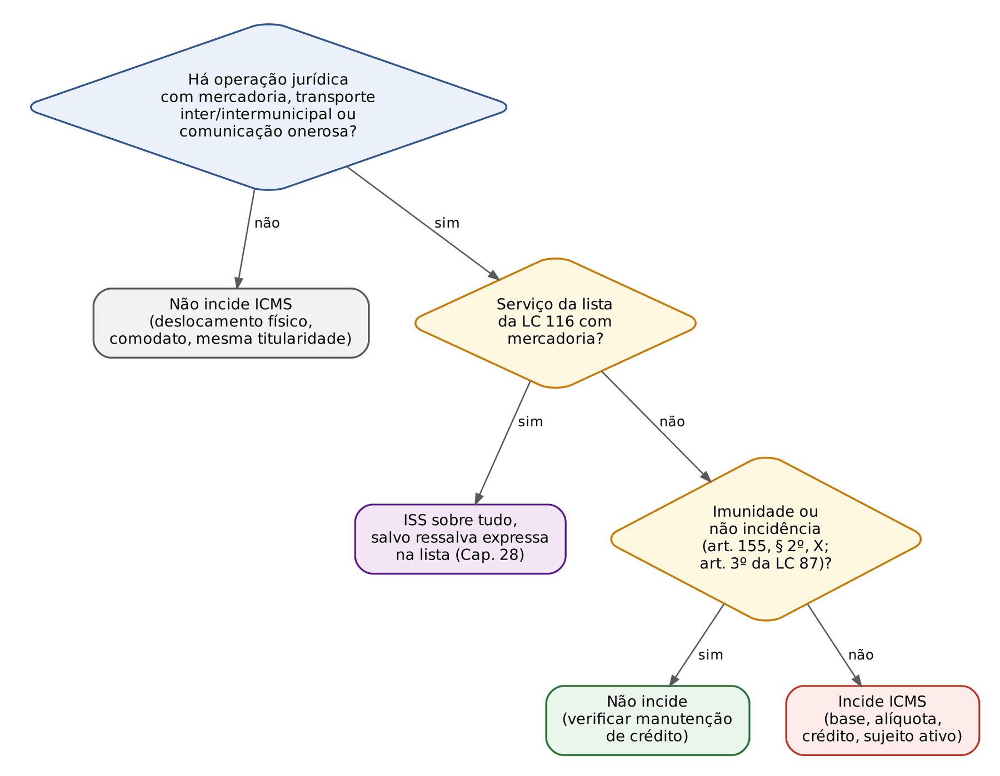
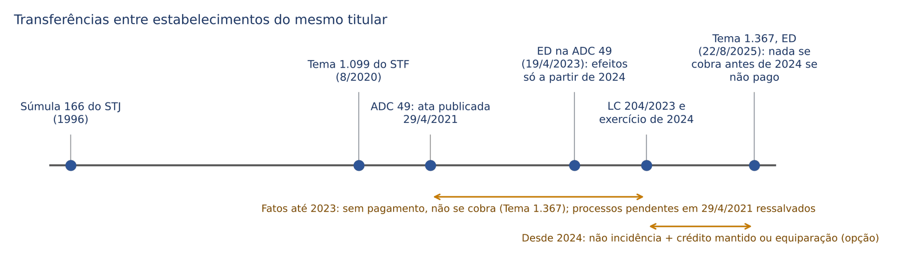
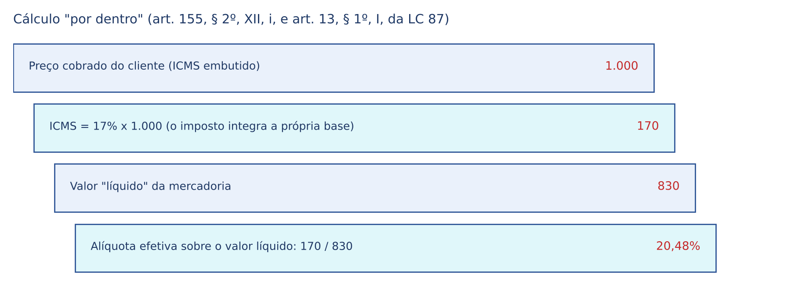
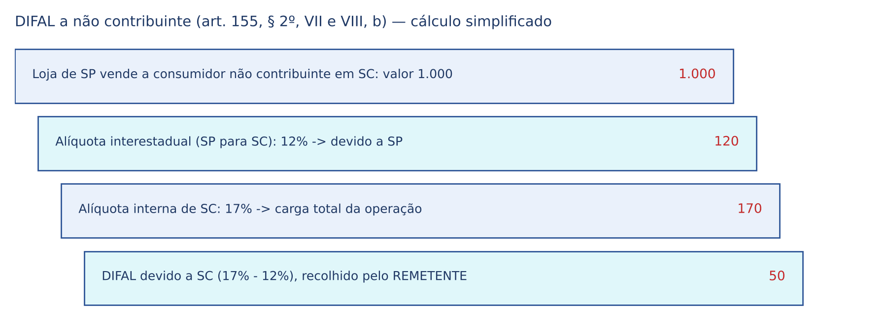
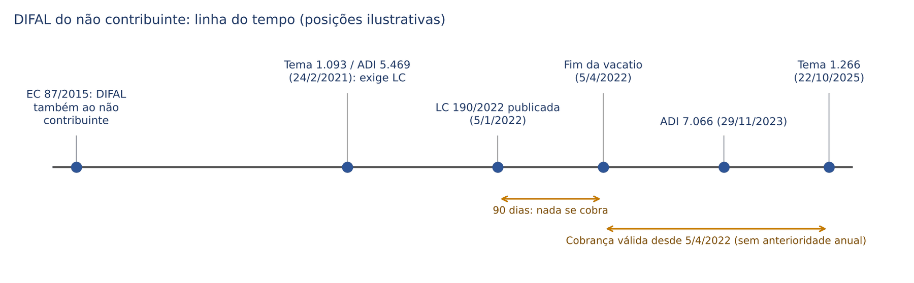
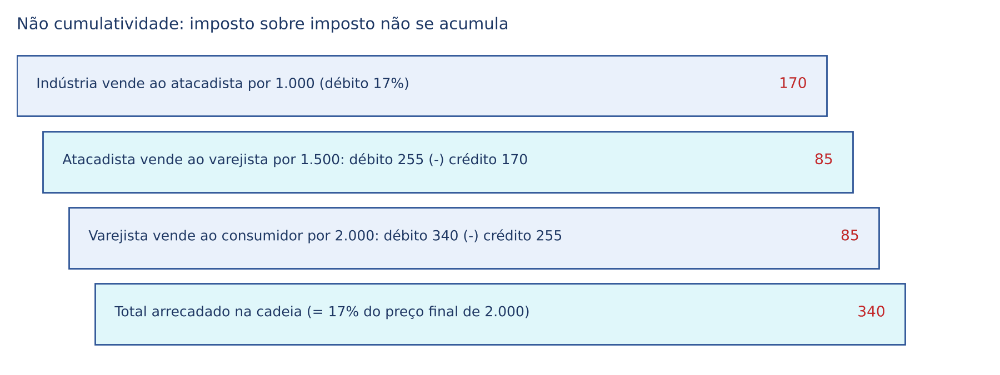
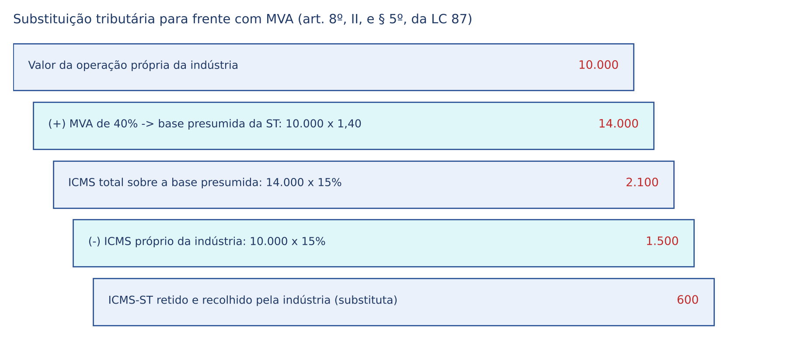

# CAPÍTULO 27 — ICMS: HIPÓTESES DE INCIDÊNCIA, NÃO INCIDÊNCIA E IMUNIDADES, MERCADORIA E SERVIÇOS DE TRANSPORTE E COMUNICAÇÃO, TRANSFERÊNCIAS ENTRE ESTABELECIMENTOS (ADC 49), DIFAL, SUBSTITUIÇÃO TRIBUTÁRIA E RESTITUIÇÃO, NÃO CUMULATIVIDADE E CRÉDITOS, SELETIVIDADE, IMPORTAÇÃO E ENERGIA; LEGISLAÇÃO DE SC (LEI 10.297/1996)

:::INCIDENCIA
TRF5 p. 10; TJRS p. 1; TJSC p. 19 e 24. Nível A+. Lote: 69 questões (FGV 20, FCC 49).
O que mais cai: restituição na substituição tributária para frente (Tema 201), DIFAL (Temas 1.093, 1.266 e 1.284), seletividade da energia (Tema 745), transporte para exportação, transferências entre estabelecimentos (ADC 49 e Tema 1.367) e, na FCC, créditos, estornos e regulamentos estaduais.
:::

| Subtema | FGV | FCC | Padrão de cobrança |
|---|---|---|---|
| Substituição tributária e restituição | 7 | 2 | caso de revenda por preço menor que o presumido; cálculo com MVA |
| DIFAL (não contribuinte, contribuinte, Simples) | 6 | 4 | quem recolhe, a que Estado, desde quando (LC 190/2022) |
| Não cumulatividade, créditos e estornos | 1 | 14 | crédito de uso e consumo, ativo, isenção, perecimento, exportação |
| Incidência, local e momento do fato gerador | 4 | 8 | alimentação, transporte, importação, contribuinte |
| Seletividade e energia | 3 | 0 | alíquota de energia acima da geral; demanda contratada |
| Transferências entre estabelecimentos | 1 | 1 | ADC 49, LC 204/2023, cobrança de períodos anteriores |
| Combustíveis (monofásico) | 0 | 2 | LC 192/2022: Estado do consumo, momento do fato gerador |
| Regulamentos, fiscalização e presunções | 0 | 16 | RICMS de SP, CE, MT e PI; omissão de receitas |
| Outros (convênios, IBS/CBS) | 0 | 3 | remissão aos Caps. 17 e 32 |

## 27.1 Panorama: o que é o ICMS e como estudá-lo

### 27.1.1 A lógica do imposto

O ICMS é o imposto estadual sobre o consumo. Ele grava cada etapa da circulação de uma mercadoria (da indústria ao atacado, do atacado ao varejo, do varejo ao consumidor), mais dois serviços que a Constituição destacou do ISS municipal: o transporte interestadual e intermunicipal e a comunicação. Como incide várias vezes sobre o mesmo bem, é PLURIFÁSICO; para não gerar "imposto sobre imposto" (efeito cascata), é NÃO CUMULATIVO: cada contribuinte abate o imposto cobrado nas etapas anteriores (27.9). O ônus econômico, embutido no preço, chega ao consumidor final, que é o contribuinte "de fato"; o contribuinte "de direito" é quem pratica a operação. Daí ser classificado como imposto INDIRETO, com as consequências do art. 166 do CTN na repetição do indébito (ver Cap. 16).

Para o civilista, a chave é esta: o ICMS não tributa o bem, nem o contrato em si, mas o NEGÓCIO JURÍDICO que faz a mercadoria mudar de titular. Por isso a jurisprudência repete que o que importa é a circulação JURÍDICA (transferência de titularidade), e não a física (27.2.2).

### 27.1.2 Fontes normativas: quem manda em quê

O ICMS é o imposto mais "federalizado" dos impostos estaduais. Como a operação de um Estado repercute em outro (crédito, guerra fiscal), a Constituição retirou boa parte da disciplina do legislador estadual:

| Fonte | O que disciplina | Base |
|---|---|---|
| Constituição | competência, não cumulatividade, imunidades, DIFAL, monofásico dos combustíveis | art. 155, II, e §§ 2º a 5º |
| Lei complementar nacional | contribuintes, substituição tributária, compensação (créditos), local da operação, manutenção de crédito, base de cálculo "por dentro", combustíveis de incidência única | art. 155, § 2º, XII; LC 87/1996 (Lei Kandir), LC 192/2022, LC 190/2022, LC 194/2022, LC 204/2023 |
| Lei complementar dos convênios | forma de concessão e revogação de isenções e benefícios | art. 155, § 2º, XII, g; LC 24/1975 e LC 160/2017 (Cap. 17) |
| Resolução do Senado | alíquotas interestaduais e de exportação (obrigatória); mínimas e máximas internas (facultativas) | art. 155, § 2º, IV e V |
| Convênio do CONFAZ | benefícios fiscais; alíquotas e regras dos combustíveis monofásicos | art. 155, § 2º, XII, g, e § 4º, IV |
| Lei estadual | INSTITUI o imposto, fixa alíquotas internas, define as mercadorias sujeitas à substituição | art. 155, II; art. 6º, § 2º, da LC 87 |

:::PEGADINHA Quem institui o ICMS é a lei ESTADUAL
A LC 87/1996 é lei de normas gerais: ela NÃO cria o ICMS. Cada Estado o institui por lei própria (em SC, a Lei 10.297/1996). Por isso, mesmo depois da LC 190/2022, o DIFAL depende de lei estadual, e a cobrança do Simples Nacional exige lei estadual em sentido estrito, não decreto (27.8.4). O inverso também cai: lei estadual não pode suprir a falta de lei complementar onde a Constituição a exige (Tema 1.093, 27.8.2; substituição tributária, Tema 456, 27.12.1).
:::

### 27.1.3 Ficha de consulta rápida

| Elemento | ICMS |
|---|---|
| Competência | Estados e DF (art. 155, II) |
| Fatos geradores | operações relativas à circulação de mercadorias; transporte interestadual e intermunicipal; comunicação onerosa; importação de bens e mercadorias por qualquer pessoa; fornecimento de alimentação e bebidas (art. 2º da LC 87) |
| Momento | saída do estabelecimento; fornecimento; início do transporte; desembaraço aduaneiro etc. (art. 12 da LC 87) |
| Local (Estado credor) | onde está o estabelecimento no fato gerador; na importação, o do destinatário jurídico; no DIFAL, o de destino (art. 11 da LC 87; Tema 520) |
| Base de cálculo | valor da operação ou preço do serviço, com o próprio imposto "por dentro" (art. 13) |
| Alíquotas | internas pela lei estadual; interestaduais por resolução do Senado (12%, 7% e 4%) |
| Contribuinte | quem pratica operações com habitualidade ou volume comercial; também o importador e outros sem habitualidade (art. 4º) |
| Lançamento | por homologação (Cap. 12) |
| Princípios próprios | não cumulatividade obrigatória; seletividade facultativa; anterioridade anual e nonagesimal (salvo combustíveis monofásicos, art. 155, § 4º, IV, c) |
| Futuro | extinção gradual pela reforma tributária, substituído pelo IBS (ver Caps. 32 e 33) |

:::ATENCAO ICMS e reforma tributária
A EC 132/2023 manteve o ICMS durante a transição: as alíquotas são reduzidas progressivamente de 2029 a 2032 e o imposto se extingue em 2033, quando o IBS assume integralmente (art. 128 do ADCT e LC 214/2025; cronograma, aproveitamento de saldos credores e fundos de compensação no Cap. 33). Para a prova de 2026 e 2027, todo o regime deste capítulo continua VIGENTE. Uma novidade já incorporada à Lei Kandir: a partir de 1/1/2027, o Imposto Seletivo integra a base de cálculo do ICMS (art. 13, § 1º, III, da LC 87, incluído pela LC 227/2026).
:::

## 27.2 Hipóteses de incidência sobre mercadorias

### 27.2.1 O mapa das incidências (art. 2º da LC 87)

O art. 2º da LC 87 desdobra a competência (mercadorias, alimentação, transporte, comunicação, fornecimento misto) e o § 1º acrescenta importação, serviço iniciado no exterior e entrada interestadual de combustíveis e energia para consumo. O § 2º traz regra decisiva: a caracterização do fato gerador independe da natureza jurídica da operação.

### 27.2.2 Circulação jurídica e o conceito de mercadoria

Três palavras do art. 155, II, delimitam a competência:

- OPERAÇÃO: negócio jurídico (compra e venda, troca, dação em pagamento). Sem negócio, não há ICMS.
- CIRCULAÇÃO: passagem da mercadoria de um titular a outro. A doutrina majoritária (Roque Antonio Carrazza, Paulo de Barros Carvalho, Hugo de Brito Machado) a define como circulação JURÍDICA, isto é, transferência de titularidade ou de poderes de disposição. Saída meramente física não basta.
- MERCADORIA: bem móvel destinado ao comércio. O mesmo bem pode ser mercadoria nas mãos do comerciante e não ser na do particular que vende seu carro usado.

Dessa moldura saem as orientações cobradas:

| Situação | Incide? | Fundamento |
|---|---|---|
| Comodato de máquinas e utensílios | NÃO | Súmula 573 do STF: a saída física em comodato não é fato gerador |
| Simples deslocamento entre estabelecimentos do mesmo titular | NÃO | Súmula 166 do STJ; Tema 1.099 e ADC 49 (27.3) |
| Venda de salvados de sinistro pela seguradora | NÃO | SV 32 e Tema 216 do STF; art. 3º, IX, da LC 87 |
| Arrendamento mercantil (sem opção de compra exercida) | NÃO | art. 3º, VIII, da LC 87; leasing internacional: Tema 297 (27.5.3) |
| Alienação fiduciária em garantia | NÃO | art. 3º, VII, da LC 87 |
| Transferência de propriedade de estabelecimento (trespasse) | NÃO | art. 3º, VI, da LC 87 |
| Locadora que vende veículo com menos de 12 meses da aquisição | SIM | Tema 1.012 do STF: o bem passou a ser mercadoria |
| Fornecimento de água encanada | NÃO | Tema 326 do STF: serviço público essencial, não mercadoria |
| Embalagens sob encomenda para integrar produto que será industrializado ou comercializado | SIM (ICMS, não ISS) | Jurisprudência em Teses do STJ, ed. 177, tese 7 |
| Venda de fitas de vídeo em série | SIM | Súmula 662 do STF; gravação por encomenda: ISS (Súmula 135 do STJ) |
| Aparelhos celulares cedidos em comodato pela operadora | não incide na cessão, e a operadora pode creditar-se do ICMS da entrada | Tema 1.052 do STF |

:::DICA Como o juiz cível deve raciocinar
Pergunte primeiro: houve negócio translativo da titularidade? Se a resposta é não (comodato, depósito, remessa para conserto, deslocamento entre filiais), o ICMS não incide, ainda que a mercadoria tenha viajado centenas de quilômetros. A intuição de que "saiu da loja, pagou imposto" é a armadilha mais comum.
:::

:::QUESTAO FCC 2026 — SEFAZ-SP — Auditor Fiscal (Q3926883)
Pela lei paulista, qual situação gera ICMS? Gabarito C: adquirir, em licitação do Poder Público, mercadoria importada apreendida (art. 12, XI, da LC 87). Erros: transportar em veículo próprio mercadoria já adquirida (A) e remeter a armazém geral em nome do remetente (B) são deslocamentos sem negócio translativo; as alternativas D (leilão judicial) e E (alienação de bem usado do ativo permanente) descrevem situações que a lei paulista não arrola como fato gerador; o RICMS/SP trata a saída de bem do ativo como não incidência (Q3956721, gabarito B).
:::

### 27.2.3 Contribuinte: habitualidade e as exceções do § 1º do art. 4º

Contribuinte é quem realiza operações de circulação de mercadoria ou presta transporte interestadual e intermunicipal e comunicação, com habitualidade ou em volume que caracterize intuito comercial, ainda que as operações se iniciem no exterior (art. 4º, caput). O § 1º dispensa a habitualidade para: o importador, qualquer que seja a finalidade; o destinatário de serviço prestado ou iniciado no exterior; o adquirente em licitação de bens apreendidos ou abandonados; o adquirente interestadual de combustíveis e energia não destinados a comercialização ou industrialização. O § 2º, incluído pela LC 190/2022, define o contribuinte do DIFAL (27.8.3).

:::QUESTAO FCC 2026 — SEFAZ-GO — Auditor Fiscal (Q4067504)
Gabarito D: literalidade do art. 4º, caput (qualquer pessoa, física ou jurídica, com habitualidade ou volume que caracterize intuito comercial, ainda que as operações se iniciem no exterior). Armadilha: a pessoa física que arremata bem PENHORADO (C) não é a do art. 4º, § 1º, III (bens apreendidos ou abandonados em licitação).
:::

### 27.2.4 Fornecimento de alimentação e bebidas

Bares e restaurantes prestam serviço (preparo, atendimento), mas a LC 87 os coloca no ICMS sobre o VALOR TOTAL, inclusive a parcela de serviço (Súmula 163 do STJ; tese repetitiva da Jurisprudência em Teses do STJ, ed. 175, tese 5). O momento do fato gerador é o fornecimento (art. 12, II).

Duas sutilezas cobradas:

- Hotel: a alimentação incluída na diária (o café da manhã que se paga com ou sem consumo) integra a hospedagem, serviço da lista do ISS (item 9.01 da LC 116, ver Cap. 28). Já as refeições cobradas à parte, mesmo de hóspede, sujeitam-se ao ICMS.
- Entrega (*delivery*) dentro do mesmo Município não é transporte intermunicipal: não há ICMS-transporte. A pizza entregue é mercadoria que SAI do estabelecimento (fato gerador na saída, art. 12, I); a consumida no salão é fornecimento (art. 12, II).

:::QUESTAO FCC 2026 — SEFAZ-SP — Auditor Fiscal (Q3917732)
Hotel com restaurante e salão de festas. Gabarito A: incide ICMS no almoço e no jantar cobrados à parte do hóspede, nas seis refeições do não hóspede e nas bebidas vendidas na festa. Não incide no café da manhã incluído na diária (integra a hospedagem, ISS) nem no ingresso da festa com música ao vivo (serviço de diversão, ISS). A alternativa E (nenhum café da manhã) erra porque o café do não hóspede, vendido avulso, é fornecimento de alimentação.
:::

:::QUESTAO FCC 2025 — SEFAZ-PI — Auditor Fiscal (Q3596251)
Pizzaria com salão e *delivery* terceirizado dentro do mesmo Município. Gabarito C: o fato gerador ocorre na SAÍDA das pizzas do estabelecimento, quanto às entregues, e no FORNECIMENTO, quanto às consumidas no local. Não há ICMS sobre o transporte, porque é intramunicipal (A, B e E erradas).
:::

### 27.2.5 Operações mistas: ICMS x ISS (remissão)

Quando mercadoria e serviço andam juntos, a regra da LC 116 é: serviço da lista = ISS sobre o total, salvo ressalva expressa da própria lista (ex.: peças nas oficinas, alimentação nos hotéis); serviço fora da lista = ICMS sobre o total (art. 155, § 2º, IX, b, da CF; art. 2º, IV e V, da LC 87; art. 3º, V). *Software*, industrialização por encomenda, gráficas, *streaming* e provimento de conteúdo são desenvolvidos no Cap. 28 (ADIs 5.659 e 1.945; Súmula 156 do STJ). Aqui basta registrar que a Lei 10.297/1996 de SC ainda prevê ICMS sobre "bens digitais" quando caracterizados como mercadoria (Cap. 34, 34.4), regra cuja aplicação deve ser lida à luz daqueles precedentes.

### 27.2.6 Momento e local do fato gerador

O momento (art. 12) define QUANDO nasce a obrigação; o local (art. 11) define QUAL Estado cobra e qual estabelecimento responde. Os cobrados:

| Situação | Momento (art. 12) | Local / Estado credor (art. 11) |
|---|---|---|
| Venda de mercadoria | saída do estabelecimento (I) | o do estabelecimento onde se encontre no fato gerador (I, a) |
| Mercadoria em situação irregular | — | onde se encontre (I, b) |
| Alimentação e bebidas | fornecimento (II) | estabelecimento fornecedor |
| Armazém geral | transmissão a terceiro (III) | saída considerada no estabelecimento do depositante, se no mesmo Estado (§ 5º) |
| Transporte | início da prestação (V) | onde tenha início (II, a) |
| Comunicação | prestação (VII); por ficha ou cartão, no fornecimento do instrumento (§ 1º) | onde cobrado o serviço (III, d); serviço não medido entre Estados: metade para cada (§ 6º) |
| Importação | desembaraço aduaneiro (IX), ou entrega anterior ao desembaraço (§ 3º) | estabelecimento da entrada física (I, d) ou domicílio do adquirente não estabelecido (I, e); STF: destinatário jurídico (Tema 520) |
| Pescado | — | local do desembarque (I, i) |
| Aquisição em licitação de importado apreendido | aquisição (XI) | local da licitação (I, f) |

:::QUESTAO FCC 2026 — SEFAZ-SP — Auditor Fiscal (Q3956727)
Gabarito E (RICMS/SP): o local da operação com mercadoria é onde ela se encontra no fato gerador, presumindo-se interna a operação se o contribuinte não comprovar a saída para outro Estado ou a exportação. Erros: a regra da captura vale para pescado, não para gado (A); no DIFAL ao NÃO contribuinte o local é o do REMETENTE (D, art. 11, V, b).
:::

:::QUESTAO FCC 2026 — SEFAZ-SP — Auditor Fiscal (Q3917741)
Gabarito C: na operação interestadual a consumidor final NÃO contribuinte, o remetente paga ao seu Estado a alíquota interestadual e ao Estado do destinatário a diferença para a alíquota interna deste. Erros: transporte de passageiro tributado no Estado de início (B, art. 11, § 8º); comunicação não medida dividida em partes IGUAIS (D, § 6º); armazém geral só no MESMO Estado (E, § 5º).
:::

## 27.3 Transferências entre estabelecimentos do mesmo titular

### 27.3.1 De onde vem o problema

A LC 87 adota a AUTONOMIA DOS ESTABELECIMENTOS: cada filial apura seu imposto (art. 11, § 3º, II, e art. 25). Daí a redação original do art. 12, I, que considerava fato gerador a saída "ainda que para outro estabelecimento do mesmo titular". Nas INTERESTADUAIS, a transferência definia quanto ficava com a origem e quanto com o destino.

A jurisprudência sempre leu a Constituição de outro modo. Se ICMS pressupõe circulação jurídica, mandar mercadoria de uma filial para outra da mesma pessoa jurídica não é operação mercantil: ninguém vende a si mesmo (Súmula 166 do STJ). O STF confirmou a tese para as operações interestaduais (Tema 1.099) e, na ADC 49, declarou inconstitucionais os dispositivos da LC 87 que tratavam a transferência como fato gerador.

### 27.3.2 ADC 49, modulação e Tema 1.367

Passo a passo:

1. Mérito da ADC 49 (abril de 2021; ata publicada em 29/4/2021): inconstitucionalidade da cobrança nas transferências.
2. Embargos de declaração (concluídos em 19/4/2023): efeitos a partir do exercício financeiro de 2024, ressalvados os processos administrativos e judiciais pendentes em 29/4/2021; se os Estados não regulamentassem a transferência de créditos até o fim do prazo, ficaria reconhecido o direito dos contribuintes de transferi-los.
3. LC 204/2023: deu nova redação ao art. 12, I, e incluiu os §§ 4º e 5º no art. 12 (abaixo).
4. Tema 1.367 do STF (RE 1.490.708/SP): no julgamento de 4/2/2025, o Tribunal reafirmou a modulação (efeitos a partir de 2024, ressalvados os processos pendentes em 29/4/2021), e alguns Estados passaram a autuar transferências de 2021 a 2023 de quem não havia litigado. Nos embargos de declaração, acolhidos por maioria em 22/8/2025, a tese passou a ser: "A modulação dos efeitos estabelecida no julgamento da ADC nº 49/RN-ED não autoriza a cobrança do ICMS lá debatido quanto a fatos geradores ocorridos antes de 2024 em relação aos quais não tenha havido o pagamento do tributo."

:::LEI LC 87/1996, art. 12, § 4º (incluído pela LC 204/2023)
"Não se considera ocorrido o fato gerador do imposto na saída de mercadoria de estabelecimento para outro de mesma titularidade, mantendo-se o crédito relativo às operações e prestações anteriores em favor do contribuinte, inclusive nas hipóteses de transferências interestaduais em que os créditos serão assegurados:
I - pela unidade federada de destino, por meio de transferência de crédito, limitados aos percentuais estabelecidos nos termos do inciso IV do § 2º do art. 155 da Constituição Federal, aplicados sobre o valor atribuído à operação de transferência realizada;
II - pela unidade federada de origem, em caso de diferença positiva entre os créditos pertinentes às operações e prestações anteriores e o transferido na forma do inciso I deste parágrafo."
:::

O § 5º dá ao contribuinte uma OPÇÃO: equiparar a transferência a operação tributada (alíquotas internas nas operações internas; interestaduais nas interestaduais). Muitas empresas preferem destacar o imposto para manter a lógica dos créditos e dos benefícios fiscais. Em SC, a opção é anual, irretratável no ano-calendário, vale para todos os estabelecimentos e renova-se automaticamente (Lei 10.297/1996, art. 31-E; Cap. 34, 34.4).

:::EXEMPLO Transferência interestadual sem incidência, com transferência de crédito
A indústria Alfa, de SC, comprou insumos com 17% de ICMS (crédito de 170 (cento e setenta) reais) e transfere o produto, avaliado em 1.000 (mil) reais, para sua filial no Paraná.
| Passo | Cálculo | Valor (reais) |
|---|---|---|
| Crédito da matriz relativo à mercadoria | — | 170 |
| Limite transferível ao destino (alíquota interestadual SC para PR: 12%) | 1.000 x 12% | 120 |
| Crédito transferido à filial do PR (destacado na NF-e, sem ser débito de imposto) | — | 120 |
| Diferença positiva mantida pela matriz em SC (art. 12, § 4º, II) | 170 - 120 | 50 |
Resultado: não há fato gerador, mas os créditos continuam circulando, e cada Estado "carrega" a parcela que corresponderia à divisão interestadual. Os valores e a forma de cálculo do valor da mercadoria (custo, entrada mais recente) seguem a lei estadual (em SC, art. 31-D da Lei 10.297/1996).
:::

:::QUESTAO FGV 2026 — PGE-AC — Procurador do Estado (Q4079420)
Empresa transferiu mercadorias entre filiais de Estados diferentes de 2021 a 2023 sem recolher ICMS; em 2025 o Estado autuou, invocando a modulação. Gabarito D: a transferência entre estabelecimentos do mesmo titular não é fato gerador e é vedada a cobrança, inclusive quanto a fatos anteriores a 2024 não pagos (Tema 1.367, embargos de 22/8/2025).
Armadilhas: a circulação física não basta (A); a não incidência não veda o crédito, que é mantido (B, art. 12, § 4º); a modulação não autoriza a cobrança retroativa do que não foi pago (C, a tese que alguns Estados sustentavam); a falta de lei complementar não impede reconhecer a não incidência, que decorre da própria Constituição (E).
:::

:::SENTENCA Mandado de segurança contra autuação por transferência entre filiais
Onde entra: mérito do MS ou da anulatória contra auto de infração por saída de mercadoria para filial em outro Estado.
O que fundamentar: (i) ausência de circulação jurídica (Súmula 166 do STJ; Tema 1.099 e ADC 49); (ii) período: fatos de 2024 em diante estão sob o art. 12, § 4º, da LC 87; fatos anteriores não pagos não podem ser cobrados (Tema 1.367); (iii) se a empresa pagou em 2021 a 2023 e só ajuizou ação depois de 29/4/2021, a modulação impede a repetição.
Redação-modelo: "A transferência de mercadorias entre estabelecimentos do mesmo titular não configura fato gerador do ICMS (ADC 49; Tema 1.099 do STF; art. 12, § 4º, da LC 87/1996), e a modulação de efeitos daquele julgado não autoriza a exigência do imposto sobre fatos anteriores a 2024 não recolhidos (Tema 1.367 do STF), razão pela qual o lançamento é nulo."
Erro comum que a banca pune: tratar a modulação como autorização para cobrar o passado; e, no outro extremo, mandar devolver o que foi pago sem verificar se havia processo pendente em 29/4/2021.
:::

:::ATENCAO Operações internas e bens do ativo
A não incidência vale também nas transferências INTERNAS. Bens do ativo e de uso e consumo deslocados entre estabelecimentos não geram ICMS, mas o Fisco pode exigir que circulem com nota fiscal (Jurisprudência em Teses do STJ, ed. 175, tese 13). Na Q3956717 (FCC 2026, RICMS/SP), errava a alternativa que definia "transferência" como saída tributada para titular DIVERSO; o gabarito C reproduziu o conceito regulamentar de industrialização.
:::

## 27.4 Serviços de transporte e de comunicação

### 27.4.1 Transporte interestadual e intermunicipal

Incide ICMS sobre o transporte interestadual e intermunicipal, por qualquer via, de pessoas, bens, mercadorias ou valores (art. 2º, II, da LC 87; constitucionalidade reafirmada na ADI 2.779, j. 20/5/2024). O transporte DENTRO de um mesmo Município é serviço sujeito ao ISS (item 16 da lista da LC 116; ver Cap. 28). O fato gerador ocorre no início da prestação, e o Estado credor é o de início (arts. 11, II, a, e 12, V).

Pontos cobrados:

- Transporte para EXPORTAÇÃO: "Não incide ICMS sobre o serviço de transporte interestadual de mercadorias destinadas ao exterior" (Súmula 649 do STJ). O fundamento é o art. 3º, II, da LC 87 (não incide sobre operações e PRESTAÇÕES que destinem ao exterior mercadorias): a desoneração da exportação alcança o frete que a leva até o porto.
- Correios: não incide ICMS sobre o transporte de bens e mercadorias realizado pela ECT (Tema 402 do STF; v. Cap. 6).
- Transporte aéreo de passageiros: a cobrança foi afastada pelo STF na ADI 1.600 (nota da própria Lei 10.297/1996 de SC); o transporte aéreo de cargas é tributado.
- Transporte interestadual de passageiro não contribuinte: o fato gerador ocorre no Estado de início e aplica-se a alíquota interna dele, sem DIFAL (art. 11, § 8º).

:::QUESTAO FGV 2024 — TJ-MT — Juiz Substituto (Q3086989)
Transportadora levou produtos eletrônicos do Estado A ao porto do Estado B, de onde foram exportados; o Estado A cobrou ICMS sobre o frete. Gabarito B: inexigibilidade, porque não incide ICMS sobre o transporte interestadual de mercadorias destinadas ao exterior (Súmula 649 do STJ).
Armadilhas: tratar o frete como ato autônomo (A); exigir isenção estadual (C), quando a desoneração vem da lei complementar; afirmar isenção geral dos eletrônicos (E).
:::

:::QUESTAO FGV 2025 — TJ-TO — Juiz Substituto (Q3453293)
Mesmo raciocínio, agora com transporte INTERMUNICIPAL (fábrica no Município Alfa, porto no Município Beta, mesmo Estado). Gabarito E: não incide ICMS, porque a desoneração alcança a cadeia logística da exportação. A alternativa A, sedutora, restringia a não incidência ao transporte interestadual, como na literalidade da Súmula 649. A FGV estendeu a lógica do art. 3º, II, da LC 87 (que não distingue interestadual de intermunicipal); ver a nota de verificação.
:::

Na Q3538542 (FCC 2025, TRF4), o item correto I afirmava que o transporte no limite de um Município não gera ICMS (gabarito E).

### 27.4.2 Comunicação

Incide ICMS sobre prestações ONEROSAS de serviço de comunicação, por qualquer meio (art. 2º, III). Comunicação, para fins tributários, é a relação em que o prestador fornece os meios para que a mensagem seja transmitida e recebida (telefonia, TV por assinatura, internet como infraestrutura de telecomunicação). A jurisprudência separa o SERVIÇO DE COMUNICAÇÃO dos serviços que apenas o PREPARAM ou o complementam:

| Atividade | ICMS? | Fundamento |
|---|---|---|
| Habilitação de telefone celular | NÃO | Súmula 350 do STJ |
| Serviços conexos e preparatórios (instalação, cadastro, troca de número, auxílio à lista) | NÃO: atividade-meio | Jurisprudência em Teses do STJ, ed. 175, tese 6 |
| Provedor de acesso à internet | NÃO: serviço de valor adicionado | Súmula 334 do STJ |
| Assinatura básica mensal de telefonia | SIM, com ou sem franquia de minutos | Tema 827 do STF |
| Serviço prestado e não pago (inadimplência) | SIM: o inadimplemento é posterior e não desfaz o fato gerador | Tema 705 do STF |
| Radiodifusão sonora e de sons e imagens de recepção livre e gratuita | NÃO: imunidade | art. 155, § 2º, X, d |
| *Streaming* e disponibilização de conteúdo pela internet | ISS (item 1.09 da lista da LC 116) | ver Cap. 28 |

## 27.5 Importação

### 27.5.1 A incidência e o momento

Antes da EC 33/2001, a importação por não contribuinte para uso próprio não gerava ICMS (faltava "operação mercantil"); desde então, incide sobre a importação por pessoa física ou jurídica, contribuinte habitual ou não, qualquer que seja a finalidade (art. 155, § 2º, IX, a). O STF validou a nova regra (Tema 171) e fixou que as leis estaduais editadas depois da EC 33 e antes da LC 114/2002 são válidas, mas só produzem efeitos a partir da vigência da LC 114 (Tema 1.094). As Súmulas 155 e 198 do STJ (aeronave e veículo importados por pessoa física para uso próprio: incide) refletem a orientação atual.

O fato gerador ocorre no DESEMBARAÇO ADUANEIRO (art. 12, IX), e a liberação da mercadoria depende do comprovante de pagamento (art. 12, § 2º): "Na entrada de mercadoria importada do exterior, é legítima a cobrança do ICMS por ocasião do desembaraço aduaneiro" (SV 48; Súmula 661 do STF). Se a mercadoria é entregue antes do desembaraço, o fato gerador ocorre na entrega (§ 3º).

A base de cálculo soma o valor aduaneiro, o II, o IPI, o IOF-câmbio e quaisquer outros impostos, taxas, contribuições e despesas aduaneiras (art. 13, V), com o próprio ICMS calculado "por dentro", inclusive na importação (art. 155, § 2º, XII, i, da CF).

### 27.5.2 Qual Estado cobra: o destinatário jurídico (Tema 520)

Nas importações por conta e ordem ou por encomenda, a mercadoria entra fisicamente por um Estado (porto de Santa Catarina, por exemplo) e segue para empresa de outro. A Constituição atribui o imposto ao Estado do domicílio ou estabelecimento do DESTINATÁRIO (art. 155, § 2º, IX, a). O STF esclareceu quem é esse destinatário:

:::JURIS STF, Tema 520 (ARE 665.134, j. 27/4/2020)
"O sujeito ativo da obrigação tributária de ICMS incidente sobre mercadoria importada é o Estado-membro no qual está domiciliado ou estabelecido o destinatário legal da operação que deu causa à circulação da mercadoria, com a transferência de domínio."
Tradução: importa quem é o destinatário JURÍDICO (quem adquire a propriedade), e não por onde a mercadoria passa ou onde é desembaraçada. Na importação por conta e ordem, o adquirente é o real importador; na importação direta por trading que depois revende, a trading é a destinatária.
:::

### 27.5.3 Situações especiais

- Arrendamento mercantil internacional: não incide ICMS, salvo antecipação da opção de compra, quando configurada a transferência da titularidade (Tema 297 do STF). O fundamento é que, sem transferência de domínio, não há "operação relativa à circulação".
- Importação por ente imune: a imunidade recíproca afasta o ICMS-importação devido pela empresa pública que presta serviço público essencial, em regime não concorrencial e sem distribuição de lucros a acionistas privados (Cap. 6). Na Q3880821 (FGV 2026, ALERJ), o gabarito A conjugou as duas regras: o ICMS-importação é devido pelo importador no desembaraço, e a empresa pública só é imune se preencher aqueles requisitos.
- Fonogramas importados: a imunidade do art. 150, VI, e, não alcança suportes produzidos fora do Brasil (Q3301295, FGV 2025, TJ-SE, gabarito C; Tema 1.083, ver Cap. 6).
- Mandado de segurança para desembaraçar sem pagar: a impetração contra a exigência do comprovante não impede o lançamento para prevenir a decadência, e o contribuinte pode discutir no processo administrativo matéria distinta da judicial (Q3956737, FCC 2026; concomitância entre processo administrativo e judicial: ver Cap. 20).

:::QUESTAO FGV 2024 — AL-SC — Analista Legislativo, Direito (Q2486012)
Pessoa jurídica importou bens por arrendamento mercantil. Gabarito oficial C: o ICMS é devido no desembaraço aduaneiro.
Comentário: a banca aplicou a literalidade da EC 33 ("qualquer que seja a sua finalidade") e a SV 48. A resposta é discutível diante do Tema 297 do STF, segundo o qual não incide ICMS no arrendamento mercantil internacional, salvo antecipação da opção de compra; a alternativa E se aproximava dessa tese. Na prova, se o enunciado mencionar o leasing internacional sem opção de compra, a resposta do STF é a não incidência; ver a nota de verificação.
:::

## 27.6 Não incidência e imunidades do ICMS

### 27.6.1 Quadro geral

O que a Constituição diz que "não incidirá" é imunidade; o que a LC 87 diz no art. 3º ora repete imunidades, ora explicita hipóteses que nem estão no campo de incidência (distinção imunidade x isenção x não incidência: ver Cap. 6).

| Hipótese | Fonte | Crédito das entradas |
|---|---|---|
| Exportação de mercadorias e serviços | art. 155, § 2º, X, a; art. 3º, II, da LC 87 | MANTIDO e aproveitado (exceção expressa à regra do estorno) |
| Saída com fim específico de exportação para *trading*, outro estabelecimento da mesma empresa, armazém alfandegado ou entreposto | art. 3º, parágrafo único, da LC 87 | equiparada à exportação |
| Petróleo, lubrificantes, combustíveis e energia elétrica para outro Estado | art. 155, § 2º, X, b; art. 3º, III, da LC 87 | regra geral (estorno, salvo lei) |
| Ouro ativo financeiro | art. 155, § 2º, X, c; art. 153, § 5º | — |
| Radiodifusão livre e gratuita | art. 155, § 2º, X, d | — |
| Alienação fiduciária, arrendamento, trespasse, salvados | art. 3º, VI a IX | — |
| Transmissão e distribuição de energia e encargos setoriais | art. 3º, X (incluído pela LC 194/2022, com eficácia suspensa: 27.11.2) | — |

### 27.6.2 Exportação: imunidade e créditos

A Constituição adota o princípio do destino: não se exporta tributo. Desde a EC 42/2003, a imunidade alcança todas as mercadorias. E a imunidade vem "assegurada a manutenção e o aproveitamento do montante do imposto cobrado nas operações e prestações anteriores": o exportador não estorna os créditos das entradas (art. 21, § 2º, da LC 87) e pode acumular saldo credor.

Os limites da imunidade, desenvolvidos no Cap. 6: ela não alcança operações ANTERIORES à exportação, como a venda de peças no mercado interno a quem vai exportar (Tema 475), e não converte em crédito o ICMS dos bens de uso e consumo, que depende de lei complementar (Tema 633).

O saldo credor acumulado pelo exportador pode ser usado, nesta ordem (art. 25, § 1º, da LC 87): compensado com débitos de outros estabelecimentos do mesmo titular no Estado; e, havendo saldo, transferido a OUTROS contribuintes do mesmo Estado, mediante documento da autoridade que reconheça o crédito. Quanto aos demais saldos credores (não decorrentes de exportação), a transferência depende de lei estadual (art. 25, § 2º). O direito nasce com a exportação, não com a estocagem da matéria-prima (Súmula 129 do STJ).

:::QUESTAO FGV 2025 — MPE-RJ — Promotor de Justiça Substituto (Q3532426)
Indústria fluminense com créditos acumulados de exportação quer transferi-los a varejista do mesmo Estado, de outro grupo econômico. Gabarito C: a transferência é permitida, com verificação prévia do crédito pela SEFAZ, mas sem necessidade de autorização prévia para a transferência, independentemente da legislação estadual (art. 25, § 1º, II, da LC 87: direito assegurado pela lei complementar, com emissão de documento que reconheça o crédito).
Armadilhas: limitar o uso ao ICMS-ST (A) ou a 60% do ICMS-importação (D); proibir a transferência a terceiros (B); exigir aprovação discricionária (E). A lei estadual só pode condicionar a transferência dos saldos NÃO decorrentes de exportação (art. 25, § 2º).
:::

:::QUESTAO FCC 2025 — SEFAZ-PI — Auditor Fiscal (Q3596277)
Quais saldos credores acumulados o RICMS/PI obriga a usar na quitação de débitos inscritos em dívida ativa? Gabarito E: os decorrentes de EXPORTAÇÃO com manutenção de crédito. É a hipótese que a LC 87 trata como direito do contribuinte (art. 25, § 1º), e a lei estadual pode disciplinar a ordem de utilização.
:::

### 27.6.3 Energia e combustíveis para outro Estado: imunidade do Estado de origem

O art. 155, § 2º, X, b, retira do Estado PRODUTOR (origem) o ICMS sobre petróleo, combustíveis e energia remetidos a outro Estado. O imposto não desaparece: desloca-se integralmente para o Estado de DESTINO, que o cobra na entrada quando não destinados à comercialização ou à industrialização (art. 2º, § 1º, III, e art. 4º, § 1º, IV, da LC 87), e na operação subsequente quando destinados a revenda ou industrialização.

:::JURIS STF, Tema 689 (RE 748.543, j. 5/8/2020)
"Segundo o artigo 155, § 2º, X, b, da CF/1988, cabe ao Estado de destino, em sua totalidade, o ICMS sobre a operação interestadual de fornecimento de energia elétrica a consumidor final, para emprego em processo de industrialização, não podendo o Estado de origem cobrar o referido imposto."
A imunidade restringe-se ao Estado de origem; não beneficia o consumidor, apenas define quem tributa.
:::

Nos combustíveis de incidência monofásica, a regra do inciso X, b, deixa de se aplicar (art. 155, § 2º, XII, h, e § 4º; 27.11.3).

## 27.7 Base de cálculo e alíquotas

### 27.7.1 Base de cálculo: o valor da operação e o cálculo "por dentro"

A base é o valor da operação (mercadoria) ou o preço do serviço (transporte e comunicação), conforme o art. 13 da LC 87 (Q3819253, FCC 2025, gabarito D, cobrou exatamente essa distinção). Duas regras definem o que entra:

- O PRÓPRIO ICMS integra a base, e o destaque na nota é "mera indicação para fins de controle" (art. 13, § 1º, I; art. 155, § 2º, XII, i, da CF). É o chamado cálculo "por dentro", que faz a alíquota efetiva ser maior que a nominal.
- Integram a base: seguros, juros e demais importâncias pagas ou recebidas, descontos CONDICIONAIS e o frete cobrado pelo remetente (art. 13, § 1º, II). A partir de 1/1/2027, também o Imposto Seletivo (art. 13, § 1º, III, incluído pela LC 227/2026). NÃO integra a base o IPI, quando a operação entre contribuintes, com produto destinado a industrialização ou comercialização, configurar fato gerador dos dois impostos (art. 155, § 2º, XI; art. 13, § 2º).

| Parcela | Na base? | Fundamento |
|---|---|---|
| Desconto incondicional (dado na nota, sem condição futura) | NÃO | Súmula 457 do STJ (Tema 144) |
| Desconto condicionado (ex.: pagamento antecipado) | SIM | art. 13, § 1º, II, a |
| Bonificação e desconto incondicional na substituição tributária | SIM, na base presumida da ST | Jurisprudência em Teses do STJ, ed. 175, tese 7 |
| Juros da venda a prazo feita pelo próprio vendedor | SIM (valor da nota) | Súmula 395 do STJ; JT ed. 175, tese 9 |
| Encargos do financiamento por cartão de crédito ou instituição financeira | NÃO | Súmula 237 do STJ |
| Seguro de garantia estendida pago pelo consumidor | NÃO | JT ed. 121, tese 13 |
| PIS e Cofins embutidos no preço | SIM (repasse econômico) | Tema 1.223 do STJ |
| Venda não paga (inadimplência) no ICMS-comunicação | SIM | Tema 705 do STF |
| Demanda de potência contratada e não utilizada | NÃO | Tema 176 do STF; Súmula 391 do STJ (27.11.1) |
| TUSD e TUST lançadas na fatura do consumidor | SIM | Tema 986 do STJ (27.11.2) |
| Redução de alíquota de IPI ou II | não reduz o ICMS | Súmula 95 do STJ |

:::QUESTAO FGV 2024 — TCE-PA — Auditor de Controle Externo (Q2565248)
Três afirmações: (I) o próprio ICMS compõe sua base: VERDADEIRO (art. 13, § 1º, I); (II) a pauta fiscal é incompatível com a substituição tributária: FALSO, porque a ST trabalha com base presumida fixada nos termos da lei complementar (preço sugerido, PMC, MVA); o que a Súmula 431 do STJ veda é a pauta como substituto arbitrário do valor real da operação (27.12.2); (III) a demanda de potência só é tributável quando efetivamente consumida: VERDADEIRO (Tema 176). Gabarito B (V-F-V).
:::

A pauta fiscal e o arbitramento: a lei não pode substituir, por tabela de preços, o valor real da operação (Súmula 431 do STJ). Quando o valor declarado não merece fé, o caminho é o arbitramento com contraditório do art. 148 do CTN (Cap. 12). A FCC cobra a lógica inversa nas auditorias: quando a contabilidade revela recebimento maior do que o valor da nota ("meia nota"), a base é a diferença omitida (Q3917762, gabarito D; Q3917771, gabarito D; 27.13).

### 27.7.2 Alíquotas

| Tipo | Quem fixa | Regras |
|---|---|---|
| Interestaduais e de exportação | Senado, resolução de iniciativa do Presidente da República ou de 1/3 dos Senadores, aprovada por maioria absoluta (art. 155, § 2º, IV) | 12% em regra; 7% nas saídas do Sul e do Sudeste (exceto ES) para Norte, Nordeste, Centro-Oeste e ES; 4% para importados revendidos sem industrialização ou com conteúdo de importação acima de 40% e no transporte aéreo |
| Internas mínimas | Senado, facultativamente (1/3 inicia, maioria absoluta aprova) | art. 155, § 2º, V, a |
| Internas máximas | Senado, facultativamente, para resolver conflito específico (maioria absoluta inicia, 2/3 aprovam) | art. 155, § 2º, V, b |
| Internas | lei estadual | não podem ser inferiores às interestaduais, salvo deliberação dos Estados por convênio (art. 155, § 2º, VI) |
| Combustíveis monofásicos | convênio (deliberação dos Estados) | uniformes no país, específicas (*ad rem*) ou *ad valorem*, podem ser reduzidas e restabelecidas sem anterioridade anual (art. 155, § 4º, IV) |

Os percentuais internos constam das leis estaduais (em SC, Cap. 34, 34.4.2). Seletividade: 27.10.

:::QUESTAO FCC 2026 — SEFAZ-SP — Auditor Fiscal (Q3956731)
Gabarito C (RICMS/SP): são internas as operações com mercadorias ENTREGUES a consumidor final não contribuinte no território do Estado, qualquer que seja seu domicílio. É a lógica do art. 11, I, a: o turista de outro Estado que compra na loja paulista e leva consigo realiza operação interna (alíquota interna de SP, sem DIFAL), porque a mercadoria é entregue ao consumidor no estabelecimento.
:::

## 27.8 Diferencial de alíquotas (DIFAL)

### 27.8.1 A lógica: dividir o imposto entre origem e destino

Quando uma mercadoria sai de um Estado para outro, quem fica com o ICMS? A Constituição faz uma divisão: o Estado de ORIGEM cobra pela alíquota INTERESTADUAL (menor), e o Estado de DESTINO, se a mercadoria for a CONSUMIDOR FINAL, fica com a DIFERENÇA entre sua alíquota interna e a interestadual (art. 155, § 2º, VII). Se o destinatário é contribuinte que vai revender, não há DIFAL: o destino recebe o imposto pela via normal, quando houver a revenda (o crédito da alíquota interestadual é abatido do débito pela interna).

Antes da EC 87/2015, na venda a NÃO contribuinte aplicava-se a alíquota interna da ORIGEM, e o destino nada recebia; com o comércio eletrônico, os Estados consumidores perderam arrecadação. A EC 87/2015 estendeu o DIFAL ao não contribuinte e definiu o responsável:

:::LEI CF, art. 155, § 2º, VII e VIII (redação da EC 87/2015)
"VII - nas operações e prestações que destinem bens e serviços a consumidor final, contribuinte ou não do imposto, localizado em outro Estado, adotar-se-á a alíquota interestadual e caberá ao Estado de localização do destinatário o imposto correspondente à diferença entre a alíquota interna do Estado destinatário e a alíquota interestadual;
VIII - a responsabilidade pelo recolhimento do imposto correspondente à diferença entre a alíquota interna e a interestadual de que trata o inciso VII será atribuída:
a) ao destinatário, quando este for contribuinte do imposto;
b) ao remetente, quando o destinatário não for contribuinte do imposto;"
:::

| Destinatário consumidor final | Quem recolhe o DIFAL | Local da operação (art. 11, V) | Fato gerador (art. 12) |
|---|---|---|---|
| Contribuinte (empresa que compra para uso, consumo ou ativo) | o DESTINATÁRIO | estabelecimento do destinatário | entrada no Estado (XV) |
| Não contribuinte (pessoa física, prestador de serviço só do ISS) | o REMETENTE, que se inscreve ou recolhe ao Estado de destino | estabelecimento do remetente, devido o diferencial ao destino (§ 7º: Estado da entrada física, se diverso do domicílio) | saída (XVI) |

:::QUESTAO FCC 2024 — PGE-GO — Procurador do Estado (Q2654891)
Gabarito D: a responsabilidade pelo DIFAL depende de quem seja o destinatário (contribuinte: ele próprio; não contribuinte: o remetente). Erros: "sempre do remetente" (B); partilha invertida (C); dispensa de lei complementar (E, Tema 1.093); anterioridade ANUAL para a LC 190/2022 (A, Tema 1.266).
No mesmo sentido: Q3363391 (FGV 2025, SEFAZ-PR, gabarito D: a venda pela internet a pessoa física de outro Estado gera ICMS partilhado, com o DIFAL ao Estado de destino) e Q3917741 (27.2.6).
:::

### 27.8.2 Lei complementar: Tema 1.093 e LC 190/2022

Depois da EC 87, os Estados disciplinaram o DIFAL do não contribuinte por convênio (Convênio ICMS 93/2015) e por leis próprias. O STF decidiu que não bastava:

:::JURIS STF, Tema 1.093 (RE 1.287.019/DF) e ADI 5.469/DF, j. 24/2/2021
"A cobrança do diferencial de alíquota alusivo ao ICMS, conforme introduzido pela Emenda Constitucional nº 87/2015, pressupõe edição de lei complementar veiculando normas gerais."
As leis estaduais editadas depois da EC 87 são válidas, mas não produzem efeitos enquanto não editada a lei complementar.
:::

A LC 190/2022 (de 4/1/2022, publicada em 5/1/2022) alterou a LC 87 para disciplinar o DIFAL (arts. 4º, § 2º, 11, V, 12, XIV a XVI, e 13, IX e X). Seu art. 3º determinou que ela produzisse efeitos depois de 90 dias. Surgiu então a disputa: a cobrança dependeria também da anterioridade ANUAL (só em 2023)?

### 27.8.3 Anterioridade: Tema 1.266

:::JURIS STF, Tema 1.266 (RE 1.426.271/CE, j. 22/10/2025)
"I - É Constitucional o art. 3º da Lei Complementar 190/2022, o qual estabelece *vacatio legis* no prazo correspondente à anterioridade nonagesimal prevista no art. 150, III, 'c', da Constituição Federal. II - As leis estaduais editadas após a EC 87/2015 e antes da entrada em vigor da Lei Complementar 190/2022, com o propósito de instituir a cobrança do Diferencial de Alíquotas do ICMS – DIFAL nas operações e prestações que destinem bens e serviços a consumidor final não contribuinte do imposto, são válidas, mas produzem efeitos somente a partir da vigência da LC 190/2022. III - Contribuintes que ajuizaram ação judicial (modulação dos efeitos) - Exclusivamente quanto ao exercício de 2022, não se admite a exigência do DIFAL em relação aos contribuintes que tenham ajuizado ação judicial questionando a cobrança até a data de julgamento da ADI 7066 (29/11/2023), e tenham deixado de recolher o tributo naquele exercício."
Por que não há anterioridade anual: a LC 190 não criou nem aumentou tributo (o DIFAL já estava na Constituição e a carga total da operação não mudou: apenas foi repartida de outra forma entre os Estados). A noventena observada é a do próprio art. 3º da LC 190, e não uma imposição do art. 150, III.
:::

Passo a passo para a prova:

1. Fato gerador antes de 5/4/2022: DIFAL do não contribuinte não pode ser cobrado (leis estaduais ainda sem eficácia).
2. De 5/4/2022 em diante: cobrança válida, com base nas leis estaduais anteriores (que "ganham eficácia") ou posteriores.
3. Exceção do ano de 2022: quem ajuizou ação até 29/11/2023 e não recolheu em 2022 não pode ser cobrado quanto àquele exercício.

:::QUESTAO FGV 2025 — MPE-RJ — Promotor de Justiça Substituto (Q3532422)
Comércio eletrônico paulista vendeu em 2022 a consumidores do RJ e foi autuado pelo DIFAL. Gabarito A: não estava obrigado a recolher de 5/1 a 5/4/2022, porque a LC 190/2022, publicada em 5/1/2022, só produziu efeitos depois de 90 dias. Erros: exigir a anterioridade anual (B, rejeitada no Tema 1.266); dispensar a lei complementar (C, contra o Tema 1.093); atribuir os 90 dias a decisão do STF (D), quando decorrem da própria lei; tratar a LC 190 como interpretativa (E; ver Cap. 8).
:::

:::SENTENCA DIFAL de 2022 em mandado de segurança ou embargos à execução
Onde entra: mérito, ao examinar a exigibilidade do DIFAL de operações a não contribuintes em 2022.
O que fundamentar: data do fato gerador; LC 190/2022 e seu art. 3º; Tema 1.266 (sem anterioridade anual); modulação: ação ajuizada até 29/11/2023 e falta de recolhimento em 2022.
Redação-modelo: "Nos termos do Tema 1.266 do STF, a exigência do DIFAL nas operações destinadas a consumidor final não contribuinte é válida a partir de 5/4/2022, observada apenas a *vacatio legis* do art. 3º da LC 190/2022, sem incidência da anterioridade anual; contudo, tendo a impetrante ajuizado esta ação antes de 29/11/2023 e deixado de recolher o tributo no exercício de 2022, a ela não se aplica a cobrança relativa àquele exercício."
Erro comum: conceder a segurança para todo o ano de 2022 com base na anterioridade anual (tese vencida).
:::

### 27.8.4 DIFAL do consumidor contribuinte e do Simples Nacional

Para o destinatário CONTRIBUINTE (a empresa que compra de outro Estado bens para uso, consumo ou ativo), a sistemática é antiga: a redação original da Constituição já previa a alíquota interestadual na origem e o diferencial no destino. Por isso o STJ entendeu que a Lei Kandir já bastava:

:::JURIS STJ, Tema 1.369 (REsp 2.133.933/DF e REsp 2.025.997/DF, j. 10/6/2026, Info 892)
"A Lei Complementar n. 87/1996 (Lei Kandir) disciplina de forma suficiente a cobrança de ICMS-DIFAL em operações interestaduais destinadas a consumidor final contribuinte do imposto antes da entrada em vigor da Lei Complementar n. 190/2022."
O Tema 1.093 do STF, portanto, não alcança o DIFAL do contribuinte: a discussão foi tida como infraconstitucional pelo STF.
:::

As empresas do SIMPLES NACIONAL que compram de outro Estado para revenda também pagam o DIFAL ao Estado de destino na entrada (antecipação), independentemente da posição na cadeia e da possibilidade de compensação (Tema 517 do STF), mas só se houver lei estadual em sentido estrito, não decreto (Tema 1.284 do STF). O regime do Simples, a antecipação e as questões de juiz (Q2387028, TJSC 2024; Q3951787, TJPA 2026; Q3086988, TJMT 2024) estão desenvolvidos no Cap. 31.

:::QUESTAO FGV 2026 — TJ-MS — Delegações de Notas e de Registro (Q3914526)
Optante do Simples autuado pelo DIFAL com base apenas em decreto estadual. Gabarito E: a cobrança é inconstitucional sem lei estadual em sentido estrito (Tema 1.284). A alternativa B era a armadilha: o Tema 517 declarou a cobrança constitucional, mas não dispensou a lei.
No mesmo sentido: Q3154680 (FGV 2025, SEFAZ-RS, gabarito D: itens I e III, Tema 517 com exigência de lei estadual; o item II, que validava o decreto, é falso).
:::

:::QUESTAO FCC 2026 — SEFAZ-SP — Auditor Fiscal (Q3917734)
Varejista paulista compra 10.000 (dez mil) reais de mercadorias de fornecedor de outro Estado optante do Simples. Gabarito B: se a varejista for optante do Simples, deve pagar 600 (seiscentos) reais de DIFAL antecipado a SP. Raciocínio implícito no gabarito: alíquota interna paulista de 18% menos a interestadual de 12% = 6% de 10.000. Para a empresa do regime normal (E), não há DIFAL na compra para REVENDA: o imposto será apurado na saída, com crédito da entrada.
:::

## 27.9 Não cumulatividade e créditos

### 27.9.1 Como funciona

:::LEI CF, art. 155, § 2º, I e II
"I - será não-cumulativo, compensando-se o que for devido em cada operação relativa à circulação de mercadorias ou prestação de serviços com o montante cobrado nas anteriores pelo mesmo ou outro Estado ou pelo Distrito Federal;
II - a isenção ou não-incidência, salvo determinação em contrário da legislação:
a) não implicará crédito para compensação com o montante devido nas operações ou prestações seguintes;
b) acarretará a anulação do crédito relativo às operações anteriores;"
:::

A técnica é a do "imposto contra imposto": em cada período (em regra, mensal), o estabelecimento soma os DÉBITOS das saídas e subtrai os CRÉDITOS das entradas; se o saldo é devedor, paga; se é credor, transporta para o período seguinte (arts. 19, 20 e 24 da LC 87). O resultado é que a cadeia inteira recolhe o equivalente à alíquota sobre o preço final, como se houvesse uma única incidência:

Duas observações que a banca explora:

- "Montante cobrado" significa imposto DESTACADO na operação anterior, não imposto efetivamente PAGO pelo fornecedor. O adquirente de boa-fé não perde o crédito porque o vendedor deixou de recolher (FCC, Q4221458: era falsa a alternativa A, que condicionava a compensação ao pagamento "no mesmo Estado"; gabarito E, apuração pela diferença entre débitos e créditos, podendo, em casos específicos, ser feita por mercadoria).
- A não cumulatividade é constitucional, mas o REGIME de compensação é definido em lei complementar (art. 155, § 2º, XII, c). Por isso a lei complementar pode adiar créditos (27.9.3).

:::QUESTAO FCC 2026 — SEFAZ-MT — Fiscal de Tributos (Q3947174)
Gabarito A: no regime periódico de apuração, as obrigações consideram-se vencidas no último dia do período (art. 24, I, da LC 87: vencidas na data em que termina o período de apuração e liquidadas por compensação ou em dinheiro). As demais alternativas inventaram restrições à liquidação por compensação.
No mesmo sentido, sobre apuração: Q3956725 (FCC 2026, gabarito D: o lançamento é feito pelo contribuinte nos documentos e livros, sujeito à homologação, ver Cap. 12) e Q4221459 (FCC 2026, RICMS/CE, gabarito C: prazos contínuos, excluindo-se o dia do início e incluindo-se o do vencimento, como no art. 210 do CTN).
:::

### 27.9.2 Crédito físico e crédito financeiro

Há dois modelos de crédito:

- Crédito FÍSICO: só gera crédito o que se integra fisicamente ao produto ou é consumido no processo (matéria-prima, insumo, embalagem, mercadoria para revenda).
- Crédito FINANCEIRO: gera crédito tudo o que a empresa adquire para sua atividade, inclusive bens de uso e consumo e ativo imobilizado, porque todo custo integra o preço.

A LC 87 anunciou o modelo financeiro (art. 20, caput: crédito "inclusive" da mercadoria destinada ao uso ou consumo ou ao ativo permanente), mas o adiou pelo art. 33, que é o dispositivo decisivo na prática:

| Entrada | Regime de crédito (art. 33 e art. 20, § 5º, da LC 87) |
|---|---|
| Mercadoria para revenda, matéria-prima, insumo | crédito integral, salvo saída isenta ou não tributada |
| Bens de uso e consumo (material de escritório, limpeza, uniforme) | crédito SÓ a partir de 1/1/2033 (art. 33, I, redação da LC 171/2019) |
| Ativo imobilizado (máquina, equipamento) | crédito em 48 parcelas mensais, proporcional às saídas tributadas |
| Energia elétrica | só se revendida, consumida na industrialização ou na proporção das exportações; demais hipóteses a partir de 1/1/2033 (art. 33, II) |
| Serviço de comunicação | só se usado em serviço da mesma natureza ou na proporção das exportações; demais a partir de 1/1/2033 (art. 33, IV) |
| Veículo de transporte pessoal; bem alheio à atividade | sem crédito (presunção relativa de alheamento, art. 20, §§ 1º e 2º) |

:::JURIS STF, Tema 346 (RE 601.967, j. 18/8/2020)
"Não viola o princípio da não cumulatividade lei complementar que prorroga a compensação de créditos de ICMS."
E a postergação de novas hipóteses de crédito não é aumento de tributo, por isso não se sujeita à anterioridade nonagesimal (Tema 382 do STF; ver Cap. 5).
:::

:::QUESTAO FGV 2024 — AL-PR — Analista Legislativo, Advogado (Q2449773)
Lei complementar afastou temporariamente o crédito de bens de uso e consumo. Gabarito E: é constitucional, porque a Constituição delegou à lei complementar a disciplina do regime de compensação (art. 155, § 2º, XII, c; Tema 346). Erros: ver violação à não cumulatividade (A), à seletividade (B) ou à isonomia (D), ou atribuir a matéria à lei estadual (C).
:::

Casuística do crédito de energia (art. 33, II, b: "consumida no processo de industrialização"):

- Supermercado que panifica e congela perecíveis NÃO industrializa: sem crédito da energia (Jurisprudência em Teses do STJ, ed. 175, tese 4, tese repetitiva).
- Empresas de telefonia, equiparadas a indústria pela legislação, podem creditar-se da energia consumida na prestação (Tema 541 do STJ).
- Perdas inerentes ao processo (gases ventados) não afastam o crédito da energia consumida na industrialização (STJ, EREsp 1.854.143/MG, j. 7/8/2025, Info 866).

:::EXEMPLO Ativo imobilizado: o crédito em 48 avos
A indústria Beta compra uma máquina com ICMS destacado de 4.800 (quatro mil e oitocentos) reais.
| Passo | Cálculo | Valor (reais) |
|---|---|---|
| Parcela mensal "cheia" | 4.800 / 48 | 100 |
| Mês em que 80% das saídas foram tributadas e 20% isentas | 100 x 80% | 80 de crédito |
| Mês em que todas as saídas foram exportações | equiparadas a tributadas (art. 20, § 5º, III) | 100 de crédito |
| Mês sem nenhuma saída tributada | 100 x 0% | zero (a fração se perde) |
| Venda da máquina no mês 30 | frações dos meses 31 a 48 | perdidas (art. 20, § 5º, V) |
| Saldo após o 48º mês | — | cancelado (art. 20, § 5º, VII) |
O STJ confirmou que não se apropriam as frações de períodos sem saídas tributadas (AREsp 2.449.390/MG, j. 16/10/2025). O controle é feito no CIAP, registro da escrituração fiscal digital (FCC 2026, Q3947191, gabarito B: o inventário repercute na apuração e consta do Registro de Inventário da EFD; era falso dizer que o ativo não precisa ser escriturado no CIAP).
:::

### 27.9.3 Vedações e estornos

A regra do art. 155, § 2º, II, se desdobra em duas fases:

- Na ENTRADA (vedação): se já se sabe que a saída será isenta ou não tributada, o crédito nem é lançado (art. 20, § 1º e § 3º).
- Depois da entrada (estorno): se o crédito foi lançado e algo ocorre depois, o contribuinte o anula (art. 21): saída isenta ou não tributada imprevisível na entrada; integração em produto cuja saída não é tributada; uso em fim alheio à atividade; PERECIMENTO, DETERIORAÇÃO ou EXTRAVIO.

O crédito sobrevive em quatro situações: exportação (art. 21, § 2º); papel para livros e periódicos; determinação da legislação em contrário (o próprio inciso II o permite: convênio ou lei estadual que autorize a manutenção); e produtos agropecuários com saída isenta seguida de operação tributada (art. 20, § 6º).

A redução de base de cálculo equivale a isenção parcial e gera estorno proporcional (Tema 299 do STF; escada no Cap. 17, 17.2.8). O crédito presumido concedido sem convênio pelo Estado de origem pode ser glosado proporcionalmente pelo de destino (Tema 490; Cap. 17). No diferimento, se a etapa anterior não foi tributada, não há crédito a transferir: as distribuidoras não se creditam do etanol anidro adquirido com diferimento (Tema 694 do STF).

:::EXEMPLO Escada de estornos: quando o crédito cai
Atacadista compra 100 unidades por 10.000 (dez mil) reais, com crédito de 1.700 (mil e setecentos) reais (17%).
| Fato posterior | Consequência |
|---|---|
| Vende 60 unidades tributadas | crédito de 1.020 (mil e vinte) reais mantido |
| Vende 20 unidades com isenção não prevista na data da compra | estorna 340 (trezentos e quarenta) reais (art. 21, I) |
| 10 unidades estragam numa enchente | estorna 170 (cento e setenta) reais no mês do perecimento (art. 21, IV) |
| Exporta as 10 restantes | mantém 170 (cento e setenta) reais (art. 21, § 2º) |
:::

:::QUESTAO FCC 2025 — SEFAZ-PI — Auditor Fiscal (Q3596268)
Supermercado comprou mercadorias em maio de 2022 (com crédito) e elas se deterioraram numa enchente em janeiro de 2025, sem estorno. Gabarito D: houve infração, em JANEIRO DE 2025, por falta de estorno. O crédito de 2022 era legítimo (por isso A, C e E erram ao situar a infração em 2022 ou ao chamá-la de crédito indevido); o dever de estornar nasce com o perecimento (art. 21, IV).
No mesmo sentido: Q3926884 (FCC 2026, gabarito D: estorno quando a mercadoria se deteriora ou extravia) e Q3917737 (FCC 2026, gabarito D: estorno por uso alheio, perecimento, deterioração, roubo, furto ou extravio).
:::

:::QUESTAO FCC 2026 — SEFAZ-GO — Auditor Fiscal (Q4067495)
Três grupos de operações: (I) exportações com manutenção de crédito; (II) compras internas com crédito de 19.000 (dezenove mil) reais e revenda interestadual com débito de 15.600 (quinze mil e seiscentos) reais; (III) saídas isentas com manutenção autorizada pela legislação. Gabarito E: é legítimo manter créditos maiores do que os débitos (item II), porque a LC 87 não manda estornar o excesso decorrente da alíquota interestadual menor; o saldo credor se transporta.
Erros: estornar 3.400 (três mil e quatrocentos) reais (A); negar a manutenção na isenção (B e D), quando o próprio art. 155, § 2º, II, ressalva "determinação em contrário da legislação"; negar o crédito na exportação (C), contra o art. 155, § 2º, X, a.
:::

:::QUESTAO FCC 2026 — SEFAZ-SP — Auditor Fiscal (Q3917736)
Gabarito E (RICMS/SP): é vedado o crédito, proporcionalmente, quando a saída subsequente tiver redução de base de cálculo (Tema 299). Erros: o ativo permanente ligado à atividade gera crédito (A); a saída para exportação mantém o crédito (B).
No mesmo sentido: Q3917740 (FCC 2026, gabarito A: gera crédito acumulado a operação com redução de base em que se admite a manutenção integral do crédito); Q4221460 (FCC 2026, RICMS/CE, gabarito D: vedado o crédito de mercadoria para consumo exclusivamente administrativo, não necessária ao processo produtivo); Q3596265 (FCC 2025, gabarito C: vedado o crédito de entradas isentas, não tributadas ou alheias à atividade, art. 20, § 1º); Q4221454 (FCC 2026, gabarito B: crédito da operação tributada posterior à entrada isenta de produto agropecuário, art. 20, § 6º, I).
:::

### 27.9.4 Nota fiscal inidônea e boa-fé

O crédito depende de documento idôneo. Mas, se a nota é declarada inidônea DEPOIS da operação (o fornecedor era "empresa de fachada", por exemplo), o adquirente de boa-fé conserva o crédito, desde que prove que a compra e venda realmente ocorreu:

:::JURIS Súmula 509 do STJ
"É lícito ao comerciante de boa-fé aproveitar os créditos de ICMS decorrentes de nota fiscal posteriormente declarada inidônea, quando demonstrada a veracidade da compra e venda."
O ônus de provar a veracidade da operação (pagamento, transporte, entrada no estoque) é do contribuinte; a boa-fé, presumida, cede diante de prova de conluio. A posterior declaração de inidoneidade é ato do Fisco que não retroage contra quem confiou no documento.
:::

A NF-e só é documento fiscal depois da autorização de uso pela administração (Q3947190, FCC 2026, gabarito A), e a autorização não valida o conteúdo tributário da operação. Arquivo sem autorização de uso não é documento idôneo; o destinatário deve verificar a validade da nota que recebe.

:::SENTENCA Glosa de créditos em embargos à execução fiscal ou anulatória
Onde entra: mérito, quando o auto de infração glosa créditos por inidoneidade do fornecedor.
O que fundamentar: data da declaração de inidoneidade em relação à operação; prova da efetividade da compra (pagamento bancário, conhecimento de transporte, registro de estoque); Súmula 509.
Redação-modelo: "Demonstrada a efetiva realização da compra e venda, com pagamento por transferência bancária e entrada das mercadorias no estoque, e sendo a declaração de inidoneidade posterior às operações, é lícito o aproveitamento dos créditos pelo adquirente de boa-fé (Súmula 509 do STJ), o que impõe a desconstituição da glosa."
Erro comum que a banca pune: exigir do adquirente que prove o recolhimento do imposto pelo fornecedor (não cumulatividade é sobre imposto COBRADO, não pago); e, no outro extremo, aplicar a súmula sem prova da operação.
:::

:::PROCESSO Prazo para o Fisco glosar crédito indevido
A glosa de crédito é lançamento de ofício, sujeito a decadência. Na Q3947175 (FCC 2026, SEFAZ-MT), crédito indevido escriturado em 16/5/2023 teve o prazo contado a partir de 2/1/2024, por cinco anos (gabarito A), na linha do art. 173, I, do CTN. Gabarito oficial anterior à LC 236/2026: o CTN agora diz expressamente que, havendo pagamento parcial do tributo sujeito a homologação, o prazo decadencial conta do fato gerador (art. 150, § 6º) e que, havendo dolo, fraude ou simulação, conta na forma do art. 173, I (art. 150, § 5º). O gabarito A só se sustenta se, no período, não houve pagamento algum; se o creditamento indevido apenas reduziu o saldo a pagar e houve recolhimento, o termo inicial é a ocorrência do fato gerador (Cap. 15).
:::

## 27.10 Seletividade

O ICMS "poderá ser seletivo, em função da essencialidade das mercadorias e dos serviços" (art. 155, § 2º, III). No IPI, a seletividade é obrigatória ("será"); no ICMS, facultativa (Cap. 5, 05.6.3). Mas o STF deu à faculdade uma consequência forte: se o Estado OPTA por graduar alíquotas, não pode tributar o essencial mais pesadamente que o supérfluo.

:::JURIS STF, Tema 745 (RE 714.139/SC, j. 18/12/2021)
"Adotada, pelo legislador estadual, a técnica da seletividade em relação ao Imposto sobre Circulação de Mercadorias e Serviços - ICMS, discrepam do figurino constitucional alíquotas sobre as operações de energia elétrica e serviços de telecomunicação em patamar superior ao das operações em geral, considerada a essencialidade dos bens e serviços."
Voto vencedor: a energia é essencial qualquer que seja o consumidor ou o consumo; benefícios a baixa renda (eficácia positiva) não compensam a alíquota excessiva (eficácia negativa). Modulação: efeitos a partir do exercício de 2024, ressalvadas as ações ajuizadas até 5/2/2021 (início do julgamento do mérito). O caso paradigma era de Santa Catarina (alíquota de 25% sobre energia e telecomunicações, ante a geral de 17%).
:::

A LC 194/2022 positivou a tese e a ampliou, incluindo no CTN o art. 18-A: combustíveis, gás natural, energia elétrica, comunicações e transporte coletivo são bens e serviços essenciais e indispensáveis, que não podem ser tratados como supérfluos; é vedada a fixação de alíquotas sobre essas operações em patamar superior ao das operações em geral, facultadas alíquotas reduzidas. Santa Catarina adequou a Lei 10.297/1996: energia e telecomunicações saíram dos 25% (Cap. 34, 34.4).

:::QUESTAO FGV 2026 — TJ-PR — Juiz Substituto (Q3898968)
Estado adotou seletividade, fixou alíquota superior à geral para energia e telecomunicações e criou benefícios para baixa renda. Gabarito C: inconstitucional, pois, adotada a seletividade, bens essenciais não podem ser tributados acima das operações em geral.
Armadilhas: "ampla discricionariedade" (A); compensação por benefícios a baixa renda (B, rejeitada expressamente no Tema 745); essencialidade da energia conforme o volume (D); seletividade obrigatória (E).
No mesmo sentido: Q3505833 (FGV 2025, TJ-CE, gabarito E: facultativa, mas, adotada, impede alíquota superior à geral para energia e telecomunicações; o consumo elevado da empresa não relativiza a essencialidade).
:::

:::DICA Seletividade mal usada também é inconstitucional
A seletividade se mede pela essencialidade do PRODUTO. O STF declarou inconstitucional lei estadual que reduzia a alíquota de cervejas que contivessem um pouco de suco de caju (ADI 7.373/PI, j. 26/6/2026, Info 1223): o benefício não guardava relação com essencialidade e funcionava como favor fiscal sem convênio (Cap. 17).
:::

Adicionais para os fundos de combate à pobreza (art. 82 do ADCT): os adicionais estaduais anteriores foram validados pelo art. 4º da EC 42/2003 (Tema 1.305 do STF). Sobre energia e comunicação, porém, o STF tem afirmado que a LC 194/2022, ao classificar esses bens como essenciais, suspendeu a eficácia das leis estaduais que previam o adicional (ADI 7.716/PB, Info 1207), com modulações em alguns casos, como a que manteve a cobrança até 31/12/2026 (ADI 7.632/AL, Info 1223).

## 27.11 Energia elétrica e combustíveis

### 27.11.1 Energia: demanda contratada

A energia é tratada como mercadoria, e o ICMS incide sobre a energia efetivamente consumida. Grandes consumidores contratam uma "demanda de potência" (capacidade reservada na rede), paga ainda que não usada. O que não se consome não circula:

:::JURIS STF, Tema 176 (RE 593.824, j. 27/4/2020), e Súmula 391 do STJ
STF: "A demanda de potência elétrica não é passível, por si só, de tributação via ICMS, porquanto somente integram a base de cálculo desse imposto os valores referentes àquelas operações em que haja efetivo consumo de energia elétrica pelo consumidor."
STJ: "O ICMS incide sobre o valor da tarifa de energia elétrica correspondente à demanda de potência efetivamente utilizada" (Súmula 391; Tema 63, REsp 960.476/SC: é indevida a incidência sobre a demanda contratada e não utilizada).
:::

### 27.11.2 TUSD e TUST

A fatura de energia inclui as tarifas de uso dos sistemas de transmissão (TUST) e de distribuição (TUSD). Os consumidores as viam como mero transporte da mercadoria; o STJ decidiu o contrário:

:::JURIS STJ, Tema 986 (REsps 1.699.851/TO, 1.692.023/MT, 1.734.902/SP e 1.734.946/SP, j. 13/3/2024)
"A Tarifa de Uso do Sistema de Transmissão (TUST) e/ou a Tarifa de Uso de Distribuição (TUSD), quando lançada na fatura de energia elétrica, como encargo a ser suportado diretamente pelo consumidor final (seja ele livre ou cativo), integra, para os fins do art. 13, § 1º, II, 'a', da LC 87/1996, a base de cálculo do ICMS."
Modulação: só se beneficiam os consumidores que, até 27/3/2017, obtiveram tutela provisória ainda vigente para recolher sem as tarifas, sem depósito judicial; para os demais, a tese vale a partir da publicação do acórdão.
:::

A LC 194/2022 tentou resolver pelo legislador, incluindo no art. 3º da LC 87 o inciso X (não incide sobre "serviços de transmissão e distribuição e encargos setoriais vinculados às operações com energia elétrica"). A eficácia desse dispositivo foi suspensa por liminar na ADI 7.195, referendada pelo Plenário do STF; até a última notícia localizada, o mérito não havia sido julgado. Na prova, portanto: TUSD e TUST INTEGRAM a base (Tema 986), e o inciso X está suspenso.

:::PROCESSO Quem pode discutir o ICMS da conta de luz
Excepcionalmente, o CONSUMIDOR de energia (contribuinte de fato) tem legitimidade para pedir a declaração de inexigibilidade e a repetição do ICMS sobre a demanda contratada e não utilizada, em razão da relação peculiar entre Estado concedente, concessionária e consumidor (Tema 537 do STJ, REsp 1.299.303/SC; desenvolvimento no Cap. 16). A ação é proposta contra o ESTADO, não contra a concessionária, e tramita na Justiça Estadual (vara da Fazenda Pública ou Juizado Especial da Fazenda Pública, conforme o valor).
:::

Outros pontos da energia: não incide ICMS sobre as operações financeiras no Mercado de Curto Prazo da CCEE, que são cessões de direitos entre consumidores (Jurisprudência em Teses do STJ, ed. 177, tese 4); a subvenção econômica da Lei 10.604/2002 integra o "valor da operação" (ed. 121, tese 4); e o Estado de destino tributa integralmente a energia interestadual (Tema 689; 27.6.3).

### 27.11.3 Combustíveis: o regime monofásico

A EC 33/2001 autorizou a lei complementar a definir combustíveis e lubrificantes sobre os quais o ICMS incide UMA ÚNICA VEZ, qualquer que seja a finalidade, afastando a imunidade do art. 155, § 2º, X, b (art. 155, § 2º, XII, h). O § 4º do art. 155 completa: nos derivados de petróleo, o imposto cabe ao Estado onde ocorrer o CONSUMO (o STF julgou essa regra constitucional, sem ofensa à imunidade recíproca, na ADI 6.250, j. 27/9/2025); nos demais combustíveis, reparte-se entre origem e destino nas operações entre contribuintes e cabe à origem nas destinadas a não contribuinte; as alíquotas são fixadas por convênio, uniformes no país, podem ser *ad rem* (por litro) e reduzidas e restabelecidas sem anterioridade anual.

A disciplina só veio com a LC 192/2022, cujo art. 2º define como de incidência única a gasolina e suas correntes e o etanol anidro combustível, o diesel e suas correntes e o biodiesel, e o GLP, inclusive o derivado do gás natural (as "correntes", hidrocarbonetos líquidos usados em mistura, foram incluídas pela LC 227/2026). Na Q4067503 (FCC 2026, SEFAZ-GO), o gabarito B reproduziu a regra do § 4º, I (Estado do consumo, sem a imunidade do inciso X, b); estavam erradas a fixação das alíquotas por lei ordinária estadual (A; são definidas por deliberação dos Estados) e a inclusão do carvão mineral na lista (C). Na Q3947173 (FCC 2026, SEFAZ-MT), o gabarito B indicou como momento do fato gerador, entre outras hipóteses, a saída do estabelecimento PRODUTOR; nas importações, o desembaraço (a alternativa D errava ao incluir o carvão mineral).

## 27.12 Substituição tributária

### 27.12.1 Modalidades e reserva de lei complementar

Substituição tributária é a técnica pela qual a lei atribui a um terceiro (o SUBSTITUTO) o dever de recolher o imposto devido em operação praticada por outro (o SUBSTITUÍDO). A teoria geral (responsável x contribuinte, art. 128 do CTN) está no Cap. 10; aqui interessam as três modalidades do ICMS (art. 6º, § 1º, da LC 87):

| Modalidade | O que acontece | Exemplo |
|---|---|---|
| Regressiva ("para trás") ou DIFERIMENTO | o pagamento da etapa anterior é adiado e exigido do adquirente, numa etapa posterior | produtor rural vende leite à indústria; esta recolhe o ICMS da venda do produtor |
| Concomitante | o tomador recolhe o imposto devido pelo prestador na mesma operação | contratante recolhe o ICMS do transportador autônomo de outro Estado |
| Progressiva ("para frente") | o fabricante recolhe, antecipadamente, o imposto das vendas FUTURAS dos revendedores, sobre base presumida | cerveja, cigarro, combustíveis, medicamentos, autopeças |

No diferimento, encerrada a fase diferida, o imposto é exigido do responsável na saída subsequente ainda que isenta ou não tributada (art. 8º, § 1º, II, da LC 87; em SC, com ressalva da exportação, art. 37, § 1º, I, a, da Lei 10.297/1996). Na Q4221455 (FCC 2026, RICMS/CE), o gabarito A definiu corretamente o diferimento como postergação do pagamento para etapa posterior.

A substituição "para frente" cobra antes do fato gerador e só se tornou pacífica com a EC 3/1993, que incluiu o art. 150, § 7º, na Constituição (Cap. 10, 10.2.2). Duas reservas convivem:

:::JURIS STF, Tema 456 (RE 598.677/RS, j. 26/3/2021)
"A antecipação, sem substituição tributária, do pagamento do ICMS para momento anterior à ocorrência do fato gerador necessita de lei em sentido estrito. A substituição tributária progressiva do ICMS reclama previsão em lei complementar federal."
Consequência prática: o Estado não pode, por decreto, a pretexto de fixar prazo, exigir o ICMS na entrada da mercadoria no seu território. E a ST para frente precisa do regime geral da LC 87 (art. 6º a 10) e da lei estadual que defina as mercadorias sujeitas (art. 6º, § 2º).
:::

:::QUESTAO FGV 2024 — AL-PR — Procurador (Q2448968)
Três afirmações sobre a ST do ICMS. (I) Só há restituição se o fato gerador presumido não ocorrer: FALSA (Tema 201). (II) Não demanda lei complementar federal a imputação de responsabilidade, na ST progressiva, pelo Estado competente: considerada VERDADEIRA. (III) Demanda lei complementar a previsão de antecipação do fato gerador com ST progressiva: VERDADEIRA (Tema 456). Gabarito C (II e III).
Como conciliar o item II com o Tema 456: a lei complementar federal estabelece o REGIME (quem pode ser substituto, base de cálculo, restituição), mas a atribuição concreta da responsabilidade a determinado contribuinte, para determinadas mercadorias, é feita pela LEI ESTADUAL (art. 6º, caput e § 2º, da LC 87: "Lei estadual poderá atribuir"). Lido assim, o item é correto; lido como dispensa total da lei complementar, contrariaria o Tema 456. Ver a nota de verificação.
:::

Em operações INTERESTADUAIS, a ST depende de acordo entre os Estados de origem e destino (convênio ou protocolo), pois o substituto, situado em outro Estado, recolhe ao Estado de destino. Na Q3363389 (FGV 2025, SEFAZ-PR), com convênio entre os Estados, o gabarito B apontou o REMETENTE (indústria do Estado Alfa) como responsável pelo ICMS-ST devido ao Estado Beta.

### 27.12.2 Base de cálculo da ST para frente

O art. 8º da LC 87 dá três critérios, em ordem:

1. Preço final a consumidor, único ou máximo, fixado por órgão público (§ 2º), como o dos medicamentos (PMC).
2. Preço final sugerido pelo fabricante ou importador, se a lei estadual o adotar (§ 3º), ou preço a consumidor final usualmente praticado no mercado, apurado por pesquisa (§ 6º; nos combustíveis, o PMPF, preço médio ponderado a consumidor final).
3. Na falta deles: valor da operação própria do substituto + seguro, frete e encargos transferíveis ao adquirente + MARGEM DE VALOR AGREGADO (MVA), fixada com base em preços usualmente praticados, por levantamento, segundo critérios previstos em lei (inciso II e § 4º).

O imposto a recolher por ST é a diferença entre a alíquota interna do destino aplicada sobre a base presumida e o imposto da operação própria do substituto (§ 5º):

:::QUESTAO FGV 2025 — SEFAZ-PR — Auditor Fiscal (Q3363083)
Indústria vende por 10.000 (dez mil) reais, MVA de 40%, alíquota de 15%. Pergunta-se a BASE de cálculo da ST. Gabarito A: 14.000 (catorze mil) reais (10.000 x 1,40). Armadilha: 2.100 (dois mil e cem) reais (E) é o imposto total sobre a base presumida; o valor retido seria 600 (seiscentos) reais (2.100 - 1.500), como mostra a escada.
No mesmo sentido, literalidade do art. 8º: Q3955877 (FCC 2026, gabarito B: nas operações subsequentes, base = operação própria do substituto + seguro, frete e encargos + MVA).
:::

Limites jurisprudenciais da base presumida:

- O PMC da tabela ABCFarma não se aplica a medicamentos destinados exclusivamente a hospitais e clínicas, que não chegam ao consumidor por aquele preço (Súmula 654 do STJ).
- É ilegal o regime que alterna entre PMPF e MVA conforme o preço praticado pelo substituto, escolhendo sempre a base maior (STJ, AgInt no REsp 2.233.670/RJ, j. 4/5/2026, Info 890).
- Na ST, bonificações e descontos incondicionais integram a base presumida (Jurisprudência em Teses do STJ, ed. 175, tese 7), ao contrário da operação normal (Súmula 457).
- Pauta fiscal: a base presumida da ST não é a pauta vedada pela Súmula 431 do STJ (27.7.1), porque segue os critérios da LC 87 e é PROVISÓRIA (restituível, Tema 201).

### 27.12.3 Restituição: fato gerador que não ocorre e base real menor

:::LEI CF, art. 150, § 7º
"A lei poderá atribuir a sujeito passivo de obrigação tributária a condição de responsável pelo pagamento de imposto ou contribuição, cujo fato gerador deva ocorrer posteriormente, assegurada a imediata e preferencial restituição da quantia paga, caso não se realize o fato gerador presumido."
:::

A LC 87, art. 10, regula o procedimento: o substituído pede a restituição; se o Fisco não decidir em 90 dias, pode creditar-se do valor na escrita fiscal, atualizado; sobrevindo decisão contrária irrecorrível, estorna o crédito em 15 dias, com acréscimos.

Por muitos anos, o STF entendeu que a base presumida era DEFINITIVA: só se restituía se a venda não ocorresse (ADI 1.851, de 2002). Em 2016 mudou de orientação:

:::JURIS STF, Tema 201 (RE 593.849/MG, j. 19/10/2016; no mesmo dia, ADIs 2.675/PE e 2.777/SP)
"É devida a restituição da diferença do Imposto sobre Circulação de Mercadorias e Serviços (ICMS) pago a mais, no regime de substituição tributária para a frente, se a base de cálculo efetiva da operação for inferior à presumida."
Fundamento: o fato gerador presumido é provisório; se o real ocorreu por valor menor, cobrar sobre o presumido seria tributar riqueza inexistente (capacidade contributiva, vedação ao confisco, igualdade com quem não está na ST).
:::

:::EXEMPLO Restituição da diferença
Base presumida da ST: 14.000 (catorze mil) reais; ICMS-ST retido pela indústria: 600 (seiscentos) reais (escada acima). O varejista revende tudo por 12.000 (doze mil) reais.
| Passo | Cálculo | Valor (reais) |
|---|---|---|
| ICMS total devido sobre a venda real | 12.000 x 15% | 1.800 |
| ICMS efetivamente recolhido na cadeia | 1.500 (próprio) + 600 (ST) | 2.100 |
| Diferença a restituir ao varejista substituído | 2.100 - 1.800 | 300 |
:::

:::QUESTAO FGV 2026 — TJ-BA — Juiz Substituto (Q4083784)
Base presumida de 100 (cem) reais por unidade; venda ao consumidor por 80 (oitenta) reais. Gabarito D: a base presumida é provisória, e o contribuinte tem direito à restituição do que pagou a maior. Armadilhas: base definitiva (A, a tese superada da ADI 1.851); dependência de lei estadual (B); ilegitimidade do substituído (C); exigência de prova de arbitrariedade da MVA (E).
No mesmo sentido, todas com gabarito pela restituição: Q4389184 (FGV 2026, DATAPREV, gabarito B), Q4079421 (FGV 2026, PGE-AC, gabarito B: é ressarcimento, sem prova do repasse do art. 166) e Q3154683 (FGV 2025, SEFAZ-RS, gabarito A: só o item que afasta o art. 166 está correto). A legitimidade do substituído e a inaplicabilidade do art. 166 do CTN (Tema 1.191 do STJ) estão desenvolvidas no Cap. 16, 16.3.4.
:::

Dois desdobramentos:

- E se o preço real for MAIOR que o presumido? A lógica da "base provisória" sugere que o Estado poderia cobrar a diferença, e alguns Estados passaram a prever a complementação em lei. A exigência depende de previsão em lei estadual e não foi objeto de tese vinculante localizada nesta pesquisa; não afirme na prova que ela é automática.
- O ICMS-ST não compõe a base do PIS e da Cofins do substituído (Tema 1.125 do STJ; Q3742409, FGV 2025, TRF6, gabarito A; ver Cap. 26).

:::SENTENCA Ação de restituição da diferença do ICMS-ST
Onde entra: ação de repetição (ou mandado de segurança declaratório do direito à compensação, Súmula 213 do STJ, Cap. 23) proposta pelo varejista substituído.
O que fundamentar: (i) legitimidade ativa do substituído (Cap. 16); (ii) prova do preço real de venda (notas de saída, escrituração); (iii) Tema 201; (iv) art. 166 do CTN inaplicável (Tema 1.191); (v) prazo quinquenal e consectários (Selic na forma da lei estadual, Cap. 16).
Redação-modelo: "Demonstrado, pelas notas fiscais de saída, que as mercadorias foram revendidas por preço inferior à base de cálculo presumida que orientou a retenção pelo substituto, faz jus a autora à restituição da diferença do ICMS-ST (art. 150, § 7º, da CF; Tema 201 do STF), sem a exigência do art. 166 do CTN (Tema 1.191 do STJ)."
Erro comum que a banca pune: declarar o substituído parte ilegítima ou exigir prova de não repasse; e acolher o pedido sem prova dos preços efetivos de venda.
:::

## 27.13 Fiscalização, presunções e regulamentos estaduais (o que a FCC cobra)

Das questões de regulamento estadual da FCC, interessa à magistratura a lógica que reaparece em embargos e anulatórias: as PRESUNÇÕES LEGAIS de omissão de saídas.

A lei estadual pode presumir que houve venda sem nota quando a escrita revela sintomas contábeis de receita oculta. São presunções RELATIVAS (*juris tantum*): invertem o ônus da prova, cabendo ao contribuinte demonstrar a origem lícita dos recursos. Exigem LEI (não basta regulamento sem base legal) e não se confundem com o arbitramento do art. 148 do CTN, que pressupõe documentos inidôneos.

| Indício (presunção legal) | Lógica | Questões (FCC 2026, gabaritos) |
|---|---|---|
| Saldo credor de caixa | saiu mais dinheiro do que entrou: houve entrada não registrada | Q3917738 (B) |
| Passivo fictício (obrigação já paga ou inexistente mantida no balanço) | a dívida foi paga com recursos não contabilizados | Q3917738 (B); Q3917769 (B) |
| Suprimento de caixa não comprovado ("empréstimo de sócio" sem prova) | dinheiro sem origem é receita omitida | Q3947185 (E); Q3917765 (C: venda simulada de máquina que permanece na fábrica; depósito sem origem) |
| Diferença de estoque sem documento de baixa | mercadoria que falta saiu sem nota | Q3947189 (D) |
| Recebimento maior que o valor da nota ("meia nota") | a base real é o valor recebido | Q3917771 (D); Q3917762 (D) |

:::SENTENCA Presunção de omissão de saídas em embargos à execução fiscal
Onde entra: mérito dos embargos ou da anulatória contra auto de infração baseado em presunção legal.
O que fundamentar: (i) previsão da presunção em lei estadual; (ii) existência do fato-indício (saldo credor, passivo fictício); (iii) oportunidade de defesa no processo administrativo; (iv) se o contribuinte produziu prova idônea da origem dos recursos.
Redação-modelo: "A lei estadual autoriza presumir a omissão de saídas tributadas diante de suprimento de caixa de origem não comprovada; tratando-se de presunção relativa, competia à embargante demonstrar, por documentos idôneos, a origem dos recursos, ônus do qual não se desincumbiu, pois a mera alegação de empréstimos de sócios, desacompanhada de contrato e de registro contábil, não infirma a autuação."
Erro comum: tratar a presunção como absoluta (negando a prova em contrário) ou, no outro extremo, exigir do Fisco a prova direta de cada venda sem nota.
:::

Outros itens de regulamento cobrados no lote, com o princípio que ilustram: escrituração fiscal digital de todos os livros (Q3956726, gabarito D); NF-e emitida no momento da autorização de uso (Q3956720, gabarito D); dispensa de inscrição de quem não opera com habitualidade (Q3956722, gabarito E, reflexo do art. 4º); recolhimento no início da prestação pelo transportador não inscrito (Q3956723, gabarito B); isenções do RICMS aplicáveis ao Simples, mas não as reduções de base (Q3917735, gabarito A; Simples no Cap. 31).

Benefícios fiscais e guerra fiscal (convênios do CONFAZ, LC 24/1975, LC 160/2017, Temas 490 e 817, fundos de equilíbrio e Tema 1.386) estão no Cap. 17; a Q3745775 (FCC 2025, PGE-MT, gabarito C: remissão de créditos de benefícios unilaterais concedidos até 7/8/2017 por convênio aprovado por 2/3 das unidades e 1/3 das de cada região) foi comentada ali. As questões de IBS e CBS do lote (Q4067512, base de cálculo, e Q4067511, local da operação; FCC 2026) pertencem ao Cap. 32.

## 27.14 O ICMS de Santa Catarina (Lei 10.297/1996)

A lei catarinense do ICMS (alíquotas, créditos, substituição tributária, benefícios, presunções e multas) é desenvolvida no Cap. 34 (34.4). Neste capítulo, ela aparece só como ilustração de regras gerais: o paradigma catarinense do Tema 745 (27.10), a opção anual pela equiparação das transferências (27.3.2) e o diferimento (27.12.1).

## 27.15 Resumo para revisão pré-prova

| Instituto | Regra | Exceções e detalhes | Fundamento |
|---|---|---|---|
| Fato gerador | circulação JURÍDICA de mercadoria; transporte inter/intermunicipal; comunicação onerosa; importação | não incide: comodato, salvados, leasing, água encanada, transferência entre filiais | art. 155, II; art. 2º da LC 87; Súmula 573 do STF; SV 32; Tema 326 |
| Transferências entre estabelecimentos | não incidem; crédito mantido ou opção pela equiparação | fatos anteriores a 2024 não pagos não podem ser cobrados | Súmula 166; Tema 1.099; ADC 49; art. 12, §§ 4º e 5º; Tema 1.367 |
| Transporte | intermunicipal e interestadual; início da prestação | intramunicipal: ISS; para exportação: não incide; Correios: imune | Súmula 649 do STJ; Tema 402 |
| Comunicação | serviço oneroso de comunicação | não incide: habilitação, serviços conexos, provedor de acesso; incide: assinatura básica, venda inadimplida | Súmulas 350 e 334 do STJ; Temas 827 e 705 |
| Importação | incide por qualquer pessoa, no desembaraço | Estado do destinatário jurídico; leasing internacional sem opção: não incide | EC 33; SV 48; Temas 171, 1.094, 520 e 297 |
| Exportação | imune, com manutenção dos créditos | não alcança operações anteriores; uso e consumo depende de LC; saldo credor transferível | art. 155, § 2º, X, a; art. 25, § 1º; Temas 475 e 633 (Cap. 6) |
| Base de cálculo | valor da operação, com o ICMS "por dentro" | fora: desconto incondicional, IPI entre contribuintes, encargos de cartão; dentro: juros da venda a prazo, PIS/Cofins, IS (2027) | art. 13 da LC 87; Súmulas 457, 395, 237 do STJ; Tema 1.223 |
| DIFAL | destino recebe a diferença na venda a consumidor final | contribuinte: recolhe o destinatário; não contribuinte: o remetente | art. 155, § 2º, VII e VIII |
| DIFAL e lei complementar | exige LC (não contribuinte) | LC 190/2022; cobrança desde 5/4/2022, sem anterioridade anual; contribuinte: Lei Kandir bastava | Temas 1.093 e 1.266 do STF; Tema 1.369 do STJ |
| Não cumulatividade | imposto cobrado nas anteriores é crédito | crédito de uso e consumo só em 2033; ativo em 48 avos; energia restrita; LC pode adiar | arts. 20 e 33 da LC 87; Tema 346 |
| Isenção e não incidência | sem crédito na saída seguinte e estorno da entrada | salvo legislação em contrário; exportação mantém; redução de base estorna proporcionalmente | art. 155, § 2º, II; art. 21; Tema 299 (Cap. 17) |
| Seletividade | facultativa | se adotada, energia e telecom não podem superar a alíquota geral; efeitos em 2024 | Tema 745; art. 18-A do CTN |
| Energia | incide sobre a energia consumida | demanda não utilizada: não; TUSD/TUST: sim (inciso X do art. 3º suspenso) | Tema 176; Súmula 391; Tema 986; ADI 7.195 |
| Combustíveis | incidência única, Estado do consumo, alíquotas por convênio | sem anterioridade anual na redução e no restabelecimento | art. 155, § 2º, XII, h, e § 4º; LC 192/2022 |
| Substituição para frente | exige LC federal; atribuição por lei estadual | base: preço público, sugerido, PMPF ou valor + MVA | art. 150, § 7º; arts. 6º a 10 da LC 87; Tema 456 |
| Restituição na ST | fato gerador que não ocorre e base real menor | sem art. 166 (Cap. 16); PMC não vale para hospitais | Tema 201; Tema 1.191; Súmula 654 |

## 27.16 Artigos de lei incidentes

- Constituição: art. 150, § 7º; art. 155, II, e §§ 2º (I a XII), 3º, 4º e 5º; art. 82 do ADCT; art. 128 do ADCT (transição).
- CTN: art. 18-A (LC 194/2022); arts. 148 e 166 (remissões).
- LC 87/1996: arts. 2º, 3º, 4º, 6º, 8º, 10, 11, 12 (inclusive §§ 4º e 5º, LC 204/2023), 13 (inclusive § 1º, III, LC 227/2026), 19, 20, 21, 24, 25 e 33.
- LC 190/2022 (DIFAL; art. 3º); LC 192/2022 (combustíveis); LC 194/2022 (essencialidade; art. 3º, X, da LC 87); LC 204/2023 (transferências); LC 114/2002 (importação).
- Lei 10.297/1996 de SC: art. 31-E (ilustração; desenvolvimento no Cap. 34).

## 27.17 Julgados, temas e súmulas do capítulo

- Súmulas do STJ: 166 (deslocamento entre filiais), 334 (provedor de acesso), 350 (habilitação de celular), 391 (demanda utilizada), 431 (pauta fiscal), 457 (desconto incondicional), 509 (nota inidônea e boa-fé), 649 (transporte para exportação), 654 (PMC e hospitais); 95, 129, 135, 155, 163, 198, 237, 395 e 433 (ganchos em 27.2 a 27.7).
- Súmulas do STF 573, 661 e 662; SV 32 (salvados) e SV 48 (desembaraço).
- ADC 49 e Tema 1.099: transferências entre estabelecimentos fora do ICMS. Tema 1.367: modulação não autoriza cobrar fatos anteriores a 2024 não pagos.
- Tema 520: ICMS-importação ao Estado do destinatário jurídico. Temas 171, 1.094 e 297: importação após a EC 33; LC 114; leasing internacional.
- Tema 689: energia interestadual ao destino. Tema 745: seletividade e energia/telecom.
- Tema 1.093 e ADI 5.469: DIFAL exige LC. Tema 1.266: LC 190 sem anterioridade anual. Tema 1.369 do STJ: Lei Kandir bastava ao DIFAL do contribuinte.
- Tema 201: restituição da diferença na ST. Tema 456: ST para frente exige LC.
- Tema 986 do STJ: TUSD e TUST na base. Tema 176 do STF e Tema 63 do STJ: demanda não utilizada fora da base.
- Temas 346 (adiamento de créditos) e 694 (etanol diferido) do STF; Tema 541 do STJ (energia das teles).
- Temas 827, 705, 326, 1.012, 1.052, 216 e 1.305 do STF; ADIs 2.779, 6.250, 7.373, 7.195, 7.716 e 7.632.
- STJ: AgInt no REsp 2.233.670/RJ (PMPF x MVA); EREsp 1.854.143/MG (gases ventados); AREsp 2.449.390/MG (ativo sem saídas tributadas).

Remissões a outros capítulos: Tema 402 do STF (Cap. 6); Temas 475 e 633 e Tema 1.083 do STF (Cap. 6); Temas 382 do STF (Cap. 5); Temas 299, 490, 817 e 1.386 do STF, LC 24/1975 e LC 160/2017 (Cap. 17); Tema 1.191 e Tema 537 do STJ e art. 166 do CTN (Cap. 16); Temas 517 e 1.284 do STF (Cap. 31); Temas 1.125, 1.223 e 1.372 do STJ quanto a PIS e Cofins (Cap. 26); ADIs 5.659 e 1.945, Súmula 156 do STJ (Cap. 28); IBS, CBS e transição (Caps. 32 e 33); Lei 10.297/1996 e TAT de SC (Caps. 34 e 20).

:::NOTA Notas de verificação
Conferido no Planalto (Chrome, 22/10/2026): CF, art. 155, §§ 2º a 5º; LC 87/1996, arts. 2º, 3º, 4º, 6º, 8º, 10, 11, 12, 13, 19, 20, 21, 25 e 33 (com as LCs 190/2022, 194/2022, 204/2023 e 227/2026, esta incluindo o IS na base a partir de 1/1/2027); CTN, art. 18-A. Lei 10.297/1996 de SC conferida no portal da SEF/SC (arts. 1º, 2º, 19 a 22, 31-A a 31-E, 32 e 37).
Julgados conferidos no Radar do briefing e na base local do Dizer o Direito; modulação do Tema 986 conferida em Demarest. Tema 1.367: tese literal (redação após os embargos) conferida no buscador de temas do Damásio em 22/10/2026, e acolhimento dos embargos por maioria (relator Dias Toffoli, vencido Barroso) em notícia da APET de 26/8/2025; portal do STF não consultado. Datas da ADC 49 (ata de 29/4/2021; embargos de 19/4/2023) seguem em fontes secundárias.
LC 192/2022, art. 2º (com a redação da LC 227/2026): conferido no Planalto em 22/10/2026. CTN, arts. 148, 150, 166, 173 e 210 reconferidos em 22/10/2026 quanto à LC 236/2026: art. 150 ganhou os §§ 5º e 6º, o que afeta a Q3947175 (box PROCESSO em 27.9.4). Incertos: mérito da ADI 7.195 (não localizado); ADI 1.851 como precedente superado (de memória); complementação do ICMS-ST pelo Estado (sem tese vinculante localizada); Súmula 536 do STF (briefing) não localizada e não citada; alíquota de 18% de SP inferida do gabarito da Q3917734.
Gabaritos discutíveis: Q2486012 (leasing na importação, diante do Tema 297); Q2448968 (item II só correto como atribuição concreta pela lei estadual, ante o Tema 456); Q3453293 (Súmula 649 estendida ao transporte intermunicipal); Q3947175 (art. 173, I, no creditamento indevido; gabarito anterior à LC 236/2026, art. 150, § 6º).
Drive: Mapeamento FGV lido; Sinopse TJSC, Compilado TRF6, Ricardo Alexandre e Mazza não lidos (substituídos pela base local do Dizer o Direito e pelo Planalto). Sugere-se registrar os Temas 1.367, 1.266, 1.369 e 456 como do Cap. 27 no REGISTRO_JULGADOS.
:::
