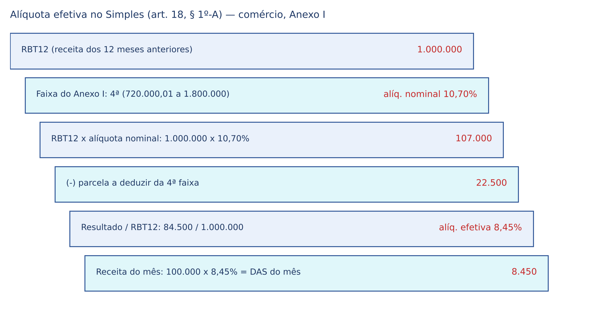
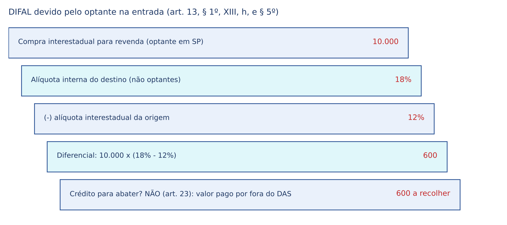
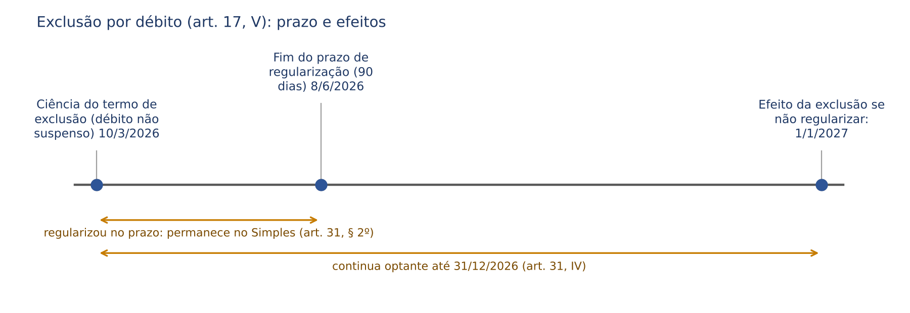

# CAPÍTULO 31 — SIMPLES NACIONAL (LC 123/2006): OPÇÃO, VEDAÇÕES, EXCLUSÃO, TRIBUTOS ABRANGIDOS, SUBSTITUIÇÃO TRIBUTÁRIA E DIFAL NO SIMPLES, CONTENCIOSO E IMPACTOS DA REFORMA TRIBUTÁRIA

:::INCIDENCIA
TRF5 p. 13 e 17; TJSC p. 19. Nível B. Lote: 18 questões (FGV 12, FCC 6).
Mais cobrado: DIFAL do optante (Temas 517 e 1.284: constitucional, mas exige lei estadual em sentido estrito), vedações (débito, sócio no exterior, transporte, pessoa jurídica sócia), tributos pagos fora do DAS, crédito do adquirente e IBS/CBS dentro ou fora do regime único.
:::

| Subtema | FGV | FCC | Padrão de cobrança |
|---|---|---|---|
| DIFAL e ICMS fora do DAS | 4 | 1 | Temas 517 e 1.284; ICMS-ST e importação por fora |
| Vedações e enquadramento | 3 | 3 | art. 3º, § 4º, x art. 17; Tema 363; transporte |
| Exclusão e devido processo | 2 | 0 | de ofício x comunicação; notificação |
| Crédito do adquirente | 1 | 1 | ICMS limitado ao devido pelo optante |
| Administração (CGSN, ISS retido, autorregularização, parcelamento) | 3 | 1 | literalidade da LC 123 |
| Reforma tributária | 1 | 0 | crédito do adquirente de IBS/CBS |

## 31.1 Natureza e fundamento constitucional

### 31.1.1 A lógica do regime

Para uma pequena padaria, apurar IRPJ, CSLL, PIS, COFINS, contribuição patronal, ICMS e eventualmente ISS e IPI, cada um com prazo, declaração e credor próprios, custa proporcionalmente muito mais do que para uma grande empresa. Por isso a Constituição manda dar às microempresas (ME) e empresas de pequeno porte (EPP) tratamento diferenciado (arts. 170, IX, e 179) e reserva à lei complementar defini-lo em matéria tributária (art. 146, III, d).

O Simples Nacional, instituído pela LC 123/2006 (art. 12), é um regime ESPECIAL e OPCIONAL de arrecadação: o optante aplica uma alíquota única sobre a receita bruta mensal e paga tudo num só documento, o DAS (Documento de Arrecadação do Simples Nacional), cujo valor é repartido automaticamente entre os entes.

:::DICA Simples Nacional NÃO é tributo
O Simples não cria tributo nem altera competências: unifica a apuração e o recolhimento de tributos que continuam pertencendo a cada ente. Por isso o STJ afirma que a LC 123 não revogou a competência municipal para instituir, fiscalizar e arrecadar o ISS (Jurisprudência em Teses, ed. 275, tese 12), e o excluído do regime volta simplesmente às regras gerais (art. 32).
:::

### 31.1.2 O art. 146 depois da EC 132/2023

A EC 132/2023 reescreveu o art. 146, III, d, para incluir IBS (art. 156-A) e CBS (art. 195, V) entre os tributos do regime simplificado, e transformou o antigo parágrafo único em §§ 1º a 3º (o art. 146 em geral é do Cap. 1). O § 1º autoriza o regime único, OPCIONAL, com recolhimento unificado e centralizado, distribuição imediata das parcelas, condições de enquadramento diferenciadas por Estado e fiscalização e cobrança compartilhadas. Os §§ 2º e 3º são cobrados na literalidade:

:::LEI CF, art. 146, §§ 2º e 3º (EC 132/2023)
§ 2º É facultado ao optante pelo regime único de que trata o § 1º apurar e recolher os tributos previstos nos arts. 156-A e 195, V, nos termos estabelecidos nesses artigos, hipótese em que as parcelas a eles relativas não serão cobradas pelo regime único.
§ 3º Na hipótese de o recolhimento dos tributos previstos nos arts. 156-A e 195, V, ser realizado por meio do regime único de que trata o § 1º, enquanto perdurar a opção: I - não será permitida a apropriação de créditos dos tributos previstos nos arts. 156-A e 195, V, pelo contribuinte optante pelo regime único; e II - será permitida a apropriação de créditos dos tributos previstos nos arts. 156-A e 195, V, pelo adquirente não optante pelo regime único de que trata o § 1º de bens materiais ou imateriais, inclusive direitos, e de serviços do optante, em montante equivalente ao cobrado por meio do regime único.
:::

Consequências: (a) só lei complementar NACIONAL disciplina o regime, que abrange tributos de todos os entes; daí o optante não poder aderir a parcelamento de lei federal ordinária (31.9.5); (b) a LC 123 admite iniciativa parlamentar, pois não há reserva de iniciativa do Executivo em matéria tributária (STF, ADI 7.096/DF, Rel. Min. Gilmar Mendes, j. 9/6/2025, que validou o MEI do transportador autônomo de cargas, art. 18-F); (c) o legislador pode fixar condições de acesso, daí a validade das vedações (31.4).

### 31.1.3 Quem administra

O Comitê Gestor do Simples Nacional (CGSN), vinculado ao Ministério da Fazenda, regulamenta os aspectos tributários (art. 2º, I): opção, exclusão, tributação, fiscalização, arrecadação e cobrança. Na redação da LC 214/2025, compõe-se de 4 representantes da União, 2 dos Estados e DF, 2 dos Municípios, 1 do Sebrae e 1 das confederações do segmento. A administração tributária é exercida de forma integrada pelos entes (art. 12, § 3º).

:::QUESTAO FGV 2024 — Câmara dos Deputados — Consultor Legislativo (Q2510946)
Gabarito oficial: D (V, F, V). Verdadeiras: o CGSN regulamenta opção, exclusão, tributação, fiscalização, arrecadação e cobrança; a opção se faz na forma de ato do CGSN e é irretratável no ano (art. 16). Falsa: presidência "rotativa" entre os entes, que a LC 123 não prevê. Ponto discutível: a banca deu por verdadeiro que os critérios de enquadramento estão em ato do CGSN; os limites estão na lei (art. 3º), que remete a regulamentação ao CGSN (§ 16).
:::

## 31.2 Quem cabe no regime: ME, EPP e MEI

### 31.2.1 Limites de receita bruta

Receita bruta é o produto da venda de bens e serviços em conta própria, o preço dos serviços, o resultado em conta alheia e as demais receitas da atividade principal, excluídas vendas canceladas e descontos incondicionais (art. 3º, § 1º).

:::ESQUEMA Enquadramento por receita bruta anual
| Categoria | Limite no ano-calendário | Fonte |
|---|---|---|
| Microempresa (ME) | até 360.000 (trezentos e sessenta mil) reais | art. 3º, I |
| Empresa de pequeno porte (EPP) | acima de 360.000 até 4.800.000 (quatro milhões e oitocentos mil) reais | art. 3º, II |
| Sublimite para ICMS e ISS no DAS | 3.600.000 (três milhões e seiscentos mil) reais; acima dele, ICMS e ISS pelas regras gerais e tributos federais no Simples | art. 13-A |
| MEI | 81.000 (oitenta e um mil) reais até 2026; 110.000 (cento e dez mil) reais em 2027; 140.000 (cento e quarenta mil) reais a partir de 1/1/2028 | art. 18-A, § 1º; LC 238/2026 |
| Exportação | limite ADICIONAL de igual valor ao do mercado interno | art. 3º, § 14 |
:::

- Início de atividade: limite PROPORCIONAL aos meses de atividade, contadas as frações como mês inteiro (art. 3º, § 2º). Empresa aberta em outubro: 4.800.000 / 12 x 3 = 1.200.000 (um milhão e duzentos mil) reais.
- Exportação não "se soma" ao mercado interno num limite único: tem limite próprio (erro da alternativa D da Q4338782).
- Consolidação (§ 19, LC 214/2025): consideram-se todas as atividades, receitas e débitos da pessoa, ainda que em inscrições distintas ou como contribuinte individual, o que impede a fragmentação artificial em vários CNPJs.

### 31.2.2 Quem nunca é ME ou EPP (art. 3º, § 4º)

O art. 3º, § 4º, afasta TODO o tratamento diferenciado da LC 123, "incluído o regime de que trata o art. 12". Cobra-se:

- pessoa jurídica de cujo capital participe outra pessoa jurídica (I) ou que participe do capital de outra (VII), ressalvadas cooperativas de crédito, centrais de compras e entidades de defesa das ME e EPP (§ 5º);
- filial ou representação de pessoa jurídica estrangeira (II) e, desde a LC 214/2025, a que tenha filial ou representação no exterior (XII);
- sócio que seja empresário inscrito ou sócio de outra beneficiária (III), que detenha mais de 10% de outra empresa não beneficiada (IV) ou que administre outra pessoa jurídica com fins lucrativos (V), DESDE QUE a receita bruta GLOBAL ultrapasse o limite de EPP;
- cooperativas, salvo as de consumo (VI); bancos e seguradoras (VIII); resultante de cisão nos 5 anos anteriores (IX); sociedade por ações (X); "pejotização", isto é, sócios com pessoalidade, subordinação e habitualidade perante o contratante (XI).

:::PEGADINHA Pessoa jurídica sócia x pessoa física sócia de outras empresas
Pessoa JURÍDICA no capital impede SEMPRE (inciso I). Pessoa FÍSICA com outras participações só impede se a receita GLOBAL exceder o limite (III a V). A FCC trocou as hipóteses na Q4338782 (alternativa E).
:::

:::QUESTAO FCC 2025 — TRT 2ª Região — Analista Judiciário (Q3596223)
Quais pessoas jurídicas não podem gozar do tratamento da LC 123: com pessoa jurídica no capital; filial de pessoa jurídica com sede no exterior; cooperativas, salvo as de consumo; sociedades por ações. Gabarito oficial: A (todas): art. 3º, § 4º, I, II, VI e X. Armadilha: supor que a S.A. de pequeno faturamento ou a cooperativa de consumo estejam excluídas da mesma forma (a cooperativa de consumo é a exceção).
:::

:::QUESTAO FCC 2026 — PGM Manaus — Procurador (Q4338782)
Gabarito oficial: B — ser ME ou EPP NÃO garante a opção, que depende também da inexistência de vedações. Erros: débito não suspenso impede (A; ver 31.4.2); não há ingresso automático (C); exportação tem limite adicional (D); pessoa jurídica sócia impede independentemente da receita global (E). Ideia-chave: a ME ou EPP vedada ao Simples conserva os DEMAIS benefícios da LC 123, como os de licitação (art. 3º-B).
:::

## 31.3 A opção

A opção é ato do contribuinte (CF, art. 146, § 1º, I), feita na forma do ato do CGSN e IRRETRATÁVEL para todo o ano-calendário (art. 16). Na redação ainda em vigor em 2026, é feita em JANEIRO, até o último dia útil, com efeitos desde 1º de janeiro (§ 2º); a empresa em início de atividade opta no prazo do CGSN, com efeitos desde a abertura (§ 3º). A LC 214/2025 deslocou a janela para SETEMBRO do ano anterior, com vigência a partir de 1/1/2027 (art. 517 c/c art. 544, III), e a LC 227/2026 revogou a regra de transição que previa a opção em setembro de 2026 para 2027 (art. 87-B). O indeferimento é ato formal (art. 16, § 6º), notificado pelo ente que o praticou e impugnável no seu contencioso (arts. 29, § 8º, e 39).

Quem opta adere ao Domicílio Tributário Eletrônico do Simples Nacional (DTE-SN), pelo qual é cientificado de indeferimento, exclusão e ações fiscais (art. 16, § 1º-A). A comunicação eletrônica dispensa Diário Oficial e via postal, é considerada PESSOAL e se reputa feita no dia da consulta ou, sem consulta, no 45º dia da disponibilização (§§ 1º-B e 1º-C). É o marco para contar prazos de defesa e de mandado de segurança.

O STJ firmou que: (a) lei nova que admita certa atividade no regime só vale a partir da sua vigência, sem opção retroativa (Jurisprudência em Teses, ed. 275, tese 1), na linha da Súmula 448 do STJ, editada sob a Lei 9.317/1996 (creches, pré-escolas e ensino fundamental só puderam optar a partir de 24/10/2000, vigência da Lei 10.034/2000); (b) a falta de alvará de localização ou funcionamento não impede a adesão, pois não é irregularidade em cadastro FISCAL (tese 2).

## 31.4 Vedações ao ingresso (art. 17)

### 31.4.1 O mapa das vedações

Diferentemente do art. 3º, § 4º, as vedações do art. 17 retiram só o regime de arrecadação; a empresa continua ME ou EPP para os demais fins (art. 3º-B).

:::ESQUEMA Vedações do art. 17 (as mais cobradas)
| Família | Hipóteses |
|---|---|
| Atividade financeira | factoring, gestão de crédito, *asset management*, empresa simples de crédito (I) |
| Pessoas e capital | titular ou sócio domiciliado no exterior (II, redação da LC 214/2025); capital de entidade da administração pública (III) |
| Regularidade | débito com INSS ou Fazendas com exigibilidade não suspensa (V); ausência de inscrição ou irregularidade em cadastro fiscal (XVI) |
| Atividades | transporte intermunicipal e interestadual de passageiros, salvo fluvial, com características de transporte urbano ou metropolitano ou fretamento contínuo de estudantes ou trabalhadores (VI); energia elétrica (VII); importação ou fabricação de automóveis e motocicletas (VIII); importação de combustíveis (IX); cigarros, armas, munições, explosivos e certas bebidas, ressalvadas micro e pequenas cervejarias, vinícolas, destilarias e produtores de licores (X); cessão ou locação de mão de obra (XII); loteamento e incorporação (XIV); locação de imóveis próprios (XV) |
:::

Atividades intelectuais, consultoria e profissões regulamentadas deixaram de ser vedadas com a LC 147/2014 e são tributadas pelos Anexos III a V.

:::QUESTAO FCC 2026 — SEFAZ-GO — Auditor Fiscal (Q4067496)
Dois irmãos domiciliados no exterior querem abrir EPP de transporte de passageiros intramunicipal, intermunicipal e interestadual, fluvial ou rodoviário. Gabarito oficial: A — poderão optar depois de AMBOS transferirem o domicílio para o Brasil, se prestarem transporte intramunicipal. Passos: (1) basta um sócio domiciliado no exterior para vedar (art. 17, II), logo "pelo menos um" transferir não resolve (erro de B e E); (2) o rodoviário intermunicipal e interestadual é vedado (erro de C e D); o intramunicipal é livre (o fluvial também seria). No mesmo sentido: FGV 2024 (Q3157910, prova não identificada no banco), gabarito B: empresa exclusivamente de transporte intermunicipal de passageiros não pode optar, ainda que dentro do limite de receita.
:::

### 31.4.2 Vedação por débito: Tema 363 do STF

O art. 17, V, veda o regime a quem tem débito com exigibilidade não suspensa. Os contribuintes sustentavam tratar-se de sanção política (Súmulas 70, 323 e 547 do STF; ver Cap. 5).

:::JURIS STF, Tema 363 (RE 627.543/RS, Plenário, j. 30/10/2013, Informativo 726)
Tese: "É constitucional a lei que veda o simples nacional para empresas em débito com a fazenda pública." O Simples é benefício de adesão voluntária; exigir regularidade para ingressar não é coação ao pagamento, porque a empresa continua a operar pelas regras gerais, e preserva a isonomia e a livre concorrência (o inadimplente teria vantagem sobre quem paga em dia).
:::

:::QUESTAO FGV 2024 — Câmara de Fortaleza — Advogado (Q2450555)
Natureza da regra que veda o Simples a quem tem débito não suspenso. Gabarito oficial: E — forma indireta de reprovar a infração fiscal e garantir a neutralidade, com enfoque na livre concorrência. As alternativas sedutoras (isonomia, livre iniciativa, coação ilícita) repetem os argumentos rejeitados no Tema 363.
:::

Débito com exigibilidade SUSPENSA (parcelamento em dia, depósito integral, impugnação, liminar; ver Cap. 13) não impede. Excluída por débito, a empresa permanece no regime se regularizar em 90 dias da ciência (art. 31, § 2º, na redação da LC 216/2025; antes, 30 dias); regularização tardia não gera direito líquido e certo à permanência (Jurisprudência em Teses, ed. 275, tese 3).

:::SENTENCA Mandado de segurança contra indeferimento da opção por débito
Onde entra: adequação da via (prova pré-constituída da suspensão ou inexistência do débito na data da opção) e mérito. Redação-modelo: "A vedação do art. 17, V, da LC 123/2006 é constitucional (STF, Tema 363). Comprovado que o débito apontado estava com a exigibilidade suspensa por parcelamento na data da opção, o indeferimento carece de motivo válido." Erro punido: conceder a ordem tratando a vedação como sanção política.
:::

## 31.5 Tributos abrangidos e tributos pagos por fora

### 31.5.1 O que entra no DAS (art. 13, caput)

IRPJ, IPI, CSLL, COFINS, PIS/Pasep, Contribuição Patronal Previdenciária (CPP, art. 22 da Lei 8.212/1991), ICMS e ISS. A CPP NÃO entra para os serviços do art. 18, § 5º-C (Anexo IV: construção civil, vigilância, limpeza, serviços advocatícios, entre outros). A partir de 2027 entram IBS e CBS (incisos IX e X, LC 214/2025 com redação da LC 227/2026), e os tributos substituídos saem conforme a transição (31.11).

### 31.5.2 O que fica fora (art. 13, § 1º)

O DAS não exclui tributos devidos "na qualidade de contribuinte ou responsável" nas hipóteses listadas, regidas pela legislação das demais pessoas jurídicas. A regra de ouro: o ATÍPICO para a atividade normal e o que envolve terceiros ficam fora.

:::ESQUEMA Fora do DAS (art. 13, § 1º)
| Grupo | Hipóteses |
|---|---|
| Federais atípicos | IOF; II; IE; ITR; IR sobre aplicações financeiras (definitivo) e sobre ganho de capital no ativo; IR retido de pessoas físicas |
| Importação | PIS, COFINS e IPI na importação (XII) |
| Folha | FGTS; contribuição do empregado; contribuição do empresário como contribuinte individual |
| ICMS (XIII) | substituição tributária e monofásico (a); por terceiro (b); petróleo, combustíveis e energia não destinados a comercialização ou industrialização (c); desembaraço aduaneiro (d); mercadoria ou operação sem documento fiscal (e, f); antecipação nas aquisições interestaduais (g); DIFAL nas aquisições interestaduais (h) |
| ISS (XIV) | substituição tributária ou retenção na fonte; importação de serviços |
| Demais (XV) | taxas, contribuição de melhoria, IPTU, IPVA, ITBI e todos os não listados no caput |
:::

:::QUESTAO FCC 2026 — SEFAZ-SP — Auditor Fiscal (Q3917733)
Empresa paulista avalia optar: o que acontece com o ICMS? Gabarito oficial: C — continuará pagando ICMS pelas regras próprias na importação e nas operações em que for substituta tributária (art. 13, § 1º, XIII, a e d). Erros: B e D supõem que o DAS esgota todo o ICMS.
:::

### 31.5.3 Dispensa das "demais contribuições" (art. 13, § 3º)

Os optantes ficam dispensados das demais contribuições da União, inclusive as do Sistema S (art. 240 da CF). A jurisprudência delimitou:

- Contribuição sindical patronal: o STF julgou IMPROCEDENTE a ADI 4.033 (Rel. Min. Joaquim Barbosa, j. 15/9/2010, Informativo 600), mantendo a dispensa. Cuidado com material que afirma o contrário; o tema perdeu relevo com o fim da compulsoriedade (Lei 13.467/2017).
- AFRMM e CONDECINE: dispensados (Jurisprudência em Teses, ed. 275, teses 7 e 8).
- Contribuição de 10% sobre o FGTS na despedida sem justa causa (LC 110/2001): DEVIDA (tese 10).
- Retenção de 11% pelo tomador de serviços: não se aplica ao optante (Súmula 425 do STJ), pois a CPP já está no DAS.

### 31.5.4 Incentivos, imunidades e base de cálculo

O optante não pode utilizar ou destinar valor a título de incentivo fiscal, e alterações de base, alíquota ou percentual pelos entes só valem se previstas ou autorizadas na LC 123 (art. 24 e § 1º): o regime já é o benefício. Daí:

- é constitucional negar ao optante a alíquota zero de PIS/COFINS da Lei 10.147/2000 (STF, Tema 1.050, RE 1.199.021/SC, j. 8/9/2020);
- o optante não usufrui da alíquota zero do PERSE (STJ, Tema 1.283, que exige ainda inscrição prévia no CADASTUR);
- o optante também se sujeita à DIRBI (STF, ADI 7.765; v. Cap. 9; correlata Q3917692, FCC, gabarito C).

Imunidades decorrem da Constituição e não se perdem pela adesão: as imunidades das receitas de exportação alcançam os optantes (STF, Tema 207; ver Cap. 6). A gorjeta, de natureza remuneratória, não integra a base dos tributos do Simples (Jurisprudência em Teses, ed. 275, tese 9).

### 31.5.5 ISS: valor fixo e retenção

A opção pelo Simples não assegura, por si, o ISS por valor fixo das sociedades uniprofissionais (tese 11; ver Cap. 28). A retenção do ISS na fonte, quando a lei municipal a prevê (art. 3º da LC 116), observa o art. 21, § 4º: alíquota efetiva do optante informada na nota (I); 2% no mês de início de atividade (II); 5% se a alíquota não for informada (V); diferença recolhida pelo prestador em guia do Município se a alíquota informada for menor (VI); sem retenção se o ISS for fixo (IV); retenção definitiva, sem novo ISS no DAS (VII).

:::QUESTAO FGV 2024 — CVM — Analista (Q2517521)
Três afirmações sobre a retenção do ISS do optante. Gabarito oficial: A (V, V, V): art. 21, § 4º, I ("mês anterior", redação vigente), IV e VI. Atualização: a LC 227/2026 trocou "mês anterior" por "mês da prestação" com efeitos a partir de 1/1/2027 (art. 169 c/c art. 182, I, b).
:::

## 31.6 Cálculo do valor mensal

O DAS resulta da alíquota EFETIVA sobre a receita bruta do mês (art. 18). A efetiva parte das alíquotas NOMINAIS dos Anexos (I comércio; II indústria; III, IV e V serviços), escolhidas pela receita bruta acumulada nos 12 meses anteriores (RBT12):

alíquota efetiva = (RBT12 x alíquota nominal − parcela a deduzir) / RBT12 (art. 18, § 1º-A)

A parcela a deduzir torna a progressividade gradual, como na tabela do IRPF. O resultado é repartido entre os tributos pelos percentuais do Anexo (§ 1º-B), com teto de 5% para o ISS.

:::EXEMPLO Padaria Trigo Bom Ltda.
RBT12 de 1.000.000 (um milhão) de reais; receita de março, 100.000 (cem mil) reais, com revenda de mercadorias (Anexo I, 4ª faixa: nominal 10,70%, parcela a deduzir 22.500). (1) 1.000.000 x 10,70% = 107.000; (2) 107.000 − 22.500 = 84.500; (3) 84.500 / 1.000.000 = 8,45%; (4) DAS de março: 100.000 x 8,45% = 8.450 (oito mil, quatrocentos e cinquenta) reais, repartidos entre IRPJ, CSLL, PIS, COFINS, CPP e ICMS. As receitas devem ser segregadas por natureza (art. 18, § 4º).
:::

Também cobráveis: a opção pelo regime de caixa (receita recebida no mês), irretratável no ano (§ 3º); a segregação das receitas com ST, monofásicas ou de exportação, para não pagar duas vezes o tributo já recolhido (§ 4º-A); juros e multas pelo atraso conforme a legislação do imposto de renda, inclusive na parcela de ICMS e ISS (art. 35).

## 31.7 ICMS do optante: substituição tributária, DIFAL e crédito do adquirente

### 31.7.1 Substituição tributária

Na substituição tributária "para frente", o substituto (em regra, fabricante ou importador) recolhe antecipadamente o ICMS das etapas seguintes sobre base presumida (instituto no Cap. 10; ICMS-ST no Cap. 27). Para o optante:

- como COMPRADOR (substituído), segrega a receita da revenda e não paga de novo a parcela de ICMS no DAS (art. 18, § 4º-A, I);
- como VENDEDOR eleito substituto, recolhe o ICMS-ST fora do DAS, pelas regras gerais (art. 13, § 1º, XIII, a, e § 6º, I).

O STF julgou constitucionais os dispositivos da LC 123 que submetem os optantes à ST e ao diferencial de alíquotas: é legítima opção legislativa sujeitá-los a procedimento diverso da guia única (STF, ADI 6.030/DF, Rel. Min. Gilmar Mendes, j. 19/8/2024, Informativo 1146).

### 31.7.2 DIFAL nas aquisições do optante: Temas 517 e 1.284

DIFAL é a diferença entre a alíquota interna do Estado de destino e a interestadual. Na compra interestadual pelo optante, o Estado de destino pode exigi-la na entrada (art. 13, § 1º, XIII, g, 2, e h), calculada com as alíquotas das empresas NÃO optantes (§ 5º). Como o optante não tem crédito de ICMS (art. 23), o DIFAL é custo definitivo; daí a alegação de ofensa ao tratamento favorecido e à não cumulatividade.

:::JURIS STF, Tema 517 (RE 970.821/RS, Rel. Min. Edson Fachin, Plenário, j. 11/5/2021, Informativo 1017)
Tese: "É constitucional a imposição tributária de diferencial de alíquota do ICMS pelo Estado de destino na entrada de mercadoria em seu território devido por sociedade empresária aderente ao Simples Nacional, independentemente da posição desta na cadeia produtiva ou da possibilidade de compensação dos créditos." O DIFAL equaliza a carga da mercadoria comprada fora com a comprada no Estado; a não cumulatividade não socorre quem aderiu voluntariamente a regime sem créditos.
:::

:::JURIS STF, Tema 1.284 (ARE 1.460.254/GO, Rel. Min. Roberto Barroso, Plenário, j. 20/11/2023, Informativo 1118)
Tese: "A cobrança de diferença entre as alíquotas interna e a interestadual de ICMS (Difal) de empresa optante do Simples Nacional é constitucional, mas depende de lei estadual em sentido estrito (não pode ser apenas regulamentada por Decreto)." A LC 123 AUTORIZA; quem INSTITUI é a lei do Estado de destino (legalidade, art. 150, I; ver Cap. 5). Decreto, convênio ou a própria LC 123 não bastam.
:::

:::PASSO Questão de DIFAL do optante
1. Optante comprou de outro Estado? O destino PODE exigir o DIFAL, qualquer que seja a destinação (Tema 517).
2. Há LEI estadual em sentido estrito? Se só decreto, convênio ou LC 123, cobrança inválida (Tema 1.284).
3. Quem cobra é o Estado de DESTINO, onde está o optante.
4. Cálculo: valor x (interna das não optantes − interestadual), sem crédito posterior.
:::

:::QUESTAO FGV 2024 — TJ-SC — Juiz Substituto (Q2387028)
Doces XXX Ltda., optante no Estado Alfa, compra queijo no Estado Beta. Gabarito oficial: D — deve o DIFAL ao Estado Alfa, desde que haja lei estadual específica, mesmo sendo optante. Erros: A (tratamento favorecido afastaria a cobrança: contraria o Tema 517); B (ST e recolhimento à origem); C (dispensa lei específica: contraria o Tema 1.284); E (Estado de origem autuando). No mesmo sentido: FGV 2026, TJ-PA, Juiz Substituto (Q3951787, gabarito E). Correlatas: Q3914526 e Q3154680 (FGV, decreto não basta) e Q3917734 (FCC, cálculo de 600 (seiscentos) reais, o da figura).
:::

### 31.7.3 Optante que vende a consumidor final de outro Estado

Aqui o DIFAL é o da EC 87/2015, devido pelo remetente, e depende de lei complementar nacional (LC 190/2022) e de lei estadual (Tema 1.093 do STF; ver Cap. 27). A cláusula do Convênio ICMS 93/2015 que estendia essa cobrança aos optantes sem base em lei complementar foi declarada inconstitucional pelo STF (ADI 5.469; ver Cap. 27).

:::QUESTAO FGV 2024 — TJ-MT — Juiz Substituto (Q3086988)
ABC, optante no Estado X, vende a consumidor final no Estado Y, que exige DIFAL de 11% por lei ordinária estadual. Gabarito oficial: D — cobrança válida, pois há lei complementar nacional e lei estadual. Passos: DIFAL da EC 87 devido pelo remetente; LC 190/2022 supriu a lei complementar; há lei estadual; o Simples não afasta a cobrança, mantida fora do DAS (art. 13, § 1º, XIII). Armadilhas: C (guia única "garantiria" recolhimento só pelo DAS) e E (dispensa de lei complementar).
:::

### 31.7.4 Crédito de ICMS para quem compra do optante

O optante não apropria nem transfere créditos (art. 23, caput). O adquirente NÃO optante, porém, credita-se do ICMS nas compras de mercadorias de optante se (art. 23, §§ 1º, 2º e 4º): (a) destinadas a comercialização ou industrialização; (b) a alíquota do ICMS do optante constar do documento fiscal; (c) limitado ao ICMS EFETIVAMENTE DEVIDO pelo optante na operação. Não há crédito se o optante paga ICMS em valor fixo (MEI) ou há isenção estadual para a sua faixa.

:::QUESTAO FCC 2025 — TRT 15ª Região — Analista Judiciário (Q3288593)
Gabarito oficial: B — o não optante pode creditar-se do ICMS se as mercadorias forem para comercialização ou industrialização, limitado ao ICMS efetivamente devido pelo optante. Erros: restringir a operações interestaduais (A), negar sempre (C), usar como limite a alíquota interna (D) ou distinguir ME de EPP (E).
:::

:::ATENCAO IBS e CBS: crédito mais amplo a partir de 2027
Para IBS e CBS pagos no DAS, o adquirente do regime regular apropria crédito sobre QUALQUER aquisição de bens e serviços do optante, sem exigência de destinação, "em montante equivalente ao cobrado" no regime único (CF, art. 146, § 3º, II; LC 123, art. 23, § 1º-A, incluído pela LC 227/2026; LC 214, art. 47, § 9º, II). O ICMS mantém a regra restrita até a sua extinção.
:::

## 31.8 Exclusão do regime

### 31.8.1 Por comunicação ou de ofício

A exclusão se dá por COMUNICAÇÃO do optante ou DE OFÍCIO (art. 28). A comunicação é voluntária (por opção, comunicada até o último dia útil de janeiro, com efeitos em 1º de janeiro do ano seguinte: arts. 30, I e § 1º, I, e 31, I) ou obrigatória, quando a empresa incorre em vedação ou excede o limite de receita (art. 30, II a IV). Certas alterações no CNPJ equivalem à comunicação obrigatória (§ 3º): passagem a S.A., inclusão de atividade vedada, de sócio pessoa jurídica ou de sócio domiciliado no exterior, cisão parcial e extinção. A omissão da comunicação devida gera exclusão de ofício (art. 29, I).

As demais hipóteses de exclusão de ofício (art. 29, II a XII) ligam-se a ilícitos ou indícios de fraude: embaraço ou resistência à fiscalização; constituição por interpostas pessoas; prática reiterada de infração à LC 123; CNPJ inapto; comércio de mercadoria contrabandeada ou descaminhada; falta de livro-caixa; despesas superiores em 20% aos ingressos ou compras de mercadorias superiores a 80% dos ingressos (fora do ano de início); falta reiterada de emissão de documento fiscal; omissão reiterada de empregados na folha.

:::PEGADINHA Exclusão de ofício punitiva
Nos incisos II a XII do art. 29, a exclusão vale desde o PRÓPRIO MÊS da infração e impede nova opção por 3 anos-calendário (§ 1º), ou 10 anos se houver artifício, ardil ou fraude (§ 2º). "Prática reiterada": duas ou mais infrações idênticas em 5 anos, formalizadas em auto de infração ou notificação de lançamento, ou a segunda ocorrência com fraude (§ 9º).
:::

### 31.8.2 Termo inicial dos efeitos

Do termo inicial em diante, a empresa deve os tributos pelas regras gerais (art. 32), lançados pelos respectivos entes (art. 29, § 3º).

:::ESQUEMA Efeitos da exclusão (arts. 3º, 29 e 31)
| Causa | Efeitos a partir de |
|---|---|
| Opção | 1º de janeiro do ano seguinte (a exceção do art. 31, § 4º, foi revogada pela LC 227/2026 a partir de 30/11/2026) |
| Vedação superveniente | mês seguinte ao da situação impeditiva |
| Débito não suspenso (art. 17, V) | ano seguinte ao da ciência, salvo regularização em 90 dias (art. 31, IV e § 2º) |
| Excesso do limite de EPP: mais de 20% / até 20% | mês seguinte ao excesso / 1º de janeiro do ano seguinte |
| Excesso do limite proporcional no ano de início: mais de 20% / até 20% | retroativos ao início das atividades, sem opção no ano seguinte (art. 31, § 1º) / 1º de janeiro do ano seguinte |
| Art. 29, II a XII | o próprio mês da infração, com impedimento de 3 ou 10 anos |
:::

:::DOUTRINA Natureza declaratória do ato de exclusão
O ato de exclusão não cria a situação impeditiva: reconhece-a. Por isso tem natureza DECLARATÓRIA, e seus efeitos se ligam ao fato, não ao ato ou à intimação. O STJ assim decidiu, em repetitivo, para o regime anterior (Tema 341, Lei 9.317/1996: efeitos a partir do mês subsequente à circunstância excludente). Na LC 123 a própria lei fixa o termo inicial de cada hipótese (quadro acima); a exclusão por débito é a exceção, com efeitos só no ano seguinte ao da CIÊNCIA, para permitir a regularização.
:::

### 31.8.3 Devido processo

A exclusão de ofício exige motivação, notificação pelo ente que a promoveu, admitida a via eletrônica do DTE-SN (art. 29, § 6º), e defesa no contencioso do ente (art. 39), ao qual o CGSN pode atribuir efeito suspensivo (art. 39, § 6º).

:::QUESTAO FGV 2024 — Prefeitura de Nova Iguaçu — Auditor Fiscal (Q3039642)
Alfa, optante, deixou de pagar parcelamento federal, e sua exclusão foi publicada no Diário Oficial. Gabarito oficial: D — é necessária a notificação prévia, para que o contribuinte se manifeste. Erros: B (o inadimplemento dispensaria contraditório); C (termo em duas vias assinado pelo contribuinte: a notificação pode ser eletrônica e se reputa pessoal, art. 16, § 1º-B, II); E (exigência de ação judicial). O DTE-SN, aliás, dispensa a publicação no Diário Oficial.
:::

:::QUESTAO FGV 2024 — Câmara dos Deputados — Consultor Legislativo (Q2510945)
Gabarito oficial: E (I e II): é vedado o Simples a quem participa do capital de outra pessoa jurídica (art. 3º, § 4º, VII) e a exclusão é de ofício ou por comunicação (art. 28). Falso o item III: o excluído se sujeita às regras das demais pessoas jurídicas (art. 32); o art. 146, III, c, invocado, trata do ato cooperativo.
:::

:::SENTENCA Mandado de segurança contra exclusão
Onde entra: (1) autoridade e competência: exclusão pela Receita Federal, delegado da RFB na Justiça Federal; por Estado ou Município, autoridade local na Justiça Estadual (art. 41, § 5º, I); (2) decadência do MS: 120 dias da ciência, inclusive a ficta do 45º dia no DTE-SN (art. 16, § 1º-C); (3) mérito: causa, contraditório e termo inicial. Redação-modelo: "A exclusão por débito produz efeitos a partir do ano-calendário seguinte ao da ciência, ressalvada a regularização em 90 dias (art. 31, IV e § 2º, da LC 123/2006, na redação da LC 216/2025). Comprovada a quitação no prazo, impõe-se a manutenção da impetrante no regime." Erro punido: aplicar os 30 dias da redação revogada.
:::

## 31.9 Fiscalização, contencioso e processo judicial

### 31.9.1 Fiscalização compartilhada e autorregularização

Fiscalizam o Simples, concorrentemente, a Receita Federal e as fazendas de Estados, DF e Municípios (art. 33, redação da LC 227/2026). Iniciada a fiscalização, pode abranger todos os estabelecimentos (§ 1º-B), e a autoridade de QUALQUER ente lança TODOS os tributos do DAS (§ 1º-C): o fiscal municipal pode lançar a diferença de IRPJ e ICMS. A multa por obrigação acessória é privativa do ente perante o qual ela deveria ser cumprida (§ 1º-D). Aplicam-se todas as presunções de omissão de receita das leis dos tributos abrangidos (art. 34), e a omissão sem origem identificada é tributada pela maior alíquota (art. 39, § 2º-A).

Antes de fiscalizar, a Administração pode notificar o contribuinte para autorregularização, notificação que NÃO inicia procedimento fiscal e, portanto, não afasta a espontaneidade (art. 34, § 3º; denúncia espontânea no Cap. 10).

:::QUESTAO FCC 2025 — SEFAZ-PI — Auditor Fiscal (Q3596254)
A Resolução CGSN 140/2018 prevê notificação prévia de autorregularização pelo Portal ou DTE-SN, com prazo de até 90 dias. Gabarito oficial: E — está em sintonia com a LC 123 quanto à possibilidade, à forma e ao prazo, porque o art. 34, § 3º, delegou forma e prazos ao CGSN.
:::

### 31.9.2 Declaração como confissão e prescrição pelo DAS

As informações mensais (PGDAS-D, que gera o DAS) e a declaração anual do MEI têm caráter declaratório e constituem confissão de dívida, hábil para exigir o que não foi pago (arts. 25 e 25-B, parágrafo único, LC 214/2025): aplica-se a Súmula 436 do STJ (Cap. 12). A partir de 2027, a declaração assistida apresentada pela Receita, se confirmada ou ajustada, é confissão, e o silêncio no prazo faz presumir correto o saldo e constituído o crédito (art. 25, §§ 6º a 8º).

Logo, a prescrição do art. 174 do CTN (Cap. 15) corre do DAS (ou do vencimento, se posterior), e não da declaração anual (DEFIS), mera obrigação acessória que não renova o prazo (Jurisprudência em Teses, ed. 275, tese 4; STJ, REsp 1.876.175/RS, Rel. Min. Paulo Sérgio Domingues, Primeira Turma, j. 11/11/2025, Informativo 872).

:::EXEMPLO Prescrição pelo DAS
DAS de fevereiro de 2017 declarado e não pago, vencido em março de 2017; DEFIS de 2017 entregue em março de 2018; execução ajuizada em fevereiro de 2023. Termo inicial: março de 2017; termo final: março de 2022. Prescrição consumada. A tese fazendária de contar da DEFIS (até março de 2023) foi rejeitada no REsp 1.876.175/RS.
:::

### 31.9.3 Contencioso administrativo e consulta

Na redação da LC 227/2026 (art. 39), julga quem praticou o ato: órgãos da União para lançamento, indeferimento ou exclusão pela Receita Federal; Estados, DF e Municípios por meio do CGIBS quando o ato decorrer do IBS (ver Cap. 33); órgãos do próprio Estado, DF ou Município nos demais casos, podendo o Município transferir o julgamento ao Estado por convênio. A impugnação de indeferimento ou exclusão pode ser julgada em órgão diverso (§ 5º). As consultas são respondidas pela Receita Federal, salvo sobre tributos estaduais ou municipais (art. 40).

### 31.9.4 Processo judicial: quem é parte

A regra é concentrar na UNIÃO: os processos sobre tributos do Simples são ajuizados em face da União, representada pela PGFN, que inscreve em Dívida Ativa da União e executa (art. 41, caput e § 2º), com auxílio dos demais entes (§ 1º) e possibilidade de delegar, por convênio, inscrição e cobrança dos tributos estaduais e municipais (§ 3º).

:::PROCESSO Simples Nacional: legitimidade e competência (art. 41)
| Situação | Parte | Justiça |
|---|---|---|
| Ação sobre tributos do DAS (repetição, anulatória de lançamento unificado, opção ou exclusão pela RFB) | União (PGFN) | Federal |
| Execução fiscal dos débitos do DAS | União (PGFN), salvo convênio | Federal |
| MS contra autoridade estadual, distrital ou municipal | autoridade local | Estadual |
| Ação só sobre tributo estadual ou municipal (DIFAL, ICMS-ST, ISS retido, ICMS e ISS do MEI) | Estado, DF ou Município | Estadual |
| Auto de infração exclusivamente por obrigação acessória | ente que o lavrou | conforme o ente |
| Crédito de IBS apurado no Simples (a partir de 2027) | fora da regra do caput (§ 5º, VI) | ver Cap. 33 |
:::

:::SENTENCA Ilegitimidade passiva
Onde entra: preliminar. Repetição de valores pagos no DAS contra o Estado: ilegitimidade do Estado (art. 41, caput). Ação só sobre o DIFAL: legitimado o Estado (art. 41, § 5º, II), não a União. Redação-modelo: "Tratando-se de pretensão relativa exclusivamente ao ICMS-DIFAL, exigido fora do regime unificado (art. 13, § 1º, XIII, h, da LC 123/2006), a legitimidade passiva é do Estado (art. 41, § 5º, II)." Erro punido: extinguir por ilegitimidade a ação sobre tributo cobrado fora do DAS, ou manter o Estado em demanda sobre o DAS.
:::

### 31.9.5 Parcelamento, compensação e restituição

- Parcelamento dos débitos do Simples: disciplinado pelo CGSN, até 60 parcelas, reparcelamento admitido, pedido deferido como confissão irretratável, rescisão pela falta de 3 parcelas ou de 1 estando pagas as demais (art. 21, §§ 15 a 24). O ente só parcela pela própria lei os débitos que lançou isoladamente e que não estejam em Dívida Ativa da União (§ 19). Optante não adere a parcelamento instituído por lei federal ordinária (Jurisprudência em Teses, ed. 275, tese 5; Cap. 13).
- Compensação: só com o MESMO ente e o MESMO tributo (art. 21, § 11); vedados créditos não apurados no Simples para pagar o DAS (§ 9º) e a cessão de créditos (§ 13).
- Restituição: regulada pelo CGSN, com Selic e prazos do CTN (§§ 5º, 6º e 12; ver Cap. 16).

:::QUESTAO FGV 2024 — Prefeitura de Macaé — Auditor Fiscal (Q3047247)
Gabarito oficial: E — o ISS de optantes não pode ser objeto do parcelamento previsto no código municipal. Fundamento: o parcelamento dos débitos apurados no Simples é do CGSN (art. 21, § 15), ressalvados os débitos lançados isoladamente pelo Município (§ 19). As demais alternativas dependem da lei local.
:::

## 31.10 MEI e tratamento não tributário

### 31.10.1 Microempreendedor individual em linhas gerais

O MEI é o empresário individual (ou o empreendedor de atividade autorizada pelo CGSN, inclusive rural) optante pelo Simples que recolhe VALORES FIXOS mensais, independentemente da receita do mês (art. 18-A): a contribuição previdenciária do próprio empresário (art. 21, § 2º, da Lei 8.212/1991), mais 1 (um) real de ICMS, se contribuinte desse imposto, e 5 (cinco) reais de ISS, se prestador de serviços (§ 3º, V); os tributos federais do DAS ficam isentos (VI). Pode ter um empregado (art. 18-C; até dois no âmbito rural, pela LC 238/2026).

Não pode ser MEI quem exerça atividade dos Anexos V ou VI, tenha mais de um estabelecimento, participe de outra empresa como titular, sócio ou administrador ou seja *startup* (§ 4º). O desenquadramento é de ofício ou por comunicação, com efeitos no ano seguinte se o excesso de receita não passar de 20%, e retroativos se passar (§§ 6º a 10). Os custos de formalização e funcionamento do MEI, inclusive taxas, são reduzidos a zero (art. 4º, § 3º), benefício que NÃO se estende a ME e EPP, ainda que optantes (Jurisprudência em Teses, ed. 275, tese 6). O transportador autônomo de cargas tem regime de MEI próprio, com limite de 251.600 (duzentos e cinquenta e um mil e seiscentos) reais (art. 18-F; ADI 7.096, ver 31.1.2).

:::ATENCAO LC 238, de 21/10/2026
(1) Limite do MEI: 110.000 (cento e dez mil) reais em 2027 (art. 2º) e 140.000 (cento e quarenta mil) reais a partir de 1/1/2028 (art. 18-A, § 1º; art. 10, I); limite proporcional no início de atividade de 9.166,67 (nove mil, cento e sessenta e seis reais e sessenta e sete centavos) por mês em 2027 e de 11.666,67 (onze mil, seiscentos e sessenta e seis reais e sessenta e sete centavos) a partir de 2028. (2) REMISSÃO integral dos créditos da União, inscritos ou não, até 13/10/2026, relativos à contribuição previdenciária do MEI e acessórios, condicionada à adimplência das contribuições dos 6 meses seguintes e, para a baixa, à desistência das ações, sem honorários pela extinção (arts. 5º e 6º). Remissão extingue o crédito (art. 156, IV, do CTN; Cap. 14): na execução fiscal dessas contribuições, a lei pode levar à extinção do processo.
:::

A LC 214/2025 criou o nanoempreendedor: pessoa física com receita bruta inferior a 50% do limite do MEI que não aderiu a esse regime; não é contribuinte do IBS e da CBS (art. 26, IV; ver Cap. 32; correlata Q3956712, FCC). O patamar acompanha o novo limite do MEI.

### 31.10.2 Benefícios não tributários

Os benefícios de licitação valem para ME e EPP optantes ou não (art. 3º-B): regularidade fiscal exigida só para a assinatura do contrato (art. 42), preferência de contratação como critério de desempate (art. 44) e tratamento diferenciado nas contratações públicas (art. 47).

:::QUESTAO FGV 2025 — SEFAZ-RS — Auditor do Estado (Q3154675)
Gabarito oficial: B (II e III): preferência no desempate e tratamento diferenciado nas contratações públicas. Falso o item I: a LC 123 prevê procedimentos simplificados de exportação para ME e EPP.
:::

## 31.11 Simples Nacional na reforma tributária: a escolha do optante

IBS e CBS são não cumulativos, com crédito amplo (Cap. 32). Se o optante pagasse pouco no DAS e o cliente não pudesse se creditar, o pequeno fornecedor perderia competitividade perante clientes empresas. A EC 132/2023 resolveu com uma ESCOLHA (CF, art. 146, §§ 2º e 3º, transcritos em 31.1.2):

- IBS e CBS DENTRO do DAS: o optante não toma créditos, e o adquirente do regime regular se credita do montante EQUIVALENTE AO COBRADO no regime único;
- IBS e CBS FORA do DAS, pelo regime regular: o optante segue no Simples para os demais tributos, mas apura IBS e CBS com débitos, créditos e destaque integral, transmitindo crédito cheio.

:::ESQUEMA IBS e CBS do optante (efeitos a partir de 2027)
| Ponto | Regra | Fonte |
|---|---|---|
| Padrão | IBS e CBS no DAS, pelos novos Anexos | LC 123, art. 13, IX e X; LC 214, art. 41, § 2º |
| Faculdade | regime regular para IBS e CBS, que deixam de ser cobrados no DAS | CF, art. 146, § 2º; LC 214, art. 41, § 3º; LC 123, art. 13, § 9º |
| Periodicidade | SEMESTRAL (janeiro e julho), irretratável no semestre, exercida em setembro e março anteriores; na abertura, desde o início da atividade | LC 123, art. 13, §§ 10 e 11 (redação da LC 227/2026) |
| Trava | quem recebeu ressarcimento de créditos no ano corrente ou anterior não sai do regime regular | LC 214, art. 41, § 5º |
| Créditos (IBS/CBS no DAS) | vedados ao optante; cliente credita o equivalente ao cobrado | CF, art. 146, § 3º; LC 214, art. 47, § 9º; LC 123, art. 23, § 1º-A |
| MEI | IBS e CBS em valores fixos | LC 123, art. 18-A, § 3º, V, d e e; Anexo VII |
| Sublimite | IBS segue o sublimite de 3.600.000 (três milhões e seiscentos mil) reais | LC 123, art. 13-A (redação da LC 214) |
:::

:::EXEMPLO Dentro ou fora?
Embalagens Sul Ltda., optante, vende 90% da produção a indústrias do regime regular: com IBS e CBS no DAS, os clientes só se creditam do pequeno percentual embutido na alíquota efetiva e tendem a preferir fornecedor do regime regular; pelo regime regular, ela paga alíquota cheia, mas desconta créditos das compras e transmite crédito integral, mantendo no DAS IRPJ, CSLL, CPP e, enquanto existirem, ICMS e ISS. A Padaria Trigo Bom (31.6), que vende a consumidores finais, não tem cliente que aproveite crédito e tende a manter tudo no DAS.
:::

:::QUESTAO FGV 2024 — Prefeitura de Cuiabá — Auditor Fiscal (Q3158451)
O que muda para a optante com a reforma? Gabarito oficial: E — adquirentes não optantes apropriam créditos de IBS e CBS sobre aquisições de optantes, equivalentes ao montante cobrado no regime único. Erros: A (a CBS pode ser recolhida no Simples); B (o regime continua opcional para todos); C (o optante que recolhe no DAS NÃO apropria créditos); D (cooperativas não receberam imunidade; o art. 146, III, c, prevê adequado tratamento ao ato cooperativo).
:::

O cronograma de extinção de PIS e COFINS, de redução de ICMS e ISS e os Anexos com repartição para CBS e IBS (já reescritos pela LC 214/2025, com vigências escalonadas para 2027 e 2028, 2029 a 2032 e a partir de 2033, mantidas as alíquotas nominais) estão no Cap. 33.

## 31.12 Resumo para revisão pré-prova

| Instituto | Regra | Exceções e detalhes | Fundamento |
|---|---|---|---|
| Natureza | regime opcional e unificado de arrecadação | não cria tributo; competências preservadas | CF, art. 146, III, d, e § 1º; LC 123, art. 12 |
| Limites | ME 360 mil; EPP 4,8 milhões; ICMS, ISS (e IBS) no DAS até 3,6 milhões | proporcional no início; exportação com limite adicional; MEI 81 mil, 110 mil (2027) e 140 mil (2028) | LC 123, arts. 3º, 13-A e 18-A; LC 238/2026 |
| Fora do Estatuto | PJ sócia ou que participa de outra; filial de estrangeira; S.A.; cooperativa salvo consumo | PF sócia de outras: só se a receita global exceder | art. 3º, § 4º |
| Opção | anual e irretratável | janeiro; setembro anterior na redação da LC 214 | art. 16 |
| Vedações | débito não suspenso, sócio no exterior, transporte inter de passageiros, energia, locação de imóveis próprios etc. | Tema 363; regularização em 90 dias | arts. 17 e 31, § 2º |
| Fora do DAS | ICMS-ST, importação, DIFAL; ISS retido; IOF, II, IE, ITR, FGTS | dispensa das demais contribuições da União (ADI 4.033), não da LC 110 | art. 13, §§ 1º e 3º |
| Cálculo | (RBT12 x nominal − PD) / RBT12 | caixa opcional; segregação de ST e exportação | art. 18 |
| Incentivos | vedados | imunidades permanecem (Tema 207) | art. 24; Temas 1.050 e 1.283 |
| DIFAL | constitucional na entrada interestadual | lei estadual em sentido estrito | Temas 517 e 1.284 |
| ST | optante substituído ou substituto; por fora do DAS | constitucional | ADI 6.030 |
| Crédito do adquirente | ICMS: comercialização ou industrialização, limitado ao devido, informado na nota | IBS/CBS: qualquer aquisição, equivalente ao cobrado | art. 23, §§ 1º e 1º-A |
| Exclusão | de ofício ou comunicação; efeitos conforme a causa | punitiva: próprio mês e impedimento de 3 ou 10 anos | arts. 28 a 32 |
| Prescrição | conta do DAS, não da DEFIS | — | REsp 1.876.175 |
| Processo | União (PGFN) | ente local em MS contra autoridade local, tributo só local e obrigação acessória | art. 41 |
| Reforma | IBS/CBS no DAS ou pelo regime regular | opção semestral | CF, art. 146, §§ 2º e 3º; LC 123, art. 13, §§ 9º a 11 |

## 31.13 Artigos de lei incidentes

- Constituição Federal: arts. 146, III, d, e §§ 1º a 3º; 170, IX; 179.
- LC 123/2006: arts. 2º, 3º, 3º-B, 4º, § 3º, 12, 13, 13-A, 16, 17, 18, 18-A, 18-C, 18-F, 21, 23, 24, 25, 25-B, 28 a 35, 39 a 42, 44 e 47.
- LC 214/2025: arts. 26, IV, 41, 47, § 9º, 516 a 518 e 544.
- LC 216/2025, art. 2º; LC 227/2026, arts. 168, 169 e 181, IV; LC 238/2026, arts. 1º, 2º, 5º, 6º e 10.
- CTN: arts. 156, IV, e 174.

## 31.14 Julgados, temas e súmulas do capítulo

- STF, Tema 363 (RE 627.543/RS): vedação por débito é constitucional.
- STF, Tema 517 (RE 970.821/RS): DIFAL do optante é constitucional.
- STF, Tema 1.284 (ARE 1.460.254/GO): DIFAL do optante exige lei estadual estrita.
- STF, ADI 6.030/DF: ST e diferencial de alíquotas para optantes são constitucionais.
- STF, ADI 7.096/DF: MEI do transportador de cargas válido; iniciativa parlamentar.
- STF, ADI 4.033: mantida a dispensa das demais contribuições da União, inclusive sindical patronal.
- STF, Tema 1.050 (RE 1.199.021/SC): optante sem a alíquota zero da Lei 10.147/2000.
- STJ, Tema 1.283: optante sem a alíquota zero do PERSE.
- STJ, Tema 341: exclusão (Lei 9.317/1996) produz efeitos desde a circunstância excludente.
- STJ, REsp 1.876.175/RS: prescrição conta do DAS, não da DEFIS.
- Súmula 425 do STJ: sem retenção previdenciária do tomador para o optante.
- Súmula 448 do STJ: creches e ensino fundamental só a partir de 24/10/2000.
- STJ, Jurisprudência em Teses, ed. 275, teses 1 a 12: opção, alvará, regularização tardia, DAS, parcelamento, taxa do MEI, AFRMM, CONDECINE, gorjeta, LC 110, ISS fixo e competência municipal.

Remissões a outros capítulos: Súmulas 70, 323 e 547 do STF (Cap. 5); ADI 7.765 do STF, DIRBI (Cap. 9); Tema 207 do STF (Cap. 6); denúncia espontânea (Cap. 10); Súmula 436 do STJ (Cap. 12); parcelamento (Cap. 13); remissão (Cap. 14); prescrição (Cap. 15); restituição (Cap. 16); Tema 1.093 do STF e ADI 5.469 (Cap. 27); uniprofissionais (Cap. 28); IBS, CBS e nanoempreendedor (Cap. 32); transição e CGIBS (Cap. 33).

:::NOTA Notas de verificação
- Conferidos no Planalto em 22/10/2026: CF, arts. 146 e 179; LC 123 (compilada), arts. 2º a 4º, 12 a 41; LC 214, arts. 26, 41, 47 e 516 a 518 e 544; LC 216/2025; LC 227/2026, arts. 168, 169, 181 e 182; LC 238/2026 (íntegra, publicada em 21/10/2026, ainda sem reflexo em obras e questões; reconferidos em 22/10/2026 os arts. 1º, 2º, 5º, 6º e 10: limites de 110 mil em 2027 e 140 mil a partir de 1/1/2028, proporcionais de 9.166,67 e 11.666,67, até 2 empregados no MEI rural, remissão até 13/10/2026 com adimplência de 6 meses e desistência sem honorários). CTN, arts. 156 e 174, conferidos no compilado em 22/10/2026 diante da LC 236/2026: o art. 174 teve o parágrafo único renumerado para § 1º e ganhou novas causas de interrupção, sem mudança no termo inicial usado em 31.9.2; nada a corrigir. Arts. 42, 44, 47 e 49-A da LC 123: não conferidos.
- Opção: a redação da LC 214 (setembro do ano anterior) vige desde 1/1/2027 e a LC 227 revogou a transição (art. 87-B); a forma da opção para 2027 depende de resolução do CGSN, não consultada. Opção semestral pelo regime regular do IBS e da CBS (art. 13, §§ 9º a 11): texto conferido na LC 227 no Planalto em 22/10/2026 (a LC 123 compilada ainda não o incorpora).
- Briefing: "optante não tem isenção de contribuição sindical patronal — ADI 4.033" estava ERRADO: a ADI foi julgada improcedente em 15/9/2010 (Informativo 600 do STF, conferido em página de compilação do informativo em 22/10/2026), isenção mantida, vencido o Min. Marco Aurélio; relator não confirmado nessa fonte. Súmula 448 do STJ refere-se à opção de creches e escolas (Lei 9.317/1996), não à exclusão.
- Tema 341 do STJ e ADI 5.469: colhidos em páginas secundárias, sem conferência no portal dos tribunais.
- Gabaritos: Q2510946 discutível (critérios de enquadramento estão na lei, com regulamentação do CGSN); Q2517521 desatualiza em 1/1/2027 (LC 227, art. 169); Q3157910 sem prova identificada no banco.
- Drive: mapeamento FGV e registros do caderno de jurisprudência (Temas 363, 517 e 1.284; ADIs 6.030, 7.096 e 7.765; REsp 1.876.175; Súmula 448). Obras doutrinárias não consultadas.
:::
