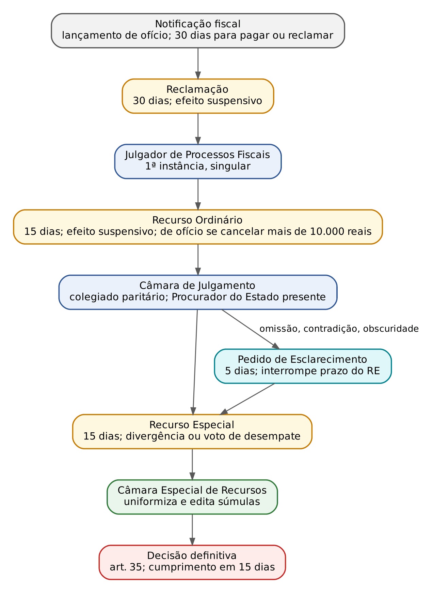
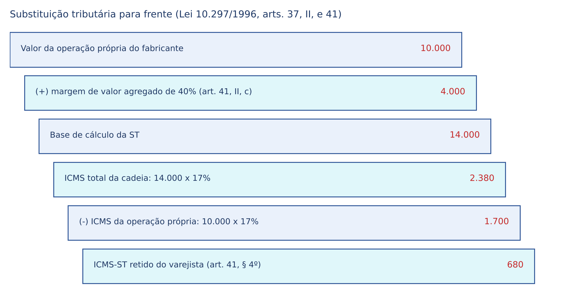
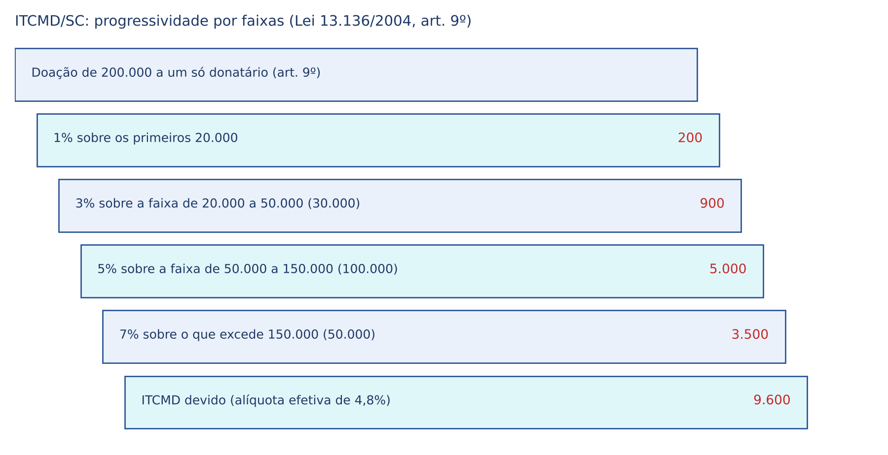

# CAPÍTULO 34 — LEGISLAÇÃO TRIBUTÁRIA DE SANTA CATARINA: LEI 3.938/1966, LC 465/2009 (TRIBUNAL ADMINISTRATIVO TRIBUTÁRIO), LEI 10.297/1996 (ICMS) E LEI 13.136/2004 (ITCMD), COM REMISSÃO AO PROCESSO ADMINISTRATIVO DO RIO GRANDE DO SUL

:::INCIDENCIA
TJSC p. 24. Nível B. Lote: FGV 1 (Q3049409, TAT/SC), FCC 0; correlatas: Q3324298 (FGV 2025, TJ-SC) e Q3956699 (FCC 2026, ITCMD com donatária em SC).
O que cai: contencioso no TAT (reclamação, efeito suspensivo, súmulas, desistência pela ação judicial), validade da lei estadual que repete o CTN e os números próprios de SC (alíquotas do ICMS e do ITCMD, prazos do TAT).
:::

## 34.1 Como a legislação catarinense se encaixa no sistema

Santa Catarina exerce competência tributária própria (ICMS, ITCMD e IPVA, art. 155 da CF) e organiza sua administração e seu processo administrativo. Mas o faz dentro de molduras nacionais: Constituição, CTN (normas gerais, art. 146, III, da CF; ver Cap. 1), LC 87/1996 (ICMS), LC 24/1975 (benefícios de ICMS) e resoluções do Senado. Daí a regra que resolve a maioria das questões: a lei estadual pode REPETIR a norma geral, mas não pode CONTRARIÁ-LA nem invadir matéria reservada a lei complementar nacional (decadência, prescrição, crédito tributário; SV 8, ver Cap. 15). A FGV cobrou exatamente isso: lei estadual que fixa em dois anos a prescrição da anulatória da decisão que nega restituição é válida, porque só reproduz o art. 169 do CTN (Q3324298, gabarito A; ver Cap. 16).

| Diploma | Objeto | Teoria em |
|---|---|---|
| Lei 3.938/1966 | normas gerais da legislação tributária estadual ("CTN estadual"), administração tributária, dívida ativa, certidões, consulta, DTEC | Caps. 8 a 19 |
| LC 465/2009 | Tribunal Administrativo Tributário e contencioso (revogou os arts. 172 a 207 da Lei 3.938) | Cap. 20 |
| Lei 10.297/1996 | ICMS | Cap. 27 |
| Lei 13.136/2004 | ITCMD | Cap. 30 |
| Lei 5.983/1981 (fora do edital) | juros, multa de mora, reduções de multa e parcelamento, aplicável ao ICMS (Lei 10.297, art. 100) e ao ITCMD (Lei 13.136, art. 16) | Cap. 11 |

## 34.2 Lei 3.938/1966: normas gerais da legislação tributária estadual

### 34.2.1 O que estudar

Editada dois meses após o CTN, a Lei 3.938 segue sua estrutura (legislação, obrigação, responsabilidade, crédito, administração, infrações) e copia boa parte de seus artigos: interpretação (arts. 11 a 16), responsabilidade e denúncia espontânea (arts. 31 a 41), lançamento (arts. 45 a 53), suspensão, extinção e exclusão (arts. 54 a 93), garantias e preferências (arts. 94 a 104). Esses trechos não precisam ser estudados de novo. Rendem questão os dispositivos que o CTN não tem.

:::PEGADINHA Texto estadual desatualizado em matéria de norma geral
A Lei 3.938 conserva redações antigas do CTN. O art. 85, parágrafo único, lista as causas de interrupção da prescrição da redação da LC 118/2005; a LC 236/2026 renumerou o parágrafo único do art. 174 do CTN para § 1º e acrescentou causas (incisos V a VII; ver 15.3.2). Como prescrição é matéria de lei complementar nacional, vale o CTN atualizado. O mesmo vale para a decadência (art. 84) e as causas de suspensão (art. 54, que não tem as novas hipóteses do art. 151 do CTN).
:::

### 34.2.2 Lançamento, norma antielisiva e crédito

- Norma antielisiva (art. 20-A): a autoridade pode desconsiderar atos praticados para dissimular o fato gerador (ideia do art. 116, parágrafo único, do CTN; ver Cap. 9), mas SC disciplinou o procedimento: só com fiscalização em curso, mediante representação ao Diretor de Administração Tributária (relatório, caracterização da simulação, provas), intimação do sujeito passivo para defesa em 30 dias e despacho fundamentado do Diretor anexado à Notificação Fiscal.
- Inscrição sumária (art. 53-A): o tributo declarado e não pago, inclusive o objeto de parcelamento descumprido, pode ser inscrito em dívida ativa sem notificação fiscal (lógica da Súmula 436 do STJ, ver Cap. 12).
- Parcelamento: será concedido na forma de lei específica, que também tratará do devedor em recuperação judicial (art. 58-A). A lei específica é a Lei 5.983/1981, art. 70: até 60 prestações para crédito exigido por notificação fiscal e até 12 nos demais casos, com a primeira paga no pedido.
- Imputação proporcional (art. 64-A): no pagamento a menor feito após o vencimento, o valor é imputado PROPORCIONALMENTE entre imposto, multa, juros e encargos (não confundir com a imputação entre débitos distintos, art. 65, cópia do art. 163 do CTN; ver Cap. 14).
- Restituição (arts. 73 a 80-A): decisão em até 30 dias do protocolo e pagamento em até 90 dias do deferimento (art. 73, §§ 2º e 3º); antes de restituir, a Fazenda compensa de ofício débitos exigíveis, inclusive parcelados sem garantia (art. 80-A). Os juros de 1% do art. 75, parágrafo único, cedem à Selic, porque SC cobra seus créditos pela Selic (Lei 5.983, art. 69; Súmula 523 do STJ e Tema 1.062 do STF, ver Caps. 11 e 16).
- Compensação: veda-se compensar tributo contestado judicialmente antes do trânsito (art. 81-A, cópia do art. 170-A do CTN) e admite-se limite mensal, por portaria, para compensar crédito reconhecido judicialmente, salvo se o crédito total for inferior a 1.000.000 (um milhão) de reais (art. 81-B).
- Recuperação judicial: sua concessão depende de prova de quitação, admitida a certidão positiva com efeito de negativa (art. 102-A, que remete aos arts. 54 e 154 a 157).

### 34.2.3 Administração tributária, dívida ativa e certidões

Espontaneidade. Até o 15º dia após o recebimento do termo de início de fiscalização, o sujeito passivo ainda pode pagar o tributo DECLARADO com os acréscimos do procedimento espontâneo (art. 111, § 3º). E as "ações auxiliares" de monitoramento (análise dos dados que o Fisco já tem) e de acompanhamento (com pedido de informações ou visita) NÃO iniciam procedimento fiscal: a regularização feita nessa fase só sofre multa de mora (art. 111-A, §§ 2º e 3º). Não confunda com a denúncia espontânea do art. 138 do CTN (Súmula 360 do STJ, ver Cap. 10): aqui é o próprio ente que, por lei, poupa a multa de ofício de quem se regulariza cedo.

Devedor contumaz (art. 111-B). É assim declarado o contribuinte de ICMS que deixar de recolher o imposto declarado em 8 períodos de apuração, sucessivos ou não, nos últimos 12 meses, ou que tiver dívida ativa acima de valor regulamentar. Sujeita-se a regime especial de fiscalização, perda de benefícios de ICMS e apuração por operação. Não contam os débitos suspensos ou garantidos em juízo nem os titulares de precatórios inadimplidos pelo Estado, até o valor do crédito, e a condição cessa com a extinção dos débitos. Não é sanção política vedada (Súmulas 70, 323 e 547 do STF, ver Cap. 5): as medidas não impedem a atividade, apenas reforçam o controle e retiram favores fiscais.

Sigilo (art. 113): cópia do art. 198 do CTN, acrescida da permissão de divulgar benefícios, renúncias e imunidades cujo beneficiário seja pessoa jurídica (§ 3º, IV).

Dívida ativa e cobrança. A SEF inscreve; esgotada a cobrança administrativa, a PGE gera a CDA e ajuíza (art. 134, §§ 3º e 4º). O parcelamento considera-se inadimplido com 3 parcelas em atraso, sucessivas ou não, ou 90 dias do vencimento da última (§ 6º). Emitida a CDA, o devedor é intimado a pagar em 10 dias; há autorização para protesto e para cobrança por instituição financeira (art. 138; ver Cap. 19). A CDA pode ser emendada ou substituída até a decisão de primeira instância (art. 135; ver Cap. 21). A execução corre no foro do domicílio do devedor (art. 142); o Procurador-Geral fixa o piso de ajuizamento, e a dívida abaixo dele é baixada após a prescrição (art. 142-A; ver Cap. 22). Sem licitante no segundo leilão, o Estado pode adjudicar por 85% da avaliação (art. 149).

Certidões. Expedição em 10 dias (art. 157) e validade da Certidão Negativa de Débitos Estaduais de 180 dias (art. 158, na redação da Lei 18.556/2022); a positiva com efeito de negativa segue o art. 206 do CTN (art. 155; ver Cap. 19).

### 34.2.4 Penalidades, notificação fiscal, consulta e intimações

- Penalidades (arts. 162 a 164): responsabilidade objetiva; a lei de cada tributo fixa as multas e, se omissa, a multa por falta de recolhimento é de uma vez o tributo (art. 163, § 2º).
- Notificação fiscal (arts. 165 e 166): é o instrumento do lançamento de ofício em SC (o auto de infração foi revogado). Indica os valores de tributo, multa, juros e atualização, o dispositivo legal e a intimação para pagar ou contestar em 30 dias.
- Consulta (arts. 209 a 213): formulada pelo sujeito passivo, por órgãos públicos ou por entidades de classe; suspende o prazo de pagamento do tributo até 30 dias após a ciência da resposta e impede, nesse período, fiscalização sobre a matéria; a resposta aproveita só ao consulente, salvo se publicada com efeitos normativos. Não se recebe consulta sobre lei em tese, fato definido como crime, matéria já decidida em contencioso do consulente, já consultada por ele ou objeto de notificação ou fiscalização em curso (teoria: Cap. 20).
- Domicílio Tributário Eletrônico do Contribuinte (art. 221-A): a intimação considera-se feita no dia da consulta eletrônica ou, sem consulta, ao fim de 10 dias do envio. Intimação por edital: 15 dias após a publicação (art. 225-A). Prazos contínuos, excluído o dia do início (art. 225).

:::SENTENCA Embargos à execução de crédito catarinense
Onde entra: preliminares e prejudiciais. Confira a intimação da notificação fiscal (pessoal, postal, DTEC com ciência tácita em 10 dias ou edital), porque dela correm os 30 dias para reclamar e, depois, a prescrição; se o crédito é declarado e não pago (art. 53-A, sem notificação); e os encargos (Selic e multa de mora de até 20%, Lei 5.983, arts. 69 e 69-A).
Redação-modelo: "Tratando-se de ICMS declarado e não pago, o crédito foi constituído pela própria declaração (Súmula 436 do STJ; art. 53-A da Lei estadual 3.938/1966), sendo dispensáveis a notificação fiscal e o processo administrativo prévio."
Erro comum: exigir processo administrativo para o tributo declarado, ou aplicar o texto estadual desatualizado sobre prescrição em vez do art. 174 do CTN vigente.
:::

## 34.3 LC 465/2009: o Tribunal Administrativo Tributário (TAT/SC)

A teoria do processo administrativo tributário e o PAF federal estão no Cap. 20. Aqui, a lei catarinense, que a FGV cobrou em 2024.

### 34.3.1 Natureza, competência e regras gerais

O TAT julga, em instância administrativa, os litígios tributários e não tributários decorrentes da legislação estadual (art. 1º, redação da LC 773/2021), inclusive os de contribuições previdenciárias estaduais e outros litígios pecuniários sem regime próprio (art. 53-A). É órgão VINCULADO à Secretaria da Fazenda (art. 52), sucessor do antigo Conselho Estadual de Contribuintes: não é tribunal judicial, e suas decisões não impedem o acesso ao Judiciário (art. 5º, XXXV, da CF). Três regras gerais caem com frequência:

- Constitucionalidade (art. 4º): os julgadores são INCOMPETENTES para declarar inconstitucionalidade ou ilegalidade de lei, decreto ou ato de Secretário; mas o TAT PODE apreciar a alegação quando houver entendimento "manso e pacífico" do STF ou do STJ (parágrafo único).
- Nulidades (art. 5º): só por incompetência ou preterição do direito de defesa; o comparecimento supre a falta de intimação; a nulidade só atinge os atos dependentes; os vícios devem ser sanados sempre que possível.
- Desistência (art. 7º): expressa ou tácita, e é esta a que cai.

:::LEI LC 465/2009 (SC), art. 7º
Art. 7º Opera-se a desistência total ou parcial do litígio na esfera administrativa:
I - expressamente, por pedido do sujeito passivo; ou
II - tacitamente:
a) pelo pagamento ou pedido de parcelamento do crédito tributário discutido, total ou parcialmente; ou
b) pela propositura de ação judicial relativa à matéria objeto do processo administrativo.
:::

É a regra da concomitância, igual à da LEF para a União (art. 38, parágrafo único, da Lei 6.830/1980; ver Cap. 13 e 20.5.4).

### 34.3.2 Estrutura e composição

| Órgão | Composição e regras |
|---|---|
| Primeira instância | Julgadores de Processos Fiscais, em decisão singular: Auditores Fiscais da Receita Estadual nível IV, até 12, admitidos *ad hoc* (arts. 2º e 9º) |
| Câmaras de Julgamento | 3 Câmaras paritárias, com 6 Conselheiros cada; sessões públicas, voto nominal e aberto, sob pena de nulidade (art. 10) |
| Conselheiros | 9 indicados em listas tríplices por federações empresariais e profissionais e 9 Auditores Fiscais; nomeação pelo Governador; mandato de 2 anos, com recondução (art. 13) |
| Câmara Especial de Recursos | 12 Conselheiros escolhidos entre os das Câmaras, com paridade, mandato de 1 ano (art. 30, § 1º); quórum de 10 e o Presidente (art. 10, parágrafo único) |
| Presidente e Vice | "equidistantes" da Fazenda e dos contribuintes, bacharéis em Direito, nomeados pelo Governador; o Presidente preside a 1ª Câmara e a Câmara Especial (art. 11) |
| Procurador do Estado | representa o Estado; presença INDISPENSÁVEL em toda sessão, sob pena de nulidade (arts. 16 a 18) |

### 34.3.3 O processo

Reclamação (art. 20). A fase contenciosa começa com a reclamação do sujeito passivo contra a notificação fiscal; antes dela há só procedimento. A reclamação é apresentada em 30 dias da ciência, tem efeito suspensivo (é a "reclamação" do art. 151, III, do CTN) e deve trazer toda a matéria e as provas, sob pena de preclusão, salvo impossibilidade, fato superveniente ou contraprova. Só o próprio sujeito passivo, seu representante ou advogado podem reclamar e recorrer (art. 19, § 1º). A reclamação perempta não impede a inscrição em dívida ativa, mas pode ser apreciada se presente hipótese do pedido de cancelamento do art. 22 (§ 2º).

Recursos (arts. 28 a 31):

| Recurso | Cabimento | Prazo e efeito | Detalhe cobrável |
|---|---|---|---|
| Ordinário | da decisão do Julgador singular para uma Câmara | 15 dias; suspensivo | de ofício obrigatório se a decisão cancelar mais de 10.000 (dez mil) reais; se o Julgador não recorrer, o TAT o tem "por havido" |
| Especial | da decisão de Câmara para a Câmara Especial | 15 dias; suspensivo | só por divergência com decisão transitada de outra Câmara ou da Câmara Especial, ou por decisão tomada com voto de desempate do Presidente da Câmara |
| Pedido de Esclarecimento | do acórdão de qualquer Câmara, ao redator | 5 dias; suspensivo | omissão, contradição ou obscuridade; INTERROMPE o prazo do Recurso Especial; não conhecido se protelatório |

No julgamento colegiado há parecer do Procurador em 15 dias, sustentação oral de 15 minutos e decisão por maioria com voto de desempate do Presidente da Câmara (art. 29, §§ 5º a 9º). Esse voto de desempate abre o Recurso Especial, limitado à matéria dos votos favoráveis ao recorrente (art. 30, § 3º); não há simetria com as regras federais do voto de qualidade no CARF (Lei 14.689/2023, ver Cap. 20).

Outras vias:

- Pedido de Cancelamento de Notificação Fiscal (arts. 22 a 24): proposto pelo Diretor de Administração Tributária ou pelo Procurador-Chefe da Procuradoria Fiscal quando a exigência for manifestamente indevida, o crédito for maior que o devido ou houver novo entendimento do STF ou do STJ; cabe até o trânsito em julgado da cobrança judicial; julgado em instância única pela Câmara Especial.
- Súmulas (art. 27): editadas pela Câmara Especial de Recursos com base em decisões reiteradas do TAT ou em jurisprudência consolidada do STF ou do STJ; aprovação por UNANIMIDADE; revisão inclusive por provocação do sujeito passivo; suspensão automática se a lei a que se referem mudar.
- Procedimento Administrativo de Revisão: extinto pela LC 465 (art. 25), voltou a ser previsto no art. 225-C da Lei 3.938: proposto ao Secretário da Fazenda em 90 dias contra decisão irrecorrível do TAT, nas hipóteses típicas de rescisão (violação literal de lei, prova falsa, documento novo, erro de fato, contrariedade à jurisprudência assente do STF ou do STJ); efeito só devolutivo, salvo concessão de efeito suspensivo.

Eficácia e prazos. São definitivas as decisões irrecorridas ou de que não caiba mais recurso, e a parte não recorrida nem sujeita a recurso de ofício (art. 35); cumprimento em 15 dias (art. 36). Intimação pela página do TAT ou por portal eletrônico, considerada feita na consulta ou, no máximo, 10 dias após o envio (arts. 45 e 46). Cada etapa deve ser decidida em 24 meses no recurso ordinário e em 18 meses nos demais casos; excedido o prazo, ficam SUSPENSOS os juros de mora e a atualização monetária pelo período excedente (art. 47, § 2º). Possível crime contra a ordem tributária é comunicado ao MP após o trânsito em julgado administrativo (art. 48; ver Cap. 11). Aplica-se subsidiariamente o CPC, e não há honorários (art. 49).

:::QUESTAO FGV 2024 — TJ-SC — Juiz Substituto (Q3049409)
Pergunta-se o que é correto sobre o contencioso perante o TAT/SC. Gabarito: D — a fase contenciosa começa com a reclamação contra a notificação fiscal, que suspende a exigibilidade (LC 465, art. 20, caput e § 1º; CTN, art. 151, III).
Armadilhas: (A) arrolamento prévio como requisito de recurso é inconstitucional (SV 21; hoje também art. 151, § 2º, do CTN, que veda caução ou garantia para impugnações e recursos, LC 236/2026; ver Cap. 13); (B) a ação judicial NÃO é indiferente: importa desistência tácita (art. 7º, II, b); (C) o TAT edita súmulas (art. 27); (E) não há "simetria" obrigatória com o CARF: processo administrativo é matéria de cada ente, e não direito processual da competência privativa da União (art. 22, I, da CF).
:::

### 34.3.4 Reflexos no processo judicial

:::PROCESSO O processo no TAT e a execução fiscal
- Pendente reclamação ou recurso, o crédito está suspenso: não corre prescrição, não há inscrição nem execução, e cabe certidão positiva com efeito de negativa.
- A prescrição corre da constituição definitiva: decisão definitiva do TAT ou fim do prazo de 30 dias sem reclamação (ver Cap. 15).
- Ação anulatória ou mandado de segurança durante o processo administrativo extinguem o litígio administrativo (art. 7º, II, b): a suspensão passa a depender de depósito ou de tutela judicial (ver Caps. 13 e 23).
- Não é necessário esgotar a via administrativa para ir a juízo.
:::

:::SENTENCA Demora do TAT e encargos da CDA (LC 465, art. 47, § 2º)
Onde entra: embargos à execução ou anulatória em que se impugnam os encargos. Fundamentar: excedidos 24 meses no recurso ordinário ou 18 meses nas demais etapas (contados da interposição, mais 90 dias se houve pedido de esclarecimento, descontadas as diligências pedidas pelo contribuinte), não fluem juros nem atualização pelo excesso; a regra vale para reclamações posteriores à LC 465 (§ 4º).
Redação-modelo: "Interposto o recurso ordinário em [data] e julgado em [data], excedido em [x] meses o prazo do art. 47, I, da LC estadual 465/2009, excluo da CDA os juros e a atualização do período excedente, prosseguindo a execução pelo saldo, apurável por cálculo aritmético."
Erro comum: anular toda a CDA por excesso destacável por cálculo (ver Cap. 21), ou recusar a regra estadual por "reserva de lei complementar": o Estado pode reduzir seus próprios encargos.
:::

### 34.3.5 Remissão ao Rio Grande do Sul

O processo administrativo gaúcho (Lei 6.537/1973, Tribunal Administrativo de Recursos Fiscais) é estudado no Cap. 20, com seus prazos e alçadas. A lógica é a mesma de SC e do PAF federal: a impugnação inaugura o litígio e suspende a exigibilidade; o órgão julgador é administrativo e não declara inconstitucionalidade de lei; a ação judicial sobre a mesma matéria implica desistência da via administrativa; e não se exige depósito ou arrolamento para recorrer.

## 34.4 Lei 10.297/1996: o ICMS de Santa Catarina

A teoria do ICMS está no Cap. 27. A Lei 10.297/1996 é a lei instituidora catarinense, alinhada à LC 87/1996; o detalhamento operacional fica no Regulamento do ICMS (RICMS/SC), aprovado por decreto. Estuda-se aqui o que ela tem de próprio.

### 34.4.1 Ficha do ICMS catarinense

| Elemento | Lei 10.297/1996 |
|---|---|
| Fato gerador (art. 2º) | operações com mercadorias, inclusive alimentação e bebidas em bares e restaurantes; transporte interestadual e intermunicipal; comunicação; DIFAL; importação; e bens digitais (software, jogos, aplicativos) quando houver transferência de titularidade e não se tratar de serviço municipal (inciso VIII e § 2º) |
| Transferências entre estabelecimentos (art. 4º, §§ 5º e 6º) | não há fato gerador, mantido o crédito; o contribuinte pode optar, anual e irretratavelmente, por equiparar a transferência a operação tributada (arts. 31-A a 31-E; ADC 49 e LC 204/2023, ver Cap. 27) |
| Não incidência (art. 7º) | livros e papel; exportação (equiparada a saída a *trading* e armazém alfandegado); energia e petróleo interestaduais para industrialização ou comercialização; ouro ativo financeiro; transferência de estabelecimento; alienação fiduciária; *leasing*; salvados; recicláveis de cooperativas. O inciso XI (TUSD, TUST e encargos setoriais) está com eficácia suspensa, segundo nota da SEF/SC, em razão da liminar na ADI 7.195 (v. 27.11.2) |
| Contribuinte e responsáveis (arts. 8º e 9º) | habitualidade ou intuito comercial; importador; no DIFAL, o destinatário contribuinte ou, se não contribuinte, o remetente; solidários, entre outros, quem concorre para o não recolhimento, quem fornece software que adultera registros e o intermediador de plataforma que não presta informações |
| Base de cálculo (arts. 10 a 18) | valor da operação, com o imposto "por dentro" (art. 11, I); arbitramento quando os documentos não merecem fé, com avaliação contraditória; a pauta fiscal só serve a esse arbitramento (art. 18, § 3º; Súmula 431 do STJ, ver Cap. 27) |
| Apuração (arts. 32 a 36) | mensal, por estabelecimento, débitos menos créditos; hipóteses de apuração por operação e por estimativa |

### 34.4.2 Alíquotas

| Alíquota | Hipóteses |
|---|---|
| 17% (art. 19, I) | regra geral |
| 25% (art. 19, II, b) | supérfluos da Seção I do Anexo I: cervejas e chope, demais bebidas alcoólicas, fumo, perfumes e cosméticos, peleteria, asas-delta, balões e dirigíveis, armas e munições |
| 12% (art. 19, III) | energia residencial até 150 kWh e rural até 500 kWh mensais; transporte rodoviário, ferroviário e aquaviário de passageiros; consumo popular (Seção II: carnes, arroz, feijão, leite, pão, café e outros); produtos primários (Seção III); veículos da Seção IV; óleo diesel; coque; louças sanitárias, cerâmica e blocos de concreto; cesta básica da construção; mercadorias destinadas a contribuinte (alínea n); alimentação em bares e restaurantes, sem bebidas (alínea o) |
| Interestaduais (art. 20) | 12% para MG, PR, RJ, RS e SP; 7% para os demais e o DF (inclusive ES); 4% para importados não industrializados ou com conteúdo de importação acima de 40%, com exceções |

Pontos cobráveis:

- As alíneas a, c e d do inciso II foram revogadas: energia, combustíveis e comunicações saíram dos 25%, em consonância com a essencialidade (LC 194/2022 e Tema 745 do STF, ver Cap. 27).
- A alínea n não se aplica a mercadorias de 25%, a bens de uso, consumo ou ativo do destinatário, a mercadorias usadas em serviços do ISS, a certos têxteis e couros do próprio fabricante nem a energia, gasolina e álcool (§ 3º); se o destinatário der à mercadoria uma dessas destinações, responde SOLIDARIAMENTE pela diferença até 17% (§ 4º).
- O Executivo pode reduzir temporariamente os 25% para até 17%, limitado ao exercício e considerando os demais Estados do Sul (§ 1º).

:::EXEMPLO Qual a alíquota?
A Distribuidora Blumenau vende em SC: arroz a um supermercado (12%, consumo popular); vinho a um restaurante (25%: a alínea n não alcança supérfluos); papel a uma papelaria para revenda (12%, alínea n); impressora a um escritório para uso próprio (17%). Se a papelaria consumir o papel em vez de revendê-lo, responde solidariamente pelos 5 pontos de diferença (§ 4º).
:::

### 34.4.3 Créditos, substituição tributária e antecipação

Créditos (arts. 21 a 31-E):

- o texto admite crédito de uso e consumo (art. 22), mas prevalece o adiamento da LC 87/1996, art. 33, I (ver Cap. 27);
- ativo permanente: 1/48 por mês, proporcional às saídas tributadas, com cancelamento do saldo ao fim de 48 meses (art. 22, § 1º);
- o direito de usar o crédito extingue-se em 5 anos da EMISSÃO do documento (art. 25); documento inidôneo faz prova só a favor do Fisco (art. 94; adquirente de boa-fé, Súmula 509 do STJ, ver Cap. 27);
- é vedado o crédito ligado a saída isenta ou não tributada (salvo exportação) e o crédito concedido por outro Estado sem convênio (arts. 28 e 29; ver Cap. 17);
- exportadores podem transferir saldos credores acumulados a estabelecimento próprio e, havendo saldo, a outros contribuintes catarinenses (art. 31).

Substituição tributária (arts. 37 a 41; conceitos no Cap. 10):

| Modalidade | Substituto |
|---|---|
| Para trás (diferimento, art. 37, I) | o destinatário, pelas operações anteriores (ex.: produtor que remete a cooperativa, produto agropecuário para estabelecimento em SC) |
| Para frente (art. 37, II) | industrial, importador, atacadista ou distribuidor, pelas saídas subsequentes das mercadorias da Seção V do Anexo I, implantada mercadoria a mercadoria por decreto |
| Concomitante (art. 37, III) | contratante, remetente ou terceiro, nos serviços de transporte e comunicação |

Na ST interestadual exige-se acordo entre os Estados (art. 38); recebida mercadoria sujeita à ST sem retenção na origem, o destinatário catarinense responde pelas operações seguintes (art. 37, § 8º). A base da ST para frente soma operação própria, frete e encargos e margem de valor agregado (MVA) apurada por pesquisa em pelo menos 10 Municípios, ouvido o setor; ou preço fixado por órgão público ou sugerido pelo fabricante; o imposto retido é a diferença entre o ICMS sobre essa base e o da operação própria (art. 41). Se o fato gerador presumido não ocorre, há restituição; sem decisão em 90 dias, o substituído pode creditar-se (art. 40, §§ 1º e 2º); se ocorre por valor diverso, restitui-se a diferença a menor ou recolhe-se a diferença a maior (§ 3º; Tema 201 do STF, ver Cap. 27).

:::EXEMPLO ICMS-ST com números redondos
A Indústria de Bebidas Joinville vende refrigerantes a um varejista por 10.000 (dez mil) reais. Supondo 17% nas duas etapas e MVA de 40%, a base da ST é 14.000 (catorze mil) reais e a indústria retém 680 (seiscentos e oitenta) reais (figura). Se o varejista vender por 13.000 (treze mil) reais, o imposto efetivo da cadeia seria 2.210 (dois mil, duzentos e dez) reais: restituição de 170 (cento e setenta) reais (art. 40, § 3º, I). Se vender por 15.000 (quinze mil) reais, complementa 170 (cento e setenta) reais (§ 3º, II).
:::

Antecipação. O regulamento pode exigir o imposto na entrada de mercadorias vindas de outro Estado, inclusive a parcela de benefício concedido na origem sem convênio (art. 36, §§ 3º e 4º). Do optante do Simples Nacional que compra para revenda ou industrialização cobra-se na entrada a diferença entre 12% e a alíquota interestadual, SOMENTE nas operações a 4%, sem encerrar a tributação e sem gerar crédito (§ 6º; ver Cap. 31).

### 34.4.4 Benefícios, presunções e penalidades

Benefícios. Dependem de convênio do CONFAZ (art. 42) e, peculiaridade catarinense, só produzem efeitos depois de INTERNALIZADOS POR LEI estadual (art. 99-A, com lista no Anexo II). O Executivo pode adotar medidas de proteção contra benefícios unilaterais de outros Estados (art. 43), e os benefícios só valem para operações regularmente escrituradas (art. 43-A). Guerra fiscal: Cap. 17.

Presunções de omissão de receitas (art. 49): suprimento de caixa sem origem, saldo credor de caixa, passivo fictício, diferenças de estoque e, nas hipóteses recentes, valores informados por instituições de pagamento e plataformas acima das saídas registradas e recebimentos por meio de pagamento em nome de terceiro (incisos XIV e XV). São presunções RELATIVAS (§ 1º), e a receita omitida é tributada a 17%, salvo proporção de operações declaradas (art. 19, § 7º).

Penalidades:

| Infração | Multa |
|---|---|
| Não recolher imposto apurado pelo próprio sujeito passivo, por estimativa ou na entrada (art. 51) | 50% do imposto |
| Não submeter operação tributável ao imposto (art. 52) | 75% |
| Idem, sem documento fiscal ou com documento fraudado (art. 52, § 1º) | 100% |
| Reincidência em 5 anos (art. 97) | + 50%, EXCETO nas multas proporcionais (§ 2º) |

Encargos e reduções (Lei 5.983/1981): juros pela Selic do mês seguinte ao vencimento até o anterior ao pagamento, mais 1% no mês do pagamento (art. 69); multa de mora de 0,3% ao dia, até 20%, antes de procedimento fiscal (art. 69-A); redução da multa de ofício de 50% se paga em 30 dias da notificação (art. 68) ou de 70% se paga no prazo de defesa prévia, inclusive em até 24 parcelas com desconto decrescente, sem cumulação e sem ficar abaixo da multa de mora, inaplicável à reincidência, ao flagrante no trânsito e ao imposto declarado (art. 68-A). Os limites das multas (art. 113-A do CTN, LC 236/2026; Temas 736 e 863 do STF) estão no Cap. 11.

:::SENTENCA ICMS/SC em embargos ou anulatória
Roteiro: (1) confira a alíquota pelo art. 19 e suas exceções; (2) nas glosas de crédito, verifique a idoneidade do documento e a prova da operação; (3) na multa, verifique o enquadramento (art. 51, 52 ou 52, § 1º) e os limites do Cap. 11.
Redação-modelo: "As operações estavam acobertadas por notas fiscais regularmente emitidas, sem qualquer das hipóteses qualificadoras do art. 52, § 1º, da Lei estadual 10.297/1996; a multa de 100% deve ser reenquadrada no caput do art. 52 (75%), mantida a exigência quanto ao mais."
Erro comum: afastar integralmente a multa quando o vício é só de enquadramento, ou admitir pauta fiscal fora do arbitramento.
:::

## 34.5 Lei 13.136/2004: o ITCMD de Santa Catarina

A teoria do ITCMD está no Cap. 30 (competência e elemento no exterior em 30.3; base e alíquotas em 30.4; inventário em 30.5; quadro da lei catarinense à luz da LC 227 em 30.6). Aqui, a lei catarinense.

### 34.5.1 Ficha do ITCMD catarinense

| Elemento | Lei 13.136/2004 |
|---|---|
| Fato gerador (art. 2º) | transmissão *causa mortis* ou doação de imóveis, direitos reais e móveis; doação é "qualquer ato ou fato, não oneroso, que importe ou se resolva em transmissão" (§ 1º); há TANTOS fatos geradores quantos forem os herdeiros, legatários ou donatários (§ 2º) |
| Incidências específicas (art. 2º, §§ 3º e 4º) | sucessão provisória, com restituição se o ausente aparecer (em linha com a Súmula 331 do STF; v. 30.5); partilha em vida (art. 2.018 do CC); excesso de meação ou de quinhão na partilha |
| Não incidência (art. 3º, parágrafo único) | frutos e rendimentos posteriores ao óbito |
| Contribuinte (art. 5º) | herdeiro, legatário, fiduciário ou fideicomissário; donatário ou cessionário; beneficiário do direito real na instituição; nu-proprietário na extinção |
| Responsáveis solidários (art. 6º) | doador, se o donatário não for domiciliado em SC; escrivão do inventário ou divórcio; tabelião e registrador; servidores do DETRAN/SC e da JUCESC que transferirem bens sem prova do pagamento |
| Base de cálculo (arts. 7º e 12-A) | valor venal na data em que as informações são apresentadas ao Fisco; 50% na instituição e extinção de direito real e na nua-propriedade; bens financiados ou de consórcio: prestações pagas (critério que o Cap. 30, 30.6, dá por superado pelo art. 153 da LC 227/2026); nunca abaixo dos valores do formal de partilha ou da escritura |
| Lançamento (art. 8º) | por HOMOLOGAÇÃO: o sujeito passivo calcula e antecipa o pagamento; base inferior gera cobrança da diferença |
| Parcelamento (art. 11) | até 48 prestações |

### 34.5.2 Competência: imóveis, móveis e exterior

O art. 3º acompanha o art. 155, § 1º, I e II, da CF: imóveis situados em SC; móveis, títulos e créditos, quando o *de cujus* ou o doador forem domiciliados em SC (a redação do inciso II dada pela EC 132/2023 e sua aplicação às sucessões abertas após a publicação estão em 30.3.1).

O ponto próprio de SC é o elemento no exterior. As alíneas c, d e e do art. 3º, II, incluídas pela Lei 14.967/2009 sem a lei complementar do art. 155, § 1º, III, foram declaradas formalmente inconstitucionais na ADI 6.823, com a modulação do Tema 825 (nota da SEF/SC; v. 30.3.2). A competência com elemento estrangeiro seguiu a regra transitória do art. 16 da EC 132 (30.3.3) e hoje segue os arts. 158 e 159 da LC 227/2026 (30.3.4); mas a cobrança por SC depende de lei estadual NOVA, editada depois da EC 132, porque a lei antiga não se convalida (ADI 6.838), e essa lei não foi localizada na compilação consultada (30.6).

:::QUESTAO FCC 2026 — SEFAZ-SP — Auditor Fiscal (Q3956699), correlata
Caso: Heitor, domiciliado em Campo Grande/MS, deixa depósitos em Nova Iorque aos filhos Celso (Campina Grande/PB) e Sônia (Atenas); Sônia renuncia em favor da mãe, Maria, domiciliada em Blumenau/SC (renúncia translativa). Gabarito: D — Santa Catarina pode exigir o ITCMD da transmissão decorrente da renúncia translativa.
Fundamento: a renúncia translativa equivale a doação de Sônia a Maria; doadora no exterior, donatária em SC: Estado do domicílio da donatária (EC 132, art. 16, II, a; mesma solução hoje no art. 159 da LC 227). Armadilhas: a transmissão *causa mortis* dos quinhões cabe a Mato Grosso do Sul, domicílio do falecido (art. 16, III), e não à Paraíba (E) nem a SC (B); "nenhum Estado" (A e C) ignora a regra transitória. A questão mede só a competência constitucional; a cobrança efetiva por SC depende de lei estadual nova (acima; 30.3).
:::

### 34.5.3 Alíquotas progressivas e isenções

A EC 132 tornou obrigatória a progressividade do ITCMD (art. 155, § 1º, VI, da CF); SC já a adotava, observado o teto do Senado. A técnica é a das FAIXAS: cada alíquota incide só sobre a parcela da base dentro da sua faixa.

| Parcela da base | Alíquota (art. 9º) |
|---|---|
| até 20.000 (vinte mil) reais | 1% |
| de 20.000 a 50.000 (cinquenta mil) reais | 3% |
| de 50.000 a 150.000 (cento e cinquenta mil) reais | 5% |
| acima de 150.000 (cento e cinquenta mil) reais | 7% |

Doações sucessivas entre as mesmas partes em 12 meses são somadas, recalculando-se o imposto sobre o total e deduzindo-se o já pago (art. 9º, parágrafo único). E, como há um fato gerador por herdeiro, a progressividade se aplica a cada quinhão, não ao monte.

:::EXEMPLO Herança de 200.000 reais para dois filhos
Joana, domiciliada em Chapecó, deixa bens móveis de 200.000 (duzentos mil) reais aos filhos Ana e Bruno, em partes iguais. São dois fatos geradores de 100.000 (cem mil) reais: para cada filho, 200 + 900 + 2.500 = 3.600 (três mil e seiscentos) reais; total de 7.200 (sete mil e duzentos) reais. Se o monte fosse um só fato gerador, o imposto seria 9.600 (nove mil e seiscentos) reais (figura). Comece sempre por "quantos fatos geradores há?".
:::

Isenções (art. 10), interpretadas literalmente (CTN, art. 111): prêmio do testamenteiro até a vintena; seguro de vida, pecúlio e verbas trabalhistas e previdenciárias não recebidas em vida; herdeiro aquinhoado com um único imóvel, na transmissão *causa mortis*, se próprio para moradia, sem outro imóvel e de valor até 200.000 (duzentos mil) reais (inciso III, redação da Lei 18.831/2025; para doações de imóveis, a isenção anterior vigorou até 31/12/2024); quem receber até 20.000 (vinte mil) reais, somadas as doações de 12 meses (inciso IV); sociedades sem fins lucrativos de utilidade pública estadual como donatárias; doações para programas oficiais de moradia, assentamento e regularização fundiária de famílias de baixa renda; e herdeiro ou donatário com deficiência incapaz de prover a própria subsistência. A imunidade do art. 155, § 1º, VII, da CF (instituições sem fins lucrativos de relevância pública e social) é mais ampla e depende de lei complementar (ver Cap. 30).

:::PEGADINHA Isenção até 20.000 reais não é faixa isenta
A isenção do inciso IV é limite de VALOR TOTAL recebido: quem recebe 20.000 reais nada paga; quem recebe 20.001 reais paga sobre tudo, começando por 1% sobre os primeiros 20.000.
:::

### 34.5.4 Obrigações do inventário e multas

Dependem da prova do pagamento, do parcelamento ou do reconhecimento da imunidade ou isenção (art. 12): escrituras de inventário, partilha, divórcio e doação; registro de formais, adjudicações, legados e direitos reais; atos notariais e registrais de transmissão; transferência de veículo no DETRAN; e arquivamento na JUCESC de atos com transmissão não onerosa. No parcelamento, o registro exige quitação ou garantia (hipoteca extrajudicial, fiança bancária ou seguro-garantia). Carta precatória de outro Estado para avaliar bens não é devolvida sem manifestação da Fazenda e pagamento do imposto (art. 15).

| Infração (art. 13) | Multa |
|---|---|
| Não abrir o inventário ou partilha no prazo legal | 20% do imposto |
| Praticar ato sujeito ao imposto sem comprovar o pagamento | 50% |
| Descumprir obrigação acessória | 100 (cem) reais |
| Omitir bens, direitos, títulos ou créditos da tributação | 75% do imposto omitido |

O pagamento em atraso sofre juros pela Selic e multa de mora de até 20% antes de procedimento fiscal, ou multa de 50% havendo notificação fiscal (art. 14). A multa estadual pela demora no início ou na ultimação do inventário não é inconstitucional (Súmula 542 do STF).

:::SENTENCA ITCMD no inventário ou arrolamento em SC
Fundamentar: (1) lançamento por homologação (art. 8º): o inventariante informa a SEF, que pode exigir diferença; (2) um fato gerador por herdeiro e alíquotas por faixas (arts. 2º, § 2º, e 9º); (3) excesso de meação ou de quinhão é tributável (art. 2º, § 4º; art. 7º, §§ 4º e 5º); (4) no arrolamento sumário, observe o Tema 1.074 do STJ (ver Cap. 30); de todo modo, o registro do formal depende da prova de pagamento, parcelamento garantido ou isenção (art. 12).
Redação-modelo: "Homologo a partilha. A expedição do formal fica condicionada à comprovação do recolhimento do ITCMD ou do reconhecimento de isenção pela Secretaria de Estado da Fazenda (art. 12, II, c, da Lei estadual 13.136/2004), intimando-se a Fazenda para eventual lançamento de diferenças."
Erro comum: calcular sobre o monte-mor, como se houvesse um só fato gerador, ou aplicar a alíquota máxima a todo o quinhão em vez de calcular por faixas.
:::

## 34.6 Resumo para revisão pré-prova

| Instituto | Regra | Exceções e detalhes | Fundamento |
|---|---|---|---|
| Lei estadual x CTN | pode repetir a norma geral, não contrariá-la | texto estadual desatualizado cede ao CTN vigente | CF, art. 146, III; Q3324298 |
| Norma antielisiva | desconsideração com fiscalização em curso | representação ao Diretor; defesa em 30 dias | Lei 3.938, art. 20-A |
| Declarado e não pago | inscrição sumária | inclui parcelamento descumprido | Lei 3.938, art. 53-A |
| Espontaneidade | ações auxiliares não iniciam fiscalização | 15 dias após o termo de início para pagar o declarado | Lei 3.938, arts. 111, § 3º, e 111-A |
| Devedor contumaz | 8 períodos sem recolher em 12 meses ou dívida ativa elevada | regime especial, perda de benefícios; não conta débito suspenso ou garantido | Lei 3.938, art. 111-B |
| Restituição e compensação | decisão em 30 dias, pagamento em 90; compensação de ofício | limite mensal para crédito judicial, salvo abaixo de 1.000.000 reais | Lei 3.938, arts. 73, 80-A e 81-B |
| Dívida ativa e certidões | CDA pela PGE; protesto; foro do domicílio | CND por 180 dias; adjudicação por 85% | Lei 3.938, arts. 134 a 158 |
| Consulta | suspende prazo de pagamento e impede fiscalização | não cabe em tese, crime ou matéria autuada | Lei 3.938, arts. 209 a 213 |
| TAT | órgão vinculado à SEF; não declara inconstitucionalidade | salvo entendimento pacífico do STF ou do STJ | LC 465, arts. 4º e 52 |
| Estrutura | julgadores singulares; 3 Câmaras paritárias de 6; Câmara Especial de 12 | Procurador do Estado obrigatório na sessão | LC 465, arts. 9º a 18 e 30 |
| Reclamação | inicia o contencioso; 30 dias; suspensiva | preclusão de provas, com exceções | LC 465, art. 20 |
| Desistência | expressa ou tácita (pagamento, parcelamento, ação judicial) | arquivamento de ofício | LC 465, art. 7º |
| Recursos | Ordinário e Especial (15 dias), Esclarecimento (5 dias), suspensivos | de ofício acima de 10.000 reais; RE por divergência ou desempate | LC 465, arts. 28 a 31 |
| Súmulas | Câmara Especial, por unanimidade | suspensas se a lei mudar | LC 465, art. 27 |
| Demora no julgamento | 24 meses (RO) ou 18 meses | excesso suspende juros e atualização | LC 465, art. 47 |
| Revisão | ao Secretário, 90 dias | efeito só devolutivo, salvo concessão | Lei 3.938, art. 225-C |
| ICMS: alíquotas | 17% geral; 25% supérfluos; 12% casos listados | 12% a contribuinte, com exceções e solidariedade | Lei 10.297, art. 19 |
| ICMS: interestaduais | 12% (MG, PR, RJ, RS, SP); 7% (demais); 4% importados | exceções ao 4% | Lei 10.297, art. 20 |
| ICMS: créditos | ativo em 1/48; uso em 5 anos da emissão | vedado crédito de benefício sem convênio | Lei 10.297, arts. 22, 25 e 29 |
| ICMS: ST | para trás, para frente (por decreto), concomitante | restituição ou complementação da diferença | Lei 10.297, arts. 37 a 41 |
| ICMS: benefícios | convênio e internalização por lei | proteção contra guerra fiscal | Lei 10.297, arts. 42, 43 e 99-A |
| ICMS: multas | 50%, 75% e 100% | reincidência + 50%, salvo proporcionais; reduções de 50% ou 70% | Lei 10.297, arts. 51, 52 e 97; Lei 5.983, arts. 68 e 68-A |
| Encargos | Selic + 1% no mês do pagamento; mora até 20% | repetição pelo mesmo índice | Lei 5.983, arts. 69 e 69-A |
| ITCMD: competência | imóveis em SC; móveis se *de cujus* ou doador em SC | exterior: ADI 6.823; LC 227, arts. 158 e 159; cobrança exige lei estadual nova | Lei 13.136, art. 3º |
| ITCMD: cálculo | um fato gerador por herdeiro; 1%, 3%, 5%, 7% por faixas | soma de doações em 12 meses | Lei 13.136, arts. 2º e 9º |
| ITCMD: isenções | até 20.000 reais; imóvel único de até 200.000 na sucessão | interpretação literal | Lei 13.136, art. 10 |
| ITCMD: atos e multas | registros dependem da prova de pagamento | 20%, 50% e 75% | Lei 13.136, arts. 12 e 13 |

## 34.7 Artigos de lei incidentes

- CF: arts. 146, III; 155, § 1º, II, III, VI e VII. EC 132/2023: arts. 16 e 17. LC 227/2026: arts. 158 e 159. CTN: arts. 151, III, 169 e 174. Lei 6.830/1980: art. 38, parágrafo único.
- Lei 3.938/1966 (SC): arts. 20-A, 53-A, 58-A, 64-A, 73, 75, 80-A, 81-A, 81-B, 84, 85, 102-A, 111, 111-A, 111-B, 113, 134, 135, 138, 142, 142-A, 149, 155, 157, 158, 163, 165, 166, 209 a 213, 221-A, 225, 225-A e 225-C.
- LC 465/2009 (SC): arts. 1º, 4º, 5º, 7º, 9º a 13, 16 a 22, 25, 27 a 31, 35, 36, 45 a 49, 52 e 53-A.
- Lei 10.297/1996 (SC): arts. 2º, 4º, 7º a 11, 18 a 31-E, 36, 37 a 43-A, 49, 51, 52, 94, 97, 99-A e 100; Anexo I.
- Lei 13.136/2004 (SC): arts. 2º, 3º, 5º a 15.
- Lei 5.983/1981 (SC): arts. 68, 68-A, 69, 69-A e 70.

## 34.8 Julgados, temas e súmulas do capítulo

- Súmula 542 do STF: multa estadual pelo atraso no inventário é constitucional.
- Remissões: ADI 7.195 (27.11.2); ADI 6.823, Tema 825 e ADI 6.838 (30.3.2 a 30.3.4); Súmula 331 do STF (30.5); SV 8 (Cap. 15); Súmula 436 do STJ (Cap. 12); Súmula 360 do STJ (Cap. 10); SV 21 (Cap. 13); Súmula 523 do STJ, Tema 1.062 e Temas 736 e 863 do STF (Cap. 11); Súmulas 70, 323 e 547 do STF (Cap. 5); Súmulas 431 e 509 do STJ, ADC 49, Temas 201 e 745 do STF (Cap. 27); Tema 1.074 do STJ (Cap. 30); CARF e PAF do RS (Cap. 20); Q3324298 e art. 169 do CTN (Cap. 16).

:::NOTA Notas de verificação
- Conferidos nos textos compilados da SEF/SC (lidos em 22/10/2026): LC 465/2009 integral; Lei 13.136/2004 integral (compilação de 13/1/2025); Lei 10.297/1996, arts. 1º a 52, 74 a 100-B e Anexo I (compilação atual); Lei 3.938/1966 integral (compilação de 6/9/2024); Lei 5.983/1981, arts. 68 a 70. EC 132/2023 (arts. 1º, 16 e 17) conferida no Planalto. Alterações estaduais posteriores às datas das compilações não foram verificadas.
- Lei 3.938: os arts. 67 a 71 (parcelamento em 10 a 15 prestações) convivem no texto com o art. 70 da Lei 5.983 (60 prestações); não se confirmou o regime aplicado. O art. 225-C fala em "Câmaras Reunidas", denominação ausente da LC 465; a lei que o incluiu não foi identificada.
- ADIs 6.823 e 7.195: conteúdo tirado das notas oficiais da SEF/SC; ementas não lidas no STF (desenvolvimento nos Caps. 27 e 30). Superação do critério das prestações pagas pelo art. 153 da LC 227: afirmação do Cap. 30, não conferida nesta revisão.
- CTN conferido no Planalto em 22/10/2026 (arts. 151, incisos e § 2º, 169 e 174, § 1º, na redação da LC 236/2026; arts. 116, 163, 170-A, 198 e 206 sem alteração por LC de 2026).
- Súmulas do TAT: repositório não acessado; nenhuma súmula específica citada.
- Multa por atraso no inventário: Súmula 542 do STF, número e objeto confirmados por busca (juris.damasio.com.br), texto parafraseado. Teto do ITCMD pelo Senado e número do decreto do RICMS/SC: não citados por falta de conferência.
- Drive: lido o Mapeamento FGV. Não lidos Sinopse TJSC 2026, Dizer o Direito, compilado TRF6 e Ricardo Alexandre; jurisprudência do TJSC sobre essas leis não pesquisada.
- Sobreposição: os Caps. 20 (20.10, TAT), 27 (27.14, Lei 10.297) e 30 (30.6, Lei 13.136) também trazem quadros da legislação catarinense; a decisão sobre o titular fica para a revisão geral.
:::
